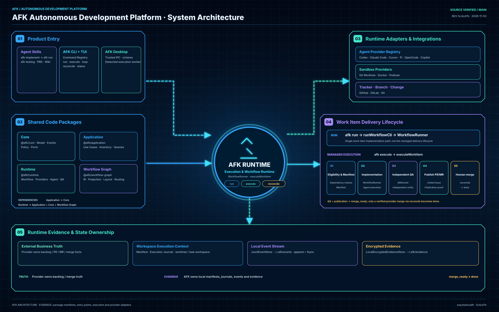

# AFK

**AFK = Away From Keyboard** — an autonomous development execution platform for provider-backed work items.

AFK connects issue trackers, code repositories, and coding-agent runtimes. It takes already-decomposed work items through isolated implementation, independent verification, and a human-controlled merge gate.

[中文说明](README.zh.md)

## Architecture



AFK is a pnpm workspace with two product entry points — the **CLI/TUI** and **AFK Control Desktop** — sharing the same Core, Application, and Runtime packages. The Runtime composes provider adapters, agent providers, sandbox providers, workflow execution, QA, and local evidence storage.

The diagram reflects the current implementation:

| Area | Responsibility |
| --- | --- |
| `@afk/core` | Pure work-item and execution models, events, reducers, policies, and ports |
| `@afk/application` | Shared use cases, inventory, execution queries, and observation contracts |
| `@afk/runtime` | Workflow orchestration, provider adapters, agent execution, sandboxing, QA, sessions, and persistence |
| `@afk/workflow-graph` | Workflow graph IR, projection, layout, routing, and validation |
| CLI / Desktop | Separate user interfaces over shared packages; Desktop uses typed IPC and a detached Runtime worker |
| Skills | Agent-side playbooks and knowledge workflows; the Wiki skill has its own Python CLI |

AFK consumes work items that have already been decomposed and carry acceptance criteria and relationships. Planning and decomposition remain upstream. The issue tracker remains the authority for backlog state; local inventory and execution records support operation, audit, and observation.

## Features

- **Cross-platform backlog and change management** — GitHub and GitLab providers behind stable contracts
- **CLI + TUI** — command-line operations, interactive dashboard, Kanban, and run observation
- **Desktop control app** — backlog, work items, execution history, workflow views, and operational controls
- **Multi-agent runtime** — Claude Code, Codex, Cursor, OpenCode, Pi, and GitHub Copilot adapters
- **Composable execution environments** — local, Docker, and Podman sandboxes with Git worktrees and process control
- **Independent QA and auditability** — separate verification, execution journals, append-only events, and evidence
- **Skills suite** — reusable research, PRD, implementation, testing, QA, and engineering workflows

## Quick Start

```bash
git clone https://github.com/easyhaloo/afk.git
cd afk
pnpm install
pnpm build
pnpm --dir apps/cli link --global
afk --version
```

See [Getting Started Guide](docs/getting-started.md) for detailed setup.

## Install Claude Code Plugin (Optional)

AFK provides a skill suite that can be installed as a Claude Code plugin.

### Method 1: In Claude Code Session (Recommended)

```bash
/plugin install afk@afk
```

### Method 2: Using CLI

```bash
# Add marketplace
claude plugin marketplace add easyhaloo/afk --scope user

# Install plugin
claude plugin install afk@afk
```

### Method 3: settings.json Configuration

Add to Claude Code's `settings.json` (global or project-level `.claude/settings.json`):

```json
{
  "extraKnownMarketplaces": {
    "afk": {
      "source": {
        "source": "github",
        "repo": "easyhaloo/afk"
      }
    }
  }
}
```

Supported `source` types:
- `"github"` — Load from GitHub repository
- `"local"` — Load from local filesystem

### Method 4: Symlink Skills

Link the `skills/` directory to the global skills directory:

```bash
mkdir -p ~/.claude/skills
ln -s /path/to/afk/skills/* ~/.claude/skills/
```

### Verify Installation

Run `/afk-grill-me` in Claude Code to confirm skills are loaded.

## Install on OpenCode 2.x

AFK also ships as an OpenCode 2.x package. OpenCode treats **plugins** and
**skills** as two separate mechanisms, so there are two parts: the plugin entry
(optional) and skill discovery (this is what gives you the AFK workflows).

### 1. Add the plugin (optional)

The plugin entry is a thin loader — AFK's substance is its skills, which
OpenCode discovers separately (step 2). Register the plugin from npm, a git
spec, or a local checkout:

```bash
# npm package
opencode plugin add afk

# git
opencode plugin add github:easyhaloo/afk
```

Or reference it in `opencode.json(c)` (`~/.config/opencode/opencode.jsonc` for
global, or a project-level one). Relative paths resolve from the config file:

```jsonc
{
  "$schema": "https://opencode.ai/config.json",
  "plugins": [
    "afk",                          // npm
    "github:easyhaloo/afk",         // git
    "/path/to/afk"                  // local checkout (directory)
  ]
}
```

### 2. Make the skills discoverable

OpenCode does not auto-load `SKILL.md` files from inside an installed npm
package, so point it at AFK's `skills/` directory via the `skills` array (an
absolute path or `~/` path is most reliable):

```jsonc
{
  "$schema": "https://opencode.ai/config.json",
  "skills": [
    "/path/to/afk/skills"
  ]
}
```

Alternatively, link the skills into the global skills directory that OpenCode
scans automatically:

```bash
mkdir -p ~/.config/opencode/skills
ln -s /path/to/afk/skills/* ~/.config/opencode/skills/
```

Each `skills/<name>/SKILL.md` becomes a skill whose ID is its directory name
(e.g. `afk-do`, `afk-qa`). The `jev-agent-guard` skill owns its own OpenCode
host integration and is independent of the thin plugin entry above.

### Verify Installation

Run `opencode plugin list` to confirm the plugin loaded, then invoke a skill
(e.g. `@afk-do`) in an OpenCode session.

## CLI Commands

```bash
# Backlog management
afk backlog show --id <id>
afk backlog list --state ready --mode afk
afk backlog create "Title" --description-file ./description.md --tag feature
afk backlog tag add --id <id> --tag bug
afk backlog tag remove --id <id> --tag bug

# Execution and automation
afk                                  # Interactive TUI panel
afk kanban                           # Kanban board
afk execute --work-item-id github:owner/repo#123 --execution-manifest <path>
afk observe executions --work-item-id github:owner/repo#123 --json
afk run --backlog-id <id>            # Implementation-stage entry
afk qa --backlog-id <id>             # Standalone QA
afk loop start --daemon --backlog-id <id> --work-item-id github:owner/repo#123 --execution-manifest <path>

# Infrastructure and diagnostics
afk tmux create-session --name <name> --dir <path>
afk isolate up
afk debug reproduce <cmd>
afk signal goal-complete --summary "<summary>"
```

Full command reference: `afk --help`.

## Execution Model

- **`afk run`** runs the implementation stage. On success it publishes the implementation branch and moves the work item to `verification`; it does not by itself complete the managed QA-and-change-request lifecycle.
- **`afk execute`** runs the managed work-item lifecycle: manifest and eligibility checks, implementation, independent QA, change-request creation or verification, and the `merge_ready` human gate.
- **`afk loop`** continuously polls exactly one manifest-bound work item and delegates each attempt to `executeWorkItem`. It is not a global multi-item queue scheduler.
- **Final merge is human-controlled.** AFK prepares and verifies the change request; the work item reaches `done` only after the merge is performed and reconciled.

See [Full Workflow & E2E Architecture](docs/architecture/full-workflow-e2e-architecture.md) for the lifecycle, states, evidence, and verification boundaries.

## Skills（Claude Code）

Skills 按使用目的进行逻辑分类，目录与触发命令保持原样。需要查看职责边界、工作流程和协作关系时，请阅读 [Skills Guide](docs/guides/skills.md)。

### Requirements & Product Planning

| Skill | Purpose |
|---|---|
| [`/afk-grill-me`](skills/afk-grill-me/) | Requirements interview |
| [`/afk-grill-me-context`](skills/afk-grill-me-context/) | Context-aware clarification |
| [`/afk-to-prd`](skills/afk-to-prd/) | Create and publish an approved PRD |
| [`/afk-to-issues`](skills/afk-to-issues/) | Decompose requirements into backlog work items |

### Development & Technical Exploration

| Skill | Purpose |
|---|---|
| [`/afk-do`](skills/afk-do/) | Task analysis and development-workflow entry point |
| [`/afk-research`](skills/afk-research/) | Investigate existing implementation and approaches |
| [`/afk-prototype`](skills/afk-prototype/) | Validate technical feasibility |
| [`/afk-implement`](skills/afk-implement/) | Execute implementation workflow |
| [`/afk-diagnose`](skills/afk-diagnose/) | Diagnose reproducible failures |
| [`/afk-branch-migrate`](skills/afk-branch-migrate/) | Migrate changes across divergent branches |
| [`/afk-llm-dev-guide`](skills/afk-llm-dev-guide/) | LLM application architecture and context engineering |

### Testing & Quality Assurance

| Skill | Purpose |
|---|---|
| [`/afk-testing`](skills/afk-testing/) | Test design, execution, failure diagnosis, and effectiveness review |
| [`/afk-change-driven-testing`](skills/afk-change-driven-testing/) | Add regression tests for changed legacy business flows |
| [`/afk-qa`](skills/afk-qa/) | Independent acceptance verification before merge |
| [`/api-workflow`](skills/api-workflow/) | Multi-step API and browser-hybrid testing |

### Orchestration & Session Continuity

| Skill | Purpose |
|---|---|
| [`/afk-scheduler`](skills/afk-scheduler/) | Schedule work items by dependencies |
| [`/afk-hand-off`](skills/afk-hand-off/) | Capture progress, decisions, blockers, and next steps |
| [`/session-time-analysis`](skills/session-time-analysis/) | Analyze session time distribution and bottlenecks |

### Agent Engineering & Reasoning Governance

| Skill | Purpose |
|---|---|
| [`/afk-skill-craft`](skills/afk-skill-craft/) | Create, diagnose, and refactor skills |
| [`/reasoning-guard`](skills/reasoning-guard/) | Detect reasoning degradation in-session |
| [`/jev-agent-guard`](skills/jev-agent-guard/) | Install checkpoints for coding agents |

### Knowledge & Engineering Governance

| Skill | Purpose |
|---|---|
| [`/wiki`](skills/wiki/) | Search, read, ingest, and lint project knowledge |
| [`/software-complexity-governance`](skills/software-complexity-governance/) | Assess complexity, coupling, and technical debt |

### Documentation & Format Conversion

| Skill | Purpose |
|---|---|
| [`/md-to-pdf`](skills/md-to-pdf/) | Export Markdown documents to PDF |

## Development

```bash
pnpm install
pnpm build
pnpm test
pnpm --dir apps/desktop typecheck
pnpm --dir apps/desktop build
pnpm --dir apps/desktop test
pnpm --dir apps/cli link --global
```

## Documentation

- **[Getting Started](docs/getting-started.md)** — AFK setup
- **[System Architecture](docs/architecture/system-architecture-design.md)** — system boundaries, layers, control plane, execution substrate, and trust model
- **[Workspace Architecture](docs/architecture/overview.md)** — package boundaries, dependency direction, paths, and provider contracts
- **[Execution Environment](docs/architecture/execution.md)** — agent providers, sandbox providers, sessions, and workflow templates
- **[Full Workflow & E2E](docs/architecture/full-workflow-e2e-architecture.md)** — lifecycle, QA, state transitions, and evidence
- **[Workflows](docs/guides/workflows.md)** — workflow and skill usage
- **[Skills Guide](docs/guides/skills.md)** — skills design and usage
- **[Agent Plugins Compatibility](docs/guides/agent-plugins.md)** — portable Agent Plugins package format

## License

MIT
