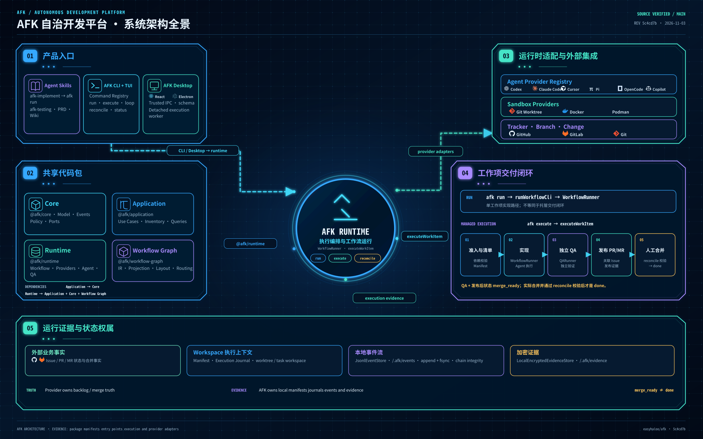

# AFK

**AFK = Away From Keyboard** — 面向工单工作项的自治开发执行平台。

AFK 连接工单平台、代码仓库与编码 Agent 运行时，将已经拆分的工作项推进到隔离实现、独立验证和人工控制的合并门禁。

[English](README.md)

## 整体架构



AFK 当前采用 pnpm workspace，提供两个产品入口：**CLI/TUI** 和 **AFK Control Desktop**。两个入口共享 Core、Application 和 Runtime 包。Runtime 组合工单/分支/变更 Provider、Agent Provider、Sandbox、工作流执行、QA 和本地证据存储。

架构图对应当前实际实现：

| 模块 | 职责 |
| --- | --- |
| `@afk/core` | 纯工作项与执行模型、事件、Reducer、策略和 Ports |
| `@afk/application` | 共享用例、Inventory、执行查询和观察契约 |
| `@afk/runtime` | 工作流编排、Provider 适配、Agent 执行、Sandbox、QA、会话和持久化 |
| `@afk/workflow-graph` | 工作流图 IR、投影、布局、路由和校验 |
| CLI / Desktop | 基于共享包的独立产品入口；Desktop 通过类型化 IPC 和独立 Runtime Worker 执行 |
| Skills | Agent 侧的研发工作手册与知识流程；Wiki Skill 使用独立 Python CLI |

AFK 消费已经拆分、具备验收标准和关系信息的工作项。需求规划与任务拆分属于上游流程，不属于执行引擎。工单平台是 backlog 状态的权威来源；本地 Inventory 和执行记录用于运行、审计与观察，不取代外部权威状态。

## 功能特性

- **跨平台工单与变更管理** — 通过稳定契约接入 GitHub 和 GitLab
- **CLI + TUI** — 命令行操作、交互式仪表盘、Kanban 和运行观察
- **桌面控制端** — Backlog、Work Items、执行历史、工作流视图和运行控制
- **多 Agent Runtime** — Claude Code、Codex、Cursor、OpenCode、Pi 和 GitHub Copilot 适配器
- **可组合执行环境** — Local、Docker、Podman Sandbox，结合 Git Worktree 和进程控制
- **独立 QA 与审计** — 独立验证、执行 Journal、追加式事件流和证据
- **Skills 套件** — 覆盖调研、PRD、实现、测试、QA 和工程治理的可复用工作流

## 快速开始

```bash
git clone https://github.com/easyhaloo/afk.git
cd afk
pnpm install
pnpm build
pnpm --dir apps/cli link --global
afk --version
```

详细设置请查看[快速入门指南](docs/getting-started.zh.md)。

## 安装 Claude Code 插件（可选）

AFK 提供完整的 Skill 套件，可作为 Claude Code 插件集成。

### 方式一：在 Claude Code 会话中（推荐）

```bash
/plugin install afk@afk
```

### 方式二：使用 CLI

```bash
# 添加 marketplace
claude plugin marketplace add easyhaloo/afk --scope user

# 安装插件
claude plugin install afk@afk
```

### 方式三：settings.json 配置

在 Claude Code 的 `settings.json`（全局或项目级 `.claude/settings.json`）中添加：

```json
{
  "extraKnownMarketplaces": {
    "afk": {
      "source": {
        "source": "github",
        "repo": "easyhaloo/afk"
      }
    }
  }
}
```

支持的 `source` 类型：
- `"github"` — 从 GitHub 仓库加载
- `"local"` — 从本地文件系统加载

### 方式四：软链接 Skills

将 `skills/` 目录链接到全局 skills 目录：

```bash
mkdir -p ~/.claude/skills
ln -s /path/to/afk/skills/* ~/.claude/skills/
```

### 验证安装

在 Claude Code 中运行 `/afk-grill-me` 确认 Skills 已加载。

## 在 OpenCode 2.x 上安装

AFK 同时以 OpenCode 2.x 包的形式分发。OpenCode 将**插件**和 **Skills** 视为两个
独立的机制，因此包含两部分：插件入口（可选）和 Skill 发现（这才是真正带来 AFK
工作流的部分）。

### 1. 添加插件（可选）

插件入口是一个轻量加载器 —— AFK 的核心是它的 Skills，而 Skills 由 OpenCode 单独
发现（见第 2 步）。可以从 npm、git 规格或本地检出注册插件：

```bash
# npm 包
opencode plugin add afk

# git
opencode plugin add github:easyhaloo/afk
```

或在 `opencode.json(c)` 中引用（全局为 `~/.config/opencode/opencode.jsonc`，或项目级
配置）。相对路径相对于所在配置文件解析：

```jsonc
{
  "$schema": "https://opencode.ai/config.json",
  "plugins": [
    "afk",                          // npm
    "github:easyhaloo/afk",         // git
    "/path/to/afk"                  // 本地检出（目录）
  ]
}
```

### 2. 让 Skills 可被发现

OpenCode 不会自动从已安装的 npm 包内部加载 `SKILL.md`，因此需要通过 `skills` 数组
将其指向 AFK 的 `skills/` 目录（使用绝对路径或 `~/` 路径最为可靠）：

```jsonc
{
  "$schema": "https://opencode.ai/config.json",
  "skills": [
    "/path/to/afk/skills"
  ]
}
```

或者，将 Skills 链接到 OpenCode 自动扫描的全局 skills 目录：

```bash
mkdir -p ~/.config/opencode/skills
ln -s /path/to/afk/skills/* ~/.config/opencode/skills/
```

每个 `skills/<name>/SKILL.md` 会成为一个 Skill，其 ID 即目录名（如 `afk-do`、
`afk-qa`）。`jev-agent-guard` Skill 拥有自己独立的 OpenCode 宿主集成，与上面的轻量
插件入口无关。

### 验证安装

运行 `opencode plugin list` 确认插件已加载，然后在 OpenCode 会话中调用某个 Skill
（例如 `@afk-do`）。

## CLI 命令

```bash
# Backlog 管理
afk backlog show --id <id>
afk backlog list --state ready --mode afk
afk backlog create "标题" --description-file ./description.md --tag feature
afk backlog tag add --id <id> --tag bug
afk backlog tag remove --id <id> --tag bug

# 执行与自动化
afk                                  # 交互式 TUI 面板
afk kanban                           # 看板
afk execute --work-item-id github:owner/repo#123 --execution-manifest <path>
afk observe executions --work-item-id github:owner/repo#123 --json
afk run --backlog-id <id>            # 仅执行实现阶段
afk qa --backlog-id <id>             # 独立 QA
afk loop start --daemon --backlog-id <id> --work-item-id github:owner/repo#123 --execution-manifest <path>

# 基础设施与诊断
afk tmux create-session --name <name> --dir <path>
afk isolate up
afk debug reproduce <cmd>
afk signal goal-complete --summary "<summary>"
```

完整命令参考：`afk --help`。

## 执行模型

- **`afk run`** 执行实现阶段。成功后推送实现分支并将工作项推进到 `verification`；它本身不完成托管式 QA 和变更请求闭环。
- **`afk execute`** 执行托管工作项生命周期：Manifest 与可执行性校验、实现、独立 QA、创建或校验变更请求，并进入 `merge_ready` 人工门禁。
- **`afk loop`** 持续轮询且仅绑定一个 Manifest 工作项，每次尝试委托给 `executeWorkItem`。它不是面向全局队列的多工作项调度器。
- **最终合并由人控制。** AFK 准备并验证 PR/MR；只有在人工完成合并且审计对账通过后，工作项才进入 `done`。

完整生命周期、状态、证据和验证边界请查看[全流程执行与 E2E 架构](docs/architecture/full-workflow-e2e-architecture.md)。

## Skills（Claude Code）

Skills 按使用目的进行逻辑分类，目录与触发命令保持原样。需要查看职责边界、工作流程和协作关系时，请阅读 [Skills 指南](docs/guides/skills.zh.md)。

### 需求与产品规划

| Skill | 用途 |
|---|---|
| [`/afk-grill-me`](skills/afk-grill-me/) | 需求访谈 |
| [`/afk-grill-me-context`](skills/afk-grill-me-context/) | 基于现有材料补充澄清 |
| [`/afk-to-prd`](skills/afk-to-prd/) | 生成并发布已确认的 PRD |
| [`/afk-to-issues`](skills/afk-to-issues/) | 将需求拆解为 Backlog 工作项 |

### 研发执行与技术探索

| Skill | 用途 |
|---|---|
| [`/afk-do`](skills/afk-do/) | 任务分析与研发流程编排入口 |
| [`/afk-research`](skills/afk-research/) | 调研现有实现与技术方案 |
| [`/afk-prototype`](skills/afk-prototype/) | 验证技术方案可行性 |
| [`/afk-implement`](skills/afk-implement/) | 执行代码实现工作流 |
| [`/afk-diagnose`](skills/afk-diagnose/) | 诊断可复现故障 |
| [`/afk-branch-migrate`](skills/afk-branch-migrate/) | 跨分支迁移代码 |
| [`/afk-llm-dev-guide`](skills/afk-llm-dev-guide/) | LLM 应用架构与上下文工程 |

### 测试与质量保障

| Skill | 用途 |
|---|---|
| [`/afk-testing`](skills/afk-testing/) | 测试设计、执行、失败诊断与有效性审查 |
| [`/afk-change-driven-testing`](skills/afk-change-driven-testing/) | 为变更涉及的存量业务流程补充回归测试 |
| [`/afk-qa`](skills/afk-qa/) | 独立验收与合并前验证 |
| [`/api-workflow`](skills/api-workflow/) | 多步骤 API 与浏览器混合测试 |

### 任务编排与会话连续性

| Skill | 用途 |
|---|---|
| [`/afk-scheduler`](skills/afk-scheduler/) | 按依赖关系调度多个工作项 |
| [`/afk-hand-off`](skills/afk-hand-off/) | 记录进度、决策、阻塞与下一步 |
| [`/session-time-analysis`](skills/session-time-analysis/) | 分析会话耗时分布与瓶颈 |

### Agent 能力与推理治理

| Skill | 用途 |
|---|---|
| [`/afk-skill-craft`](skills/afk-skill-craft/) | 创建、诊断与重构 Skills |
| [`/reasoning-guard`](skills/reasoning-guard/) | 会话内识别推理退化 |
| [`/jev-agent-guard`](skills/jev-agent-guard/) | 为编码 Agent 安装检查点 |

### 知识管理与工程治理

| Skill | 用途 |
|---|---|
| [`/wiki`](skills/wiki/) | 检索、读取、沉淀与检查项目知识 |
| [`/software-complexity-governance`](skills/software-complexity-governance/) | 评估复杂度、耦合度与技术债 |

### 文档与格式转换

| Skill | 用途 |
|---|---|
| [`/md-to-pdf`](skills/md-to-pdf/) | 将 Markdown 文档导出为 PDF |

## 开发

```bash
pnpm install
pnpm build
pnpm test
pnpm --dir apps/desktop typecheck
pnpm --dir apps/desktop build
pnpm --dir apps/desktop test
pnpm --dir apps/cli link --global
```

## 文档

- **[快速开始](docs/getting-started.zh.md)** — AFK 上手
- **[系统架构](docs/architecture/system-architecture-design.md)** — 系统边界、分层、控制平面、执行基座和信任模型
- **[Workspace 架构](docs/architecture/overview.zh.md)** — 包边界、依赖方向、路径和 Provider 契约
- **[执行环境](docs/architecture/execution.zh.md)** — Agent Provider、Sandbox Provider、会话和工作流模板
- **[全流程与 E2E](docs/architecture/full-workflow-e2e-architecture.md)** — 生命周期、QA、状态流转和证据
- **[工作流](docs/guides/workflows.zh.md)** — 工作流和 Skill 使用
- **[Skills 指南](docs/guides/skills.zh.md)** — Skills 设计与使用

## License

MIT
