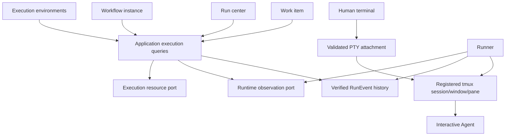

# ADR-0019: Shared Execution Views and Interactive Tmux Access

**Status:** in progress — verified run timelines, independent runtime-health projection, recorded workflow snapshots, dedicated workflow-instance navigation, and exact registered tmux attachment are implemented. Interactive tmux takeover and unchanged Runner scheduling remain the final end-to-end acceptance boundary.

**Proposal date:** 2026-10-14

## Context

Desktop work items, workflows, the run center, and execution environments read
different projections and cannot follow one execution reliably:

- Work-item details combine inventory, desktop process records, and Application
  execution summaries. Run cards cannot open a specific execution.
- The run center converts `ExecutionSummary` into a synthetic `RuntimeEvent`,
  assigns `timestamp: "—"`, and repeats a status label as the next action.
- The inspector extracts a workspace from presentation text. Terminal lookup
  uses that workspace or the selected project, not the run's registered resources.
- Environment DTOs discard the registry's existing `runId` and `worktreePath`.
- Workflow editing describes project configuration; history lacks a persisted
  snapshot of the workflow that actually ran.
- Electron launches a detached CLI process. Its process receipts, audit state,
  and runtime observations have different meanings and lifecycle owners.

Work item `github:easyhaloo/afk#180` illustrates the problem. Audited run
`86667974-9c41-4b8c-afa0-06d9176ccd6b` records request, start, and lease grant.
Its runtime record describes Codex `exec`, `batch`, and a last heartbeat of
`2026-10-13T02:12:06.022Z`. The named tmux session does not exist. This does not
prove the process exited, but an unconditional running label and tmux-only
control cannot represent these observations correctly.

Reuse the verified RunEvent spine, `loadWorkItemExecution`, existing execution
projection, TaskRuntimeStore, resource registry `listByRun`, sandbox execution
handles, and agent interrupt/capture/resume capabilities.

## Decision

Establish one Application-owned execution query boundary and a shared interactive
tmux execution surface. The Runner keeps its lifecycle and scheduling behavior
when a human attaches. Desktop does not reconcile business state or identify
terminal targets from labels or guessed directories.



### 1. Identity and relationships

| Identity | Meaning |
| --- | --- |
| `workItemId` | Canonical work item across attempts; provider backlog mapping retains the existing contract. |
| `runId` | One execution attempt; pass the same ID from launch into audit and control. |
| `parentRunId` | Explicit execution relationship when implementation/QA owns a separately audited child run. |
| `stepId` | A step in that attempt's workflow snapshot. |
| `resourceId` | Registered environment/session resource associated with its actual run. |
| `sessionId` | Provider-native agent session, which need not be a tmux session. |

`parentId`, `dependsOn`, and `baseBacklogId` keep their existing work-item
semantics. Root execution queries include explicitly linked child runs and
report missing linkage. Never infer it from issue numbers or nearby timestamps.
Retries create attempts; provider resume generations remain within the current
attempt unless the existing lifecycle requires a new run.

Project selection is a browsing filter. It cannot provide a missing run workspace
or select a terminal. The query reports a missing association explicitly.

### 2. Shared execution read model and state authorities

Application exposes execution list, detail, and incremental timeline queries.
Detail composes verified history, run relationships, runtime observations, and
registered resources into one typed view containing:

- identity, attempt, start/update/end times, and audit integrity;
- business progress, phase/step, outcomes, human gates, QA evidence, published
  changes, and recorded token usage;
- workflow snapshot and each step's recorded state;
- actual task root, repository checkout/worktree paths, branches, environment,
  provider, transport, session references, and resources;
- runtime health, Runner ownership, observation times, and available actions
  with explicit unavailable reasons.

This is a composed read model, not another authoritative persisted run database.
Move the existing pure execution projection into `@afk/application` and reuse it
for CLI and Desktop. Main injects event/runtime/resource adapters through typed
ports; preload returns validated DTOs. Keep filesystem and process access out
of the renderer and infrastructure dependencies out of the application package.

| Concern | Authority | Limit |
| --- | --- | --- |
| Work-item lifecycle | Provider Backlog | Process exit cannot mark work done. |
| Execution business outcome | Verified RunEvents | Preserve independent QA and publication/merge evidence requirements. |
| Runtime health | Runner heartbeat, owner/lease evidence, process/resource probes | Historical run start cannot prove liveness. |
| Workspace/resource association | Persisted manifest, workspace preparation events, resource registration | No presentation parsing or project-directory fallback. |
| Runner ownership | Existing Runner/lease lifecycle | Human attachment does not change scheduling or transfer ownership. |

Audit progress and health remain separate. Health distinguishes live, stale,
exited, and unknown observations using the shared runtime freshness policy.
Heartbeat expiry alone cannot imply failure or authorize concurrent writes.
Missing runtime data is unknown, not live; corrupt audit data disables controls.
Do not add a renderer-specific timeout policy.

Audit timeline entries and diagnostics remain distinguishable. Incremental event
queries use verified sequence cursors; runtime/resources carry observation times.
Missing token usage stays uncollected rather than zero.

### 3. Workflow definition and workflow instance

Definitions belong to the workflow editor. Start persists the resolved definition
identity, content revision/hash, steps/dependencies, and agent/environment
selection with existing execution metadata, referenced by audit evidence.
Prompts and secrets follow evidence classification/redaction rules rather than
being copied into public DTOs.

A root execution covers implementation, independent verification, and
publication/human merge. Implementation template steps appear within that
phase. Step events update the instance; later template edits affect new attempts
only. Missing historical snapshots remain unavailable and cannot be replaced
by the current template.

### 4. Tmux is the execution and takeover boundary

Every AFK-managed Agent execution uses an interactive Agent process inside a
Runner-owned tmux session and window. The Runner never starts the managed Agent
in `exec`, batch, or an untracked child process. Provider differences remain
inside the Agent provider, but the execution contract is always:

```text
work item → Runner → tmux session/window/pane → interactive Agent
                                      ↑
                              human takeover
```

The execution resource records the complete target: `resourceId`, tmux session,
window ID/name, pane ID, worktree, and `runId`. A session name alone is not a
control target. The Runner registers this resource before the Agent starts and
updates its state when the session, window, or pane exits. Desktop resolves the
target from the execution view; it never searches by project directory or
falls back to the currently selected workspace.

Starting a run creates the tmux window and launches the provider in interactive
mode. The Runner sends the initial goal through the same pane and continues to
supervise structured lifecycle evidence, heartbeat, workflow steps, and
completion signals. The Agent remains visible and interactive throughout the
run, including implementation, verification, and human-gated actions.

Takeover means opening the exact registered tmux session/window/pane. Desktop
does not open a replacement shell and does not migrate the Agent to another
transport. The user can type Agent instructions, inspect its output, and guide
the current Agent directly in tmux. The terminal UI must show the resolved
session, window, pane, worktree, provider, and whether the target is available
before offering the attach action.

Takeover is an additional interactive attachment, not exclusive control. The
Runner continues sending instructions, observing completion, advancing workflow
steps, and managing Agent/session lifecycle exactly as it does without an
attached human. There is no `human_control` state, scheduling pause, takeover
acknowledgement, return-of-control command, or input lock between Runner and user.
The user can issue instructions and interrupt the Agent's current turn through
its normal keyboard interaction. Such input can affect the Agent's work; attach
or detach itself does not change Runner behavior. Both inputs share the actual
Agent terminal and its normal command/interrupt semantics.

Desktop uses a real PTY attached to the registered tmux target, supporting raw
keyboard input, output streaming, resize, and interrupt keys. Pane capture plus
a line-based send box is insufficient for takeover. Closing the Desktop
terminal detaches only its PTY client; the Runner and Agent continue unchanged.
Human attachment does not bypass workflow validation, QA, publication, or merge
rules. Existing stop/recovery commands remain explicit lifecycle operations and
are not part of attaching to the terminal.

Completion during attachment advances the workflow normally. The Runner may
finish or replace the active Agent pane as part of its existing lifecycle; an
attached client does not delay that transition. The UI shows the pane ending
and updates the current-step resource association. It never silently redirects
the user's input to a replacement Agent. Opening the new target requires a new
validated attach operation. Stale run/resource generations and reused pane
references must not route input to a different run. Missing resources yield
an unavailable diagnostic rather than a guessed terminal.

Provider capabilities are resolved against the interactive tmux transport.
Native provider resume is an optional recovery capability, not a substitute for
the primary tmux takeover path. Batch and app-server transports may remain
available for unrelated non-managed CLI operations, but cannot be selected for
the Desktop work-item execution chain.

| Execution situation | User action |
| --- | --- |
| Live interactive session | Enter the exact registered tmux window; Runner automation continues during user interaction. |
| Exited/missing session | Inspect history/artifacts; do not open a replacement Agent shell. Recovery is explicit. |
| Missing association/unknown writer | Inspect read-only evidence and diagnostics; recovery is a separate explicit command. |

### 5. Desktop data ownership and navigation

Create an execution feature with a shared query cache and typed selection context,
using existing React hooks/state and IPC. One active-run refresh updates all
consumers, invalidates after commands, and discards stale-selection responses.
Lists page through attempts; failures retain labelled stale data with retry.

- Work-item details show attempts and open an exact `runId`.
- Run center lists executions, rather than synthetic events grouped by work-item text.
- Execution detail contains overview, workflow instance, timeline, resources,
  and capability-driven controls.
- Workflow-instance navigation preserves the run and separately links its definition.
- Environment inventory lists registered tmux sessions/windows/panes and
  validated worktrees for each run, retains association IDs, and opens the same
  detail. It must not represent an untracked shell as the Agent.

Extract run-center/inspector/environment feature code from `main.tsx` while
connecting this boundary. App retains shell, navigation, preferences, and
composition. Keep unrelated workflow editing and SSH outside the change.
Terminal attach is a validated resource operation, independent of Runner
scheduling and ownership transitions.

The Runner records the selected template name, version, step identities,
dependencies, providers, and execution modes in an immutable
`workflow.recorded` audit event before dispatching the plan. Execution detail
renders this recorded snapshot beside the step timeline; it does not substitute
the project's current workflow configuration for a historical attempt.

### 6. Migration and implementation order

1. **Shared query contract:** reuse/move the projection; add runtime/resource
   ports and list/detail/timeline DTOs preserving integrity and outcome rules.
2. **Execution producers:** make the managed implementation and QA Agents use
   interactive tmux; persist workflow snapshots, child-run links, and exact
   resource associations for CLI and Desktop launches. Remove hardcoded batch
   selection and validate interactive provider support before claiming work.
3. **Desktop read path:** connect the four surfaces to shared queries/selection;
   remove synthetic events and presentation-text resource lookup.
4. **Terminal path:** implement real PTY tmux attachment and resource lifecycle
   handling, with Runner scheduling unchanged during user interaction.
5. **Retire duplicate authorities:** desktop process records become launch
   receipts; legacy readers normalize evidence into the common query boundary.
   Remove obsolete readers/projections when their consumers have migrated.

Each stage has runnable contract checks. Keep historical attempts readable
without rewriting audit hashes or inventing missing steps or relationships.
Enable controls only on validated execution contexts. CLI signature/command
changes update the registry and both architecture overview language variants.

## Alternatives

1. **Page links and inspector fields:** smaller UI work, but retains duplicate
   state authorities and ambiguous terminal targets.
2. **Shared views and interactive tmux access (selected):** repairs query and
   terminal boundaries while reusing existing audit/runtime/resource stores.
3. **New daemon and run database:** adds lifecycle, migration, and another
   authority that the current local model does not require.

## Acceptance and verification

- The same attempt shows consistent phase, times, workspace, and capabilities
  across all four surfaces, including CLI-originated executions.
- Retries and linked implementation/QA runs cannot exchange timeline or terminal
  targets. Pagination and async navigation preserve identities.
- Work item 180 displays recorded progress and its historical batch transport as
  a migration diagnostic. New managed executions use interactive tmux and
  expose the exact session/window/pane; no guessed attachment is offered for
  the old run.
- Workflow edits preserve existing snapshots. Missing events/runtime data and
  audit corruption produce explicit diagnostics.
- A fake Runner proves it still sends instructions and advances workflow steps
  while a human is attached. Attach/detach do not pause, interrupt, resume, or
  otherwise change Runner scheduling. User input reaches the same Agent.
- Terminal keyboard, resize, output streaming, and interrupt reach the exact
  pane. Detaching preserves the existing Runner/Agent lifecycle. Completion
  during attachment advances normally; pane replacement shows a disconnect
  and never silently reroutes input. Stale resource references cannot connect
  to a different run.
- An isolated interactive tmux run supports takeover in the same window,
  user-issued Agent instructions, continuing Runner automation, independent QA,
  and publication results visible in the same task history.
- Focused service/pure-function tests and isolated Electron scenarios validate
  read/control contracts. All affected workspace packages and Desktop pass
  their own typecheck, build, and tests; architecture/docs checks pass.
  Verification never interrupts the real work item 180.

## Consequences

This is a coordinated execution-query and terminal refactor. It requires
execution metadata and interactive tmux integration, but adds no ownership
transfer protocol, status database, UI store library, or daemon. Historical
attempts may remain partially observable; unsupported capabilities stay explicit.
The read migration can ship before terminal access, but the request is complete
only after interactive tmux execution, same-window takeover, and unchanged
Runner scheduling during attachment are verified. Historical batch records
remain readable and cannot be retroactively turned into live interactive sessions.

## Related

- [Execution identity and lifecycle](../architecture/overview.md#work-item-and-execution-identity)
- [Execution environment design](../architecture/execution.md)
- [Desktop architecture](../../desktop-client/ARCHITECTURE.md)
- [Desktop design system](../architecture/design-system.md)
- [ADR-0016: Run Event Audit Spine](0016-run-event-audit-spine.md)
- [ADR-0018: Evidence Classification and Redaction](0018-evidence-classification-and-redaction.md)
