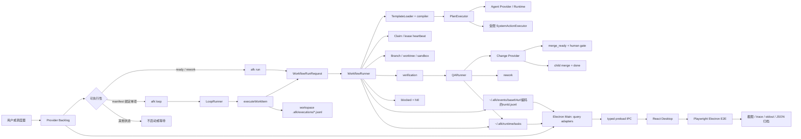
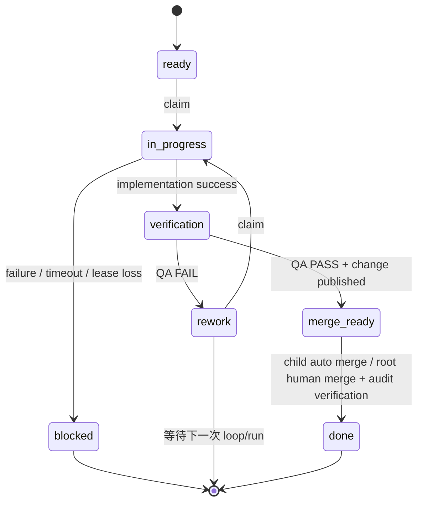

# AFK 全流程执行与 E2E 验证架构

本文描述 AFK 从任务派发、单项执行、持续 loop、模板编排、QA 和状态流转，到桌面端展示与 E2E 证据归档的真实实现边界。

本文基于当前源码整理，主要实现锚点如下：

| 领域 | 实现入口 |
| --- | --- |
| CLI 命令注册 | [`apps/cli/src/command-registry.ts`](../../apps/cli/src/command-registry.ts) |
| `afk run` | [`apps/cli/src/commands/run.ts`](../../apps/cli/src/commands/run.ts)、[`packages/runtime/src/application/workflows/run-cmd.ts`](../../packages/runtime/src/application/workflows/run-cmd.ts) |
| `afk loop` | [`apps/cli/src/commands/loop.ts`](../../apps/cli/src/commands/loop.ts)、[`packages/runtime/src/application/modules/loop-runner.ts`](../../packages/runtime/src/application/modules/loop-runner.ts) |
| 单项闭环 | [`packages/runtime/src/application/workflows/execute-work-item.ts`](../../packages/runtime/src/application/workflows/execute-work-item.ts) |
| 工作流执行 | [`packages/runtime/src/application/workflow-engine.ts`](../../packages/runtime/src/application/workflow-engine.ts) |
| 模板加载与编译 | [`packages/runtime/src/domain/templates/loader.ts`](../../packages/runtime/src/domain/templates/loader.ts)、[`packages/runtime/src/domain/templates/builtin.ts`](../../packages/runtime/src/domain/templates/builtin.ts)、[`packages/runtime/src/application/workflows/plan-executor.ts`](../../packages/runtime/src/application/workflows/plan-executor.ts) |
| QA | [`apps/cli/src/commands/qa.ts`](../../apps/cli/src/commands/qa.ts)、[`packages/runtime/src/application/modules/qa-runner.ts`](../../packages/runtime/src/application/modules/qa-runner.ts) |
| 审计事件 | [`packages/core/src/events.ts`](../../packages/core/src/events.ts)、[`packages/runtime/src/infrastructure/observability/jsonl-event-store.ts`](../../packages/runtime/src/infrastructure/observability/jsonl-event-store.ts) |
| 桌面端与 E2E | [`apps/desktop/ARCHITECTURE.md`](../../apps/desktop/ARCHITECTURE.md)、[`apps/desktop/playwright.config.ts`](../../apps/desktop/playwright.config.ts)、[`apps/desktop/tests/e2e/_helpers/launch.ts`](../../apps/desktop/tests/e2e/_helpers/launch.ts) |

## 1. 范围与判定口径

本文中的“全流程”是以下链路全部可追踪：

```text
任务进入 Provider Backlog
  → 任务满足可执行条件
  → afk run 或 afk loop 获取执行权
  → execution manifest / project context 校验
  → WorkflowRunner 执行模板步骤
  → 实现分支推送并进入 verification
  → QARunner 执行 QA
  → root 任务进入 merge_ready 等待人工合并，或 child 任务自动合并进入 done
  → 事件、runtime、执行 journal、CLI/Agent 日志形成证据
  → Desktop 通过 Main/IPC 查询 Backlog、runtime 和事件投影
  → Playwright Electron E2E 保存运行结果、截图或 trace
```

“任务完成”不能只由进程退出码证明。至少要同时核对 Provider 状态、执行身份、审计事件完整性和必要的 runtime 诊断；桌面端的 launch metadata 只能说明桌面端发起过进程，不能推断 `verification`、`blocked` 或 `done`。

## 2. 组件与数据流



### 2.1 Provider Backlog 是业务事实源

`BacklogProvider` 负责任务的身份、标题、描述、状态、执行模式、父子关系、依赖、标签和分支映射。执行器通过 Provider 进行 claim、状态迁移和变更请求操作，不能通过解析 Provider 标签自行推断业务状态。

可执行条件由 Provider 和执行编排共同约束：

- 状态必须是 `ready` 或 `rework`。
- 执行模式必须是 `afk`；`hitl` 项不能被自动执行。
- 任务不能有子任务。
- 所有 `dependsOn` 项必须为 `done`。
- manifest、Provider 项和全局 work item 身份必须一致。

`afk run` 通过 `WorkflowRunner` 在创建工作树前 claim；claim 失败会记录取消结果并返回 `not_claimed`。claim 成功后持续 heartbeat，租约丢失会把任务转为 `blocked` 并切到 `hitl`。

### 2.2 `afk run` 的单项执行路径

`afk run --backlog-id <id>` 的入口只负责收集 CLI 参数并调用 `runWorkflowCli`。后者解析配置和 manifest、创建 tracker/provider bundle，再交给 `WorkflowRunner.run`。

`WorkflowRunner` 的关键顺序是：

1. 创建 `run.requested` 审计事件。
2. 对 backlog 做条件 claim；成功后记录 `run.started` 和 `lease.granted`。
3. 启动 runtime 记录和 lease heartbeat。
4. 加载并校验模板；模板错误发生在工作树创建前，并会把已 claim 的项收敛到 `blocked`。
5. 准备 branch、worktree、sandbox、agent runtime 和 watchdog。
6. 编译模板并由 `PlanExecutor` 按依赖层级执行 agent/system step。
7. 成功后推送实现分支，进入 `verification`；失败、超时、异常或清理失败进入 `blocked`。
8. 结束 runtime，释放 claim 和工作树资源，并写入实现阶段审计事件。

实现模板明确要求 Agent 不创建或合并 MR；发布、提交 QA、创建变更请求和合并策略由后续系统动作或 `QARunner` 负责。

`afk run` 本身只运行实现阶段，成功交付到 `verification`；随后需由 `executeWorkItem` 闭环或独立 `afk qa` 进入 QA。默认模板的 `publish-change` 动作在这里推送实现分支，`queue-qa` 迁移状态，并不创建 PR/MR。若 `verify-ac` 返回可解析的 AC FAIL，runner 会按 `maxSelfIterations` 上限重跑 `implement → verify-ac`；纠正成功后再发布并进入 `verification`。这属于同一次实现尝试，不是 QA FAIL 后的 backlog `rework`。

### 2.3 `afk loop` 的持续执行路径

`afk loop` 不是多项通用调度器，而是一个 manifest-bound 的单项循环器。启动时必须提供：

```text
--work-item-id <global-id>
--execution-manifest <path>
--backlog-id <exactly-one-id>
```

同时不允许 module triggers。`LoopRunner` 在每次 poll 中重新读取 manifest，并只把这个 manifest 绑定的 backlog 项交给 `executeWorkItem`。每个成功或失败的尝试都有独立 `executionId`，同一进程用 `inFlight` 防止重复启动。

loop 的外部控制面是：

- `afk loop start` 或兼容的 `afk loop`：前台运行；`-d` 通过 detached child 后台运行。
- `afk loop status`：读取 `~/.afk/loop.pid`、`~/.afk/loop-status.json` 和进程存活状态。
- `afk loop stop`：先发 `SIGTERM`，超时后发 `SIGKILL`。

loop 输出状态行和 JSON 状态文件，包含 active execution、完成数、失败数、启动时间和最近错误。Provider 状态仍是事实源；`inFlight` 只用于当前进程内去重，重启后不会恢复之前的内存集合。

### 2.4 `executeWorkItem` 的闭环

manifest-bound 执行通过工作区 `.afk/executions/` 创建以 `executionId` 命名的 journal 和按 work item 编码的锁。执行前会核对 manifest、Provider backlog、inventory item、项目平台、issue number、执行模式、managed/eligible 标记和依赖完成情况。

执行阶段如下：

1. 写入 journal `requested` 和 `implementing`。
2. 调用 `WorkflowRunner`，强制 batch 模式，并把 `executionId` 同时作为 observation `traceId` / `runId`。
3. 实现成功后要求 Provider 状态已经进入 `verification`。
4. 调用 `QARunner`，写入 `qa.started`，根据 QA 结果写入 `qa.passed` 或 `qa.failed`。
5. QA PASS 时提交 QA 分支、push、创建或复用 Change Request，并校验变更与 work item 的关联。
6. root backlog 留在 `merge_ready` 并打开人工 gate；child backlog 执行合并并进入 `done`。
7. QA FAIL 持久化递增的 rework attempt，并 supersede 旧 active 记录；低于 `maxQaReworkAttempts`（默认 3）时回到 `rework` + `afk`，达到上限时进入 `blocked` + `hitl` 且不再返回 rework。后续 FAIL 保留到限记录，不会重新开启自动返工；不可恢复的错误也进入 `blocked`。边界及配置见 [Backlog 生命周期](overview.zh.md#backlog-生命周期)。

返回值的 `status` 是执行尝试的结果：`merge_ready`、`done`、`rework`、`blocked` 或 `not_claimed`。它不能直接替换 Provider 的 backlog ID 或生命周期状态。

## 3. 身份字段与关联规则

| 字段 | 所属对象 | 含义 | 使用边界 |
| --- | --- | --- | --- |
| `BacklogItem.id` | Provider Backlog | Provider 内部 backlog 主键 | 传给 `afk run --backlog-id`，用于状态迁移和 claim |
| `workItemId` / `Run.workItemId` | 全局工作项、`Run`、事件上下文 | manifest-bound `executeWorkItem` 显式使用全局身份，例如 `github:team/repo#158`；普通 `afk run` 的 `Run.workItemId` / observation 默认沿用 Provider `backlogId` | 必须按入口核对命名空间，不能假定所有 `Run.workItemId` 都已全局化，也不能用 `runId` 替代 |
| `runId` | 核心 `Run`、事件流、runtime | 一次执行或阶段的身份 | 闭环实现阶段使用 `executionId`；QA runtime 独立使用 `qa-<backlogId>-<timestamp>-runtime`，不另建同名闭环事件流 |
| `executionId` | `executeWorkItem` 结果、journal、闭环审计 | loop/闭环的一次执行编排身份 | 默认生成 UUID；当前闭环中同时作为 observation `runId` 和 `traceId` |
| `parentId` | `BacklogItem` | 组织上的父子分组 | 不选择 Git 基线；root 与 child 的 QA 合并策略不同 |
| `dependsOn` | `BacklogItem` | 任务级调度依赖 | 所有依赖达到 `done` 后任务才可运行；不自动选择分支 |
| `baseBacklogId` | Provider backlog 投影 | 显式的未合并 Git 执行基线 | 用于 stacked work 的基线选择；和 `parentId`、`dependsOn` 是不同关系 |
| `baseWorkItemId` | `@afk/core` `WorkLineage` | 核心模型中对应的显式执行基线字段 | 进入 core policy 时表示相同语义；适配层不得把它与父项或依赖项混用 |
| `providerRef` | `BacklogItem` | Provider 原始引用 | 作为 Provider 边界校验字段，不是执行尝试 ID |
| `correlationId` | `RunEvent` | 事件所属执行关联 | projection 用它生成 `executionId`；必须与同一事件流身份一致 |
| `leaseEpoch` | `ObservationContext` | claim/租约世代 | 用于识别租约变更，不能当作任务或 run 身份 |
| `TaskRuntimeRecord.backlogId` / `providerRef` | canonical runtime | Provider backlog 主键及 Provider 原始引用 | 不要求 `backlogId` 等于全局 `workItemId`；Desktop runtime 服务还按 workspace、可用的 `providerRef` 和启动时间过滤，执行历史按事件中的 `workItemId` 查询 |

最小不变量是：`Run.workItemId === event.context.workItemId`，`run.requested.run.id === event.context.runId`；manifest-bound 闭环的 journal 与事件流必须使用同一个 `executionId` 和全局 `workItemId`。实现 runtime 的 `runId` 等于该 `executionId`，QA runtime 则通过 `backlogId`、`providerRef`、workspace 和时间关联，不能要求两阶段 runtime 的 `runId` 相等。执行历史投影的 `awaiting_merge` 对应 Provider 的 `merge_ready`，两者不是同一状态枚举。

## 4. 模板加载、编译与执行

### 4.1 加载优先级

`TemplateLoader` 按以下顺序查找同名模板，并在首次加载后缓存：

```text
--template 直接路径（名称包含 / 或 .yml/.yaml）
  > <project>/.afk/workflows/<name>.yml|yaml
  > ~/.afk/workflows/<name>.yml|yaml
  > 内置 registry
```

磁盘模板先经 YAML 解析和 `WorkflowTemplateSchema` 校验，再解析相对 prompt 文件路径。模板版本当前固定为 `1`。agent step 必须有 `role` 和 `prompt`；system step 必须有 `action`。system action 只能通过 `SystemActionExecutor` 的固定动作或已注册 plugin action 执行，不能从模板任意执行 shell 命令。

### 4.2 编译规则

`resolveExecutionPlan` 先校验依赖和 `when` 引用，再用 Kahn 算法计算依赖层级。相同层级的 runnable steps 由 `PlanExecutor` 通过 `Promise.all` 并发执行；有依赖的层级按顺序推进。

条件语义是：

- 没有 `when` 时，所有 `dependsOn` 必须为 `completed` 才运行。
- 有 `when` 时先由 `evaluateWhen` 判断条件；显式条件可以有意从失败依赖中恢复，例如 `review=failed` 时执行 `fix`。
- step 结果保存在以 step ID 为键的结果表中，后续 step 只能依赖已记录结果。

## 5. 内置模板覆盖矩阵

当前 `builtinTemplates()` 注册以下 6 个模板；名称由 `packages/runtime/src/domain/templates/templates.test.ts` 固定断言。

| 模板 | 图结构 | 主要能力 | 全流程验证重点 | 终态边界 |
| --- | --- | --- | --- | --- |
| `issue-implementation` | `implement → verify-ac → publish → queue-qa` | 默认实现流程；包含两个 agent step 和两个 system step | claim、工作树、实现、AC 验证、push、verification | QA 不在模板内完成；后续 `QARunner` 决定 `merge_ready` 或 `done` |
| `pre-merge-qa-verification` | `verify-ac` | 已合并最新基线后的 QA agent；要求结构化 `goal_complete` | QA 工作树、AC/集成测试、PASS/FAIL 解析、诊断保存 | PASS 由 QA runner 提交/push/发布；Agent 本身不负责 MR |
| `simple-loop` | `run` | 单 agent step 的最小执行模板 | 单步 prompt、完成信号、单步 runtime 和事件 | 由 runner 的 wrap-up 和 backlog 路由决定 |
| `sequential-review` | `implement → review → fix` | 依赖顺序和失败条件分支 | `review` 失败时 `fix` 可运行；成功时不应误跑 fix | 后续仍由 runner wrap-up 处理分支和状态 |
| `parallel-planner` | `plan-frontend ∥ plan-backend ∥ plan-infra` | 同层多个 planner 并发；每步声明独立 named branch | 并发执行、互不复用工作树、结果全量记录 | 模板本身没有合并/QA terminalizer |
| `planner-with-review` | `plan-frontend ∥ plan-backend → review → fix` | 并发 fan-out、review fan-in、条件修复 | 两个 planner 完成后才进入 review；review 失败才运行 fix | 仍需 runner 的发布和 QA 闭环 |

验证矩阵中的“全流程验证重点”必须分层：模板单元测试可以验证图和条件，runner 集成测试可以验证资源和状态，真实 Provider/Agent E2E 才能验证外部 change、push、合并和凭据边界。

### 5.1 模板当前限制

模板的 `parallel` 字段用于表达模板意图和独立分支约束，但当前 resolver 的并发依据是“同一依赖层级”，不是按 `parallel` 字符串单独分组。因此，未来增加无依赖的多个 step 时，即使没有相同 `parallel` 值，也可能在同层并发；需要改变此语义时必须同时修改 resolver、测试和本文矩阵。

条件修复只保证 `fix` 可被调度。`WorkflowRunner` 在计划执行后仍检查所有 step 结果；`sequential-review` / `planner-with-review` 的 `fix` 完成不会清除原 `review` 的 `failed` 状态。因此 deterministic 条件分支通过不等于真实 runner 在该分支成功收敛；`verify-ac` 的重试则会显式替换验证结果。

## 6. QA 与状态流转



`QARunner` 使用管理 provider，不拥有 implementation claim 能力。进入 QA 的 `verification` 前置检查由 `executeWorkItem` 或独立 QA CLI 执行；`QARunner.process` 不重复该状态检查。Agent 必须返回满足以下结构的结构化结果：

```json
{
  "type": "goal_complete",
  "kind": "qa",
  "result": "PASS",
  "summary": "...",
  "requiredChecks": []
}
```

FAIL 还必须提供非空的 `failedCriteria`，每项包含 `id`、`expected` 和 `actual`。PASS 会 commit、push、发布 Change Request；`executeWorkItem` 注入的回调负责复用检查和 issue association 验证，独立 QA CLI 没有注入这些闭环审计回调。root 项切到 `merge_ready` 和 `hitl`；child 项也先进入 `merge_ready`，再执行 merge 并切到 `done`。QA 的终端路由失败会切到 `blocked` 和 `hitl`。

QA 工作树的依赖目录不是指向主检出的单个符号链接。pnpm 12 会拒绝把符号链接当作任务运行状态目录（`ERR_PNPM_UNSAFE_TASK_RUN_STATE_PATH`），带 `--filter` 的 workspace 运行在软链布局下直接失败。`GitBranchProvider` 为 QA 工作树物化一个真实的 `node_modules` 目录，其条目（包含 `.pnpm` 存储和 `.bin`）逐项链接到主检出；pnpm 自身的可变状态 `.pnpm-task-run-state-v1` 与 `.pnpm-workspace-state-v1.json` 不共享，留在工作树本地，避免并行工作树互相写入。

## 7. 日志、事件和截图归档

### 7.1 运行时产生的证据

| 证据 | 默认位置 | 内容与校验 |
| --- | --- | --- |
| 审计事件流 | `~/.afk/events/<base64url(runId)>.jsonl` | JSONL、连续 sequence、前向 hash 链；`RunEventQueryPort.verify` 和 projection 负责完整性/身份诊断；CLI 可通过 `AFK_EVENT_STORE_DIR` 覆盖根目录 |
| 运行时活动 | `~/.afk/runtime/tasks/active/` | 运行中的 `TaskRuntimeRecord`、heartbeat、phase、progress、agent/runtime 元数据 |
| 运行时归档 | `~/.afk/runtime/tasks/archive/` | terminal runtime 记录；`completed` 或 `blocked` 后从 active 移入 archive |
| 运行时诊断 | `~/.afk/runtime/tasks/diagnostics/<base64url(runId)>/` | `runtime.json`、`result.json`、`output.log`；active/archive 的 JSON 文件也以相同编码命名 |
| 闭环 journal | `<manifest.workspaceRoot>/.afk/executions/<executionId>.jsonl` | `requested`、`implementing`、`verifying`、发布/合并及最终状态；每行包含 `executionId` 和 `workItemId` |
| 统一日志 | `~/.afk/logs/afk-YYYY-MM-DD.log` | 按天轮转的 pino JSONL 日志；watchdog、QA 超时快照同在此根目录下，可用 `AFK_LOG_DIR` 整体覆盖 |
| 实现超时日志 | `~/.afk/logs/timeout/timeout-<iid>-<timestamp>.log` | workflow watchdog 捕获的 tmux pane 内容 |
| QA 超时日志 | `~/.afk/logs/qa/timeout-<backlogId>-<timestamp>.log` | QA Agent 最近输出和执行诊断 |
| loop 状态 | `~/.afk/loop-status.json` | active execution、完成/失败计数、uptime、启动时间和最近状态 |
| loop PID | `~/.afk/loop.pid` | daemon 控制和单实例检查 |

`RunEvent` 的每条事件还携带 `ObservationContext`、`correlationId`、可选 `evidence` 和完整性字段。证据引用应填写 `uri`、`sha256`、`mediaType`、分类和脱敏状态；日志中出现凭据、token、私有输出时不得直接作为 public evidence 发布。

### 7.2 E2E 截图和 trace 约定

桌面 E2E 使用真实 Electron Main、preload、IPC 和 React renderer，但通过 fixture provider snapshot、隔离 HOME 和 fake `afk` CLI 运行。`playwright.config.ts` 当前配置为：

- `trace: "retain-on-failure"`：失败保留 trace，成功默认不保留。
- `screenshot: "only-on-failure"`：失败自动截图，成功默认不截图。
- 每个测试使用隔离 workspace、Electron user data 和 JSONL 审计目录。
- `globalSetup` 会先构建当前 main/preload/provider bundle。
- 使用 `AFK_E2E_PORT` 指定 Vite 端口，并且不复用其他 worktree 的 Vite 服务。

为了让一次全流程验证可以复盘，执行器或 CI 应按以下目录归档本次证据；这是归档约定，不是当前仓库已经固化的额外 runtime schema：

```text
artifacts/full-workflow-e2e/<UTC-timestamp>/<workItemId>/
├── manifest.json          # workItemId、backlogId、runId/executionId、template、commit、环境
├── command.log            # afk run/loop/qa/observe 的 stdout + stderr
├── loop-status.json       # 采样到的 loop status
├── provider-final.json    # 最终 backlog/change 状态，脱敏后保存
├── runtime/               # runtime archive 与 diagnostics 的只读副本
├── events/                # 对应 runId 的 JSONL 事件流
├── executions/            # 对应 executionId 的闭环 journal
├── screenshots/           # 关键页面和状态截图
└── playwright/            # trace、失败截图、测试报告
```

归档命名必须包含可回查的 `workItemId` 和时间；截图至少覆盖任务列表/详情、运行中或 runtime 视图、QA/状态终态和关键 workflow/template 页面。截图只能证明可见 UI 状态，不能替代 Provider 状态、事件完整性或 runtime 文件。

### 7.3 QA 证据的对外出口（2026-10-22）

QA 的验证证据不再只留在本机运行时归档里。Change Request 正文仍以两行开头（`QA: PASS` 与 `Closes #<id>`），runner 在其后追加 `## Verification Evidence` 段，并按性质分层：`summary` 是 agent 的一句话结论，`### Acceptance criteria` 是 `requiredChecks` 逐条 AC 的命令与预期，`### Observations` 是逐条行为断言及其观察方式，`### Artifacts` 是附件链接，`> **Run notes**` 单独承载环境说明与工具注意事项。分层不是排版偏好：一次 QA 产出的三类信息不可互换，混在一段散文里会让评审者无法分辨哪句是验收证据、哪句是环境噪声。二进制产物由 Agent 写进工作树的 `.afk/artifacts.txt`（一行一个绝对路径），runner 在发布时经 `TrackerProvider.uploadArtifacts` 上传到 provider 并回填链接；GitHub 侧落到该工作项专属的 pre-release，GitLab 侧落到项目 upload。附件缺失不是失败，但 runner 会在运行时活动里留痕，避免"已验证且带附件"与"已验证但无附件"看起来一样。

GitHub 侧的附件 release 不能是 draft：draft 的 `browser_download_url` 在浏览器里是 404，GitHub 只允许用带 token 的 `GET /repos/{owner}/{repo}/releases/assets/{asset_id}` 取内容，PR 正文里的链接点不开。实测 draft 附件经该 API 端点返回 200，published 后的 `browser_download_url` 无需认证即返回 200 且字节一致，所以附件 release 以 `prerelease: true` 发布：不占用 "Latest release"，链接却是评审者能直接打开的。重跑同一工作项时复用同一个 release，GitHub 拒绝同名附件，所以上传前先删除旧附件。

这条链路此前从未接通：`TrackerProvider.uploadArtifacts` 有 GitLab 实现却没有调用方，GitHub 实现是返回空串的 TODO 空壳。Backlog 229 的 QA 因此只发出两行正文，逐条 AC 证据只落在 `~/.afk/runtime/tasks/diagnostics/<runId>/result.json`，二进制产物无处可寻（QA 提交里 `.afk/` 文件数为 0）。回归测试覆盖证据渲染、change provider 的上传接线与上传失败降级、GitHub pre-release 的创建与复用、同名附件先删后传、单个附件失败不影响其余附件，以及 runner 在缺清单时的留痕。

### 7.4 各阶段证据的出口（2026-10-22）

一次工作项的证据分两个阶段落在两个地方，skill 必须与之一致，否则 agent 会执行不存在的步骤。

| 阶段 | 证据 | 出口 | 持久性 |
| --- | --- | --- | --- |
| 实现 | 命令输出等文本 | commit message 的 Progress 清单 | 随分支到达评审者 |
| 实现 | 截图、trace、二进制 | 工作树内的 `.afk/artifacts.txt` 记录绝对路径 | 不持久：`.afk/` 被 Git 忽略，且工作树在运行结束后被清理 |
| QA | 逐条 AC 的预期与实际、行为断言、附件 | Change Request 正文的 `## Verification Evidence` 段，附件上传到 provider 的 release | 持久，且评审者无需访问本机 |

实现阶段不上传任何文件：那个阶段还没有 Change Request 可挂载，工作树也会在运行结束后被删除，因此只有文本证据能随分支存活。skill 曾要求 agent `git add .afk/artifacts.txt`——该路径被 Git 忽略，命令必然被拒绝；skill 还承诺一个并不存在的 "wrapup step" 会上传并嵌入 URL。两处都已改正，并由 `tests/contract/skill-evidence-contract.test.ts` 守卫：任何 skill 不得再要求暂存 `.afk/`，且必须写明附件由 QA 阶段上传。

### 7.5 合并后的状态收敛（2026-10-22）

人工在 GitLab 或 GitHub 上合并 Change Request 之后，backlog 仍停在 `merge_ready` + `hitl`：平台只负责关 issue，不改 AFK 的标签，而从 `merge_ready` 到 `done` 需要一次带审计的确认。

`confirm-merge` 同时承担"合并"与"置为 done"，因此它始终是人工动作——它会在变更仍 open 时把 PR 合掉。自动收敛必须另走一条只读的路径：`reconcileMergedBacklog` 只在关联变更**已经 merged** 时把 backlog 收敛为 `done`，变更仍 open 时原样返回并说明原因，合并门禁的语义不变。`afk backlog reconcile-merge --id <id>` 是它的命令入口，`afk loop` 的每次轮询也会顺带收敛它自己绑定的那一项。

收敛前逐项复核，与人工确认同标准：必须是根 backlog、状态为 `merge_ready` + `hitl`、变更的源分支是 QA 验证分支或实施分支、目标分支与配置一致、变更确实已 merged。任一条不满足即不动作。

判定必须看**标签**而不是推导出来的状态。Provider 侧的推导是"issue 关闭即为 done"，与标签无关：变更合并后平台自动关掉 issue，backlog 读出来已经是 `done`，但标签仍停在 `stage::merge-ready`——评审者在平台上看到的仍是"待合并"。因此 `BacklogItem.labeledState` 单独暴露标签状态，收敛与人工确认都按它判定；`confirm-merge` 同样按标签判定，否则它会在"已 done"上直接返回，永远不修标签。

触发方式有两种，调用的是同一条命令：

| 触发 | 位置 | 适用 |
| --- | --- | --- |
| 轮询 | `afk loop` 每次 poll 顺带收敛自己绑定的那一项 | 本机常驻 daemon |
| 事件 | GitHub Actions `qa-merge-reconcile.yml`（`pull_request: closed` + `merged == true`） | 平台侧即时，daemon 不在时也生效 |

平台侧的 workflow 只做两件事：从标题 `Backlog <id>` 或正文 `Closes #<id>` 取出 backlog id，然后调用 `afk backlog reconcile-merge`；判定完成的依据是**标签变成 `done`**，而不是这次调用是否发生了转移（人工已确认过时同样算成功）。它需要 `issues: write` 权限，AFK CLI 由仓库源码构建。GitLab 的等价物是 `merge_request` 事件上的 CI job 调用同一条命令。

## 8. 验证边界与建议用例

| 层级 | 应验证什么 | 可接受证据 | 不能证明什么 |
| --- | --- | --- | --- |
| 模板纯测试 | 注册、schema、依赖层级、`when` 条件、cycle 拒绝 | `packages/runtime/src/domain/templates/templates.test.ts`、compiler/resolver 测试 | Agent、Git、Provider、桌面端真实行为 |
| workflow 集成测试 | claim、lease、worktree、system action、失败清理、runtime | `packages/runtime/src/application/workflow-engine*.test.ts`、workflow tests | 外部 Provider 真实网络结果 |
| `executeWorkItem` 测试 | manifest 身份、锁、journal、QA 路由、root/child 分支 | `execute-work-item.test.ts`、审计事件投影 | 桌面 UI 和真实 Electron 进程 |
| loop 测试 | poll、单实例、状态文件、SIGTERM、重试、max iterations | `loop-runner.test.ts`、loop CLI tests | 跨重启恢复内存 `inFlight` |
| CLI/provider E2E | 真实 claim、push、change request、QA、merge | 隔离 Provider 项目和脱敏命令日志 | 不应使用生产任务做回归 |
| Desktop Electron E2E | Main/preload/IPC/renderer、导航、筛选、workflow 画布、任务入口 | `apps/desktop/tests/e2e/*.spec.ts`、截图/trace | 真实 GitHub/GitLab、真实 Agent、真实 MR merge |
| 全流程验收 | 从 ready 到 merge_ready/done 的身份和状态闭环 | Provider final snapshot + event/runtime/journal + Playwright evidence | 单一截图或单一进程退出码 |

最低全流程用例应至少覆盖：

1. 一个 root backlog：`ready → in_progress → verification → merge_ready`，并确认 `human_gate.opened`、Change Request 和 `qa.passed`。
2. 一个 child backlog：验证 QA PASS 后自动 merge，`change.merge_verified.child === true`，最终为 `done`。
3. 连续 QA FAIL：首次保存 `failedCriteria` 与 attempt 1，回到 `rework`；重新创建 runner 后再次 FAIL 必须从 Provider comment/note 读取并递增 attempt；达到上限后保持 `blocked` + `hitl`，后续 loop 不再重试。
4. 一个 workflow failure/timeout/lease loss：事件中有失败分类，runtime 为 `blocked`，Provider execution mode 为 `hitl`。
5. 每个内置模板至少通过模板图验证；需要验证 Agent/Git/Provider 语义时，按模板矩阵单独运行隔离项，不能只运行 `issue-implementation` 代替全部模板。
6. Desktop E2E 至少确认任务身份按完整 `workItemId` 关联，不能因不同仓库使用相同 issue number 而串项；执行历史应通过 verified JSONL query path 展示。

### 8.1 首次验证记录（2026-10-12）

下列结果来自既有本地证据；Issue/PR 的远端状态与关联已由 `gh` 核验，本次文档审阅未重复远端请求。时间统一为 CST（UTC+08:00，Asia/Shanghai）。

| 验证层级 | 实际结果 | 证据与边界 |
| --- | --- | --- |
| 6 个 built-in templates | 全部通过 deterministic `PlanExecutor` 和 `LoopRunner` 驱动验证，覆盖依赖、review 失败后的 fix，以及 planner 并发 | `.afk/e2e-artifacts/20261011-234041-full-flow/all-templates-e2e.json`、`loop-full-flow.json`；Agent、system action、Provider 和闭环发布使用替身，不能外推为 6 个真实外部 E2E 全通过 |
| 真实 GitHub Loop | `github:easyhaloo/afk#174` 完成实现（含一次 AC 纠正）、QA PASS、PR #175 发布与关联；Provider 为 `merge_ready` / `hitl`，PR 保持 OPEN | 执行 ID `ecd8081f-be43-401b-a3cf-70dc213f36fd`；`.afk/e2e-artifacts/20261012-0129-app-server-rerun/issue-174/verification.json`、`issue.json`、`pr.json`；此结果是 root 人工合并门前的通过，不是 `done` 或已合并 |
| 驱动超时与实际完成 | E2E 驱动在 `600000ms` 超时后，实际 Loop 仍于 **2026-10-12 02:13:56 CST** 输出 `execution completed → merge_ready`；独立后验核验脚本退出码为 `0` | `.afk/e2e-artifacts/20261012-0129-app-server-rerun/codex-runtime.log`、`issue-174/verification.json`；必须区分驱动等待超时与 workflow/QA 自身超时，不能仅凭驱动超时判定本次闭环失败 |
| runtime 与审计 | 实现和 QA 两份 runtime archive 均为 `codex` / `app-server`、`completed`；事件完整性核验通过（17 条），执行投影为 `awaiting_merge` | 同目录 `issue-174/projection.json`、`implementing-runtime.json`、`verifying-runtime.json`；阶段 `completed` 不代表 Provider `done` |
| Desktop 全套 | **48 passed，2 failed**；失败为已有的 backlog 控件尺寸及 workflow select 菜单边框样式断言 | `.afk/e2e-artifacts/20261011-234041-full-flow/desktop-e2e.log`；不能声称全部 UI 绿色 |
| Desktop 目标用例 | backlog Loop **1 passed**；context selection **6 passed** | 同目录 `desktop-backlog-loop.log`、`desktop-e2e.log` 中的 `context-selection.spec.ts` 结果；fixture Electron 验证不替代真实 Provider/Agent 链路 |

上述两份 canonical runtime archive 分别为：

```text
~/.afk/runtime/tasks/archive/ZWNkODA4MWYtYmU0My00MDFiLWEzY2YtNzBkYzIxM2YzNmZk.json
~/.afk/runtime/tasks/archive/cWEtMTc0LTE3OTE3NDIxNDczMDUtcnVudGltZQ.json
```

前者对应实现 `runId = executionId`，后者对应 QA `runId = qa-174-1791742147305-runtime`。QA 日志 `issue-174/verifying/output.log` 还记录了 pnpm 拒绝当前依赖目录符号链接、Agent 将工作树依赖恢复为本地目录后重新验证通过；该恢复只证明本次执行可继续，不能作为 pnpm 普遍支持 symlink `node_modules` 的结论。

### 8.2 样式与驱动期限回归（2026-10-12）

Backlog 局部控件高度原为 30px，与设计系统的共享 36px 控件不一致；现统一为 36px，并在 Electron E2E 中检查搜索、筛选、分段选择和添加控件的尺寸。工作流菜单的边框属于外层 popover，旧断言却检查内部 listbox；现检查 popover 四边的 1px 实线边框、浅色与石墨主题的不透明背景，以及菜单对下方控件的实际遮挡。

修复后 Desktop 全套为 **50 passed，0 failed**；桌面包 typecheck、build 和 **768 项单测**通过。日志、8 张截图及复现失败到修复通过的记录位于 `.afk/e2e-artifacts/20261012-style-timeout-fix/`，精确结果见 `ui-summary.json`。

首次真实运行的 `600000ms` 来自测试启动时的环境变量覆盖。后续 Issue #177 的实现阶段受网络重试影响，耗时约 27 分钟；旧驱动把实现和 QA 共用的 30 分钟作为全程期限，导致 QA 刚开始就超时。现将 `AFK_CODEX_E2E_TIMEOUT_MS`（默认 `1800000ms`）分别用于实现（含排队）和 QA；第一次进入 `verification` 时启动 QA 预算，之后的 rework 不再延长预算。驱动打印有效阶段期限及来源，九项回归测试覆盖阶段预算、停滞超时、rework、Loop 提前停止/异常及 blocked 终态。Loop 拒绝值即使为 `undefined` 也按原值传播，不会误判为阶段超时。复验应显式移除短期限覆盖：

```sh
env -u AFK_CODEX_E2E_TIMEOUT_MS pnpm exec tsx tests/e2e/codex-runtime.ts --transport=app-server
```

本轮第一次复验 Issue #176 因 GitHub clone 连接失败进入 `blocked` / `hitl`，驱动退出码为 1；Issue #177 的旧驱动在全程 `1800000ms` 超时。两个失败记录分别保留在 `attempt-176/`、`attempt-177/`，不计为修复通过。真实 E2E 成功必须同时满足原驱动退出码为 0、实现与 QA runtime 完成、Provider 为 `merge_ready` / `hitl`、PR 关联正确和事件完整性通过，不能用后验成功覆盖原驱动失败。

本机 GitHub HTTPS Git 连接间歇不可达，现有 SSH 认证通道可用。修复后的真实复验通过进程级 `url.git@github.com:.insteadOf=https://github.com/` 将 Git 操作转到同一 GitHub 仓库的 SSH 通道；不修改全局 Git 配置或 Provider API 认证。该环境条件须随驱动退出码一起归档，不能外推为 HTTPS 网络恢复。

Issue #178 的实现、验收检查、QA 和 PR #179 发布已完成，驱动命令于 **2026-10-12 12:33:15 CST** 退出 `0`；命令耗时 23 分 56 秒，Loop 执行耗时 23 分 1 秒。实现与 QA runtime 均为 `completed` / `codex` / `app-server`，13 条事件的 hash chain 校验通过，Provider 为 `merge_ready` / `hitl`。本次 QA 的类型检查在相同源码的临时镜像、真实依赖目录中完成；不能声称 pnpm 已兼容原工作树的依赖符号链接。

独立范围核验另外发现 QA 自动提交带入了生成的 `node_modules` 符号链接：仅匹配目录的 `node_modules/` 规则不会忽略该链接。`GitBranchProvider` 现为自己创建的共享链接补充 Git 本地 `/node_modules` 排除规则，保留既有规则；native Git 回归测试覆盖共享链接与自动提交的真实路径。E2E 驱动同时校验远端分支只能改动指定 fixture。PR #179 中的多余链接已通过提交 `332c73a` 清理，最终 Git diff、PR 文件范围及 fixture 精确字节核验通过；该清理发生在真实运行之后，不属于最初自动发布的结果。完整记录见归档中的 `driver-result.json`、`issue-178/verification.json`、`verification.log` 及依赖链接的 red/green 日志。

### 8.3 QA 工作树依赖共享修复（2026-10-22）

Backlog 229 的 QA 在工作树内执行 `pnpm --filter @afk/runtime... build` 时命中 pnpm 12.5.1 的 `ERR_PNPM_UNSAFE_TASK_RUN_STATE_PATH`：拒绝把符号链接 `node_modules` 用作任务运行状态目录。Agent 自行把软链物化为真实目录后验证通过，那只是本次执行的临时恢复，不是可依赖的布局；8.1 记录的同源现象在此得到解释。

`GitBranchProvider.shareNodeModules` 改为物化真实 `node_modules` 目录，并逐项链接主检出的条目；pnpm 可变状态留在工作树本地。修复后在一个由修复代码创建的 QA 工作树中，原失败命令 `pnpm --filter @afk/runtime... build` 通过，`pnpm exec playwright test --config=playwright.config.ts boot` 3 passed。native Git 回归测试覆盖真实目录、逐项链接、状态条目排除，以及自动提交不混入 `node_modules`。

## 9. 已知限制

- 当前桌面 Playwright E2E 的 Provider 边界是 fixture snapshot，fake `afk` 只实现测试所需的 CLI 子集；它不能证明真实 GitHub/GitLab 凭据、网络、push、MR 创建或 merge。
- 当前 desktop Playwright 配置只在失败时自动保留 screenshot/trace；成功全流程若要存档，必须显式截图并复制日志/事件/runtime，不能假设测试报告自动包含完整证据。
- `afk loop` 强制单个 manifest-bound backlog，并且 `inFlight` 是进程内状态；daemon 重启后的恢复依赖 Provider 状态和下一次 poll，不是持久化队列恢复。
- `JsonlEventStore` 在单进程内串行写入并对每次追加执行 fsync；源码明确预留跨进程 lease fencing，当前不等同于多主机共识系统。
- workflow runner 的 `parallel` 字段目前不是独立调度器；同层 `Promise.all` 才是实际并发机制。并行模板声明独立 branch/worktree 是设计约束，但仍应由测试确认资源没有被错误共享。
- runtime heartbeat 过期会在 Desktop 投影为 `stale`，不会自动修改 Provider backlog 生命周期状态；状态修复仍需执行器、loop 或人工处理。
- runtime `completed` 是阶段记录：实现成功交付 QA 时就归档，QA 使用独立记录。实现成功后的资源清理失败还可能在 runtime 已归档 `completed` 后将 Provider 转为 `blocked`；终态仍需核对 Provider、journal 和事件。
- root 与 child 的终态不同：root QA PASS 只是 `merge_ready`，只有人工 merge 且审计验证通过后才能达到 `done`；“QA passed”不能直接写成“任务完成”。
- 模板缓存按进程存在，磁盘模板更新后需要新建 loader 或显式清空 cache；生产运行不会热加载模板文件。

## 10. 完成判定

一次可审计的全流程运行只有在以下条件同时满足时才算通过：

- 所有身份字段能从 Provider backlog、manifest、`executionId`、`runId`、runtime 和事件流互相校验。
- 每个模板的图结构和条件分支有独立证据；模板覆盖矩阵没有用单一默认模板代替。
- 实现、QA、Change Request、人工 gate/自动 merge 和最终 Provider 状态与事件顺序一致。
- 失败、超时、rework、blocked 和 lease loss 至少各有一条可复现或已有测试证据。
- Desktop E2E 的 UI 结果与真实 Main/IPC 查询结果一致，并且归档包含日志、事件、runtime、journal 和必要截图/trace。
- 证据经过脱敏、带有时间和 commit，能够从 `workItemId` 反查本次执行的全部材料。
