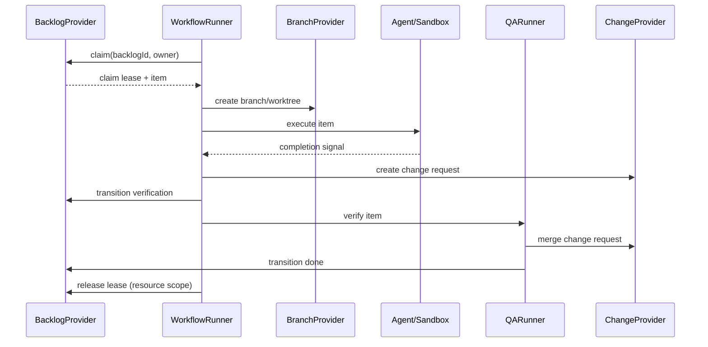

# AFK architecture

## Architecture guard

`pnpm architecture:check --check-packages` enforces the package dependency
contract and the root layer direction. Five package roots are checked:
`packages/afk-core`, `packages/afk-application`,
`packages/afk-infrastructure`, `packages/afk-execution`, and
`packages/afk-workflow-graph`. The contract is table-driven: `core` depends
on nothing, `application` may reach only `@afk/core`, `infrastructure` may
reach `core` and `application`, and `execution` may reach `core`,
`application`, `infrastructure`, and `@afk/workflow-graph`. Neither `core`
nor `application` may import Node built-ins. The guard also disallows
generic records and legacy client-factory imports, and rejects a package
that imports itself by name or reaches outside its own root. The legacy
migration is complete: `scripts/architecture-legacy-baseline.json` records
zero legacy files, imports, and patterns. New legacy files or imports fail
the check. Delete the stale baseline record when removing an entry.

The root `src/` tree is the CLI and the TUI; the shared capabilities live in
the packages. Layer direction applies to relative imports between non-test
files in `src/cli`, `src/shared`, and `src/views`. The guard's layer table
still names `domain`, `application`, and `infrastructure`, but those
directories are empty since the move. Passing `--require-packages` makes a
missing package root a failure instead of a skipped check.

The desktop client is a separate source tree with its own contract: it may
consume the shared `@afk/*` packages, but it must not import the root
package's `src/` tree, and it must not spawn an `afk` CLI process. A relative
import that escapes the desktop root into `src/` is reported the same way a
package importing outside its own root is.

`pnpm typecheck` also type-checks `tests/` through `tsconfig.tests.json`.
The root `tsconfig.json` excludes `tests/`, so without that project a broken
import in a test or an E2E script is invisible to the build.

## Scope and command surface

AFK executes backlog items that were already decomposed by an external
planner. It does not decompose or split work into smaller items. Creating a
backlog item is a management operation (`afk backlog create`), not part of the
execution pipeline. The command registry is the single source of truth for the
supported surface:

| Command | Responsibility |
| --- | --- |
| `afk backlog init` | Provision provider metadata |
| `afk backlog adopt --id <id> --project <project> --platform github\|gitlab [--json]` | Explicitly adopt one open manual issue as ready AFK work |
| `afk backlog create <title>` | Create one provider-backed backlog item |
| `afk backlog list/show/tag` | Inspect and manage backlog records |
| `afk backlog inventory` | Inventory issues across all credential-accessible projects |
| `afk backlog interrupt` | Stop active execution and hand the backlog to an operator |
| `afk backlog retry` | Return blocked operator-owned work to autonomous rework |
| `afk backlog confirm-merge` | Merge an approved root backlog change and mark it done |
| `afk run --backlog-id <id>` | Claim and execute one backlog item |
| `afk execute --work-item-id <id> --execution-manifest <path>` | Implement, independently verify, and publish one managed work item |
| `afk reconcile --work-item-id <id> --execution-manifest <path> --execution-id <id>` | Verify a human-merged root PR and reconcile its execution audit |
| `afk qa --backlog-id <id>` | Verify one backlog item and publish its change for the appropriate merge policy |
| `afk loop` | Poll one manifest-bound work item and call `executeWorkItem` |
| `afk loop start\|status\|stop` | Control the loop daemon: foreground or background start, status, and graceful stop |
| `afk observe` | Read append-only AFK run audit events (`runs`, `executions`, `execution`, `timeline`, `verify`, `replay`, `explain`, `doctor`) |
| `afk retro run --run-id <id> --workspace <path>` | Analyze recorded evidence with the existing `/retro` skill and write `report.json` plus `report.html` |
| `afk retro show <report>` | Read a generated retro report |
| `afk graph workflow <template>` | Generate a deterministic workflow graph |
| `afk` (TUI), `afk board`, `afk signal`, `afk tmux`, `afk kanban`, `afk debug`, `afk isolate`, `afk completion` | Operational and local tooling |

There are no aliases for removed command groups. Provider metadata labels are
an adapter detail and never part of this CLI contract.

## Provider boundaries

`BacklogProvider` is the canonical source for item identity, title and
description, state, execution mode, parent, dependencies, business tags, and
the branch mapping. `BranchProvider` owns branch and worktree operations.
`ChangeProvider` owns change-request creation, lookup, and merge. The runner
coordinates these interfaces and never parses provider labels.

GitHub and GitLab are concrete `BacklogProvider` implementations selected by
the provider bundle. They delegate common tracker mechanics internally while
keeping platform validation and construction at the platform boundary. A
future integration such as Linear implements `BacklogProvider` directly; no
tracker-specific type is required by the runner.

The management bundle wraps a concrete provider in a claim-free facade. Its
backlog surface includes lookup, listing, metadata initialization, business
tag updates, and the state/mode updates needed by QA. It has no `claim()` at
the type or runtime boundary. The execution bundle is the only path that
exposes claiming and runnable checks.

`adopt` is an optional management/provider capability; unsupported providers
return an explicit error. The tracker adapter checks the issue's raw state and
metadata rather than inferring readiness from domain defaults. It accepts only
open issues with absent or canonical ready/afk lifecycle labels, rejects unknown,
duplicate or conflicting AFK metadata and malformed or self-referencing
parent/base/dependency IDs, and preserves business labels, relationships and the
issue body. Adoption initializes provider metadata only when labels are missing,
then adds only the missing ready/afk labels with no removals. An already ready/afk
item is a no-write success; closed, blocked, HITL and other lifecycle states are
rejected without writes. Project and platform are required, and `--json` emits
the `backlog.adopt` envelope. Execution and loop never invoke adoption implicitly.

## Work-item and execution identity

The Provider Backlog is the business source of truth. Its `BacklogItem.id` is
carried unchanged through `afk run --backlog-id <id>`, `Run.workItemId`,
`TaskRuntimeRecord.backlogId`, TUI projections, and Desktop summaries.
`runId` identifies one execution attempt and must never replace the Backlog ID.

Relationships have separate meanings: `parentId` is organizational grouping,
`dependsOn` controls scheduling, and `baseBacklogId` selects an explicit Git
execution base. Neither parent nor dependency edges implicitly select a branch.

## Backlog lifecycle

```text
ready/rework --claim--> in_progress --> verification --> merge_ready --> done
   \                         \
    \                         +--> blocked (execution mode: hitl)
     +--> blocked (conflict, failure, timeout, or expired lease)
```

An item is runnable only when it is in `ready` or `rework`, uses the `afk` execution mode,
has no child items, and all `dependsOn` items are `done`. `parentId` groups
child items; a parent itself is never runnable. Any automation failure,
conflict, timeout, or uncertain lease recovery transitions the item to
`blocked` and routes it to `hitl`.

QA FAIL persists a new rework record in the provider's issue comment/note,
supersedes any active record, and increments `ReworkRecord.attempt` from the
highest persisted attempt. QA record creation only persists evidence;
`QARunner` owns the subsequent state/mode routing. Operator retry still creates
its record and routes directly to `rework` + `afk`.

`WorkflowConfig.maxQaReworkAttempts` defaults to **3** and must be a positive
integer. Set `maxQaReworkAttempts: 3` in `.afk/config.yml` or use
`AFK_MAX_QA_REWORK_ATTEMPTS=3`; the project file takes precedence. With no prior
records, the first FAIL is attempt 1, the second FAIL is attempt 2, and both
allow `rework` + `afk`. The third FAIL persists attempt 3 and returns
`success: false` without `rework`, routing directly to `blocked` + `hitl`.
Further FAIL calls retain that record and cannot reopen automatic rework.
A limit of 1 blocks the first FAIL. Attempts include earlier resolved,
superseded, and operator records; restarting a runner does not reset them.
QA PASS can still resolve an active record. This limit is separate from
`maxRetries` (execution retries) and `maxSelfIterations` (AC corrections).
The handoff/token `BudgetManager` restores its snapshot from
`<workspace>/.afk/budgets/` per canonical work item. Handoff rounds and native
harness token usage persist across runs; session IDs are deduplicated and a
corrupt snapshot fails closed before a new agent execution starts.

The `commit.recorded` audit event links implementation and QA commits to the
real local SHA and branch. It is emitted only for a new commit; a change
request SHA is never substituted.

## Runtime and Desktop projections

Canonical runtime files under `~/.afk/runtime/tasks` own execution-attempt
status, phase, heartbeat, progress, and diagnostics. A heartbeat older than the
freshness threshold is displayed as runtime `stale`; it does not mutate the
Provider Backlog lifecycle state.

The runtime owns the reading of these files as well as the writing. One reader
lists the buckets, validates each record, applies the identity rule and judges
staleness, so the run-detail view and the backlog view cannot disagree about a
record. The write model and the read model differ on purpose: a record
published today always carries the sandbox it ran in, the execution mode and
the agent it ran, while an older record may not — and a record that does not
carry them says so rather than being given a guess.

Desktop's workspace-local `.afk/backlog-runs.json` contains process launch
metadata only. It may report a PID or launch error, but it cannot infer
`verification`, `blocked`, or `done`. Desktop joins Backlog, launch metadata,
and canonical runtime records by exact `backlogId`; missing or malformed runtime
data leaves the Backlog visible with an explicit no-runtime state.

## Claim boundary and local fallback

Providers may expose a native conditional claim (CAS). The execution provider
uses that operation whenever available. Otherwise it acquires a durable lease
under `${AFK_STATE_DIR:-~/.afk/state}` and, while holding it, rereads and
validates the item, performs `ready -> in_progress`, and rereads to confirm the
claim. The returned lease is heartbeated by the runner and released exactly
once by the run resource scope on success, failure, timeout, crash, or handoff.

The filesystem lease is a single-host mechanism backed by a local trusted
filesystem; it is not a multi-host consensus or crash-recovery mechanism.
Multi-host execution requires provider-native CAS (a shared filesystem alone is
not sufficient). Lease paths are
namespaced by provider, project, and backlog ID. Symlinked state paths are
rejected, stale leases fail closed by default, and expiry recovery is allowed
only after the provider durably records `blocked` with mode `hitl`.

## End-to-end flow



`afk loop` accepts exactly one scoped backlog ID and matching execution
manifest, and delegates to `executeWorkItem`. The former separate
implementation/QA queue is removed. The standalone QA command remains a
lower-level verification operation.

## Extension points

Plugins can register provider implementations through the plugin runtime.
Each provider supplies the complete `BacklogProvider` contract, including
parent/dependency validation, state transitions, execution mode, tags, and
claim behavior. Platform clients remain private to their provider. No
database or additional middleware is required; local state is kept in the
filesystem lease directory.

## Reliability rules

- A failed transition, conflict, timeout, or expired lease is `blocked` plus
  `hitl`; it is never silently retried as automatic work.
- Native claim is preferred; the filesystem fallback is deliberately scoped to
  a trusted local filesystem on one host.
- Lease cleanup is lifecycle-owned and idempotent.
- Backlog IDs map deterministically to branches through the provider-neutral
  branch naming function.
