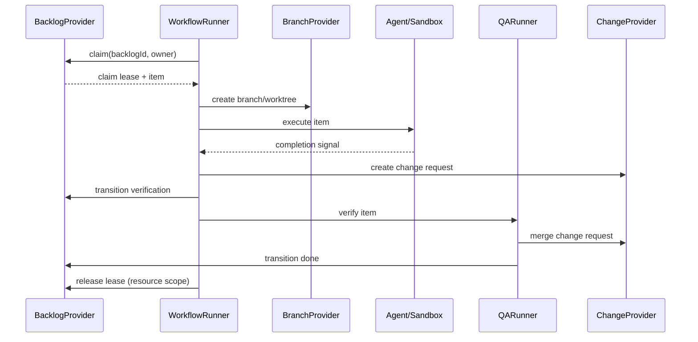

# AFK architecture

## Workspace organization

The root is a private pnpm workspace. `apps/cli` owns the `afk` executable,
Commander commands, shell completion, and the Ink TUI. `apps/desktop` owns
Electron main/preload, IPC validation and the React renderer. Both consume
the same shared packages through declared exports:

| Package | Responsibility |
| --- | --- |
| `packages/core` (`@afk/core`) | Pure models, events, reducer, policy and ports |
| `packages/application` (`@afk/application`) | Shared use cases, inventory and execution queries; depends on Core |
| `packages/runtime` (`@afk/runtime`) | Workflow execution, backlog operations and Node adapters for providers, Git, tmux, sandbox and storage |
| `packages/workflow-graph` (`@afk/workflow-graph`) | Pure workflow graph projection, layout and validation |

Applications must not import another workspace's source by relative path.
Shared packages must not depend on applications; the workspace graph must be
acyclic. Desktop renderer code must not import `@afk/runtime`; Node access
stays behind main-process IPC. Runtime retains its existing internal layer
rules. The architecture check enforces these rules and package exports.

Desktop backlog operations and graph generation call Runtime directly.
Managed work-item execution runs the same `executeWorkItem` used by CLI in a
bundled, detached Node worker. This preserves task process isolation and
allows execution to outlive the desktop window. Desktop never looks up or calls
the AFK CLI. Stop, recovery and merge confirmation call shared Runtime directly;
execution has a single Worker path with no command override or fallback.

Each workspace owns its build, typecheck and tests. Root commands run shared
packages and CLI in dependency order, then repository contract tests. Desktop
validation runs separately with `pnpm --filter afk-control-electron typecheck`,
`build` and `test`. The CLI binary is `apps/cli/dist/index.js`; root no longer
publishes an executable or contains application source.

## Execution and system paths

CLI and Desktop share the Runtime path resolver. Execution starts under
`~/.loop-workspace/<platform>/<project segments>/<issue>/`; repository checkouts
live in `repositories/` under that directory. The invocation directory and
`AFK_WORKSPACE` do not change this root. `afk run` without a manifest resolves
the provider identity and prepares an isolated checkout there.

Configuration and AFK system data live in `~/.afk/`. Global workflow settings
and templates are `config.yml` and `workflows/`; the tracker index is
`tracker-projects.json`. Per-workspace metadata, manifests, launch receipts,
budgets, sessions, diagnostic runs and execution journals live in
`~/.afk/workspaces/<sha256-of-absolute-workspace-path>/`. Hashing preserves
workspace isolation without placing system records in code repositories.

`afk execute --work-item-id <id>` locates the shared manifest automatically;
when missing, it creates one from the authoritative provider project and
working branch. `--execution-manifest` remains an explicit input override;
its location never changes the canonical execution root. `reconcile` requires
an existing manifest and never creates a new execution configuration.
Existing files in the former repository-local locations are left untouched;
move any needed configuration to `~/.afk/` before starting new executions.
Agent completion signals and QA artifact manifests remain execution-local
protocol files; they are not configuration or lifecycle state stores.

## Architecture guard

`pnpm architecture:check --check-packages` enforces layer direction and checks
the `packages/core` and `packages/application` roots for pure
source imports and dependency direction. The guard also
disallows generic records and legacy client-factory imports. The legacy migration is complete:
`scripts/architecture-legacy-baseline.json` records zero legacy files, imports,
and patterns. New legacy files or imports fail the check. Delete the stale
baseline record when removing an entry.

Layer direction applies to relative imports between non-test files in
`packages/runtime/src/domain`, `packages/runtime/src/application`,
`packages/runtime/src/infrastructure`, and `packages/runtime/src/shared`.
Application boundaries in `apps/cli` and `apps/desktop` are checked by the
workspace import guard. Passing `--require-packages` makes a missing package
root a failure instead of a skipped check.

## Scope and command surface

AFK executes backlog items that were already created and decomposed by an
external planner. It does not create or split work. The command registry is the
single source of truth for the supported surface:

| Command | Responsibility |
| --- | --- |
| `afk backlog init` | Provision provider metadata |
| `afk backlog adopt --id <id> --project <project> --platform github\|gitlab [--json]` | Explicitly adopt one open manual issue as ready AFK work |
| `afk backlog create <title> [--stage ready\|prd] [--dry-run] [--idempotency-key <key>]` | Create one provider-backed backlog item or preview its labels and relationships |
| `afk backlog list/show/tag` | Inspect and manage backlog records |
| `afk backlog children <prd-id>` | List the issues that belong to one work item, across every reachable project |
| `afk backlog inventory` | Inventory issues across all credential-accessible projects |
| `afk backlog interrupt` | Stop active execution and hand the backlog to an operator |
| `afk backlog retry` | Return blocked operator-owned work to autonomous rework |
| `afk backlog confirm-merge` | Merge an approved root backlog change and mark it done |
| `afk backlog reconcile-merge` | Complete a root backlog whose change is already merged on the provider |
| `afk run --backlog-id <id>` | Execute one claimed item |
| `afk execute --work-item-id <id> [--execution-manifest <path>]` | Implement, independently verify, and publish one managed work item |
| `afk reconcile --work-item-id <id> [--execution-manifest <path>] --execution-id <id>` | Verify a human-merged root PR and reconcile its execution audit |
| `afk qa --backlog-id <id>` | Run QA for an item awaiting verification |
| `afk loop` | Poll one manifest-bound work item and call `executeWorkItem` |
| `afk loop start\|status\|stop` | Control the loop daemon: foreground or background start, status, and graceful stop |
| `afk observe` | Read append-only AFK run audit events as text by default, or with `--json` (`runs`, `executions`, `execution`, `timeline`, `verify`, `replay`, `explain`, `doctor`) |
| `afk observe <runId>` / `afk log <runId>` | Short forms of `afk observe execution <runId>` with the same `--watch`, `--tail`, `--root`, and `--json` options |
| `afk observe execution\|timeline <runId> [--watch] [--tail <count>]` | Show a detailed run timeline; optionally follow new events or limit the initial history |
| `afk retro run --run-id <id> --workspace <path>` | Analyze recorded evidence with the existing `/retro` skill and write `report.json` plus `report.html` |
| `afk retro show <report>` | Read a generated retro report |
| `afk graph workflow <template>` | Generate a deterministic workflow graph |
| `afk` (TUI), `afk signal`, `afk tmux`, `afk kanban`, `afk debug`, `afk isolate`, `afk completion` | Operational and local tooling |

The [wiki skill](../../skills/wiki/SKILL.md) bundles a separate Python CLI;
its argparse registry in `skills/wiki/scripts/wiki.py` owns this surface.
It does not add an `afk` command. All operations accept `--vault` and `--json`,
before or after the subcommand. Vault resolution is `--vault` → `WIKI_VAULT`
→ nearest ancestor `.wiki.json` → user `wiki/config.json` under
`XDG_CONFIG_HOME` (default `~/.config`). Configurations contain a `vault`
string; relative paths are based on the configuration's directory.

| Skill-local command | Responsibility |
| --- | --- |
| `wiki.py locate` | Show the resolved vault and configuration source |
| `wiki.py search <query> [--regex] [--limit <count>]` | Search titles, aliases, and content |
| `wiki.py read <path> [--heading <heading>]` | Read a page or section and its whole-file hash |
| `wiki.py lint [path] [--max-age-days <days>]` | Report vault-local or portable quality checks |
| `wiki.py ingest --plan <file-or-dash> [--apply] [--max-age-days <days>]` | Preview or apply an evidence-backed change plan |

There are no aliases for removed command groups. Provider metadata labels are
an adapter detail and never part of this CLI contract.

### Reading and following runs

```bash
afk observe runs
afk observe <runId>
afk log <runId> --watch --tail 20
afk observe execution <runId>
afk observe timeline <runId> --tail 20 --watch
afk observe execution <runId> --watch --tail 0
afk observe execution <runId> --json
```

`observe <runId>` uses `execution` as the default subcommand; existing named
subcommands still take precedence. `log <runId>` is a direct shortcut to the
same run viewer, including the same option validation and JSON contract.

Text output includes the recorded run state, phase, active step or human gate,
integrity, local time zone, elapsed time, and latest event. Workspace paths and
branches remain in the summary even when `--tail` hides their original event.
Timeline entries expand event fields, including steps, commits, change URLs,
session/transcript references, complete multiline error summaries, and QA
expected/actual criteria. Failed events without a recorded reason say so.
These are audit events, not a live agent stdout/stderr stream; unrecorded
details cannot be reconstructed. A running state without an active step is
not by itself a failure.

`--watch` polls once per second and appends new events without repeating the
history. It stays quiet without changes, displays human-review gates while
waiting, and exits after a terminal event. Ctrl-C or SIGTERM stops only the
observer. Invalid integrity stops following, marks the state untrusted, and
excludes unverified details. A replaced or shortened history requires restarting
the observer. `--tail` accepts a non-negative integer and counts complete events;
zero suppresses the initial timeline while retaining the summary.

`--json` preserves the existing single-document JSON contracts and cannot be
combined with `--watch` or `--tail`. Text redirected to a file or pipe has no
color escapes; `NO_COLOR` also disables colors in a terminal.

## Provider boundaries

`BacklogProvider` is the canonical source for item identity, title and
description, state, execution mode, parent, dependencies, business tags, and
the branch mapping. `BranchProvider` owns branch and worktree operations.
`ChangeProvider` owns change-request creation, lookup, and merge. The runner
coordinates these interfaces and never parses provider labels.

GitHub and GitLab are concrete `BacklogProvider` implementations selected by
the provider bundle. They delegate common tracker mechanics internally while
keeping platform validation and construction at the platform boundary. A
future integration such as Linear implements `BacklogProvider` directly; no
tracker-specific type is required by the runner.

The management bundle wraps a concrete provider in a claim-free facade. Its
backlog surface includes lookup, listing, metadata initialization, business
tag updates, and the state/mode updates needed by QA. It has no `claim()` at
the type or runtime boundary. The execution bundle is the only path that
exposes claiming and runnable checks.

### Tracker target resolution

The provider project a command talks to is a tracker target: one platform and
one project, resolved together and never mixed. The project is chosen by the
first source that names one:

1. the explicit `--project` flag
2. the local tracker index, by issue id
3. the local tracker index, by working directory
4. the `AFK_TRACKER_PROJECT` environment variable
5. the `origin` remote of the working directory

The platform follows the project: the `--platform` flag wins, then the
platform recorded next to the project, then `AFK_TRACKER_PLATFORM`, then the
shape of the project key, then the git remote, then the configured
credentials.

The git remote is therefore optional. Read-only commands such as
`afk backlog show` run from any directory once the target is known, and an
unresolvable target fails with an actionable error instead of a platform
detection failure. When the platform is still unknown, a numeric project key
or a key with three or more path segments resolves to GitLab; an `owner/repo`
key resolves to GitHub unless only GitLab credentials are configured.

### Local tracker index

`~/.afk/tracker-projects.json` records the provider projects AFK has
worked with: the project, the local repositories it was
reached from, and the issues it contains. Every provider read, inventory and
execution writes what it saw, so a later command resolves a bare issue id or
a working directory to its provider project without any configuration. This
is how a user who works across several repositories addresses a project
without remembering its key or configuring each repository.

The index is a local cache, not a source of truth: provider state always
comes from the provider, and a missing or damaged index only means "no
association known". When several recorded projects carry the same issue id,
the project that owns the working directory wins; otherwise the most recently
updated project wins, and `--project` always overrides that choice.

`adopt` is an optional management/provider capability; unsupported providers
return an explicit error. The tracker adapter checks the issue's raw state and
metadata rather than inferring readiness from domain defaults. It accepts only
open issues with absent or canonical ready/afk lifecycle labels, rejects unknown,
duplicate or conflicting AFK metadata and malformed or self-referencing
parent/base/dependency IDs, and preserves business labels, relationships and the
issue body. Adoption initializes provider metadata only when labels are missing,
then adds only the missing ready/afk labels with no removals. An already ready/afk
item is a no-write success; closed, blocked, HITL and other lifecycle states are
rejected without writes. Project and platform are required, and `--json` emits
the `backlog.adopt` envelope. Execution and loop never invoke adoption implicitly.

## Work-item and execution identity

The Provider Backlog is the business source of truth. Its `BacklogItem.id` is
the **canonical global identity** of the item: `platform:projectKey#issueNumber`,
for example `github:acme/api#42`. The same identity is carried through
`afk run --backlog-id <id>`, `Run.workItemId`, the run events, TUI projections
and Desktop summaries. `runId` identifies one execution attempt and must never
replace the backlog identity.

One item has one identity, whichever provider served it. Two repositories with
the same issue number stay two different backlog items, and every relationship
edge names the item it points at unambiguously. Relationship fields
(`parentId`, `baseBacklogId`, `dependsOn`) carry the same canonical form.

The canonical project key is derived by one rule, `canonicalProjectKey()`:
GitHub projects are `owner/repo`; GitLab projects are `host/group/project` on a
self-hosted instance and the bare `group/project` on gitlab.com. A first path
segment that contains a dot is read as a host, which is the same rule the
tracker adapter uses to route a relationship to another project.

A provider accepts both spellings of a reference: a bare issue number, which
belongs to the project that provider writes to, and a canonical global
identity, which may address another repository on the same provider host.
Cross-platform and cross-host references are rejected.

The project a provider writes to is its own private state, not part of the
provider contract: a reference that names no project can only be resolved by
the provider that owns that project. What the contract owns is the *behaviour*
— `planCreate()` plans a creation without writing anything, and `create()`
writes exactly that plan. A dry run and a real creation therefore go through
the same code path, and every wrapper in the chain has to carry the behaviour
because the port requires it.

Relationship labels are stored in canonical form (`parent::github:acme/api#42`).
Legacy bare-number labels (`parent::42`) are still read and resolve against the
owning project. The backlog metadata codec
(`packages/runtime/src/domain/backlog/metadata-codec.ts`) is the only place
that parses, validates and serializes these labels; the tracker adapter, the
global inventory and the cross-project graph all use it, so a `parent::` edge
means the same thing everywhere.

Relationships have separate meanings: `parentId` is organizational grouping,
`dependsOn` controls scheduling, and `baseBacklogId` selects an explicit Git
execution base. Neither parent nor dependency edges implicitly select a branch.

The backlog graph spans projects. A PRD anchor may live in the requirements
repository while its implementation children live in the service repository, so
the provider asks the cross-project graph for the children of an item before it
claims it; a parent with children in another repository is never runnable. When
the graph cannot be read, the adapter falls back to the local project scan and
reports the failure.

The children of one work item are answered by one query
(`packages/runtime/src/application/work-item/children.ts`). It takes the
canonical identity of the parent, because a bare issue number names a
different issue in every repository, and it answers from the local inventory
first. The inventory is a cache, so a missing or stale copy is collected again
before the question is answered, and an identity the copy has never heard of is
collected once more before it is reported as unknown. The children are ordered
by project and issue number, so the list does not depend on when the inventory
was collected. A child that AFK does not manage is reported as well, with its
`managed` flag, because a hand-written issue attached to a PRD is a child too.

Creation relationship flags (`--parent`, `--base-backlog`, `--depends-on`)
accept a positive issue number in the explicitly selected project, or a
qualified `platform:projectKey#issueNumber` reference. A Git base must belong
to the execution repository. Multi-repository Git bases belong in an execution
manifest.

For `afk run`, an unfinished base backlog selects its branch before workspace
preparation, and a completed/merged base falls back to the configured base.
An explicit `--base-branch`, branch strategy base, or manifest base takes precedence.
Legacy `base::prd-N` metadata still selects `prd/N`. Implementation and QA use
the same backlog base resolver; the normal target branch is unchanged.

`--stage prd` creates an organizational anchor with `stage::prd`, which is
never execution eligible. A PRD parent is its own core work item state, not a
blocked item: an organizational parent and an item that waits for a human are
different facts. Existing PRD anchors are recognized even without mode
labels. Issues without mode labels default to `hitl` until explicitly adopted.
`--dry-run` validates the same creation plan, including referenced issues, and
prints the title, description, labels and relationships without provider writes.
`--idempotency-key` persists a hashed, project-scoped metadata label: sequential
retries return the existing issue, including closed issues. It is a retry key,
not a distributed lock; concurrent creators must be serialized by the caller.
Reserved metadata labels cannot be supplied as business tags, and duplicate
parent/base labels or invalid references fail validation.

CLI JSON success envelopes are `{ok:true,kind,data}`. Failures are
`{ok:false,kind,data:null,error:{code,message,details?}}` with a nonzero exit code.
Automation must check both the exit status and `ok` before reading `data`.

## Backlog lifecycle

```text
ready/rework --claim--> in_progress --> verification --> merge_ready --> done
   \                         \
    \                         +--> blocked (execution mode: hitl)
     +--> blocked (conflict, failure, timeout, or expired lease)
```

An item is runnable only when it is in `ready` or `rework`, uses the `afk` execution mode,
has no child items, and all `dependsOn` items are `done`. `parentId` groups
child items; a parent itself is never runnable. "No child items" is decided on
the backlog graph, so children in another repository count as children. Any automation failure,
conflict, timeout, or uncertain lease recovery transitions the item to
`blocked` and routes it to `hitl`.

A `prd` item is an organizational parent. It is never execution eligible, and
it is not `blocked`: it groups children instead of waiting for a human.

QA FAIL persists a new rework record in the provider's issue comment/note,
supersedes any active record, and increments `ReworkRecord.attempt` from the
highest persisted attempt. QA record creation only persists evidence;
`QARunner` owns the subsequent state/mode routing. Operator retry still creates
its record and routes directly to `rework` + `afk`.

`WorkflowConfig.maxQaReworkAttempts` defaults to **3** and must be a positive
integer. Set `maxQaReworkAttempts: 3` in `~/.afk/config.yml` or use
`AFK_MAX_QA_REWORK_ATTEMPTS=3`; the configuration file takes precedence. With no prior
records, the first FAIL is attempt 1, the second FAIL is attempt 2, and both
allow `rework` + `afk`. The third FAIL persists attempt 3 and returns
`success: false` without `rework`, routing directly to `blocked` + `hitl`.
Further FAIL calls retain that record and cannot reopen automatic rework.
A limit of 1 blocks the first FAIL. Attempts include earlier resolved,
superseded, and operator records; restarting a runner does not reset them.
QA PASS can still resolve an active record. This limit is separate from
`maxRetries` (execution retries) and `maxSelfIterations` (AC corrections).
The handoff/token `BudgetManager` restores its snapshot from
`~/.afk/workspaces/<workspace hash>/budgets/` per canonical work item. Handoff rounds and native
harness token usage persist across runs; session IDs are deduplicated and a
corrupt snapshot fails closed before a new agent execution starts.

The `commit.recorded` audit event links implementation and QA commits to the
real local SHA and branch. It is emitted only for a new commit; a change
request SHA is never substituted.

## Runtime and Desktop projections

Canonical runtime files under `~/.afk/runtime/tasks` own execution-attempt
status, phase, heartbeat, progress, and diagnostics. A heartbeat older than the
freshness threshold is displayed as runtime `stale`; it does not mutate the
Provider Backlog lifecycle state.

Desktop reads `work-item-runs.json` from the system data directory for the
execution workspace located by canonical `workItemId`. These records contain Worker launch receipts, not
Provider lifecycle state. Runtime records must explicitly name their workspace;
Desktop joins them by exact `backlogId`, execution workspace and provider.
Missing or malformed runtime data leaves the Backlog visible with an explicit
no-runtime state. There is no reader for the removed backlog run store.

## Claim boundary and local fallback

Providers may expose a native conditional claim (CAS). The execution provider
uses that operation whenever available. Otherwise it acquires a durable lease
under `${AFK_STATE_DIR:-~/.afk/state}` and, while holding it, rereads and
validates the item, performs `ready -> in_progress`, and rereads to confirm the
claim. The returned lease is heartbeated by the runner and released exactly
once by the run resource scope on success, failure, timeout, crash, or handoff.

The filesystem lease is a single-host mechanism backed by a local trusted
filesystem; it is not a multi-host consensus or crash-recovery mechanism.
Multi-host execution requires provider-native CAS (a shared filesystem alone is
not sufficient). Lease paths are
namespaced by provider, project, and backlog ID. Symlinked state paths are
rejected, stale leases fail closed by default, and expiry recovery is allowed
only after the provider durably records `blocked` with mode `hitl`.

## End-to-end flow



`afk loop` accepts exactly one scoped backlog ID and matching execution
manifest, and delegates to `executeWorkItem`. The former separate
implementation/QA queue is removed. The standalone QA command remains a
lower-level verification operation.

## Extension points

Plugins can register provider implementations through the plugin runtime.
Each provider supplies the complete `BacklogProvider` contract, including
parent/dependency validation, state transitions, execution mode, tags, and
claim behavior. Platform clients remain private to their provider. No
database or additional middleware is required; local state is kept in the
filesystem lease directory.

## Reliability rules

- A failed transition, conflict, timeout, or expired lease is `blocked` plus
  `hitl`; it is never silently retried as automatic work.
- Native claim is preferred; the filesystem fallback is deliberately scoped to
  a trusted local filesystem on one host.
- Lease cleanup is lifecycle-owned and idempotent.
- Backlog IDs map deterministically to branches through the provider-neutral
  branch naming function.
