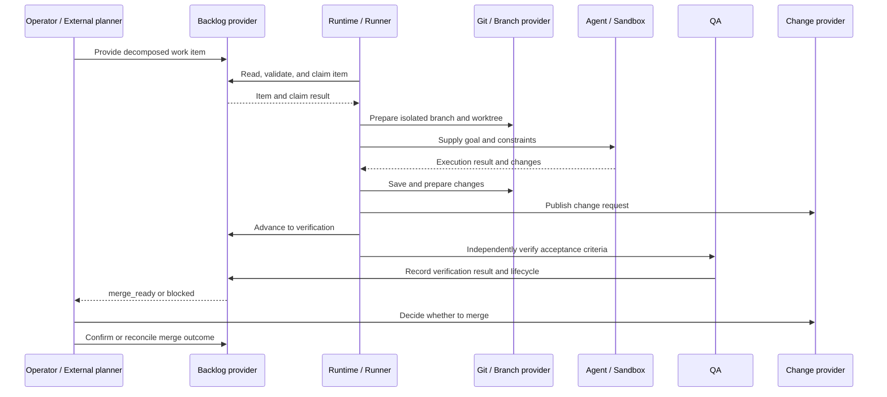

# AFK architecture overview

AFK turns backlog work items already planned and decomposed by an external system into **traceable, independently verified code changes awaiting human merge**. It owns execution and pre-delivery control, not requirements planning, task decomposition, or the final merge decision.

This page explains the system boundary, core components, sources of truth, and end-to-end flow. See [Execution architecture](./execution.md) for execution details and [System architecture design](./system-architecture-design.md) for the deeper design rationale.

## System boundary

AFK sits between a backlog provider, code repositories, and coding agents. It manages work from claim through verification and publication of a change request.

| Participant | Facts or capabilities it owns | AFK's responsibility |
| --- | --- | --- |
| Backlog provider (such as GitHub or GitLab) | Work-item identity, business state, relationships, and metadata | Validate eligibility, advance lifecycle state, and record outcomes |
| Git repository | Branches, commits, worktrees, and change history | Isolate execution, preserve changes, and publish change requests |
| Coding agent | Code modification and execution feedback | Supply the goal and constraints, supervise execution, and verify results independently |
| Operator | Authorization, exception handling, and merge decisions | Provide a takeover path without bypassing verification or audit boundaries |

AFK consumes the output of an external planning system; it does not perform requirements decomposition. An agent executes work but is not the final judge of its result. An agent's completion claim does not replace independent QA. After a change request is published, it waits at a human merge gate; AFK does not decide to merge autonomously.

## System structure

The repository is a pnpm workspace. Applications consume shared capabilities through declared package exports rather than relative imports into another workspace's source.

| Component | Primary responsibility |
| --- | --- |
| `apps/cli` | CLI commands, shell completion, terminal interaction, and operations entry points |
| `apps/desktop` | Electron main process, preload, IPC, and React UI |
| `packages/core` (`@afk/core`) | Domain models, events, reducers, policies, and ports |
| `packages/application` (`@afk/application`) | Shared use cases, manifests, and execution queries; depends on Core |
| `packages/runtime` (`@afk/runtime`) | Workflow execution, backlog operations, and Provider, Git, tmux, sandbox, and storage adapters |
| `packages/workflow-graph` (`@afk/workflow-graph`) | Workflow graph projection, layout, and validation |

Dependencies must be one-way and acyclic: applications depend on shared packages, and shared packages do not depend on applications. The Desktop renderer must not import `@afk/runtime`; Node capabilities are exposed through main-process IPC.

CLI and Desktop share Runtime. Desktop backlog management and graph generation call Runtime directly. Managed work items run through a separate Node Worker that invokes the same `executeWorkItem` path as CLI, preserving process isolation and allowing work to continue after the Desktop window closes. Desktop does not execute work by invoking the AFK CLI.

## Core responsibilities and boundaries

### Provider and Runtime

- **`BacklogProvider`** supplies canonical work-item identity, title and description, lifecycle state, execution mode, relationships, business tags, and branch mapping.
- **`BranchProvider`** owns branch and worktree operations.
- **`ChangeProvider`** owns change-request creation, lookup, and merge operations.
- **Runner / Runtime** coordinates these interfaces; provider-specific label parsing and API details should not leak into the execution flow.
- **Agent / Sandbox** performs authorized work. It does not own backlog lifecycle state, claim authority, or the final acceptance decision.
- **QA** independently checks acceptance criteria and determines whether work passes, needs rework, or must be blocked.

Platform adapters encapsulate their clients and platform-specific behavior. A new platform should implement the Provider contract rather than add platform-specific branches to Runner.

### Sources of truth

Different state categories have different authoritative sources and must not be conflated.

| Data | Source of truth | Meaning |
| --- | --- | --- |
| Work item and business lifecycle | Backlog provider | Local caches and UI projections cannot override provider state |
| Execution-attempt phase, heartbeat, progress, and diagnostics | Runtime execution records | Describes one attempt; a stale heartbeat may be shown as `stale` without changing backlog state |
| Worker launch receipt | Desktop work-item run record | Records Worker startup, not provider lifecycle state |
| Commit, phase-transition, and execution audit evidence | AFK append-only audit events | Supports traceability and explanation of recorded activity; it cannot recover output that was never recorded |

Configuration and AFK system data live under `~/.afk/`. Workspace metadata, execution manifests, launch receipts, budgets, sessions, diagnostics, and execution audit records are isolated under directories keyed by the workspace-path hash. The execution directory and system-state directory serve different purposes and are not interchangeable.

## Work-item identity and relationships

Every work item has a canonical global identity, for example `github:acme/api#42`. This identity remains consistent across runs, events, CLI, and Desktop projections. A `runId` identifies one execution attempt and must not replace the work-item identity.

Three relationship types have distinct meanings:

| Field | Meaning | Controls scheduling or Git baseline? |
| --- | --- | --- |
| `parentId` | Organizes work items into a parent-child hierarchy | No. A parent is not executable; its children may live in other repositories |
| `dependsOn` | Declares work that must finish first | Yes. Dependencies must be `done` before the item can run |
| `baseBacklogId` | References a work item used as an execution baseline | Used to select or trace the baseline; a Git branch cannot be reused directly across repositories |

Cross-repository references retain their canonical identity for traceability, but an execution baseline must respect the target repository's Git semantics. A relation inside one repository is written as the issue number; a relation across repositories keeps the canonical identity. Parent, dependency, and baseline relationships do not implicitly substitute for one another.

## Lifecycle and human gate

```text
ready / rework
      |
    claim
      v
 in_progress
      |
      v
 verification
      |
      v
 merge_ready  -- human merge -->  done
      |
      +-- failure, conflict, timeout, or uncertain claim --> blocked + hitl
```

An item is runnable only when its state is `ready` or `rework`, its execution mode is `afk`, it has no children, and every `dependsOn` item is `done`. A parent is an organizational container, not an executable task. Child checks account for cross-repository relationships.

- **`in_progress`**: the item has been claimed and execution is underway.
- **`verification`**: implementation has entered independent verification.
- **`merge_ready`**: the change is ready for human review and merge; it is not complete.
- **`done`**: the change has been confirmed merged, either by an explicit merge action or reconciliation with a merge already performed on the provider.
- **`blocked + hitl`**: the automated flow cannot safely continue and requires operator intervention.

`afk backlog confirm-merge` explicitly initiates a merge at the operator's request. `afk backlog reconcile-merge` only reconciles a change that has already been merged by a person. AFK never merges without explicit authorization.

## End-to-end execution path



The key sequence is to validate eligibility before starting, isolate the execution environment, and let independent verification assess the result after the executor reports completion. Only verified changes proceed to the human merge gate.

## Claiming and concurrency safety

When a provider supports native conditional claims (CAS), AFK prefers that mechanism. Otherwise, Runtime can use a durable file lease under `${AFK_STATE_DIR:-~/.afk/state}`, rereading and validating the item while holding the lease before performing and confirming the state transition.

A filesystem lease is limited to a trusted local filesystem on one host. It does not provide multi-host consensus or cross-host crash recovery. Multi-host execution requires provider-native CAS; a shared filesystem alone is not sufficient. An uncertain claim, expired lease, or failed state transition must fail closed and require human handling.

## Failure handling and recovery

Different failures represent different facts. They must not all be treated as an ordinary agent failure or retried unconditionally.

| Situation | Handling principle |
| --- | --- |
| Agent process or session disappears, or execution is interrupted unexpectedly | Within the configured retry budget, the execution step may be repeated in the same workspace with the same goal |
| Execution times out | Treat it as work that did not finish within its budget; do not equate it with an unexpected agent exit |
| QA fails | Persist verification evidence and route according to the rework policy; block after the limit is reached |
| Change request conflicts | Attempt resolution within the verification flow and verify again; block if it cannot be resolved safely |
| Required tools or dependencies are missing from the verification environment | Record what is missing and which acceptance criteria are affected, then hand off to an operator |
| Claim, state transition, or recovery outcome is uncertain | Fail closed; do not assume success or silently retry concurrently |

Runtime records, audit events, and provider state have distinct responsibilities. When diagnosing an issue, inspect the authoritative business state, the corresponding execution attempt, and its audit evidence rather than relying only on the UI or an agent's completion claim.

## Architecture constraints and extension

The following constraints are enforced by code and architecture checks, not just documented conventions:

- Workspaces interact through declared package exports, with one-way and acyclic dependencies.
- Core and Application preserve the domain-core boundary; Runtime's domain, application, infrastructure, and shared layers follow their defined dependency direction.
- The Desktop renderer does not depend directly on Node Runtime; managed execution uses a separate Worker.
- Provider-specific metadata and client details remain inside the Provider boundary.
- Claiming, lifecycle transitions, verification, and audit do not depend on an agent voluntarily following prompt instructions.
- New platform integrations extend the Provider contract; new execution capabilities must not bypass lifecycle controls, verification, or the human merge gate.

Run `pnpm architecture:check --check-packages` to check package dependencies and architecture boundaries. The current source and guard scripts are authoritative; if documentation and implementation disagree, inspect the code and tests before updating the documentation.

## Related documentation

- [Execution architecture](./execution.md): execution lifecycle, run modes, and execution constraints.
- [System architecture design](./system-architecture-design.md): deeper system boundaries, architecture decisions, and reliability analysis.
- [Chinese architecture overview](./overview.zh.md): Chinese version of this overview.
- [Documentation index](../index.md): documentation categories and entry points.
