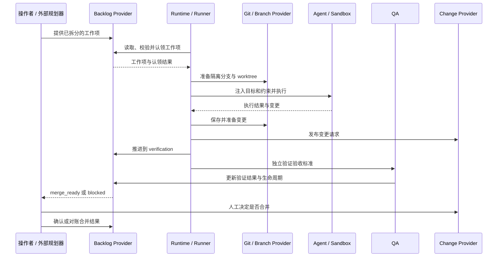

# AFK 架构概览

AFK 将外部规划系统已经拆分好的 backlog 工作项，转化为**可追踪、可独立验证、等待人工合并的代码变更**。它负责执行与交付前的控制，不负责需求规划、任务拆分或最终合并决策。

本文说明系统边界、核心组件、数据权威和端到端流程。具体执行步骤见[执行架构](./execution.zh.md)；更完整的设计分析见[系统架构设计](./system-architecture-design.md)。

## 设计边界

AFK 位于 backlog provider、代码仓库与编码 Agent 之间，托管从认领到验证和发布变更请求的生命周期。

| 参与方 | 提供的事实或能力 | AFK 的职责 |
| --- | --- | --- |
| Backlog Provider（如 GitHub、GitLab） | 工作项身份、业务状态、关系与元数据 | 校验可执行性，推进生命周期并记录结果 |
| Git 仓库 | 分支、提交、worktree 与变更历史 | 隔离执行、保存变更并发布变更请求 |
| 编码 Agent | 代码修改能力与执行反馈 | 提供目标和约束，监控执行并独立验证结果 |
| 操作者 | 任务授权、异常处理与合并决策 | 提供接管入口，不绕过验证和审计边界 |

AFK 消费外部规划结果，不负责创建需求分解本身。Agent 是执行者而非结果的最终裁判；Agent 的完成声明不能代替独立 QA。变更请求发布后进入人工合并关卡，AFK 不会自行决定合并。

## 系统结构

仓库采用 pnpm workspace，应用通过包的正式导出共享能力，不通过相对路径导入其他 workspace 的源码。

| 组件 | 主要职责 |
| --- | --- |
| `apps/cli` | CLI 命令、补全、终端交互与运维入口 |
| `apps/desktop` | Electron 主进程、preload、IPC 与 React 界面 |
| `packages/core`（`@afk/core`） | 领域模型、事件、Reducer、策略与 Port |
| `packages/application`（`@afk/application`） | 共享用例、清单处理与执行查询，依赖 Core |
| `packages/runtime`（`@afk/runtime`） | 工作流执行、backlog 操作，以及 Provider、Git、tmux、sandbox 和存储适配器 |
| `packages/workflow-graph`（`@afk/workflow-graph`） | 工作流图的投影、布局与校验 |

依赖方向必须保持单向且无环：应用依赖共享包，共享包不能反向依赖应用。Desktop 渲染器不直接引用 `@afk/runtime`，Node 能力通过主进程 IPC 提供。

CLI 与 Desktop 共用 Runtime。Desktop 的 backlog 管理和图生成直接调用 Runtime；托管工作项通过独立 Node Worker 调用与 CLI 相同的 `executeWorkItem`，以保留进程隔离以及关闭窗口后继续执行的能力。Desktop 不通过调用 AFK CLI 来执行工作。

## 核心职责与边界

### Provider 与 Runtime

- **`BacklogProvider`** 提供工作项的规范身份、标题和描述、生命周期状态、执行模式、关系、业务标签及分支映射。
- **`BranchProvider`** 负责分支与 worktree 操作。
- **`ChangeProvider`** 负责变更请求的创建、查询与合并操作。
- **Runner / Runtime** 编排这些接口，不应把特定平台的标签解析或 API 细节散落到执行流程中。
- **Agent / Sandbox** 执行被授权的工作；它不拥有 backlog 生命周期、认领权或独立验收的最终决定权。
- **QA** 独立检查变更是否满足验收标准，并决定通过、返工或阻断。

平台适配器封装自己的客户端和平台特有行为。接入新平台应实现完整的 Provider 契约，而不是在 Runner 中增加平台分支。

### 数据权威

系统中的状态有不同的权威来源，不应将它们混为一谈。

| 数据 | 权威来源 | 说明 |
| --- | --- | --- |
| 工作项及其业务生命周期 | Backlog Provider | 本地缓存和界面投影不能覆盖 Provider 的业务状态 |
| 执行尝试的阶段、心跳、进度和诊断 | Runtime 运行记录 | 记录单次执行过程；过期心跳可显示为 `stale`，但不改变 backlog 状态 |
| Worker 启动回执 | Desktop 工作项运行记录 | 说明 Worker 的启动情况，不代表 Provider 生命周期状态 |
| 提交、阶段变化和执行结果的审计证据 | AFK append-only 审计事件 | 用于追踪与解释已经记录的过程；不能推断未记录的输出 |

配置和 AFK 系统数据位于 `~/.afk/`。工作区元数据、执行清单、启动回执、预算、会话、诊断与执行审计按工作区路径哈希隔离保存。执行目录与系统状态目录用途不同，不能互相替代。

## 工作项身份与关系

每个工作项都有规范全局身份，例如 `github:acme/api#42`。该身份跨运行、事件、CLI 和 Desktop 投影保持一致；`runId` 则标识一次执行尝试，不能替代工作项身份。

三类关系表达不同语义：

| 字段 | 语义 | 是否决定执行顺序或 Git 基线 |
| --- | --- | --- |
| `parentId` | 将工作项组织为父子层级 | 否；父项本身不可执行，子项可位于其他仓库 |
| `dependsOn` | 声明必须先完成的工作项 | 是；依赖项必须为 `done` 才可运行 |
| `baseBacklogId` | 引用执行基准工作项 | 用于选择或追踪基线；Git 分支不能跨仓库直接复用 |

跨仓库引用保留规范身份用于追踪，但执行基线必须符合目标仓库的 Git 语义。同一仓库内的关系写成 issue 编号，跨仓库的关系保留规范身份。父子关系、依赖关系和执行基线互不隐式替代。

## 生命周期与人工关卡

```text
ready / rework
      |
    claim
      v
 in_progress
      |
      v
 verification
      |
      v
 merge_ready  -- 人工合并 -->  done
      |
      +-- 失败、冲突、超时或认领状态不确定 --> blocked + hitl
```

工作项只有在状态为 `ready` 或 `rework`、执行模式为 `afk`、没有子项且所有依赖均为 `done` 时才可执行。父项是组织性容器，不作为可执行任务；判断是否存在子项时会考虑跨仓关系。

- **`in_progress`**：工作项已被认领，执行正在进行。
- **`verification`**：实现已进入独立验证阶段。
- **`merge_ready`**：变更已准备好等待人工合并，不等于已完成。
- **`done`**：变更已被确认合并，或通过显式对账确认已在 Provider 合并。
- **`blocked + hitl`**：自动流程无法安全继续，需要操作者介入。

`afk backlog confirm-merge` 是操作者明确发起合并的动作；`afk backlog reconcile-merge` 只对账已经由人合并的变更。AFK 不会在无人授权时自动合并。

工作项的变更请求由规则选定，而不是由列表恰好返回的顺序决定：已落地的变更优先，其次是目标分支与工作去向一致的变更，再次是仍在进行中的变更。同一个源分支可能承载多个变更——探针、重做、误开的变更——选错会让已经落地的工作项账目一直挂着。

这条规则回答两个不同的问题，两侧共用同一套规则与同一批候选：合并对账要的是「已落地的那一个」，因为它才是工作项账目所依据的事实；工作项展示要的是「还活着的那一个」，因为返工重开的源分支上同时挂着上一轮已合并的变更和这一轮仍在进行中的变更，而只有后者才是合并闸门。两侧都把候选状态回读 provider，因为列表可能少报已经落地的变更。

## 端到端执行路径



执行的关键原则是：先验证是否有资格开始，再隔离执行环境；执行者提交结果后，由独立验证流程判断是否满足验收要求；只有通过验证的变更才进入人工合并关卡。

## 认领与并发安全

Provider 支持原生条件认领（CAS）时优先使用。否则 Runtime 可在 `${AFK_STATE_DIR:-~/.afk/state}` 下使用持久化文件 lease，并在持有期间重新读取、校验和确认状态转换。

文件系统 lease 只适用于单机上的可信本地文件系统，不提供多主机共识或跨主机崩溃恢复。多机执行必须依赖 Provider 原生 CAS；共享文件系统本身不足以构成可靠的分布式认领机制。认领不确定、lease 过期或状态转换失败时，流程必须保守阻断并交由人工处理。

## 失败处理与恢复原则

不同失败代表不同事实，不能统一当作 Agent 普通失败或无条件重试。

| 情况 | 处理原则 |
| --- | --- |
| Agent 进程或会话消失、执行流异常中断 | 在既定重试预算内，可在同一工作区以同一目标重跑该执行步骤 |
| 执行超时 | 视为工作未在预算内完成，不等同于 Agent 意外退出 |
| QA 不通过 | 持久化验证证据，并按返工策略路由；达到上限后阻断 |
| 变更请求冲突 | 在验证流程中尝试解决并重新验证；无法安全解决时阻断 |
| 验证环境缺少必要工具或依赖 | 明确记录缺失项与受影响的验收标准，交由人工处理 |
| 认领、状态转换或恢复结果不确定 | 采用 fail-closed 原则，不猜测成功，也不静默并发重试 |

运行时记录、审计事件与 Provider 状态承担不同职责。排查问题时应同时核对权威业务状态、对应执行尝试及其审计证据，而不是仅凭界面显示或 Agent 的完成声明下结论。

## 架构约束与扩展

以下约束由代码和架构检查守护，而不只是文档约定：

- workspace 之间通过正式包导出交互，依赖方向保持单向、无环。
- Core 与 Application 保持领域核心边界；Runtime 的 domain、application、infrastructure、shared 依照既定方向依赖。
- Desktop 渲染器不直接依赖 Node Runtime；托管执行使用独立 Worker。
- Provider 特有的元数据和客户端细节留在 Provider 边界内。
- 认领、状态推进、验证与审计不依赖 Agent 自觉遵守提示词。
- 新增平台能力通过 Provider 契约扩展；新增执行能力不得绕过生命周期、验证和人工合并关卡。

运行 `pnpm architecture:check --check-packages` 可检查包依赖与架构边界。具体规则以当前源码和检查脚本为准；若文档与实现不一致，应先核对代码及测试，再更新文档。

## 相关文档

- [执行架构](./execution.zh.md)：执行生命周期、运行方式与执行过程约束。
- [系统架构设计](./system-architecture-design.md)：更深入的系统边界、架构决策与可靠性分析。
- [英文架构概览](./overview.md)：英文版架构说明。
- [文档索引](../index.md)：当前文档分类与入口。
