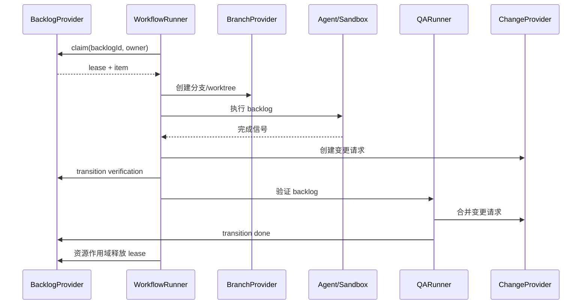

# AFK 架构

## 工作区组织

根目录是私有 pnpm 工作区。`apps/cli` 管理 `afk` 可执行入口、Commander 命令、
补全和 Ink TUI；`apps/desktop` 管理 Electron 主进程、preload、IPC 与 React 界面。
两端通过包的正式导出复用以下模块：

| 包 | 职责 |
| --- | --- |
| `packages/core`（`@afk/core`） | 纯模型、事件、Reducer、策略与 Port |
| `packages/application`（`@afk/application`） | 共享用例、清单与执行查询，依赖 Core |
| `packages/runtime`（`@afk/runtime`） | Workflow 执行、backlog 操作，以及 Provider、Git、tmux、sandbox、存储等 Node 适配器 |
| `packages/workflow-graph`（`@afk/workflow-graph`） | 纯工作流图投影、布局与校验 |

应用禁止通过相对路径引用其他工作区的源码，共享包禁止反向依赖应用，包依赖图必须无环。
桌面渲染器禁止引用 `@afk/runtime`，Node 能力通过主进程 IPC 提供。
runtime 内部保留既有分层约束，架构检查同时检查包导出和工作区依赖。

桌面 backlog 管理和图生成直接调用 Runtime；托管工作项通过打包后的独立 Node Worker
调用与 CLI 相同的 `executeWorkItem`，保留进程隔离和关闭窗口后继续执行的能力。
桌面端不查找或调用 AFK CLI；停止、恢复和合并确认直接复用共享 Runtime。
执行只有 Worker 一条路径，不提供命令覆盖或回退入口。

各包分别拥有构建、类型检查和测试命令；根命令按依赖顺序检查共享包、CLI 和仓库契约测试。
桌面端通过 `pnpm --filter afk-control-electron` 分别运行 `typecheck`、`build`、`test`。
CLI 产物位于 `apps/cli/dist/index.js`，根包不再发布可执行文件或包含应用源码。

## 架构守卫

`pnpm architecture:check --check-packages` 强制层间依赖方向，并检查
`packages/core` 与 `packages/application` 根目录的纯源码导入和依赖方向。
该守卫同时禁止泛型 record 和遗留 client-factory 导入。遗留迁移已完成：
`scripts/architecture-legacy-baseline.json` 记录零个遗留文件、导入和模式。
新增的遗留文件或导入会导致检查失败。删除基线条目时请一并删除这条过期记录。

层间方向约束适用于 `packages/runtime/src/domain`、`packages/runtime/src/application`、
`packages/runtime/src/infrastructure` 和 `packages/runtime/src/shared` 中非测试文件的相对导入。
`apps/cli` 和 `apps/desktop` 的应用边界由工作区导入检查约束。
传入 `--require-packages` 会让缺失的 package 根目录导致失败，而不是跳过检查。

## 范围与命令

AFK 只执行外部规划器已经创建并拆分好的 backlog，不负责创建或拆分任务。
命令注册表是唯一命令来源：

| 命令 | 职责 |
| --- | --- |
| `afk backlog init` | 初始化 provider 元数据 |
| `afk backlog adopt --id <id> --project <project> --platform github\|gitlab [--json]` | 显式将一个开放手工 issue 接管为 ready AFK 工作项 |
| `afk backlog create <title>` | 创建一个 provider 背书的 backlog 工作项 |
| `afk backlog list/show/tag` | 查看和管理 backlog |
| `afk backlog inventory` | 盘点所有凭据可达项目下的 issue |
| `afk backlog interrupt` | 中止活跃执行，把 backlog 交还操作者 |
| `afk backlog retry` | 把 blocked 的操作者持有工作项退回 autonomous rework |
| `afk backlog confirm-merge` | 合并已批准的根 backlog 变更并置为 done |
| `afk backlog reconcile-merge` | 当变更已在平台合并时，将根 backlog 收敛为 done |
| `afk run --backlog-id <id>` | 认领并执行一个 backlog |
| `afk execute --work-item-id <id> --execution-manifest <path>` | 实现、独立验证并发布一个托管工作项 |
| `afk reconcile --work-item-id <id> --execution-manifest <path> --execution-id <id>` | 校验人工已合并的根 PR 并对账执行审计 |
| `afk qa --backlog-id <id>` | 执行等待验证的 backlog QA |
| `afk loop` | 轮询单个 manifest 绑定的工作项并调用 `executeWorkItem` |
| `afk loop start\|status\|stop` | 控制 loop 守护进程：前台/后台启动、状态查看与优雅停止 |
| `afk observe` | 默认以友好文本读取 append-only 的 AFK 运行审计事件，支持 `--json`（`runs`、`executions`、`execution`、`timeline`、`verify`、`replay`、`explain`、`doctor`） |
| `afk observe <runId>` / `afk log <runId>` | `afk observe execution <runId>` 的简写，支持相同的 `--watch`、`--tail`、`--root` 和 `--json` 参数 |
| `afk observe execution\|timeline <runId> [--watch] [--tail <count>]` | 查看带详情的运行时间线，可持续追踪新事件或限制首次展示的历史数量 |
| `afk retro run --run-id <id> --workspace <path>` | 用现有 `/retro` 技能分析已记录证据并写出 `report.json` 与 `report.html` |
| `afk retro show <report>` | 读取已生成的复盘报告 |
| `afk graph workflow <template>` | 生成确定性的工作流图 |
| `afk`（TUI）、`afk signal`、`afk tmux`、`afk kanban`、`afk debug`、`afk isolate`、`afk completion` | 运维和本地工具 |

[wiki skill](../../skills/wiki/SKILL.md) 自带独立 Python CLI，命令以
`skills/wiki/scripts/wiki.py` 的 argparse 注册为准，不增加 `afk` 命令。
所有操作支持 `--vault` 与 `--json`，可放在子命令前后。Vault 定位顺序为
`--vault` → `WIKI_VAULT` → 最近的祖先 `.wiki.json` → `XDG_CONFIG_HOME`
（默认 `~/.config`）下的 `wiki/config.json`。配置填写 `vault` 字符串，
相对路径以配置文件所在目录为基准。

| Skill 内命令 | 职责 |
| --- | --- |
| `wiki.py locate` | 显示自动定位的 Vault 和配置来源 |
| `wiki.py search <query> [--regex] [--limit <count>]` | 检索页名、别名和正文 |
| `wiki.py read <path> [--heading <heading>]` | 读取页面或章节并返回完整文件哈希 |
| `wiki.py lint [path] [--max-age-days <days>]` | 报告 Vault 专有或通用质量检查 |
| `wiki.py ingest --plan <file-or-dash> [--apply] [--max-age-days <days>]` | 预览或执行有证据的更新计划 |

已移除的命令组没有别名。provider 的元数据标签属于 adapter 内部实现，
不是 CLI 契约。

### 查看和追踪运行

```bash
afk observe runs
afk observe <runId>
afk log <runId> --watch --tail 20
afk observe execution <runId>
afk observe timeline <runId> --tail 20 --watch
afk observe execution <runId> --watch --tail 0
afk observe execution <runId> --json
```

`observe <runId>` 使用默认的 `execution` 子命令；原有具名子命令仍优先匹配。
`log <runId>` 直接复用同一运行查看器，参数校验和 JSON 契约也保持一致。

文本摘要包含审计记录中的运行状态、阶段、活动步骤或人工审核关卡、完整性、
本地时区、耗时和最后一个事件。即使 `--tail` 隐藏了工作区原始事件，摘要中
仍显示已记录的工作区路径和分支。时间线展开事件字段，包括步骤、提交、变更
链接、会话和 transcript 路径、完整多行错误摘要，以及 QA 条件的预期和实际结果。
失败事件没有记录原因时会明确说明。这里展示的是审计事件，不是 agent 的实时
stdout/stderr；无法还原没有记录的详情。运行中没有活动步骤本身不代表失败。

`--watch` 每秒查询一次，只追加新事件；无变化时保持安静，等待人工审核时展示
关卡信息，进入终态后自动退出。Ctrl-C 或 SIGTERM 只停止观察。完整性无效时
停止追踪、标记状态不可信，并排除未通过校验的详情。历史被替换或缩短时需要
重新启动观察。`--tail` 接受非负整数，按完整事件计数；零表示不展示初始时间线，
但仍保留摘要。

`--json` 保持原有单个 JSON 文档契约，与 `--watch`、`--tail` 互斥。重定向到文件
或管道时不输出颜色转义；终端中也可通过 `NO_COLOR` 关闭颜色。

## Provider 边界

`BacklogProvider` 是 backlog 的 canonical 来源，负责身份、标题与描述、
状态、执行模式、父子关系、依赖、业务标签以及分支映射。`BranchProvider`
负责分支和 worktree；`ChangeProvider` 负责变更请求的创建、查询和合并。
Runner 只编排这些接口，不解析平台标签。

GitHub 和 GitLab 分别由具体的 `BacklogProvider` 实现，并由 provider bundle
按平台选择。它们可以在内部复用 tracker 机制，但平台校验和生产构造位于
各自边界。未来的 Linear 等平台直接实现 `BacklogProvider`，Runner 不依赖
tracker 类型。

管理 bundle 会将具体 provider 包装为不含认领能力的 facade。其 backlog
接口提供读取、列表、元数据初始化、业务标签更新，以及 QA 所需的状态和
执行模式更新；类型和运行时都没有 `claim()`。只有执行 bundle 暴露认领和
可运行性检查。

### Tracker 目标解析

命令访问的 provider 项目是一个 tracker 目标：一个平台加一个项目，二者
一起解析、绝不混用。项目由第一个能指明它的来源决定：

1. 显式的 `--project` 参数
2. 本地 tracker 索引，按 issue id 命中
3. 本地 tracker 索引，按工作目录命中
4. `AFK_TRACKER_PROJECT` 环境变量
5. 工作目录的 `origin` remote

平台随项目而定：`--platform` 参数优先，然后是记录在该项目旁的平台，然后是
`AFK_TRACKER_PLATFORM`，然后由项目名形态判定，然后是 git remote，最后是
已配置的凭据。

因此 git remote 是可选的。`afk backlog show` 这类只读命令在知道目标后可以在
任意目录下执行；无法解析目标时给出可操作的错误，而不是平台探测失败。平台仍
未知时，数字项目名或三段及以上路径判定为 GitLab；`owner/repo` 形态判定为
GitHub，除非只配置了 GitLab 凭据。

### 本地 tracker 索引

`<workspace>/.afk/tracker-projects.json`（未配置工作区时为
`~/.afk/tracker-projects.json`）记录 AFK 接触过的 provider 项目：项目本身、
访问时所在的本地仓库，以及涉及的 issue。每次读取
provider、inventory 和执行都会写入它看到的内容，因此后续命令无需任何配置
就能把裸 issue id 或工作目录解析到对应项目。多仓库用户由此无需记住项目名、
也无需逐个仓库配置。

索引只是本地缓存，不是事实来源：provider 状态始终以 provider 为准；索引缺失
或损坏只意味着"暂未建立关联"。当多个已记录项目都有同一个 issue id 时，工作
目录所属的项目优先；否则取最近更新的项目，`--project` 始终可以覆盖该选择。

`adopt` 是管理/provider 的可选能力，不支持时明确报错。tracker adapter
检查 issue 原始状态和元数据，不从 domain 默认状态推断 ready。只接受开放且
生命周期标签缺失或为 canonical ready/afk 的 issue；拒绝未知、重复或冲突的
AFK 元数据，以及格式非法或指向自身的父级、执行基线和依赖 ID，保留业务标签、
关系和 issue 正文。仅在缺少标签时初始化 provider 元数据，再只添加缺失的
ready/afk 标签，不移除任何标签。已 ready/afk 项无写入地幂等成功；closed、
blocked、HITL 和其他生命周期状态无写入地拒绝。项目与平台必须显式提供，
`--json` 输出 `backlog.adopt` envelope。execute 和 loop 不会隐式调用接管。

## 工作项与执行身份

Provider Backlog 是业务事实来源。其 `BacklogItem.id` 在
`afk run --backlog-id <id>`、`Run.workItemId`、`TaskRuntimeRecord.backlogId`、
TUI 投影和 Desktop 摘要之间原样传递。`runId` 标识一次执行尝试，
绝不可替代 Backlog ID。

各关系字段含义互不相同：`parentId` 表示组织分组，`dependsOn` 控制调度顺序，
`baseBacklogId` 选择显式的 Git 执行基线。父级边和依赖边都不会隐式选择分支。

## Backlog 生命周期

```text
ready/rework --claim--> in_progress --> verification --> merge_ready --> done
   \                         \
    \                         +--> blocked（执行模式：hitl）
     +--> blocked（冲突、失败、超时或 lease 过期）
```

只有状态为 `ready` 或 `rework`、执行模式为 `afk`、没有子 backlog 且所有 `dependsOn`
均为 `done` 时，条目才可运行。`parentId` 用于聚合子 backlog，父 backlog
本身不可运行。任何自动化失败、冲突、超时或不确定的 lease 恢复都必须将
条目转为 `blocked` 并切换到 `hitl`。

QA FAIL 在 Provider issue comment/note 中持久化新的返工记录，将旧 active
记录标为 `superseded`，并从已持久化的最高值递增 `ReworkRecord.attempt`。
QA 记录创建只持久化证据，后续状态和执行模式由 `QARunner` 路由；operator
retry 仍在创建记录后直接切到 `rework` + `afk`。

`WorkflowConfig.maxQaReworkAttempts` 默认 **3**，必须为正整数。可在
`.afk/config.yml` 设置 `maxQaReworkAttempts: 3`，或使用环境变量
`AFK_MAX_QA_REWORK_ATTEMPTS=3`，项目文件优先。没有历史记录时，首次 FAIL
为 attempt 1，第二次 FAIL 为 attempt 2，均允许 `rework` + `afk`；第三次
FAIL 持久化 attempt 3，返回 `success: false` 且不返回 `rework`，直接转为
`blocked` + `hitl`。后续 FAIL 保留该记录，不再开启自动返工。上限为 1 时
首次 FAIL 即阻塞。attempt 包含历史 resolved、superseded 和 operator
记录，重新创建 runner 不会重置；QA PASS 仍可 resolve active 记录。
该上限独立于执行重试的 `maxRetries` 和 AC 纠正的 `maxSelfIterations`。
handoff/token `BudgetManager` 会按 canonical work item 从
`<workspace>/.afk/budgets/` 恢复快照。handoff 次数和 harness 原生 token
消耗会跨运行持久化，并按 session ID 去重；账本损坏时会在启动新 Agent
前 fail closed。

`commit.recorded` 审计事件会在有新提交时记录实现或 QA 的真实本地 SHA
和分支；没有新提交时不产生该事件，也不会用变更请求的 SHA 替代。

## 运行时与 Desktop 投影

`~/.afk/runtime/tasks` 下的规范运行时文件拥有执行尝试的状态、阶段、心跳、
进度和诊断的最终解释权。超过新鲜度阈值的心跳会显示为运行时 `stale`；
它不会改变 Provider Backlog 的生命周期状态。

Desktop 通过规范 `workItemId` 定位执行工作区，读取其中的
`.afk/work-item-runs.json`。该文件记录 Worker 启动回执，不拥有 Provider 生命周期状态。
规范运行时记录必须显式包含工作区，Desktop 按精确的 `backlogId`、执行工作区和
Provider 关联。运行时数据缺失或格式错误时，Backlog 仍然可见，并显式呈现为无运行时状态。
已删除的 backlog 运行存储不再提供读取兼容。

## 认领与本地文件系统 fallback

Provider 支持原生条件认领（CAS）时优先使用。否则在
`${AFK_STATE_DIR:-~/.afk/state}` 下取得持久化 lease；持有期间重新读取并
校验 backlog，执行 `ready -> in_progress`，再读取确认。Runner 通过资源
作用域维护 heartbeat，并在成功、失败、超时、崩溃和 handoff 时 exactly once
释放 lease。

文件系统 lease 只协调单机本地可信文件系统上的 worker，不提供多机共识或
跨主机崩溃恢复。多机执行必须使用 provider 原生 CAS（仅共享文件系统并
不足够）。路径按 provider、项目
和 backlog ID 命名空间隔离；符号链接路径会被拒绝；过期 lease 默认 fail-closed，
只有 provider 已持久化 `blocked` 与 `hitl` 后才允许恢复。

## 完整流程



`afk loop` 在进程内复用同一流程并集成 QA；独立 `qa` 命令使用管理 bundle，
不会认领实现任务。

## 扩展机制

插件运行时可以注册 provider。每个 provider 必须完整实现 `BacklogProvider`，
包括父子关系、依赖校验、状态与执行模式、业务标签和认领策略。平台客户端
封装在 provider 内部。系统不引入数据库或额外中间件；本地状态只使用文件
系统 lease 目录。

## 可靠性规则

- 任何失败转换、冲突、超时或 lease 过期都进入 `blocked + hitl`，不会静默
  作为自动任务重试。
- 优先使用原生认领；文件系统 fallback 仅适用于单机上的本地可信文件系统。
- lease 清理由生命周期统一管理且必须幂等。
- backlog ID 通过 provider-neutral 函数确定性映射到分支名。
