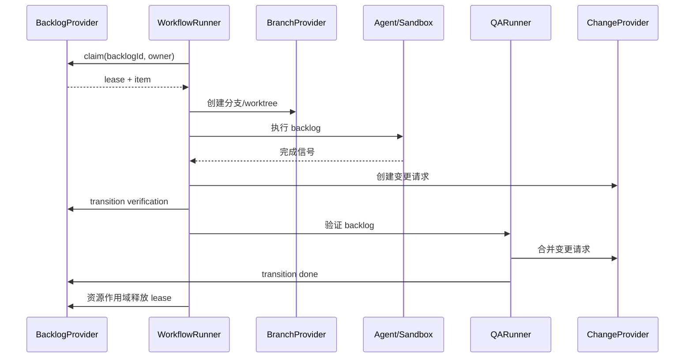

# AFK 架构

## 工作区组织

根目录是私有 pnpm 工作区。`apps/cli` 管理 `afk` 可执行入口、Commander 命令、
补全和 Ink TUI；`apps/desktop` 管理 Electron 主进程、preload、IPC 与 React 界面。
两端通过包的正式导出复用以下模块：

| 包 | 职责 |
| --- | --- |
| `packages/core`（`@afk/core`） | 纯模型、事件、Reducer、策略与 Port |
| `packages/application`（`@afk/application`） | 共享用例、清单与执行查询，依赖 Core |
| `packages/runtime`（`@afk/runtime`） | Workflow 执行、backlog 操作，以及 Provider、Git、tmux、sandbox、存储等 Node 适配器 |
| `packages/workflow-graph`（`@afk/workflow-graph`） | 纯工作流图投影、布局与校验 |

应用禁止通过相对路径引用其他工作区的源码，共享包禁止反向依赖应用，包依赖图必须无环。
桌面渲染器禁止引用 `@afk/runtime`，Node 能力通过主进程 IPC 提供。
runtime 内部保留既有分层约束，架构检查同时检查包导出和工作区依赖。

桌面 backlog 管理和图生成直接调用 Runtime；托管工作项通过打包后的独立 Node Worker
调用与 CLI 相同的 `executeWorkItem`，保留进程隔离和关闭窗口后继续执行的能力。
桌面端不查找或调用 AFK CLI；停止、恢复和合并确认直接复用共享 Runtime。
执行只有 Worker 一条路径，不提供命令覆盖或回退入口。

各包分别拥有构建、类型检查和测试命令；根命令按依赖顺序检查共享包、CLI 和仓库契约测试。
桌面端通过 `pnpm --filter afk-control-electron` 分别运行 `typecheck`、`build`、`test`。
CLI 产物位于 `apps/cli/dist/index.js`，根包不再发布可执行文件或包含应用源码。

## 执行与系统数据路径

CLI 与桌面端共用 Runtime 路径解析。执行根目录固定为
`~/.loop-workspace/<platform>/<项目路径>/<issue>/`，代码检出位于其
`repositories/` 下。当前目录和 `AFK_WORKSPACE` 均不改变执行根目录。
不传清单的 `afk run` 先解析 provider 身份，再准备独立仓库。

配置和 AFK 系统数据统一存放在 `~/.afk/`：`config.yml`、`workflows/`、
`tracker-projects.json` 和运行状态。各工作区的元数据、执行清单、启动回执、
预算、会话、诊断和执行审计存放在
`~/.afk/workspaces/<绝对工作区路径的 SHA256>/`，保留隔离性。
`afk execute --work-item-id <id>` 自动定位清单；缺失时根据 provider 的项目和
工作分支创建。显式 `--execution-manifest` 只选择输入文件，不改变执行目录。
`reconcile` 只读取已有清单，不新建配置。旧目录中的文件保留原状；新执行前需将
需要的配置放到 `~/.afk/`。Agent 完成信号和 QA 附件清单仍属于执行目录内的协议文件。

## 架构守卫

`pnpm architecture:check --check-packages` 强制层间依赖方向，并检查
`packages/core` 与 `packages/application` 根目录的纯源码导入和依赖方向。
该守卫同时禁止泛型 record 和遗留 client-factory 导入。遗留迁移已完成：
`scripts/architecture-legacy-baseline.json` 记录零个遗留文件、导入和模式。
新增的遗留文件或导入会导致检查失败。删除基线条目时请一并删除这条过期记录。

层间方向约束适用于 `packages/runtime/src/domain`、`packages/runtime/src/application`、
`packages/runtime/src/infrastructure` 和 `packages/runtime/src/shared` 中非测试文件的相对导入。
`apps/cli` 和 `apps/desktop` 的应用边界由工作区导入检查约束。
传入 `--require-packages` 会让缺失的 package 根目录导致失败，而不是跳过检查。

## 范围与命令

AFK 只执行外部规划器已经创建并拆分好的 backlog，不负责创建或拆分任务。
命令注册表是唯一命令来源：

| 命令 | 职责 |
| --- | --- |
| `afk backlog init` | 初始化 provider 元数据 |
| `afk backlog adopt --id <id> --project <project> --platform github\|gitlab [--json]` | 显式将一个开放手工 issue 接管为 ready AFK 工作项 |
| `afk backlog create <title> [--kind prd] [--base-branch <ref>] [--dry-run] [--idempotency-key <key>]` | 创建一个 provider 背书的 backlog 工作项，或预览标签与关系 |
| `afk backlog apply-manifest <file> [--project <project>] [--idempotency-key <key>] [--dry-run]` | 按 manifest 建立它所描述的 backlog 记录，每条落在它自己声明的项目里 |
| `afk backlog list/show/tag` | 查看和管理 backlog |
| `afk backlog relation add\|remove --id <id> [--parent <id>] [--base <id>] [--depends-on <id>]` | 修改已存在 backlog 工作项的关系边 |
| `afk backlog role --id <id> --kind prd` | 把一个 backlog 工作项设为 PRD 锚点角色 |
| `afk backlog mode --id <id> --mode afk\|hitl` | 切换一个 backlog 工作项的执行方 |
| `afk backlog base --id <id> --branch <ref>` | 在工作项正文中记录它起始的基线 ref |
| `afk backlog children <id> [--project <project>] [--platform <platform>]` | 跨所有可达项目列出归属于某个工作项的 issue，并给出每项当前可执行或不可执行的原因 |
| `afk backlog inventory` | 盘点所有凭据可达项目下的 issue |
| `afk backlog interrupt` | 中止活跃执行，把 backlog 交还操作者 |
| `afk backlog retry` | 把 blocked 的操作者持有工作项退回 autonomous rework |
| `afk backlog confirm-merge` | 合并已批准的根 backlog 变更并置为 done |
| `afk backlog reconcile-merge` | 当变更已在平台合并时，将根 backlog 收敛为 done |
| `afk run --backlog-id <id>` | 认领并执行一个 backlog |
| `afk execute --work-item-id <id> [--execution-manifest <path>]` | 实现、独立验证并发布一个托管工作项 |
| `afk reconcile --work-item-id <id> [--execution-manifest <path>] --execution-id <id>` | 校验人工已合并的根 PR 并对账执行审计 |
| `afk qa --backlog-id <id>` | 执行等待验证的 backlog QA |
| `afk loop` | 轮询单个 manifest 绑定的工作项并调用 `executeWorkItem` |
| `afk loop start\|status\|stop` | 控制 loop 守护进程：前台/后台启动、状态查看（`--all` 列出 loop 运行目录下的全部 loop）与优雅停止 |
| `afk observe` | 默认以友好文本读取 append-only 的 AFK 运行审计事件，支持 `--json`（`runs`、`executions`、`execution`、`timeline`、`verify`、`replay`、`explain`、`doctor`） |
| `afk observe <runId>` / `afk log <runId>` | `afk observe execution <runId>` 的简写，支持相同的 `--watch`、`--tail`、`--root` 和 `--json` 参数 |
| `afk observe execution\|timeline <runId> [--watch] [--tail <count>]` | 查看带详情的运行时间线，可持续追踪新事件或限制首次展示的历史数量 |
| `afk retro run --run-id <id> --workspace <path>` | 用现有 `/retro` 技能分析已记录证据并写出 `report.json` 与 `report.html` |
| `afk retro show <report>` | 读取已生成的复盘报告 |
| `afk graph workflow <template>` | 生成确定性的工作流图 |
| `afk`（TUI）、`afk signal`、`afk tmux`、`afk kanban`、`afk debug`、`afk isolate`、`afk completion` | 运维和本地工具 |

[wiki skill](../../skills/wiki/SKILL.md) 自带独立 Python CLI，命令以
`skills/wiki/scripts/wiki.py` 的 argparse 注册为准，不增加 `afk` 命令。
所有操作支持 `--vault` 与 `--json`，可放在子命令前后。Vault 定位顺序为
`--vault` → `WIKI_VAULT` → 最近的祖先 `.wiki.json` → `XDG_CONFIG_HOME`
（默认 `~/.config`）下的 `wiki/config.json`。配置填写 `vault` 字符串，
相对路径以配置文件所在目录为基准。

| Skill 内命令 | 职责 |
| --- | --- |
| `wiki.py locate` | 显示自动定位的 Vault 和配置来源 |
| `wiki.py search <query> [--regex] [--limit <count>]` | 检索页名、别名和正文 |
| `wiki.py read <path> [--heading <heading>]` | 读取页面或章节并返回完整文件哈希 |
| `wiki.py lint [path] [--max-age-days <days>]` | 报告 Vault 专有或通用质量检查 |
| `wiki.py ingest --plan <file-or-dash> [--apply] [--max-age-days <days>]` | 预览或执行有证据的更新计划 |

已移除的命令组没有别名。provider 的元数据标签属于 adapter 内部实现，
不是 CLI 契约。

### 查看和追踪运行

```bash
afk observe runs
afk observe <runId>
afk log <runId> --watch --tail 20
afk observe execution <runId>
afk observe timeline <runId> --tail 20 --watch
afk observe execution <runId> --watch --tail 0
afk observe execution <runId> --json
```

`observe <runId>` 使用默认的 `execution` 子命令；原有具名子命令仍优先匹配。
`log <runId>` 直接复用同一运行查看器，参数校验和 JSON 契约也保持一致。

文本摘要包含审计记录中的运行状态、阶段、活动步骤或人工审核关卡、完整性、
本地时区、耗时和最后一个事件。即使 `--tail` 隐藏了工作区原始事件，摘要中
仍显示已记录的工作区路径和分支。时间线展开事件字段，包括步骤、提交、变更
链接、会话和 transcript 路径、完整多行错误摘要，以及 QA 条件的预期和实际结果。
失败事件没有记录原因时会明确说明。这里展示的是审计事件，不是 agent 的实时
stdout/stderr；无法还原没有记录的详情。运行中没有活动步骤本身不代表失败。

`--watch` 每秒查询一次，只追加新事件；无变化时保持安静，等待人工审核时展示
关卡信息，进入终态后自动退出。Ctrl-C 或 SIGTERM 只停止观察。完整性无效时
停止追踪、标记状态不可信，并排除未通过校验的详情。历史被替换或缩短时需要
重新启动观察。`--tail` 接受非负整数，按完整事件计数；零表示不展示初始时间线，
但仍保留摘要。

`--json` 保持原有单个 JSON 文档契约，与 `--watch`、`--tail` 互斥。重定向到文件
或管道时不输出颜色转义；终端中也可通过 `NO_COLOR` 关闭颜色。

## Provider 边界

`BacklogProvider` 是 backlog 的 canonical 来源，负责身份、标题与描述、
状态、执行模式、父子关系、依赖、业务标签以及分支映射。`BranchProvider`
负责分支和 worktree；`ChangeProvider` 负责变更请求的创建、查询和合并。
Runner 只编排这些接口，不解析平台标签。

GitHub 和 GitLab 分别由具体的 `BacklogProvider` 实现，并由 provider bundle
按平台选择。它们可以在内部复用 tracker 机制，但平台校验和生产构造位于
各自边界。未来的 Linear 等平台直接实现 `BacklogProvider`，Runner 不依赖
tracker 类型。

管理 bundle 会将具体 provider 包装为不含认领能力的 facade。其 backlog
接口提供读取、列表、元数据初始化、业务标签更新，以及 QA 所需的状态和
执行模式更新；类型和运行时都没有 `claim()`。只有执行 bundle 暴露认领和
可运行性检查。

### Tracker 目标解析

命令访问的 provider 项目是一个 tracker 目标：一个平台加一个项目，二者
一起解析、绝不混用。项目由第一个能指明它的来源决定：

1. 显式的 `--project` 参数
2. 本地 tracker 索引，按 issue id 命中
3. 本地 tracker 索引，按工作目录命中
4. `AFK_TRACKER_PROJECT` 环境变量
5. 工作目录的 `origin` remote

平台随项目而定：`--platform` 参数优先，然后是记录在该项目旁的平台，然后是
`AFK_TRACKER_PLATFORM`，然后由项目名形态判定，然后是 git remote，最后是
已配置的凭据。

因此 git remote 是可选的。`afk backlog show` 这类只读命令在知道目标后可以在
任意目录下执行；无法解析目标时给出可操作的错误，而不是平台探测失败。平台仍
未知时，数字项目名或三段及以上路径判定为 GitLab；`owner/repo` 形态判定为
GitHub，除非只配置了 GitLab 凭据。

### 本地 tracker 索引

`~/.afk/tracker-projects.json` 记录 AFK 接触过的 provider 项目：项目本身、
访问时所在的本地仓库，以及涉及的 issue。每次读取
provider、inventory 和执行都会写入它看到的内容，因此后续命令无需任何配置
就能把裸 issue id 或工作目录解析到对应项目。多仓库用户由此无需记住项目名、
也无需逐个仓库配置。

索引只是本地缓存，不是事实来源：provider 状态始终以 provider 为准；索引缺失
或损坏只意味着"暂未建立关联"。当多个已记录项目都有同一个 issue id 时，工作
目录所属的项目优先；否则取最近更新的项目，`--project` 始终可以覆盖该选择。

`adopt` 是管理/provider 的可选能力，不支持时明确报错。tracker adapter
检查 issue 原始状态和元数据，不从 domain 默认状态推断 ready。只接受开放且
生命周期标签缺失或为 canonical ready/afk 的 issue；拒绝未知、重复或冲突的
AFK 元数据，以及格式非法或指向自身的父级、执行基线和依赖 ID，保留业务标签、
关系和 issue 正文。仅在缺少标签时初始化 provider 元数据，再只添加缺失的
ready/afk 标签，不移除任何标签。已 ready/afk 项无写入地幂等成功；closed、
blocked、HITL 和其他生命周期状态无写入地拒绝。项目与平台必须显式提供，
`--json` 输出 `backlog.adopt` envelope。execute 和 loop 不会隐式调用接管。

## 工作项与执行身份

Provider Backlog 是业务事实来源。它的 `BacklogItem.id` 是该工作项的**规范全局
身份**：`platform:projectKey#issueNumber`，例如 `github:acme/api#42`。同一身份在
`afk run --backlog-id <id>`、`Run.workItemId`、运行事件、TUI 投影和 Desktop 摘要
之间原样传递。`runId` 标识一次执行尝试，绝不可替代 backlog 身份。

无论由哪个 provider 提供，一个工作项只有一个身份。两个仓库中的相同 issue 编号
仍然是两个不同的 backlog 工作项，每条关系边都无歧义地指向它所指的项。关系字段
（`parentId`、`baseBacklogId`、`dependsOn`）同样使用该规范形式。

规范项目键由唯一规则 `canonicalProjectKey()` 推导：GitHub 项目为 `owner/repo`；
自建 GitLab 实例为 `host/group/project`，gitlab.com 为裸 `group/project`。首段含
有点号时读作主机名，这与 tracker adapter 把关系路由到其他项目时使用的规则一致。

provider 同时接受两种引用写法：裸 issue 编号归属于该 provider 写入的项目；规范
全局身份可以指向同一 provider 主机上的另一个仓库。跨平台与跨主机引用会被明确拒绝。

provider 写入的项目是它自己的私有状态，不属于 provider 契约：不指明项目的引用
只能由拥有该项目的 provider 解析。契约拥有的是**行为**——`planCreate()` 规划一次
创建且不写入任何内容，`create()` 写入的正是这份计划。dry-run 与真实创建因此走
同一条代码路径，调用链上的每一层 wrapper 都必须携带该行为，因为端口要求它。

关系标签以规范形式存储（`parent::github:acme/api#42`）。存量的裸编号标签
（`parent::42`）仍可读取，并相对所属项目解析。backlog metadata codec
（`packages/runtime/src/domain/backlog/metadata-codec.ts`）是解析、校验和序列化
这些标签的唯一位置；tracker adapter、全局库存和跨仓图都使用它，因此 `parent::`
边在任何地方含义一致。

各关系字段含义互不相同：`parentId` 表示组织分组，`dependsOn` 控制调度顺序，
`baseBacklogId` 显式引用执行基准任务。三种关系都支持规范化的跨项目身份。
若基准任务与当前任务位于同一仓库，未完成的基准任务分支可作为 Git 基线；
若位于不同仓库，则保留该引用用于追踪，但执行时使用目标仓库配置的基准分支，
因为一个仓库的 Git 分支不能直接作为另一个仓库的 Git 基线。父级边和依赖边都不会隐式选择分支。

backlog 图跨越项目。PRD 锚点可能位于需求仓库，其实现子项位于服务仓库，因此
provider 在 claim 之前会向跨仓图查询该工作项的子项；在另一个仓库有子项的父项永远
不可运行。当跨仓图不可读时，adapter 回落到本地项目扫描并报告该失败。

某个工作项的子项由同一个查询回答
（`packages/runtime/src/application/work-item/children.ts`）。它接受父项的规范身份，
因为裸 issue 编号在每个仓库都指向不同的 issue；它优先从本地库存回答。本地库存是
缓存，缺失或过期时会重新采集后再回答，而本地库存从未见过的身份会再采集一次才判定
为未知。子项按项目与 issue 编号排序，因此列表不依赖库存的采集时机。未被 AFK 纳管的
子项同样会被返回，并标明 `managed`，因为手工挂到 PRD 上的 issue 也是子项。

命令会替调用方解析这个身份：裸 issue 编号会在本地索引里查出它属于哪个项目，
`--project` 与 `--platform` 则直接说明。只有脚本产出规范身份时，整串才需要被敲出来。
每个条目独占一行，provider 报的 URL 就在标题旁边，因此在终端里点一下就能打开。

创建关系参数（`--parent`、`--base-backlog`、`--depends-on`）接受显式选定项目内的
正整数 issue 编号，或完整的 `platform:projectKey#issueNumber` 引用。`--base-backlog`
支持跨仓引用；但跨仓任务的分支不能直接作为当前仓库的 Git 基线，运行时会保留该引用
并使用目标仓库配置的基准分支。

`afk run` 在准备工作区前，以尚未完成的基线 backlog 分支作为执行基线；基线已完成
或合并时回落到配置分支。显式的 `--base-branch`、分支策略基线或 manifest 基线
优先。存量 `base::prd-N` 继续选择 `prd/N`。实现执行与 QA 共用 backlog 基线
解析逻辑，正常目标分支保持原有语义。

`--kind prd` 创建带 `kind::prd` 标签的组织性锚点，始终不可执行。角色不是阶段：
锚点是容器，因此**没有任何生命周期状态**——它不落在 `ready` 桶里，其不可执行性来自
角色本身而不是来自状态。七个 `stage::*` 标签是唯一的生命周期位置，每个非锚点工作项
恰好携带其中一个。缺少 mode 标签的 issue 默认 `hitl`，需显式 adopt 后才能自动执行。
`--dry-run` 使用相同创建计划校验引用，并输出标题、描述、标签与关系，不写入 provider。
锚点默认使用 `hitl` 模式；请求自治锚点会被直接拒绝，而不是被静默降级。
`--idempotency-key` 持久化经过哈希的项目内元数据标签，顺序重试返回已有 issue（含已关闭项）。
该键用于重试去重，不是分布式锁；并发创建需要由调用方串行化。业务标签不能注入保留元数据，
重复 parent/base 标签或非法引用会被校验拒绝。

`afk backlog list` 与 `afk backlog inventory` 按状态和按角色分别过滤：锚点没有状态，
所以 `--state ready` 永远不会返回锚点，选出锚点要用 `--kind prd`。

### Backlog 关系边

关系边在工作项创建时写入，但 backlog 会继续演进：依赖在被识别出来时才出现，
当基线边指向的分支并不存在时必须被撤回。`afk backlog relation add` 与
`afk backlog relation remove` 就是用来修改已存在工作项的关系边。

编辑只声明它要动的那条边——`--parent`、`--base` 或 `--depends-on`——工作项的
其余关系边原样保留。provider 把编辑转成承载它的最小标签增量，因此关系标签
不会被整体重写；编辑没有提到的标签即使本 codec 解析不了也保持不动。引用可以是
所属项目里的裸 issue 号，也可以是规范全局工作项身份，指向自身的引用会被拒绝。
若某个依赖已经能到达本工作项，加这条边会成环，因此同样被拒绝。

`afk backlog tag add` 与 `afk backlog tag remove` 刻意拒绝保留元数据前缀，
关系前缀也在其中：业务标签和关系边是两件事，走不同的命令编辑。

### Backlog 角色

角色标签同样是保留元数据，所以不能当业务标签传进来。
`afk backlog role --id <id> --kind prd` 给一个已存在的工作项赋上 PRD 锚点角色：
加上角色标签，去掉 stage 标签，模式换成 human-in-the-loop，表示它本身永不执行。
锚点完全没有生命周期位置——它是个容器。

该 issue 的其余标签一律不动，因此一个工作项变成锚点时，不会丢掉它的子项、
依赖或业务标签。这个编辑是幂等的：已经带该角色的工作项不会被改动。

### Backlog 执行模式

`afk backlog mode --id <id> --mode afk|hitl` 切换一个已存在工作项的执行方。
执行模式同样是保留元数据，所以这个编辑只替换模式标签：状态、角色、业务标签
与关系一律不动。这个编辑是幂等的，操作者用它把工作项交给 AFK，或收回给人工。

### 工作项从哪个 ref 起始

一个仓库可以在 `master` 上开发，而这项工作从某个发布 ref 起始——provider 的
默认分支说不出后一种情况。这个 ref 是关于工作本身的事实，因此写在工作项正文：

```text
## Base Version

- Base Ref: 2025-11-8-show
```

分支名在拥有它的仓库之外没有任何意义，用标签会把仓库内的事实带到凭据可达的
每一个仓库。`afk backlog create --base-branch <ref>` 在创建时写入该区块，
`afk backlog base --id <id> --branch <ref>` 为已存在的工作项补记它。两者都不动
工作项的其他内容，且都是幂等的。

执行时会读回该区块：manifest 不存在时由工作项推导，其基线依次取正文声明的
ref、仓库默认分支、`main`。manifest 存在时仍以 manifest 为准——它是执行自己对
「基于什么运行」的记录——因此操作者可以在不修改 issue 的前提下为单次执行做
覆盖。

### 工作项为什么不动

生命周期标签说明工作项处在什么位置，而不是它为什么停着不动。一屏 `ready`
的工作项分不清「在排队」和「死锁」，因此凡是报告工作项的入口，都会一并报告
原因：

| 原因 | 含义 |
| --- | --- |
| `not_execution_eligible` | 该项是容器（PRD 锚点），不是可执行的工作 |
| `blocked_for_human` | 该项被阻塞，等待人工处理 |
| `execution_in_progress` | AFK 正在处理该项 |
| `awaiting_merge` | 变更已通过 QA，等待合并 |
| `state_not_runnable` | 该生命周期位置不是 AFK 启动工作的位置 |
| `execution_mode_hitl` | 该项由人工执行，AFK 不得接手 |
| `not_managed` | 该项的生命周期不由 AFK 管理 |
| `has_children` | 该项拥有子项，工作在子项上 |
| `dependency_not_done` | 至少一个依赖尚未完成 |

依赖这一条会指名尚未完成的依赖，所以给出的答案是「要谁动手」，而不只是
「得有人动手」。这些规则只存在一处（`@afk/runtime` 的 backlog 域），loop、
命令行与 Desktop 客户端对同一问题给出同一个答案。loop 会把跳过原因写进
日志，`afk backlog children <id>` 会为某个 PRD 的每个子项报告该原因。

### 活得比进程更久的认领

认领会活得比持有它的进程更久：重启后的 loop 发现自己负责的工作项仍标记为
进行中，却已经没有任何东西在执行它。轮询只寻找尚未开始的工作，于是这样的
工作项再也不会动——一次重启就静默地变成了停滞。

因此 loop 启动时会把**自己负责的**认领交还队列。已经存在未关闭变更请求的
工作项回到 `rework`，因为那个位置的执行会复用已有变更请求，而不是拒绝再开
一个。别的 loop 的认领不动——那是别的 loop 的工作。

### Backlog manifest

`afk backlog apply-manifest <file>` 应用一份 provider 中立的 manifest：一份 YAML 条目
列表，每条带标题、描述、所属项目与它之间的关系。manifest 是需求分解产出的交接物，
由 AFK 消费。

| 字段 | 含义 |
| --- | --- |
| `project` | 记录所属项目的规范项目键：`platform:projectKey` |
| `ref` | 清单内可被其它条目引用的本地名 |
| `parentId` | 组织性父项：规范 ID 或清单内 `ref` |
| `baseBacklogId` | Git 执行基线：规范 ID 或清单内 `ref` |
| `dependsOn` | 必须先完成的记录 |
| `executionMode` | `afk` 或 `hitl` |
| `tags` | provider 中立的业务标签 |

跨仓需求把条目放进拥有该工作的仓：每条声明自己的项目，记录就建在那里。引用要么是
已存在记录的规范 ID，要么是同一份 manifest 里另一条目的 `ref`——后者在它所指的记录
建好之后才解析，因此父项、执行基线和依赖总是先于指向它们的条目建立。依赖成环会被
直接拒绝，而不是按某种顺序硬建。

跨项目关系要求两个项目在同一个 provider host 上；跨 provider 的关系会被拒绝。执行
基线必须与条目运行所在的仓相同，因为分支只属于一个仓。

`--idempotency-key <prefix>` 用前缀加条目的 `ref`（没有则用标题）派生出逐条重试键，
因此同一份 manifest 应用两次会返回它已经建好的记录，而不是再建一遍。

依赖边会被写两遍：一遍是 provider 中立的 `depends-on::<id>` 标签，也就是 AFK 读回来的
那条边；一遍是给人看的 provider 原生链接。在 GitLab 上这条链接是从「被等待的那条记录」
出发的 `blocks` 链接——GitLab 正是这样显示 "is blocked by"；链接的目标项目用数字身份
指认，因为链接的请求体里放的是 id。在 GitHub 上它是一条点名那条记录的评论。重复应用
会补写缺失的关系，也不会重复已有的关系，因此同一份 manifest 应用两次会收敛到这份
manifest。

CLI JSON 成功信封为 `{ok:true,kind,data}`；失败信封为
`{ok:false,kind,data:null,error:{code,message,details?}}`，并返回非零退出码。
自动化脚本须同时检查退出状态与 `ok`，再读取 `data`。

## Backlog 生命周期

```text
ready/rework --claim--> in_progress --> verification --> merge_ready --> done
   \                         \
    \                         +--> blocked（执行模式：hitl）
     +--> blocked（冲突、失败、超时或 lease 过期）
```

只有状态为 `ready` 或 `rework`、执行模式为 `afk`、没有子 backlog 且所有 `dependsOn`
均为 `done` 时，条目才可运行。`parentId` 用于聚合子 backlog，父 backlog
本身不可运行。“没有子 backlog”由 backlog 图判定，因此位于其他仓库的子项同样
计入。任何自动化失败、冲突、超时或不确定的 lease 恢复都必须将
条目转为 `blocked` 并切换到 `hitl`。

带 `prd` 角色的条目是组织性父项。它**没有任何生命周期状态**——它聚合子项，而不是
等待人工介入，而“等待子项完成”并不是生命周期中的一个位置。让它不可执行的是角色，
而不是某个状态。

QA FAIL 在 Provider issue comment/note 中持久化新的返工记录，将旧 active
记录标为 `superseded`，并从已持久化的最高值递增 `ReworkRecord.attempt`。
QA 记录创建只持久化证据，后续状态和执行模式由 `QARunner` 路由；operator
retry 仍在创建记录后直接切到 `rework` + `afk`。

`WorkflowConfig.maxQaReworkAttempts` 默认 **3**，必须为正整数。可在
`~/.afk/config.yml` 设置 `maxQaReworkAttempts: 3`，或使用环境变量
`AFK_MAX_QA_REWORK_ATTEMPTS=3`，项目文件优先。没有历史记录时，首次 FAIL
为 attempt 1，第二次 FAIL 为 attempt 2，均允许 `rework` + `afk`；第三次
FAIL 持久化 attempt 3，返回 `success: false` 且不返回 `rework`，直接转为
`blocked` + `hitl`。后续 FAIL 保留该记录，不再开启自动返工。上限为 1 时
首次 FAIL 即阻塞。attempt 包含历史 resolved、superseded 和 operator
记录，重新创建 runner 不会重置；QA PASS 仍可 resolve active 记录。
该上限独立于执行重试的 `maxRetries` 和 AC 纠正的 `maxSelfIterations`。
handoff/token `BudgetManager` 会按 canonical work item 从
`~/.afk/workspaces/<工作区路径哈希>/budgets/` 恢复快照。handoff 次数和 harness 原生 token
消耗会跨运行持久化，并按 session ID 去重；账本损坏时会在启动新 Agent
前 fail closed。

`commit.recorded` 审计事件会在有新提交时记录实现或 QA 的真实本地 SHA
和分支；没有新提交时不产生该事件，也不会用变更请求的 SHA 替代。

## 运行时与 Desktop 投影

`~/.afk/runtime/tasks` 下的规范运行时文件拥有执行尝试的状态、阶段、心跳、
进度和诊断的最终解释权。超过新鲜度阈值的心跳会显示为运行时 `stale`；
它不会改变 Provider Backlog 的生命周期状态。

Desktop 通过规范 `workItemId` 定位执行工作区，读取其中的
对应系统数据目录中的 `work-item-runs.json`。该文件记录 Worker 启动回执，不拥有 Provider 生命周期状态。
规范运行时记录必须显式包含工作区，Desktop 按精确的 `backlogId`、执行工作区和
Provider 关联。运行时数据缺失或格式错误时，Backlog 仍然可见，并显式呈现为无运行时状态。
已删除的 backlog 运行存储不再提供读取兼容。

## 认领与本地文件系统 fallback

Provider 支持原生条件认领（CAS）时优先使用。否则在
`${AFK_STATE_DIR:-~/.afk/state}` 下取得持久化 lease；持有期间重新读取并
校验 backlog，执行 `ready -> in_progress`，再读取确认。Runner 通过资源
作用域维护 heartbeat，并在成功、失败、超时、崩溃和 handoff 时 exactly once
释放 lease。

文件系统 lease 只协调单机本地可信文件系统上的 worker，不提供多机共识或
跨主机崩溃恢复。多机执行必须使用 provider 原生 CAS（仅共享文件系统并
不足够）。路径按 provider、项目
和 backlog ID 命名空间隔离；符号链接路径会被拒绝；过期 lease 默认 fail-closed，
只有 provider 已持久化 `blocked` 与 `hitl` 后才允许恢复。

## 完整流程



`afk loop` 在进程内复用同一流程并集成 QA；独立 `qa` 命令使用管理 bundle，
不会认领实现任务。

作用域里的 backlog ID 是 manifest 的 provider backlog id，而 provider 列出的
backlog 条目使用规范全局 ID。loop 因此按 manifest 绑定的规范 ID 匹配，
一个 manifest 绑定的 loop 只执行一个工作项。

manifest 声明主仓基线，变更请求就落在该基线上。全局配置的 `targetBranch`
只作为无 manifest 执行时的回落值。

`AFK_LOOP_PID_FILE` 与 `AFK_LOOP_STATUS_FILE` 可改写 loop 的 pid 文件与状态
文件路径。默认值保持单机单 loop；指定不同路径即可让多个 manifest 绑定的
loop 并行，各执行各的工作项。

Claude Code 第一次在从未打开过的目录里运行时，会弹出「Quick safety check」
信任对话框，而 AFK 创建的每个 worktree 都是新目录。对话框会阻塞 agent 的
TUI，statusline 因此不会渲染，运行会以 `blocked/hitl` 收场——即使实现本身
没有问题。启动 Claude Code 之前，AFK 会把 worktree 登记为已信任：写入
Claude Code 的配置文件（`~/.claude.json`，或 `$CLAUDE_CONFIG_DIR/.claude.json`）
的 `projects[<绝对路径>].hasTrustDialogAccepted`。该写入是尽力而为，永不导致
运行失败；`AFK_CLAUDE_TRUST_PRESEED=0` 可关闭它。

agent 的 TUI 还可能用自己的弹窗独占键盘。Codex 在检测到已安装更新版本时会弹出
「Update available」提示，弹窗打开期间用于提交目标的 Enter 会被吞掉：目标留在
输入框里，运行则一直等待一个永远不会到来的完成信号。因此 AFK 以
`check_for_update_on_startup=false` 启动 Codex，先等 Codex 的输入框就绪再键入
目标，并在输入框仍持有目标时再次按下 Enter。

## 扩展机制

插件运行时可以注册 provider。每个 provider 必须完整实现 `BacklogProvider`，
包括父子关系、依赖校验、状态与执行模式、业务标签和认领策略。平台客户端
封装在 provider 内部。系统不引入数据库或额外中间件；本地状态只使用文件
系统 lease 目录。

## 可靠性规则

- 任何失败转换、冲突、超时或 lease 过期都进入 `blocked + hitl`，不会静默
  作为自动任务重试。
- 阻断条目时会一并关闭本次失败执行所回应的 operator rework 请求，使
  `afk backlog retry` 能再次发起。qa 来源的 rework 记录保持 open——它就是
  验证反馈本身，下一次 operator 重试会自行取代它。
- 发布分支之前由 AFK 自己提交实现。agent 若留下未提交的改动，否则会发布出
  一个空变更，工作也会在工作区恢复时丢失。
- AFK 的运行时产物——完成信号与 `.afk/` 目录——不会被加入提交：它们是过程
  状态，不是工作成果。
- 优先使用原生认领；文件系统 fallback 仅适用于单机上的本地可信文件系统。
- 交互式 agent 必须真正收到目标，而不只是被键入。AFK 在提交后检查输入框状态，
  只要目标仍处于待提交状态就重复提交，使 TUI 弹窗无法悄悄搁浅一次运行。
- lease 清理由生命周期统一管理且必须幂等。
- backlog ID 通过 provider-neutral 函数确定性映射到分支名。
