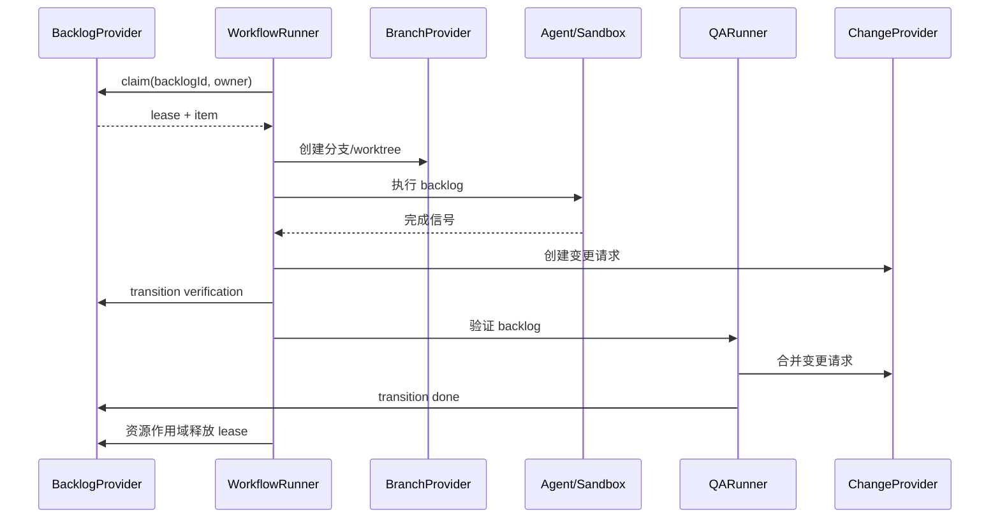

# AFK 架构

## 架构守卫

`pnpm architecture:check --check-packages` 强制 package 依赖契约和根目录层间
依赖方向。守卫检查五个 package 根目录：`packages/afk-core`、
`packages/afk-application`、`packages/afk-infrastructure`、
`packages/afk-execution` 和 `packages/afk-workflow-graph`。契约由表驱动：
`core` 不依赖任何包，`application` 只能依赖 `@afk/core`，`infrastructure` 可以
依赖 `core` 与 `application`，`execution` 可以依赖 `core`、`application`、
`infrastructure` 和 `@afk/workflow-graph`。`core` 与 `application` 都不得导入
Node 内建模块。该守卫同时禁止泛型 record 和遗留 client-factory 导入，并拒绝
按包名自引用或越出自身根目录的包。遗留迁移已完成：
`scripts/architecture-legacy-baseline.json` 记录零个遗留文件、导入和模式。
新增的遗留文件或导入会导致检查失败。删除基线条目时请一并删除这条过期记录。

根 `src/` 树现在只保留 CLI 与 TUI，共享能力都在 package 里。层间方向约束适用于
`src/cli`、`src/shared` 和 `src/views` 中非测试文件的相对导入。守卫的层表里
仍保留 `domain`、`application`、`infrastructure` 这几个名字，但这些目录在迁移
之后已经空了。传入 `--require-packages` 会让缺失的 package 根目录导致失败，
而不是跳过检查。

桌面客户端是独立的源码树，有自己的依赖约定：它可以使用共享的 `@afk/*` 包，
但不得导入根包的 `src/` 目录，也不得 spawn `afk` CLI 进程。逃逸到 `src/` 的
相对导入，与包越界导入一样会被守卫报告。

执行运行时经由端口接入，守卫把这条写成规则。直接 import
`@afk/execution/infrastructure` 的命令、视图或服务，等于替运行时承担了「它
是怎么造出来的」这份知识——该构造哪个类、该读哪个文件、该给哪个进程发信号
——于是 CLI 与桌面就可能对「配置」或「资源注册表」各说各话。只有两个文件可以
import 运行时的适配器：`src/cli/composition-root.ts` 与
`desktop-client/electron/composition-root.ts`，它们就是组合根，说明每个端口背后
是什么。测试文件豁免，这是决定而非疏忽——要拿真实文件验适配器的测试需要适配器，
要验命令的测试需要端口。

桌面的 renderer 只加载共享词表，别的一概不加载。它跑在浏览器里，只能加载浏览器
能加载的模块，而执行运行时不是：它要碰文件系统、进程和 provider SDK。因此桌面
`shared/` 或 `src/` 下 import 执行运行时的文件会被报告——契约住在那里，renderer
根本读不到。

`pnpm typecheck` 通过 `tsconfig.tests.json` 一并检查 `tests/`。根 `tsconfig.json`
把 `tests/` 排除在外，没有这个工程的话，测试或 E2E 脚本里的断链导入对构建
是不可见的。

每个 package 都有同一个工程，根 typecheck 会把它们一并跑。package 自己的
`tsconfig.json` 把测试文件排除在外，所以一个已经对不上契约的 mock 仍会「通过」——
而 mock 与契约对不上的测试，是不可能失败的测试。

## 范围与命令

AFK 执行外部规划器已经拆分好的 backlog 工作项，不负责把工作项再拆分成更小的任务。创建 backlog 工作项属于管理操作（`afk backlog create`），不在执行流水线内。
命令注册表是唯一命令来源：

| 命令 | 职责 |
| --- | --- |
| `afk backlog init` | 初始化 provider 元数据 |
| `afk backlog adopt --id <id> --project <project> --platform github\|gitlab [--json]` | 显式将一个开放手工 issue 接管为 ready AFK 工作项 |
| `afk backlog create <title>` | 创建一个 provider 背书的 backlog 工作项 |
| `afk backlog list/show/tag` | 查看和管理 backlog |
| `afk backlog inventory` | 盘点所有凭据可达项目下的 issue |
| `afk backlog interrupt` | 中止活跃执行，把 backlog 交还操作者 |
| `afk backlog retry` | 把 blocked 的操作者持有工作项退回 autonomous rework |
| `afk backlog confirm-merge` | 合并已批准的根 backlog 变更并置为 done |
| `afk run --backlog-id <id>` | 认领并执行一个 backlog |
| `afk execute --work-item-id <id> --execution-manifest <path>` | 实现、独立验证并发布一个托管工作项 |
| `afk reconcile --work-item-id <id> --execution-manifest <path> --execution-id <id>` | 校验人工已合并的根 PR 并对账执行审计 |
| `afk qa --backlog-id <id>` | 验证一个 backlog 工作项并按合并策略发布其变更 |
| `afk loop` | 轮询单个 manifest 绑定的工作项并调用 `executeWorkItem` |
| `afk loop start\|status\|stop` | 控制 loop 守护进程：前台/后台启动、状态查看与优雅停止 |
| `afk observe` | 读取 append-only 的 AFK 运行审计事件（`runs`、`executions`、`execution`、`timeline`、`verify`、`replay`、`explain`、`doctor`） |
| `afk retro run --run-id <id> --workspace <path>` | 用现有 `/retro` 技能分析已记录证据并写出 `report.json` 与 `report.html` |
| `afk retro show <report>` | 读取已生成的复盘报告 |
| `afk graph workflow <template>` | 生成确定性的工作流图 |
| `afk`（TUI）、`afk signal`、`afk tmux`、`afk kanban`、`afk debug`、`afk isolate`、`afk completion` | 运维和本地工具 |

已移除的命令组没有别名。provider 的元数据标签属于 adapter 内部实现，
不是 CLI 契约。

## Provider 边界

`BacklogProvider` 是 backlog 的 canonical 来源，负责身份、标题与描述、
状态、执行模式、父子关系、依赖、业务标签以及分支映射。`BranchProvider`
负责分支和 worktree；`ChangeProvider` 负责变更请求的创建、查询和合并。
Runner 只编排这些接口，不解析平台标签。

GitHub 和 GitLab 分别由具体的 `BacklogProvider` 实现，并由 provider bundle
按平台选择。它们可以在内部复用 tracker 机制，但平台校验和生产构造位于
各自边界。未来的 Linear 等平台直接实现 `BacklogProvider`，Runner 不依赖
tracker 类型。

管理 bundle 会将具体 provider 包装为不含认领能力的 facade。其 backlog
接口提供读取、列表、元数据初始化、业务标签更新，以及 QA 所需的状态和
执行模式更新；类型和运行时都没有 `claim()`。只有执行 bundle 暴露认领和
可运行性检查。

`adopt` 是管理/provider 的可选能力，不支持时明确报错。tracker adapter
检查 issue 原始状态和元数据，不从 domain 默认状态推断 ready。只接受开放且
生命周期标签缺失或为 canonical ready/afk 的 issue；拒绝未知、重复或冲突的
AFK 元数据，以及格式非法或指向自身的父级、执行基线和依赖 ID，保留业务标签、
关系和 issue 正文。仅在缺少标签时初始化 provider 元数据，再只添加缺失的
ready/afk 标签，不移除任何标签。已 ready/afk 项无写入地幂等成功；closed、
blocked、HITL 和其他生命周期状态无写入地拒绝。项目与平台必须显式提供，
`--json` 输出 `backlog.adopt` envelope。execute 和 loop 不会隐式调用接管。

## 运行时端口

执行运行时在进程之外做实事：读配置文件、驱动 tmux、拉起 loop 守护进程、读
harness 的 transcript、开浏览器，并维护运行登记出去的资源注册表。直接伸手去拿
其中任何一样，入口就得知道这事是怎么做的——而这份知识属于运行时，不属于恰好
需要它的命令、视图或服务。

所以运行时由它回答的端口来描述。端口声明在 `@afk/application`
（`packages/afk-application/src/runtime-ports.ts` 与
`packages/afk-application/src/workflow-config.ts`），端口点名的词表住在
`@afk/core`，实现住在执行包的 infrastructure 层，一个端口一个模块。

| 端口 | 回答什么 |
| --- | --- |
| `ConfigurationPort` | 一次运行被什么配置塑形：工作流设置、默认值、调度器设置、tracker 连接。 |
| `TmuxPort` | 运行被驱动着走的终端会话。 |
| `LoopProcessPort` | loop 守护进程的进程，以及记录它的 pid 文件。 |
| `AgentTelemetryPort` | AFK 读取的 harness transcript。AFK 只读；这次运行里发生了什么由 harness 说了算。 |
| `BrowserPort` | 操作系统的默认浏览器。 |
| `ResourceRegistryPort` | 运行登记出去的资源注册表。 |
| `RunSessionPort` | 运行里 agent 所在的那个终端会话，以及停掉它的办法。 |
| `TaskRuntimePort` | 运行时正在跟踪的那些运行记录。 |

命令、视图或服务只说自己需要什么；组合根说明它接到了什么。CLI 与 TUI 在
`src/cli/composition-root.ts` 接线，桌面客户端在
`desktop-client/electron/composition-root.ts`。只有这两个文件可以导入运行时的
适配器，架构守卫会报告任何别的文件这样做。

把词表挪进 `@afk/core` 是声明端口的一部分：形状住在实现里的端口，包不在那个
实现里就没法命名它；而形状的第二份拷贝，就是同一个问题的第二个答案。信号文法、
tmux 词表、资源记录、token 用量、运行记录、运行所处的阶段以及图的格式，因此
都是 `@afk/core` 里的词表；infrastructure 包按 core 声明的形状校验信号文件，
而不是自己再推一份。

桌面 renderer 要读其中一些词表，而 renderer 跑在浏览器里：它只能加载浏览器能
加载的模块，执行运行时不是。renderer 需要的共享词表只能住在 core 包里——core
不依赖任何东西。架构守卫把这条写成规则：桌面 `shared/` 或 `src/` 下 import
执行运行时的文件会被报告，因为桌面契约不能依赖一个 renderer 加载不了的模块。

## 停止一次运行

一次运行的 agent 是终端会话里的一个进程，而这次运行住在另一个进程里。从外面
停掉它的人——桌面客户端、或运维——没法直接调用正在跑的 agent，所以这个请求必须
经由双方都看得见的东西传过去。

停一次运行必须真的停掉那个进程。tracker 说这次运行被阻塞了、而 agent 还在干活，
不叫停了；agent 还在花本该被这次停止终结掉的预算。所以停止是两件事，按这个顺序：
先把请求写进这次运行自己的 worktree——就放在 agent 自己写的信号文件旁边——再杀掉
这次运行登记的会话。

运行时等 agent 的时候一直在轮询那个 worktree，于是它会发现这个请求，以 `manual`
为由中断 agent，并把这次运行以「被中断」结束，而不是报一次崩溃，也不是拖到完成
超时才发现。会话是运行时自己的：它在资源注册表里查到，所以一次停止不会终结属于
别的东西的会话。

## loop 的边界

`afk loop` 只接机器自己拥有的活：`ready`，以及 `rework`——QA 判定需要再来一次的
工作项。`verification`、`merge_ready`、`blocked` 属于人，不在其中；`merge_ready`
尤其如此，它在等一个人读完那份变更再合，而 loop 若是把它接过来，等于替人合并了
一份没人读过的变更。

loop 也会自己退出：每次执行链结束后，它向 provider 重读绑定工作项的真实状态——
仍是 `ready` 或 `rework`（QA 打回）就继续轮询；离开这两个状态（`merge_ready`、
`done`、`blocked` 等）说明机器已无活可干，loop 自行退出。状态读取失败只记录
错误并继续轮询；工作项处于 `in_progress` 时绝不退出。

合并永远由人做。loop 跑工作，不合并工作：合并是一个人对还没读过的变更做的决定，
所以能合并的 provider 刻意不在 loop 的接缝里——这个能力不在它手上，不会被顺手
用掉。根工作项的 QA 通过后停在 `merge_ready` 并切到 `hitl`，要合的人跑
`afk backlog confirm-merge`；子工作项（带 parent）的变更合进父分支后该项直接
`done`——那一段是机器该做的。

## 工作项与执行身份

Provider Backlog 是业务事实来源。其 `BacklogItem.id` 在
`afk run --backlog-id <id>`、`Run.workItemId`、`TaskRuntimeRecord.backlogId`、
TUI 投影和 Desktop 摘要之间原样传递。`runId` 标识一次执行尝试，
绝不可替代 Backlog ID。

各关系字段含义互不相同：`parentId` 表示组织分组，`dependsOn` 控制调度顺序，
`baseBacklogId` 选择显式的 Git 执行基线。父级边和依赖边都不会隐式选择分支。

这套身份的文法 —— 平台清单、project key 规则、issue number 规则，以及执行
manifest 的形状与规则 —— 只有一个家：`@afk/application` 的
`packages/afk-application/src/work-items/identity.ts` 与 `packages/afk-application/src/work-items/execution-manifest.ts`。桌面端与执行
运行时都经由它读取 manifest，所以一方接受的文档，另一方也读得懂。

## Backlog 生命周期

```text
ready/rework --claim--> in_progress --> verification --> merge_ready --> done
   \                         \
    \                         +--> blocked（执行模式：hitl）
     +--> blocked（冲突、失败、超时或 lease 过期）
```

只有状态为 `ready` 或 `rework`、执行模式为 `afk`、没有子 backlog 且所有 `dependsOn`
均为 `done` 时，条目才可运行。`parentId` 用于聚合子 backlog，父 backlog
本身不可运行。任何自动化失败、冲突、超时或不确定的 lease 恢复都必须将
条目转为 `blocked` 并切换到 `hitl`。

QA FAIL 在 Provider issue comment/note 中持久化新的返工记录，将旧 active
记录标为 `superseded`，并从已持久化的最高值递增 `ReworkRecord.attempt`。
QA 记录创建只持久化证据，后续状态和执行模式由 `QARunner` 路由；operator
retry 仍在创建记录后直接切到 `rework` + `afk`。

`WorkflowConfig.maxQaReworkAttempts` 默认 **3**，必须为正整数。可在
`.afk/config.yml` 设置 `maxQaReworkAttempts: 3`，或使用环境变量
`AFK_MAX_QA_REWORK_ATTEMPTS=3`，项目文件优先。没有历史记录时，首次 FAIL
为 attempt 1，第二次 FAIL 为 attempt 2，均允许 `rework` + `afk`；第三次
FAIL 持久化 attempt 3，返回 `success: false` 且不返回 `rework`，直接转为
`blocked` + `hitl`。后续 FAIL 保留该记录，不再开启自动返工。上限为 1 时
首次 FAIL 即阻塞。attempt 包含历史 resolved、superseded 和 operator
记录，重新创建 runner 不会重置；QA PASS 仍可 resolve active 记录。
该上限独立于执行重试的 `maxRetries` 和 AC 纠正的 `maxSelfIterations`。
handoff/token `BudgetManager` 会按 canonical work item 从
`<workspace>/.afk/budgets/` 恢复快照。handoff 次数和 harness 原生 token
消耗会跨运行持久化，并按 session ID 去重；账本损坏时会在启动新 Agent
前 fail closed。

`commit.recorded` 审计事件会在有新提交时记录实现或 QA 的真实本地 SHA
和分支；没有新提交时不产生该事件，也不会用变更请求的 SHA 替代。

## 运行时与 Desktop 投影

`~/.afk/runtime/tasks` 下的规范运行时文件拥有执行尝试的状态、阶段、心跳、
进度和诊断的最终解释权。超过新鲜度阈值的心跳会显示为运行时 `stale`；
它不会改变 Provider Backlog 的生命周期状态。

Desktop 的工作区本地文件 `.afk/backlog-runs.json` 仅包含进程启动元数据。
它可以报告 PID 或启动错误，但无法推断 `verification`、`blocked` 或 `done`。
Desktop 按精确的 `backlogId` 关联 Backlog、启动元数据和规范运行时记录；
运行时数据缺失或格式错误时，Backlog 仍然可见，并显式呈现为无运行时状态。

## 认领与本地文件系统 fallback

Provider 支持原生条件认领（CAS）时优先使用。否则在
`${AFK_STATE_DIR:-~/.afk/state}` 下取得持久化 lease；持有期间重新读取并
校验 backlog，执行 `ready -> in_progress`，再读取确认。Runner 通过资源
作用域维护 heartbeat，并在成功、失败、超时、崩溃和 handoff 时 exactly once
释放 lease。

文件系统 lease 只协调单机本地可信文件系统上的 worker，不提供多机共识或
跨主机崩溃恢复。多机执行必须使用 provider 原生 CAS（仅共享文件系统并
不足够）。路径按 provider、项目
和 backlog ID 命名空间隔离；符号链接路径会被拒绝；过期 lease 默认 fail-closed，
只有 provider 已持久化 `blocked` 与 `hitl` 后才允许恢复。

## 完整流程



`afk loop` 在进程内复用同一流程并集成 QA；独立 `qa` 命令使用管理 bundle，
不会认领实现任务。

## 扩展机制

插件运行时可以注册 provider。每个 provider 必须完整实现 `BacklogProvider`，
包括父子关系、依赖校验、状态与执行模式、业务标签和认领策略。平台客户端
封装在 provider 内部。系统不引入数据库或额外中间件；本地状态只使用文件
系统 lease 目录。

## 可靠性规则

- 任何失败转换、冲突、超时或 lease 过期都进入 `blocked + hitl`，不会静默
  作为自动任务重试。
- 优先使用原生认领；文件系统 fallback 仅适用于单机上的本地可信文件系统。
- lease 清理由生命周期统一管理且必须幂等。
- backlog ID 通过 provider-neutral 函数确定性映射到分支名。
