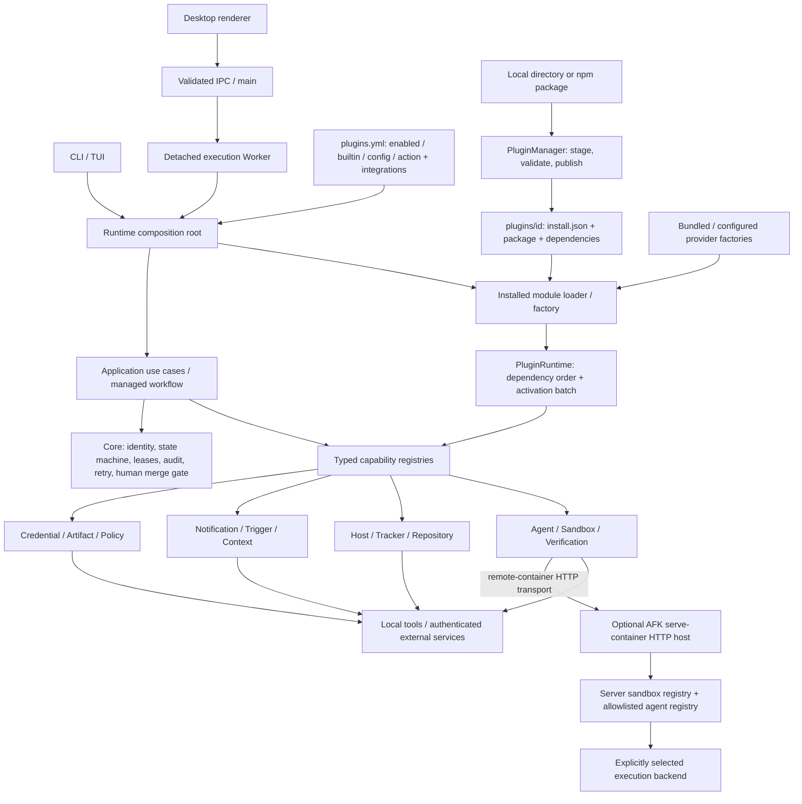

# AFK Capability Plugins

[中文](plugins.zh.md) · [Architecture overview](overview.md) · [Execution entry points](execution.md#execution-entry-points) · [ADR-0030](../adr/0030-host-capability-plugin.md)

This document describes the capability plugin implementation in the integration
tree as of November 7, 2026. The matrix and consumption paths describe concrete
provider contracts, managed execution, external prerequisites and protocol
boundaries. These Node
runtime plugins are separate from the Claude Code skills distribution and
the CLI's TUI extension loader.

## Core and extension boundary

The core owns work identity, state transitions, execution eligibility,
repository leases, audit ordering, retry budgets, and the human merge gate.
Plugins supply implementations behind ports; they do not redefine these rules.

| Remains in core / managed execution | Optional implementation behind a port |
|---|---|
| `BacklogItem.id`, `Run.workItemId`, `runId`, `parentId`, `dependsOn`, `baseBacklogId` and their distinct meanings | Read/write an external issue or source repository |
| Reducer, attempt lifecycle, eligibility, independent QA and reconciliation | Start an agent, prepare a sandbox, run verification |
| Repository lease acquisition, overlap rules and release | Access a local or remote workspace |
| Append-only audit semantics, event order and evidence authority | Export traces, metrics, reports or notifications |
| Retry classification, budgets, cancellation and recovery decisions | Perform one provider operation and report its result |
| Publish a change request and wait for a human to merge | Source-host API and additional policy checks |

`@afk/core` contains pure models, reducers and ports. `@afk/application` exposes
shared use cases such as host listing and command execution. `@afk/runtime`
contains the Node plugin manager, loader, registries, workflow engine and concrete
adapters. CLI and Desktop own argument parsing, output, IPC and interactive UI.
See the [identity contract](overview.md#work-item-identity-and-relationships)
and [audit architecture](observability.md) for the authoritative rules.

## Overall composition



Arrows show construction or calls, not process isolation. An installed plugin
runs in its host Node process. A detached Desktop execution Worker is an
execution boundary; it does not sandbox an individual plugin.

The shared composition entry is `createDefaultPluginRuntime`: construct the
builtins, apply configuration, load installed factories, and return one
`PluginRuntime` to the caller. CLI managed commands and the Desktop execution
Worker use this construction path. Callers can supply `homeDir`, `workspaceRoot`
and warning handling. Within an execution, implementation and QA receive the
same runtime and projected registries. Each process owns its instance and
disposes it when its work ends. CLI `execute`, `qa`, `loop`, `schedule` and `run`
reuse `composition.pluginRuntime` when supplied, avoiding duplicate activation;
a command creates and disposes its own fallback only when none was injected.

## Twelve provider families

“Available adapter” means concrete source exists. It does not imply an account
is configured, a service is reachable, or a workflow automatically calls it.
Capability IDs are the values in `packages/runtime/src/plugin-sdk/profile.ts`.

| Family / capability ID | Available adapters | External credentials or prerequisites | Consumption and limits |
|---|---|---|---|
| Agent · `agent.provider` | Claude Code, Codex, Cursor, Pi, OpenCode, Copilot | Corresponding CLI and its login, token or endpoint configuration | Registered by `createBuiltinAgentPlugins`; workflow engine consumes the projected agent registry. Session features follow each adapter's capabilities. |
| Sandbox · `sandbox.provider` | Local worktree, Docker, Podman, remote-container CLI/HTTP transport; optional AFK HTTP service host | Local Git; Docker/Podman engine; remote backend and its authentication when applicable | Builtin sandbox factory registers local/docker/podman. Remote container needs explicit transport configuration and a compatible backend; `plugin serve-container` explicitly hosts AFK's backend using shared sandbox/agent registries. |
| Tracker / backlog · `tracker.provider`, `tracker.issue`, `backlog.provider` | GitHub/GitLab source-host tracker/backlog integrations; independent Linear and Jira issue adapters | GitHub/GitLab tokens and repository/project; Linear token + team ID + API URL; Jira token + project key + API URL, optionally email | Configured GitHub/GitLab register tracker and backlog providers; shared assembly selects a tracker matching platform, project and applicable host, then builds its managed provider bundle. Multiple matches fail; no match uses the existing tracker factory. Linear/Jira remain independent `tracker.issue` adapters and do not supply repository-backed backlog/change-request identity. |
| Host · `host.connection` | JumpServer, SSH, AWS SSM, Kubernetes Exec | `jms` login; SSH keys/agent/config; AWS CLI credentials/profile + SSM permission; `kubectl` context/kubeconfig + exec RBAC | `HostConnectionPort` → Application host use cases → `afk host ls/exec`; Desktop can reuse the shared adapter. Discovery and remote execution require a real target. |
| Verification · `verification.provider` | Test runner, static scan, browser check | Installed test/lint/browser tools; optional project-specific service credentials | `verify` runs an argv command in the target workspace. Defaults are `npm test`, `npm run lint`, `playwright test`; these are command wrappers, not embedded analyzers. |
| Notification · `notification.provider` | Feishu, Slack, email, Gmail, desktop | Feishu/Slack webhook URL; configured `sendmail` and mail transport for email; Gmail API and Google user OAuth; native desktop notification tool | `notify`; HTTP adapters default to global fetch with optional transport injection. Gmail defaults to the authenticated account as recipient. A delivery receipt reports actual success/failure. Desktop delivery depends on the OS tool. |
| Trigger · `trigger.provider` | HMAC webhook, Git push, issue event, interval schedule | Webhook shared secret; a host that delivers incoming events; no external account for local interval timers | `register/unregister`; `plugin listen` supplies the resident HTTP host and activates configured timers/actions. The adapters themselves do not start a listener, Git watcher or durable cron service. Schedule text is positive integer milliseconds. |
| Context / memory · `context.provider` | Code context, knowledge base, retrieval, project memory | Readable workspace/files; knowledge-base HTTP endpoint and any authentication supplied by its transport | `gather`; code reads local content, retrieval uses supplied documents, memory reads a local file, knowledge base expects protocol-compatible JSON fragments. No automatic embedding or indexing service. |
| Credential / auth · `credential.provider` | System keychain, Google user OAuth, OAuth client credentials, OIDC assertion/exchange, enterprise environment credentials | Keychain access; Google Desktop app client JSON and browser consent; OAuth endpoint/client ID/secret; OIDC issuer/client/assertion; supplied environment/value entries | `resolve`; scopes only where advertised. Enterprise adapter reads configured values/environment; it is not an enterprise vault SDK. HTTP adapters default to global fetch with optional transport injection. Credential resolution remains private to SDK consumers. |
| Artifact / report · `artifact.provider` | Local test reports, evidence bundle builder, object storage upload, report platform upload | Writable local path; presigned/upload URL or report endpoint, optionally bearer token | `put`; upload adapters advertise write only. The configured evidence-bundle factory wraps its builder as an `ArtifactSink`. Object storage does not implement AWS request signing. |
| Repository / workspace · `repository.provider` | Multiple local repositories, remote workspace snapshot, special Git backend | Git and configured local paths; compatible remote endpoint/token; installed special backend executable | `snapshot`; current adapters advertise read/snapshot, not clone or push. Remote workspace expects its specific HTTP protocol; special backend must return snapshot JSON. |
| Security / policy · `policy.provider` | Secret scan, license policy, compliance policy | Workspace files, explicit license allowlist and compliance rules; no account required for local checks | Selected policies are required managed lifecycle gates, including engine `before-publish` and QA publication checks; denial or evaluation failure blocks publication. Direct SDK callers must invoke the lifecycle or evaluate/enforce policy themselves. Local pattern, license and rule checks do not constitute an external compliance service. |

The current default root constructs all six agent adapters, local/docker/podman,
the four host adapters, all three verification wrappers, desktop notification,
code/retrieval/project-memory context, system keychain, local test-report
storage, multiple-local-repository snapshots, and the three local policy checks.
It supplies an empty retrieval document list, repository set and compliance rule
set; the default license allowlist is MIT, Apache-2.0, BSD-2-Clause,
BSD-3-Clause and ISC. It does not automatically construct Linear/Jira,
remote-container, webhook/email delivery, remote knowledge/workspace services,
OAuth/OIDC or remote artifact uploads. Those require an installed factory or
a concrete configured builtin factory. Configured GitHub/GitLab participate in
the same managed assembly through their registered tracker/backlog contracts;
they are selected by project rather than treated as independent issue adapters.

Observability is an additional extension surface, not a thirteenth family in
this matrix. `observability.provider`, `observe.event-store`, `observe.evidence`,
`observe.tracing`, and `observe.metrics` expose event/evidence/tracer/metrics
contracts. Enabled generic and specialized tracing, metrics and event-store
providers are discovered automatically; registrations of the same object are
deduplicated. Local JSONL remains the authoritative audit store.
Workflow and presentation extension points are `workflow.lifecycle`,
`workflow.template`, `workflow.action`, `surface.cli`, `surface.tui`, and
`surface.desktop`; a surface registration alone does not mount a UI.

## Observability export

The configurable builtin plugin `observability.otlp` registers provider `otlp`.
It sends OTLP/HTTP JSON to a collector's base `endpoint` plus `/v1/traces` and
`/v1/metrics`. It implements generic OTLP export, without a vendor-specific
Prometheus exporter or Langfuse API integration. A compatible collector is an
optional external service; AFK does not start one. See the
[local collector example](observability.md#optional-local-otlp-collector).

Save the configuration object as `observability.json`:

```json
{
  "endpoint": "http://127.0.0.1:4318",
  "serviceName": "runtime",
  "headers": {"Authorization": {"env": "OTLP_AUTHORIZATION"}},
  "resourceAttributes": {"deployment.environment": "local"},
  "timeoutMs": 2000
}
```

```sh
afk plugin configure observability.otlp --builtin --file observability.json
```

`serviceName` is optional; `resourceAttributes` maps keys to string, number or
boolean values. Each header value must be an environment reference such as
`{"env":"OTLP_AUTHORIZATION"}` or a credential reference such as
`{"provider":"credential.enterprise","name":"otlp-authorization"}`.
Set the referenced secret to the full header value; raw string values are
rejected. Omit `headers` for an unauthenticated local collector.
`timeoutMs` defaults to 2000 and accepts at most 300000. The host's shared
5000 ms deadline bounds all exports for one audit record.

The host mirrors events only after a successful durable local append. An
`EventStoreProvider` receives these persisted events; it cannot
replace local audit authority. Each audit record has its own span, with run
and work-item trace attributes. Tracing uses `startSpan`, `addEvent` and
`endSpan`; `endSpan` remains optional for legacy providers. `TraceSpanOptions`
accepts scalar attributes and `TraceContext` accepts optional `parentSpanId`.
`MetricSample.kind` optionally selects `counter`, `gauge` or `histogram`.
Event counts use low-cardinality attributes, and `run.event_persistence_ms`
records persistence latency as a histogram. Run/work-item identifiers belong
on traces, not metric labels; secrets and evidence bodies must not be exported
as attributes.

Before returning from recording an audit event, the host drains its export
operations under this shared deadline, aborting in-flight work and skipping
remaining exports when it expires. Specialized registrations enable only their
registered signal. Existing plugin runtime disposal
owns cleanup, so CLI exit does not abandon fire-and-forget exports. Export
errors and timeouts are isolated from execution; diagnostics exclude secret
values and remote error bodies. Local audit failures remain fatal. This is
best-effort export, not a cloud-account end-to-end delivery claim.
`EvidenceStoreProvider` / `observe.evidence` is available as an interface;
external evidence upload is not automatically hooked into audit recording.

## Standard manifest and API v1

The package root must contain `package.json` and `plugin.json`. The latter is a
standard `PluginManifest` plus an optional relative `entry`; the default entry
is `dist/index.js`. It is not a nested `manifest` envelope.

```json
{
  "id": "context.project-note",
  "version": "1.0.0",
  "apiVersion": 1,
  "trusted": true,
  "provides": ["context.provider"],
  "requires": [],
  "conflicts": [],
  "entry": "dist/index.js",
  "configSchema": {
    "type": "object",
    "properties": {"note": {"type": "string", "minLength": 1}},
    "required": ["note"],
    "additionalProperties": false
  }
}
```

IDs use a domain and a meaningful name: `host.jumpserver`, `tracker.linear`,
`context.project-note`. The validator rejects the `afk-`/`afk.` prefix. Generic
builtin wrappers preserve an existing domain prefix, so `context.code` stays
`context.code`. Plugin ID, capability ID and registered provider name are
different keys: `context.project-note` / `context.provider` / `project-note`.

| Manifest field | Runtime meaning |
|---|---|
| `id`, `version` | Validated plugin identifier and semantic-version-shaped string |
| `apiVersion: 1`, `trusted: true` | Required compatibility/trust declaration; not a verified publisher identity |
| `provides` | Declared capabilities; registrations outside this list fail activation |
| `requires` | Required capability IDs; no package names or dependency version ranges |
| `conflicts` | Plugin IDs or capability IDs that cannot coexist |
| `configSchema` | AJV validation of this plugin's configuration object |
| `entry` | Installer metadata, relative to the package root; not part of the SDK `PluginManifest` interface |

The SDK entry is `@afk/runtime/plugin-sdk`. A `Plugin` exports `manifest` and
`activate(context)`, optionally `health()` and `diagnostics()`. The setup context
has typed `registerAgentProvider`, `registerSandboxProvider`,
`registerTrackerProvider`, `registerIssueTrackerProvider`,
`registerBacklogProvider`, `registerHostProvider`, and equivalent registration
methods for the remaining families, plus lifecycle/action/template/surface
registration and `onDispose`.

Modules export `default` or `plugin`: either a plugin object or a factory. A
factory receives `{ configuration, homeDir, workspaceRoot }` and may be async.
For example, with `package.json` containing
`{"name":"project-note","version":"1.0.0","type":"module"}`, the entry
`dist/index.js` can be:

```js
import { readFileSync } from 'node:fs';

export const manifest = JSON.parse(
  readFileSync(new URL('../plugin.json', import.meta.url), 'utf8'),
);

export default function createPlugin({ configuration }) {
  return {
    manifest,
    activate(context) {
      context.registerContextProvider('project-note', {
        id: 'project-note',
        capabilities: { 'read-only': true, summarize: false, search: false },
        async gather() {
          return [{ content: configuration.note, origin: 'project-note' }];
        },
      });
    },
  };
}
```

Implement the SDK provider interface for the selected family; configuration is
data, while the factory supplies functions, transports and provider instances.
Acquire resources during activation and register their cleanup with
`context.onDispose`. Resources created during module import or factory execution
are outside the activation batch and require factory-owned cleanup on failure.

## Installation and configuration

```sh
afk plugin install ./project-note
afk plugin install @example/project-note@1.0.0
afk plugin configure context.project-note --file ./project-note.settings.json
afk plugin list --json
afk plugin doctor --plugin context.project-note --json
afk plugin disable context.project-note
afk plugin enable context.project-note
afk plugin remove context.project-note
```

`project-note.settings.json` is `{"note":"Use the repository contribution guide."}`.
It is the configuration object itself, not an enclosing `plugins` document.
Installation enables the module; configure required settings before starting a
new runtime. `remove` disables and deletes an installed package while retaining
its settings. Enable/disable/configure affect subsequent runtime construction;
they do not hot-reload a running Worker.

Before publishing an installation or saving enable/disable/configure/remove,
the manager checks the proposed enabled set against static builtin and installed
manifest metadata, validates applicable configuration, and checks whether the
change would remove a capability required by another enabled plugin. It does
not import or execute installed plugin modules, run their factories, activate
them, or call health/credential operations for this guard. Installed entry
containment and digest checks still apply. Malformed configuration envelopes or
installation metadata block the mutation; a rejected replacement preserves the
previous installation. Unconfigured installed plugins do not block unrelated
setup or repair. A validated replacement can repair a damaged target entry digest.

The guard compares previously available dependents with the proposed manifest
set, including conflicts and exact configured credential references. Another
`credential.provider` cannot substitute for a known configured registry name.
Installed plugins' registration names are opaque without executing their code;
when an enabled configured consumer references such a name, changes to a
potential credential owner are conservatively refused. Disable the consumer
first to modify that provider. Activation still checks the actual registry;
this guard does not prove provider health, authorization or successful activation.

`PluginManager` serializes mutations with `~/.afk/plugins/.manager.lock`. It
copies a local directory without `.git` or `node_modules`, or resolves an npm
package specification in a new `.install-*` staging directory. Dependencies
are installed there using `npm install --ignore-scripts --omit=dev --no-audit
--no-fund --legacy-peer-deps`; npm specifications also use `--save-exact`.
The module must already contain its built entry: install scripts do not compile
it. The installer links the host `@afk/runtime` package for SDK access.

After validating the manifest and ensuring the real entry path stays inside
the package, it writes `install.json`: ID, version, source, stage-relative entry,
manifest, `sha256-<base64>` entry digest and installation time. It renames the
old installation to a backup, publishes the stage and enables configuration.
An ordinary failed upgrade restores the old directory. This is not a
crash-recoverable multi-file transaction, a package-tree signature, or a
malicious-code sandbox. A process crash can also leave the manager lock behind.

Configuration lives in `~/.afk/plugins.yml`:

```yaml
plugins:
  - id: context.project-note
    enabled: true
    config:
      note: Use the repository contribution guide.
  - id: host.ssh
    enabled: true
    builtin: true
    config:
      hosts:
        - alias: staging
          address: staging.example.test
          username: developer
```

Zod validates the configuration envelope and JSON-compatible values. AJV
validates `configSchema` with all errors, non-strict schema mode and format
validation disabled; it does not populate defaults. `format` is therefore not
an enforced constraint. No generic secret interpolation is performed by the
loader: an environment-variable name is a literal string unless the configured
factory explicitly resolves it. Keep actual secrets in the provider's
credential source rather than copying them into examples or CLI arguments.

`afk plugin configure host.ssh --file ./ssh.settings.json --builtin` writes
`builtin: true`. The installed-module loader skips these entries. A configured
builtin factory must recognize the ID, validate its specific schema, translate
the data into constructor options, and register the resulting provider. Writing
arbitrary JSON with `--builtin` cannot instantiate an unknown provider. Functions
such as injected fetch, callbacks or command executors cannot be serialized in
YAML; the factory creates them. Schema coverage and available configured IDs are
defined by that factory, not by the flag.

### Desktop Settings

Settings provides local-directory or npm package installation, enable/disable,
removal of installed packages, and configuration replacement from a local JSON
object file (at most 1 MiB). Installation and configuration import require native
confirmation; removal has a confirmation dialog. Builtins can be disabled but
not removed. Removal retains settings, and a configuration-only entry cannot be
re-enabled until its package is installed.

The main process calls the shared manager through validated IPC. Renderer DTOs
contain plugin metadata and fixed diagnostic messages, not saved configuration,
secret values or raw plugin errors. The initial Runtime inspection is cached
until Desktop restarts; refreshing rereads install/configuration state, not a
live view of Worker runtimes. Inspection constructs a real Runtime and calls
diagnostics, so it can execute trusted plugin code and configured credential
resolution; this is separate from the static mutation guard.

Changes affect subsequent runtime construction and future Workers. Existing
Workers keep their runtime. Install/remove are blocked while tracked Workers or
live starting/running Worker records exist; unreadable Worker state also blocks
those file mutations. Worker launches are blocked during a file mutation. The
Settings manager does not mount `surface.desktop`, add an OAuth login UI, or
install the external tools required by providers.

### Gmail OAuth

Enable the Gmail API in a Google Cloud project, configure its OAuth consent
screen, and download an OAuth client JSON file with application type **Desktop
app**. For an External app in **Testing**, add the authorizing Google account
as a test user. Keep the client file private; pass its path, not its contents:

```sh
afk plugin auth login google --client ./google-desktop-client.json
afk plugin auth status google
afk plugin auth logout google
```

Login opens the browser and receives the authorization response on a local
loopback callback. Keep the CLI process running and complete authorization within
10 minutes. After timeout, start login again and use the new browser page;
the previous callback URL is no longer valid. Choose the Google account in the browser; the CLI does not
ask for an email address. The requested scopes are
`https://www.googleapis.com/auth/gmail.send`, `openid`, and `email`: mail sending
plus account identification, without mailbox reading. SIGINT/SIGTERM cancels
the login and closes the callback server. OAuth and credential storage belong
to the runtime's public `GoogleOAuthCredentialProvider` SDK API; the CLI only
parses arguments, forwards cancellation, configures providers and prints safe
results.

After successful login, `PluginManager.configure` saves builtin
`credential.google-oauth` with `{}` and adds builtin `notification.gmail` with
`{}` if no Gmail entry exists. Existing Gmail settings, recipients and
enablement remain intact. No configuration is written when authentication
fails. Login does not send a test email.

Credentials are stored through the macOS Keychain or Linux keychain service.
Windows is explicitly unsupported; there is no token-file fallback. Keep
Keychain access available to the CLI and subsequent notification processes.
Account mutations share a process queue and an exclusive cross-process lock,
including the entire browser login. Another process fails as busy instead of
overwriting an in-flight login, refresh or logout. The lock contains only its
owner PID; after an unclean process termination, remove a stale
`~/.afk/auth/google-oauth.lock` only after confirming its owner is no longer running.
Run `node scripts/check-google-oauth-keychain.mjs` after building to verify real
native Keychain create/update/read/delete with an isolated synthetic record.
Google OAuth and Gmail HTTP requests respect `HTTP_PROXY`/`HTTPS_PROXY` and
`NO_PROXY` (including lowercase forms). Without explicit proxy variables on
macOS, they use the system HTTP/HTTPS proxy. Loopback bypasses the proxy;
proxy discovery is cached for the process, so restart after changing it.
PAC or SOCKS-only setups need an explicit HTTP proxy. Authentication failures
report safe stage codes such as `token.network`, `token.scope` and
`account.storage`; Google response bodies and credentials are never printed.

Gmail's default recipient is the authenticated account itself. To override it,
save `{"to":"alerts@example.com"}` in `gmail.settings.json` and run:

```sh
afk plugin configure notification.gmail --builtin --file ./gmail.settings.json
```

This explicitly configured `to` replaces the default recipient for subsequent
notifications. The optional `channel` field selects the notification channel.
`status` needs no client file and prints only the local Keychain record's
`connected`, optional `email` and `expiresAt`, never tokens. It does not contact
Google to verify the session or token validity; `connected: true` alone does
not prove that sending will succeed. `logout` also needs no client file. The
runtime first revokes Google authorization, then removes the Keychain record
only after successful revocation. A failed revocation retains the record for
retry. Logout retains plugin settings and does not disable other providers.

For an External OAuth app left in Testing, refresh tokens for this Gmail scope
expire after **7 days**; authorize again when needed. Production publishing and
any required Google verification are separate setup steps. See Google's
[Desktop OAuth flow](https://developers.google.com/identity/protocols/oauth2/native-app)
and [refresh token expiration rules](https://developers.google.com/identity/protocols/oauth2#expiration).
The CLI tests inject an authentication object and use isolated configuration;
they do not authorize a real Google account or send real Gmail messages.
Separately, a manual run on November 7, 2026 completed browser consent, automatic
account identification, native Keychain persistence, CLI notification dispatch,
Gmail API acceptance and recipient-confirmed delivery. The run required an
explicit HTTP proxy because the system proxy was disabled. A separate real
refresh request also succeeded: the injected clock forced only the initial
expiry check, then the real clock determined the refreshed token's persisted
expiry. The account remained unchanged and no email was sent. Revocation
remains unverified. Desktop Google authentication buttons are
not included. Connecting Gmail does not configure workflow notifications;
select the notification provider in the workflow integrations separately.

Gmail failures distinguish unavailable network/proxy, HTTP 401 authentication,
HTTP 403 API/permission denial and HTTP 429 rate limits using static messages.
Unknown failures remain generic; response bodies, tokens and native errors are
not printed. Failed or uncertain deliveries are never retried automatically.

### Configured builtin fields

`createConfiguredPlugins` recognizes the IDs below. Its strict schemas reject
unknown IDs and fields. `?` marks optional fields; arrays described as nonempty
must contain at least one item. Paths resolve against `workspaceRoot`; `~/`
resolves against the supplied home directory. Every secret field accepts either
`{env: VARIABLE_NAME}` or `{provider: REGISTERED_NAME, name: CREDENTIAL_NAME,
scope?: REQUESTED_SCOPE}`. Provider names are exact registry keys, for example
`credential.enterprise`; registration alone does not select a credential source.
The factory rejects missing, empty or control-character secret values and
redacts resolved secrets from its own errors, health and diagnostics. It supplies
fetch/executors/callbacks rather than serializing functions in YAML.

| Plugin ID | Accepted configuration fields |
|---|---|
| `agent.claude-code`, `agent.codex`, `agent.cursor`, `agent.pi`, `agent.opencode`, `agent.copilot` | `{}`; agent authentication remains with each installed tool |
| `sandbox.local`, `sandbox.docker`, `sandbox.podman` | `engine?` equal to the corresponding backend name |
| `sandbox.remote-container` | HTTP: `transport: http`, `endpoint`, secret `token?`, `timeoutMs?`; CLI: `transport: cli`, `command`, `timeoutMs?` |
| `host.jumpserver` | `serverAlias?` |
| `host.ssh` | Nonempty `hosts[{alias,address,id?,username?,port?,identityFile?}]`; defaults `username?`, `port?`, `identityFile?`, `binary?`, `scpBinary?` |
| `host.aws-ssm` | Nonempty `hosts[{alias,instanceId,id?,region?,profile?,address?}]`; `region?`, `profile?`, `binary?`, `pollIntervalMs?` |
| `host.kubernetes-exec` | Nonempty `hosts[{alias,pod,id?,namespace?,container?,address?}]`; `namespace?`, `context?`, `kubeconfig?`, `binary?` |
| `tracker.github` | `repo` in owner/repository form, secret `token` |
| `tracker.gitlab` | `url`, secret `token`, `projectId` as string or positive integer |
| `tracker.linear` | `baseUrl`, secret `token`, `teamId` |
| `tracker.jira` | `baseUrl`, secret `token`, `projectKey`, `email?`, `issueType?` |
| `verification.test-runner`, `verification.static-scan`, `verification.browser-check` | Nonempty argv `command`, `timeoutMs?` |
| `notification.feishu`, `notification.slack` | Secret `webhook` resolving to an HTTP URL, `channel?` |
| `notification.email` | `from`, `to` email addresses; `sendmailPath?`, `channel?` |
| `notification.gmail` | `{}` sends to the authenticated Google account; optional email `to` overrides the recipient; `channel?` |
| `notification.desktop` | `platform?` (`darwin`, `linux`, `win32`), `channel?` |
| `trigger.webhook` | Secret `secret`, nonempty `triggers[{id,kind: webhook,payload?,input?}]`; `payload` is event filtering and `input` is static action input |
| `trigger.git-push`, `trigger.issue-event` | Same webhook-kind `triggers`; Git push also accepts `includeDeleted?` |
| `trigger.schedule` | Nonempty `triggers[{id,kind: schedule,schedule,payload?,input?}]`; schedule is a positive integer millisecond string, at most `2147483647`; `payload` and `input` accept nested JSON |
| `context.code`, `context.knowledge-base`, `context.project-memory` | Respectively `root`, `endpoint`, `file` |
| `context.retrieval` | Nonempty `documents[{origin,content}]` |
| `credential.system-keychain` | `service`, `command?` |
| `credential.google-oauth` | `{}` uses the Google credentials saved by `afk plugin auth login google --client <path>` |
| `credential.oauth` | HTTPS `tokenEndpoint`, `clientId`, secret `clientSecret`, `authMethod?` (`client_secret_basic`/`client_secret_post`), `timeoutMs?` |
| `credential.oidc` | HTTPS `issuer`, `clientId`, secret `assertion`, `tokenEndpoint?`, `timeoutMs?`; optional `exchange:{subjectToken,subjectTokenType,audience?,resource?}` with secret `subjectToken` |
| `credential.enterprise` | Nonempty `values` map of secret references |
| `artifact.test-report-local`, `artifact.evidence-bundle` | `root`; evidence-bundle factory wraps the builder as an `ArtifactSink`, mapping `put` to a one-record bundle's `create` |
| `artifact.object-storage`, `artifact.report-platform` | `endpoint`; report platform also accepts secret `token?` |
| `repository.multi-repository` | Nonempty `repositories[{name,path}]` with unique names |
| `repository.remote-workspace`, `repository.special-git-backend` | Respectively `baseUrl` plus secret `token?`, or `backend` |
| `policy.secret-scan` | Fallback `root`, nonempty `files?`, `maxFileBytes?`; evaluation prefers the trusted lifecycle's `context.worktreePath` |
| `policy.license-policy` | Nonempty `allowlist`, nonempty `licenses?` |
| `policy.compliance-policy` | Nonempty `rules[{id,effect,actions?,when?,reason?}]`, `defaultEffect?`; effect is `allow`/`deny`, actions are nonempty, `when` is a scalar equality map |

Explicit configured entries replace defaults with the same ID. `--builtin`
validates configuration before saving; validation neither resolves credential
provider references nor performs authentication/network calls or starts timers.
Environment references are checked and captured during construction.

Credential references are shape-checked first. At activation the factory looks
up the exact credential provider in the existing Runtime registry, awaits
`resolve({name, scope?})` once per referenced field, validates the actual value,
then registers the consumer. Webhook URL validation runs after the asynchronous
resolution. Missing providers, invalid results and resolution errors fail
activation without publishing the consumer or exposing credential errors.
Values injected through these generic references are captured for that
activation; operations do not automatically resolve or refresh them.
Reactivation resolves again. Gmail retains its own OAuth refresh behavior.

The shared composition root batches valid configured builtins. Within that
batch, specific credential references order credential providers before their
consumers, including credential-to-credential chains; self-references and cycles
are rejected before credential resolution. Credential providers do not add a
same-capability `requires` edge for their own references. The shared loader also
defers configured consumers until their exact named credential providers are
registered, including providers from installed plugins. Missing or cyclic
dependencies produce `load.dependencies`; actual resolution failures are not retried.
Change an environment value or credential source by constructing a new Runtime;
there is no automatic refresh of an existing consumer.

## Loading, dependencies and disposal

1. Read configuration, ignore disabled entries, record duplicates and malformed
   configuration as diagnostics. YAML parse/read errors use a fixed message
   without source excerpts; envelope validation reports field paths rather
   than values. Module loading skips `builtin: true`.
2. Read the installed record, validate its manifest, real entry containment and
   entry digest. Import the module, validate configuration and call the factory.
   Check the returned ID, version and capability list against the record. The
   compatibility path without `install.json` still supports explicitly configured
   legacy `dist/index.js` modules; it has no installed-record digest check.
3. Combine installed candidates and supplied builtins. An explicit installed
   entry suppresses the builtin with the same ID even when import, validation
   or activation fails; it does not silently fall back. Disabling that ID also
   skips the builtin. Explicit configured builtin overrides likewise replace
   the default before construction, so invalid settings cannot restore it.
   Repeatedly activate candidates whose required capabilities are
   already available. Missing/cyclic dependencies produce `load.dependencies`.
4. `PluginRuntime.activate` validates manifest, dependencies and conflicts;
   collects registrations, actions, lifecycle modules, templates and disposers
   into a batch; validates the batch; then commits it to the registries.
5. A failed activation commits no registrations and runs that batch's disposers
   in reverse order. Rollback errors are collected with the activation error.
   Already loaded plugins stay available. External side effects are only undone
   if the plugin supplied a working disposer.
6. `dispose()` removes plugins in reverse activation order and runs each plugin's
   disposers in reverse registration order, continuing after errors and finally
   throwing an `AggregateError`. Removing one plugin is refused if it would
   leave another loaded plugin without a required capability.

The runtime and `resolveProfile` permit several plugins for one capability.
`ResolvedProfile.capabilities` is a map from capability to a readonly
`PluginManifest[]`; selecting a profile does not implicitly choose one provider.
Runtime duplicate `(capability, provider name)` registrations still fail.
Profile resolution checks selected IDs, required capabilities and conflicts.
`requires` expresses capability availability, not a versioned package resolver
or a selected provider's health.

During `activate`, dependent plugins can obtain an already activated provider
through `context.getProvider<T>(capability, name)` or
`context.getCredentialProvider(name)`. A consumer can declare
`requires: ['credential.provider']` for capability availability, but must still
check the exact named provider and await its `resolve` privately. Capability
requirements alone cannot order credential-to-credential references; configured
builtins use the specific-reference ordering described above. Do not expose returned secrets through action results,
diagnostics or logs. These SDK methods do not add credential reads to the CLI
operation whitelist; named-provider selection remains the consumer's job.

The transaction begins at `activate`, after import and factory execution.
Diagnostic handling catches optional plugin failures; it does not prevent
trusted code from mutating global state, reading files or crashing the process.

## Actual consumption paths and integration status

| Consumer | Path and boundary |
|---|---|
| Managed agent and sandbox execution | CLI `execute` / `qa` / `loop` / `schedule`, `run` → `runWorkflowCli`, and Desktop Worker pass the shared Runtime into execution. `executeWorkItem` forwards it to implementation and QA; the engine obtains agent/sandbox registries, lifecycle modules and registered system actions from it. |
| Desktop Agent selection | Snapshot exposes registered agent provider names; workflow menus offer those names, including external plugins. Saving the default Agent or an Agent node validates membership in the current registry and rejects unknown names. Tool installation diagnostics remain a separate check. |
| GitHub/GitLab tracker and backlog | Configured factories register both contracts. Shared `assembleProviders` matches the runtime's tracker by platform, project and applicable host, builds the managed bundle and rejects ambiguous matches; no match uses the existing source-host factory. |
| Host operations | Runtime → `getHostProvider(name)` → shared Application host use cases → CLI `host` or a Desktop adapter. `jumpserver` is the CLI default; another provider must be selected explicitly. |
| Linear/Jira issue operations | Runtime → `getIssueTrackerProvider(name)` → `IssueTrackerPort` methods. Source-host `TrackerProvider` and `BacklogProvider` remain separate contracts; an issue adapter alone cannot execute a canonical GitHub/GitLab backlog item. |
| Other capability operations | Typed getters and CLI `invoke` call the permitted operations. Root `integrations` selects policy, context, artifact and notification consumers for implementation and QA; credentials remain private SDK operations and resident triggers run through `listen`. |
| Lifecycle modules and system actions | `getLifecycleModules()` feeds engine and QA hooks; registered system actions serve workflow steps and trigger callbacks. Core transitions, audit, retry and the human merge gate remain mandatory. |
| Templates and surfaces | Registry entries are available to explicit consumers. Registration alone does not replace existing command dispatch, template storage or Desktop rendering. |

Host execution distinguishes a remote command's exit status from a connection
failure. A completed remote command returns `HostExecResult` with its original
`code`, `stdout` and `stderr`, including a nonzero code. SSH exits other than
`255`, kubectl's matching remote-exit marker, complete SSM `Failed` responses
with a remote response code, and ordinary JumpServer `remote-failed` command
results follow this contract. JumpServer execution also preserves output
whitespace. Connection, authentication and timeout failures remain `HostFailure`;
a nonzero remote command result must not be relabeled as a connection error.
`afk host exec` preserves the remote exit code; the generic `plugin invoke`
command instead sets its own exit status to `1` for a nonzero result code while
retaining that code and both output streams in its JSON result.

At this source snapshot, `createCliPluginRuntime` delegates to the shared
`createDefaultPluginRuntime` in
`packages/runtime/src/application/plugins/default-runtime.ts`. The exact CLI
registrations for `invoke` and `listen`, the typed operation dispatcher and
the authenticated listener are present. Configured builtin construction, nested
trigger payloads, remote-container service assembly and the engine's
`before-publish` hook are implemented. Managed execution, standalone QA, loop,
schedule, `run` / `runWorkflowCli` and the Desktop Worker now pass the same
runtime through their execution paths. The engine consumes its registries,
actions and lifecycle modules; each command or Worker disposes the runtime it
owns. The diagram shows these implemented composition and invocation paths.

| Integration surface | Implemented behavior and checks |
|---|---|
| Local directory / npm package installer and upgrade preservation | Source checked; installation/example checks passed; real local npm dependency with disabled lifecycle scripts confirmed |
| CLI `invoke` and its 43-operation dispatcher | Exact command registration and whitelist checked |
| CLI `listen` and authenticated HTTP host | Implemented and confirmed; exact flags, routing and authentication checked |
| CLI `serve-container` and shared registry service assembly | Required flags, shared backend registries and authenticated HTTP handler checked |
| CLI delegation to shared composition root | Source checked |
| CLI managed Runtime ownership | `execute`, `qa`, `loop`, `schedule` and `run` reuse injected `composition.pluginRuntime`; only their own fallback instance is disposed by the command |
| Configured builtin schemas / secret-field mappings | Implemented; concrete fields and examples checked against `configured.ts` |
| System-step input, `capability.invoke`, required policy hooks | Implemented; negative operation results fail the step; checks run before Agent, after Agent and before publication |
| Managed execution, QA, loop, schedule, run and Desktop Worker | Implemented; Runtime and registries are propagated into implementation/QA and disposed by their owner |
| QA lifecycle and publication policy | Required init and before-agent hooks run before verification; context uses a file pointer; successful QA runs after-agent artifact/notification hooks; separate `before-publish` checks precede branch push and change-request publication |
| Desktop plugin management | Settings calls the shared manager for local/npm install, enable/disable, removal and JSON configuration import; cached inspection is distinct from future Worker state and the static dependency guard. |
| Desktop external Agent selection | Implemented; menu uses registered providers and save rejects an unknown default/node provider |
| Trigger to managed workflow | Implemented; static descriptor `input` dispatches `work-item.execute` with the same Runtime, normal eligibility/lease checks and no automatic merge |

For the project-note example, the invoke integration contract is
`afk plugin invoke context.provider project-note gather --input ./context-query.json`,
where the input file contains `{"scope":".","prompt":"conventions"}`. The
provider name is `project-note`, not the plugin ID `context.project-note`.
The input file contains the `gather` request itself, not the invocation envelope;
the positional CLI arguments supply that envelope. The same operation is
available through the SDK getter.

### CLI invocation whitelist

The exact command is
`afk plugin invoke <capability> <provider> <operation> --input <path> [--json]`.
`--input` is required. Output is formatted JSON whether or not `--json` is
supplied, with `null` for a void result. The CLI sets exit status `1` for
`passed: false`, `allowed: false`, `delivered: false`, or a numeric nonzero
remote `code`. It does not preserve that remote code as the process exit status;
`afk host exec` has separate exit-code semantics.

`operations.ts` validates a strict request union and each operation's result.
Its 43 allowed capability/operation pairs are:

| Capability | Allowed operations | Count |
|---|---|---|
| `verification.provider` | `verify` | 1 |
| `notification.provider` | `notify` | 1 |
| `context.provider` | `gather` | 1 |
| `artifact.provider` | `put` | 1 |
| `repository.provider` | `snapshot` | 1 |
| `policy.provider` | `evaluate` | 1 |
| `trigger.provider` | `register`, `unregister` | 2 |
| `tracker.issue` | `getIssue`, `listIssues`, `createIssue`, `updateIssue`, `deleteIssue`, `addComment`, `listComments`, `updateComment`, `deleteComment`, `linkIssues`, `listIssueLinks`, `health`, `doctor` | 13 |
| `tracker.provider` | `getIssue`, `listIssues`, `createIssue`, `updateIssue`, `updateLabels`, `addLabel`, `removeLabel`, `addComment`, `listIssueComments`, `updateIssueComment`, `linkIssues`, `getMR`, `listMRs`, `createMR`, `updateMR`, `closeMR`, `reopenMR`, `isMRLinkedToIssue` | 18 |
| `host.connection` | `listHosts`, `resolve`, `exec`, `upload` | 4 |

Credential operations remain private: `credential.provider.resolve` cannot be
invoked through this dispatcher and must not emit secrets through CLI JSON.
Agent/sandbox execution, backlog, observability and arbitrary plugin methods
are not part of the whitelist. There is no merge operation. Optional
`host.connection.upload` and `tracker.provider.updateMR` still require support
from the selected provider.

CLI verification input must include `target`; only the managed system action
can supply the current worktree automatically. Artifact `put` takes canonical
base64 `bytes`, decoded before calling the provider. Independent issue inputs
use string `issueId`, while source-host tracker inputs use positive numeric
`id`; these schemas do not convert one identity contract into the other.

### Host the remote-container backend

```sh
afk plugin serve-container \
  --repository /srv/afk/repository \
  --workspace-root /srv/afk/workspaces \
  --sandbox docker \
  --agent codex claude-code \
  --token-env AFK_CONTAINER_TOKEN
```

All five flags shown are required: `--repository <path>`,
`--workspace-root <path>`, `--sandbox <provider>`, `--agent <providers...>` and
`--token-env <name>`. The repository creates execution worktrees; the workspace
root must already exist and bounds allowed remote execution worktrees.
`--agent` is an explicit variadic allowlist of registered agents, not an implicit
selection of every installed agent. The environment variable holds a bearer
token of at least 32 bytes, distinct from the trigger listener's 16-character
minimum.

Optional flags are `--host <address>` (default `127.0.0.1`),
`--port <number>` (default `8375`) and `--allow-remote`. Non-loopback binding and
clients require explicit `--allow-remote`. The server uses Node HTTP; this flag
does not add TLS or change the trusted-code plugin boundary.

CLI constructs the shared runtime with the repository as its workspace root.
`startRemoteContainerService` passes the runtime's sandbox/agent registries to
the HTTP backend, supplies a repository `WorktreeManager`, selects the requested
sandbox and restricts agents to the allowlist. It rejects `remote-container` as
its own sandbox provider to avoid forwarding back into itself. Docker/Podman
still require their engines; agents still require tools and credentials on the
service host. SIGINT/SIGTERM close the HTTP service and backend, then dispose the
runtime. The client factory accepts `transport: http`, `endpoint`, optional
`token: {env: AFK_CONTAINER_TOKEN}` and `timeoutMs`; the CLI transport instead
accepts `transport: cli`, `command` and optional `timeoutMs`.

This is separate from `plugin listen` on port `8374`, which delivers trigger
events. It does not add agent/sandbox execution to `plugin invoke`'s 43-operation
whitelist. Clients must implement the remote-container transport protocol.

## Workflow and root integration recipes

The examples use the configured factories, system actions and lifecycle hooks
consumed by the managed CLI and Desktop execution paths described above.

### Invoke a provider from a system step

`StepSchema` accepts optional `input: unknown`. A system step selects a
registered workflow action through `action`; it does not use the agent step's
`provider` field to select a capability provider. The standard action is
`capability.invoke`, with capability, provider name, operation and operation
input inside the step's `input` object:

```yaml
name: plugin-verification
version: 1
steps:
  - id: run-tests
    kind: system
    action: capability.invoke
    input:
      capability: verification.provider
      provider: test-runner
      operation: verify
      input:
        command: [npm, test]
  - id: check-policy
    kind: system
    dependsOn: [run-tests]
    action: capability.invoke
    input:
      capability: policy.provider
      provider: secret-scan
      operation: evaluate
      input:
        action: static-review
```

The outer `input` is the invocation envelope; its inner `input` is the typed
provider request. The workflow engine must pass the current step and its input
through the system-action context. For verification, omitting `target` selects
the worktree for this attempt; an explicit `target` selects the supplied
workspace directory. It must not silently default to the CLI's original cwd.

`VerificationResult.passed: false` and `PolicyDecision.allowed: false` must fail
the system step. A resolved promise containing a negative result is not a
successful verification or an accepted policy. Downstream dependencies must
observe that failed step. These checks supplement independent QA and the human
merge gate; they do not replace either.

### Configure policy gates and the agent context reference

`integrations` is a root key in `~/.afk/plugins.yml`, alongside `plugins`; it is
not a plugin entry's `config`. These selections refer to registered provider
names, so `secret-scan` differs from plugin ID `policy.secret-scan`:

```yaml
integrations:
  policies:
    - provider: secret-scan
      input:
        action: pre-execution
  contexts:
    - provider: context.code
      query:
        scope: docs
        prompt: contribution rules and architecture constraints
        limit: 3
```

Policy entries contain `{ provider, input }`; context entries contain
`{ provider, query: { scope, prompt, limit? } }`. This fragment selects existing
providers; their concrete filesystem roots, settings and transports are still
constructed by the configured factory. Do not add constructor fields to
`integrations` or assume it creates a missing provider.

The managed policy lifecycle hook must use `failureMode: required`, so a denied
decision, missing selected provider or failed evaluation blocks execution.
`failureMode` is the hook's enforcement setting, not an extra key in the YAML
fragment above. A warning-only hook would weaken the configured gate.

The selected policies run in `onBeforeAgent`, `onAfterAgent` and
`onBeforePublish` (the `before-publish` lifecycle phase). In `onAfterAgent`,
policy checks precede artifact uploads, published artifact references
and notifications, checking Agent changes before those side effects. The hook
reuses the configured policy `input`; it does not automatically rewrite
`input.action` from `pre-execution` to a different phase name.

Secret scan advertises `pre-execution`, `post-execution` and `static-review`.
Its `evaluate` scans `input.context.worktreePath` when supplied, falling back
to configured `root` only when that context field is absent. The shared
lifecycle supplies the current worktree, so Agent-created secrets are checked
before publication. Symlink/path violations and read failures block the
required check. A file exceeding `maxFileBytes` produces
`allowed: false, rule: secret-scan-incomplete`, rather than being silently
skipped. Findings report secret kinds and file information without matched
secret text. Direct SDK callers must supply the intended context and enforce
the returned policy decision.

The engine invokes publication hooks before each branch push, including explicit
`publish-change`, recovered verification and automatic wrap-up, and before
multi-repository publication for each prepared repository. A required policy
failure prevents publication at that boundary, rather than waiting for the
aggregate after-agent hook. The managed entry points supply the runtime's
lifecycle modules to the engine.

QA uses that same Runtime's lifecycle modules. Required `init` hooks include
the invalid-settings guard. `before-agent` evaluates policy and gathers context;
the QA prompt references `.afk/plugin-context.md` and includes the reference in
its prompt budget check. After a passing QA result, `after-agent` rechecks
policy, publishes configured artifacts and sends notifications. A separate
`before-publish` evaluation runs before pushing the verification branch and
before publishing or updating the change request. Cleanup removes gathered
context. These integrations therefore cover both implementation and QA.

Context integration gathers selected fragments into the current attempt's
worktree at `.afk/plugin-context.md`. The Agent goal receives a pointer to that
file, using a fixed reference segment rather than injecting all fragments into
the prompt. The file is written atomically and removed during cleanup; symlink
directories are rejected. `query.limit` is passed to the provider. There is no
shared total byte cap or truncation policy for the assembled context file in
this implementation; provider limits and the reference segment must not be
described as such a cap. The file is execution context, not an audit record or a
replacement for evidence classification and redaction.

### Secret references and trigger lifetime

Configured secret values use either an environment reference, for example
`{"env":"PROVIDER_TOKEN"}`, or a credential reference such as
`{"provider":"credential.enterprise","name":"deployment"}` with optional
`scope`. A bare environment-variable name string, literal secret or `${VAR}`
expression is not the secret-reference syntax. The actual secret field
names and supported provider settings belong to `configured.ts`; complete
provider configuration examples must follow that implementation rather than
guessing constructor-to-YAML mappings.

A trigger plugin entry selects a registered `workflow.action` through its
top-level `action` field, alongside `id`, `enabled`, `builtin` and `config`.
The host's event callback dispatches that action. Each `TriggerDescriptor` has
`id`, `kind`, optional `schedule`, optional `payload` and optional `input`.
`payload` retains the adapter's event filters; `input` is a static JSON record
for the action, with nested JSON values. Dispatch chooses `trigger.input`, then
`event.payload`, then `trigger.payload`, then `{}`; it does not merge these
objects. This differs from a workflow system step, whose `input` holds its
action's invocation envelope. Declaring a trigger does not itself open an HTTP
listener or keep a CLI process alive.

Interval schedules need a resident process. The implemented command is
`afk plugin listen --token-env <name> [--host <address>] [--port <number>]`.
It defaults to `127.0.0.1:8374`; `--token-env` is required and names an environment
variable whose value must have at least 16 characters and contain no CR/LF.
The command creates a runtime with `activateTriggers: true`, waits for SIGINT or
SIGTERM, closes the listener, then disposes the runtime. Ordinary runtime
construction, including `list` and `doctor`, does not arm configured timers.
Startup rejects any error diagnostic. If a configured trigger's action is not
registered, the runtime disposes that trigger and records `trigger.action-missing`;
events are not silently accepted and discarded. Listener startup failure also
disposes the runtime and its timers.

Shutdown drains accepted actions: listener close stops accepting requests and
awaits tracked request handlers even if their HTTP connections have closed;
schedule disposal clears timers before awaiting callbacks already in flight.
This waits for accepted work within the process, not a durable event queue,
replay guarantee or deadline for a callback that never settles.

The HTTP host accepts `POST /triggers/<registered-provider-name>`, with request
bodies limited to 1 MiB. Listener authentication accepts a matching bearer
token, `x-gitlab-token`, or `x-hub-signature-256` containing
`sha256=<hex HMAC-SHA256 of the raw body>`. For `WebhookTriggerProvider`, the
adapter additionally verifies that raw-body signature against its configured
secret; bearer authentication alone does not bypass it. Use matching listener
and webhook secrets when signing once for both checks.

Unknown routes/providers return `404`, failed listener authentication `401`,
and dispatch/parsing/signature failures `400`. A successful response reports
`{"dispatched": <count>}`; it does not certify a managed work item completed.
The server handles the concrete webhook, Git-push and issue-event adapters, not
arbitrary plugin HTTP endpoints. There is no durable event queue or replay
service. `--token-env` passes a variable name, not its secret value on argv.

### Complete configured example and scheduled invocation

This `~/.afk/plugins.yml` example uses actual factory fields. The Linear entry
registers independent issue operations, not a managed repository-backlog adapter.
The HTTP sandbox expects a separately running `serve-container` service with
the same token. Install the external tools and supply environment values before
constructing the runtime.

```yaml
plugins:
  - id: tracker.linear
    builtin: true
    config:
      baseUrl: https://linear.example.test/graphql
      teamId: team-example
      token: {env: LINEAR_TOKEN}
  - id: sandbox.remote-container
    builtin: true
    config:
      transport: http
      endpoint: http://127.0.0.1:8375
      token: {env: AFK_CONTAINER_TOKEN}
      timeoutMs: 60000
  - id: notification.slack
    builtin: true
    config:
      webhook: {env: SLACK_WEBHOOK}
  - id: verification.test-runner
    builtin: true
    config:
      command: [npm, test]
  - id: trigger.schedule
    builtin: true
    action: capability.invoke
    config:
      triggers:
        - id: hourly-tests
          kind: schedule
          schedule: "3600000"
          input:
            capability: verification.provider
            provider: test-runner
            operation: verify
            input:
              target: /srv/afk/repository
              command: [npm, test]
integrations:
  notifications:
    - provider: notification.slack
      message:
        title: Agent completed
        body: Review the execution evidence.
        urgency: normal
```

`integrations.notifications[].message.urgency` accepts `low`, `normal` or
`high`; `priority` is rejected. Notification selection belongs to the managed
lifecycle, while the timer independently dispatches the registered action.
The timer has no managed worktree context, so its static action `input` supplies
an explicit verification `target`. A legacy schedule invocation in `payload`
still works through the fallback order when `input` is absent. Webhook/Git/issue
events use their received payload only when no static `input` is configured.

To configure only the timer, save its `config` object (starting with `triggers`)
as `schedule.settings.json`, then run:

```sh
afk plugin configure trigger.schedule --builtin --action capability.invoke --file ./schedule.settings.json
afk plugin listen --token-env AFK_TRIGGER_TOKEN
```

`--action` saves `entry.action`; omitting it preserves the previous value.
It is outside `config`. Only the resident listener activates these configured
timers. This example invokes verification directly; use `work-item.execute`
below to execute an existing canonical work item through the managed lifecycle.

### Trigger an actual managed work item

The builtin `workflow.action` named `work-item.execute` closes the path from a
trigger to managed execution. Its strict input contains required `workItemId`
and optional `manifestPath`, `executionId`, `template`, `project` and `runOptions`.
`runOptions` accepts only `executionMode` (`batch` or `interactive`),
`agentProvider` and `sandboxProvider`. The action calls `executeWorkItem` with
the same Runtime and agent registry. Results other than `done` or `merge_ready`
throw; `merge_ready` still waits for a human. There is no automatic merge.

For a Git push on `main`, this configuration runs the existing canonical item
`github:acme/service#42`. The configured GitHub tracker is selected by shared
assembly for the matching project; it also registers the backlog contract.
The item must meet normal execution eligibility and lease rules.

```yaml
plugins:
  - id: tracker.github
    builtin: true
    config:
      repo: acme/service
      token: {env: GITHUB_TOKEN}
  - id: trigger.git-push
    builtin: true
    action: work-item.execute
    config:
      includeDeleted: false
      triggers:
        - id: main-work-item
          kind: webhook
          payload:
            branch: main
          input:
            workItemId: "github:acme/service#42"
            runOptions:
              executionMode: batch
              agentProvider: codex
              sandboxProvider: local
```

Start `afk plugin listen --token-env AFK_TRIGGER_TOKEN` and configure the event
sender to authenticate to `POST /triggers/trigger.git-push`. A standard event
such as `{"ref":"refs/heads/main","deleted":false}` matches the branch filter.
The callback passes the descriptor's static `input` to `work-item.execute`,
instead of treating the Git event as execution arguments. Nonmatching branches
and deleted branches in this example do not dispatch. For CLI configuration,
save only the trigger's `config` object to `git-push.settings.json` and run:

```sh
afk plugin configure trigger.git-push --builtin --action work-item.execute --file ./git-push.settings.json
```

Direct SDK users can dispatch either registered action through
`runtime.dispatchSystemAction(name, input)`. Calling a provider method alone
does not execute the managed action or enforce its lifecycle policy gates.

## Operational limits

- Trusted local modules execute with the host process's filesystem, environment
  and network access. `trusted: true`, npm `--ignore-scripts`, entry containment
  and an entry hash do not establish a security sandbox or publisher trust.
- There is no marketplace, publisher signature verification, per-plugin process
  sandbox, dependency-tree integrity attestation or live upgrade protocol.
- HTTP providers default to global fetch; transport injection is optional.
  They remain protocol clients and need a service implementing their operations.
  Selecting the remote-container client does not start a server; optional
  `plugin serve-container` explicitly hosts AFK's backend through shared
  registries. Knowledge-base, remote-workspace,
  object-upload and report endpoints likewise need external implementations.
- Credential availability, provider health and individual operation capability
  tokens must be checked for the chosen provider. A registered provider or an
  `unknown` health result is not evidence that an external operation will work.
- Local retrieval with no documents, a missing memory file, an empty repository
  set or an empty compliance rule set provides no configured domain content.
  Supplying those inputs is part of configuration, not automatic discovery.

Implementation owners: `packages/runtime/src/plugin-sdk/{profile,capabilities,issue-tracker}.ts`,
`packages/runtime/src/application/plugins/{runtime,loader,manager,configuration,configured,default-runtime,integrations,listener}.ts`,
the `builtins*` / `builtin-*` modules alongside them, concrete adapters under
`packages/runtime/src/infrastructure/`, `apps/cli/src/commands/plugin.ts`,
`apps/cli/src/composition-root.ts`,
`packages/runtime/src/application/workflows/{execute-work-item,run-cmd}.ts`,
`packages/runtime/src/application/runners/qa-runner.ts`,
`apps/desktop/electron/services/{runtime-service,desktop-service}.ts` and
`apps/desktop/electron/worker/execution-worker.ts`.

## Runtime governance and experience reuse

The [implementation plan](../superpowers/plans/2026-11-08-runtime-learning-and-validation.md) and its [Chinese design](../superpowers/plans/2026-11-08-runtime-learning-and-validation.zh.md) extend the existing execution engine.

| Concern | Kernel / application owns | Plugin extension |
| --- | --- | --- |
| Context | Scope, size, provenance and prompt references | Existing context providers plus `context.experience` |
| Execution | Identity, leases, state, budgets, cleanup and merge gates | Agent, Sandbox, typed system actions |
| Templates | Validation, dependencies and dispatch | Explicit files → user templates → plugin templates → builtins |
| Hooks | Ordering, required failure policy, reverse cleanup | Init, before/after agent, before publication, cleanup |
| Sessions | Ownership, checksums, resume fallback, persistent usage | Agent/sandbox transports and session stores |
| Experience | Evidence gates, state, scope, retention and recurrence | Verified local experience through `ContextSource.gather` |

Implementation, QA/conflict resolution and CLI graph generation can select registered plugin templates. Prompt files in an in-memory plugin template must be absolute. Removing a plugin removes its templates without a stale cache. Required hooks still block execution/publication. The runtime does not offer a vendor-independent interception API for every Agent tool call.

Selected reference context retains source identifiers and is capped at 32,000 characters per file; the lifecycle retains at most 64 bounded fragments per worktree. Experience retrieval selects at most five records within an 8,000-character serialized-record budget. Prompts carry short file references and remain subject to the provider's prompt limit. Only relevant, unexpired, verified records from the exact canonical project enter this context. The implementation runner audits a supplied experience context as `decision.made` with command `experience.recall`.

Structured runner failures, including intermediate retryable failures, automatically create candidates with run/work-item provenance. A shared SQLite ledger isolates projects across checkouts and stores bounded redacted diagnoses and evidence references. It does not copy transcripts. Bounds are 1,000 records, 8 MiB logical payload/receipts, 32 KiB per record, 256 source identities per record and a default 90-day validity period. Eviction prefers expired and unverified records.

`experience verify` requires an intact local audit chain, the same project, independent QA that started and passed, and additional evidence. The run must then finish successfully or publish a confirmed change and reach its matching human merge gate. Later QA or terminal failure disqualifies it. Experience verification never closes the human merge gate. Implementation success alone does not promote advice. Text corrections preserve the original failure identity; new evidence of recurrence withdraws verified state. Verification history prevents replaying earlier proof after recurrence. At the 256-source provenance limit, another recurrence still withdraws advice and blocks further promotion. Revoked and expired advice disappears from later context. Retrieval is lexical; no model weights are trained and no embedding service is created. The knowledge-base HTTP provider remains a retrieval adapter without generic remote writeback.

Implementation workflows execute the compiled Agent/System plan. The specialized `pre-merge-qa-verification` and `merge-conflict-resolution` templates each require exactly one inline Agent step; unsupported multi-step, System or file-prompt shapes fail before launching the reviewer and cannot silently omit checks.

`observe` and `retro` inspect execution/session evidence; `experience` governs derived advice. These controls apply to sessions owned by AFK, not arbitrary sessions started directly in Agent CLIs. Desktop shares execution behavior; experience management currently uses the CLI. The executable guarantee is evidence retention, scoped verified retrieval and withdrawal, rather than a promise that a model never repeats a mistake. See the [testing guide](../guides/testing.md) for the verification layers.
