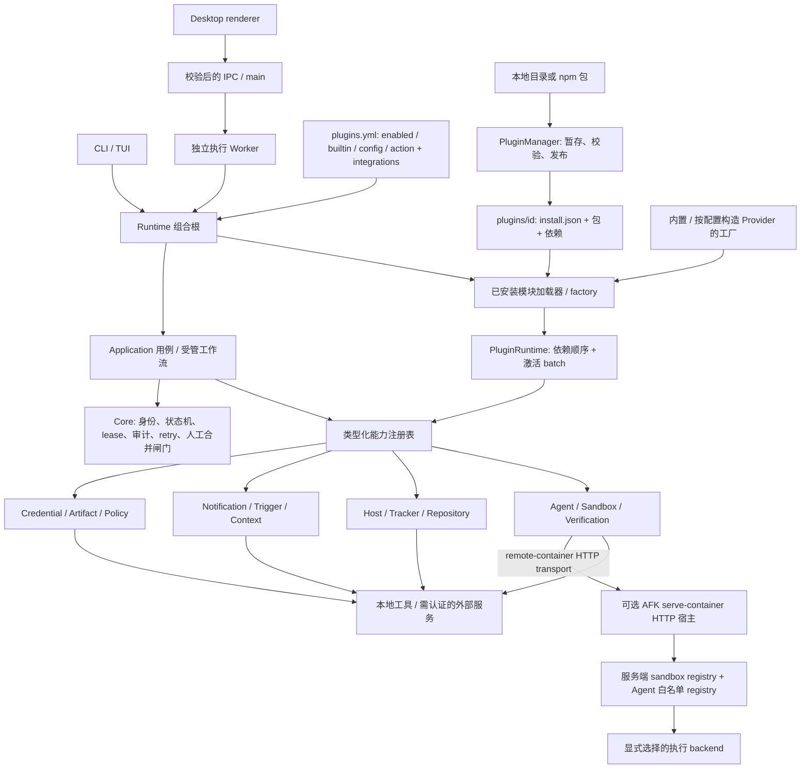

# AFK 能力插件架构

[English](plugins.md) · [架构概览](overview.zh.md) · [执行入口](execution.zh.md#执行入口) · [ADR-0030](../adr/0030-host-capability-plugin.md)

本文以 2026 年 11 月 7 日集成工作树中的源码为依据。下方矩阵和调用路径说明
具体 Provider 契约、受管执行、外部前提和协议范围。
这里的 Node Runtime 能力插件，与 Claude Code Skills 发行包、CLI 的 TUI 扩展加载器
不是同一套插件机制。

## Core 与插件边界

Core 保留工作身份、状态转换、执行资格、仓库 lease、审计顺序、重试预算和人工合并
闸门。插件提供 port 后面的实现，不能重新定义这些规则。

| Core / 受管执行继续负责 | 可由插件提供的 port 实现 |
|---|---|
| `BacklogItem.id`、`Run.workItemId`、`runId`、`parentId`、`dependsOn`、`baseBacklogId` 的不同语义 | 读取或修改外部 issue、源码仓库 |
| Reducer、attempt 状态机、资格校验、独立 QA 与 reconcile | 启动 Agent、准备 Sandbox、运行验证 |
| 仓库 lease 获取、重叠规则与释放 | 访问本地或远程工作区 |
| append-only 审计语义、事件顺序、证据权威边界 | 导出 trace、metrics、报告、通知 |
| 重试分类、预算、取消、恢复决策 | 执行一次 Provider 操作并返回结果 |
| 发布变更请求、等待人决定合并 | 调用代码托管 API、执行额外策略检查 |

`@afk/core` 放纯模型、reducer 和 ports；`@afk/application` 暴露主机列表、远程命令等
共享用例；`@afk/runtime` 放 Node 插件管理器、加载器、注册表、执行引擎与具体适配器。
CLI / Desktop 负责命令参数、输出、IPC 与交互 UI。
身份和数据权威以[架构概览](overview.zh.md)及[审计架构](observability.md)为准。

## 整体组合图



箭头表示构造或调用关系，不表示安全隔离。已安装插件运行在宿主 Node 进程中。
Desktop 的独立执行 Worker 是执行边界，不是逐插件沙箱。

共享组合入口是 `createDefaultPluginRuntime`：构造内置实现、应用配置、加载已安装
factory，再向调用者返回一个 `PluginRuntime`。CLI 受管命令与 Desktop execution
Worker 已使用同一路径；调用方可传入 `homeDir`、`workspaceRoot` 和告警处理。
同一次执行的实现阶段与 QA 使用相同 Runtime 及其投影 registry；不同进程各自拥有
实例，工作结束时负责 dispose。CLI `execute`、`qa`、`loop`、`schedule` 和 `run`
优先复用传入的 `composition.pluginRuntime`，避免双激活；没有注入实例时才创建并
dispose 自己的 fallback。

## 十二类 Provider 矩阵

“已有适配器”表示存在具体源码，不表示账户已配置、外部服务可达，或受管工作流已经
自动调用。能力 ID 以 `packages/runtime/src/plugin-sdk/profile.ts` 为准。

| 类别 / 标准能力 ID | 已有适配器 | 外部凭据或运行前提 | 调用路径与当前限制 |
|---|---|---|---|
| Agent · `agent.provider` | Claude Code、Codex、Cursor、Pi、OpenCode、Copilot | 对应 CLI 及其登录、token 或 endpoint 配置 | `createBuiltinAgentPlugins` 注册，执行引擎使用投影出的 agent registry；会话能力依各适配器声明。 |
| Sandbox · `sandbox.provider` | 本地 worktree、Docker、Podman、remote-container CLI/HTTP transport；可选 AFK HTTP 服务宿主 | 本地 Git；Docker/Podman 引擎；远端 backend 与所需认证 | 内置工厂注册 local/docker/podman；remote-container 必须显式提供 transport 和兼容后端，`plugin serve-container` 显式使用共享 sandbox/agent registry 托管 AFK 后端。 |
| Tracker / backlog · `tracker.provider`、`tracker.issue`、`backlog.provider` | GitHub/GitLab 源码托管 tracker/backlog；独立 Linear、Jira issue 适配器 | GitHub/GitLab token 与仓库/项目；Linear token + team ID + API URL；Jira token + project key + API URL，可选 email | Configured GitHub/GitLab 注册 tracker 与 backlog；shared assembly 按 platform、project 和适用的 host 匹配 tracker，再构造受管 Provider bundle。多项匹配报错，无匹配沿用既有 tracker 工厂。Linear/Jira 仍是独立 `tracker.issue` 适配器，不提供仓库型 backlog/变更请求身份。 |
| Host · `host.connection` | JumpServer、SSH、AWS SSM、Kubernetes Exec | `jms` 登录；SSH key/agent/config；AWS CLI 凭据/profile + SSM 权限；`kubectl` context/kubeconfig + exec RBAC | `HostConnectionPort` → Application 主机用例 → `afk host ls/exec`；Desktop 可复用共享适配器。需要真实目标才能发现或远程执行。 |
| Verification · `verification.provider` | Test runner、静态扫描、浏览器检查 | 已安装的 test/lint/browser 工具，项目需要时另供服务凭据 | `verify` 在目标工作区执行 argv；默认 `npm test`、`npm run lint`、`playwright test`，是命令适配器，不内置分析引擎。 |
| Notification · `notification.provider` | 飞书、Slack、邮件、桌面通知 | 飞书/Slack webhook URL；邮件需要已配置的 `sendmail` 和邮件传输；桌面需要 OS 通知工具 | `notify`；HTTP 适配器默认使用 global fetch，可选注入 transport；receipt 报告真实投递结果，桌面依赖具体平台工具。 |
| Trigger · `trigger.provider` | HMAC webhook、Git push、issue event、间隔定时器 | Webhook 共享 secret；负责接收并投递事件的宿主；本地 timer 无需外部账户 | `register/unregister`；`plugin listen` 提供常驻 HTTP 宿主并激活配置 timer/action。适配器自身不启动 listener、Git watcher 或持久 cron；schedule 是正整数毫秒。 |
| Context / memory · `context.provider` | 代码上下文、知识库、检索、项目记忆 | 可读的工作区/文件；知识库 HTTP endpoint，认证由其 transport 提供 | `gather`；代码读取本地内容，检索使用传入文档，记忆读取本地文件，知识库要求兼容 JSON fragment 协议；不自动建立 embedding/index 服务。 |
| Credential / auth · `credential.provider` | 系统钥匙串、OAuth client credentials、OIDC assertion/exchange、企业环境凭据 | Keychain 权限；OAuth endpoint/client ID/secret；OIDC issuer/client/assertion；环境变量或显式值 | `resolve`；scope 依能力声明；企业适配器读取配置值/环境变量，不是企业 vault SDK。HTTP 默认使用 global fetch，可选注入 transport；凭据解析仅供 SDK 消费者私下使用。 |
| Artifact / report · `artifact.provider` | 本地测试报告、证据包 builder、对象存储上传、报告平台上传 | 本地可写路径；预签名/upload URL 或报告 endpoint，可选 bearer token | `put`；上传适配器只声明 write；configured 工厂把证据包 builder 包装为 `ArtifactSink`；对象存储不生成 AWS 签名。 |
| Repository / workspace · `repository.provider` | 多本地仓库、远程工作区快照、特殊 Git backend | Git 与已配置本地路径；兼容远程 endpoint/token；已安装的特殊 backend 可执行文件 | `snapshot`；当前适配器声明 read/snapshot，不提供 clone/push；远程工作区和特殊 backend 分别要求其 HTTP/JSON 协议。 |
| Security / policy · `policy.provider` | Secret scan、license policy、compliance policy | 工作区文件、显式许可证白名单和合规规则；本地检查无需账户 | 已选策略是 required 受管 lifecycle 闸门，覆盖引擎 `before-publish` 与 QA 发布检查；拒绝或评估异常阻止发布。直接调用 SDK 时由调用方接入 lifecycle 或自行评估并执行策略决定。本地模式、许可证与规则检查不等于外部合规服务。 |

当前默认组合根构造六种 Agent、local/docker/podman、四种 Host、三种验证命令适配器、
桌面通知、code/retrieval/project-memory 上下文、系统钥匙串、本地测试报告、多本地仓库
快照和三种本地策略检查。默认 retrieval 文档、仓库集合和合规规则均为空；许可证白名单
为 MIT、Apache-2.0、BSD-2-Clause、BSD-3-Clause、ISC。
默认根不自动构造 Linear/Jira、remote-container、webhook/邮件投递、远程知识库/工作区、
OAuth/OIDC 或远程制品上传；这些需要已安装工厂或具体的 configured builtin 工厂。
Configured GitHub/GitLab 通过已注册的 tracker/backlog 契约参与相同的 managed
assembly，按项目匹配采用，与独立 issue 适配器区分。

Observability 是额外扩展面，不计入上表十二类：`observability.provider`、
`observe.event-store`、`observe.evidence`、`observe.tracing`、`observe.metrics`
与 event/evidence/tracer/metrics 契约并存；注册它们不自动替换受管审计存储。
工作流及界面扩展点包括 `workflow.lifecycle`、`workflow.template`、`workflow.action`、
`surface.cli`、`surface.tui`、`surface.desktop`；仅注册 surface 不会自动挂载 UI。

## 标准 manifest 与 API v1

包根目录必须有 `package.json` 和 `plugin.json`。后者是标准 `PluginManifest`
再加可选的相对 `entry`，默认 `dist/index.js`，不是包裹在 `manifest` 字段内的对象。

```json
{
  "id": "context.project-note",
  "version": "1.0.0",
  "apiVersion": 1,
  "trusted": true,
  "provides": ["context.provider"],
  "requires": [],
  "conflicts": [],
  "entry": "dist/index.js",
  "configSchema": {
    "type": "object",
    "properties": {"note": {"type": "string", "minLength": 1}},
    "required": ["note"],
    "additionalProperties": false
  }
}
```

ID 使用领域加具体名称，如 `host.jumpserver`、`tracker.linear`、`context.project-note`。
校验器拒绝 `afk-` / `afk.` 前缀；通用内置 wrapper 保留已有领域前缀，例如
`context.code` 不再重复拼接领域。插件 ID、能力 ID、Provider 注册名称是不同的键：
`context.project-note` / `context.provider` / `project-note`。

| Manifest 字段 | 实际语义 |
|---|---|
| `id`、`version` | 经校验的插件标识和符合语义版本外形的版本字符串 |
| `apiVersion: 1`、`trusted: true` | 必需的兼容与信任声明，不是经过验证的发布者身份 |
| `provides` | 声明提供的能力，越界注册会导致激活失败 |
| `requires` | 依赖的能力 ID，不是包名，不支持依赖版本范围 |
| `conflicts` | 不允许共存的插件 ID 或能力 ID |
| `configSchema` | 用 AJV 校验此插件自己的配置对象 |
| `entry` | Installer 元数据，相对于包根；不属于 SDK 的 `PluginManifest` 接口 |

SDK 入口是 `@afk/runtime/plugin-sdk`。`Plugin` 包含 `manifest` 和 `activate(context)`，
可选 `health()`、`diagnostics()`。Context 提供 `registerAgentProvider`、
`registerSandboxProvider`、`registerTrackerProvider`、`registerIssueTrackerProvider`、
`registerBacklogProvider`、`registerHostProvider` 及其余类别的类型化注册方法，
也支持 lifecycle/action/template/surface 和 `onDispose`。

模块导出 `default` 或 `plugin`，可为插件对象，也可为异步或同步工厂。
工厂收到 `{ configuration, homeDir, workspaceRoot }`。
例如 `package.json` 为 `{"name":"project-note","version":"1.0.0","type":"module"}`，
`dist/index.js` 可以这样实现：

```js
import { readFileSync } from 'node:fs';

export const manifest = JSON.parse(
  readFileSync(new URL('../plugin.json', import.meta.url), 'utf8'),
);

export default function createPlugin({ configuration }) {
  return {
    manifest,
    activate(context) {
      context.registerContextProvider('project-note', {
        id: 'project-note',
        capabilities: { 'read-only': true, summarize: false, search: false },
        async gather() {
          return [{ content: configuration.note, origin: 'project-note' }];
        },
      });
    },
  };
}
```

按类别实现 SDK Provider 接口；配置承载数据，工厂提供函数、transport 与具体实例。
在 activate 中获取资源，并通过 `context.onDispose` 注册清理。
模块 import 或 factory 阶段创建的资源不在激活 batch 内，失败时由工厂自行清理。

## 安装与配置

```sh
afk plugin install ./project-note
afk plugin install @example/project-note@1.0.0
afk plugin configure context.project-note --file ./project-note.settings.json
afk plugin list --json
afk plugin doctor --plugin context.project-note --json
afk plugin disable context.project-note
afk plugin enable context.project-note
afk plugin remove context.project-note
```

`project-note.settings.json` 内容是 `{"note":"Use the repository contribution guide."}`，
即配置对象本身，不是外层 `plugins` 文档。安装后默认启用；新建 Runtime 前应补齐必需配置。
`remove` 禁用并删除已安装包，保留配置。Enable/disable/configure 在下次构造 Runtime 时
生效，不会热更新正在执行的 Worker。

`PluginManager` 用 `~/.afk/plugins/.manager.lock` 串行化修改；本地目录复制时排除
`.git` 和 `node_modules`，npm spec 则在新的 `.install-*` 暂存目录解析。
依赖使用 `npm install --ignore-scripts --omit=dev --no-audit --no-fund --legacy-peer-deps`
安装；npm spec 另加 `--save-exact`。包必须已经带有构建后的入口，安装脚本不会替它编译。
Installer 链接宿主的 `@afk/runtime` 包供 SDK 导入。

校验 manifest 和入口 realpath 位于包内之后，生成 `install.json`，记录 ID、版本、source、
相对于 stage 的 entry、manifest、`sha256-<base64>` 入口摘要和安装时间。
先将旧目录改名为 backup，再发布 stage 并启用配置；普通升级失败会恢复旧目录。
这不是崩溃可恢复的多文件事务、完整包树签名，也不构成恶意代码沙箱；进程崩溃还可能遗留 lock。

配置保存在 `~/.afk/plugins.yml`：

```yaml
plugins:
  - id: context.project-note
    enabled: true
    config:
      note: Use the repository contribution guide.
  - id: host.ssh
    enabled: true
    builtin: true
    config:
      hosts:
        - alias: staging
          address: staging.example.test
          username: developer
```

Zod 校验配置外层和可 JSON 序列化的值；AJV 校验插件 `configSchema`，启用所有错误、
关闭 strict 和 format 校验，不填充默认值。因此 `format` 不是强制约束。
Loader 不统一展开环境变量引用：变量名只是普通字符串，只有具体 configured factory
显式解析时才会读取对应值。真实 secret 应留在 Provider 的凭据来源中，不写入示例或命令参数。

`afk plugin configure host.ssh --file ./ssh.settings.json --builtin` 保存 `builtin: true`。
已安装模块 loader 会跳过这类条目；按配置构造内置 Provider 的工厂负责识别 ID、校验
具体 schema、转换 constructor options、注册实例。仅凭 `--builtin` 保存任意 JSON
不能实例化未知 Provider。fetch、回调、command executor 等函数不能保存在 YAML，
必须由工厂创建；支持哪些 ID 和 schema，以该工厂实现为准。

### Configured builtin 字段

`createConfiguredPlugins` 识别下列 ID，严格 schema 拒绝未知 ID 和字段。
`?` 表示可选；注明非空的数组必须有条目。相对路径基于 `workspaceRoot`，
`~/` 基于所传 home directory。所有 secret 字段使用 `{env: VARIABLE_NAME}`；
工厂拒绝缺失、空值和含控制字符的值，并在自身错误、health 和诊断中脱敏已解析的 secret。
Fetch、executor 和 callback 由工厂注入，不是 YAML 中可序列化的函数。

| 插件 ID | 接受的配置字段 |
|---|---|
| `agent.claude-code`、`agent.codex`、`agent.cursor`、`agent.pi`、`agent.opencode`、`agent.copilot` | `{}`；认证仍由已安装的 Agent 工具负责 |
| `sandbox.local`、`sandbox.docker`、`sandbox.podman` | `engine?` 必须等于对应 backend 名称 |
| `sandbox.remote-container` | HTTP：`transport: http`、`endpoint`、secret `token?`、`timeoutMs?`；CLI：`transport: cli`、`command`、`timeoutMs?` |
| `host.jumpserver` | `serverAlias?` |
| `host.ssh` | 非空 `hosts[{alias,address,id?,username?,port?,identityFile?}]`；默认项 `username?`、`port?`、`identityFile?`、`binary?`、`scpBinary?` |
| `host.aws-ssm` | 非空 `hosts[{alias,instanceId,id?,region?,profile?,address?}]`；`region?`、`profile?`、`binary?`、`pollIntervalMs?` |
| `host.kubernetes-exec` | 非空 `hosts[{alias,pod,id?,namespace?,container?,address?}]`；`namespace?`、`context?`、`kubeconfig?`、`binary?` |
| `tracker.github` | owner/repository 格式的 `repo`、secret `token` |
| `tracker.gitlab` | `url`、secret `token`、字符串或正整数 `projectId` |
| `tracker.linear` | `baseUrl`、secret `token`、`teamId` |
| `tracker.jira` | `baseUrl`、secret `token`、`projectKey`、`email?`、`issueType?` |
| `verification.test-runner`、`verification.static-scan`、`verification.browser-check` | 非空 argv `command`、`timeoutMs?` |
| `notification.feishu`、`notification.slack` | 解析为 HTTP URL 的 secret `webhook`、`channel?` |
| `notification.email` | 邮箱 `from`、`to`；`sendmailPath?`、`channel?` |
| `notification.desktop` | `platform?`（`darwin`、`linux`、`win32`）、`channel?` |
| `trigger.webhook` | Secret `secret`、非空 `triggers[{id,kind: webhook,payload?,input?}]`；`payload` 过滤事件，`input` 为静态 action 入参 |
| `trigger.git-push`、`trigger.issue-event` | 同样的 webhook-kind `triggers`；Git push 另接受 `includeDeleted?` |
| `trigger.schedule` | 非空 `triggers[{id,kind: schedule,schedule,payload?,input?}]`；schedule 是不大于 `2147483647` 的正整数毫秒字符串，`payload`、`input` 支持嵌套 JSON |
| `context.code`、`context.knowledge-base`、`context.project-memory` | 分别为 `root`、`endpoint`、`file` |
| `context.retrieval` | 非空 `documents[{origin,content}]` |
| `credential.system-keychain` | `service`、`command?` |
| `credential.oauth` | HTTPS `tokenEndpoint`、`clientId`、secret `clientSecret`、`authMethod?`（`client_secret_basic`/`client_secret_post`）、`timeoutMs?` |
| `credential.oidc` | HTTPS `issuer`、`clientId`、secret `assertion`、`tokenEndpoint?`、`timeoutMs?`；可选 `exchange:{subjectToken,subjectTokenType,audience?,resource?}`，其中 `subjectToken` 是 secret |
| `credential.enterprise` | 非空 `values` 映射，每个值为 secret 引用 |
| `artifact.test-report-local`、`artifact.evidence-bundle` | `root`；evidence-bundle 工厂把 builder 包装成 `ArtifactSink`，`put` 调用单记录 bundle 的 `create` |
| `artifact.object-storage`、`artifact.report-platform` | `endpoint`；报告平台另接受 secret `token?` |
| `repository.multi-repository` | 非空 `repositories[{name,path}]`，名称唯一 |
| `repository.remote-workspace`、`repository.special-git-backend` | 分别为 `baseUrl` 加 secret `token?`，或 `backend` |
| `policy.secret-scan` | 兜底 `root`、非空 `files?`、`maxFileBytes?`；评估优先使用可信 lifecycle 的 `context.worktreePath` |
| `policy.license-policy` | 非空 `allowlist`、非空 `licenses?` |
| `policy.compliance-policy` | 非空 `rules[{id,effect,actions?,when?,reason?}]`、`defaultEffect?`；effect 为 `allow`/`deny`，actions 非空，`when` 为 scalar 相等条件映射 |

显式配置会替换同 ID 默认插件。`--builtin` 保存前校验真实工厂，不启动 timer。
Secret 在构造时解析，环境值变更后需重启进程。注册 credential Provider 不会自动
把它绑定到其他工厂的 `{env: ...}` 字段。

## 加载、依赖与 dispose

1. 读取配置，跳过 disabled 条目，对重复 ID、配置格式错误记录诊断；模块加载跳过
   `builtin: true`。YAML 解析或读取失败使用不含源码片段的固定错误消息；
   envelope 校验只报告字段路径，不输出字段值。
2. 读取 install record，校验 manifest、入口 realpath 边界与摘要；import 模块，校验
   配置并调用 factory；检查返回的 ID、版本和能力列表是否匹配 record。
   兼容路径仍接受无 `install.json` 的显式配置旧 `dist/index.js` 模块，该路径没有
   安装记录摘要校验。
3. 合并已安装候选与传入的内置插件；显式安装条目屏蔽同 ID 内置实现，即使 import、
   校验或激活失败也不静默回退；禁用该 ID 同样跳过内置实现。显式 configured builtin
   override 也在构造前替换默认项，配置无效不会恢复默认项。
   反复激活所需能力已就绪的候选，无进展时对缺失或循环依赖记录
   `load.dependencies`。
4. `PluginRuntime.activate` 校验 manifest、依赖和冲突；将注册、action、lifecycle、
   template 与 disposer 收集到 batch，整体校验通过后才提交到注册表。
5. 激活失败不提交任何注册，并逆序执行该 batch 的 disposer；清理失败与激活错误汇总。
   已加载的其他插件继续可用；外部副作用只有插件提供有效 disposer 才能撤销。
6. 全量 `dispose()` 按激活逆序移除插件，每个插件内部按注册逆序清理；遇错继续，最终
   抛 `AggregateError`。单独移除某插件若会使其他已加载插件失去必需能力，则被拒绝。

Runtime 允许同一能力下存在多个具名 Provider，但拒绝重复的 `(capability, provider name)`。
`resolveProfile` 也允许同一能力由多个插件提供，`ResolvedProfile.capabilities`
将能力映射到只读 `PluginManifest[]`，不会隐式选定单个 Provider。Profile 解析仍检查
所选 ID、必需能力与冲突。`requires` 表示能力存在，不是包版本解析器，也不保证
具体 Provider 健康。

依赖插件在 `activate` 中可用 `context.getProvider<T>(capability, name)` 或
`context.getCredentialProvider(name)` 取得已激活的 Provider。需要凭据时声明
`requires: ['credential.provider']`，检查具名 Provider 存在，再私下调用其 `resolve`。
返回的 secret 不应进入 action 结果、诊断或日志。SDK getter 不会把凭据读取加入
CLI 操作白名单；具体 Provider 仍由消费者显式选择。

事务边界从 `activate` 开始，早于它的 import 和 factory 不在其中。
诊断机制捕获可选插件错误，不阻止可信代码修改全局状态、读写文件或导致进程崩溃。

## 实际调用路径与接入状态

| 消费者 | 路径与边界 |
|---|---|
| 受管 Agent / Sandbox 执行 | CLI `execute` / `qa` / `loop` / `schedule`、`run` → `runWorkflowCli` 以及 Desktop Worker 均传入共享 Runtime。`executeWorkItem` 将其继续传给实现阶段和 QA；引擎从中取得 Agent/Sandbox registry、lifecycle modules 和注册的 system action。 |
| Desktop Agent 选择 | Snapshot 提供已注册 Agent Provider 名称，工作流菜单包含外部插件；保存默认 Agent 或 Agent 节点时按当前 registry 校验，拒绝未知名称。工具安装诊断仍是独立检查。 |
| GitHub/GitLab tracker 与 backlog | Configured 工厂注册两种契约；共享 `assembleProviders` 按 platform、project 和适用的 host 匹配 Runtime 的 tracker 并构造受管 bundle，多项匹配拒绝，无匹配沿用既有源码托管工厂。 |
| 主机操作 | Runtime → `getHostProvider(name)` → 共享 Application 主机用例 → CLI `host` 或 Desktop adapter；CLI 默认 `jumpserver`，其他 Provider 需显式选择。 |
| Linear/Jira issue 操作 | Runtime → `getIssueTrackerProvider(name)` → `IssueTrackerPort`；源码托管的 `TrackerProvider` / `BacklogProvider` 是另外的契约，独立 issue 适配器不能直接执行 GitHub/GitLab 规范 backlog 身份。 |
| 其他能力操作 | 类型化 getter 与 CLI `invoke` 调用许可操作；根 `integrations` 为实现阶段和 QA 选择策略、上下文、制品和通知消费者。凭据保留为 SDK 私下操作，常驻 trigger 由 `listen` 驱动。 |
| Lifecycle / system action | `getLifecycleModules()` 接入引擎与 QA hook，注册 system action 供 workflow step 和 trigger callback 使用；Core 状态转换、审计、重试和人工合并闸门继续有效。 |
| Template / surface | 注册表向显式消费者提供条目；注册本身不替换现有命令派发、模板存储或 Desktop 渲染。 |

Host exec 区分远程命令退出与链路错误：远程命令完成后返回 `HostExecResult`，
保留原始 `code`、`stdout`、`stderr`，非零退出码也属于结果。SSH 非 `255` 退出、
kubectl 带匹配远程退出码标记、SSM 含远程响应码的完整 `Failed` 响应，以及
JumpServer 普通 `remote-failed` 命令结果均遵循该契约；JumpServer exec 还保留
输出空白。连接、认证和超时错误仍为 `HostFailure`，不能把远程非零退出误判成
连接异常。`afk host exec` 保留远程退出码；通用 `plugin invoke` 遇到非零结果 code
则把自身退出状态设为 `1`，JSON 结果仍保留原始 code 和两个输出流。

本次源码快照中，CLI 的 `createCliPluginRuntime` 已委托给共享
`packages/runtime/src/application/plugins/default-runtime.ts` 中的
`createDefaultPluginRuntime`；`invoke` / `listen` 精确命令注册、类型化操作 dispatcher
和认证 listener 均已落入源码。Configured builtin 构造、嵌套 trigger payload、
remote-container 服务组合和 engine 的 `before-publish` hook 均已实现。
Managed 执行、独立 QA、loop、schedule、`run` / `runWorkflowCli` 和 Desktop Worker
均已沿执行路径传递相同 Runtime；引擎消费其中的 registry、action 和 lifecycle
modules，命令或 Worker 结束时 dispose 自己拥有的实例。整体图表达已实现的组合与调用路径。

| 接入面 | 实际行为与核对结果 |
|---|---|
| 本地目录 / npm 包安装与升级保留旧版 | 已核对源码与安装示例；真实本地 npm 依赖、禁用 lifecycle scripts 检查已确认通过 |
| CLI `invoke` 与 43 项操作 dispatcher | 已核对精确命令注册和白名单 |
| CLI `listen` 与认证 HTTP 宿主 | 已实现并确认；精确 flags、路由和认证已核对 |
| CLI `serve-container` 与共享 registry 服务组合 | 必需参数、共享 backend registry 和认证 HTTP handler 已核对 |
| CLI 委托共享组合根 | 已核对源码 |
| CLI 受管 Runtime 所有权 | `execute`、`qa`、`loop`、`schedule` 和 `run` 复用注入的 `composition.pluginRuntime`，命令只 dispose 自己创建的 fallback |
| Configured builtin schema / secret 字段映射 | 已实现；具体字段和示例已对照 `configured.ts` |
| System step input、`capability.invoke`、required 策略 hook | 已实现；负结果使 step 失败，策略在 Agent 前、Agent 后及发布前检查 |
| Managed 执行、QA、loop、schedule、run 和 Desktop Worker | 已实现；Runtime 与 registry 传入实现阶段和 QA，由拥有者 dispose |
| QA lifecycle 与发布策略 | 验证前运行 required init 和 before-agent，context 使用文件指针；QA 通过后运行 after-agent 制品/通知 hook；branch push 与变更请求发布前单独执行 `before-publish` 检查 |
| Desktop 外部 Agent 选择 | 已实现；菜单使用已注册 Provider，保存时拒绝未知默认/节点 Provider |
| Trigger 到受管 workflow | 已实现；descriptor 静态 `input` 派发 `work-item.execute`，使用相同 Runtime、正常资格与 lease 检查，不自动 merge |

Project-note 示例对应的 invoke 集成契约为
`afk plugin invoke context.provider project-note gather --input ./context-query.json`，
输入文件为 `{"scope":".","prompt":"conventions"}`。Provider 名称是 `project-note`，
不是插件 ID `context.project-note`。输入文件只放 `gather` 请求本身，调用 envelope
由 CLI 位置参数提供；同一个操作也可通过 SDK getter 调用。

### CLI 操作白名单

精确命令为
`afk plugin invoke <capability> <provider> <operation> --input <path> [--json]`，
`--input` 必需。无论是否传 `--json` 都输出格式化 JSON，void 结果为 `null`。
`passed: false`、`allowed: false`、`delivered: false` 或数值非零的远程 `code`
使 CLI exit status 为 `1`；它不直接保留远程 code 为退出码，`afk host exec` 另有语义。

`operations.ts` 校验严格请求 union 及各操作返回值，当前允许的 43 对 capability/operation 为：

| 能力 | 允许的 operation | 数量 |
|---|---|---|
| `verification.provider` | `verify` | 1 |
| `notification.provider` | `notify` | 1 |
| `context.provider` | `gather` | 1 |
| `artifact.provider` | `put` | 1 |
| `repository.provider` | `snapshot` | 1 |
| `policy.provider` | `evaluate` | 1 |
| `trigger.provider` | `register`、`unregister` | 2 |
| `tracker.issue` | `getIssue`、`listIssues`、`createIssue`、`updateIssue`、`deleteIssue`、`addComment`、`listComments`、`updateComment`、`deleteComment`、`linkIssues`、`listIssueLinks`、`health`、`doctor` | 13 |
| `tracker.provider` | `getIssue`、`listIssues`、`createIssue`、`updateIssue`、`updateLabels`、`addLabel`、`removeLabel`、`addComment`、`listIssueComments`、`updateIssueComment`、`linkIssues`、`getMR`、`listMRs`、`createMR`、`updateMR`、`closeMR`、`reopenMR`、`isMRLinkedToIssue` | 18 |
| `host.connection` | `listHosts`、`resolve`、`exec`、`upload` | 4 |

Credential 操作保持私有：dispatcher 不允许 `credential.provider.resolve`，不能通过
CLI JSON 导出 secret。Agent/Sandbox 执行、backlog、observability 和插件任意方法
都不在此白名单，没有 merge 操作。`host.connection.upload` 和 `tracker.provider.updateMR`
还要求所选 Provider 确实支持这两个可选方法。

CLI verification 输入必须提供 `target`，只有 managed system action 能自动补当前
worktree。Artifact `put` 的 `bytes` 为规范 base64，调用 Provider 前解码。
独立 issue 使用字符串 `issueId`，源码托管 tracker 使用正整数 `id`；这些 schema
不转换两套身份契约。

### 托管 remote-container 后端

```sh
afk plugin serve-container \
  --repository /srv/afk/repository \
  --workspace-root /srv/afk/workspaces \
  --sandbox docker \
  --agent codex claude-code \
  --token-env AFK_CONTAINER_TOKEN
```

上面五个 flag 全部必需：`--repository <path>`、`--workspace-root <path>`、
`--sandbox <provider>`、`--agent <providers...>`、`--token-env <name>`。
Repository 用于创建执行 worktree；workspace root 必须已存在，是允许的远程执行
worktree 边界。`--agent` 是已注册 Agent 的显式可变长白名单，不自动开放全部已安装
Agent。环境变量保存至少 32 bytes 的 bearer token，与 trigger listener 的
16 字符最低要求不同。

可选 `--host <address>` 默认 `127.0.0.1`，`--port <number>` 默认 `8375`，
另有 `--allow-remote`；非 loopback 绑定和客户端必须显式允许 remote。
服务使用 Node HTTP，该开关不增加 TLS，也不改变插件可信代码边界。

CLI 以 repository 为 workspace root 构造共享 Runtime。
`startRemoteContainerService` 将其 sandbox/agent registry 交给 HTTP backend，提供
该 repository 的 `WorktreeManager`，使用指定 Sandbox，并限制 Agent 白名单。
服务拒绝将 `remote-container` 选作自身 sandbox，避免再次转发回自身。
Docker/Podman 仍需服务主机安装并启动引擎，Agent 仍需该主机上的工具与凭据。
SIGINT/SIGTERM 后关闭 HTTP service/backend，再 dispose Runtime。
客户端工厂接受 `transport: http`、`endpoint`，以及可选的
`token: {env: AFK_CONTAINER_TOKEN}`、`timeoutMs`；CLI transport 使用
`transport: cli`、`command` 和可选 `timeoutMs`。

它与 `8374` 端口投递 trigger 事件的 `plugin listen` 是不同服务，也不表示把
Agent/Sandbox 执行加入 `plugin invoke` 的 43 项白名单。
客户端需要实现 remote-container transport 协议。

## 工作流与根配置接入示例

本节示例使用上一节所述 managed CLI 与 Desktop 执行路径实际消费的 configured
factory、system action 和 lifecycle hook。

### 在 system step 中调用 Provider

`StepSchema` 接受可选 `input: unknown`。System step 用 `action` 选择已注册的
workflow action，不能用 Agent step 的 `provider` 字段选择能力 Provider。
标准 action 为 `capability.invoke`，能力、Provider 名称、操作和操作输入放在 step 的
`input` 对象中：

```yaml
name: plugin-verification
version: 1
steps:
  - id: run-tests
    kind: system
    action: capability.invoke
    input:
      capability: verification.provider
      provider: test-runner
      operation: verify
      input:
        command: [npm, test]
  - id: check-policy
    kind: system
    dependsOn: [run-tests]
    action: capability.invoke
    input:
      capability: policy.provider
      provider: secret-scan
      operation: evaluate
      input:
        action: static-review
```

外层 `input` 是调用 envelope，内层 `input` 才是具体 Provider 的类型化请求。
工作流引擎需要通过 system-action context 传入当前 step 和它的 input。
Verification 省略 `target` 时使用本次 attempt 的 worktree；显式指定时使用该工作区目录，
不能悄悄退回最初启动 CLI 的 cwd。

`VerificationResult.passed: false` 和 `PolicyDecision.allowed: false` 都必须让 system
step 失败；Promise 正常返回一个否定结果不等于验证成功或策略通过。
下游依赖需要看到该失败状态；这些检查补充独立 QA 和人工合并闸门，不替代它们。

### 配置策略闸门和 Agent 上下文指针

`integrations` 与 `plugins` 同属 `~/.afk/plugins.yml` 顶层，不是某个插件的 `config`。
这里选的是已注册 Provider 名称，例如 `secret-scan` 不等于插件 ID `policy.secret-scan`：

```yaml
integrations:
  policies:
    - provider: secret-scan
      input:
        action: pre-execution
  contexts:
    - provider: context.code
      query:
        scope: docs
        prompt: contribution rules and architecture constraints
        limit: 3
```

策略条目结构为 `{ provider, input }`，上下文条目为
`{ provider, query: { scope, prompt, limit? } }`。此片段只选择现有 Provider；
具体文件系统根、参数和 transport 仍由 configured factory 构造。
不要把 constructor 字段塞入 `integrations`，也不能假定它会创建不存在的 Provider。

受管策略 lifecycle hook 必须采用 `failureMode: required`，使拒绝结果、所选 Provider
缺失或执行异常阻止执行。`failureMode` 是 hook 的强制策略，不是上面 YAML 额外添加的字段；
仅记录 warning 的 hook 会削弱已配置的闸门。

所选策略在 `onBeforeAgent`、`onAfterAgent` 和 `onBeforePublish` 都会检查，
后者对应 `before-publish` lifecycle phase。After-agent 中先检查策略，
再上传 artifact、发布制品引用、发送通知，在这些副作用前检查 Agent 引入的变化。
Hook 复用配置中的策略 `input`，不会自动把 `input.action` 从 `pre-execution`
改成其他阶段名。

Secret scan 声明支持 `pre-execution`、`post-execution` 和 `static-review`。
`evaluate` 优先扫描 `input.context.worktreePath`，仅在该字段缺失时回退配置 `root`。
共享 lifecycle 注入当前 worktree，因此 Agent 新生成的 secret 会在发布前检查。
符号链接/路径违规和读取失败都会阻断 required 检查；文件超过 `maxFileBytes` 时
返回 `allowed: false, rule: secret-scan-incomplete`，不会静默跳过。
发现结果报告 secret 类型和文件信息，不输出匹配到的 secret 原文。
直接调用 SDK 时由调用者提供目标上下文并执行返回的策略决定。

引擎在每次 branch push 前调用发布 hook，覆盖显式 `publish-change`、验证恢复和
自动收尾，并在 multi-repository 发布前逐个检查已准备的仓库。Required 策略失败在
该边界阻止发布，不会等到总 after-agent hook 才执行。受管执行入口已把 Runtime 的
lifecycle modules 传给引擎。

QA 复用相同 Runtime 的 lifecycle modules。Required `init` 包括无效配置闸门；
`before-agent` 评估策略并收集上下文，QA prompt 引用 `.afk/plugin-context.md`，
指针段计入 prompt 预算检查。QA 结果通过后，`after-agent` 再检查策略、发布配置的
制品并发送通知。推送验证分支以及发布或更新变更请求前单独执行 `before-publish`
策略评估；cleanup 删除收集的上下文。因此这些集成同时覆盖实现阶段和 QA。

上下文接入将收集的片段写入本次 attempt 的 worktree 下 `.afk/plugin-context.md`，
往 Agent 目标中放固定长度的文件指针段，避免把所有片段直接塞进 prompt。
文件原子写入，cleanup 时删除，拒绝符号链接目录。`query.limit` 传给 Provider；
当前实现没有为拼装后的上下文文件统一设置总字节上限或截断策略，不能把 Provider 的
limit 或固定指针描述成已有总预算限制。该文件是执行上下文，不是审计记录，
也不替代证据分类与脱敏。

### Secret 引用和 Trigger 生命周期

配置中的 secret 使用环境引用对象，例如 `{"env":"PROVIDER_TOKEN"}`。
裸变量名字符串或 `${VAR}` 表达式不是该引用语法。
真实 secret 字段名和 Provider 配置范围由 `configured.ts` 定义，完整示例应逐项对照该
实现，不能猜测 constructor 到 YAML 的映射。

Trigger 插件条目用顶层 `action` 选择一个已注册的 `workflow.action`，与 `id`、
`enabled`、`builtin`、`config` 并列；宿主事件 callback 负责派发该 action。
每个 `TriggerDescriptor` 包含 `id`、`kind`，以及可选的 `schedule`、`payload`、
`input`。`payload` 保留适配器的事件过滤语义，`input` 是支持嵌套 JSON 的静态 action
入参对象。派发依次选择 `trigger.input`、`event.payload`、`trigger.payload`、`{}`，
不会合并这些对象。这和工作流 system step 自身的 `input` 承载 action 调用 envelope
是不同层次。仅声明 trigger 不会自动打开 HTTP listener，也不会让一次性 CLI 进程持续驻留。

间隔 schedule 需要常驻进程。已实现的精确命令为
`afk plugin listen --token-env <name> [--host <address>] [--port <number>]`，
默认 `127.0.0.1:8374`；`--token-env` 必需，所引用环境变量的值至少 16 字符且不能有 CR/LF。
命令以 `activateTriggers: true` 构造 Runtime，等待 SIGINT / SIGTERM 后关闭 listener，
再 dispose Runtime。普通 Runtime 构造（包括 `list`、`doctor`）不会启动配置 timer。
启动时若存在 error diagnostic 则拒绝监听；配置的 action 未注册时，Runtime dispose
对应 trigger 并记录 `trigger.action-missing`，避免静默接收后丢弃事件。
Listener 启动失败也会 dispose Runtime 及其 timer。

关闭时会 drain 已接收的 action：listener close 停止接收新请求，并等待已追踪的
request handler 完成，即使对应 HTTP 连接已经关闭；schedule dispose 先清除 timer，
再等待已经运行的 callback。这是进程内等待，不提供持久事件队列、replay 保证，
也不为永不结束的 callback 设置完成期限。

HTTP 宿主接受 `POST /triggers/<已注册Provider名称>`，body 上限 1 MiB。
Listener 认证接受匹配的 bearer token、`x-gitlab-token`，或 `x-hub-signature-256`
中的 `sha256=<原始body的HMAC-SHA256十六进制摘要>`。
`WebhookTriggerProvider` 还会按自己配置的 secret 再校验原始 body 签名，单有 bearer
认证不能绕过它。需要一次签名通过两层校验时，listener token 与 webhook secret 应一致。

未知路由/Provider 返回 `404`，listener 认证失败返回 `401`，派发、解析或适配器签名
失败返回 `400`；成功结果为 `{"dispatched": <count>}`，不证明受管工作项已完成。
服务面向具体 webhook、Git-push、issue-event 适配器，不是插件任意 HTTP endpoint 的宿主；
没有持久事件队列或 replay 服务。`--token-env` 只传变量名，不把 secret 值放入 argv。

### 完整配置与定时调用示例

以下 `~/.afk/plugins.yml` 使用实际工厂字段。Linear 条目注册独立 issue 操作，
不是受管源码仓库 backlog 适配器。HTTP sandbox 要求另行运行 `serve-container`
并使用相同 token。构造 Runtime 前须安装外部工具、提供环境变量。

```yaml
plugins:
  - id: tracker.linear
    builtin: true
    config:
      baseUrl: https://linear.example.test/graphql
      teamId: team-example
      token: {env: LINEAR_TOKEN}
  - id: sandbox.remote-container
    builtin: true
    config:
      transport: http
      endpoint: http://127.0.0.1:8375
      token: {env: AFK_CONTAINER_TOKEN}
      timeoutMs: 60000
  - id: notification.slack
    builtin: true
    config:
      webhook: {env: SLACK_WEBHOOK}
  - id: verification.test-runner
    builtin: true
    config:
      command: [npm, test]
  - id: trigger.schedule
    builtin: true
    action: capability.invoke
    config:
      triggers:
        - id: hourly-tests
          kind: schedule
          schedule: "3600000"
          input:
            capability: verification.provider
            provider: test-runner
            operation: verify
            input:
              target: /srv/afk/repository
              command: [npm, test]
integrations:
  notifications:
    - provider: notification.slack
      message:
        title: Agent completed
        body: Review the execution evidence.
        urgency: normal
```

`integrations.notifications[].message.urgency` 接受 `low`、`normal`、`high`，
`priority` 会被拒绝。通知选择属于 managed lifecycle，timer 则独立派发注册 action。
Timer 没有受管 worktree 上下文，因此静态 action `input` 显式填写验证 `target`。
旧 schedule 若把调用对象放在 `payload`，在未提供 `input` 时仍按优先级回退使用。
Webhook/Git/issue 只有未配置静态 `input` 时才使用收到的事件 payload。

若只配置 timer，把其 `config` 对象（从 `triggers` 开始）存为
`schedule.settings.json`，然后运行：

```sh
afk plugin configure trigger.schedule --builtin --action capability.invoke --file ./schedule.settings.json
afk plugin listen --token-env AFK_TRIGGER_TOKEN
```

`--action` 保存 `entry.action`，省略则保留旧值；它不在 `config` 内。
只有常驻 listener 激活这些配置 timer。此例直接调用验证；执行已有规范工作项的
完整受管生命周期应使用下文的 `work-item.execute`。

### Trigger 执行实际受管工作项

内置 `workflow.action` 名称 `work-item.execute` 已接通 trigger 到受管执行。
严格输入要求 `workItemId`，可选 `manifestPath`、`executionId`、`template`、`project`
及 `runOptions`。`runOptions` 仅接受 `executionMode`（`batch` 或 `interactive`）、
`agentProvider`、`sandboxProvider`。Action 使用相同 Runtime 和 Agent registry 调用
`executeWorkItem`；结果不是 `done` 或 `merge_ready` 时抛错。`merge_ready` 仍等待人
决定合并，不自动 merge。

下例在 `main` 的 Git push 事件后运行已存在的规范工作项
`github:acme/service#42`。Configured GitHub tracker 由 shared assembly 按该项目
匹配采用，同时注册 backlog 契约。条目仍须满足正常执行资格与 lease 规则。

```yaml
plugins:
  - id: tracker.github
    builtin: true
    config:
      repo: acme/service
      token: {env: GITHUB_TOKEN}
  - id: trigger.git-push
    builtin: true
    action: work-item.execute
    config:
      includeDeleted: false
      triggers:
        - id: main-work-item
          kind: webhook
          payload:
            branch: main
          input:
            workItemId: "github:acme/service#42"
            runOptions:
              executionMode: batch
              agentProvider: codex
              sandboxProvider: local
```

运行 `afk plugin listen --token-env AFK_TRIGGER_TOKEN`，让事件发送方认证访问
`POST /triggers/trigger.git-push`。标准事件
`{"ref":"refs/heads/main","deleted":false}` 会匹配 branch 过滤条件；callback 将
descriptor 的静态 `input` 传给 `work-item.execute`，不会把 Git 事件误作执行参数。
此例中不匹配的分支和删除分支不派发。若用 CLI 配置，只把 trigger 的 `config`
对象存为 `git-push.settings.json`，然后运行：

```sh
afk plugin configure trigger.git-push --builtin --action work-item.execute --file ./git-push.settings.json
```

直接使用 SDK 时，可通过 `runtime.dispatchSystemAction(name, input)` 派发任一
已注册 action。只调用 Provider 方法不会执行 managed action，也不会自动执行其
lifecycle 策略闸门。

## 真实运行限制

- Trusted 本地模块拥有宿主文件系统、环境变量和网络访问能力。`trusted: true`、
  npm `--ignore-scripts`、入口路径边界和入口 hash，不构成安全沙箱或发布者信任校验。
- 没有 marketplace、发布者签名校验、逐插件进程沙箱、依赖树完整性认证或热升级协议。
- HTTP Provider 默认使用 global fetch，transport 注入可选。它们仍是协议客户端，
  需要实现相应操作的服务。选择 remote-container 客户端不会自动启动 server；可选 `plugin serve-container`
  通过共享 registry 显式托管 AFK 后端。知识库、远程工作区、对象上传、报告 endpoint
  也都需要外部实现。
- 应检查所选 Provider 的凭据、health 和各操作能力标记。出现在注册表里，或 health
  为 `unknown`，不表示外部操作已经可用。
- 没有文档的本地 retrieval、缺失的 memory 文件、空 repository 集合、空合规规则
  都不提供已配置的领域内容；输入需要真实配置，不会自动发现。

实现入口：`packages/runtime/src/plugin-sdk/{profile,capabilities,issue-tracker}.ts`、
`packages/runtime/src/application/plugins/{runtime,loader,manager,configuration,configured,default-runtime,integrations,listener}.ts`、
同目录 `builtins*` / `builtin-*`、`packages/runtime/src/infrastructure/` 具体适配器、
`apps/cli/src/commands/plugin.ts`、`apps/cli/src/composition-root.ts`、
`packages/runtime/src/application/workflows/{execute-work-item,run-cmd}.ts`、
`packages/runtime/src/application/runners/qa-runner.ts`、
`apps/desktop/electron/services/{runtime-service,desktop-service}.ts` 和
`apps/desktop/electron/worker/execution-worker.ts`。
