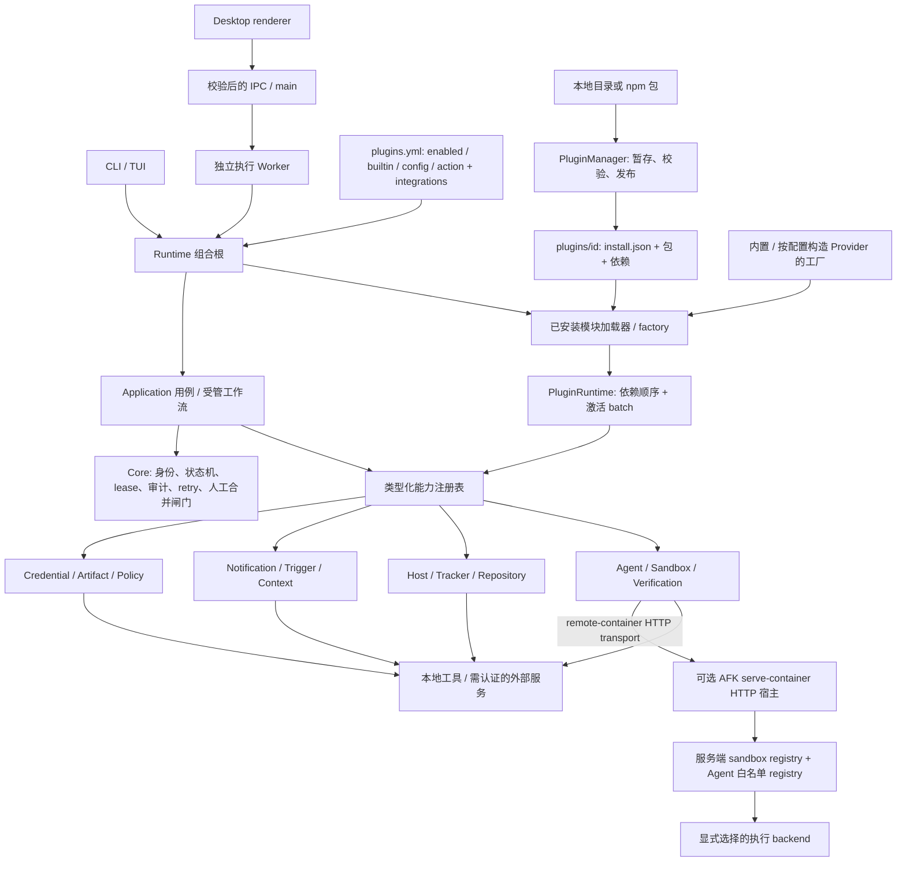

# AFK 能力插件架构

[English](plugins.md) · [架构概览](overview.zh.md) · [执行入口](execution.zh.md#执行入口) · [ADR-0030](../adr/0030-host-capability-plugin.md)

本文以 2026 年 11 月 8 日集成工作树中的源码为依据。下方矩阵和调用路径说明
具体 Provider 契约、受管执行、外部前提和协议范围。
这里的 Node Runtime 能力插件，与 Claude Code Skills 发行包、CLI 的 TUI 扩展加载器
不是同一套插件机制。

源码与协议能力不表示已验证真实厂商端到端投递；外部账户和服务需单独验证。

## Core 与插件边界

Core 保留工作身份、状态转换、执行资格、仓库 lease、审计顺序、重试预算和人工合并
闸门。插件提供 port 后面的实现，不能重新定义这些规则。

| Core / 受管执行继续负责 | 可由插件提供的 port 实现 |
|---|---|
| `BacklogItem.id`、`Run.workItemId`、`runId`、`parentId`、`dependsOn`、`baseBacklogId` 的不同语义 | 读取或修改外部 issue、源码仓库 |
| Reducer、attempt 状态机、资格校验、独立 QA 与 reconcile | 启动 Agent、准备 Sandbox、运行验证 |
| 仓库 lease 获取、重叠规则与释放 | 访问本地或远程工作区 |
| append-only 审计语义、事件顺序、证据权威边界 | 导出 trace、metrics、报告、通知 |
| 重试分类、预算、取消、恢复决策 | 执行一次 Provider 操作并返回结果 |
| 发布变更请求、等待人决定合并 | 调用代码托管 API、执行额外策略检查 |

`@afk/core` 放纯模型、reducer 和 ports；`@afk/application` 暴露主机列表、远程命令等
共享用例；`@afk/runtime` 放 Node 插件管理器、加载器、注册表、执行引擎与具体适配器。
CLI / Desktop 负责命令参数、输出、IPC 与交互 UI。
身份和数据权威以[架构概览](overview.zh.md)及[审计架构](observability.md)为准。

## 整体组合图



箭头表示构造或调用关系，不表示安全隔离。已安装插件运行在宿主 Node 进程中。
Desktop 的独立执行 Worker 是执行边界，不是逐插件沙箱。

共享组合入口是 `createDefaultPluginRuntime`：构造内置实现、应用配置、加载已安装
factory，再向调用者返回一个 `PluginRuntime`。CLI 受管命令与 Desktop execution
Worker 已使用同一路径；调用方可传入 `homeDir`、`workspaceRoot` 和告警处理。
同一次执行的实现阶段与 QA 使用相同 Runtime 及其投影 registry；不同进程各自拥有
实例，工作结束时负责 dispose。CLI `execute`、`qa`、`loop`、`schedule` 和 `run`
优先复用传入的 `composition.pluginRuntime`，避免双激活；没有注入实例时才创建并
dispose 自己的 fallback。

## 十二类 Provider 矩阵

“已有适配器”表示存在具体源码，不表示账户已配置、外部服务可达，或受管工作流已经
自动调用。能力 ID 以 `packages/runtime/src/plugin-sdk/profile.ts` 为准。

| 类别 / 标准能力 ID | 已有适配器 | 外部凭据或运行前提 | 调用路径与当前限制 |
|---|---|---|---|
| Agent · `agent.provider` | Claude Code、Codex、Cursor、Pi、OpenCode、Copilot | 对应 CLI 及其登录、token 或 endpoint 配置 | `createBuiltinAgentPlugins` 注册，执行引擎使用投影出的 agent registry；会话能力依各适配器声明。 |
| Sandbox · `sandbox.provider` | 本地 worktree、Docker、Podman、remote-container CLI/HTTP transport；可选 AFK HTTP 服务宿主 | 本地 Git；Docker/Podman 引擎；远端 backend 与所需认证 | 内置工厂注册 local/docker/podman；remote-container 必须显式提供 transport 和兼容后端，`plugin serve-container` 显式使用共享 sandbox/agent registry 托管 AFK 后端。 |
| Tracker / backlog · `tracker.provider`、`tracker.issue`、`backlog.provider` | GitHub/GitLab 源码托管 tracker/backlog；Linear 和 Jira issue 适配器 | 源码托管 token、仓库/项目；Linear token/team/API URL；Jira token/project/API URL，可选 email | 共享 assembly 按 platform/project/host 选择源码托管 tracker，歧义拒绝。外部 issue 可导入规范 GitHub/GitLab backlog 项并显式回写状态，不替代受管身份。 |
| Host · `host.connection` | JumpServer、SSH、AWS SSM、Kubernetes Exec | `jms` 登录；SSH key/agent/config；AWS CLI 凭据/profile + SSM 权限；`kubectl` context/kubeconfig + exec RBAC | `HostConnectionPort` → Application 主机用例 → `afk host ls/exec`；Desktop 可复用共享适配器。需要真实目标才能发现或远程执行。 |
| Verification · `verification.provider` | Test runner、静态扫描、浏览器检查 | 已安装的 test/lint/browser 工具，项目需要时另供服务凭据 | `verify` 在目标工作区执行 argv；默认 `npm test`、`npm run lint`、`playwright test`，是命令适配器，不内置分析引擎。 |
| Notification · `notification.provider` | 飞书、Slack、邮件、Gmail、桌面通知 | 飞书/Slack webhook URL；邮件需要已配置的 `sendmail` 和邮件传输；Gmail 需要 Gmail API 和 Google 用户 OAuth；桌面需要 OS 通知工具 | `notify`；HTTP 适配器默认使用 global fetch，可选注入 transport；Gmail 默认收件人为授权账号自身；receipt 报告真实投递结果，桌面依赖具体平台工具。 |
| Trigger · `trigger.provider` | HMAC webhook、Git push、issue event、interval schedule | Webhook secret；HTTP 投递需要常驻 listener 与私有 SQLite 队列；本地 timer 无需账户 | `register/unregister`；`plugin listen --queue` 通过常驻 listener 提供认证接收、持久回执、重试、replay 和显式清理。interval timer 仍在进程内运行，schedule 为正整数毫秒。 |
| Context / memory · `context.provider` | 代码上下文、知识库、检索、项目记忆 | 可读的工作区/文件；知识库 HTTP endpoint，可选通过 HTTPS 使用操作期解析的 Bearer 凭据 | `gather`；代码读取本地内容，检索使用传入文档，记忆读取本地文件，知识库要求兼容 JSON fragment 协议；不自动建立 embedding/index 服务。 |
| Credential / auth · `credential.provider` | 系统钥匙串、Google 用户 OAuth、OAuth client credentials、OIDC assertion/exchange、企业环境凭据 | Keychain 权限；Google Desktop app 客户端 JSON 和浏览器授权；OAuth endpoint/client ID/secret；OIDC issuer/client/assertion；环境变量或显式值 | `resolve`；scope 依能力声明；企业适配器读取配置值/环境变量，不是企业 vault SDK。HTTP 默认使用 global fetch，可选注入 transport；凭据解析仅供 SDK 消费者私下使用。 |
| Artifact / report · `artifact.provider` | 本地测试报告、证据包、对象存储、报告平台 | 本地可写路径；upload URL/报告 endpoint，可选 bearer token | `put`；`integrations.evidence` 通过审计 bridge 选择审计证据导出，lifecycle 报告 hook 独立消费。本地审计为权威；对象存储不生成 AWS 签名。 |
| Repository / workspace · `repository.provider` | 多本地仓库、远程工作区、特殊 Git backend | Git/本地路径；显式 managed root、remote、base branch、lease key；兼容远程/backend lifecycle 协议 | 默认仅 snapshot；显式启用 `prepare/checkout/publish/cleanup`，组合操作 `run` 在 checkout 与 publish 之间执行注册 action；所有权、租约及干净/已发布状态约束清理。 |
| Security / policy · `policy.provider` | Secret scan、license policy、compliance policy | 工作区文件、显式许可证白名单和合规规则；本地检查无需账户 | 已选策略是 required 受管 lifecycle 闸门，覆盖引擎 `before-publish` 与 QA 发布检查；拒绝或评估异常阻止发布。直接调用 SDK 时由调用方接入 lifecycle 或自行评估并执行策略决定。本地模式、许可证与规则检查不等于外部合规服务。 |

当前默认组合根构造六种 Agent、local/docker/podman、四种 Host、三种验证命令适配器、
桌面通知、code/retrieval/project-memory 上下文、系统钥匙串、本地测试报告、多本地仓库
快照和三种本地策略检查。默认 retrieval 文档、仓库集合和合规规则均为空；许可证白名单
为 MIT、Apache-2.0、BSD-2-Clause、BSD-3-Clause、ISC。
默认根不自动构造 Linear/Jira、remote-container、webhook/邮件投递、远程知识库/工作区、
OAuth/OIDC 或远程制品上传；这些需要已安装工厂或具体的 configured builtin 工厂。
Configured GitHub/GitLab 通过已注册的 tracker/backlog 契约参与相同的 managed
assembly，按项目匹配采用，与独立 issue 适配器区分。

Docker 适配器另有内部冻结执行原语：先捕获受限输入树，以固定镜像 ID 构建输入，
在非 root、只读根和输入、无网络、零 capability 及有界独立 scratch 中执行。
执行收据绑定实际输入、命令、镜像与输出；分配前报告资源所有权，清理无法确认时
保留所有权错误，不宣称资源已经释放。超时、取消与输出上限也结束本调用的输出管道。
该原语信任宿主 runtime、daemon、管理员与基础镜像；普通开发容器不自动获得同等隔离，
Podman/远程等价实现、技能工具语义验证及产品接线仍需各自验收。

Observability 作为第十三类扩展面补充上表十二类：`observability.provider`、
`observe.event-store`、`observe.evidence`、`observe.tracing`、`observe.metrics`
提供 event/evidence/tracer/metrics 契约。已启用的通用及专用 tracing、metrics、
event-store Provider 自动发现；同一对象的重复注册会去重。本地 JSONL 始终是审计权威。
工作流及界面扩展点包括 `workflow.lifecycle`、`workflow.template`、`workflow.action`、
`surface.cli`、`surface.tui`、`surface.desktop`；仅注册 surface 不会自动挂载 UI。

存在 observation recorder 时，`before-agent`、`after-agent`、`before-publish`
中的 optional 模块或扩展失败先追加失败的 `effect.completed`，再继续后续 Hook。
收据绑定 run、phase 及模块名或扩展注册序号，使用固定原因，不记录原始异常和堆栈。
审计写入失败立即阻断后续 Hook；init、required、fatal 和 cleanup 的逆序及严格聚合
规则保持不变。失败收据前优先检查取消；无 recorder 的调用方保持 best-effort 兼容。
学习 Hook 围绕整个执行计划运行，不代表逐工具拦截。

## 可观测性导出

可配置内置插件 `observability.otlp` 注册名为 `otlp` 的 Provider，向 collector 的
基础 `endpoint` 加 `/v1/traces` 和 `/v1/metrics` 发送 OTLP/HTTP JSON。
它提供通用 OTLP 导出，不包含厂商专用 Prometheus exporter 或 Langfuse API 接入。
兼容 collector 是可选的外部服务，由用户独立启动；参见
[本地 collector 示例](observability.md#optional-local-otlp-collector)。

将配置对象保存为 `observability.json`：

```json
{
  "endpoint": "http://127.0.0.1:4318",
  "serviceName": "runtime",
  "headers": {"Authorization": {"env": "OTLP_AUTHORIZATION"}},
  "resourceAttributes": {"deployment.environment": "local"},
  "timeoutMs": 2000
}
```

```sh
afk plugin configure observability.otlp --builtin --file observability.json
```

`serviceName` 可省略；`resourceAttributes` 的值只能是 string、number 或 boolean。
每个 header 值必须使用 `{"env":"OTLP_AUTHORIZATION"}` 这样的环境引用，
或 `{"provider":"credential.enterprise","name":"otlp-authorization"}`
这样的凭据引用。引用的 secret 应是完整 header 值，禁止直接配置原始字符串。
具名 header 引用在每次实际 `endSpan` 或 `record` 导出时重新解析，并检查轮换、有效期
及撤权；发现、激活、health、doctor、开始 span 和记录事件均不解析。环境引用仍在
构造时捕获。解析和 HTTP 投递共用调用方 deadline 与配置导出 timeout 中较早的绝对
期限；取消和销毁后，晚到的凭据或传输成功不能将失败导出改为成功。
无认证的本地 collector 可省略 `headers`。`timeoutMs` 默认 2000，上限 300000，
但每条审计记录的全部导出共用宿主 5000 ms 期限。

事件、Trace 和 Metrics 导出同时受父运行取消信号约束。运行取消后不启动排队导出；
即使在途 Provider 忽略 signal，宿主也停止等待。取消记为 `dropped`，在途导出耗尽
共用期限记为 `timed_out`；晚到结果不能改变已保存结论。本地审计及投递摘要继续
持久化；取消请求不能撤销远端已经接受的副作用。

Artifact 审计桥为每次 append 合并已配置 signal 与父运行 signal，取消后停止等待
事件证据采集和上传，不影响其他运行的 signal。源事件及已有本地证据仍为权威；
采集取消与实际上传尝试的失败回执分别记账。

事件镜像仅在本地持久追加成功后导出；`EventStoreProvider` 接收已持久化事件，
不能替代本地审计权威。每条审计记录使用独立 span，并带运行和工作项 trace 属性。
Tracing 使用 `startSpan`、`addEvent`、`endSpan`，为兼容旧 Provider，`endSpan` 可选。
`TraceSpanOptions` 支持标量 attributes，`TraceContext` 支持可选 `parentSpanId`。
`MetricSample.kind` 可选 `counter`、`gauge` 或 `histogram`；事件计数使用低基数属性，
`run.event_persistence_ms` 以 histogram 记录持久化延迟。运行和工作项标识只放在
trace 中，不作 metric label；属性不得携带秘密或证据正文。

记录审计事件的方法返回前，宿主在共用期限内等待导出完成，到期中止在途请求并跳过
剩余导出；专用注册只启用对应信号。资源清理由现有
插件 Runtime dispose 负责，避免 CLI 退出遗失 fire-and-forget 导出。导出异常和超时
与执行隔离，诊断不记录 secret 值或远端错误响应正文；本地审计失败仍是致命错误。
导出为尽力交付，不代表已通过云账户端到端验证。`EvidenceStoreProvider` /
`observe.evidence` 仍是独立接口；审计导出通过根配置选择可写的 `ArtifactSink` 注册名：

```yaml
integrations:
  evidence:
    provider: object-storage
    timeoutMs: 5000
```

可选 `timeoutMs` 为 1..60000 整数。仅当根配置 `integrations.evidence` 选择已启用、
可写的 Artifact Provider 时，默认 Runtime 才为该 Artifact bridge 初始化持久化本地加密证据存储并启用
`captureEvents: true`。选择或初始化失败会安装必需的初始化闸门，阻止受管执行；
未选择时，此 bridge 不自动采集事件证据。审计 bridge 先在本地保存 QA、发布、失败和运行结束事件
的有界摘要，源审计追加后上传引用的证据；校验内容 hash、拒绝 restricted 证据、对
支持的文本格式脱敏，并移除返回 URI 中的凭据、query 和 fragment。
`artifact.upload` 的 `effect.completed` 记录关联源事件/序号、本地摘要、远端引用或
安全失败原因。上传异常/超时不替代本地审计，上传回执不递归触发上传。转换上传内容的 sink
通过 `storedContent` 返回其 URI 对应对象的 SHA-256 和媒体类型。`evidence-bundle` 对序列化的 JSON
清单计算摘要。原样保存字节和类型的 sink 可以只返回 `uri` 和 `name`。既有 after-agent
报告 hook 独立消费。SDK 调用方可通过 `createPluginRunObserver`、
`setPluginAuditArtifacts`、`PluginRunObserverOptions` 选择同一 bridge，
`createLocalEncryptedEvidenceStore` 提供持久本地证据；key 初始化加锁并复用已有 key，
文本脱敏保留 restricted 状态。

SDK `EvidenceStoreProvider` 使用独立根配置显式选择，不改变以上 ArtifactSink 出口：

```yaml
evidenceStore:
  provider: private
  scopes: ["github:org/repo"]
  timeoutMs: 2000
  maxBytes: 65536
```

注册名须对应已启用且支持 `put/get` 的 `observe.evidence` 或 `observability.provider`。
scope 为 1..32 个互异规范项目，禁止通配符；超时为 1..60000 ms，字节上限为 1..1048576，
默认分别为 2000 和 65536。未知字段拒绝。默认关闭，选择失败通过 required 初始化闸门阻止执行。
只为显式项目镜像新事件脱敏摘要：本地加密证据和事件先持久化，再 put/get 并核对身份与 hash。
未选 store 不收到该出口字节，远端回读不替换本地正文；`evidence.mirror` 回执记录安全结果。
失败、超时和取消保留本地权威。配置在新 Runtime 生效，无热重载、持久重试或远端副本撤回；
已接受的保存选择在运行期失效时停止镜像，新建 observer 仍可本地记录；显式无效选择继续拒绝。
取消不能强杀忽略 signal 的进程内可信插件。SDK 入口为 `setPluginAuditEvidence` 与
`PluginRunObserverOptions.evidenceStore`，两个出口可独立启用。

## 标准 manifest 与 API v1

包根目录必须有 `package.json` 和 `plugin.json`。后者是标准 `PluginManifest`
再加可选的相对 `entry`，默认 `dist/index.js`，不是包裹在 `manifest` 字段内的对象。

```json
{
  "id": "context.project-note",
  "version": "1.0.0",
  "apiVersion": 1,
  "trusted": true,
  "provides": ["context.provider"],
  "requires": [],
  "conflicts": [],
  "entry": "dist/index.js",
  "configSchema": {
    "type": "object",
    "properties": {"note": {"type": "string", "minLength": 1}},
    "required": ["note"],
    "additionalProperties": false
  }
}
```

ID 使用领域加具体名称，如 `host.jumpserver`、`tracker.linear`、`context.project-note`。
校验器拒绝 `afk-` / `afk.` 前缀；通用内置 wrapper 保留已有领域前缀，例如
`context.code` 不再重复拼接领域。插件 ID、能力 ID、Provider 注册名称是不同的键：
`context.project-note` / `context.provider` / `project-note`。

| Manifest 字段 | 实际语义 |
|---|---|
| `id`、`version` | 经校验的插件标识和符合语义版本外形的版本字符串 |
| `apiVersion: 1`、`trusted: true` | 必需的兼容与信任声明，不是经过验证的发布者身份 |
| `provides` | 声明提供的能力，越界注册会导致激活失败 |
| `requires` | 依赖的能力 ID，不是包名，不支持依赖版本范围 |
| `conflicts` | 不允许共存的插件 ID 或能力 ID |
| `configSchema` | 用 AJV 校验此插件自己的配置对象 |
| `entry` | Installer 元数据，相对于包根；不属于 SDK 的 `PluginManifest` 接口 |

SDK 入口是 `@afk/runtime/plugin-sdk`。`Plugin` 包含 `manifest` 和 `activate(context)`，
可选 `health()`、`diagnostics()`。Context 提供 `registerAgentProvider`、
`registerSandboxProvider`、`registerTrackerProvider`、`registerIssueTrackerProvider`、
`registerBacklogProvider`、`registerHostProvider` 及其余类别的类型化注册方法，
也支持 lifecycle/action/template/surface 和 `onDispose`。

模块导出 `default` 或 `plugin`，可为插件对象，也可为异步或同步工厂。
工厂收到 `{ configuration, homeDir, workspaceRoot }`。
例如 `package.json` 为 `{"name":"project-note","version":"1.0.0","type":"module"}`，
`dist/index.js` 可以这样实现：

```js
import { readFileSync } from 'node:fs';

export const manifest = JSON.parse(
  readFileSync(new URL('../plugin.json', import.meta.url), 'utf8'),
);

export default function createPlugin({ configuration }) {
  return {
    manifest,
    activate(context) {
      context.registerContextProvider('project-note', {
        id: 'project-note',
        capabilities: { 'read-only': true, summarize: false, search: false },
        async gather() {
          return [{ content: configuration.note, origin: 'project-note' }];
        },
      });
    },
  };
}
```

按类别实现 SDK Provider 接口；配置承载数据，工厂提供函数、transport 与具体实例。
在 activate 中获取资源，并通过 `context.onDispose` 注册清理。
模块 import 或 factory 阶段创建的资源不在激活 batch 内，失败时由工厂自行清理。

### 外部工具声明与SDK诊断

API v1 Manifest支持可选的`externalTools`，由`listExternalTools`静态读取；`diagnoseExternalTools`仅在显式探测和可信调用方精确白名单同时满足时执行。目标位置区分host/backend，缺失backend不搜索宿主；清理未确认保留`unknown`与`cleanup: unconfirmed`。字段、执行期限和结果协议见[接入标准](plugin-integration-standard.zh.md#21-外部工具声明与诊断)。

桌面通知声明实际平台的`osascript`、`notify-send`或`powershell`；显式`platform`配置同步投影到依赖，其他平台探测返回unsupported。这些程序及`sendmail`均不执行版本或投递探测。邮件仅在`sendmailPath: "sendmail"`时声明PATH程序；默认`/usr/sbin/sendmail`和其他路径保持`unsupported/custom-binding`，不能用PATH中的另一个程序证明指定路径就绪。Windows通知通过stdin提交有界等待及finally清理的脚本，无需用户关闭消息框；原生显示仍须对应平台实测。命令成功表示已向本地通知系统或邮件传输提交，不证明用户已看到通知或邮件到达收件箱。

CLI/manager默认采用静态发现；`plugin list`不激活插件，`plugin doctor`返回静态配置/依赖诊断。`--loaded`显式保留原激活后列表和健康检查；`doctor --probe`仅探测获准的内置宿主工具。自定义程序显示实际配置绑定但不自动探测；backend诊断执行器尚未接线，不回退宿主。外部依赖安装另行验收；来源URL只作说明，不触发下载或安装。字段与JSON结构见[执行入口](execution.zh.md#执行入口)。

## 安装与配置

验证工具默认独占。对声明 `concurrentVerification` 的受信任纯验证插件，管理员可在内建 `policy.compliance-policy` 的 `sharedVerification` 中授权，绑定项目、绝对工作区、插件 ID、版本及本次 `install.json` 的 `entry`、`integrity`、`treeIntegrity`。旧版仅入口摘要的授权保持独占。宿主在共享调用前复核安装代次内的文件和本地依赖，各读者从独立的已验证临时副本加载代码。宿主 SDK 链接指向受信任的运行时。工厂可用 `installedEntryUrl` 保持来源读取规则中的安装地址稳定。

```sh
afk plugin install ./project-note
afk plugin install @example/project-note@1.0.0
afk plugin configure context.project-note --file ./project-note.settings.json
afk plugin list --json
afk plugin doctor --plugin context.project-note --json
afk plugin disable context.project-note
afk plugin enable context.project-note
afk plugin remove context.project-note
```

`project-note.settings.json` 内容是 `{"note":"Use the repository contribution guide."}`，
即配置对象本身，不是外层 `plugins` 文档。安装后默认启用；新建 Runtime 前应补齐必需配置。
`remove` 禁用并删除已安装包，保留配置。Enable/disable/configure 在下次构造 Runtime 时
生效，不会热更新正在执行的 Worker。

发布安装或保存启用、禁用、配置、卸载操作前，管理器根据内置与已安装插件的静态
manifest 元数据检查变更后的启用集合，校验适用配置，并判断变更是否移除了其他启用
插件必需的能力。此守卫不 import 或执行已安装插件，不运行其 factory、activate、
health 或凭据操作；仍校验安装入口的路径边界和摘要。配置 envelope 或安装元数据损坏
时阻止修改；拒绝升级时保留旧安装。未配置完成的已安装插件不会阻塞无关插件的配置
或修复；经完整校验的 replacement 可以修复目标入口摘要损坏。

守卫比较变更前后可用的依赖插件，考虑冲突以及配置中精确的凭据引用；其他
`credential.provider` 不能替代已知的具体注册名。外部插件的注册名无法在不执行代码
的前提下确认；启用的 configured 消费者引用此类名称时，保守阻止修改潜在的凭据
所有者。先禁用消费者，再修改该 Provider。激活时仍检查真实 registry；静态守卫
不证明 Provider 健康、已授权或能够成功激活。

`PluginManager` 用 `~/.afk/plugins/.manager.lock` 串行化修改；本地目录复制时排除
`.git` 和 `node_modules`，npm spec 则在新的 `.install-*` 暂存目录解析。
依赖使用 `npm install --ignore-scripts --omit=dev --no-audit --no-fund --legacy-peer-deps`
安装；npm spec 另加 `--save-exact`。包必须已经带有构建后的入口，安装脚本不会替它编译。
Installer 链接宿主的 `@afk/runtime` 包供 SDK 导入。

校验 manifest 和入口 realpath 位于包内之后，生成 `install.json`，记录 ID、版本、source、
相对于 stage 的 entry、manifest、`sha256-<base64>` 入口摘要和安装时间。
先将旧目录改名为 backup，再发布 stage 并启用配置；普通升级失败会恢复旧目录。
这不是崩溃可恢复的多文件事务、完整包树签名，也不构成恶意代码沙箱；进程崩溃还可能遗留 lock。

受信依赖配方使用 `afk plugin install-tool browser-check-1.62.1 --target host-local
[--offline]` 安装。首个配方支持 darwin/arm64 和 Node >=22.16，锁定 npm 来源和完整性，
禁用 lifecycle scripts 和浏览器下载，并校验完整 CLI 目录树。浏览器载荷及 OS/backend
前置条件仍需单独配置。Provider 仅接受启动工作区或内部 `PluginSystemActionOptions`
授权的 worktree，action JSON 不能授予路径权限。托管工具卸载在具备权威引用检查前保持阻断。

配置保存在 `~/.afk/plugins.yml`：

```yaml
plugins:
  - id: context.project-note
    enabled: true
    config:
      note: Use the repository contribution guide.
  - id: host.ssh
    enabled: true
    builtin: true
    config:
      hosts:
        - alias: staging
          address: staging.example.test
          username: developer
```

Zod 校验配置外层和可 JSON 序列化的值；AJV 校验插件 `configSchema`，启用所有错误、
关闭 strict 和 format 校验，不填充默认值。因此 `format` 不是强制约束。
Loader 不统一展开环境变量引用：变量名只是普通字符串，只有具体 configured factory
显式解析时才会读取对应值。真实 secret 应留在 Provider 的凭据来源中，不写入示例或命令参数。

`afk plugin configure host.ssh --file ./ssh.settings.json --builtin` 保存 `builtin: true`。
已安装模块 loader 会跳过这类条目；按配置构造内置 Provider 的工厂负责识别 ID、校验
具体 schema、转换 constructor options、注册实例。仅凭 `--builtin` 保存任意 JSON
不能实例化未知 Provider。fetch、回调、command executor 等函数不能保存在 YAML，
必须由工厂创建；支持哪些 ID 和 schema，以该工厂实现为准。

### Desktop 设置

设置页支持选择本地目录或 npm 包安装、启用/禁用、卸载已安装包，以及从本地 JSON
对象文件替换配置（上限 1 MiB）。安装和配置导入需原生确认，卸载有确认对话框。
内置插件可禁用、不可卸载；卸载保留配置，仅有配置记录的条目须安装后才能重新启用。

主进程经校验后的 IPC 调用共享管理器。Renderer 只收到插件元数据和固定诊断提示，
不接收已存配置、秘密或插件原始错误。首次 Runtime 检查快照缓存到 Desktop 重启；
刷新只重读安装/配置状态，不代表各 Worker 的实时状态。检查会创建真实 Runtime 并
调用诊断，可能执行受信插件及配置的凭据解析，和静态修改守卫是两个边界。

修改在后续 Runtime 构造和新 Worker 中生效，现有 Worker 保留原 Runtime。
有跟踪中的 Worker 或仍存活的 starting/running Worker 记录时阻止安装和卸载；
无法读取或核实 Worker 状态也会阻止这两类文件修改。文件修改期间阻止启动 Worker。
此入口不挂载 `surface.desktop`，也不代装 Provider 所需工具。

Google 账号面板经主进程 IPC 提供状态、浏览器登录、取消及确认断开。原生文件选择器
选择 Google **Desktop app** OAuth 客户端 JSON，复用 loopback/PKCE 授权和系统钥匙串。
登录配置 `credential.google-oauth`，仅在缺失时添加 `notification.gmail`，保留已有
Gmail 设置和禁用状态。登录后配置失败会保留凭据并报告部分完成；通知 integration
仍需显式选择，连接账号不等于已完成投递验证。

经验面板按当前工作项来源提供的项目列出记录或召回已验证记录，显示来源、证据和状态，
用独立审计运行验证修正，并确认撤销。与 CLI 共用账本及审计闸门；交换和显式采纳
仍由 CLI 提供。

### Gmail OAuth

在 Google Cloud 项目启用 Gmail API、配置 OAuth consent screen，并下载应用类型为
**Desktop app** 的 OAuth 客户端 JSON。External 应用处于 **Testing** 时，将授权的
Google 账号加入 test users。私密保存客户端文件；命令只传文件路径，不传文件内容：

```sh
afk plugin auth login google --client ./google-desktop-client.json
afk plugin auth status google
afk plugin auth logout google
```

登录自动打开浏览器，通过本机 loopback 回调接收授权结果。保持 CLI 进程运行，
在 10 分钟内完成授权；超时后重新执行登录并使用新打开的页面，旧回调地址不再有效。
在浏览器选择 Google
账号，CLI 不要求输入邮箱。请求 scope 为 `https://www.googleapis.com/auth/gmail.send`、
`openid` 和 `email`：发信加账户身份识别，不包含读取邮箱权限。SIGINT/SIGTERM 取消
登录并关闭回调服务器。OAuth 与凭据保存属于 Runtime 的公开
`GoogleOAuthCredentialProvider` SDK API；CLI 只解析参数、传递取消信号、配置 Provider
和输出安全结果。

登录成功后，`PluginManager.configure` 以 `{}` 保存 builtin `credential.google-oauth`，
仅在尚无 Gmail 条目时以 `{}` 添加 builtin `notification.gmail`。已有 Gmail 配置、
收件人与启用状态保持原样。认证失败不写入配置，登录本身不发送测试邮件。

配置化 Gmail 固定依赖精确注册的 `credential.google-oauth` Provider，按依赖序激活。
凭据缺失、禁用或不兼容时不创建私有认证实例；停用凭据插件前须先停用 Gmail。
静态检查和激活不解析账号、不刷新令牌或发信。

凭据使用 macOS Keychain 或 Linux keychain 服务保存。Windows 明确不支持，不提供
令牌文件兜底。CLI 和后续通知进程需要能够访问 Keychain。
账户变更共用进程内队列与跨进程排他锁，锁覆盖完整的浏览器登录流程；另一进程
会收到繁忙错误，不会覆盖进行中的登录、刷新或退出。锁文件只记录所属进程 PID；
进程异常退出后，确认所属进程已停止再清理残留的 `~/.afk/auth/google-oauth.lock`。
构建后运行 `node scripts/check-google-oauth-keychain.mjs`，可用独立合成记录验证
真实原生 Keychain 的创建、更新、读取和删除。
`credential.google-oauth` 和 `notification.gmail` 的 health/doctor 为被动检查：
只读取已保存账户的本地元数据，不刷新令牌、不获取认证写锁、不打开浏览器、不发信。
`auth status` 的 connected 表示存在保存记录；被动检查的 ok 表示本地记录具备条件，
两者都不证明当前 Google 认证或 Gmail API 权限可用。过期或即将过期的 access token
显示 degraded，仍可能正常刷新，不据此判断授权已撤销。异常记录、缺账户和不可读存储
返回脱敏诊断；实际刷新和投递由正常授权操作分别验证。
Google OAuth 与 Gmail HTTP 请求遵循 `HTTP_PROXY`/`HTTPS_PROXY`、`NO_PROXY`
及对应的小写变量；macOS 未显式配置代理环境变量时使用系统 HTTP/HTTPS 代理。
回环地址直连；代理发现按进程缓存，修改代理后需重启客户端。仅 PAC 或 SOCKS
的环境需要显式设置 HTTP 代理。认证失败输出 `token.network`、`token.scope`、
`account.storage` 等安全阶段码，不打印 Google 响应正文或凭据。

Gmail 默认收件人为授权账号自身。要覆盖默认收件人，将
`{"to":"alerts@example.com"}` 写入 `gmail.settings.json`，再执行：

```sh
afk plugin configure notification.gmail --builtin --file ./gmail.settings.json
```

显式配置的 `to` 会覆盖后续通知的默认收件人，可选的 `channel` 用于选择通知通道。
`status` 不需要客户端文件，只输出本地 Keychain 记录的 `connected` 及可选的
`email`、`expiresAt`，不输出令牌，不联系 Google 检查会话或令牌有效性；
`connected: true` 本身不证明能成功发信。`logout` 同样不需要客户端文件：Runtime
先撤销 Google 授权，撤销成功后才移除 Keychain 记录；撤销失败保留记录供重试。
退出保留插件配置，不会禁用其他已配置 Provider。

External OAuth 应用保持 Testing 时，包含此 Gmail scope 的 refresh token 会在
**7 天**后过期，需要重新授权。发布到 Production 及 Google 要求的验证属于独立配置
步骤。参考 Google 的 [Desktop OAuth 流程](https://developers.google.com/identity/protocols/oauth2/native-app)
和 [refresh token 过期规则](https://developers.google.com/identity/protocols/oauth2#expiration)。
CLI 测试使用注入的认证对象及隔离配置，不授权真实 Google 账户，也未发送真实 Gmail 邮件。
2026 年 11 月 7 日另行完成了真实人工验收：浏览器授权、自动识别账号、原生 Keychain
保存、CLI 通知调用、Gmail API 接受以及用户确认实际收件。本次系统代理关闭，
发信通过显式 HTTP 代理完成。另行通过注入时钟触发首次过期检查，完成真实 Google
令牌刷新并用真实时钟保存新有效期；账号保持一致，未再次发信。撤销授权尚未实测，
桌面账号操作已接入；桌面浏览器真实授权及撤销尚未实测。
连接 Gmail 不会自动配置工作流通知；需要在工作流 integrations 中另行选择通知 Provider。

Gmail 失败区分网络/代理不可用、HTTP 401 认证失效、HTTP 403 API/权限拒绝、
HTTP 429 限流，使用固定安全提示；未知错误保留通用提示，不输出响应正文、令牌或
原生错误。失败或结果不确定的投递不会自动重试。

### Configured builtin 字段

`createConfiguredPlugins` 识别下列 ID，严格 schema 拒绝未知 ID 和字段。
`?` 表示可选；注明非空的数组必须有条目。相对路径基于 `workspaceRoot`，
`~/` 基于所传 home directory。所有 secret 字段接受 `{env: VARIABLE_NAME}` 或
`{provider: REGISTERED_NAME, name: CREDENTIAL_NAME, scope?: REQUESTED_SCOPE}`。
Provider 使用精确 registry 名，例如 `credential.enterprise`，注册本身不选择凭据来源。
工厂拒绝缺失、空值和含控制字符的 secret，在自身错误、health 和诊断中脱敏已解析值。
Fetch、executor 和 callback 由工厂注入，不是 YAML 中可序列化的函数。

| 插件 ID | 接受的配置字段 |
|---|---|
| `agent.claude-code`、`agent.codex`、`agent.cursor`、`agent.pi`、`agent.opencode`、`agent.copilot` | `{}`；认证仍由已安装的 Agent 工具负责 |
| `sandbox.local`、`sandbox.docker`、`sandbox.podman` | `engine?` 必须等于对应 backend 名称 |
| `sandbox.remote-container` | HTTP：`transport: http`、`endpoint`、secret `token?`、`timeoutMs?`；CLI：`transport: cli`、`command`、`timeoutMs?` |
| `host.jumpserver` | `serverAlias?` |
| `host.ssh` | 非空 `hosts[{alias,address,id?,username?,port?,identityFile?}]`；默认项 `username?`、`port?`、`identityFile?`、`binary?`、`scpBinary?` |
| `host.aws-ssm` | 非空 `hosts[{alias,instanceId,id?,region?,profile?,address?}]`；`region?`、`profile?`、`binary?`、`pollIntervalMs?` |
| `host.kubernetes-exec` | 非空 `hosts[{alias,pod,id?,namespace?,container?,address?}]`；`namespace?`、`context?`、`kubeconfig?`、`binary?` |
| `tracker.github` | owner/repository 格式的 `repo`、secret `token` |
| `tracker.gitlab` | `url`、secret `token`、字符串或正整数 `projectId` |
| `tracker.linear` | `baseUrl`、secret `token`、`teamId` |
| `tracker.jira` | `baseUrl`、secret `token`、`projectKey`、`email?`、`issueType?` |
| `verification.test-runner`、`verification.static-scan`、`verification.browser-check` | 非空 argv `command`、`timeoutMs?` |
| `notification.feishu`、`notification.slack` | 解析为 HTTP URL 的 secret `webhook`、`channel?`。飞书还接受可选的凭据引用 `signingSecret`。 |
| `notification.email` | 邮箱 `from`、`to`；`sendmailPath?`、`channel?` |
| `notification.gmail` | `{}` 默认发给授权 Google 账号自身；邮箱 `to?` 可覆盖收件人，另可选 `channel?` |
| `notification.desktop` | `platform?`（`darwin`、`linux`、`win32`）、`channel?` |
| `trigger.webhook` | Secret `secret`、非空 `triggers[{id,kind: webhook,payload?,input?}]`；`payload` 过滤事件，`input` 为静态 action 入参 |
| `trigger.git-push`、`trigger.issue-event` | 同样的 webhook-kind `triggers`；Git push 另接受 `includeDeleted?` |
| `trigger.schedule` | 非空 `triggers[{id,kind: schedule,schedule,payload?,input?}]`；schedule 是不大于 `2147483647` 的正整数毫秒字符串，`payload`、`input` 支持嵌套 JSON |
| `context.code`、`context.project-memory` | 分别为 `root`、`file` |
| `context.knowledge-base` | `endpoint`、secret `token?`、`timeoutMs?`；Bearer 认证要求 HTTPS；具名凭据在每次 `gather` 时解析，遵循操作取消与期限；`timeoutMs` 限制 HTTP，包括响应体读取 |
| `context.retrieval` | 非空 `documents[{origin,content}]`。两个字段均去除首尾空白，且不得为空或包含 NUL。`origin` 为单行，`content` 保留内部换行。 |
| `credential.system-keychain` | `service`、`command?` |
| `credential.google-oauth` | `{}` 使用 `afk plugin auth login google --client <path>` 保存的 Google 凭据 |
| `credential.oauth` | HTTPS `tokenEndpoint`、`clientId`、secret `clientSecret`、`authMethod?`（`client_secret_basic`/`client_secret_post`）、`timeoutMs?` |
| `credential.oidc` | HTTPS `issuer`、`clientId`、secret `assertion`、`tokenEndpoint?`、`timeoutMs?`；可选 `exchange:{subjectToken,subjectTokenType,audience?,resource?}`，其中 `subjectToken` 是 secret |
| `credential.enterprise` | 非空 `values` 映射，每个值为 secret 引用 |
| `artifact.test-report-local`、`artifact.evidence-bundle` | `root`；evidence-bundle 工厂把 builder 包装成 `ArtifactSink`，`put` 调用单记录 bundle 的 `create` |
| `artifact.object-storage` | 二选一，`endpoint` 或 secret 引用 `presignedUrl` |
| `artifact.report-platform` | `endpoint` 和可选 secret `token` |
| `repository.multi-repository` | 非空 `repositories[{name,path,remoteUrl?,baseBranch?,leaseKey?}]`，名称唯一；可选 `managed: {workspaceRoot}` 要求各仓库提供 remote URL、base branch 和规范 lease key |
| `repository.remote-workspace`、`repository.special-git-backend` | 分别为 `baseUrl` 加 secret `token?`，或 `backend`；可选 `lifecycle: {repositories:[{url,ref?}],operations:[prepare,checkout,publish,cleanup]}` 选择支持的操作 |
| `repository.remote-workspace`、`repository.special-git-backend` 受管执行 | 增加 `managed: {workspaceRoot,repositories:[{name,gitDirectory,leaseKey,remoteUrl}]}`。`workspaceRoot` 使用共享挂载的规范绝对路径。后端在 `<workspaceRoot>/<name>@<runId>` 创建 Git 关联工作树，`gitDirectory` 指向 Git 公共目录的绝对路径。每个名称须对应声明了来源 ref 的生命周期仓库。多个执行器共用同一份租约存储和仓库对应的 Tracker 租约键。见[服务安装与恢复说明](../../services/mounted-workspace/README.md)。 |
| `policy.secret-scan` | 兜底 `root`、非空 `files?`、`maxFileBytes?`；评估优先使用可信 lifecycle 的 `context.worktreePath` |
| `policy.license-policy` | 非空 `allowlist`、非空 `licenses?` |
| `policy.compliance-policy` | 非空 `rules[{id,effect,actions?,when?,reason?}]`、`defaultEffect?`；effect 为 `allow`/`deny`，actions 非空，`when` 为 scalar 相等条件映射 |

显式配置会替换同 ID 默认插件。`--builtin` 保存前校验配置，不解析 credential
Provider 引用，不进行认证/网络调用，也不启动 timer；环境引用在构造时校验并取值。

Credential 引用先校验形状。“Secret 引用和 Trigger 生命周期”列出的按操作解析消费者
在激活时绑定精确具名 Provider，不读取凭据值；实际操作再解析并校验新值。其余消费者
在激活时逐字段解析，校验成功后发布，并保留到重新激活。Webhook URL 在解析后校验。
具名 Provider 缺失使激活失败；按操作解析字段的凭据失效或解析异常使本次操作失败，
不暴露认证原始错误。Gmail 保留独立 OAuth 刷新行为。

共享组合根批量构造有效的 configured builtin，按具体凭据引用将 Provider 排在
消费者前，支持凭据 Provider 之间的引用链；自引用与循环引用在解析前拒绝。
凭据 Provider 自身不会为其引用增加同能力的 `requires` 边。共享 loader 同时等待
configured 消费者引用的精确凭据 Provider，包括已安装插件注册的 Provider。
缺失或循环依赖报告 `load.dependencies`；实际解析失败不重试。
环境值或配置的凭据来源变化后需重建消费者；按操作解析字段从绑定的 Provider 读取新值，
其他消费者继续保留激活时捕获的值。

普通命令验证的 `target` 保持为工作目录。可选 `input` 经 stdin 传入，上限为 UTF-8
256 KiB；`executionId` 为最多 512 字符的标识符。请求执行观察时，默认原生命令执行器
在直属子进程确认 close 后返回 `verification-execution-v1` 收据，包含 executionId、
实际 argv、规范 cwd、inputDigest、退出码及独立 stdout/stderr。公共调用入口保留该结构。
未请求观察的调用保留原结果形状；注入 runner 的结果不被背书为原生执行收据。
取消、信号终止或超时不产生成功观察，调用方绝对期限覆盖启动和返回检查。
命令收据仅证明该直属进程执行，不授予业务断言、Repository/Sandbox 绑定或学习资产资格。

## 加载、依赖与 dispose

1. 读取配置，跳过 disabled 条目，对重复 ID、配置格式错误记录诊断；模块加载跳过
   `builtin: true`。YAML 解析或读取失败使用不含源码片段的固定错误消息；
   envelope 校验只报告字段路径，不输出字段值。
2. 读取 install record，校验 manifest、入口 realpath 边界与摘要；import 模块，校验
   配置并调用 factory；检查返回的 ID、版本和能力列表是否匹配 record。
   兼容路径仍接受无 `install.json` 的显式配置旧 `dist/index.js` 模块，该路径没有
   安装记录摘要校验。
3. 合并已安装候选与传入的内置插件；显式安装条目屏蔽同 ID 内置实现，即使 import、
   校验或激活失败也不静默回退；禁用该 ID 同样跳过内置实现。显式 configured builtin
   override 也在构造前替换默认项，配置无效不会恢复默认项。
   反复激活所需能力已就绪的候选，无进展时对缺失或循环依赖记录
   `load.dependencies`。
4. `PluginRuntime.activate` 校验 manifest、依赖和冲突；将注册、action、lifecycle、
   template 与 disposer 收集到 batch，整体校验通过后才提交到注册表。
5. 激活失败不提交任何注册，并逆序执行该 batch 的 disposer；清理失败与激活错误汇总。
   已加载的其他插件继续可用；外部副作用只有插件提供有效 disposer 才能撤销。
6. 全量 `dispose()` 按激活逆序移除插件，每个插件内部按注册逆序清理；遇错继续，最终
   抛 `AggregateError`。单独移除某插件若会使其他已加载插件失去必需能力，则被拒绝。

Runtime 允许同一能力下存在多个具名 Provider，但拒绝重复的 `(capability, provider name)`。
`resolveProfile` 也允许同一能力由多个插件提供，`ResolvedProfile.capabilities`
将能力映射到只读 `PluginManifest[]`，不会隐式选定单个 Provider。Profile 解析仍检查
所选 ID、必需能力与冲突。`requires` 表示能力存在，不是包版本解析器，也不保证
具体 Provider 健康。

依赖插件在 `activate` 中可用 `context.getProvider<T>(capability, name)` 或
`context.getCredentialProvider(name)` 取得已激活的 Provider。消费者可声明
`requires: ['credential.provider']` 检查能力存在，但仍须检查精确具名 Provider，
私下 await 其 `resolve`。能力要求本身不能排序凭据 Provider 之间的引用；configured
builtin 使用上文的具体引用排序。返回的 secret 不应进入 action 结果、诊断或日志。SDK getter 不会把凭据读取加入
CLI 操作白名单；具体 Provider 仍由消费者显式选择。

事务边界从 `activate` 开始，早于它的 import 和 factory 不在其中。
诊断机制捕获可选插件错误，不阻止可信代码修改全局状态、读写文件或导致进程崩溃。

## 实际调用路径与接入状态

| 消费者 | 路径与边界 |
|---|---|
| 受管 Agent / Sandbox 执行 | CLI `execute` / `qa` / `loop` / `schedule`、`run` → `runWorkflowCli` 以及 Desktop Worker 均传入共享 Runtime。`executeWorkItem` 将其继续传给实现阶段和 QA；引擎从中取得 Agent/Sandbox registry、lifecycle modules 和注册的 system action。 |
| Desktop Agent 选择 | Snapshot 提供已注册 Agent Provider 名称，工作流菜单包含外部插件；保存默认 Agent 或 Agent 节点时按当前 registry 校验，拒绝未知名称。工具安装诊断仍是独立检查。 |
| GitHub/GitLab tracker 与 backlog | Configured 工厂注册两种契约；共享 `assembleProviders` 按 platform、project 和适用的 host 匹配 Runtime 的 tracker 并构造受管 bundle，多项匹配拒绝，无匹配沿用既有源码托管工厂。 |
| 主机操作 | Runtime → `getHostProvider(name)` → 共享 Application 主机用例 → CLI `host` 或 Desktop adapter；CLI 默认 `jumpserver`，其他 Provider 需显式选择。 |
| Linear/Jira 受管导入/同步 | `IssueTrackerPort` 读取来源 issue；`importManagedIssue` 幂等创建规范源码托管 backlog 项，`syncManagedIssue` 按显式映射向绑定来源回写状态。执行使用受管仓库的 tracker/backlog。 |
| 仓库生命周期 | `RepositoryLifecycleService.run` 在 prepare/checkout/publish/cleanup 中执行 callback；公开 `repository.provider/run` 把工作区句柄/路径交给注册 action。 |
| 其他能力操作 | 类型化 getter 与 CLI `invoke` 调用许可操作；根 `integrations` 为实现阶段和 QA 选择策略、验证、上下文、制品和通知消费者。凭据保留为 SDK 私下操作，常驻 trigger 由 `listen` 驱动。 |
| Lifecycle / system action | `getLifecycleModules()` 接入引擎与 QA hook，注册 system action 供 workflow step 和 trigger callback 使用；Core 状态转换、审计、重试和人工合并闸门继续有效。 |
| Template / surface | 注册表向显式消费者提供条目；注册本身不替换现有命令派发、模板存储或 Desktop 渲染。 |

Host exec 区分远程命令退出与链路错误：远程命令完成后返回 `HostExecResult`，
保留原始 `code`、`stdout`、`stderr`，非零退出码也属于结果。SSH 非 `255` 退出、
kubectl 带匹配远程退出码标记、SSM 含远程响应码的完整 `Failed` 响应，以及
JumpServer 普通 `remote-failed` 命令结果均遵循该契约；JumpServer exec 还保留
输出空白。连接、认证和超时错误仍为 `HostFailure`，不能把远程非零退出误判成
连接异常。`afk host exec` 保留远程退出码；通用 `plugin invoke` 遇到非零结果 code
则把自身退出状态设为 `1`，JSON 结果仍保留原始 code 和两个输出流。

本次源码快照中，CLI 的 `createCliPluginRuntime` 已委托给共享
`packages/runtime/src/application/plugins/default-runtime.ts` 中的
`createDefaultPluginRuntime`；`invoke` / `listen` 精确命令注册、类型化操作 dispatcher
和认证 listener 均已落入源码。Configured builtin 构造、嵌套 trigger payload、
remote-container 服务组合和 engine 的 `before-publish` hook 均已实现。
Managed 执行、独立 QA、loop、schedule、`run` / `runWorkflowCli` 和 Desktop Worker
均已沿执行路径传递相同 Runtime；引擎消费其中的 registry、action 和 lifecycle
modules，命令或 Worker 结束时 dispose 自己拥有的实例。整体图表达已实现的组合与调用路径。

| 接入面 | 实际行为与核对结果 |
|---|---|
| 本地目录 / npm 包安装与升级保留旧版 | 分阶段安装校验包、禁用 npm lifecycle scripts，失败保留原安装 |
| CLI `invoke` 与 48 项操作 dispatcher | 已核对精确命令注册和白名单 |
| CLI `listen`、`deliveries`、`replay`、`prune-deliveries` | 认证持久回执、分页状态、失败投递 replay 和 delivered 行显式清理 |
| CLI `serve-container` 与共享 registry 服务组合 | 必需参数、共享 backend registry 和认证 HTTP handler 已核对 |
| CLI 委托共享组合根 | 已核对源码 |
| CLI 受管 Runtime 所有权 | `execute`、`qa`、`loop`、`schedule` 和 `run` 复用注入的 `composition.pluginRuntime`，命令只 dispose 自己创建的 fallback |
| Configured builtin schema / secret 字段映射 | 已实现；具体字段和示例已对照 `configured.ts` |
| System step input、`capability.invoke`、required 策略 hook | 已实现；负结果使 step 失败，策略在 Agent 前、Agent 后及发布前检查 |
| Managed 执行、QA、loop、schedule、run 和 Desktop Worker | 已实现；Runtime 与 registry 传入实现阶段和 QA，由拥有者 dispose |
| QA lifecycle 与发布策略 | Git 远端同步在实现/QA Agent 启动前完成；验证前运行 required init 和 before-agent，context 使用文件指针；QA 通过后运行 after-agent 制品/通知 hook；branch push 与变更请求发布前单独执行 `before-publish` 检查。push 不再隐式合并，审查后远端变化导致拒绝时保留本地已审查 HEAD，重新准备与验证 |
| Desktop 插件管理 | 设置页调用共享管理器完成本地/npm 安装、启用/禁用、卸载及 JSON 配置导入；缓存检查快照、未来 Worker 状态与静态依赖守卫分别处理。 |
| Desktop 外部 Agent 选择 | 已实现；菜单使用已注册 Provider，保存时拒绝未知默认/节点 Provider |
| Desktop Google / 经验设置 | 主进程服务和校验 IPC 支持账号生命周期、项目内验证/撤销；真实 Google 授权/投递仍需外部验证 |
| 审计证据导出 | 根配置初始化本地持久加密证据，以关联源事件的审计回执记录导出 |
| Trigger 到受管 workflow | 已实现；descriptor 静态 `input` 派发 `work-item.execute`，使用相同 Runtime、正常资格与 lease 检查，不自动 merge |

Project-note 示例对应的 invoke 集成契约为
`afk plugin invoke context.provider project-note gather --input ./context-query.json`，
输入文件为 `{"scope":".","prompt":"conventions"}`。Provider 名称是 `project-note`，
不是插件 ID `context.project-note`。输入文件只放 `gather` 请求本身，调用 envelope
由 CLI 位置参数提供；同一个操作也可通过 SDK getter 调用。

### 受管 issue 身份与状态同步

`plugin import-issue <provider> <issue> --project <platform:projectKey>`
读取 Linear/Jira issue 并创建 GitHub/GitLab backlog 项，默认 `hitl`，`--mode afk`
需显式指定。创建使用锁与幂等键，键来自 Provider ID、规范化 endpoint、来源项目和
来源 issue ID；重复导入指向同一受管项。先剥离外部文本携带的绑定标记，再附加唯一
权威来源标记；返回受管 ID 必须属于指定仓库。

后续执行使用返回的规范 `workItemId`；Linear/Jira key 不充当 `BacklogItem.id`、
`runId` 或仓库身份，导入本身不执行。
`plugin sync-issue <provider> <issue> <work-item> --states <json-file>`
核对来源项目、精确受管项及唯一匹配绑定，按显式映射回写受管生命周期状态，仅状态
变化时更新。拒绝缺失映射、绑定不符及无生命周期状态的组织父项。这是显式单向同步。
注册的 `work-item.import`、`work-item.sync` system action 向工作流开放相同受管操作。

### 仓库生命周期 callback 与清理

`RepositoryLifecycleService.run(request, callback, options?)` 要求
`prepare`、`checkout`、`publish`、`cleanup`，可用 `withLifecycleLease` 包围完整顺序：
`prepare → checkout → callback(workspace) → publish → cleanup`。
公开 `repository.provider/run` 输入为 `{repository:{url,ref?},runId,checkout?:{branch?,ref?},action,input}`，
注册 system action 收到 `{input,repositoryWorkspace,worktreePath}`；返回
`{value,workspace,publication,cleanup}`，此显式操作不自动替换工作项执行器。

受管本地仓库使用规范仓库租约和 checkout 所有权锁，句柄归 Provider 实例所有，
checkout 接受可选目标 `branch` 和来源 `ref`，缺省从准备好的 revision 创建 `afk/<runId>`。
prepare 始终使用配置基线；受管实现使用工作分支及可选 sourceBranch，独立QA使用实现来源和自己的QA分支。
本地显式来源从配置remote获取并解析为固定commit后再创建分支；无来源时拒绝revision漂移。
来源、目标均校验，获取过程传递取消和期限；publish绑定实际checkout分支，安全清理基线在成功checkout后更新。
目标不得等于配置基线；已有目标分支只在revision相同时复用，否则拒绝，不重置或覆盖。
发布检查干净分支/commit 和配置 remote，不执行合并。
清理拒绝脏工作区、迁移路径、无所有权或未发布内容以及嵌套 worktree。远程/特殊
backend 必须实现选定的 lifecycle 协议，仅配置 snapshot 不启用这些操作。
checkout/callback/发布失败或取消后，清理使用独立的 15 秒 signal；执行和清理同时
失败时保留两项错误，拒绝清理时保留工作区而非报告成功。

Repository 回调的检出路径缺失时，显式空的可信授权使 Verification dispatcher 在调用 Provider 前拒绝；不能验证启动目录后发布另一仓库。不需要本地路径的其他 action 仍可使用远端句柄。独立直接调用省略授权字段时继续使用启动工作区语义。

### CLI 操作白名单

精确命令为
`afk plugin invoke <capability> <provider> <operation> --input <path> [--json]`，
`--input` 必需。无论是否传 `--json` 都输出格式化 JSON，void 结果为 `null`。
`passed: false`、`allowed: false`、`delivered: false` 或数值非零的远程 `code`
使 CLI exit status 为 `1`；它不直接保留远程 code 为退出码，`afk host exec` 另有语义。

`operations.ts` 校验严格请求 union 及各操作返回值，当前允许的 48 对 capability/operation 为：

| 能力 | 允许的 operation | 数量 |
|---|---|---|
| `verification.provider` | `verify` | 1 |
| `notification.provider` | `notify` | 1 |
| `context.provider` | `gather` | 1 |
| `artifact.provider` | `put` | 1 |
| `repository.provider` | `snapshot`、`prepare`、`checkout`、`publish`、`cleanup`、`run` | 6 |
| `policy.provider` | `evaluate` | 1 |
| `trigger.provider` | `register`、`unregister` | 2 |
| `tracker.issue` | `getIssue`、`listIssues`、`createIssue`、`updateIssue`、`deleteIssue`、`addComment`、`listComments`、`updateComment`、`deleteComment`、`linkIssues`、`listIssueLinks`、`health`、`doctor` | 13 |
| `tracker.provider` | `getIssue`、`listIssues`、`createIssue`、`updateIssue`、`updateLabels`、`addLabel`、`removeLabel`、`addComment`、`listIssueComments`、`updateIssueComment`、`linkIssues`、`getMR`、`listMRs`、`createMR`、`updateMR`、`closeMR`、`reopenMR`、`isMRLinkedToIssue` | 18 |
| `host.connection` | `listHosts`、`resolve`、`exec`、`upload` | 4 |

Credential 操作保持私有：dispatcher 不允许 `credential.provider.resolve`，不能通过
CLI JSON 导出 secret。Agent/Sandbox 执行、backlog、observability 和插件任意方法
都不在此白名单，没有 merge 操作。`host.connection.upload` 和 `tracker.provider.updateMR`
还要求所选 Provider 确实支持这两个可选方法。

CLI verification 输入必须提供 `target`，只有 managed system action 能自动补当前
worktree。Artifact `put` 的 `bytes` 为规范 base64，调用 Provider 前解码。
独立 issue 使用字符串 `issueId`，源码托管 tracker 使用正整数 `id`；这些 schema
不转换两套身份契约。

### 托管 remote-container 后端

```sh
afk plugin serve-container \
  --repository /srv/afk/repository \
  --workspace-root /srv/afk/workspaces \
  --sandbox docker \
  --agent codex claude-code \
  --token-env AFK_CONTAINER_TOKEN
```

上面五个 flag 全部必需：`--repository <path>`、`--workspace-root <path>`、
`--sandbox <provider>`、`--agent <providers...>`、`--token-env <name>`。
Repository 用于创建执行 worktree；workspace root 必须已存在，是允许的远程执行
worktree 边界。`--agent` 是已注册 Agent 的显式可变长白名单，不自动开放全部已安装
Agent。环境变量保存至少 32 bytes 的 bearer token，与 trigger listener 的
16 字符最低要求不同。

可选 `--host <address>` 默认 `127.0.0.1`，`--port <number>` 默认 `8375`，
另有 `--allow-remote`；非 loopback 绑定和客户端必须显式允许 remote。
服务使用 Node HTTP，该开关不增加 TLS，也不改变插件可信代码边界。

CLI 以 repository 为 workspace root 构造共享 Runtime。
`startRemoteContainerService` 将其 sandbox/agent registry 交给 HTTP backend，提供
该 repository 的 `WorktreeManager`，使用指定 Sandbox，并限制 Agent 白名单。
服务拒绝将 `remote-container` 选作自身 sandbox，避免再次转发回自身。
Docker/Podman 仍需服务主机安装并启动引擎，Agent 仍需该主机上的工具与凭据。
SIGINT/SIGTERM 后关闭 HTTP service/backend，再 dispose Runtime。
客户端工厂接受 `transport: http`、`endpoint`，以及可选的
`token: {env: AFK_CONTAINER_TOKEN}`、`timeoutMs`；CLI transport 使用
`transport: cli`、`command` 和可选 `timeoutMs`。

远程 Sandbox 健康检查使用 transport 已注册的探针。缺少探针时返回 `unknown`，不启动
命令或请求。配置的 HTTP transport 使用带认证的 `/health` 及已有超时限制；返回否定结果
或失败时报告 `unhealthy`，错误提示不暴露原始异常。探针成功只代表端点健康，不能证明
Agent 已认证或可成功执行；未显式提供探针的 CLI transport 继续返回 `unknown`。

它与 `8374` 端口投递 trigger 事件的 `plugin listen` 是不同服务，也不表示把
Agent/Sandbox 执行加入 `plugin invoke` 的 48 项白名单。
客户端需要实现 remote-container transport 协议。

`sandbox.create`可分别返回canonical host的`worktreePath`与实际native cwd的`workspacePath`。
客户端分别保存，Provider启动绑定host，容器命令和Codex `-C`使用native cwd；旧响应按已有
字段回退。checkpoint同时绑定两种路径；capture只额外接受native cwd去尾斜杠的等价值，
host仍严格匹配，checkpoint不改写。根目录和旧同namespace响应保持兼容。

远端Provider启动接受缺省runtime或严格Codex exec配置，保留provider/profile/auth/startupTimeoutMs；
analysis、app-server、endpoint、authTokenEnv及跨Provider配置明确拒绝，远端选择不能启动本机app-server。
wait响应可携带服务端实际执行metadata，客户端校验Provider后消费；逻辑result.sessionId不生成原生threadId，
旧响应缺少metadata时保留未知。远端遥测不读取客户端本机转录。
权威失败结果撤销原生身份时，也撤销已保存快照；在途旧快照响应不能回填身份或启用恢复，新执行建立独立会话状态。

Provider受管远端启动通过宿主可选的`startProviderExecution`选择服务器已注册的Agent，
不把客户端argv当作服务器执行授权。恢复携带同一Sandbox实际捕获的原样快照与可选继续
prompt；generation必须为快照加一。客户端校验捕获来源，服务器再次校验native身份、
provider、worktree和快照内容，停止旧执行成功后才启动后继。

`context_high`或interrupt仍保留占用与deadline；terminal事件不能替代实际停止确认。
停止失败保留可重试状态，显式kill成功后清除停止故障；先前deadline的晚到失败不得重新
污染stopped、terminal或superseded执行。本轮停止合同实测使用loopback与受控Node，
普通本地后代追踪限定macOS默认继承环境，不构成恶意代码隔离或厂商live资格。

## 工作流与根配置接入示例

本节示例使用上一节所述 managed CLI 与 Desktop 执行路径实际消费的 configured
factory、system action 和 lifecycle hook。

### 在 system step 中调用 Provider

`StepSchema` 接受可选 `input: unknown`。System step 用 `action` 选择已注册的
workflow action，不能用 Agent step 的 `provider` 字段选择能力 Provider。
标准 action 为 `capability.invoke`，能力、Provider 名称、操作和操作输入放在 step 的
`input` 对象中：

```yaml
name: plugin-verification
version: 1
steps:
  - id: run-tests
    kind: system
    action: capability.invoke
    input:
      capability: verification.provider
      provider: test-runner
      operation: verify
      input:
        command: [npm, test]
  - id: check-policy
    kind: system
    dependsOn: [run-tests]
    action: capability.invoke
    input:
      capability: policy.provider
      provider: secret-scan
      operation: evaluate
      input:
        action: static-review
```

外层 `input` 是调用 envelope，内层 `input` 才是具体 Provider 的类型化请求。
工作流引擎需要通过 system-action context 传入当前 step 和它的 input。
Verification 省略 `target` 时使用本次 attempt 的 worktree；显式指定时使用该工作区目录，
不能悄悄退回最初启动 CLI 的 cwd。

`VerificationResult.passed: false` 和 `PolicyDecision.allowed: false` 都必须让 system
step 失败；Promise 正常返回一个否定结果不等于验证成功或策略通过。
下游依赖需要看到该失败状态；这些检查补充独立 QA 和人工合并闸门，不替代它们。

### 配置策略、验证闸门和 Agent 上下文指针

`integrations` 与 `plugins` 同属 `~/.afk/plugins.yml` 顶层，不是某个插件的 `config`。
这里选的是已注册 Provider 名称，例如 `secret-scan` 不等于插件 ID `policy.secret-scan`：

```yaml
integrations:
  policies:
    - provider: secret-scan
      input:
        action: pre-execution
  verifications:
    - provider: test-runner
      command: [npm, test]
      timeoutMs: 120000
  contexts:
    - provider: context.code
      query:
        scope: docs
        prompt: contribution rules and architecture constraints
        limit: 3
```

策略条目结构为 `{ provider, input }`，上下文条目为
`{ provider, query: { scope, prompt, limit? } }`。此片段只选择现有 Provider；
具体文件系统根、参数和 transport 仍由 configured factory 构造。
工作流绑定了宿主授权的执行 worktree 时，默认 `context.code` 读取该 worktree。
独立 CLI 调用读取 CLI 工作区。设置 `config.root` 后，两种入口均使用该固定根目录。
不要把 constructor 字段塞入 `integrations`，也不能假定它会创建不存在的 Provider。

`verifications` 默认为空，最多 32 项；每项仅接受 `{ provider, command?, timeoutMs? }`。
`command` 是无 shell 展开的 argv 数组，首项必须为非空程序名且所有参数禁止 NUL；
`timeoutMs` 必须为正整数。省略命令或期限时使用所选 Provider 的默认值。
配置不能提供 `target` 或 `passed`；宿主将目标绑定到当前执行 worktree。
保存配置选中的 Provider 缺失或禁用时，required init 阻断执行。
已选择策略或验证时，集成门禁模块被禁用、缺失或被替换同样阻断初始化；
停止这些门禁需同时移除相应保存选择，不能仅禁用模块。

所选验证在 `after-agent` 和每次 `before-publish` 中运行，顺序为策略检查、验证、
后续副作用。`passed: false`、异常或非法结果均阻断该阶段；after-agent 验证失败时
不会继续上传制品或发送通知，发布前失败阻止相应 push 或变更请求操作。
未选择的验证器不会自动执行，重启后重新读取保存选择。命令超时由 Provider 实现；
此配置不增加全局会话取消协议。普通执行器通过不授予五类学习资产的独立验证资格。

受管策略 lifecycle hook 必须采用 `failureMode: required`，使拒绝结果、所选 Provider
缺失或执行异常阻止执行。`failureMode` 是 hook 的强制策略，不是上面 YAML 额外添加的字段；
仅记录 warning 的 hook 会削弱已配置的闸门。

所选策略在 `onBeforeAgent`、`onAfterAgent` 和 `onBeforePublish` 都会检查，
后者对应 `before-publish` lifecycle phase。After-agent 中先检查策略，
再上传 artifact、发布制品引用、发送通知，在这些副作用前检查 Agent 引入的变化。
Hook 复用配置中的策略 `input`，不会自动把 `input.action` 从 `pre-execution`
改成其他阶段名。

Secret scan 声明支持 `pre-execution`、`post-execution` 和 `static-review`。
`evaluate` 优先扫描 `input.context.worktreePath`，仅在该字段缺失时回退配置 `root`。
共享 lifecycle 注入当前 worktree，因此 Agent 新生成的 secret 会在发布前检查。
符号链接/路径违规和读取失败都会阻断 required 检查；文件超过 `maxFileBytes` 时
返回 `allowed: false, rule: secret-scan-incomplete`，不会静默跳过。
发现结果报告 secret 类型和文件信息，不输出匹配到的 secret 原文。
直接调用 SDK 时由调用者提供目标上下文并执行返回的策略决定。

引擎在每次 branch push 前调用发布 hook，覆盖显式 `publish-change`、验证恢复和
自动收尾，并在 multi-repository 发布前逐个检查已准备的仓库。Required 策略失败在
该边界阻止发布，不会等到总 after-agent hook 才执行。受管执行入口已把 Runtime 的
lifecycle modules 传给引擎。

QA 复用相同 Runtime 的 lifecycle modules。Required `init` 包括无效配置闸门；
`before-agent` 评估策略并收集上下文，QA prompt 引用 `.afk/plugin-context.md`，
指针段计入 prompt 预算检查。QA 结果通过后，`after-agent` 再检查策略、发布配置的
制品并发送通知。推送验证分支以及发布或更新变更请求前单独执行 `before-publish`
策略评估；cleanup 删除收集的上下文。因此这些集成同时覆盖实现阶段和 QA。

上下文接入将收集的片段写入本次 attempt 的 worktree 下 `.afk/plugin-context.md`，
往 Agent 目标中放固定长度的文件指针段，避免把所有片段直接塞进 prompt。
文件原子写入，cleanup 时删除，拒绝符号链接目录。`query.limit` 传给 Provider；
组合结果最多保留 64 个片段，整个上下文文件上限为 32,000 个字符，包含引导文字和
来源引用，超出内容在该预算内截断。该文件是执行上下文，不是审计记录，
也不替代证据分类与脱敏。

### Secret 引用和 Trigger 生命周期

对象存储服务签发 PUT URL 后，可为 `artifact.object-storage` 配置 `{"presignedUrl":{"env":"OBJECT_UPLOAD_URL"}}`，也可使用 Credential Provider 引用。在调用进程中注入环境变量，或由 Credential Provider 在每次上传时提供 URL。该 URL 指向固定对象键，产物名称不改变对象键。远程存储使用 HTTPS，本地存储可在 `127.0.0.1` 或 `::1` 使用 HTTP。返回的产物引用会移除 URL 中的签名查询参数。

配置中的 secret 使用环境引用对象，例如 `{"env":"PROVIDER_TOKEN"}`，或 credential
引用 `{"provider":"credential.enterprise","name":"deployment"}`，后者可带 `scope`。
裸变量名、明文 secret 或 `${VAR}` 表达式不是该引用语法。
真实 secret 字段名和 Provider 配置范围由 `configured.ts` 定义，完整示例应逐项对照该
实现，不能猜测 constructor 到 YAML 的映射。

OTLP headers、ReportPlatform token、飞书/Slack webhook、OAuth clientSecret、OIDC assertion/exchange subjectToken 和企业凭据
values 及 `context.knowledge-base.token` 中的具名引用在每次操作时解析。知识库 Bearer
要求 HTTPS，匿名访问支持 HTTP(S)；`deadlineAt` 覆盖凭据解析和 HTTP，`timeoutMs`
仅限制 HTTP（含响应体读取）。HTTP `sandbox.remote-container.token` 和
`repository.remote-workspace.token` 的具名引用在每次实际 HTTP 请求前解析，包括容器
主动 health、Repository snapshot 以及 publish/cleanup 前的生命周期预检 snapshot。
容器 health 成功不证明执行已就绪。容器 CLI 传输没有 bearer token 字段；容器 HTTP
传输接受 HTTP(S)，Repository bearer 认证要求 HTTPS（匿名 Repository 请求可用 HTTP）。
这些按操作解析的字段接受带时区的 ISO `expiresAt`。激活及静态检查不解析这些
引用。操作检查引用和返回凭据的有效期，拒绝 `revoked: true`，传递取消与绝对
`deadlineAt`，拒绝所属激活已销毁后晚到的值。企业凭据转发保留引用和上游中较早的有效期。
环境引用在 schema 准备时捕获，不按操作重读，OIDC 时机详见下文；其他具名引用消费者仍在激活时解析；Gmail 保留独立刷新流程。
销毁不能撤回已发送的请求，也不能强制停止不响应取消的凭据解析器。

配置式 OIDC 激活只绑定两个精确具名凭据的所属插件，不解析输入。每次实际 `resolve`
先发现并校验精确 HTTPS issuer、endpoint 及可选 endpoint pin，再取得新 assertion 和
可选 subjectToken。发现、输入准备、交换和响应体读取共用一个绝对期限，取调用方
`deadlineAt` 与配置 `timeoutMs` 中较早者；默认 15 秒，最大 300 秒。输入有效期可进一步
缩短后续准备和交换期限；过期、撤权、取消及销毁阻止接受晚到结果。签发 access token 的
有效期仍由响应决定，不沿用输入 assertion 或 subjectToken 的有效期。
直接字符串和原 `assertion(ref, tokenEndpoint)` / `subjectToken(ref)` 回调保持兼容；
回调可在第三/第二个参数接收操作选项，并返回带元数据的 `CredentialValue`。

OIDC 沿用 `defineOperation` 的环境捕获时机：仅含环境引用时，在
`createConfiguredPlugins` 构造时取值；任一输入含具名引用时，每次激活的依赖准备会
重新解析整份 OIDC 配置，此时再次捕获其中的环境值。两种情况均不在每次 resolve 时
重读环境。重新激活注册新的 OIDC Provider，旧引用和旧操作仍保持已销毁状态。

Trigger 插件条目用顶层 `action` 选择一个已注册的 `workflow.action`，与 `id`、
`enabled`、`builtin`、`config` 并列；宿主事件 callback 负责派发该 action。
每个 `TriggerDescriptor` 包含 `id`、`kind`，以及可选的 `schedule`、`payload`、
`input`。`payload` 保留适配器的事件过滤语义，`input` 是支持嵌套 JSON 的静态 action
入参对象。派发依次选择 `trigger.input`、`event.payload`、`trigger.payload`、`{}`，
不会合并这些对象。这和工作流 system step 自身的 `input` 承载 action 调用 envelope
是不同层次。仅声明 trigger 不会自动打开 HTTP listener，也不会让一次性 CLI 进程持续驻留。

间隔 schedule 需要常驻进程。CLI 命令为
`afk plugin listen --token-env <name> [--host <address>] [--port <number>] [--queue <path>]`，
默认 `127.0.0.1:8374` 和 `~/.afk/triggers/deliveries.sqlite`。token 至少 16 字符，
不含 CR/LF；仅专用 listener 激活 timer。error diagnostic 阻止启动；action 缺失时
销毁对应 trigger 并报告 `trigger.action-missing`。

listener API 接收 `POST /triggers/<已注册Provider名称>`，body 上限
1 MiB；接受匹配的 bearer、`x-gitlab-token` 或 `x-hub-signature-256`
（原始 body 的 HMAC-SHA256）。Webhook adapter 额外要求自身配置的原始 body 签名，
bearer 不能绕过。持久化前校验 payload；入队成功返回 `202` 和 delivery ID、状态、
尝试次数及 duplicate 标记，表示持久接收，不代表工作完成。

投递身份由 Provider 名称与依次优先的 `Idempotency-Key`、`X-GitHub-Delivery`、
`X-GitLab-Event-UUID` 或 body hash 组成。Gitea 重投工单 `opened` 事件时，若未指定显式幂等键、
Gitea 与 GitHub 投递头一致，同一 Provider 收到字节完全相同的正文会返回保留的原回执。
每个新 UUID 占一个记录名额，随原回执清理。任何已保留 ID 携带不同正文均返回 `409`。私有、单拥有者
SQLite 队列保存 `pending/processing/delivered/failed` 并恢复中断投递；默认最多五次
尝试、1000 ms 重试间隔、10000 行、64 MiB payload，不自动静默淘汰。队列满返回
`503`，body 超限 `413`，未知路由/Provider `404`，认证失败 `401`，无效 payload `400`。

队列管理调用运行中的认证 listener，各命令都要求 `--token-env <name>`，
可选 `--url <listener-url>`：

| CLI 命令 | HTTP 协议 |
|---|---|
| `afk plugin deliveries [--offset <非负整数>] [--limit <1-100>]` | `GET /deliveries`；分页回执可查询更早的失败 ID，返回 `offset/limit/nextOffset` 和容量，不返回正文 |
| `afk plugin replay <delivery-id>` | `POST /deliveries/<id>/replay`；仅失败投递允许 replay |
| `afk plugin prune-deliveries` | `POST /deliveries/prune`；仅删除超过七天去重窗口的 delivered 行 |

清理必须显式进行，绝不删除 pending/failed；删除 ID 后对应去重窗口结束。URL 默认
`http://127.0.0.1:8374`；管理客户端只接受 HTTPS 或 loopback HTTP，拒绝 URL
凭据/query/fragment 及重定向，超时 15 秒。`--token-env` 只传变量名，secret 不进 argv。
HTTP 宿主服务具体 webhook、Git-push、issue-event 适配器，不挂载任意插件 HTTP endpoint。

队列至少一次派发；`work-item.execute` 未显式指定 `executionId` 时，默认 Runtime
按 `SHA256(deliveryId + '\0' + canonical workItemId)` 生成稳定执行 ID。仅实现前
journal 处于 `requested` 或 `failed` 时允许重试，绝不自动重复已启动的实现。
启动后中断仍须原生所有权及审计对账；队列重试/replay 不保证引擎续跑或任意 action
恰好执行一次。

关闭先停止接收、等待进程内已接收任务，再 dispose Runtime；待处理队列重启后保留。
interval timer 仍在进程内，不补跑停机时段；callback 完成依赖 action 自身结束。
SDK 提供 `currentTriggerDeliveryId()`、`TriggerQueueOptions`、
`TriggerDeliveryStatus`，分别用于投递上下文、队列限制和回执契约。

### 首次连接 Slack、飞书、Linear 和 Jira Cloud

1. 选择一行，在官方入口创建凭据。将密钥或完整 webhook URL 存入启动 AFK 的进程环境，配置文件只保存环境变量引用。

| 插件 ID | 获取配置 | `settings.json` 内容（替换示例目标） |
| --- | --- | --- |
| `notification.slack` | 在测试工作区创建应用，开启 Incoming Webhooks，选择获授权的测试频道并复制生成的 URL。[Slack 应用](https://api.slack.com/apps) · [配置步骤](https://docs.slack.dev/messaging/sending-messages-using-incoming-webhooks/) | `{"webhook":{"env":"SLACK_WEBHOOK"}}` |
| `notification.feishu` | 在目标群的机器人设置中添加自定义机器人，将 webhook 存入 `FEISHU_WEBHOOK`。在「安全设置」启用「签名校验」，将生成的密钥存入 `FEISHU_SIGNING_SECRET`。无签名机器人省略 `signingSecret`。若启用关键词，消息须包含该词。遇到错误码 19021 时检查签名密钥和发送端时钟（时间戳与当前时间须相差一小时以内）。[飞书自定义机器人](https://open.feishu.cn/document/client-docs/bot-v3/add-custom-bot) | `{"webhook":{"env":"FEISHU_WEBHOOK"},"signingSecret":{"env":"FEISHU_SIGNING_SECRET"}}` |
| `tracker.linear` | 创建有目标团队读取权限的个人 API key，原样保存。在授权工作区运行查询 `query { teams { nodes { id name } } }`，选择目标团队的 `id`。[Linear API 设置](https://linear.app/settings/api) · [GraphQL 入门](https://linear.app/developers/graphql) | `{"baseUrl":"https://api.linear.app/graphql","teamId":"TEAM_UUID","token":{"env":"LINEAR_TOKEN"}}` |
| `tracker.jira` | 创建账户 API token，填写同一账户邮箱及项目键。普通 token 使用站点根地址，带 scope 的 token 使用 `https://api.atlassian.com/ex/jira/CLOUD_ID`。适配器追加 REST 路径并使用邮箱和 token 构造 Basic 认证。[创建 token](https://id.atlassian.com/manage-profile/security/api-tokens) · [令牌与网关说明](https://support.atlassian.com/atlassian-account/docs/manage-api-tokens-for-your-atlassian-account/) | `{"baseUrl":"https://YOUR-SITE.atlassian.net","projectKey":"DEMO","email":"operator@example.com","token":{"env":"JIRA_TOKEN"}}` |

2. 将所选行的 JSON 保存为 `settings.json`，运行 `afk plugin configure <插件 ID> --builtin --file settings.json`。
3. 对工单插件，将 `{}` 保存为 `empty.json`。运行 `afk plugin invoke tracker.issue <linear 或 jira> health --input empty.json --json`，确认 `status` 为 `ok`。再将 `{"issueId":"DEMO-123"}` 保存为 `issue.json`（替换为获授权的已知测试工单），运行 `afk plugin invoke tracker.issue <linear 或 jira> getIssue --input issue.json --json`，核对返回的工单。这两个操作均为只读。
4. 对通知插件，先确认 webhook 绑定的群或频道允许试发。将 `{"title":"插件接入测试","body":"测试编号 CHECK-001"}` 保存为 `message.json`，替换为本次唯一编号。运行 `afk plugin invoke notification.provider <完整插件 ID> notify --input message.json --json`。核对 `delivered: true`，并在目标群或频道核对相同编号。

### 完整配置与定时调用示例

以下 `~/.afk/plugins.yml` 使用实际工厂字段。Linear 条目注册独立 issue 操作，
不是受管源码仓库 backlog 适配器。HTTP sandbox 要求另行运行 `serve-container`
并使用相同 token。构造 Runtime 前须安装外部工具、提供环境变量。

```yaml
plugins:
  - id: tracker.linear
    builtin: true
    config:
      baseUrl: https://linear.example.test/graphql
      teamId: team-example
      token: {env: LINEAR_TOKEN}
  - id: sandbox.remote-container
    builtin: true
    config:
      transport: http
      endpoint: http://127.0.0.1:8375
      token: {env: AFK_CONTAINER_TOKEN}
      timeoutMs: 60000
  - id: notification.slack
    builtin: true
    config:
      webhook: {env: SLACK_WEBHOOK}
  - id: verification.test-runner
    builtin: true
    config:
      command: [npm, test]
  - id: trigger.schedule
    builtin: true
    action: capability.invoke
    config:
      triggers:
        - id: hourly-tests
          kind: schedule
          schedule: "3600000"
          input:
            capability: verification.provider
            provider: test-runner
            operation: verify
            input:
              target: /srv/afk/repository
              command: [npm, test]
integrations:
  notifications:
    - provider: notification.slack
      message:
        title: Agent completed
        body: Review the execution evidence.
        urgency: normal
```

`integrations.notifications[].message.urgency` 接受 `low`、`normal`、`high`，
`priority` 会被拒绝。通知选择属于 managed lifecycle，timer 则独立派发注册 action。
Timer 没有受管 worktree 上下文，因此静态 action `input` 显式填写验证 `target`。
旧 schedule 若把调用对象放在 `payload`，在未提供 `input` 时仍按优先级回退使用。
Webhook/Git/issue 只有未配置静态 `input` 时才使用收到的事件 payload。

若只配置 timer，把其 `config` 对象（从 `triggers` 开始）存为
`schedule.settings.json`，然后运行：

```sh
afk plugin configure trigger.schedule --builtin --action capability.invoke --file ./schedule.settings.json
afk plugin listen --token-env AFK_TRIGGER_TOKEN
```

`--action` 保存 `entry.action`，省略则保留旧值；它不在 `config` 内。
只有常驻 listener 激活这些配置 timer。此例直接调用验证；执行已有规范工作项的
完整受管生命周期应使用下文的 `work-item.execute`。

### Trigger 执行实际受管工作项

内置 `workflow.action` 名称 `work-item.execute` 已接通 trigger 到受管执行。
严格输入要求 `workItemId`，可选 `manifestPath`、`executionId`、`template`、`project`
及 `runOptions`。`runOptions` 仅接受 `executionMode`（`batch` 或 `interactive`）、
`agentProvider`、`sandboxProvider`。Action 使用相同 Runtime 和 Agent registry 调用
`executeWorkItem`；结果不是 `done` 或 `merge_ready` 时抛错。`merge_ready` 仍等待人
决定合并，不自动 merge。

下例在 `main` 的 Git push 事件后运行已存在的规范工作项
`github:acme/service#42`。Configured GitHub tracker 由 shared assembly 按该项目
匹配采用，同时注册 backlog 契约。条目仍须满足正常执行资格与 lease 规则。

```yaml
plugins:
  - id: tracker.github
    builtin: true
    config:
      repo: acme/service
      token: {env: GITHUB_TOKEN}
  - id: trigger.git-push
    builtin: true
    action: work-item.execute
    config:
      includeDeleted: false
      triggers:
        - id: main-work-item
          kind: webhook
          payload:
            branch: main
          input:
            workItemId: "github:acme/service#42"
            runOptions:
              executionMode: batch
              agentProvider: codex
              sandboxProvider: local
```

运行 `afk plugin listen --token-env AFK_TRIGGER_TOKEN`，让事件发送方认证访问
`POST /triggers/trigger.git-push`。标准事件
`{"ref":"refs/heads/main","deleted":false}` 会匹配 branch 过滤条件；callback 将
descriptor 的静态 `input` 传给 `work-item.execute`，不会把 Git 事件误作执行参数。
此例中不匹配的分支和删除分支不派发。若用 CLI 配置，只把 trigger 的 `config`
对象存为 `git-push.settings.json`，然后运行：

```sh
afk plugin configure trigger.git-push --builtin --action work-item.execute --file ./git-push.settings.json
```

直接使用 SDK 时，可通过 `runtime.dispatchSystemAction(name, input)` 派发任一
已注册 action。只调用 Provider 方法不会执行 managed action，也不会自动执行其
lifecycle 策略闸门。

## 真实运行限制

- Trusted 本地模块拥有宿主文件系统、环境变量和网络访问能力。`trusted: true`、
  npm `--ignore-scripts`、入口路径边界和入口 hash，不构成安全沙箱或发布者信任校验。
- 没有 marketplace、发布者签名校验、逐插件进程沙箱、依赖树完整性认证或热升级协议。
- HTTP Provider 默认使用 global fetch，transport 注入可选。它们仍是协议客户端，
  需要实现相应操作的服务。选择 remote-container 客户端不会自动启动 server；可选 `plugin serve-container`
  通过共享 registry 显式托管 AFK 后端。知识库、远程工作区、对象上传、报告 endpoint
  也都需要外部实现。
- 应检查所选 Provider 的凭据、health 和各操作能力标记。出现在注册表里，或 health
  为 `unknown`，不表示外部操作已经可用。
- JumpServer 的只读 health 发现 `jms` 时返回 `unknown`，分别标明二进制已找到、认证和目标访问尚未验证；缺失二进制为 `degraded`。该探针不登录、不列资产、不执行远程命令，也不回显本机二进制路径。
- inventory / doctor 不创建本地报告目录或初始化审计加密存储。报告 health 只检查已有目录，缺失根目录为 degraded；受管 lifecycle init 或真实 evidence 读写才按需初始化私有存储。初始化失败保留诊断，后续操作可重试；事件导出保持既有 best-effort 语义。
- 没有文档的本地 retrieval、缺失的 memory 文件、空 repository 集合、空合规规则
  都不提供已配置的领域内容；输入需要真实配置，不会自动发现。
- 受管执行锁通过 `ps -o lstart=` 校验进程身份。禁止执行 `ps` 的受限容器或沙箱会让
  身份探针失败，执行以 fail-closed 方式拒绝启动；这类环境需提供等价的进程启动时间查询，
  不能绕过身份校验。

实现入口：`packages/runtime/src/plugin-sdk/{profile,capabilities,issue-tracker}.ts`、
`packages/runtime/src/application/plugins/{runtime,loader,manager,configuration,configured,default-runtime,integrations,listener}.ts`、
同目录 `builtins*` / `builtin-*`、`packages/runtime/src/infrastructure/` 具体适配器、
`apps/cli/src/commands/plugin.ts`、`apps/cli/src/composition-root.ts`、
`packages/runtime/src/application/workflows/{execute-work-item,run-cmd}.ts`、
`packages/runtime/src/application/runners/qa-runner.ts`、
`apps/desktop/electron/services/{runtime-service,desktop-service}.ts` 和
`apps/desktop/electron/worker/execution-worker.ts`。

## 执行治理与经验复用

[补充设计与架构图](../superpowers/plans/2026-11-08-runtime-learning-and-validation.zh.md)及[实施清单](../superpowers/plans/2026-11-08-runtime-learning-and-validation.md)沿用已有执行引擎。

| 能力 | Core / Application 负责 | 插件扩展 |
| --- | --- | --- |
| 上下文 | 项目隔离、大小、来源和提示词引用 | 现有 Context Provider 及 `context.experience` |
| 执行 | 身份、租约、状态、预算、清理、合并闸门 | Agent、Sandbox、类型化系统动作 |
| 模板 | 校验、依赖编译和派发 | 显式文件 → 用户模板 → 插件模板 → 内置模板 |
| Hooks | 执行顺序、必需失败策略、逆序清理 | 初始化、Agent 前后、发布前、清理 |
| 会话 | 所有权、校验和、恢复回退、持久用量 | Agent / Sandbox transport 和 Session Store |
| 经验 | 证据门禁、状态、作用域、保留和复发处理 | 已验证本地经验，经 `ContextSource.gather` 返回 |

实现、QA / 冲突解决和 CLI 工作流图均可选取已注册的插件模板。内存模板的 prompt 文件必须是绝对路径。卸载插件后模板不可继续被缓存命中。必需 Hook 仍能阻断执行或发布；当前没有跨厂商拦截所有 Agent 工具调用的统一 API。

引用上下文保留来源，每个文件最多 32,000 字符；生命周期每个工作树最多保留 64 个有界片段。经验检索最多五条，序列化记录预算 8,000 字符。提示词携带短文件引用，仍遵循 Provider 的提示词预算。只有同一规范项目内相关、已验证且未过期的经验能够进入上下文。实现引擎通过 `decision.made`、`command=experience.recall` 审计经验供应。

Code、Retrieval 与 Project Memory 的本地词项排序支持中文分词及英文查询，共用经验检索的分词函数，新增中文词项过滤通用疑问词。经验召回在分词后执行自身的相关性、否定条件和适用范围过滤；通用 Context 的词项命中不授予经验验证或发布资格。 Retrieval 先按命中的不同查询词数量排序，再按子串命中总数和来源名称排序。返回的 `score` 仍为命中总数，Code 与 Project Memory 也按该总数排序。

结构化失败（含中途可重试失败）自动形成候选经验，保留运行和工作项身份。共享 SQLite 账本跨工作树使用、按项目隔离，保存有界且脱敏的诊断及证据引用，不复制原始会话。限制为 1,000 条、逻辑负载与来源收据合计 8 MiB、单条 32 KiB、每条 256 个来源，默认有效期 90 天；容量淘汰优先处理过期和未验证记录。

`experience verify` 要求本地审计链完整、项目一致、独立 QA 已启动并通过，且提供新增证据。随后运行必须成功结束，或已确认发布变更并抵达对应的人工合并闸门；后续 QA 或终态失败使该运行失去资格。经验验证不会关闭人工合并闸门。实现成功不会自动提升经验。修改修复建议保留原始失败身份；新证据表明失败复发时，原建议退回候选。验证历史阻止复用复发前的旧证明；达到 256 个来源上限后，新复发仍使建议退回候选，并阻止继续提升。撤销和过期也会使建议退出后续上下文。当前使用词项相关性检索，不训练模型权重，也不自动创建向量服务；HTTP 知识库仍是检索适配器，没有通用远端写回协议。

`experience export/import` 使用 version-1 JSON，上限 100 条、1 MiB；保留来源、
原始失败身份和有界来源收据，不携带验证权威或采纳计数。导入必须显式选择目标规范项目，
包括已验证/成功经验在内都作为候选；重复导入保留候选身份，拒绝内容冲突及覆盖本地
已验证/撤销历史。`experience copy` 仅把有效已验证经验显式复制到另一项目并降为候选；
目标项目独立 QA 和新证据通过后才能召回。

`experience metrics` 分别统计保留记录的检索、显式采纳和去重复发。
CLI `experience adopt` 核对精确目标 run/work item 的完整审计，要求同项目有效已验证
经验；收据按运行/工作项去重，每条最多 64 个。JSON 保留 `retrievals`、`adoptions`、
`recurrences`，新增
`receipt: { binding: 'verified-version', experienceId, scope, source, version: 2, verificationDigest, contextDigest, contextStatus: 'recorded' | 'unavailable', acknowledgedAt, publication? }`；
新收据将 `source: { runId, workItemId }` 持久保存。发布 lesson 还保存准确的
`publication: { key, candidateId, validatedVersion, candidateDigest, evidenceDigest, validatorVersion, targetRef }`，
普通经验省略该字段。重放校验已保存的消费任务与当前发布绑定，缺失、篡改或外来绑定均拒绝。
旧 version-1 绑定收据保持原格式重放，不补写未保存的 source/publication，也不重复计数。
`verificationDigest` 是已验证内容、验证证据及必需适用条件规范化后的 SHA-256；
`contextDigest` 在 `contextStatus: 'recorded'` 时对已记录的实际目标上下文规范化后计算摘要；
上下文缺失时对规范化的 `{}` 计算摘要并标记 `contextStatus: 'unavailable'`，不虚构目标。
`contextStatus` 是绑定收据格式的增量字段。相同来源、已验证版本与上下文重放
返回原收据及保存的时间，只计数一次；验证/版本或目标上下文变化报冲突，绝不重标旧收据。
损坏绑定拒绝。历史 `metric`/`metric` 收据仅返回
`{ binding: 'legacy-unbound', experienceId, scope, source }`，不虚构摘要/时间、不重复计数或升级。

受管工作流和独立 QA 对内建 `context.experience` 另存 version-1 上下文事件：
`retrieved` 表示实际返回的已验证记录；`selected` 表示非空片段保留在引用文件中，且执行器已接受
含该文件引用的任务（含成功原生续接）。二者绑定目标 `runId/workItemId`、选择 ID、验证/上下文
摘要、片段摘要和记录时间；发布经验还绑定完整发布身份。retrieved 在事务内比较召回记录快照，
并发重新验证时拒绝将已渲染片段绑定到新版本；selected 保留原 retrieved 快照及片段摘要。
run 与工作项取自同一个执行上下文，工作项冲突在修改引用文件前拒绝；检索反馈失败必须通过
Workflow 和 QA 传播，不能降为可选上下文警告。
普通搜索只增加检索指标；通用 Provider 的展示 `origin` 不授予经验身份。每条经验最多 128 个上下文
事件，等价重放保留原时间，冲突和超限回滚且不静默淘汰。撤销后可查历史，但不能新召回。
预算拒绝或执行器启动失败不写 selected；执行器已接受后反馈保存失败会明确终止该运行并报告反馈
不完整。引用文件发生变化也拒绝确认；预期摘要来自序列化字节，不以写入后的路径重读结果作为基准。
确认时检查普通文件并通过同一文件句柄有界读取，平台支持时使用 no-follow 打开。
执行器分发和 SQLite 写入不构成跨系统事务，selected 不证明
模型已读取、采纳或产生收益。该能力当前仅接内建经验 Provider，未增加通用插件反馈协议或新 CLI。

持久化的 `run.finished`、`qa.failed`、`failure.classified` 事件现为实际选中的内建经验派生
version-1 outcome 收据。收据保存完整历史 `selected` 快照、事件 run/sequence/hash/type/outcome、
发生及观察时间、复发标记和 `benefit: 'unknown'`。必须匹配准确项目、运行、工作项和完整本地审计，
且两个事件时间都晚于选择；仅 system/cli/loop 所属事件有效，learning 用途不递归反馈。
只有 retrieved 的上下文不产生结果收据。同一失败身份可撤销被选经验的 verified 状态；其他失败
不算该经验复发。失败聚合与结果收据同事务提交；重放保留时间和复发结论，同序号内容变化拒绝。
每条经验最多保存 256 份结果收据，并受既有存储总量限制。纠正或撤回后仍可查看历史选择，
但历史收据不授予新召回资格。
同一次尝试中，可信执行器启动 QA 并通过检查、发布变更、打开对应的人工合并门禁后，系统记录 `awaiting_merge`，收益仍为 `unknown`。

插件观察器在审计持久化后，通过实际配置的内建 Provider 派生反馈，关闭模型学习时仍有效。
派生写入失败保留原审计供显式重放，也不阻止已启用的学习捕获。具有规范工作项身份的独立 QA
在没有调用方审计归属时负责开始、QA 及终态事件；受管 QA 保留调用方归属。
取消和清理失败不能报告 QA 成功完成。执行成功不增加采纳次数，也不证明因果收益；
负收益评估、新版本纠正及真实跨 Agent 复用仍需单独验收。

`verifyAdoptionRun` 返回
`{ actual: ExperienceQueryContext, verified?: ExperienceQueryContext }`。
精确任务的可信 QA 目标快照提供 `actual`，包括尚未完成 QA 的进行中运行。可信且成功的
QA/完成审计仅在目标干净且 revision 与记录的 QA commit 一致时额外提供 `verified`。
上下文缺失时 `actual` 为 `{}`；Agent 自报目标不能提供可信上下文。

存储层采纳绑定 `actual`，新增收据及幂等重放均始终对 `actual` 检查兼容性。
实际上下文不变时，QA 前后兼容性结果一致；未存储 `applicability` 的普通经验也不能
绕过已知 `productVersions` 的兼容性检查。存储了 `applicability` 或发布绑定的经验额外要求
成功 QA，并在与 `actual` 匹配的 `verified` 中匹配适用条件；仅记录进行中快照不能授予此资格。
同时提供的 `actual` 与 `verified` 不匹配时拒绝该信封。未存储 `applicability` 或发布绑定的普通经验
仍可针对完整进行中运行显式确认，包括上下文不可用时，但须通过实际上下文兼容性检查。
保存的采纳运行哈希不属于失败来源：该目标运行后续独立失败仍可计为
复发，采纳本身也不使独立 QA 失去资格。收据按实际存储文本字节数计入共享账本容量。
采纳仍是显式确认，不代表观测到使用或结果。已发布 lesson 的经验投影绑定 CandidateStore 的候选、验证版本和实际发布身份；普通经验不会因此获得发布资格。
受管 runner 还可依据完整独立 QA/完成审计形成成功经验，附带已记录的
workflow/commit/change 引用；仅实现成功仍不能产生已验证建议。

实现工作流执行编译后的 Agent / System 计划。专用的 `pre-merge-qa-verification` 与 `merge-conflict-resolution` 模板分别只接受一个 inline Agent 步骤；多步骤、System 或文件提示词形态会在复核 Agent 启动前报错，不能静默省略检查。

`observe` 和 `retro` 查看执行及会话证据，`experience` 管理从证据派生的建议。治理范围是 AFK 拥有的会话，不接管用户直接启动的任意 Agent 会话。Desktop 共享执行行为及项目内经验验证/撤销；交换和采纳由 CLI 提供。可执行保证是保留证据、按项目检索已验证经验、撤回无效经验，不能承诺模型永远不再犯错。[测试指南](../guides/testing.zh.md)分别说明验证层次。

### 会话提炼插件内核

Desktop 的 `learning` 固定接口提供项目、任务、候选查询、独立验证及知识 prepare / publish / reconcile。Main 根据工作项库存核对项目，在操作前后检查范围及候选版本，只向 Renderer 投影有界元数据；原始证据、配置和发布恢复路径不进入 IPC。操作使用自有短生命周期 Runtime，释放结束前阻止插件文件和启用状态变更。该入口不启动提炼 Worker；查询不调用模型。界面及完整 Electron 学习闭环仍按开发计划单独验收。

`learning.distiller` 使用既有 `workflow.action` 协议，默认关闭。仅在保存了 `knowledge` 配置时声明并注册 `context.provider`，避免依赖检查把未配置的知识能力计为可用。基础配置为 `{ enabled: false, provider: "claude-code", dailyCalls: 20, timeoutMs: 120000, executionContexts: [] }`；可选 `knowledge` 配置见下文，未知字段拒绝。当前仅 Claude Code 提供合格的 `analysis` 配置，其他 Provider 返回 `analysis_unsupported`。

`executionContexts` 保存最多 64 个项目的可信条件，每个项目只能出现一次，例如：

```json
{
  "executionContexts": [{
    "applicability": { "environment": "ci", "version": "knowledge-v2" },
    "target": {
      "project": "github:acme/api",
      "productVersions": { "sqlite": "3.45" },
      "runtimeVersions": { "node": "22.16" },
      "conditions": { "transactional": true }
    }
  }]
}
```

默认实现引擎与 QA 从配置动作取得条件，传给经验 / 知识消费；受信调用方显式提供的上下文字段优先。项目必须与任务和准备的仓库一致，Git revision / dirty 由实际工作树观察，保存配置禁止声明它们。版本映射和条件分别最多 32 项；未知字段、重复项目及无效 scope 拒绝。提示词不提供这些条件；原型继承的 target / applicability 在消费入口拒绝。关闭自动学习不妨碍读取有效资产，停用插件则不再提供此动作。

| 标准动作 | 输入 | 行为 |
| --- | --- | --- |
| `learning.settings` | `{}` | 返回当前实例配置的独立副本 |
| `learning.context` | `{ scope }` | 返回准确项目的可信执行条件副本，未配置为 `{}`；不调用模型 |
| `learning.distill` | `{ request, pack }` | 校验证据快照并写入私有收件箱，不直接调用模型 |
| `learning.capture` | `{ scope, runId, eventRoot? }` | 从准确项目及运行的完整审计补查证据，原子保存请求与扫描位置；返回当前快照的 `requestKeys`，无变化重放仍返回对应 key |
| `learning.reconcile` | `{ scope?, runId?, eventRoot? }` | 补查遗漏来源，并恢复已配置、已授权的知识发布 / 撤回；返回来源结果，不调用模型 |
| `learning.jobs` | `{ scope }` | 查询准确项目的请求、阻断原因和调用尝试 |
| `learning.candidates` | `{ scope }` | 查询准确项目的候选；模型输出不授予验证或发布状态 |
| `learning.request` | `{ scope, requestKey }` | 查询准确请求及处理收据；仅返回该收据列明且绑定一致的候选 |
| `learning.validate` | `{ scope, candidateId, expectedVersion, checkerId }` | 从可信配置取得验证器、授权和实际目标，执行独立断言；拒绝客户端结果、命令和目标覆盖 |
| `learning.worker.once` | `{}` 或 `{ scope, requestKey }` | 全局处理待办，或仅处理准确请求；定向模式不消费其他排队投递 |
| `learning.retrospective` | `{ scope, runId, kind: "process" \| "lesson" \| "skill" \| "tool", checkerId, workItemId?, repair?: true }` | 补查准确运行，要求唯一当前请求，对其收据内指定类型候选独立验证；process/lesson 准备知识发布，skill/tool 返回精确验证收据且不准备发布；不自动发布 |

复盘拒绝阻断、缺失或多义的来源补查、来源运行不匹配、缺少处理收据、候选状态不合格及验证失败。
process/lesson 的发布准备使用实际验证后的版本；已验证候选重放须复核当前来源、配置、授权及指定 checker。
阻断结果抛错，不将工作流步骤标记成功。补查 key 不包含历史快照；新失败来源需在下述修复模式显式接纳。
生产 fact 发布仍关闭，该动作不授予额外发布权限。

skill/tool 需要保存的 `validation` 配置，不需要 `knowledge`。开始验证前，动作预先检查
准确处理收据内所有同 kind 候选：已为 `validated` 时抛出
`learning_proposal_revalidation_required`；其他非 `candidate` 状态抛出
`learning_candidate_not_preparable`。成功返回
`{ scope, runId, requestKey, processing, validated }`，每条精确收据包含
`status: "validated"`、`candidateId`、`candidateVersion`、`validatedVersion`、
`executionId`、`receiptDigest`；不返回 `prepared`，不准备知识发布。
既有 checker 及授权闸门仍须满足；这些收据不证明发布或安装完成。

部分验证失败合同：当前调用已有 skill/tool 验证成功后发生中断，抛出
`LearningReviewIncompleteError`，其严格安全输出为
`{ status: 'incomplete', scope, runId, requestKey, validated, interruptedCandidateId, reason }`，
`reason` 仅为 `'validation_blocked' | 'validation_failed' | 'cancelled'`。
`validated` 仅含本次调用返回的精确成功收据，不合成历史收据。CLI review 须在
自身拥有的 Runtime 的 `dispose` 尝试结束后仅打印该安全 JSON，即使 dispose 失败
仍保留安全 JSON，最终仍以非零退出；Runner 保持失败/取消，partial incomplete 后
不再派发后续 system actions（包括 `when: { step: 'review', equals: 'failed' }`
恢复条件），不执行 after-success Hook。中断候选自身可能已在取消前提交验证状态，须读取权威
候选状态，不得假定回滚。重入仍以 `learning_proposal_revalidation_required`
拒绝含先前 `validated` 候选的混合状态，不作断点续验；不代表技能安装或发布完成。

产品复盘入口提供规范 `scope/workItemId`、来源 `runId` 及保存的 `checkerId`；
`experience review --kind success|repair|skill|tool` 默认 `success`：success/repair
分别选择 `success-review-preview`（process）和 `repair-review-preview`
（`kind: "lesson", repair: true`）；skill/tool 分别选择
`skill-optimization-validation` / `tool-optimization-validation`，使用对应候选类型。
修复模式要求 checker 保存 `qa.repair.failure` 和 `qa.repair.fix`，每项为
`{ runId, root, auditDigest }`；独立 QA 另保留自己的
`qa.runId/root/auditDigest/targetRevision`。三个角色运行 ID 必须两两不同，所选来源
必须匹配同项目、同工作项的已保存失败运行。该路由从保存的失败根读取审计，显式允许
失败采集并持久保存 `reason: "failed"`；普通收集不接纳新的失败来源。

复盘来源补查和定向 Worker 执行均不触发发布恢复，重放同样如此。
无来源运行的准确纠正/导入请求可直接处理，不回退为全局补查。
两个动作均响应调用方取消及插件释放；取消停止后续阶段，但不回滚已完成的
收集、验证或准备记录。会话允许根在收集、验证、发布、Context 读取和恢复中
统一来自宿主可信 home 配置，动作 DTO 不允许覆盖。

纯学习模板声明 `purpose: learning`，仅包含已注册 `learning.*` 动作的显式系统步骤。
公开 Runner 选择学习生命周期，直接转发 `input` 及获授权工作区/取消 options；
不领取来源工作项，不创建实现资源。模板 purpose 在 Hook 和副作用前验证。
生命周期模块用 `purposes: ['learning']` 显式接入，或同时声明学习和执行；
省略时仍只参加普通执行。步骤期限采用合作取消，已启动动作结束后才清理并记录终态。
学习运行不能复用步骤输入声明的来源运行 ID，包括合法的一层工作流上下文；
预检与动作派发共用解包规则和来源身份 schema，包含去除首尾空白。
重复步骤 ID 在审计和 Hook 前编译失败。必要审计失败
阻止待启动兄弟动作，仍等待已启动动作结束；终态持久化失败保留先前的 Hook 和清理错误。

学习动作接受直接的严格 DTO，或普通执行工作流上下文
`{ iid, worktreePath, branch, targetBranch, step, input }` 内的一层 DTO。
学习动作注册边界要求 `iid` 为正整数，工作区及分支字段非空，`step` 与 `input`
均为对象自有属性，且合法系统步骤的 action 与调用动作一致。拒绝上下文和 DTO 的
未知字段，不递归解包。模板将 DTO 放在 `input` 中，空输入显式填写 `{}`。
上下文元数据不授予验证、执行或发布权限。其他插件动作继续接收完整工作流上下文。

Worker 通过已有持久队列投递；启动前原子预留 UTC 日预算并记录调用尝试。完成请求重放不重复调用模型，未完成的旧尝试保持结果未知并阻断自动重试；用量缺失不补零。插件释放会取消本实例拥有的 Worker。

新请求、Evidence Pack 和扫描位置在同一 SQLite 事务提交，快照计入待处理及总字节上限，失败整体回滚。账本升级为 version 2，保留 version 1 请求及旧文件快照读取兼容，旧写入器拒绝打开升级后的账本。模型调用预算预留在事务内重新检查来源阻断；重试和补查清除状态时使用预期原因比较，不能覆盖新到的来源失效。

分析使用独立临时目录和新会话，禁用工具、MCP、自动技能和 Hooks，不持久化会话；`retro` 也复用同一执行器。输入是有大小限制和来源摘要的脱敏 Evidence Pack；发现仅能引用该快照的精确证据 ID。`goal_complete` 是传输完成标记，不是验证凭据。

启用后，Observer 在持久审计之后摄入完成、人工合并闸门、合并确认、晚到会话和 QA 失败事件。摄入失败记录降级，不改变原任务结果；Worker 单次入口启动前补查遗漏审计。重复终态及相同会话遥测不重复提交，新增会话证据形成新检查点；晚到失败使关联请求阻断、候选进入冲突。只读取明确记录且位于受管目录的会话；学习用途运行不再次触发学习。当前用户纠正由可信 CLI / UI 用例提交，转录中的授权声明不获得权限。

补查记录受管审计目录，重启可发现自定义目录中的遗漏事件及已经删除的已知来源；没有受管扫描记录的显式导入不被当成缺失审计。目录归属冲突返回 `source_not_allowed`，不能撤销其他目录拥有的来源。并发追加及未完成尾行返回 `audit_unstable`，暂时阻断请求；完整复核后只清除 `source_unstable`。完整前缀中的失败或篡改仍立即失效，不能被部分尾行掩盖；`source_invalidated` 不自动清除。降级诊断按来源保留，不因另一个健康运行的定向补查而消失。

补查返回 `checkedSources`，列出完成证据复核的准确审计目录及运行身份；未完成的新 QA 轮次不发出该确认。只有这些身份能清除对应摄入诊断，因此项目级修复也能清除该来源先前全局扫描产生的错误，同时保留其他来源的故障。路径解析错误在脱敏消息的同时保留暂态文件系统错误码。SQLite 辅助文件出现已解除链接的自有普通文件元数据时最多重查两次；主库、持续零链接状态和不安全替换仍拒绝。

普通准入上限为 2,000 条记录 / 32 MiB。来源失效在同一事务内阻断请求、使派生候选进入冲突并保存不可变版本；来源暂态阻断和失效可使用安全预留，总记录 / 字节不超过普通上限两倍。重复失效幂等，普通工作、模型调用、验证和发布不能借用预留。SQLite 主文件物理上限为 128 MiB，包含 payload 与页开销；安全预留或实际磁盘耗尽时整体回滚并报告存储失败。

Worker 已提供启动 / 周期补查、在途取消和受控重试。当前原生分析要求 Darwin 及 `/usr/bin/sandbox-exec`，其他平台在启动分析前明确阻断；进程 guard 拒绝后代进程并检测 Worker 消失。此前真实本地 Claude 内核测试保留了认证、候选生成、重放去重、来源失效，以及转录注入、恶意 Hook 和 MCP 不执行的阶段证据；2026-11-11 最近生产分析与真实提炼重跑仍失败，历史通过不能代表当前模型服务可用。生产 Main 的确定性 checker E2E 已覆盖未验证候选到验证、Wiki 发布、上下文读取、来源失效和实际撤回，该结果不涉及真实模型。完整交付继续按[会话提炼计划](../superpowers/plans/2026-11-09-session-distillation.zh.md)推进。

### 候选验证接线

默认 Runtime 为保存的 `integrations.verifications` 接入本地加密 Evidence Store。在 `after-agent` 和 `before-publish` 阶段，宿主分配独立执行 ID，使用实际工作区的 realpath 覆盖请求目标，并在执行前后读取 Git HEAD 与分支。`capability-verification-v1` 收据保存 Provider、完整运行身份、阶段、目标、前后版本、结构化结果及失败分类；既有审计流中的 `effect.started/completed` 关联执行 ID，完成事件引用加密证据。独立 QA 先持久化 `run.requested/run.started/qa.started`，使验证收据与最终结果可通过标准重放和执行历史查询；受管 QA 复用调用者的身份与观察器。

缺少观察上下文、执行结果绑定不一致、检测到版本变化、取消、证据保存或审计失败均阻断 required 生命周期。带执行观察的结果仅标记为 `provider-result`，只有报告值的结果为 `provider-reported`；二者均不授予原生执行来源证明或资产领域验证资格。前后 HEAD/分支比较不冻结 dirty/untracked 内容，也不证明期间没有变化后恢复。未配置 Evidence Store 的手写 lifecycle 保留原调用兼容性。

可选配置 `validation: { configurationFile }` 指向私有 checker 配置的规范绝对路径。配置为 `{ version: 1, checkers: [...] }`；每项声明 `scope/checkerId/providerId/version/authorizationFile/target`，`target` 为 `{ ref, root, path }`。按准确项目与 checker ID 唯一选择已注册的 Verification Provider。受管来源从账本扫描身份、审计链和已记录会话恢复；未注册导入需可信配置提供匹配证据摘要的来源清单，客户端不能补充该清单。

验证器必须支持 `learning-validation-v1` 独立断言协议及稳定身份，普通 test-runner 不具备该资格。fact/process 使用领域断言；lesson 还要求保存配置显式设置 `allowLessonValidation: true` 和 `qa: { scope, workItemId, runId, targetRevision, root, auditDigest }`，并保留当前授权的项目、目标与撤销检查。先核验原始来源身份及独立 QA 的完整审计链、系统事件与修复版本，再独立观察根因、修复、预防及适用范围；QA 成功不能替代语义验证。oracle 的快照摘要与 QA 的 Git revision 分别绑定。该许可仅用于 lesson 验证，发布另需显式 lesson 目标授权；skill/tool 使用提案验证，真实生产资格仍受未实现的 skill 解释器及 tool 权限拒绝实验阻断。复盘路由不绕过这些闸门，也不证明发布/安装完成。

私有提案目录 v1 支持按技能选填 `resources: [{ path, digest }]`。路径相对于所属 `SKILL.md` 所在目录，`digest` 为资源字节的 SHA-256。填写时列表不得为空，路径不得重复、归属其他技能或指向技能入口。原有有界扫描同样对资源执行文件和 UTF-8 检查，拒绝未声明、缺失或发生变化的文件。声明纳入目录摘要，冻结前与 Git 提交的字节核对，原版和提案版共享相同资源。声明不授予工具权限，也不证明技能解释器加载或执行了资源。

修复复盘还要求 `qa` 包含上述固定的 `repair: { failure, fix }`。验证绑定失败来源
审计、在 `qa.targetRevision` 成功完成的实现修复，以及同版本的独立 QA；收据增加
`repair` 和 `repairEvidence`，引用失败及修复事件。重放和发布重新检查这些审计及
既有 checker 与授权闸门。

预算从用例入口开始计时，包含开库及锁等待；获 SQLite 写锁后同步复核来源、授权、目标、checker、deadline 及 lesson 的实际 QA 审计字节摘要，失效则回滚，无晋级或收据。状态顺序以审计 sequence 为准，不要求 occurredAt 单调。动作接线与临时权威快照的真实验证 → Wiki 发布 → 上下文读取 → 来源失效撤回已有集成测试；这不证明真实模型或五类资产完整闭环已交付。

当前修复复盘的模型输出与语义检查使用合成数据，不证明真实模型/服务或完整产品 E2E 验收。

隔离 scratch 观察器可将保存的 fault/recovery/replay 返回断言绑定到原始 stdout/stderr
字节及资源边界。宿主片段为 `linux-native-scratch-recovery-v2`，helper wire 保留 v1，
配置合同摘要为 `bounded-recovery-return-state-v1`。重验使用独立保存的可信配置、
适配器持有的 captured helper 及 operation/container 身份，重算片段而不信任布尔标志。
最高资格为 `qualified-bounded-returns-and-state`，副作用历史始终未观察；缺少返回断言或
要求完整历史时保持 unsupported。该合同已接入保存的生产提案配置、执行授权、Runtime
和最终验收。宿主执行授权使用 v3，旧授权不得继承；保存配置及授权必须绑定 helper
路径与摘要，宿主持有 capture API 返回的自有对象并重验文件身份。每次执行独立保存
实际限额、operation 和 container 身份；最终重新核验合同、wrapper、helper、阶段字节
及输出，可信 context 不写入持久报告。语义证据重验异常返回 invalid_receipt，保留取消
和超时优先级。必需权限拒绝实验仍在仓库选择前阻断；这不授予工具发布资格，也不证明
外围隔离、清理、观察来源或完整副作用。当前测试使用合成观察，不是容器或原生执行验收。

### 知识发布与读取接线

事实检查器可设置 `factAuthorityPaths`，列出相对验证目标根目录的 1–16 个权威 JSON 文件。每个文件包含 `scope`、`targetRef`、`subject`、`rule`、`version`、`validUntil` 及可选 `environment`。`validUntil` 使用带时区的时间戳，到点即过期。查询至少需要一份适用的当前记录，且所有适用记录的规则均须与发布事实相同。来源冲突或过期时，查询排除该事实，保留发布记录与 Wiki 页面。启用独立来源授权时，将每个权威文件纳入授权路径。

修复经验的 `payload.triggerAliases` 可提供 1–8 个单行症状短语，每个最多 128 个字符。验证器必须将其写入 `lesson.triggerAliases` 观察断言并绑定证据。查询可以用完整短语找回已验证的经验。候选的 `applicability.productId` 与 `versions` 共同限定产品及版次。

需要独立管理来源读取权限时，在 `knowledge.sourceReadGrantFile` 配置私有 JSON 文件的规范绝对路径。文件格式为 `{ "version": 1, "grants": [...] }`。每条授权包含 `scope`、`targetRef`、`evidenceDigest`、`revoked` 和 `paths`。`paths` 列出授权读取的证据和验证目标文件的绝对路径。管理者将对应授权的 `revoked` 改为 `true` 后，下次查询即排除该发布，Wiki 页面和发布收据保留。配置了此文件时，缺失、无效或重复的授权均拒绝读取。已有配置省略此字段时沿用原有 Wiki 授权和来源检查。

可选配置 knowledge 包含 wikiScript（可信 Wiki CLI 的规范绝对路径）与 grants（1–64 个不重复的私有授权文件路径）。路径由保存的插件配置解析，动作只接受项目、候选、版本及逻辑目标，不能覆盖 vault、授权文件或脚本。授权元数据可在撤销后读取；写入和撤回分别检查当前权限。同项目相同逻辑目标的多重授权拒绝路由，授权缺失和孤立发布记录逐项报告阻断。

lesson 目标的 kinds 必须显式包含 lesson；既有 fact/process 默认不扩大。准备、发布、读取及补查核对当前独立 QA、来源、配置与收据，正文保存验证及修复版本引用。授权规则和必须不存在的目录规则进入最终读取快照，普通文件摘要读取上限64MiB、私有 grant 上限1MiB。准备、导航替换及 applied/committed 晋级获得数据库写锁后再次同步复核；漂移回滚。QA 单独失效只使对应 lesson 冲突并安排撤回，不失效同请求的 fact/process；未配置 knowledge 时仍补查 lesson 资格。

committed lesson 自动幂等投影到同一学习目录的 ExperienceStore，绑定实际发布 key（包括导航更新后的 successor）、候选 ID/摘要、验证版本、证据摘要及验证器版本。重试保留原经验 ID、有效期、指标和采纳收据；撤销的经验不会因补查重新启用。每次召回和采纳（包括旧收据重放）重查当前来源、QA、配置、授权、正文及适用条件；历史记录可查看不代表当前可消费。版本标签及环境按已验证范围匹配，新的消费 revision 不必等于来源 QA revision；尚无具名 productVersions/runtimeVersions 兼容证明时拒绝携带这些映射的上下文。

生产调用方传入可信 home，每次消费重读其中唯一启用的内置 learning.distiller 配置；config.enabled:false 只关闭自动学习，仍允许有效资产读取。显式自定义经验文件未提供 home 或可信 knowledge 配置时，不回退真实用户目录。发布经验不进入 v1 导出，copy 和普通 verify 不能移植或授予其发布证明。Wiki 已提交而经验投影失败时，保留提交结果并返回 experienceProjection.blocked；reconcile 报 experience_projection_blocked 并可修复缺失投影。发布后取消保留原取消原因，已提交发布由后续补查恢复投影。

Desktop 发布或核对返回合法结果后，候选重读异常返回 `candidateRefresh: "unavailable"`，保留已校验的发布收据及投影阻断项。界面提示结果已保留但当前数据未完成核对，清除旧候选与发布预览，并允许显式核对；不会自动重发发布。畸形响应和错误候选版本仍拒绝，事后读取成功时继续检查候选范围与版本，最终项目权限检查覆盖读取异常分支。该行为不承诺保留 Runtime 释放或最终项目查询失败时的结果，也不表示当前候选状态已经确认。

| 标准动作 | 输入 | 行为 |
| --- | --- | --- |
| learning.knowledge.prepare | { scope, candidateId, expectedVersion, targetRef? } | 对已经具备当前验证收据的候选进行 Wiki preview，保存不可变计划与 prepared 收据；重试失败直接返回错误，不因此启动冲突或撤回，显式 publish/reconcile 仍执行恢复及撤回检查 |
| learning.knowledge.publish | { scope, key } | 核对当前授权、候选、来源及目标，执行发布或恢复 |
| learning.knowledge.reconcile | { scope? } | 补查全部发布阶段，包含 committed 内容的实际撤回；返回逐项结果和阻断 |

自动来源补查与 Worker 启动 / 周期补查共用以上恢复用例。来源失效必须撤回资产正文，权限拒绝或人工修改保留现场并报告 knowledge_publication_degraded。prepared / applied 阶段仍校验完整计划、导航和乐观 hash；committed 资产持续校验授权、来源、验证收据与正文，正常索引 / 回链增长不能使既有事实失效。

context.knowledge 只读取当前授权、未撤销且适用的发布内容，有数量与字节上限；缺少所需可信适用性字段时不返回该资产。插件释放取消在途 Wiki 子进程，旧 Provider 引用不能绕过关闭。这里的动作接线不代表新增验证入口、安装版 CLI、Desktop 或完整跨 Agent 闭环已交付。
