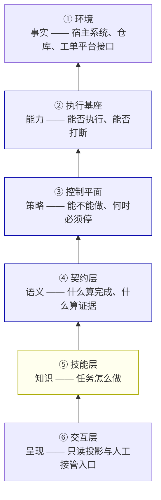
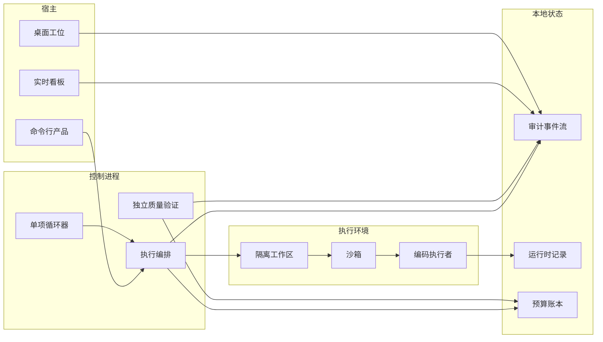
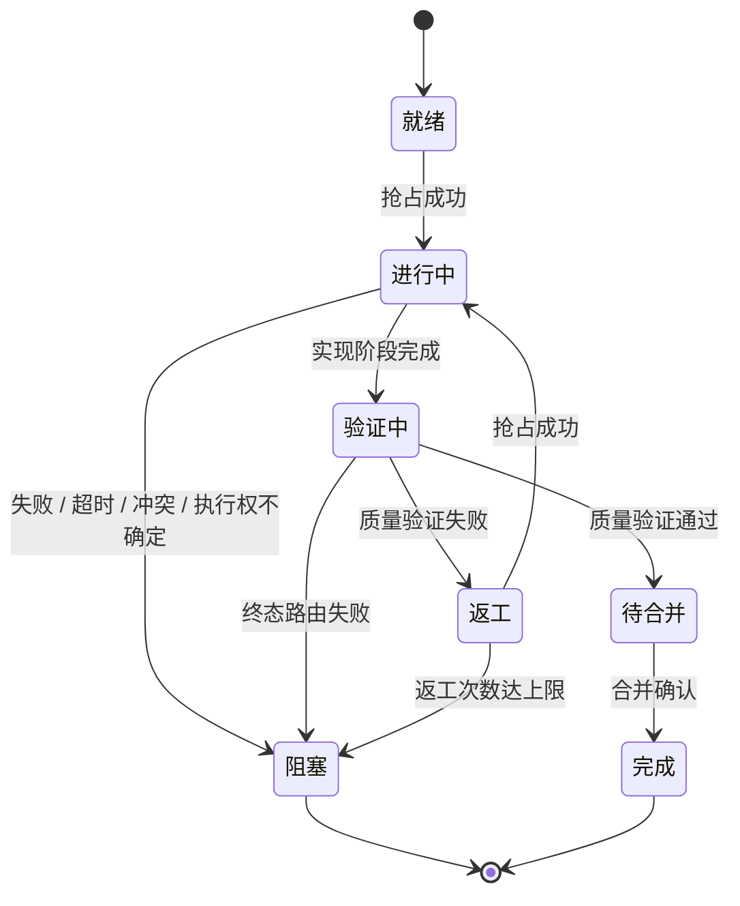

# AFK 系统架构设计说明书

| 项目 | 内容 |
| --- | --- |
| 文档类型 | 系统架构设计说明书（Software Architecture Description） |
| 适用范围 | AFK 自治开发工作流系统，含命令行产品、桌面工位与技能体系 |
| 文档层级 | 全局架构（Overall / Enterprise View） |
| 读者对象 | 架构评审人、系统维护者、能力接入方、安全与运维评审人 |
| 术语约定 | 工作项 = 业务任务身份；执行尝试 = 对同一工作项的一次执行；执行者 = 承载编码智能体的外部进程 |
| 表达约定 | 本文只描述结构、契约与行为语义，不记录实现细节、代码标识与文件位置 |

---

## 1. 引言

### 1.1 编制目的

本文档说明 AFK 系统的整体架构：系统边界、架构风格、分层结构、组件职责、数据与控制流程、质量属性、安全模型、失败语义与演进边界。

文档的目标是让读者能够在**不阅读源码**的前提下，理解：

- 系统解决什么问题、明确不解决什么问题；
- 各组成部分为何如此划分，以及这种划分如何约束后续变更；
- 系统在异常、并发、崩溃与成本约束下如何保持可信；
- 哪些边界是刻意保留的已知限制，而非缺陷。

### 1.2 文档边界

本文档描述**已实现并经核实**的架构。设计中已确定但尚未落地的部分，统一在"已知边界与演进"一章中显式标注，不与现状混述。

更细粒度的专题设计（执行环境与多智能体编排、可观测性 Harness、桌面端交互、决策记录）由 `docs/architecture/` 下的专题文档与 `docs/adr/` 下的决策记录承担。本文不重复这些内容，只在需要支撑全局结论时引用其结论。

---

## 2. 系统概述

### 2.1 系统定位

AFK 是一个**把业务工单自动化流转为可合并代码变更的自治执行系统**。

系统位于工单平台与代码仓库之间，向下对接两侧系统，向上托管中间完整的执行生命周期。它不替代工单平台作为业务事实源，也不替代代码托管平台作为版本事实源；它托管的是**从"任务可执行"到"变更可合并"之间的全部编排、验证与审计**。

### 2.2 业务目标

| 目标 | 含义 |
| --- | --- |
| 交付自动化 | 将已分解、已定义验收标准的工作项，自动推进为可合并的变更请求 |
| 判定可信 | 系统对"这项工作已完成"的结论必须可独立验证，不依赖执行者的自我评价 |
| 过程可解释 | 任意一次执行在事后都可被完整重建，包括其决策依据与失败原因 |
| 执行可恢复 | 执行环境崩溃、中断或重启后，系统能解释发生了什么并从正确位置继续 |
| 成本可控 | 单个工作项的执行消耗有持久化上限，且该上限不可被重启绕过 |

### 2.3 明确的非目标

架构设计同样由**拒绝做什么**定义。下列内容不在系统范围内：

| 非目标 | 理由 |
| --- | --- |
| 需求分解与工单拆分 | 属于规划问题，与执行正交；系统只消费已分解的工作项 |
| 版本发布与部署 | 交付止于"可合并"，之后的发布流程不属于执行生命周期 |
| 多租户安全隔离 | 假设单租户可信环境；同机多互不信任租户不在威胁模型内 |
| 替代人工代码评审 | 系统提供可信证据与门禁，不替代人的合并判断 |
| 实时流式监控 | 呈现为投影拉取模型，最终一致即可满足运维与诊断需求 |

---

## 3. 设计驱动因素

架构不是从功能清单推导的，而是从**约束**推导的。本章说明约束如何决定后续所有结构决策。

### 3.1 硬约束

| 编号 | 约束 | 来源 |
| --- | --- | --- |
| K1 | **执行者不可信** | 编码智能体是概率性组件，会误报、漏报、乱改；系统的产出价值完全依赖于此 |
| K2 | **工作项状态可被外部编辑** | 工单可被人工或第三方随时修改，自动化不得假设自身持有唯一写权 |
| K3 | **执行环境可能崩溃** | 智能体进程、宿主进程与容器均可能异常退出，且退出不等于工作完成 |
| K4 | **上下文上限不可自察** | 执行者无法可靠判断自身上下文即将耗尽 |
| K5 | **工单平台未提供原生条件更新** | 并发抢占需自建机制，并必须承认其一致性边界 |

### 3.2 派生设计原则

由硬约束可直接推出三条覆盖全系统的原则。它们是后续所有结构决策的源头：

> **P1｜判定权与执行权分离**（源自 K1）
> 实现与验收必须由相互独立的主体完成。同一主体不得既产出结果又裁定结果，否则确认偏差在原理上不可消除。

> **P2｜本地投影永不反向写入外部权威**（源自 K2）
> 系统只推动业务状态、不覆盖它。权威状态始终在工单平台侧，本地状态仅用于呈现与决策辅助。

> **P3｜过程必须先于结果可追溯**（源自 K3）
> 任何外部副作用都必须有前置的、可持久化的意图记录与事后结果记录，否则系统在崩溃后无法解释自身行为。

### 3.3 质量属性优先级

架构的本质是在冲突的品质之间做出**有意识的排序**。AFK 的排序如下，这个顺序直接决定了许多设计取舍：

| 排序 | 质量属性 | 优先级理由 |
| --- | --- | --- |
| 1 | **保守失败** | 不确定时停止而非继续。一次错误的自动化副作用，远比一次人工介入昂贵 |
| 2 | **判定可信** | "完成"必须可验证。这是系统全部产出价值的前提 |
| 3 | **可恢复** | 执行者是概率性组件，崩溃属于常态而非异常 |
| 4 | **可审计** | 无法事后解释的自动化系统，在实践中不敢真正放开权限 |
| 5 | **可移植** | 平台会变、执行者会变，架构必须吸收这种变化 |
| 6 | **一致性及时性** | 最终一致即可满足全部已知场景，主动排在最后 |

### 3.4 明确的取舍

下列每一项都牺牲了某项品质，且都是刻意决策而非疏漏：

| 获得 | 牺牲 | 取舍内容 |
| --- | --- | --- |
| 判定正确 | 吞吐 | 就绪判定逐项核实依赖关系，以调用次数换取判定正确性 |
| 判定正确 | 实时性 | 呈现层拉取投影，不建立事件订阅通道 |
| 安全性 | 自动化程度 | 执行权归属不确定时一律阻塞转人工，绝不静默重试 |
| 可解释 | 简洁性 | 自建文件租约而非引入分布式锁服务 |
| 数据完整性 | 可演进性 | 审计事件采用哈希链，不引入模式迁移，旧事件永久保留 |
| 执行可靠性 | 资源成本 | 质量验证串行执行，阶段交接保留完整现场 |

---

## 4. 系统上下文与边界

### 4.1 系统上下文

```mermaid
flowchart TB
    subgraph 外部系统
        TRK["工单平台<br/>（业务状态权威）"]
        SCM["代码仓库<br/>（版本事实源）"]
        EXE["编码执行者<br/>（不可信组件）"]
        RTY["执行环境<br/>（宿主 / 容器运行时）"]
    end

    subgraph AFK
        AFK["AFK 自治执行系统<br/>托管执行生命周期"]
    end

    HUM["操作者 / 评审人"]

    TRK <--> AFK
    SCM <--> AFK
    AFK --> EXE
    AFK --> RTY
    HUM <--> AFK

    classDef ext fill:#eef,stroke:#99a
    classDef sys fill:#efe,stroke:#9a9
    class TRK,SCM,EXE,RTY ext
    class AFK sys
```

### 4.2 外部接口与信息流

| 相邻系统 | 向 AFK 提供 | 从 AFK 接收 |
| --- | --- | --- |
| 工单平台 | 工作项身份、权威状态、执行模式、父子关系、依赖、评论通道 | 状态推进、业务标签、进展与返工记录 |
| 代码仓库 | 分支、提交、变更请求语义、合并结果 | 分支推送、变更请求创建与合并 |
| 编码执行者 | 执行能力、令牌用量、原生会话、上报信号 | 任务目标、约束条件、实时控制指令 |
| 执行环境 | 进程与终端控制、工作区、沙箱、凭据注入 | 执行请求、资源回收指令 |

### 4.3 信任关系

三条边界关系的信任级别不同，这是架构中最容易被忽视、却最具决定性的事实：

| 关系 | 信任级别 | 由此得出的设计 |
| --- | --- | --- |
| 与工单平台 | **对方权威，且随时可能被人工改动** | 本地状态只推动、不覆盖（原则 P2） |
| 与代码仓库 | 语义可靠 | 借用其版本控制模型，不重复实现 |
| 与编码执行者 | **不可信** | 判定权必须与执行权分离（原则 P1） |
| 与执行环境 | 部分可信 | 隔离级别必须显式声明，不得让使用者误判 |

### 4.4 所有权划分

| AFK 拥有 | AFK 仅借用 |
| --- | --- |
| 执行生命周期与状态推进 | 工单平台的持久业务状态（外部权威） |
| 执行权独占（租约） | 执行者的执行能力与原生会话 |
| 工作区隔离与资源回收 | 代码仓库的版本控制语义 |
| 执行过程的完整审计 | 平台接口的读写通道 |
| 验收判定与放行决策 | 终端复用机制（用于实时控制） |
| 预算与失败计数 | —— |

> **所有权要点：AFK 拥有生命周期，但不拥有状态。**
> 工单状态属于外部权威，系统只是推动它。这一表述是原则 P2 的所有权版本。

---

## 5. 架构风格与总体结构

### 5.1 架构风格

系统整体采用**分层架构 + 端口与适配器（六边形）**的组合风格：

- **分层**表达职责性质与依赖方向，保证架构不随功能增长而腐化；
- **端口与适配器**表达外部世界的可替换性，保证平台、执行者与环境的变化被局部吸收。

两者组合的原因：分层解决"哪些规则不能天天改"，端口与适配器解决"哪些东西会天天换"。

### 5.2 分层模型



| 序 | 层 | 承载 | 职责 |
| --- | --- | --- | --- |
| ⑥ | 交互层 | 呈现 | 命令行、实时看板、桌面工位；只读投影 + 人工接管入口 |
| ⑤ | 技能层 | **知识** | 任务分解、实现策略、质量核查、产出规范；定义"怎么做" |
| ④ | 契约层 | **语义** | 完成协议、验收标准、审计事件、能力契约；定义"什么算数" |
| ③ | 控制平面 | **策略** | 工单接入、调度抢占、生命周期推进、工作流编排；定义"能不能做、何时停" |
| ② | 执行基座 | **能力** | 进程与终端控制、工作区准备、沙箱与凭据、遥测采集；定义"能否执行、能否打断" |
| ① | 环境 | 事实 | 宿主系统、容器运行时、代码仓库、工单平台接口 |

### 5.3 层间契约

层与层之间只有两条通道：**向下派发指令，向上接收举证**。不存在跨层直连，也不存在反向写入。

不同层回答的是不同性质的问题，这一区分是分层的根本意义：

| 层 | 回答的问题 | 性质 |
| --- | --- | --- |
| ⑥ 交互层 | 怎么看 | 呈现 |
| ⑤ 技能层 | 怎么做 | **知识（可变）** |
| ④ 契约层 | 什么算完成、什么算证据 | **语义（稳定）** |
| ③ 控制平面 | 能不能做、何时必须停 | **策略（稳定）** |
| ② 执行基座 | 能否执行、能否打断 | **能力（适配）** |
| ① 环境 | 物理约束 | 事实 |

> **混用这四种性质是本架构最需要防范的设计退化。**
> 典型反例是把业务规则写进技能提示词——这会让规则随技能一起被替换，从而失去强制力。

### 5.4 层方向治理

层方向不是文档约定，而是**强制检查**。架构守卫在持续集成中拒绝非法依赖方向、拒绝遗留代码基线的重新引入，并校验状态投影映射的完整性。守卫本身亦有测试覆盖，保证"防止腐化"这件事本身被验证。

守卫同时约束领域核心包：核心领域模型不得依赖任何基础设施组件，应用层包只允许依赖核心领域包。这一约束保证了领域规则可以在没有运行环境的情况下被完整测试。

### 5.5 运行时拓扑



控制进程与执行环境**跨进程分离**。这是硬约束 K3 的直接结果：跨进程边界使执行状态必须显式持久化，从而使崩溃恢复成为可能而非偶然。

---

## 6. 组件架构

### 6.1 控制平面

控制平面承载全部策略决策，且是执行副作用的**唯一授权来源**。

| 组件 | 职责 | 关键约束 |
| --- | --- | --- |
| 工作项接入 | 从工单平台读取身份、状态、依赖、执行模式 | 不解析平台标签推断业务状态 |
| 执行权仲裁 | 抢占、续租、释放执行权 | 归属不确定时禁止抢占 |
| 工作流编排 | 编译并执行工作流计划 | 不承载业务语义，不直接操作外部系统 |
| 生命周期管理 | 状态迁移与守卫校验 | 终态拒绝任何后续迁移 |
| 阶段资源管理 | 执行与沙箱的创建、终结、清理 | 终结操作幂等，成功与失败均执行 |
| 单项循环器 | 在授权范围内持续推进单一工作项 | 绑定单一工作项，不做全局扫描调度 |

**控制平面的核心纪律**：所有策略决策必须先落审计事件，再执行外部副作用。决策与副作用之间不存在"先做后记"的路径。

### 6.2 契约与语义平面

契约层定义系统中**什么是有意义的事实**，不关心事实如何产生。

| 契约 | 语义 |
| --- | --- |
| 完成协议 | 执行者宣告完成时必须满足的结构化格式；解析采用保守策略，**协议不合法不等于通过** |
| 验收标准契约 | 判定"完成"的依据；必须由独立主体重新执行，而非采信执行者声明 |
| 审计事件契约 | 版本化、可追加、带因果与幂等标识、带完整性字段的事件格式 |
| 能力契约 | 扩展方可提供与必须提供的能力的封闭集合 |

契约层是**知识层不可信时的兜底**：即使技能层写错、漏步骤、乱改文件，契约层的校验依然成立。

### 6.3 执行基座

执行基座**不理解业务**，只提供六类通用能力：

| 能力 | 说明 |
| --- | --- |
| **拉起** | 启动执行者进程，注入目标与约束 |
| **供给** | 准备隔离工作区、沙箱与凭据 |
| **监听** | 采集上报信号：完成声明、用量、存活状态 |
| **控制** | 实时投递输入、中断、终止 |
| **观察** | 捕获过程产出，供事后解释 |
| **清理** | 释放资源，按策略决定保留或移除工作区 |

> **关键语义区分：中断 ≠ 终止。**
> 中断是优雅停止，为恢复与上下文交接保留可能；终止是强制结束，不假设会话可恢复。
> 该区分直接决定长时任务的上下文续跑能否实现。

### 6.4 技能与知识层

这是系统中最具辨识度的设计，必须讲清其架构定位：

| | 技能层 | 系统层（契约 + 策略 + 能力） |
| --- | --- | --- |
| 承载什么 | **HOW** —— 工艺、步骤、表达方式、约束提示 | **WHETHER / WHEN** —— 能不能做、何时停 |
| 可信度 | **不可信**，由人编写、可被用户随时替换 | **不可绕过**，由代码强制 |
| 失效后果 | 做不好，但**不破坏系统** | 破坏系统不变量 |
| 变更节奏 | 持续演进 | 谨慎变更，需评审 |

**推论**：系统层不假设技能层会遵守规则。即使技能编写有误——漏步骤、命令写错、误改文件——执行权归属不会失效、审计不会中断、预算不会重置、协议不会放行。

> **类比**：技能层相当于应用代码，系统层相当于运行时。
> 不会因为应用代码质量差就放弃运行时的保护机制。

**两条特殊护栏**（均在框架层生效，而非提示词层）：

| 护栏 | 作用 |
| --- | --- |
| **能力围栏** | 以工具禁用清单与"禁止自动调用"开关在框架层约束执行者可触达的能力 |
| **知识保留规则** | 通用抽象允许泛化；项目专属契约必须原样保留 |

> 知识保留规则针对的是大模型特有的失败模式：模型倾向于把项目专属契约当作通用知识"顺手优化"掉，从而破坏既有约定。该规则是对这一失败模式的直接防御。

### 6.5 交互与呈现

呈现层具备两条硬性限制：

| 限制 | 说明 |
| --- | --- |
| **只读** | 呈现层不具备决策权，界面行为不得影响业务状态 |
| **无平台能力** | 渲染进程不持有系统能力，所有本地访问经由白名单通道与类型锁定接口 |

桌面工位直接复用命令行产品所用的同一批用例，不派生执行进程，也不经由子进程获取数据。这保证了两个客户端走**同一条代码路径**，不会随时间漂移。

### 6.6 可观测性平面

可观测性是建立在审计事件流之上的**查询与投影层**，不是独立的事实源。

| 能力 | 说明 |
| --- | --- |
| 运行列举与时间线 | 列出本地执行记录，按序展示事件流并给出完整性校验结论 |
| 重放 | 从事件流重建聚合状态，**不产生任何副作用** |
| 解释 | 直接回答"为何运行、失败、终止或等待人工" |
| 诊断 | 检查本地事件目录完整性 |

全部查询均为只读，不申请工作项、不启动执行者、不创建工作区、不修改远端工单。

---

## 7. 端口与适配器：可扩展性设计

### 7.1 端口抽象

控制平面与执行基座之间是**端口与适配器**结构：编排只依赖接口契约，不依赖任何具体实现。

| 端口族 | 已实现适配器 |
| --- | --- |
| 工单 / 分支 / 变更来源 | GitLab、GitHub、本地 Git |
| 执行者来源 | 六种智能体命令行适配器 |
| 沙箱来源 | 本地、Docker、Podman |
| 执行权租约 | 文件系统租约（平台原生条件更新为预留端口） |
| 事件存储 / 证据存储 | 只追加日志存储 / 本地加密存储 |

### 7.2 四条正交扩展轴

系统将差异拆解为四条互不干扰的轴，任意组合构成一条执行产线：

| 扩展轴 | 消除哪一类差异 | 当前规模 |
| --- | --- | --- |
| 执行者来源 | 各家智能体的参数、输出格式、能力差异 | 六种 |
| 沙箱来源 | 运行环境的隔离级别与控制方式 | 三种 |
| 分支策略 | 分支命名、基线选取、并行隔离 | 四种 |
| 工作流模板 | 业务步骤、依赖关系、条件分支 | 六套内置 |

> **为什么必须正交**：曾将"执行者差异""环境差异""业务流程差异"揉进同一个类型，
> 导致任一维度变化都要修改核心类型定义，组合方式也无法穷举验证。
> 正交化之后，新增一个执行者不影响任何其他维度。

### 7.3 执行者能力矩阵

执行者适配器必须**显式声明**其能力集合，不允许乐观假设：

| 能力维度 | 语义 |
| --- | --- |
| 流式输出 | 是否可实时获取过程事件 |
| 结构化输出 | 是否可返回机器可解析的完成结果 |
| 用量上报 | 是否可提供令牌用量 |
| 会话续跑 | 是否支持原生会话恢复 |
| 会话分叉 | 是否支持从历史点派生 |
| 交互模式 | 是否支持实时输入注入与人工接管 |

> **能力声明是强制契约**：不支持会话续跑的执行者不得进入续跑流程。
> 这条规则避免了"流程看起来正常、实际静默降级"的隐性故障。

### 7.4 能力档案与封闭能力集

扩展通过**能力档案**接入。档案声明各插件提供的能力、所需能力与配置模式，系统据此解析出一个能力集合。

| 规则 | 设计 |
| --- | --- |
| 能力集合是**封闭集** | 不接受运行期动态引入未知能力 |
| 能力**冲突即启动失败** | 两个插件提供同一能力时拒绝启动，不做静默覆盖或优先级仲裁 |
| 缺失依赖能力即**启动失败** | 在任何运行时启动前完成校验 |

> **为什么冲突要失败**：能力冲突意味着运行时语义不确定。
> 一个以"可预测"为前提的系统，不能在启动期就引入语义歧义。
> 将冲突暴露为启动失败，比在生产环境中产生不确定行为代价低得多。

### 7.5 插件边界

插件可以注册能力提供方、生命周期模块、工作流模板与受限系统动作。插件**不获得**以下能力：直接访问外壳、资源作用域管理权限，以及绕过领域核心归约器的通道。

受限系统动作的含义是：工作流模板只能触发**已注册的动作**，不能声明任意可执行命令。这消除了"配置文件即任意代码执行"的攻击面。

---

## 8. 数据架构

### 8.1 工作身份模型

身份是本系统最容易被误用的部分，因此单独建模并明确边界：

| 身份 | 语义 | 使用边界 |
| --- | --- | --- |
| **工作项标识** | 工单平台侧的稳定业务身份 | 全链路透传，不得被任何派生标识替代 |
| **执行尝试标识** | 对同一工作项的一次执行 | 仅标识单次尝试，**绝不可替代工作项标识** |
| **父项关系** | 组织性分组 | 不选择执行基线，不隐含分支关系 |
| **依赖关系** | 调度先后约束 | 不隐含分支关系，不选择执行基线 |
| **执行基线** | 显式指定的未合并基线 | 选择代码基线的**唯一**合法来源 |
| **执行关联标识** | 跨事件流与运行记录关联同一次执行 | 必须与所属事件流身份一致 |

> **最小不变量**：执行尝试所携带的工作项身份，必须与其审计事件上下文中的工作项身份严格相等。
> 混淆父项、依赖与基线，是本架构明确禁止的行为。

### 8.2 审计事件主干

审计事件流是**每次执行的权威记录**。其他一切（日志、指标、运行时快照、界面展示）都是它的投影或关联诊断信号，不具备权威性。

| 属性 | 设计 |
| --- | --- |
| 存储形态 | 按执行尝试组织的只追加日志文件 |
| 顺序性 | 单次执行内严格有序，携带连续序号 |
| 完整性 | 事件之间构成**前向哈希链**，读取时校验 |
| 原子性 | 追加过程保证原子性并落盘同步 |
| 版本化 | 事件具备模式版本，但**不提供迁移** |
| 保留策略 | 默认全部保留；清理是**显式维护操作**，需通过完整性校验与独占访问声明 |
| 写入失败 | **阻断后续全部外部副作用**，不得静默跳过 |

> **为什么写入失败必须阻断**：若审计允许失败后继续，这份审计就**永远无法证明"未记录的事情没有发生过"**。
> 这与"日志能证明什么"是同一条逻辑线。审计的价值不在于记录成功的事，而在于排除未发生的事。

> **为什么哈希链不引入迁移**：哈希链的完整性验证要求历史事件不可改写，而模式迁移通常需要重写或新增历史记录，两者存在根本张力。
> 系统选择保完整性、放弃可演进性，代价是旧事件流永久保留。这是取舍，不是疏漏。

**事件上下文**随每一次外部副作用传递，携带执行、工作项、追踪、关联、尝试、运行档案、执行者与租约世代等标识。其中租约世代用于识别执行权的更替，**不得**当作工作项或执行尝试的身份。

### 8.3 证据存储与数据治理

过程证据采用独立存储，与事件流分离：

| 属性 | 设计 |
| --- | --- |
| 寻址方式 | 内容哈希寻址 |
| 加密 | 对称加密存储 |
| 密钥来源 | **必须**来自受控凭据提供者，不得来自命令行参数、日志或档案文件 |
| 脱敏 | 加密前对常见凭据格式做规则化脱敏 |
| 能力边界 | **不是**通用数据防泄漏引擎；生产化前需接入组织级扫描、访问控制与保留策略 |

> **证据引用只携带元数据**：位置、内容摘要、媒体类型、分类与脱敏状态。
> 提示词全文、命令全文、环境变量、凭据、私有代码与高基数路径，不得进入指标标签、遥测属性或常规日志。

### 8.4 预算账本

预算是成本控制的核心机制，其设计要点：

| 要点 | 设计 |
| --- | --- |
| 归属粒度 | 按工作项持久化 |
| 累加语义 | 按执行会话**只接受增长**，以差值累加；重启不清零 |
| 一致性约束 | 会话明细之和必须等于总量，不成立即判定账本损坏 |
| 损坏响应 | **拒绝执行**（保守失败） |
| 写入方式 | 临时文件加原子重命名，避免半初始化 |

> **预算必须持久化，因为重启是最常见的失败模式。**
> 若重启清零，则"重启"成为绕过上限的最简路径，整个预算机制形同虚设。

### 8.5 运行时记录

运行时记录承载执行尝试的状态、阶段、心跳、进度与诊断信息。

| 约束 | 说明 |
| --- | --- |
| 心跳陈旧 | 判定为**诊断性**异常，**不改变**业务生命周期状态 |
| 启动元数据 | 只能证明"曾发起进程"，**不能推断**验证、阻塞或完成状态 |
| 数据损坏 | 降级为已验证前缀加诊断信息，不整体丢弃 |

### 8.6 数据权威与投影

系统严格区分**权威数据**与**投影数据**：

| 类别 | 包含 | 允许的写入方 |
| --- | --- | --- |
| 权威数据 | 工单平台业务状态、审计事件流、预算账本 | 工单平台 / 控制平面 |
| 投影数据 | 运行时记录、界面视图、执行历史、缓存索引 | 读取方与派生进程 |

投影允许陈旧，权威不允许错误。当出现"外部已完成、本地仍显示进行中"时，这是**可接受**的正常状态：投影可以滞后，权威不能出错。

---

## 9. 流程与状态架构

### 9.1 生命周期状态机



**状态集**：就绪 · 进行中 · 验证中 · 待合并 · 完成 · 阻塞 · 返工

**终态**是完成与阻塞。终态之后拒绝任何迁移，这条守卫不可绕过。

**进入"阻塞并转人工"的四条路径**，其铁律是**绝不静默重试为自动工作**：

失败 ｜ 超时 ｜ 冲突 ｜ **执行权归属不确定**

> 最后一条最为关键。执行权过期有两种成因：持有者确已死亡（应当回收），
> 与持有者仍存活但卡死或失联（回收即产生双写）。分不清就不该回收。

### 9.2 可执行性判定

一个工作项可被执行，必须同时满足以下合取条件，且**依赖读取失败一律按不可执行处理**：

1. 状态为就绪或返工；
2. 执行模式为自动（非人工介入）；
3. 无未完成子项——父项本身永不可执行；
4. 全部依赖项已完成。

### 9.3 主执行回路

主回路的每一步都跨越一个层，这种跨层结构正是闭环得以成立的机制：

| 步 | 发生层 | 动作 | 跨层性质 |
| --- | --- | --- | --- |
| ① | 控制平面 | 工作项就绪判定 | —— |
| ② | 控制平面 | 执行权抢占与就绪校验 | 策略层决定**能否开始** |
| ③ | 执行基座 | 隔离工作区、沙箱、凭据注入 | 能力层兑现**执行条件** |
| ④ | 技能层 | 工艺执行：编排 → 动作 → 代码变更 | 知识层决定**怎么做** |
| ⑤ | 契约层 | 完成声明的强校验 | 语义层决定**算不算数** |
| ⑥ | 契约层 + 控制平面 | 独立质量验证重新验收 | 语义层与策略层决定**放不放行** |

**分支**：通过则推送变更进入待合并，人工合并后经关联对账确认进入完成；
不通过则写入返工记录，开启**一次新的执行尝试**回到第 ① 步。

**贯穿全程**：每一次状态推进都向审计上下文投递一条事件。
这些事件既是本次执行的**输出证明**，也是下一轮的**输入依据**——返工记录决定下一轮重做什么，预算快照决定还能不能继续转。**闭环由此闭合。**

### 9.4 上下行信号的不对称

这是整个闭环最核心的纪律：

| 方向 | 内容 | 性质 | 校验强度 |
| --- | --- | --- | --- |
| **下行（授权）** | 任务目标、阶段指令、约束条件 | 授权 | 授权范围内即可 |
| **上行（举证）** | 完成声明、用量上报、存活信号、审计事件 | **举证** | **必须严格强校验** |

> **举证必须比授权严格。**
> 下行发错，最多浪费一次执行；上行放过一次错误声明，后续所有环节都建立在错误事实上。

一次完整执行中**没有任何一个上行信号是"信任即可"的**：用量越阈值即中断、存活丢失即封锁、完成声明不合法即判失败、审计写入失败即阻断。

### 9.5 异常回路

不同失败粒度回到不同位置，这是闭环设计中最易被追问、也最易做错的部分：

| 回路 | 触发条件 | 回到哪 | 更换的是什么 | 语义 |
| --- | --- | --- | --- | --- |
| **执行重试** | 进程崩溃 / 协议非法 | 工艺执行 | **换会话** | 同一次尝试 |
| **上下文交接** | 用量越阈值 | 工艺执行 | **换代次** | 同一次尝试 |
| **返工** | 质量验证失败 | 就绪判定 | **换尝试** | 同一工作项 |
| **人工介入** | 阻塞转人工 | 就绪判定 | —— | 人解除阻塞后重入 |
| **预算** | 预算耗尽 | 阻塞 | —— | **元回路**：决定其他回路还能转几次 |
| **审计** | 全程 | 事后 + 下次输入 | —— | 让回路可被追溯 |

> **前三个回路的粒度不同，是本设计最关键的区别之一。**
> 重试与上下文交接更换的是**执行细节**（会话 / 代次），返工更换的是**执行整体**（新的一次尝试）。
> 混为一谈会导致返工次数被高估，或上下文交接被误当作失败重来。

**预算回路是元回路**：它不推动流程，而是决定其他回路还能转几次。这解释了为什么预算必须持久化——重启若清零，元回路就被绕过了。

### 9.6 闭环的闭合条件

| # | 条件 | 缺失后果 |
| --- | --- | --- |
| 1 | 每次状态推进都写入审计事件 | 循环不可追溯，事故无法解释 |
| 2 | 失败不丢失现场 | 转人工后无人能接续 |
| 3 | 计数跨重启持久化 | 重启即可绕过上限 |
| 4 | 权威单一 | 循环内出现两个真相 |

> **闭合不是靠"跑完了"，而是靠"任何一步失败都知道该回哪去、且回得去"。**

### 9.7 质量验证与返工

质量验证由**独立主体**执行，且不持有执行权仲裁能力——它只能验收，不能抢占。

| 设计点 | 说明 |
| --- | --- |
| 独立性 | 验证方与实现方是两个主体，验证方重新执行验收 |
| 结果持久化 | 失败结果写入工单平台的评论通道，形成返工记录 |
| 记录取代 | 新记录取代既有活动记录，尝试序号按**历史最高值**递增 |
| 上限 | 默认 3 次；达到上限直接转人工，**不再返回自动返工** |
| 计数持久性 | 尝试计数包含已被取代与人工干预的记录，**重启不重置** |

> **上限设计的要点**：达到上限后保留该记录，后续失败不会重新开启自动返工。
> 这避免了"反复失败又反复重置上限"的无限循环。

---

## 10. 质量属性设计

质量属性以**场景**方式描述：刺激、环境、响应、度量。

### 10.1 场景化质量属性

| 编号 | 刺激 | 环境 | 响应 | 度量 |
| --- | --- | --- | --- | --- |
| Q1 判定可信 | 执行者声明"已完成" | 该声明可能不真实 | 系统不采信声明，由独立主体重新执行验收；协议不合法直接判失败 | 未经独立验收而放行的变更数为 0 |
| Q2 保守失败 | 执行权归属不确定 | 无法区分持有者已死与失联 | 禁止抢占，阻塞并转人工 | 系统从不在归属不明时产生第二个执行者 |
| Q3 过程可解释 | 事后需要解释某次执行 | 执行已结束 | 从审计事件流重建状态与决策依据，不依赖进程存活 | 任意历史执行可完整重建的比例为 100% |
| Q4 可恢复 | 执行进程意外崩溃 | 工作区与预算账本仍在 | 判定为同一次尝试的失败，换会话重试；计数不重置 | 崩溃后无需人工介入即可恢复的比例 |
| Q5 预算不可绕过 | 尝试通过重启绕过消耗上限 | 账本持久化 | 预算跨执行累加，重启仅接受增长 | 重启前后累计消耗连续，无归零窗口 |
| Q6 并发安全 | 两个执行者同时尝试同一工作项 | 单机可信文件系统 | 通过原子发布抢占记录，仅一个成功；失败方干净退化为未抢占 | 双写同一工作项的次数为 0 |
| Q7 审计不可绕过 | 审计事件持久化失败 | 即将执行外部副作用 | 阻断后续全部外部副作用 | 存在副作用而无对应意图记录的次数为 0 |
| Q8 可移植 | 需要接入新的工单平台或执行者 | 端口契约已定义 | 仅新增适配器，控制平面不改动 | 接入新执行者所需的控制平面改动为 0 |
| Q9 呈现无决策权 | 界面操作试图改变业务状态 | 呈现层只读 | 拒绝；业务状态只能由控制平面依据契约变更 | 呈现层导致的业务状态变更数为 0 |
| Q10 成本可归因 | 需要核算单次执行的消耗 | 遥测已采集 | 按执行尝试汇总已记录用量；缺失保持缺失，不做推算 | 汇总值与执行器原生记录一致的比例 |

### 10.2 质量属性之间的冲突处理

| 冲突 | 裁决 | 理由 |
| --- | --- | --- |
| 吞吐 vs 判定正确 | 牺牲吞吐 | 错误交付的返工成本远高于正确性成本 |
| 实时性 vs 一致性 | 牺牲实时性 | 诊断场景对最终一致无感 |
| 自动化程度 vs 安全性 | 牺牲自动化 | 转人工的代价远低于双写事故 |
| 简洁性 vs 可解释性 | 牺牲简洁性 | 自建租约换来的是失效模式可预测 |
| 可演进性 vs 数据完整性 | 牺牲可演进性 | 审计的证明力依赖历史不可改写 |

---

## 11. 安全架构

### 11.1 威胁模型与信任边界

| 边界 | 威胁 | 定位 |
| --- | --- | --- |
| **执行者边界** | 误报完成、越权操作、篡改文件 | **不可信**，判定权与之分离 |
| **本地模式边界** | 执行者访问宿主其他文件、进程、环境变量 | **任务隔离，非安全隔离** |
| **容器模式边界** | 同上，但受挂载范围限制 | **具备安全边界** |
| **凭据边界** | 凭据外泄到执行者或日志 | 白名单注入，**可扩展不可收缩** |
| **配置边界** | 配置文件成为任意代码执行入口 | 仅允许已注册动作，不允许任意命令 |
| **呈现边界** | 渲染进程越权访问宿主 | 无平台能力，白名单通道 |

> **必须主动声明的一点**：本地执行模式提供的是**任务隔离**——它能防止多个执行者互相干扰，
> 但**不能**阻止执行者访问宿主上的其他文件、进程与环境变量。
> 只有容器模式才提供真正的安全边界。这条界限写在设计文档中，是为了让使用者**不误判**运行环境的保护级别。

### 11.2 隔离分级

| 级别 | 含义 | 适用 |
| --- | --- | --- |
| 工作区隔离 | 各自独立的工作目录 | 防止任务互相干扰 |
| 进程隔离 | 进程与进程组边界 | 支持优雅中断与强制终止 |
| 文件系统隔离 | 受限挂载范围 | 提供安全边界 |
| 虚拟机隔离 | 完整虚拟化边界 | 不在当前实现范围 |

隔离级别是**显式声明的属性**，不是隐含行为。系统不假设某个执行环境"大概是隔离的"。

### 11.3 凭据治理

| 规则 | 设计 |
| --- | --- |
| 注入方式 | 显式白名单，禁止全量继承宿主环境 |
| 变更方向 | 白名单**可扩展、不可收缩**；移除默认项需要显式派生配置 |
| 容器挂载 | 仅挂载工作区、会话与结果三类路径；不默认挂载用户主目录、密钥目录、容器套接字与其他仓库 |
| 运行身份 | 默认非特权用户 |
| 密钥材料 | 证据存储密钥必须来自受控凭据提供者 |

> **设计取向**：让**收紧**成为显式且困难的动作，让**放松**必须经过明确决策。
> 核心是最小权限，而不是堆叠检查。

### 11.4 数据保护

| 对象 | 保护措施 |
| --- | --- |
| 审计事件 | 完整性链校验；不可修改、不可删除 |
| 过程证据 | 内容寻址 + 加密存储 + 规则化脱敏 |
| 日志与遥测 | 禁止写入凭据、私有代码、高基数路径；上下文标识随异步作用域隔离 |
| 人工接管输入 | 交互输入不落日志 |

---

## 12. 失败模型与容错设计

### 12.1 失败分类与响应

成熟的系统不是"不会失败"，而是**知道自己会怎么失败**。

| 失败类型 | 检测方式 | 系统响应 | 终态 |
| --- | --- | --- | --- |
| 执行者进程崩溃 | 进程退出且无有效声明 | 执行级重试，更换会话 | 达上限后阻塞 |
| **完成声明格式非法** | 协议解析保守失败 | **判失败**，不视为通过 | 触发重试 |
| 验收不通过 | 独立验证方返回失败 | 返工记录并重跑实现 | 超限阻塞 |
| 上下文耗尽 | 执行器轮询越阈值 | 中断 → 交接 → 新代次 | 预算耗尽则阻塞 |
| 超时（单代次 / 整体） | 看门狗 / 累计预算 | 阻塞转人工，**保留现场** | 阻塞 |
| 代码冲突 | 合并冲突检测 | 阻塞转人工，保留现场 | 阻塞 |
| **执行权丢失** | 心跳失败 / 租约过期 | **封锁，禁止抢占** | 阻塞 |
| 重复抢占 | 抢占原子失败 | 干净退化为"未抢占" | 无副作用 |
| **审计写入失败** | 写入异常 | **阻断后续全部外部副作用** | 失败并清理 |
| 凭据或平台不可用 | 接口错误 | 退避重试，**不推进状态** | 保持原状态 |
| 投影数据损坏 | 校验失败 | 降级为已验证前缀加诊断 | 局部不可用 |
| **预算账本损坏** | 一致性校验失败 | **拒绝执行** | 阻塞 |
| 会话快照损坏 | 校验失败 | **降级为文档交接** | 继续执行 |

### 12.2 失败方向判定原则

失败处理不是逐个案例决定的，而是由三条原则推出：

| 原则 | 体现 |
| --- | --- |
| **不确定时停止，而非继续** | 执行权丢失、账本损坏、审计失败 —— 全部阻塞 |
| **代价越大的失败，保留越多现场** | 超时与冲突保留工作区，便于人工接续 |
| **可降级的不阻断，不可降级必阻断** | 会话快照损坏降级为文档交接（放行）；审计账本写入失败阻断（拦截） |

> **同一系统中存在两种相反的失败策略，这不是矛盾，而是必须显式决策的结果。**
> 每一个持久化边界都必须明确：损坏时是保守失败还是降级继续。
> 没有声明这一点的设计，实际行为将由实现细节偶然决定。

### 12.3 恢复语义

| 语义 | 含义 |
| --- | --- |
| **中断（可恢复）** | 优雅停止，保留会话与恢复可能 |
| **终止（不可恢复）** | 强制结束，不假设会话可恢复 |
| **上下文交接** | 中断 → 等待会话落盘 → 完整性校验 → 优先原生续跑 → 降级为文档交接 → 新代次继续 |
| **抢占发布原子性** | 先在私有位置准备**完整**记录，再通过一次原子重命名发布；清理前重新比对身份 |

> **抢占记录的原子发布**采用"完整记录 + 原子重命名"而非"独占创建标志文件"：
> 后者只能原子地产生空文件，内容需要二次写入，**存在半初始化窗口**；
> 前者保证记录路径上出现的必然是完整状态。

---

## 13. 工程治理与质量保障

### 13.1 架构守卫

架构约定写在文档里没有约束力，系统将其转为**会失败的检查**：

| 守卫项 | 作用 |
| --- | --- |
| 层方向检查 | 拒绝非法层间依赖 |
| 包依赖检查 | 领域核心零基础设施依赖；应用层仅依赖核心层 |
| 遗留基线检查 | 遗留清单**已清零**，任何新增遗留代码直接失败 |
| 逃逸口检查 | 拒绝以泛型容器绕过类型契约 |
| 状态映射检查 | 校验状态投影映射完整性 |
| 呈现层检查 | 拒绝在表现层出现平台全局对象 |

### 13.2 测试分层

| 层次 | 验证内容 | 特点 |
| --- | --- | --- |
| 领域纯函数 | 归约器、状态迁移、策略、计划编译 | 无运行环境依赖，覆盖组合爆炸 |
| 平台契约 | 适配器与端口契约的一致性 | 隔离外部依赖 |
| 执行基座集成 | 真实终端、工作区、进程中断与会话交接 | 使用受控执行者替身 |
| 端到端 | 工作项 → 执行 → 验证 → 变更请求 → 合并 | 桌面端使用真实主进程与隔离环境 |

> **架构守卫本身也有测试**，保证"防止腐化"这件事本身被验证到。

### 13.3 文档一致性

文档与代码保持同步由两类机制保证：自动化的链接与命名检查，以及对**过时表述**的人工责任。链接检查只能捕获断链，陈旧措辞需要主动维护。架构文档中记录的已知边界与权衡，应当在实现变化时同步更新。

---

## 14. 已知边界与演进

### 14.1 已知边界

主动暴露已知边界，好过被动承认。每条按"性质"定性：

| # | 边界 | 性质 |
| --- | --- | --- |
| 1 | 工单平台原生条件更新未接入真实实现，接口与策略分支就绪 | 已知边界 |
| 2 | 文件租约为**单机机制**，非多机共识；多机执行不受支持，需依赖平台原生能力 | 已知边界 |
| 3 | **验收标准的检查命令尚未由系统真实执行**：系统当前只做协议层强校验，真正的机器校验需在沙箱内执行命令并回收证据 | **当前能力上限** |
| 4 | 能力配置的模式校验存在手写子集，与实际校验接线存在差距 | 明确的下一步 |
| 5 | 脱敏为规则化实现，非通用数据防泄漏；人名与内部地址无法处理 | 已知边界 |
| 6 | 审计事件无模式迁移 | 刻意取舍 |
| 7 | 交互式接管尚未完成最终验收；调度不变性仍是未关闭验收项 | 已知边界 |
| 8 | 部分决策记录文本存在写入损坏 | 文档缺陷 |
| 9 | 工作流模板的并行分组字段与实际并发判定语义存在偏差：当前并发依据是依赖层级，而非该字段 | 明确的下一步 |
| 10 | 就绪判定存在重复调用，以调用次数换取判定正确性 | 刻意取舍 |
| 11 | 投影缓存以修改时间判定失效，同秒内两次写入可能返回陈旧结果 | 刻意取舍 |

### 14.2 主要演进方向

演进按**能力上限的顺序**推进，而非按实现便利性：

| 方向 | 内容 | 前置条件 |
| --- | --- | --- |
| **判定闭环** | 将验收标准转为沙箱内真实执行的机器校验，回收可审计证据 | 执行基座证据回收机制成熟 |
| **统一副作用授权** | 由执行协调器成为全部运行副作用的唯一授权来源 | 跨流程状态编排统一、跨进程执行权隔离就绪 |
| **跨主机执行** | 依赖工单平台原生条件更新，实现多机安全执行 | 平台能力落地——这是**架构前提变更**，不是优化工作 |
| **遥测外发** | 分布式追踪、指标外发与服务水平目标 | 统一副作用授权完成 |
| **合并确认闭环** | 受控的合并确认：先经变更端口验证外部合并事实与目标正确，再记录终态 | 合并状态机补齐 |

### 14.3 当前能力上限

**判定可信度是当前上限。** 系统能够安全执行、完整审计、崩溃恢复，但在"验收标准是否真的被机器执行"这一环尚未闭合。这一环决定了自动化产出能否被真正信任。相比之下，性能、并发规模与界面体验都是次要问题。

其次是**多机执行能力**。执行权的单机性质决定了横向扩展必须等待平台原生能力，这是架构前提的变更，不属于优化范畴。

---

## 15. 附录

### A. 术语表

| 术语 | 含义 |
| --- | --- |
| 工作项 | 由外部规划产生、已分解的业务任务，是系统的最小业务单位 |
| 执行尝试 | 对同一工作项的一次完整执行 |
| 执行者 | 承载编码智能体的外部进程，**不可信** |
| 执行权 | 在某一时刻对某一工作项的独占执行资格 |
| 契约层 | 定义"什么算数"的语义层 |
| 技能层 | 定义"怎么做"的知识层，可信度低但可替换 |
| 控制平面 | 决定"能不能做、何时必须停"的策略层 |
| 执行基座 | 提供进程、工作区、沙箱与遥测的能力层 |
| 审计事件流 | 每次执行的权威记录，只追加、带完整性链 |
| 保守失败 | 不确定时停止并转人工，而非继续尝试 |
| 保守解析 | 协议不合法即判失败，不默认为通过 |
| 能力档案 | 声明可提供与所需能力的可组合运行组合 |
| 封闭能力集 | 不接受运行期引入未知能力，冲突即启动失败 |
| 人工介入 | 需要人参与决策的执行模式 |
| 投影 | 由权威数据派生的、允许陈旧的展示数据 |

### B. 关键设计原则索引

| 编号 | 原则 | 来源约束 |
| --- | --- | --- |
| P1 | 判定权与执行权分离 | 执行者不可信 |
| P2 | 本地投影永不反向写入外部权威 | 工作项可被外部编辑 |
| P3 | 过程先于结果可追溯 | 执行环境可能崩溃 |
| P4 | 举证严格于授权 | 上行错误的传播性 |
| P5 | 不确定时停止 | 执行者不可信 + 环境可崩 |
| P6 | 技能可替换，骨架不可绕过 | 知识层高频变更 |
| P7 | 每个持久化边界显式声明失败方向 | 环境可崩 |
| P8 | 预算跨执行累加，不可被重启绕过 | 成本可控 |

### C. 状态与信号对称性

| 维度 | 下行 | 上行 |
| --- | --- | --- |
| 内容 | 目标、指令、约束 | 完成声明、用量、存活、审计 |
| 性质 | 授权 | 举证 |
| 校验强度 | 授权范围内即可 | 必须强校验 |
| 失败代价 | 浪费一次执行 | 后续环节建立在错误事实上 |

---

## 16. 结论

AFK 的架构可以概括为一句话：**用不可信的知识层承载高频变更，用强制执行的骨架层兜底。**

分层的作用是把高频变更隔离在可替换层，把必须守住的规则固化在不可绕过层；
端口与适配器的作用是把平台、执行者与环境的变化吸收在适配器内部；
闭环的作用是保证任何一步失败都知道该回哪里去、并且回得去；
不变量的作用是保证组件可替换、实现可重写时，系统的可信度不被侵蚀。

系统的性能不会是最好的，但每一处性能损失都对应一次明确、可解释的取舍。
如果存在一张未经解释的性能优化清单，那意味着尚未想清楚哪些东西不能省。
