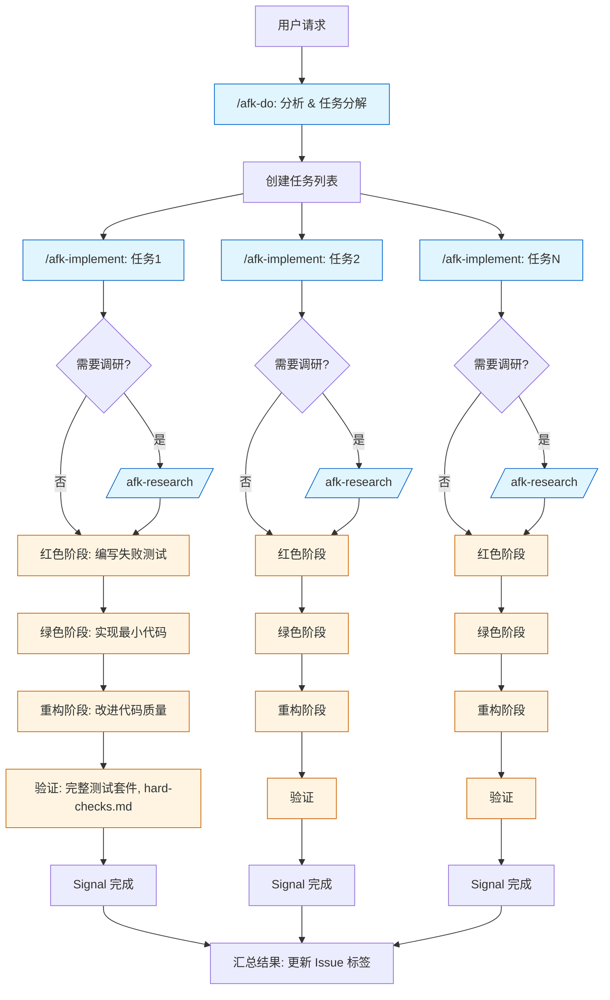
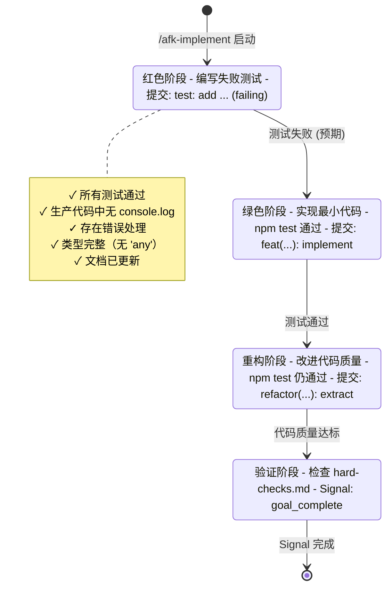
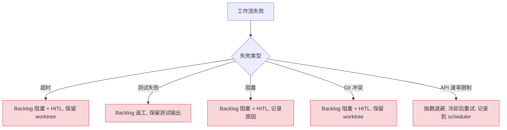
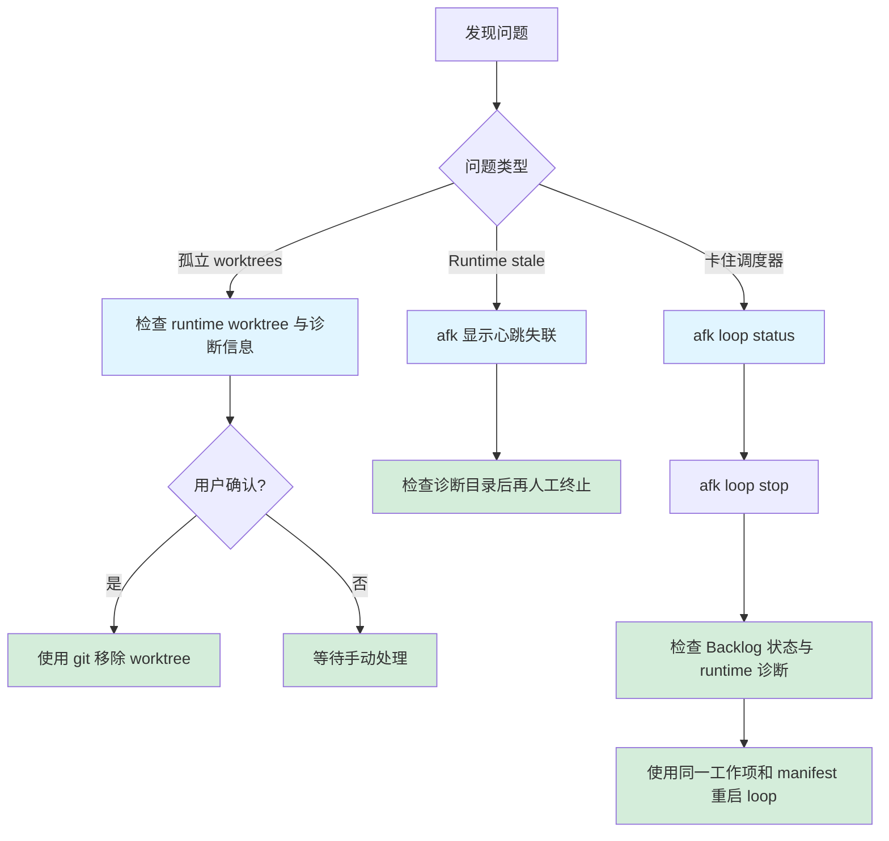
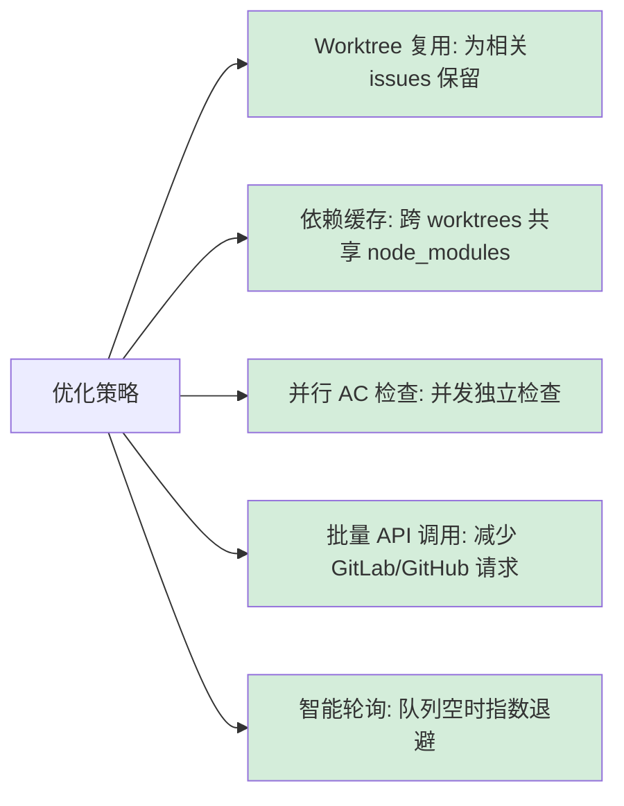

# AFK 工作流程

> 桌面受管工作项只在“工作项”详情启动或重试；Backlog 用于计划与关联，运行中心查看同一执行的审计历史。CLI 对应 `afk execute --work-item-id <平台:仓库#编号> --execution-manifest <路径>`；`afk run` 是仅执行实现阶段的底层命令，`afk loop` 需要唯一 Backlog ID 与匹配的 manifest，并复用 `executeWorkItem`。不要对同一项重复启动。

> 根 PR 在 QA 后保持 `awaiting_merge`。人工合并后执行 `afk reconcile --work-item-id <平台:仓库#编号> --execution-manifest <路径> --execution-id <原执行ID>`，确认 Provider 上 PR 已合并且关联同一 Issue，才审计为 `done`。Provider 不可用时重试对账，不能仅凭进程退出推断完成。

## 概述

AFK 实现三种主要工作流模式：
1. **Backlog → 实现 → 变更单流水线**：手动或自动化工作项处理
2. **Loop 工作流**：绑定 manifest 的后台轮询执行
3. **Skills 工作流**：TDD 方法论集成

## Backlog → 实现 → 变更单流水线

从 Backlog 发现到合并请求的端到端工作流。

### 手动执行

```bash
# 1. 查看可执行 Backlog
afk backlog list --state ready --mode afk

# 2. 执行指定 Backlog
afk run --backlog-id 123

# 3. 观察 Backlog 与 runtime
afk

# 4. 独立执行 QA
afk qa --backlog-id 123

# 分支名由业务 ID 派生为 afk/backlog-123
```

### 自动执行（调度器）

```bash
afk loop start --daemon --backlog-id <id> \
  --work-item-id github:owner/repo#123 \
  --execution-manifest /absolute/path/to/manifest.json
```

Loop 只轮询该工作项，将完整执行交给 `executeWorkItem`。没有 manifest 的旧实现/QA
调度链已删除，不存在回退路径。

### 工作流阶段

```mermaid
flowchart TD
    A["Backlog 发现: 读取 Provider 工作项"] --> B{"前置条件验证"}
    B -->|"AC 存在, 依赖完成, 可执行"| C["Worktree 创建: afk/backlog-id 分支"]
    B -->|失败| Z1["Backlog blocked + hitl"]

    C --> D["Runtime 启动: runId + backlogId, agent + watchdog"]
    D --> E["实现阶段: 实现 Backlog, 遵循 TDD 方法论"]
    E --> F["Runner 轮询: 信号文件 + statusline token 用量 (每 2s)"]

    F -->|goal_complete| G["AC 验证阶段: /goal 验证 AC"]
    F -->|"token ≥ 阈值"| H["上下文交接: 打断 → 总结 → 杀会话 → 重启 → 注入总结继续"]
    F -->|timeout| Z2["超时: Backlog 阻塞 + HITL, 保留 worktree"]

    G -->|goal_complete (ac_verification)| I["MR/PR 创建: push 分支, 关联 Closes iid"]
    G -->|"token ≥ 阈值"| H
    G -->|timeout| Z2

    H --> E
    H -.->|"预算耗尽/重启失败"| Z3["终止式交接: blocked + hitl, 恢复文档"

    I --> J["清理: Backlog 进入 verification, 删除 worktree"]

    classDef success fill:#d4edda,stroke:#28a745
    classDef fail fill:#f8d7da,stroke:#dc3545
    classDef process fill:#e1f5ff,stroke:#0066cc

    class I,J success
    class Z1,Z2,Z3 fail
    class A,C,D,E,F,G,H process
```

## 已移除：无范围调度器

本文此前描述的依赖感知后台调度器已不存在。仓库里没有 `afk scheduler` 命令、没有
调度器模块，也没有 worker 池。它是被移除的，而不是作为兜底保留，依赖图、任务状态机
和并发 worker 池随之一起消失。

取代它的是：

| 关注点 | 现在的做法 |
| --- | --- |
| 决定执行什么 | `afk loop` 只轮询一个绑定了执行 manifest 的 backlog ID |
| 决定工作项何时可执行 | provider backlog 状态：`ready` 或 `rework`、执行模式 `afk`、无子项、全部 `dependsOn` 已 `done` |
| 执行这一轮 | `executeWorkItem`，与 `afk run` 调用同一个用例 |
| 排序 | 依赖图从 provider backlog 读取，不再由本地调度器构建 |

一个用自己的内存状态重新推导可执行性的调度器，可能与 provider backlog 产生分歧，
而 provider backlog 才是工作身份的唯一真源。移除它就移除了第二个真源。

## Skills 工作流

与 Claude Code skills 集成，实现 TDD 方法论。

### Skill 调用链



### Skill 通信

Skills 通过三种机制通信：

1. **任务系统** (TaskCreate/TaskUpdate):
   ```typescript
   TaskCreate({
     subject: "实现用户认证",
     description: "添加带 JWT 的登录端点",
   });
   // 稍后: TaskUpdate({ taskId: "1", status: "completed" });
   ```

2. **Signal 文件** (`.afk-signal.json`):
   ```json
   {
     "type": "goal_complete",
     "timestamp": "2026-07-27T10:30:00Z",
     "sha": "abc123def456",
     "summary": "已实现认证，5 个测试通过"
   }
   ```

3. **Git 状态** (commits, branches):
   - 进度提交: `wip: add login endpoint`
   - 最终提交: `feat(auth): implement user authentication`

### TDD 方法论集成



**红色阶段：**
```bash
# /afk-implement 首先创建失败测试
$ afk run --backlog-id 123
# Claude 编写测试
$ npm test
# ❌ 测试失败（预期）
# 进度提交: "test: add authentication test (failing)"
```

**绿色阶段：**
```bash
# Claude 实现最小代码以通过测试
$ npm test
# ✅ 测试通过
# 进度提交: "feat(auth): implement login endpoint"
```

**重构阶段：**
```bash
# Claude 改进代码质量
$ npm test
# ✅ 测试仍然通过
# 进度提交: "refactor(auth): extract token validation"
```

**验证：**
```bash
# 检查 references/hard-checks.md 要求
✓ 所有测试通过
✓ 生产代码中无 console.log
✓ 存在错误处理
✓ 类型完整（无 'any'）
✓ 文档已更新

# Signal 完成
$ cat .afk-signal.json
{
  "type": "goal_complete",
  "sha": "final-commit-sha",
  "summary": "认证完成：8 个测试通过"
}
```

### afk-do 中的工作流编排

`/afk-do` 编排完整工作流：

1. **解析 issue** 为离散任务
2. **对于每个任务**:
   - 检查是否需要调研（`/afk-research`）
   - 用特定目标调用 `/afk-implement`
   - 等待 signal（成功/失败/阻塞）
3. **汇总结果** 并报告
4. **根据结果更新 issue** 标签

任务分解示例：
```
Issue #123: "添加用户认证"

任务：
1. 调研: 审查现有认证模式 → /afk-research
2. 实现: 登录端点 → /afk-implement
3. 实现: 登出端点 → /afk-implement
4. 实现: 会话中间件 → /afk-implement
5. 验证: 集成测试 → /afk-implement
```

## Signal 类型

工作流通过类型化 signal 通信状态（写入 `<worktree>/.afk-signal.json`，由 agent 或 watchdog 写入，Runner 轮询读取）：

```typescript
type SignalType =
  | 'goal_complete'    // Phase 完成：实现、QA 或 AC 验证
  | 'handoff_ready'    // 交接总结完成（summary 必填）
  | 'timeout'          // watchdog 硬超时（分离进程写入）
  | 'idle'             // agent 无事可做，处于等待

interface Signal {
  type: SignalType;
  timestamp: string;
  summary?: string;        // goal_complete / handoff_ready 必填
  sha?: string;            // Git commit SHA
  kind?: 'task' | 'qa' | 'ac_verification';  // 仅 goal_complete
  result?: 'PASS' | 'FAIL';                    // 仅 goal_complete
  tests_run?: number;
  tests_passed?: number;
  failedCriteria?: { id: string; expected: string; actual: string }[];
}
```

## 上下文交接（Context Handoff）

上下文接近上限时，workflow **自动打断当前 Claude 会话，交接上下文并重启会话继续执行**，而不是终止等待人工恢复。

### 检测机制

- **Runner 轮询 statusline**：agent 无法可靠感知自己的上下文上限（Claude Code 的 TUI 警告在渲染层不可见、压缩系统消息到达时已太迟），信号协议中不存在 context_high。Runner 是上下文溢出的唯一权威 —— 在等待周期（2s）内检查信号文件与 `<worktree>/.afk/claude-status.json` 的 token 用量（statusline 每个 turn 写入）。
- **阈值**：绝对 token 数，默认 `contextThreshold` = 100,000，可用 `--context-high <tokens>` 配置，也可在项目的 `.afk/config.yml` 中用 `contextThreshold` 覆盖。
- **信号优先**：agent 已写完成信号时不打断（信号文件检查先于 token 检查）。

### 交接流程（自动续跑）

1. **请求总结**：打字纯文本交接指令（催促立即简短总结）—— ① `git add -A && git commit`（无改动可跳过）→ ② 3 个简答（已完成/正在做/接下来）→ ③ 用 `afk signal handoff-ready --summary "<总结>"` 写 `handoff_ready` 信号。60s 内无有效 `handoff_ready`（含模板占位符 `<总结>` 视为无总结）则用 pane 快照兜底。
2. **交接文档**：总结 + 快照 + commit sha 写入 `<worktree>/.afk/handoff/handoff-<backlogId>-<gen>.md`（`.afk/` 已在仓库 `.gitignore` 中，不会被 `git add -A` 提交进 MR；文档随 worktree 走，恢复时 agent 可直接读取）。
3. **不写 issue 评论**：交接事件自己进审计脊柱（`handoff.performed`）。磁盘上的恢复文档就是交接产物；终止式交接还会把 backlog 转为 `blocked` + `hitl`，这是操作者在 tracker 里能看到的信号。
4. **重启**：杀 tmux 会话 → 清理信号文件与旧 statusline 数据 → 重建同名 session → 重启 watchdog（每代会话拥有完整的 hard timeout）。
5. **继续**：新会话收到「继续实现/验证 issue #N（先阅读交接文档）」指令，循环直到完成信号或再次交接。

### 预算与兜底

- `--max-handoffs <n>`（默认 `min(ceil(goalBudget / 1,000,000), 20)`，即默认 `goalBudget` 为 10,000,000 时是 **10**）：自动续跑轮次上限，两个 phase（实现/验证）**全局共享**。
- `--max-total-tokens <tokens>`（默认 `goalBudget`，即 **10,000,000**）：整个 run 跨交接代际的累计 token 上限（每次交接时把旧会话的用量累加；终止判断 = 累计 + 当前会话用量 ≥ 上限）。
- **任一预算耗尽** → 终止式交接：backlog 转为 `blocked` + `hitl`，恢复文档写入 `<worktree>/.afk/handoff/`，会话被杀掉。worktree 保留下来供人工恢复。
- **重启失败**（如 Claude 30s 内未就绪）→ 自动翻转终止式交接（blocked + hitl，会话被杀），不落入 crash 路径。

## 错误处理

### 工作流失败



### 恢复过程



**孤立的 worktrees：**
```bash
# 检测无活动 tmux 会话的 worktrees
git worktree list

# 带确认的清理
git worktree remove <path>
```

**过期的 tmux 会话：**
```bash
# 查看规范 runtime 心跳与诊断
afk
```

**卡住的调度器：**
```bash
# 检查调度器状态
afk loop status

# 暂停以防止新启动
afk loop stop

# 手动完成卡住的任务
afk backlog show --id 123

# 恢复
afk loop start --daemon --backlog-id <id> \
  --work-item-id github:owner/repo#123 \
  --execution-manifest /absolute/path/to/manifest.json
```

## 性能考虑

### 轮询间隔

Loop 只处理一项绑定 manifest 的工作项，不再提供并发参数；可用
`--poll-interval <秒数>` 调整检查频率。

### 每个工作流的资源使用

- **CPU**: 1-2 核（Claude + 测试）
- **内存**: 500MB-1GB（Node.js 进程）
- **磁盘**: 50-200MB（worktree + node_modules）
- **网络**: API 调用 + git 操作

### 优化策略



1. **Worktree 复用** — 为相关 issues 保留 worktrees
2. **依赖缓存** — 跨 worktrees 共享 node_modules
3. **并行 AC 检查** — 并发运行独立检查
4. **批量 API 调用** — 减少 GitLab/GitHub API 请求
5. **智能轮询** — 队列为空时指数退避
