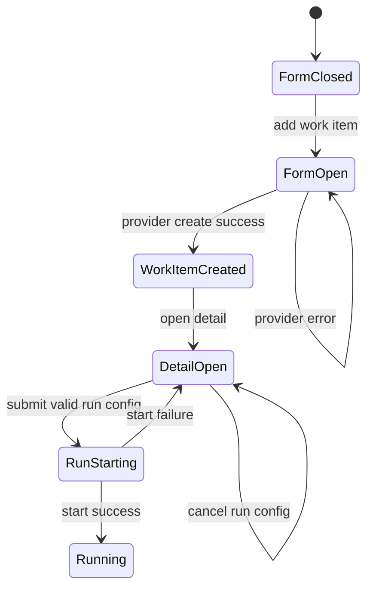
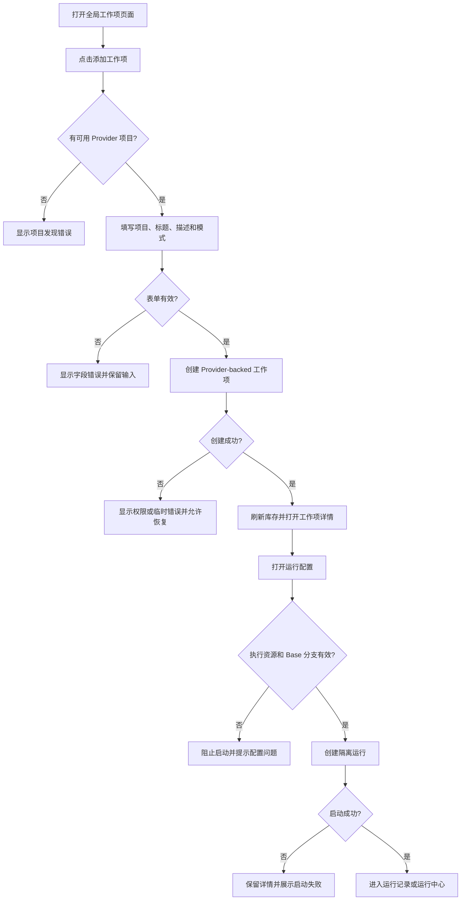
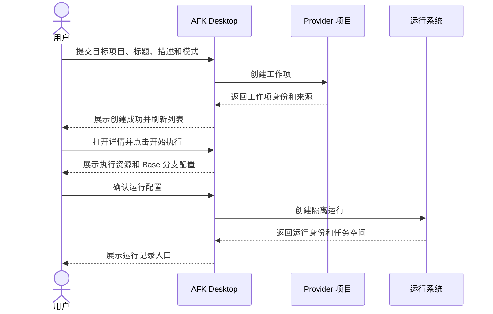

# PRD: 手动创建工作项并通过 Desktop 执行

- **PRD ID**: PRD-2026-10-19-001
- **Version**: 1.0.0
- **Status**: Approved
- **Owner**: AFK Control
- **Created**: 2026-10-19
- **Updated**: 2026-10-19
- **Source**: 用户要求：创建 PRD，并使用 AFK Desktop 的运行流程执行工作项；已确认的创建原型

> **Writing rule**: 本 PRD 描述用户可观察的行为和产品边界。Provider API、IPC、组件和存储实现由后续技术设计决定。

## 1. Problem Statement

### 1.1 Problem

全局“工作项”页面当前只能浏览已有 Provider 工作项并启动执行，用户无法在同一页面手动创建新的工作项。现有创建入口位于旧的项目 Backlog 页面，依赖本地工作区上下文，无法完整支持全局工作项的跨项目创建和后续执行。

### 1.2 Affected Users

- 使用 AFK Control 创建、配置并执行研发任务的研发、测试和项目协作者。

### 1.3 Current Impact

- 用户必须先在外部 Provider 手动创建 Issue，才能在 AFK Desktop 中看到工作项。
- 创建入口与全局工作项列表分离，目标项目和工作项来源不够清晰。
- 新建任务后缺少从创建结果直接进入运行配置的连续流程。

### 1.4 Why Now

全局工作项页面已经具备跨 Provider 发现、详情查看和隔离运行能力；补充创建流程可以闭合“创建 → 查看 → 配置运行 → 执行”的核心操作链路。

## 2. Goals

### GOAL-001: 闭合工作项创建与执行流程

用户可以在全局工作项页面创建一个可管理的 Provider-backed 工作项，创建成功后在列表中看到它，并通过现有 Desktop 运行流程选择执行资源并启动一次执行。

## 3. Non-Goals

- 不创建脱离 Provider 的本地孤立工作项。
- 不在创建表单中配置代码仓库、Base 分支或运行环境；这些属于运行配置。
- 不改变现有工作项状态机、工作项全局身份规则或执行审计模型。
- 不新增工作流编辑器、Issue 模板系统或批量创建能力。
- 不自动替用户选择或修改执行仓库。

## 4. Users & Jobs

### USER-001: AFK 工作项协作者

- **Role**: 通过 AFK Desktop 管理 Provider 工作项并启动 Agent 执行的人。
- **Job**: 从一个明确的 Provider 项目创建任务，补充任务说明，再选择代码仓库和运行配置启动执行。
- **Success**: 新工作项可在全局列表中查询，详情信息完整，用户可以从详情进入运行配置并看到运行记录。

## 5. Domain Glossary

| Term | Definition |
|---|---|
| 工作项 | AFK 可以展示、管理并按资格启动执行的任务记录。 |
| Provider 项目 | 用户当前凭据可访问的 GitHub 仓库或 GitLab 项目。 |
| Provider-backed 工作项 | 在 Provider 项目中持久化、具有稳定 Provider 身份的工作项。 |
| 执行资源 | 用户在运行配置中选择的一个或多个代码仓库及其 Base 分支。 |
| 运行 | 针对一个工作项创建的一次隔离执行尝试，具有独立运行身份和审计记录。 |

## 6. Functional Requirements

### FR-001: 从全局工作项页面打开创建流程

- **Confidence**: Confirmed
- **Priority**: Must
- **Surface**: User
- **Related Goal**: GOAL-001
- **Actor**: USER-001
- **Bounded Context**: 全局工作项管理
- **Trigger**: 用户在全局工作项页面点击添加工作项入口。

#### Product Promise

系统提供一个可访问的添加入口，打开创建工作项表单。表单明确区分目标 Provider 项目、任务内容和执行模式。

#### Preconditions

- 用户可以打开全局工作项页面。
- 系统已经发现至少一个用户可访问的 Provider 项目，或能明确展示项目发现失败原因。

#### Main Flow

1. 用户点击“添加工作项”入口。
2. 系统打开创建表单并显示可选择的 Provider 项目。
3. 用户选择一个目标项目，填写标题和 Markdown 描述，可选设置执行模式和业务标签。
4. 用户提交表单。

#### Abnormal Flows

- 如果没有可用 Provider 项目，系统禁用提交并显示项目发现状态及下一步提示。
- 如果必填字段为空，系统在表单内指出缺失字段，不清除用户已填写内容。
- 用户关闭表单时，系统保留已创建的远端数据；尚未提交的数据可以放弃。

#### Completion Conditions

- 表单提交动作只在目标项目、标题和描述均有效时可执行。
- 创建成功或失败结果对用户可见。

#### Invariants

- 添加入口遵循桌面端设计系统，使用独立 `+` 图标按钮并提供无障碍名称。
- 创建表单不要求用户先选择本地代码工作区。

#### Acceptance Criteria

##### AC-001: 打开创建表单

- **Given**: 用户已打开全局工作项页面
- **When**: 用户点击添加工作项入口
- **Then**: 系统打开创建表单，并展示目标 Provider 项目、标题、描述、执行模式和标签字段

##### AC-002: 无项目时阻止提交

- **Given**: 当前没有可用 Provider 项目
- **When**: 用户打开创建流程
- **Then**: 系统显示项目不可用的原因，且不能提交一个没有目标项目的工作项

### FR-002: 创建 Provider-backed 工作项

- **Confidence**: Confirmed
- **Priority**: Must
- **Surface**: User
- **Related Goal**: GOAL-001
- **Actor**: USER-001
- **Bounded Context**: Provider 工作项持久化
- **Trigger**: 用户提交有效的创建表单。

#### Product Promise

系统在用户选择的 Provider 项目中创建一个可追踪的工作项，并将标题、描述、执行模式和业务标签保存在工作项记录中。创建结果返回稳定的工作项身份和可导航来源信息。

#### Preconditions

- 用户已选择一个可访问的 Provider 项目。
- 标题和描述通过表单校验。
- 用户凭据仍有创建该项目 Issue 的权限。

#### Main Flow

1. 系统提交创建请求。
2. Provider 成功持久化工作项后，系统返回工作项身份、标题、状态、执行模式和来源地址。
3. 系统关闭创建表单并刷新全局工作项列表。
4. 系统在列表中展示新工作项，并允许用户打开详情。

#### Abnormal Flows

- 如果凭据失效或无创建权限，系统显示可理解的权限错误，不将失败请求展示为已创建。
- 如果 Provider 请求超时或返回临时错误，系统保留表单内容并允许用户重试。
- 如果创建结果未知，系统提示用户先刷新或查询目标项目，避免直接重复创建。
- 如果重复提交产生同一用户动作的并发请求，系统不得向用户显示多条成功结果而不说明实际创建数量。

#### Completion Conditions

- 创建成功后，工作项可通过全局列表和详情查询到。
- 工作项默认进入可管理的初始状态，并遵循既有执行资格判断。

#### Invariants

- Provider 工作项身份与运行身份保持区分；运行 ID 不替代工作项 ID。
- 创建不会自动关联执行仓库，也不会修改用户代码仓库。
- Provider 原有业务标签和描述内容不会因 AFK 元数据写入而丢失。

#### Acceptance Criteria

##### AC-003: 成功创建工作项

- **Given**: 用户选择可写的 Provider 项目并填写有效标题和描述
- **When**: 用户提交创建表单
- **Then**: 系统创建一个 Provider-backed 工作项，显示成功反馈，并在刷新后的列表中展示该工作项

##### AC-004: 创建权限失败

- **Given**: 用户对所选 Provider 项目没有创建权限
- **When**: 用户提交有效创建表单
- **Then**: 系统显示权限错误，保留表单内容，且列表不显示一条虚假的成功工作项

##### AC-005: 临时错误可重试

- **Given**: Provider 请求因网络超时或临时服务错误失败，且系统无法确认是否已创建
- **When**: 用户查看错误并选择重试或刷新查询
- **Then**: 系统提供明确的恢复路径，并避免把未确认的结果直接标记为已创建

### FR-003: 创建成功后进入工作项详情

- **Confidence**: Confirmed
- **Priority**: Must
- **Surface**: User
- **Related Goal**: GOAL-001
- **Actor**: USER-001
- **Bounded Context**: 全局工作项浏览
- **Trigger**: Provider-backed 工作项创建成功。

#### Product Promise

系统将新工作项纳入全局库存，用户可以打开详情查看任务说明、来源、状态、执行模式和可用执行资源。

#### Preconditions

- FR-002 已成功创建工作项。
- 全局库存刷新请求可执行，或系统可以展示局部创建结果。

#### Main Flow

1. 系统刷新当前库存。
2. 系统定位新建工作项并在列表中突出其可见性。
3. 用户打开工作项详情。
4. 详情展示来源信息和当前执行资格。

#### Abnormal Flows

- 如果刷新暂时失败，系统显示创建成功但库存刷新失败的区别，并允许用户手动刷新。
- 如果工作项已创建但当前库存暂时不包含它，系统提供来源地址或工作项身份，避免用户误以为创建失败。

#### Completion Conditions

- 用户可以从列表或成功反馈进入新工作项详情。

#### Invariants

- 来源 Issue 与执行资源在详情中保持不同身份。
- 详情展示的状态以 Provider 工作项状态为准，不能用本地运行记录覆盖它。

#### Acceptance Criteria

##### AC-006: 创建后可查看详情

- **Given**: 工作项已成功创建
- **When**: 系统完成库存刷新或用户点击创建结果
- **Then**: 用户可以打开该工作项详情并看到标题、描述、来源和当前状态

### FR-004: 通过 Desktop 现有运行流程执行工作项

- **Confidence**: Confirmed
- **Priority**: Must
- **Surface**: User
- **Related Goal**: GOAL-001
- **Actor**: USER-001
- **Bounded Context**: 工作项隔离执行
- **Trigger**: 用户在新建工作项详情中点击开始执行。

#### Product Promise

系统复用现有 Desktop 工作项运行流程：用户在运行配置中选择一个或多个执行资源、确认每个资源的 Base 分支，并按工作项执行模式启动隔离运行。

#### Preconditions

- 工作项已出现在全局库存中。
- 工作项满足既有执行资格和状态规则。
- 用户至少选择一个有效执行资源；执行资源的 Base 分支通过校验。
- HITL 工作项在需要前台运行时具有可用的 Agent 和终端配置。

#### Main Flow

1. 用户从工作项详情点击开始执行。
2. 系统打开运行配置，展示可用执行资源和每个资源的 Base 分支。
3. 用户选择执行资源并确认运行配置。
4. 系统创建一次隔离运行，并显示运行身份和任务空间位置。
5. 系统将用户带到运行记录或运行中心，展示准备中、执行中和后续状态。

#### Abnormal Flows

- 如果工作项不满足执行资格，系统禁用开始执行并说明原因。
- 如果没有选择执行资源或 Base 分支无效，系统阻止启动并指出具体字段。
- 如果运行启动失败，系统显示失败原因，不伪造运行成功状态，并保留工作项详情。
- 用户取消运行配置时，不创建运行记录，不改变工作项 Provider 状态。

#### Completion Conditions

- 成功启动后，用户获得一个独立运行身份，并可以在工作项详情或运行中心查看运行记录。

#### Invariants

- 每次运行使用独立任务空间，不使用用户当前打开目录作为隐式执行目录。
- 工作项 ID、运行 ID 和执行资源身份不可互换。
- 运行状态与 Provider 工作项状态继续由既有工作流规则协调。

#### Acceptance Criteria

##### AC-007: 选择资源并创建运行

- **Given**: 新建工作项可执行，且用户已打开详情
- **When**: 用户选择至少一个执行资源、确认有效 Base 分支并点击开始执行
- **Then**: 系统创建隔离运行，返回运行身份，并显示运行记录入口

##### AC-008: 无执行资源时阻止启动

- **Given**: 工作项详情中没有选中的有效执行资源
- **When**: 用户打开运行配置
- **Then**: 系统禁用启动动作并明确提示至少选择一个执行资源

##### AC-009: 取消不产生运行

- **Given**: 用户已打开运行配置但尚未提交
- **When**: 用户取消运行配置
- **Then**: 系统关闭运行配置，不创建运行记录，也不修改工作项状态

### FR-005: 展示创建与启动错误的恢复路径

- **Confidence**: Proposed
- **Priority**: Should
- **Surface**: User
- **Related Goal**: GOAL-001
- **Actor**: USER-001
- **Bounded Context**: 工作项操作反馈
- **Trigger**: 创建或启动流程出现可恢复错误。

#### Product Promise

系统将权限、校验、Provider 临时错误、库存刷新失败和运行启动失败区分展示，并为可恢复错误提供重试、刷新或返回配置的路径。

#### Preconditions

- 创建或运行操作返回可识别的失败结果。

#### Main Flow

1. 系统显示与失败阶段对应的错误信息。
2. 系统保留仍然有效的用户输入或已创建工作项身份。
3. 用户选择重试、刷新、修改配置或关闭错误提示。

#### Abnormal Flows

- 如果错误信息不足以判断结果是否已持久化，系统不得提示用户无条件重复提交。

#### Completion Conditions

- 用户能够理解失败发生在创建、刷新还是启动阶段，并知道下一步操作。

#### Invariants

- 错误反馈不得泄露凭据或敏感令牌。
- 失败状态不得伪装成成功状态。

#### Acceptance Criteria

##### AC-010: 启动失败后保留详情

- **Given**: 工作项创建成功但运行启动失败
- **When**: 用户返回工作项详情
- **Then**: 系统保留工作项及其创建内容，显示启动失败原因，并允许用户重新打开运行配置

## 7. State Model

### STATE-001: 手动创建到运行

| Current State | Event | Next State | Allowed |
|---|---|---|---|
| 表单未打开 | 点击添加入口 | 表单已打开 | Yes |
| 表单已打开 | 提交无效内容 | 表单已打开 | Yes |
| 表单已打开 | Provider 创建成功 | 工作项已创建 | Yes |
| 表单已打开 | Provider 创建失败 | 表单已打开 | Yes |
| 工作项已创建 | 打开详情 | 详情已打开 | Yes |
| 详情已打开 | 提交有效运行配置 | 运行准备中 | Yes |
| 详情已打开 | 取消运行配置 | 详情已打开 | Yes |
| 运行准备中 | 启动成功 | 运行中 | Yes |
| 运行准备中 | 启动失败 | 详情已打开 | Yes |

## 8. User Flows

### FLOW-001: 创建并执行工作项

- **Purpose**: 说明用户从全局工作项页面创建任务并通过 Desktop 运行流程启动执行的主路径和可恢复失败路径。
- **Related Requirements**: FR-001, FR-002, FR-003, FR-004, FR-005
- **Related Acceptance Criteria**: AC-001, AC-003, AC-006, AC-007, AC-010

## 9. Sequence Diagrams

### SEQ-001: 创建后启动 Desktop 运行

- **Purpose**: 说明用户、Desktop 工作项页面、Provider 和执行流程之间的可观察交互边界。
- **Related Requirements**: FR-002, FR-003, FR-004
- **Participants**: 用户、AFK Desktop、Provider、运行系统

## 10. Non-Functional Requirements

### NFR-001: 可访问性

创建入口、表单字段、校验错误、状态反馈和运行配置必须可被键盘操作和辅助技术识别；图标按钮必须提供准确的无障碍名称。

### NFR-002: 数据一致性

创建成功反馈必须基于 Provider 已确认的持久化结果；运行成功反馈必须基于运行系统已确认的运行创建结果。

### NFR-003: 安全性

错误反馈和运行状态展示不得暴露 Provider 凭据、令牌或其他敏感认证信息。

## 11. Technical Constraints & Decisions

### CONSTRAINT-001: 复用现有全局工作项身份和运行流程

- **Constraint**: 新建工作项必须进入现有全局库存，并通过既有工作项详情和隔离运行流程执行。
- **Product Impact**: 用户不会得到一套与现有工作项并列的本地任务身份；创建后的工作项可以直接使用既有详情、运行记录和审计能力。
- **Rationale**: 保持工作项 ID、运行 ID、Provider 状态和审计记录的既有边界。
- **Implementation**: Defined in Technical Design; do not prescribe it here.
- **Affected Requirements**: FR-002, FR-003, FR-004

### CONSTRAINT-002: 执行资源在运行阶段选择

- **Constraint**: 创建表单只记录任务和 Provider 项目；执行仓库及 Base 分支在开始运行时由用户确认。
- **Product Impact**: 创建任务不要求用户立即知道或绑定最终执行仓库，运行前仍保留逐仓库配置能力。
- **Rationale**: Provider 来源和代码执行资源具有不同身份和生命周期。
- **Implementation**: Defined in Technical Design; do not prescribe it here.
- **Affected Requirements**: FR-001, FR-004

## 12. Key Decisions

### DEC-001: 手动创建使用 Provider-backed 工作项

- **Decision**: 手动创建结果必须持久化到用户选择的 GitHub 或 GitLab 项目，并进入全局工作项库存。
- **Rationale**: 复用现有 Provider 状态、来源和执行资格模型，避免新增本地孤立任务存储。
- **Impact**: FR-001, FR-002, FR-003
- **Source**: 用户确认的原型方向和现有 AFK 工作项模型。

### DEC-002: 创建与执行分为两个可确认步骤

- **Decision**: 创建成功后进入工作项详情，用户再通过现有运行配置选择执行资源并启动运行。
- **Rationale**: 创建任务和选择代码执行资源是两个不同的用户决策，分开可以避免隐式选择错误仓库。
- **Impact**: FR-003, FR-004
- **Source**: 用户要求使用 AFK Desktop 的运行流程执行工作项。

## 13. Assumptions

### ASM-001: Provider 项目库存可作为项目选择来源

- **Assumption**: 全局工作项页面能够获得当前凭据可访问的 GitHub/GitLab 项目列表。
- **Confidence**: High
- **Validation Needed**: No
- **Affected Requirements**: FR-001, FR-002

### ASM-002: 新建工作项遵循现有执行资格规则

- **Assumption**: Provider 创建成功后，工作项使用既有初始状态和执行模式规则，不新增特殊状态。
- **Confidence**: High
- **Validation Needed**: No
- **Affected Requirements**: FR-002, FR-004

## 14. Open Risks

### RISK-001: Provider 创建结果未知时的幂等恢复

- **Question or Risk**: Provider 请求超时后可能无法判断远端是否已创建；需要在技术设计阶段确定查询、幂等键或人工确认策略。
- **Impact**: 可能产生重复工作项或让用户误判创建失败。
- **Severity**: Medium
- **Owner**: AFK Control
- **Affected Requirements**: FR-002, FR-005
- **Resolve Before**: Implementation

### RISK-002: 项目选择与执行仓库的默认关联

- **Question or Risk**: 创建时选择的 Provider 项目是否应在运行配置中作为默认执行资源，需要在技术设计或实现验收前确认；本 PRD 默认不自动绑定。
- **Impact**: 影响创建后的运行配置效率，但不改变创建结果。
- **Severity**: Low
- **Owner**: AFK Control
- **Affected Requirements**: FR-004
- **Resolve Before**: Implementation

## 15. Traceability

| Source or Goal | Requirement, Diagram, or Criterion | Relationship |
|---|---|---|
| GOAL-001 | FR-001 | enables |
| GOAL-001 | FR-002 | implements |
| GOAL-001 | FR-003 | implements |
| GOAL-001 | FR-004 | implements |
| GOAL-001 | FR-005 | supports |
| FR-001 | AC-001, AC-002 | verified by |
| FR-002 | AC-003, AC-004, AC-005 | verified by |
| FR-003 | AC-006 | verified by |
| FR-004 | AC-007, AC-008, AC-009 | verified by |
| FR-005 | AC-010 | verified by |
| FR-001, FR-002, FR-003, FR-004, FR-005 | FLOW-001 | illustrated by |
| FR-002, FR-003, FR-004 | SEQ-001 | illustrated by |

## 16. Change Log

### 2026-10-19 — Version 1.0.0

- 基于手动创建工作项原型，定义 Provider-backed 创建、全局库存刷新、详情查看和 Desktop 隔离运行主流程。
- 明确创建表单不绑定执行仓库，执行资源在运行配置阶段选择。
- 用户批准 PRD，进入工作项创建和 Desktop 执行阶段。

### Downstream Impact

- 需要补充全局工作项创建入口、Provider 项目选择、创建结果反馈和工作项库存刷新。
- 需要复用并验证现有 Desktop 工作项详情、运行配置、隔离任务空间和运行记录流程。
- RISK-001 与 RISK-002 在实现前需要形成技术设计决策。
