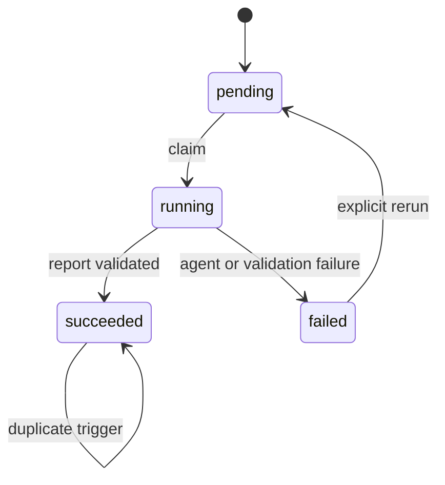
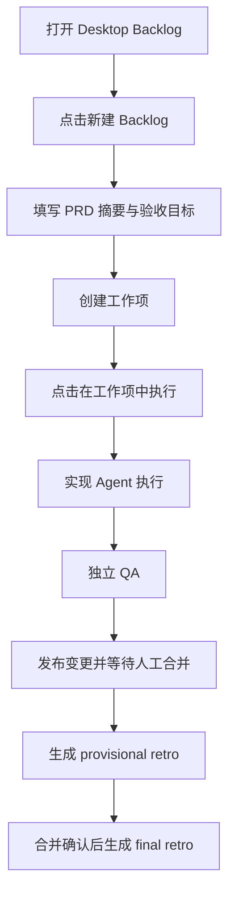
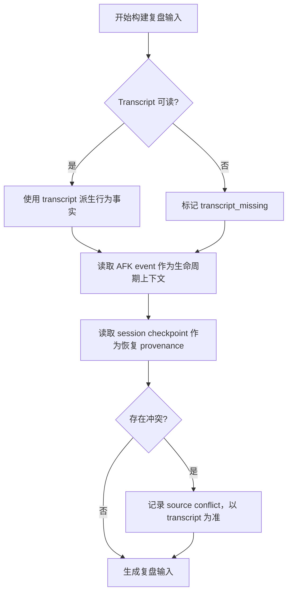
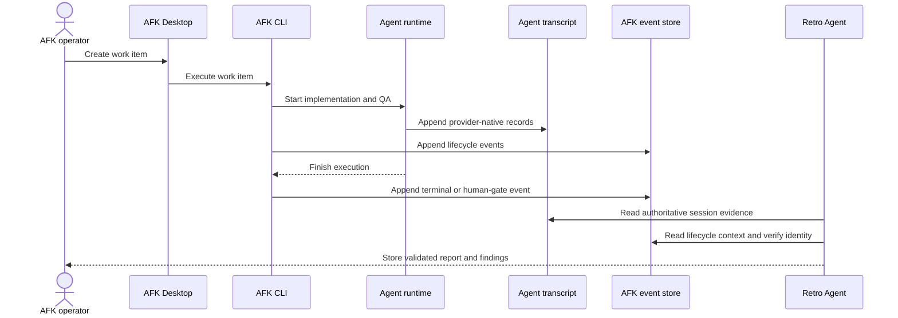

# PRD: AFK 执行复盘反馈闭环

- **PRD ID**: PRD-2026-010
- **Version**: 1.0.0
- **Status**: Approved
- **Owner**: AFK workflow maintainers
- **Created**: 2026-10-16
- **Updated**: 2026-10-16
- **Source**: 用户确认的 AFK 执行完成后复盘、定时补偿和 transcript 唯一事实源要求

> **Writing rule**: 已确认的产品事实使用 Confirmed；实现前仍需验证的内容进入 Assumptions 或 Open Risks。`transcript/rollout` 是 Agent 行为的唯一事实源；AFK event stream 和 session checkpoint 只承担各自的审计与恢复职责。

## 1. Problem Statement

### 1.1 Problem

AFK 可以通过 Desktop 启动工作项、执行 Agent、运行 QA、发布变更并等待人工合并，但一次运行结束后，Agent 为什么绕路、重复执行了什么、哪些检查失败、哪些信息缺失，仍然需要人工从多个目录和日志中拼接。现有 session snapshot、handoff 文档、AFK 审计事件和 Agent transcript 的职责没有在复盘产品边界上明确分离，可能造成同一字段出现多个来源并产生错误结论。

### 1.2 Affected Users

- AFK 操作员：从 Desktop 创建、启动和跟踪工作项的人。
- 工作流维护者：需要根据真实运行证据改进 Agent 环境、导航指针和自动检查的人。
- 评审者：需要判断复盘建议是否有证据、是否值得形成 proposal 或 PR 的人。

### 1.3 Current Impact

- 一次执行的行为证据分散在 Agent transcript、AFK event stream、session checkpoint、handoff 文档、runtime diagnostics 和 CI 结果中。
- 复盘如果把派生 telemetry、session checkpoint 或审计事件当作 Agent 行为事实，可能重复计数或错误解释。
- 运行完成后缺少统一的复盘任务状态、报告引用和可重复执行入口。
- 环境改进只能依赖人工记忆，无法形成有证据的 proposal。

### 1.4 Why Now

AFK 已经具备 Desktop 工作项入口、审计事件流、Agent telemetry 读取器、session store 和独立 retro skill。现在需要把这些能力串成一个可审计的反馈闭环，并先用 Desktop 真实点击完成一次端到端验证。

## 2. Goals

### GOAL-001: 让每次运行都能产生可审计复盘

一次 AFK 工作项执行进入完成、失败、取消、等待人工合并或合并已验证状态后，操作员可以获得一个与该执行尝试严格关联的复盘任务和报告。

### GOAL-002: 保证 Agent 行为结论只有一个事实源

Agent 的 session 行为、工具调用、token usage、错误和重试结论全部从对应 Claude transcript、Codex rollout 或 OpenCode provider-native session 派生。其他文件只能提供生命周期、恢复 checkpoint、handoff provenance 或一致性对照信息。

### GOAL-003: 把复盘结论转成可评审环境改进

复盘报告可以生成带证据引用的 proposal，供人工评审后形成文档、检查、CLI 或 PR 改进；系统不直接修改代码、skill、全局指令或主分支规则。

## 3. Non-Goals

- 不重新实现、复制或修改现有 `/Users/shenggangshu/.claude/skills/retro` skill。
- 不新增第二套 Agent session store、transcript parser、token 聚合器或工具调用聚合器。
- 不让 Retro Agent 直接修改源码、skill、`CLAUDE.md`、`AGENTS.md`、远端仓库或主分支。
- 不把 AFK event stream、`.afk/sessions` checkpoint 或 handoff Markdown 当作 Agent 行为事实源。
- 不在首版新增常驻 daemon；定时运行由外部 scheduler 调用 AFK CLI。
- 不要求 Desktop 首版直接编辑或批准复盘报告。

## 4. Users & Jobs

### USER-001: AFK 操作员

- **Role**: 通过 Desktop 管理工作项和执行过程的工程师。
- **Job**: 创建一个需求工作项，从 Desktop 点击工作项执行，确认实现、QA、发布和审计链路完成。
- **Success**: 工作项有明确的执行状态、变更链接、审计时间线和可追踪的复盘任务。

### USER-002: 工作流维护者

- **Role**: 维护 AFK agent 环境、检查、文档指针和工作流规则的人。
- **Job**: 从 transcript 事实和运行上下文中识别 Agent 绕路、重复劳动、失败和信息缺口。
- **Success**: 每个 finding 都能回指证据，并能形成明确的 `record_only`、proposal 或 PR 建议。

### USER-003: 复盘评审者

- **Role**: 审核复盘报告和环境改进建议的人。
- **Job**: 判断 finding 的根因、置信度、影响范围和建议动作是否足够成立。
- **Success**: 只批准有证据的改进，能够拒绝不完整或无法证明的自动建议。

## 5. Domain Glossary

| Term | Definition |
|---|---|
| Agent transcript | Claude Code transcript、Codex rollout 或 OpenCode provider-native session；记录 Agent 行为的唯一事实源。 |
| AFK event stream | `runId` 维度的 hash-chained JSONL；记录 AFK 生命周期和审计事实。 |
| Session checkpoint | `.afk/sessions` 中用于恢复 Agent 的 provider snapshot 及 checksum。 |
| Handoff | `.afk/handoff` 中供下一轮 Agent 或人工阅读的交接摘要。 |
| Provisional retro | PR 已发布或人工门已打开时生成的阶段性复盘。 |
| Final retro | 目标变更已确认合并后生成的完整复盘。 |
| Failure retro | 执行失败、取消或超时时针对失败路径生成的复盘。 |
| Finding | 由复盘报告提出、带证据引用、根因和建议动作的可评审发现。 |

## 6. Functional Requirements

### FR-001: 工作项执行完成后创建复盘任务

- **Confidence**: Confirmed
- **Priority**: Must
- **Surface**: Event
- **Related Goal**: GOAL-001
- **Actor**: USER-001
- **Bounded Context**: Work item execution and retrospective orchestration
- **Trigger**: 工作项执行进入成功、失败、取消、等待人工合并或合并已验证状态。

#### Product Promise

系统为一次明确的执行尝试创建一个可查询的复盘任务，并保留其与 `workItemId`、`runId` 和 `executionId` 的关联。

#### Preconditions

- AFK 已为该执行尝试写入可验证的 run identity。
- 工作项执行状态和变更状态已经由现有工作流确认。

#### Main Flow

1. 系统识别复盘来源为 provisional、final 或 failure。
2. 系统使用执行尝试的身份和输入指纹创建复盘任务。
3. 系统保存任务状态、创建时间、attempt 和输入完整性信息。
4. 重复触发同一输入时，系统返回已有任务，不重复启动复盘。

#### Abnormal Flows

- If 运行审计流不完整，系统创建带 incomplete 标记的任务，并禁止生成可信 final 结论。
- If 同一幂等键已有成功报告，系统返回已有报告，不创建新任务。
- If Retro Agent 启动失败，系统将任务标记为 failed，并保留失败原因，不改变工作项状态。

#### Completion Conditions

- 任务可通过 runId、executionId 和 retroId 查询。
- 任务状态可以从 pending、running 进入 succeeded 或 failed。

#### Invariants

- 复盘任务失败不改变工作项、QA、PR 或人工合并状态。
- 同一 execution、输入指纹和 retro 版本只允许一个成功报告。
- `workItemId`、`runId`、`executionId` 不互相替代。

#### Acceptance Criteria

##### AC-001: 成功执行生成 provisional 复盘

- **Given**: 工作项已发布 PR 并进入等待人工合并。
- **When**: 系统处理该执行的复盘触发。
- **Then**: 系统创建一个 provisional 任务，任务引用同一工作项和执行尝试，并允许报告标记尚未合并。

##### AC-002: 重复触发保持幂等

- **Given**: 同一执行已有成功 provisional 报告。
- **When**: Desktop、CLI 或 scheduler 再次触发复盘。
- **Then**: 系统返回已有报告，不启动第二个 Retro Agent。

### FR-002: 以 transcript 作为 Agent 行为唯一事实源

- **Confidence**: Confirmed
- **Priority**: Must
- **Surface**: Event
- **Related Goal**: GOAL-002
- **Actor**: USER-002
- **Bounded Context**: Agent session and telemetry
- **Trigger**: 复盘系统读取某次执行的 Agent session。

#### Product Promise

复盘报告中的 session 行为、工具调用、usage、错误、重试和思路证据来自对应 Agent transcript 或 rollout。AFK event stream 只提供生命周期边界和身份校验；session checkpoint 和 handoff 只提供恢复 provenance。

#### Preconditions

- 系统可以根据现有 Agent execution metadata 定位 transcript 或 provider-native session。
- Claude transcript、Codex rollout 或 OpenCode session 的来源身份与执行尝试可以关联。

#### Main Flow

1. 系统定位 Claude 的 `telemetryPath`、Codex 的 thread rollout 或 OpenCode 的 provider-native session，始终读取 provider 原始数据，不创建或读取 AFK transcript 副本。事件只保存真实 provider session ID 和原始数据定位符。
2. 系统使用现有 telemetry reader 解析 transcript。
3. 系统将 transcript 派生的 usage、tool calls、错误和重试写入复盘输入。
4. 系统读取 AFK event stream 作为 lifecycle context 和完整性校验。
5. 系统读取 session checkpoint 只用于说明恢复 provenance，不覆盖 transcript 内容。

#### Abnormal Flows

- If transcript 不可读，系统将 session 标记为 incomplete，不从 event、checkpoint 或 handoff 推导缺失行为。
- If 旧事件指向 AFK transcript 副本，系统按 session ID 回查 provider 原始文件；找不到则标记缺失，不根据文件修改时间猜测其他会话。
- If transcript 与 `agent.session_recorded` 的派生观测不一致，系统以 transcript 为准并记录 source conflict。
- If container 没有 transcript 挂载，系统明确记录 telemetry unavailable。

#### Completion Conditions

- 报告明确列出 transcript 是否可读。
- 报告中每个行为 finding 可以关联到 transcript 证据引用。

#### Invariants

- 系统不合并多个来源的 token 或 tool call 计数。
- `agent.session_recorded` 不是独立的 Agent 行为事实源。
- session checkpoint 不替换 transcript，也不生成新的 session identity。

#### Acceptance Criteria

##### AC-003: transcript 与 event 观测冲突时以 transcript 为准

- **Given**: transcript 的 tool count 与 `agent.session_recorded` 中的 tool count 不同。
- **When**: 系统生成复盘 manifest。
- **Then**: 报告使用 transcript 结果，标记 source conflict，并显示 event 观测仅为对照信息。

##### AC-004: transcript 不可读时不伪造完整报告

- **Given**: container 执行没有可访问的 transcript。
- **When**: 系统生成复盘报告。
- **Then**: 报告标记 incomplete，记录缺失原因，不使用 session checkpoint 或 handoff 补齐 Agent 行为。

### FR-003: 复盘报告输出可验证 finding

- **Confidence**: Confirmed
- **Priority**: Must
- **Surface**: CLI/Batch
- **Related Goal**: GOAL-003
- **Actor**: USER-002
- **Bounded Context**: Retrospective reporting
- **Trigger**: Retro Agent 按现有 retro skill 完成分析。

#### Product Promise

系统输出包含摘要、运行指标、分类 finding、根因、建议、置信度和证据引用的结构化报告。

#### Preconditions

- 复盘输入包含已校验的 lifecycle context。
- Retro Agent 使用现有 `/Users/shenggangshu/.claude/skills/retro` skill。

#### Main Flow

1. 系统将脱敏后的 transcript 证据和 lifecycle context 提供给 Retro Agent。
2. Retro Agent 按 Navigation、Automated checks、Coding standards、Global instructions、Tool economy、No-ops 和 Information access 分类分析。
3. 系统校验报告结构、证据引用、置信度和 finding 数量。
4. 系统保存报告 hash 和报告状态。

#### Abnormal Flows

- If 报告不是合法结构，系统将任务标记为 failed，并保存解析错误。
- If finding 没有有效证据引用，系统拒绝该 finding，不生成成功报告。
- If skill 文件不可用，系统将任务标记为 failed，并说明 skill path 检查结果。

#### Completion Conditions

- 报告可以通过 retroId 查询。
- 报告中的证据引用可以回到对应 manifest。

#### Invariants

- Retro Agent 只读输入并写入报告，不修改业务源代码或环境规则。
- 报告不直接包含 token、密码、Authorization header 或未脱敏私有日志。

#### Acceptance Criteria

##### AC-005: finding 可回指 transcript 证据

- **Given**: Retro Agent 识别出一次无效重复检查。
- **When**: 系统保存报告。
- **Then**: finding 包含 category、root cause、recommendation、confidence，并引用至少一个 manifest evidence ref。

##### AC-006: 非法报告被拒绝

- **Given**: Retro Agent 输出缺少 evidence reference 的 finding。
- **When**: 系统校验报告。
- **Then**: 任务进入 failed，原始解析错误可查询，工作项状态保持不变。

### FR-004: 通过 proposal 形成受控环境改进

- **Confidence**: Proposed
- **Priority**: Should
- **Surface**: CLI/Batch
- **Related Goal**: GOAL-003
- **Actor**: USER-003
- **Bounded Context**: Feedback proposal
- **Trigger**: 评审者请求将一个 finding 转成改进建议。

#### Product Promise

系统生成包含目标位置、证据、预期收益、风险和验证方式的 proposal，供人工评审和后续 PR 流程使用。

#### Preconditions

- finding 已通过 report schema 校验。
- finding 的 disposition 为 proposal 或 pull_request。

#### Main Flow

1. 系统复制 finding 的证据引用和根因。
2. 系统生成目标环境、预期行为和验证要求。
3. 系统将 proposal 标记为 pending approval。
4. 评审者批准后，proposal 才能进入独立实现和验证流程。

#### Abnormal Flows

- If finding 置信度不足或证据缺失，系统只允许 record_only。
- If proposal 目标是全局 skill、全局指令或主分支规则，系统要求人工确认并禁止自动应用。

#### Completion Conditions

- proposal 有唯一 ID、来源 retroId、来源 finding ID 和审批状态。
- proposal 不会直接修改目标文件。

#### Invariants

- 自动复盘不能自动合并环境改进。
- proposal 必须保留来源报告和 transcript 证据引用。

#### Acceptance Criteria

##### AC-007: 生成待审批 proposal

- **Given**: 一个 finding 具有高置信度和有效 transcript 证据。
- **When**: 评审者请求生成 proposal。
- **Then**: 系统生成 pending approval proposal，并列出目标、收益、风险和验证方式。

## 7. State Model

### STATE-001: Retrospective task lifecycle

| Current State | Event | Next State | Allowed |
|---|---|---|---|
| pending | worker claims task | running | Yes |
| running | valid report saved | succeeded | Yes |
| running | agent, skill or parser failure | failed | Yes |
| succeeded | duplicate trigger | succeeded | Yes |
| failed | explicit rerun | pending | Yes |
| succeeded | direct mutation request | succeeded | No |

## 8. User Flows

### FLOW-001: Desktop 创建并执行工作项

- **Purpose**: 说明用户如何通过 Desktop 完成一次真实 AFK 工作项执行。
- **Related Requirements**: FR-001, FR-003
- **Related Acceptance Criteria**: AC-001, AC-005

### FLOW-002: Transcript 权威性判断

- **Purpose**: 说明不同数据源在复盘中的边界。
- **Related Requirements**: FR-002
- **Related Acceptance Criteria**: AC-003, AC-004

## 9. Sequence Diagrams

### SEQ-001: Execution 到 Retro

- **Purpose**: 说明主执行流与独立复盘流之间的边界。
- **Related Requirements**: FR-001, FR-002, FR-003
- **Participants**: AFK Desktop、AFK CLI、Agent runtime、Transcript、Event store、Retro Agent

## 10. Non-Functional Requirements

### NFR-001: Evidence integrity

复盘任务、manifest 和 report 必须保存 hash；读取时能够检测损坏、身份不一致和 event stream integrity failure。证据损坏时报告必须标记 incomplete 或 failed。

### NFR-002: Idempotency

同一 `executionId + transcript input hash + retro version` 不得重复产生成功报告或重复启动 Retro Agent。

### NFR-003: Data minimization

原始 transcript 通过现有证据存储和脱敏策略保存；报告只保留摘要、finding 和 evidence reference，不把凭据、完整 prompt 或未脱敏私有输出复制到公开字段。

### NFR-004: Failure isolation

Retro Agent、skill、解析器或证据归档失败不得改变原工作项、QA、PR 或 merge 状态。

## 11. Technical Constraints & Decisions

### CONSTRAINT-001: Transcript is authoritative

- **Constraint**: Agent 行为结论只能从对应 provider transcript/rollout 派生。
- **Product Impact**: transcript 缺失时用户看到 incomplete，而不是一个由其他文件拼出的完整 session。
- **Rationale**: event stream、session checkpoint 和 handoff 都是 AFK 派生记录，职责不同，无法替代 Agent 原始行为记录。
- **Implementation**: Defined in Technical Design; do not prescribe it here.
- **Affected Requirements**: FR-002, FR-003

### CONSTRAINT-002: Existing session and telemetry systems are reused

- **Constraint**: 产品必须复用现有 SessionStoreChain、AgentExecution、agent telemetry reader 和 event projection。
- **Product Impact**: 复盘结果与现有执行、恢复和 Desktop 运行记录使用同一身份关联。
- **Rationale**: 避免产生第二套 session、token、tool call 和 retry 计数。
- **Implementation**: Defined in Technical Design; do not prescribe it here.
- **Affected Requirements**: FR-001, FR-002

## 12. Key Decisions

### DEC-001: Retro 是独立流程

- **Decision**: Retro 不阻塞 implementation、QA、publish 或人工合并；通过事件触发和 scheduler scan 补偿。
- **Rationale**: 复盘失败不能阻断交付主链路。
- **Impact**: 报告可能先有 provisional 版本，再补 final 版本。
- **Source**: 用户确认的反馈闭环方向。

### DEC-002: 不重新实现 retro skill

- **Decision**: 直接加载现有 `/Users/shenggangshu/.claude/skills/retro`，AFK 只负责调度、证据准备、输出校验和保存。
- **Rationale**: 复盘规则已有维护入口，避免 skill 分叉。
- **Impact**: skill path 不可用时任务失败并需要环境修复。
- **Source**: 用户明确要求。

### DEC-003: Desktop 是真实工作流入口

- **Decision**: 验证流程从 Desktop Backlog 创建工作项并点击“在工作项中执行”，不以直接 CLI 执行替代 UI 流程。
- **Rationale**: 用户需要验证实际协作模式、工作项身份和 Desktop 状态投影。
- **Impact**: E2E 需要真实 Electron main、preload、IPC、renderer 和 AFK CLI。
- **Source**: 用户明确要求。

## 13. Assumptions

### ASM-001: Desktop workspace 已可运行

- **Assumption**: 当前环境可以构建并启动 `apps/desktop`，且测试 fixture 或本地 provider 可以创建一个可执行工作项。
- **Confidence**: High
- **Validation Needed**: Yes
- **Affected Requirements**: FR-001, FLOW-001

### ASM-002: Agent transcript 可以关联到 execution

- **Assumption**: Claude 的 telemetry path 或 Codex thread ID 在执行结束时仍可定位对应 transcript/rollout。
- **Confidence**: Medium
- **Validation Needed**: Yes
- **Affected Requirements**: FR-002, FR-003

## 14. Open Risks

### RISK-001: Provider credentials or fixture availability

- **Question or Risk**: Desktop 当前环境是否具备真实 Provider 创建和推进工作项所需的凭据，或是否必须使用隔离 fixture。
- **Impact**: 可能只能完成 Desktop UI 和本地 fake execution，无法完成真实远端 PR/merge。
- **Severity**: High
- **Owner**: AFK operator
- **Affected Requirements**: FR-001, FLOW-001
- **Resolve Before**: Implementation

### RISK-002: Existing runtime telemetry precedence

- **Question or Risk**: 当前 `WorkflowRunner.recordAgentTelemetry()` 先使用 `ExecutionResult.usage/tools`，需要调整为 transcript authoritative，才能完全满足 FR-002。
- **Impact**: 调整前报告可能出现 transcript 与 event-derived telemetry 的冲突。
- **Severity**: High
- **Owner**: AFK workflow maintainers
- **Affected Requirements**: FR-002, AC-003
- **Resolve Before**: Implementation

### RISK-003: Human merge gate

- **Question or Risk**: 根工作项 PR 发布后等待人工合并；完整流程是否包含人工点击确认合并，取决于当前 Provider 状态。
- **Impact**: 未合并时只能生成 provisional retro，final retro 需要后续补偿。
- **Severity**: Medium
- **Owner**: AFK operator
- **Affected Requirements**: FR-001, FLOW-001
- **Resolve Before**: Decomposition

## 15. Traceability

| Source or Goal | Requirement, Diagram, or Criterion | Relationship |
|---|---|---|
| GOAL-001 | FR-001 | implements |
| GOAL-002 | FR-002 | implements |
| GOAL-003 | FR-003, FR-004 | implements |
| FR-001 | AC-001, AC-002 | verified by |
| FR-002 | AC-003, AC-004, FLOW-002 | verified/illustrated by |
| FR-003 | AC-005, AC-006, SEQ-001 | verified/illustrated by |
| FR-004 | AC-007 | verified by |

## 16. Change Log

### 2026-10-16 — Version 1.0.0

- 创建 AFK 执行复盘反馈闭环 PRD。
- 明确 transcript/rollout 是 Agent 行为唯一事实源。
- 明确 Desktop 是完整工作项流程的真实操作入口。
- 明确复盘失败隔离、幂等和人工审批边界。
