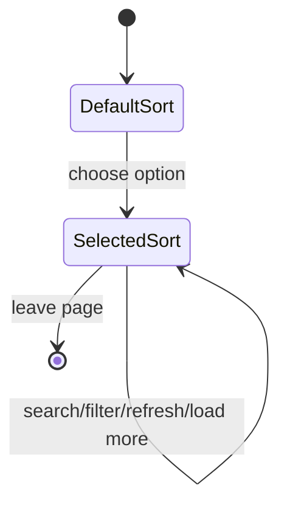
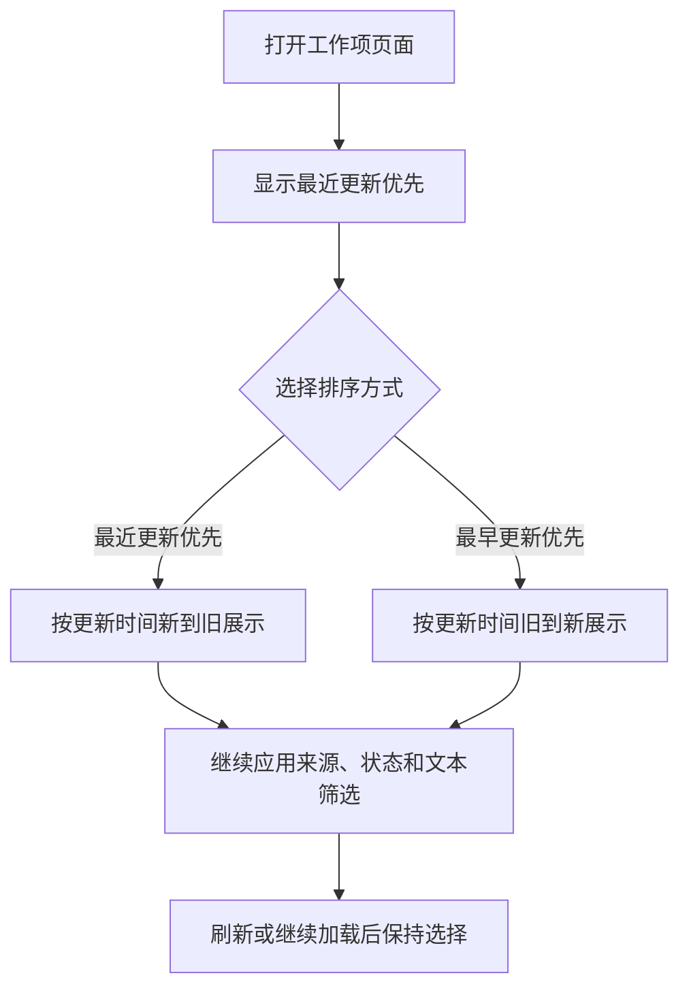
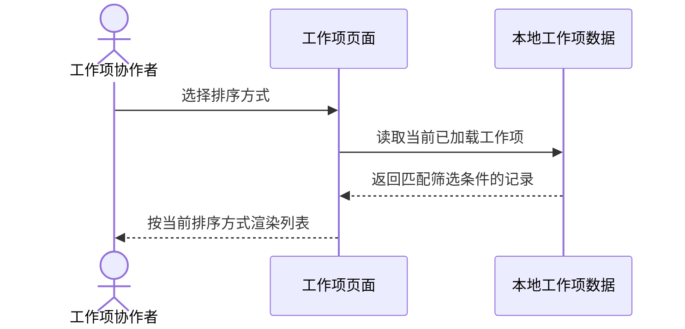

# PRD: 全局工作项倒序筛选

- **PRD ID**: PRD-2026-10-15-001
- **Version**: 1.0.0
- **Status**: Approved
- **Owner**: AFK Control
- **Created**: 2026-10-15
- **Updated**: 2026-10-15
- **Source**: 用户要求：基于整体协作模式创建需求，先创建 PRD，再通过 desktop 完成工作项

## 1. Problem Statement

### 1.1 Problem

全局“工作项”页面当前始终按最近更新时间倒序显示，但用户无法查看或切换排序规则，导致需要定位较早更新或按编号检查工作项时只能依赖搜索和人工滚动。

### 1.2 Affected Users

- 使用 AFK Control 管理跨仓库工作项的研发、测试和项目协作者。

### 1.3 Current Impact

- 用户无法显式确认当前排序规则。
- 用户无法切换到最早更新优先或其他可验证顺序。
- 刷新、搜索和状态筛选后的列表顺序缺少可控性。

### 1.4 Why Now

工作项页面已经提供状态、来源和文本筛选；补充显式排序筛选可以完成列表浏览闭环，并验证桌面端从需求到执行的完整协作链路。

## 2. Goals

### GOAL-001: 让工作项顺序可见且可切换

用户可以在全局工作项列表中选择排序方式，并在筛选、搜索、刷新和继续加载后获得稳定、可解释的结果顺序。

## 3. Non-Goals

- 不改变工作项来源采集、权限范围、执行逻辑或数据模型。
- 不引入服务端分页、无限滚动或跨页面的排序持久化。
- 不修改 Provider 的原始排序语义。

## 4. Users & Jobs

### USER-001: 工作项协作者

- **Role**: 使用桌面端查看和执行工作项的人。
- **Job**: 按更新时间或其他明确字段快速定位目标工作项。
- **Success**: 选择排序方式后，列表顺序与选项一致，刷新和筛选后仍保持该顺序。

## 5. Domain Glossary

| Term | Definition |
|---|---|
| 工作项 | 可在 AFK Control 中查看并启动执行的独立任务记录。 |
| 排序筛选 | 仅改变当前已加载工作项的展示顺序，不改变数据来源或筛选集合。 |
| 最近更新优先 | 按 `updatedAt` 从新到旧排序；缺少更新时间的记录排在有时间记录之后。 |
| 最早更新优先 | 按 `updatedAt` 从旧到新排序；缺少更新时间的记录排在有时间记录之后。 |

## 6. Functional Requirements

### FR-001: 提供工作项排序筛选

- **Confidence**: Confirmed
- **Priority**: Must
- **Surface**: User
- **Related Goal**: GOAL-001
- **Actor**: USER-001
- **Bounded Context**: 全局工作项列表
- **Trigger**: 用户打开工作项页面或在列表工具栏选择排序方式。

#### Product Promise

系统在工作项列表工具栏提供可访问的排序选择器。选择项至少包括“最近更新优先”和“最早更新优先”，并将当前选择应用到当前已加载的工作项列表。

#### Preconditions

- 用户可以打开全局工作项页面。
- 工作项列表可能包含多个来源、状态和更新时间为空的记录。

#### Main Flow

1. 系统默认选择“最近更新优先”，与现有列表默认展示顺序一致。
2. 用户打开排序选择器并选择一个排序方式。
3. 系统按选择对已应用来源、仓库、状态和文本条件的结果排序。
4. 用户继续搜索、切换筛选、刷新或加载更多时，当前排序选择保持有效。

#### Abnormal Flows

- 如果工作项缺少 `updatedAt`，系统将其放在有更新时间记录之后，并使用稳定的工作项 ID 作为并列排序依据。
- 如果列表为空，系统继续显示空状态，不显示误导性的排序结果。
- 如果排序选择器被键盘打开，Escape 关闭菜单并将焦点返回触发器。

#### Completion Conditions

- 列表顺序与当前排序选择一致。
- 当前排序选择可被辅助技术识别，并不会导致其他筛选条件丢失。

#### Invariants

- 排序不修改工作项数据、筛选条件或执行状态。
- 相同输入数据和排序选择产生确定性顺序。
- 现有工作项行点击、详情抽屉和开始执行流程继续可用。

#### Acceptance Criteria

##### AC-001: 默认显示最近更新优先

- **Given**: 工作项列表包含至少两个不同更新时间的记录
- **When**: 用户首次打开全局工作项页面
- **Then**: 排序选择器显示“最近更新优先”，列表按更新时间从新到旧排列

##### AC-002: 支持切换到最早更新优先

- **Given**: 用户已打开全局工作项页面
- **When**: 用户选择“最早更新优先”
- **Then**: 列表按更新时间从旧到新排列，缺少更新时间的记录排在有时间记录之后

##### AC-003: 排序与筛选联动

- **Given**: 用户已选择“最早更新优先”并设置来源、状态或文本筛选
- **When**: 用户修改筛选条件或搜索关键词
- **Then**: 结果集合只包含匹配项，且匹配项仍按“最早更新优先”排列

##### AC-004: 排序状态在刷新和继续加载后保持

- **Given**: 用户已选择一个排序方式
- **When**: 用户刷新列表或点击“继续加载”
- **Then**: 新显示的列表仍使用当前排序方式，且不重置为默认排序

##### AC-005: 排序选择器可访问

- **Given**: 用户使用键盘或辅助技术操作工作项页面
- **When**: 用户聚焦并打开排序选择器
- **Then**: 触发器暴露准确名称、展开状态和当前值，菜单选项可选择，Escape 可关闭并恢复焦点

## 7. State Model

### STATE-001: 排序选择生命周期

| Current State | Event | Next State | Allowed |
|---|---|---|---|
| 默认排序 | 用户选择排序项 | 已选择排序 | Yes |
| 已选择排序 | 搜索或筛选变化 | 已选择排序 | Yes |
| 已选择排序 | 刷新或继续加载 | 已选择排序 | Yes |
| 已选择排序 | 页面卸载 | 默认排序 | Yes |

## 8. User Flows

### FLOW-001: 切换工作项排序

- **Purpose**: 说明排序选择如何影响已筛选列表。
- **Related Requirements**: FR-001
- **Related Acceptance Criteria**: AC-001, AC-002, AC-003, AC-004

## 9. Sequence Diagrams

### SEQ-001: 应用排序选择

- **Purpose**: 说明用户选择排序后，列表如何重新计算展示结果。
- **Related Requirements**: FR-001
- **Participants**: USER-001, 工作项页面, 本地工作项数据

## 10. Non-Functional Requirements

### NFR-001: 排序交互反馈

排序选择变化后，当前已加载列表应在一次渲染更新内完成重排，不新增网络请求或阻塞执行操作。

### NFR-002: 可访问性

排序控件复用桌面端现有选择器语义和键盘关闭行为，颜色不作为表达当前排序的唯一方式。

## 11. Technical Constraints & Decisions

### CONSTRAINT-001: 复用现有工作项排序能力

- **Constraint**: 排序应基于现有工作项字段和共享排序规则，缺少更新时间时保持确定性结果。
- **Product Impact**: 用户看到的顺序在刷新、筛选和重复操作后保持一致。
- **Rationale**: 降低行为差异，避免为同一列表创建第二套排序语义。
- **Implementation**: Defined in Technical Design; do not prescribe it here.
- **Affected Requirements**: FR-001

## 12. Key Decisions

### DEC-001: 倒序按最近更新时间解释

- **Decision**: 本需求中的“倒序”按更新时间从新到旧解释，并提供对应的正序选项以便对照。
- **Rationale**: 当前工作项列表已经按更新时间从新到旧展示，用户请求的倒序筛选需要可见、可切换的产品控件。
- **Impact**: FR-001, AC-001, AC-002
- **Source**: 现有工作项页面行为与用户请求

## 13. Assumptions

### ASM-001: 排序范围为当前页面结果

- **Assumption**: 排序只作用于当前已从 Provider 获取的工作项集合，不扩展 Provider 查询接口。
- **Confidence**: High
- **Validation Needed**: No
- **Affected Requirements**: FR-001

## 14. Open Risks

### RISK-001: Provider 返回记录可能缺少更新时间

- **Question or Risk**: 部分来源可能没有 `updatedAt`，需要稳定地放置在列表末尾。
- **Impact**: 影响排序结果的可解释性。
- **Severity**: Low
- **Owner**: AFK Control
- **Affected Requirements**: FR-001
- **Resolve Before**: Implementation

## 15. Traceability

| Source or Goal | Requirement, Diagram, or Criterion | Relationship |
|---|---|---|
| GOAL-001 | FR-001 | implements |
| FR-001 | AC-001, AC-002, AC-003, AC-004, AC-005 | verified by |
| FR-001 | FLOW-001 | illustrated by |
| FR-001 | SEQ-001 | illustrated by |

## 16. Change Log

### 2026-10-15 — Version 1.0.0

- 创建执行型 PRD，明确工作项排序选择、倒序语义和桌面端验收边界。

## Self-Check

- Required sections: PASS
- Stable IDs and traceability: PASS
- Atomic Given/When/Then acceptance criteria: PASS
- Unresolved risks labeled: PASS
- Validator: `python3 skills/afk-ai-prd/scripts/validate_prd.py docs/product/PRD-work-items-reverse-sort-2026-10-15.md`
