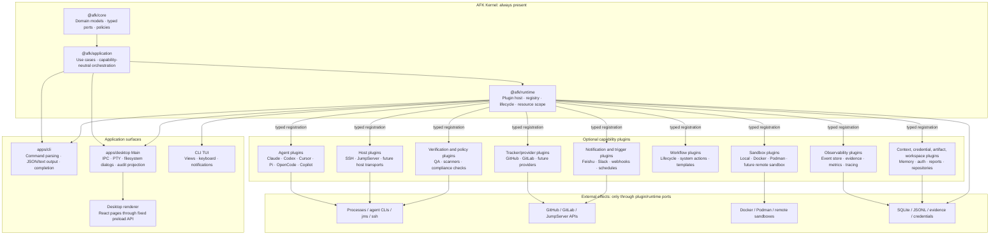
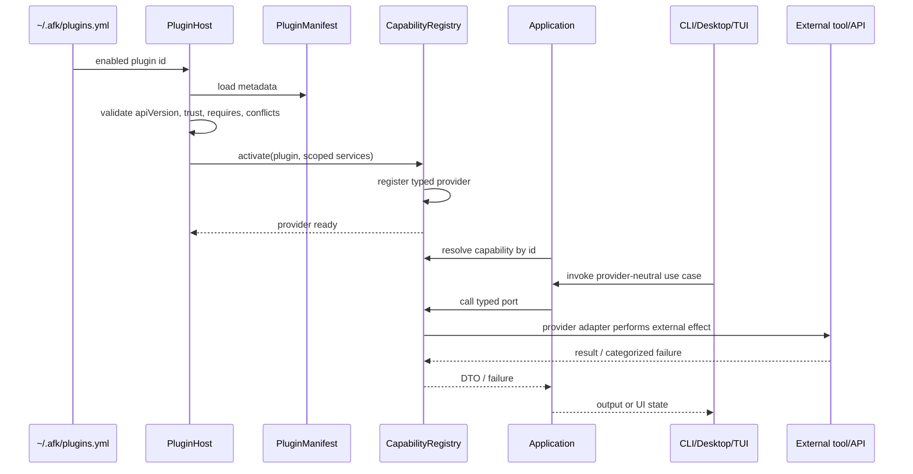

# Host Capability Plugin Architecture Implementation Plan

> **For agentic workers:** REQUIRED SUB-SKILL: Use superpowers:subagent-driven-development (recommended) or superpowers:executing-plans to implement this plan task-by-task. Steps use checkbox (`- [ ]`) syntax for tracking.

**Goal:** Make AFK's external integrations and replaceable execution providers installable, trusted capability plugins while keeping `@afk/core`, `@afk/application`, CLI, and Desktop on one stable contract.

**Architecture:** AFK keeps domain contracts and execution policy in the core packages. Plugins provide typed Runtime capabilities; Application owns use cases; CLI and Desktop register only their own command, IPC, PTY, and presentation surfaces. Agent, Sandbox, Host, Tracker, Verification, Notification, Trigger, Context, Credential, Artifact, Repository, Security, Observability, and Workflow all use the same plugin protocol, with Agent and Host providing the first migration slices.

**Tech Stack:** TypeScript, pnpm workspaces, Node.js 22, `@afk/core`, `@afk/application`, `@afk/runtime`, Commander, Electron IPC, `js-yaml`, Vitest, and the existing trusted plugin/profile code.

---

## 1. Design decisions

### 1.1 What becomes a plugin

Use a plugin when all three conditions hold:

1. The capability has a stable business port that can be expressed without Node.js, Electron, React, Commander, or a provider SDK.
2. The implementation has an optional dependency, external process, platform-specific behavior, or independent release cadence.
3. The capability can fail or be disabled without invalidating AFK's execution core.

This makes the following planned plugin families:

| Capability | Plugin status | Reason |
|---|---|---|
| SSH / JumpServer host management | First plugin | Optional `jms` dependency, external process boundary, shared by Desktop and CLI |
| GitHub / GitLab provider | Plugin family | Provider SDKs and credentials are optional and already sit behind provider contracts |
| Agent runtimes | Plugin family | Claude/Codex adapters have separate process protocols and release cadence |
| Sandbox providers | Plugin family | Docker/Podman/container support is optional and security-sensitive |
| Observability exporters | Plugin family | Event store, tracer, metrics, and evidence sinks already map to typed ports |
| Verification providers | Plugin family | External test runners, scanners, and policy checks have independent tools and release cycles |
| Notification providers | Plugin family | Feishu, Slack, email, and desktop notifications are optional delivery adapters |
| Trigger providers | Plugin family | Webhooks, schedules, Git events, and issue events are external event sources |
| Context and memory providers | Plugin family | Knowledge bases, retrieval systems, and project context sources are optional integrations |
| Credential and auth adapters | Plugin family | Keychain, OAuth, OIDC, and enterprise identity systems vary by environment |
| Artifact and report exporters | Plugin family | Test reports, evidence bundles, and run artifacts may target different stores |
| Repository and workspace adapters | Plugin family | Git hosting, multi-repository layouts, and remote workspaces vary independently |
| Security and policy checks | Plugin family | Secret scans, license checks, and compliance engines are optional policy inputs |
| Workflow actions, lifecycle modules, templates | Existing plugin surface | `PluginRuntime` already supports these registrations |
| CLI/TUI views | Existing application plugin surface | TUI plugin loader already provides a narrow view context |
| Desktop renderer pages | Later plugin surface | Requires strict preload, IPC, CSP, and lifecycle isolation; do not make arbitrary React modules the first extension API |

Keep these in the AFK kernel:

- Work-item identity, lifecycle transitions, claiming, verification, merge gates, and reducers.
- Core execution policy, resource cleanup, audit integrity, and trust boundaries.
- Configuration storage primitives, migration runner, and secret-storage policy.
- Preload whitelisting and IPC sender validation.
- The command dispatcher and command registry itself; plugins may register commands through a typed registrar after the command contract is stable.
- The workflow state machine, claim/lease rules, verification policy, merge gate, and audit invariants; plugins may supply observations or implementations through typed ports, but cannot redefine these rules.
- Generic configuration, migration, secret access, and resource cleanup; plugins consume narrow Runtime ports and do not own the persistence or security policy behind them.

The rule is: plugins provide implementations and optional surfaces; AFK owns policy and safety.

### 1.1.1 Planned extension families and boundaries

All of the following families are part of the target architecture. They are
deliberately expressed as small provider ports instead of large feature
frameworks:

| Extension family | Plugin provides | Core/Application keeps |
|---|---|---|
| Verification | `VerificationProvider`, normalized findings, readiness checks | When verification is required, pass/fail policy, retry, and merge eligibility |
| Notification | `NotificationProvider`, delivery result, channel health | Which events are emitted, deduplication, user preferences, and failure policy |
| Trigger | `TriggerProvider`, event subscription and normalized trigger event | Run creation, authorization, idempotency, and trigger-to-work mapping |
| Context / memory | `ContextSource`, search/fetch results, source metadata | Context budgets, redaction, provenance, and prompt assembly policy |
| Credential / auth | `CredentialProvider`, token/session acquisition, expiry metadata | Secret names, access grants, redaction, and lifecycle ownership |
| Artifact / report | `ArtifactSink`, upload and report export results | Artifact identity, retention policy, evidence references, and audit records |
| Repository / workspace | `RepositoryProvider`, checkout and workspace discovery | Work-item identity, branch policy, claim isolation, and cleanup guarantees |
| Security / policy | `PolicyCheckProvider`, findings and severity | Blocking rules, exceptions, approval authority, and final gate decisions |

Each family enters the implementation in a separate slice. A family may have
one built-in provider at first, but its selection, health, error, and lifecycle
path still goes through the common Registry. A one-off local helper can remain
an internal Runtime adapter only when it does not cross a package boundary or
need independent installation.

### 1.2 Plugin layers

```text
                         installed plugin package
                                  │
                         manifest + activate()
                                  │
┌─────────────────────────────────┴──────────────────────────────────┐
│ Plugin host                                                        │
│ discovery · manifest validation · dependency resolution · teardown │
└─────────────────────────────────┬──────────────────────────────────┘
                                  │ typed registrations
┌─────────────────────────────────┴──────────────────────────────────┐
│ Runtime capability registry                                        │
│ host provider · tracker provider · agent · sandbox · exporter      │
└─────────────────────────────────┬──────────────────────────────────┘
                                  │ ports
┌─────────────────────────────────┴──────────────────────────────────┐
│ Application use cases                                               │
│ hostList · hostExec · inventory · execution                         │
└─────────────────────────────────┬──────────────────────────────────┘
                                  │ DTOs / application calls
                ┌─────────────────┴─────────────────┐
                │                                   │
             Desktop                               CLI
          IPC / PTY / UI                        command / output
```

The only layer allowed to invoke `jms`, `ssh`, `scp`, provider SDKs, or other external processes is the Runtime adapter registered by a plugin. Application code never shells out. Desktop and CLI never parse provider-specific output.

### 1.3 Plugin identity, naming, and manifest

Reuse the existing capability profile vocabulary in `packages/runtime/src/plugin-sdk/profile.ts`; do not introduce a second manifest model. Extend the current manifest with optional presentation metadata only when a concrete surface needs it.

The public manifest shape is:

```ts
export interface PluginManifest {
  readonly id: string;
  readonly apiVersion: 1;
  readonly version: string;
  readonly name: string;
  readonly provides: readonly string[];
  readonly requires?: readonly string[];
  readonly configSchema?: PluginConfigSchema;
  readonly surfaces?: readonly ('runtime' | 'cli' | 'desktop' | 'tui')[];
  readonly trusted: true;
}
```

The executable module exports the manifest and activation function:

```ts
export interface Plugin {
  readonly manifest: PluginManifest;
  activate(context: PluginSetupContext): void | Promise<void>;
}
```

The current `WorkflowPlugin` contract remains accepted during migration. The
loader adapts it to `Plugin` so existing workflow plugins do not break in the
first release. New capability plugins use the manifest form.

Plugin names must not use `afk` as a prefix. AFK is the host product, so the
host already supplies that namespace. Keep the four identifiers distinct:

| Identifier | Format | Examples | Owner |
|---|---|---|---|
| Plugin ID | `<domain>.<provider>` | `agent.codex`, `host.jumpserver`, `sandbox.docker` | Plugin registry |
| Capability ID | `<domain>.<capability>` | `agent.provider`, `host.connection`, `observe.tracing` | Plugin protocol |
| Provider ID | `<provider>` | `codex`, `jumpserver`, `docker` | Domain registry |
| Package name | `<domain>-<provider>` or an organization scope | `agent-codex`, `host-jumpserver`, `@acme/agent-review` | Package registry |

First-party IDs such as `agent.codex` are reserved by the AFK distribution.
Third-party plugins use an organization-owned ID when a collision is possible,
for example `com.acme.agent.review`, while keeping a readable package name.
Plugin ID comparison is exact and case-sensitive after validation; IDs are
lowercase, use dots for namespaces, and may contain ASCII letters, digits,
`-`, and `_` in each segment. A package name does not have to equal its Plugin
ID, but its manifest ID must be stable across upgrades.

The existing `@afk/*` workspace package names and the `afk` executable are
internal product names and remain unchanged. This rule applies to plugin IDs,
plugin package names, provider examples, and public extension documentation.

Capability IDs are stable and namespaced by domain. The first host IDs are:

```text
host.connection       resolve and execute against a host
host.inventory        list and refresh managed hosts
host.upload           upload files through a host provider
host.interactive      optional PTY/session support; separate from batch exec
```

The complete first-version capability vocabulary is:

```text
agent.provider        agent execution provider
sandbox.execution     isolated process or container execution
host.connection       host resolution and batch execution
host.inventory        managed host discovery and refresh
tracker.backlog       work-item provider and backlog operations
observe.event-store   event persistence
observe.evidence      evidence persistence and retrieval
observe.tracing       distributed or run tracing
observe.metrics       metrics export
verify.check          verification execution and findings
notify.delivery       notification delivery
trigger.source        external event subscription
context.source        context and memory retrieval
credential.access     scoped credential acquisition
artifact.sink         artifact and report export
repository.workspace  repository and workspace operations
policy.check          security and compliance findings
workflow.lifecycle    lifecycle module
workflow.action       system action
workflow.template     workflow template
surface.cli           CLI extension surface
surface.tui           TUI extension surface
surface.desktop       Desktop extension surface
```

Capability IDs describe contracts. Plugin IDs identify implementations. A
plugin may provide several capabilities, but every registration is validated
against the declared capability set before activation.

`host.interactive` is intentionally separate. A plugin that only implements batch execution must not be treated as a PTY provider.

### 1.4 Trust and installation model

Phase one supports explicitly installed local modules only:

```text
~/.afk/plugins.yml
~/.afk/plugins/<plugin-id>/package.json
~/.afk/plugins/<plugin-id>/dist/index.js
```

The loader validates the ID, API version, manifest, required capabilities, and duplicate providers before activation. Activation failures are isolated and logged; a broken optional plugin must not stop the normal AFK CLI or Desktop startup.

Remote download, automatic updates, signatures, and arbitrary marketplace code are outside phase one. They require a separate trust decision. The future installer must write a lockfile, show requested permissions, install dependencies in the plugin directory, validate the manifest before enabling it, and support rollback.

### 1.5 Capability lifecycle

Every capability follows the same lifecycle:

1. Discover configured plugin IDs.
2. Load module metadata without activating it.
3. Validate the manifest and API version.
4. Resolve required capabilities and reject conflicts before any activation.
5. Activate in dependency order.
6. Register disposers for timers, child processes, watchers, and event listeners.
7. Expose health and diagnostics to the caller.
8. Deactivate in reverse order on shutdown or reload.

The registry must be transactional: if activation fails halfway through, remove every registration made by that plugin and run its already-registered disposers.

## 2. Host capability contract

### 2.1 Core port

Modify `packages/core/src/ports.ts` with a provider-neutral contract:

```ts
export type HostFailureCode =
  | 'binary-missing'
  | 'server-unknown'
  | 'auth-required'
  | 'asset-unknown'
  | 'unreachable'
  | 'remote-failed';

export interface HostRecord {
  readonly id: string;
  readonly alias: string;
  readonly provider: string;
  readonly address?: string;
  readonly lastVerifiedAt?: string;
}

export interface HostExecResult {
  readonly code: number;
  readonly stdout: string;
  readonly stderr: string;
}

export interface HostConnectionPort {
  listHosts(): Promise<readonly HostRecord[]>;
  resolve(host: string): Promise<HostRecord>;
  exec(host: string, argv: readonly string[], options?: { timeoutMs?: number }): Promise<HostExecResult>;
  upload?(host: string, source: string, destination: string, options?: { timeoutMs?: number }): Promise<void>;
}
```

The port has no PTY method. Interactive login is a separate port because it has different lifetime, input, resize, security, and audit requirements.

`HostFailure` carries the six stable failure categories and a shared next-step suggestion. A remote non-zero exit is returned as `HostExecResult.code`; a transport or adapter failure throws `HostFailure`. This preserves the distinction between a command that ran and a connection that never reached the target.

### 2.2 Application use cases

Create `packages/application/src/host-exec.ts` with these use cases:

```ts
export interface HostApplication {
  listHosts(): Promise<readonly HostRecord[]>;
  exec(input: {
    host: string;
    argv: readonly string[];
    timeoutMs?: number;
  }): Promise<HostExecResult>;
}
```

The use case validates non-empty argv, preserves argument boundaries, delegates to the selected provider, and returns stdout/stderr/exit code without formatting. It must not know `jms`, OpenSSH, JumpServer asset naming, or Commander.

### 2.3 Runtime provider registry

Extend `packages/runtime/src/application/plugins/runtime.ts` with:

```ts
interface PluginSetupContext {
  hostProvider(name: string, provider: HostConnectionPort): void;
}
```

The registry rejects duplicate provider names and malformed providers. It exposes `getHostProvider(name)` to the composition roots. Provider names are stable IDs such as `ssh-jumpserver`, not display labels.

Add `packages/runtime/src/application/host/connection.ts` as the shared resolver and cache boundary. It owns provider selection, host binding lookup, and failure normalization. It does not own Desktop status TTLs, PTY state, or CLI formatting.

## 3. SSH / JumpServer plugin design

### 3.1 Plugin responsibilities

The first plugin is `host.jumpserver` (package name `host-jumpserver`). It provides:

```text
host.connection
host.inventory
host.upload
```

It owns:

- `jms config list`, `jms ls`, and `jms exec` parsing.
- The `jms` binary check and adapter-specific failure mapping.
- JumpServer server aliases and asset external references.
- Provider-specific configuration fields and migration from old records.
- Batch execution and upload implementations.

It does not own:

- Electron IPC or React components.
- Commander command parsing or terminal output formatting.
- PTY login in the first release.
- AFK lifecycle, work-item identity, or audit policy.

### 3.2 Shared host identity

Extend the managed host record in the owning local configuration model with nullable binding fields:

```ts
interface ManagedSshHostRecord {
  id: string;
  alias: string;
  hostname: string;
  port: number;
  user?: string;
  providerId?: string;
  externalRef?: string;
  jmsServerAlias?: string;
  jmsAssetName?: string;
  origin?: 'created' | 'adopted' | 'imported';
  lastVerifiedAt?: string;
}
```

Binding rules:

- New JumpServer records store `jmsServerAlias` and `jmsAssetName` after the first successful resolution.
- Old records with only `jumpHost` use one fallback resolution and are backfilled atomically.
- `exec`, `ls`, health, and diagnostics use the stored binding after backfill.
- Secrets stay in the existing credential service; the host record never stores passwords or OTP secrets.

This removes repeated guessing based on display names and prevents two assets with the same address from resolving to the wrong server.

### 3.3 Management semantics

Separate these operations in the Application/plugin API:

| Operation | Behavior |
|---|---|
| `create` | Create the server in `jms`, persist AFK metadata, and store credentials through the existing secure credential service |
| `adopt` | Read an existing `jms config list` entry, persist only the AFK binding, and store no password |
| `remove` | Delete the AFK record and managed asset records; preserve the shared `jms` entry by default |
| `remove --provider-config` | Require explicit confirmation and reject removal when the alias is referenced by multiple AFK records |
| `update` | Update AFK metadata and provider binding through a typed IPC/use-case path |

The default delete path must never silently run `jms config remove`.

### 3.4 Health model

Use two levels of health:

| Level | Operation | Cache |
|---|---|---|
| Server | one lightweight provider check per configured server | 60 seconds by server alias |
| Asset | result of the latest real operation | timestamp on the host record |

When a server is unavailable, all assets bound to it receive the server-level diagnostic without issuing one login per asset. Assets that have not been used recently display their last verified time rather than triggering active polling.

## 4. Desktop and CLI integration

### 4.1 CLI

Add `apps/cli/src/commands/host.ts` and register it in `apps/cli/src/command-registry.ts` only after the Application and provider contracts are stable:

```bash
afk host ls [--json]
afk host exec <host> -- <argv...>
afk host exec <asset>@<server> -- systemctl status wiki-backend --timeout 15s
```

Rules:

- Default output is human-readable.
- `--json` returns stable DTOs and diagnostics.
- `--timeout` becomes `timeoutMs` in Application.
- Exit code is the remote code for a completed remote command.
- Provider and transport failures become AFK failure diagnostics and exit code `1`.
- No `afk host login` in the first release.

Update `docs/architecture/execution.md#execution-entry-points` and bump `apps/cli/package.json` because the CLI command registry changes.

### 4.2 Desktop

Keep `apps/desktop/electron/services/ssh-service.ts` as the UI orchestration layer:

- It maps Application DTOs to `shared/ssh-contract.ts`.
- It owns UI status TTLs, audit event emission, file picker interaction, and PTY session lifecycle.
- It delegates batch resolution, execution, inventory, and upload to the selected Host Provider.

Keep `apps/desktop/electron/preload.cts`, `apps/desktop/shared/ipc-contract.ts`, and sender validation as explicit allowlists. A plugin may request a registered Desktop surface only through a typed registration point; it cannot add arbitrary preload methods or open an unrestricted IPC channel.

The first Desktop migration changes the current JumpServer adapter to a Runtime import/re-export, then moves the connection and binding logic. Renderer changes come after the shared DTO and error contract are stable.

## 5. Plugin installation and dependency lifecycle

### 5.1 Phase-one local loading

Implement shared discovery in `packages/runtime/src/application/plugins/loader.ts`:

- Read `~/.afk/plugins.yml`.
- Resolve `~/.afk/plugins/<id>/dist/index.js`.
- Validate module export and manifest.
- Skip disabled, missing, malformed, or failed plugins with diagnostics.
- Load each plugin once and activate it through `PluginRuntime`.

The existing TUI loader must share the plugin entry configuration without emitting a false malformed-plugin warning for a valid Runtime-only plugin. Add a surface discriminator or make the TUI loader ignore manifests that do not provide a TUI surface.

### 5.2 Future installer

After local loading is stable, add a separate `afk plugin` command group:

```bash
afk plugin list
afk plugin doctor
afk plugin install <package>
afk plugin enable <id>
afk plugin disable <id>
afk plugin remove <id>
```

The installer must:

1. Resolve the package into an isolated plugin directory.
2. Install its declared dependencies using a controlled package-manager subprocess.
3. Write a lockfile and plugin metadata before activation.
4. Validate API version, required capabilities, and permissions.
5. Activate only after validation succeeds.
6. Roll back the directory and config entry if activation fails.

Do not add this installer to the first host migration. It is an independent security and distribution design that should be reviewed separately.

## 6. File map

### Shared kernel

- Modify `packages/core/src/ports.ts`: Host records, HostConnectionPort, HostFailure.
- Modify `packages/core/src/index.ts`: export the host contract.
- Add `packages/core/src/host.test.ts`: failure classification and port-level contract checks.

### Application

- Add `packages/application/src/host-exec.ts`: list and batch exec use cases.
- Add `packages/application/src/host-exec.test.ts`: argv preservation, empty command validation, remote exit code propagation.
- Modify `packages/application/src/index.ts`: public exports.
- Modify `packages/application/src/local-config.ts`: nullable provider binding fields and compatible record migration.

### Runtime and SDK

- Modify `packages/runtime/src/plugin-sdk/profile.ts`: stable host capability IDs and manifest fields.
- Modify `packages/runtime/src/plugin-sdk/index.ts`: public plugin SDK exports.
- Modify `packages/runtime/src/application/plugins/runtime.ts`: host provider registration, conflict checks, rollback, teardown.
- Add `packages/runtime/src/application/plugins/loader.ts`: shared installed-plugin discovery.
- Add `packages/runtime/src/application/plugins/loader.test.ts`: config parsing, disabled/missing/malformed modules, duplicate IDs, activation failure isolation.
- Add `packages/runtime/src/application/host/connection.ts`: provider selection, binding resolution, cache, and failure normalization.
- Add `packages/runtime/src/application/host/connection.test.ts`: stable binding and cache behavior.
- Add `packages/runtime/src/infrastructure/jms/jms-cli.ts`: the only `jms` subprocess boundary.
- Add `packages/runtime/src/infrastructure/jms/connection.ts`: JumpServer asset resolution and server health.
- Add matching Runtime tests with a fake executable and no network.
- Modify `packages/runtime/package.json`: public exports for the SDK, loader, Host Application, and JMS adapter.

### CLI

- Add `apps/cli/src/commands/host.ts` and `apps/cli/src/commands/host.test.ts`.
- Modify `apps/cli/src/command-registry.ts`.
- Modify `apps/cli/src/composition-root.ts`: load the shared plugin registry once for command execution.
- Modify `apps/cli/package.json`: version bump for the new command surface.
- Modify `docs/architecture/execution.md`: add `afk host` entry points.

### Desktop

- Modify `apps/desktop/electron/services/ssh-service.ts`: delegate provider operations and retain UI orchestration.
- Modify `apps/desktop/electron/services/jumpserver-service.ts`: use the shared Host Application/provider.
- Modify `apps/desktop/electron/adapters/jumpserver-cli.ts`: compatibility re-export only during migration, then remove it.
- Modify `apps/desktop/electron/ipc/register-handlers.ts`: inject the selected provider instead of constructing a provider-specific adapter in the IPC module.
- Modify `apps/desktop/shared/ssh-contract.ts`: expose provider-neutral DTOs and shared diagnostics.
- Add `apps/desktop/tests/electron/host-provider-contract.test.ts`: run Desktop service behavior against a fake HostConnectionPort.
- Modify `apps/desktop/architecture.md`: document the Runtime adapter and plugin composition boundary.

### Documentation

- Add `docs/adr/0030-host-capability-plugin.md`: accepted architecture decision after review.
- Modify `docs/index.md`: link the ADR.
- Modify `docs/architecture/overview.md` and `docs/architecture/overview.zh.md`: explain plugin versus kernel boundaries.
- Modify `docs/guides/agent-plugins.md`: distinguish Agent Skills compatibility from AFK Runtime capability plugins.

## 7. Delivery sequence

### Task 1: Architecture approval artifact

**Files:**
- Create: `docs/superpowers/plans/2026-11-06-host-capability-plugin-architecture.md`
- Create: `docs/adr/0030-host-capability-plugin.md`
- Modify: `docs/index.md`

- [ ] Review the plugin family matrix and keep/kernel boundary.
- [ ] Confirm that local trusted plugins are the only phase-one installation model.
- [ ] Confirm that PTY login is separate from batch HostConnectionPort.
- [ ] Confirm that the current uncommitted exploratory changes are either reset or reconciled before implementation starts.

### Task 2: Plugin host contract

**Files:**
- Modify: `packages/core/src/ports.ts`
- Modify: `packages/runtime/src/plugin-sdk/profile.ts`
- Modify: `packages/runtime/src/application/plugins/runtime.ts`
- Add: `packages/runtime/src/application/plugins/loader.ts`
- Add: focused tests beside each implementation

- [ ] Add the manifest and capability validation before any provider activation.
- [ ] Add host provider registration with duplicate detection and rollback.
- [ ] Add local module discovery through `~/.afk/plugins.yml`.
- [ ] Verify malformed and disabled plugins do not stop startup.
- [ ] Run `pnpm --filter @afk/core test`, `pnpm --filter @afk/runtime test`, and `pnpm architecture:check`.

### Task 3: Host Application contract

**Files:**
- Add: `packages/application/src/host-exec.ts`
- Add: `packages/application/src/host-exec.test.ts`
- Modify: `packages/application/src/index.ts`

- [ ] Implement list and batch exec use cases with no process or UI imports.
- [ ] Reject empty argv.
- [ ] Preserve remote exit code and stdout/stderr exactly.
- [ ] Run `pnpm --filter @afk/application test` and typecheck.

### Task 4: Shared JumpServer provider

**Files:**
- Add: `packages/runtime/src/infrastructure/jms/jms-cli.ts`
- Add: `packages/runtime/src/infrastructure/jms/connection.ts`
- Add: Runtime JMS tests and fake executable fixture
- Modify: `apps/desktop/electron/adapters/jumpserver-cli.ts`

- [ ] Move parser and subprocess execution to Runtime.
- [ ] Pass remote command argv directly; never construct `sh -c` or quote a command string.
- [ ] Map binary, server, asset, auth, reachability, and remote exit failures to stable categories.
- [ ] Keep the Desktop adapter as a temporary compatibility export.
- [ ] Run existing Desktop JumpServer tests and the new Runtime provider contract tests.

### Task 5: Managed host binding migration

**Files:**
- Modify: `packages/application/src/local-config.ts`
- Modify: `apps/desktop/electron/adapters/sqlite-local-config.ts`
- Modify: `apps/desktop/electron/services/jumpserver-service.ts`
- Modify: `apps/desktop/shared/ssh-contract.ts`
- Add: migration and adopt/remove tests

- [ ] Add nullable binding fields with backward-compatible reads.
- [ ] Backfill binding after the first successful legacy resolution.
- [ ] Implement `create` and `adopt` as separate paths.
- [ ] Make deletion remove AFK records by default and protect shared provider aliases.
- [ ] Verify secrets never enter host records or logs.

### Task 6: CLI surface

**Files:**
- Add: `apps/cli/src/commands/host.ts`
- Add: `apps/cli/src/commands/host.test.ts`
- Modify: `apps/cli/src/command-registry.ts`
- Modify: `apps/cli/src/composition-root.ts`
- Modify: `apps/cli/package.json`
- Modify: `docs/architecture/execution.md`

- [ ] Register `afk host ls` and `afk host exec` through the command registry.
- [ ] Implement human-readable and JSON output.
- [ ] Preserve remote exit codes and map HostFailure to exit code `1`.
- [ ] Add shell completion entries if the registry requires them.
- [ ] Bump the CLI version in the same change.

### Task 7: Desktop composition migration

**Files:**
- Modify: `apps/desktop/electron/ipc/register-handlers.ts`
- Modify: `apps/desktop/electron/services/ssh-service.ts`
- Modify: `apps/desktop/electron/services/jumpserver-service.ts`
- Modify: `apps/desktop/electron/preload.cts` only if an existing typed method needs a contract update
- Add: Desktop host provider contract tests

- [ ] Compose the provider once in Main and inject it into services.
- [ ] Keep IPC methods fixed and typed.
- [ ] Keep PTY lifecycle in Desktop and batch execution in the provider.
- [ ] Reuse shared failure categories and diagnostics.
- [ ] Run Desktop unit tests, typecheck, and the existing Electron E2E suite with the fake `jms` executable.

### Task 8: Follow-up installer decision

**Files:**
- Add only after a separate approval: `apps/cli/src/commands/plugin.ts`
- Add only after a separate approval: plugin installer package and tests

- [ ] Decide whether AFK owns npm/pnpm installation or only discovers user-installed modules.
- [ ] Define permission and trust prompts.
- [ ] Define lockfile, rollback, upgrade, and uninstall behavior.
- [ ] Add `plugin doctor` before adding online installation.

## 8. Verification matrix

| Area | Required verification |
|---|---|
| Port contract | Fake provider returns records, preserves argv, returns remote non-zero codes, throws categorized transport failures |
| Plugin loader | Enabled, disabled, missing, malformed, duplicate, dependency-missing, activation-failure, teardown |
| JMS adapter | Fake executable fixture; no network; server/asset parsing; binary missing; stderr/stdout separation |
| Binding migration | Legacy record backfill; stable `jmsServerAlias`/`jmsAssetName`; adopt without password; safe remove |
| CLI | Human output, JSON output, timeout, remote exit code, failure exit code, completion |
| Desktop | IPC validation, PTY unaffected, shared provider injection, audit/status behavior, packaged fixture path |
| Architecture | `pnpm architecture:check`, `pnpm docs:check`, package-level build/typecheck/test |

## 9. Explicit non-goals

- No arbitrary shell commands from workflow templates or untrusted plugins.
- No remote plugin download in the first release.
- No PTY login in the first HostConnectionPort implementation.
- No polling every asset to render a health page.
- No silent `jms config remove` during AFK record deletion.
- No second SSH/JMS parser in CLI or Desktop.
- No plugin access to reducers, lifecycle state transitions, merge decisions, or secret material outside typed ports.

## 10. Self-review

The plan covers the requested extensibility goal, the existing workflow plugin system, the current TUI plugin loader, the Desktop IPC boundary, the CLI registry, the JumpServer adapter, persistent host identity, and the three management gaps from the supplied design.

The main deliberate split is the installer. Loading an already installed local module is a Runtime concern; downloading packages, installing dependencies, trust prompts, signatures, rollback, and updates are a separate security-sensitive product surface. Keeping that split prevents the SSH migration from becoming an unreviewable package manager rewrite.

The current uncommitted code edits made before this plan are exploratory and should be reconciled against this document before implementation continues. No further implementation should start until the plugin boundary, local trust model, host identity fields, and E0–E8 delivery order are accepted.

## 11. Overall extensibility architecture

The repository already contains most of the right abstractions, but they are
not yet composed through one runtime registry. The important distinction is
between an abstraction that exists in a type file and an abstraction that is
actually selected by the execution path.

### 11.1 Current state discovered in the repository

| Area | Existing abstraction | Current selection path | Architectural gap |
|---|---|---|---|
| Agent | `AgentProvider`, `AgentCapability`, `ProcessAgentProvider` | `createAgentProvider()` and `AgentProviderName` union | `PluginRuntime.agentProvider()` is not the source used by `WorkflowEngine` |
| Agent transport | Codex `exec` / `app-server` selection | `AgentRuntimeSelection` special-cased for Codex | Transport selection is not yet a general provider protocol |
| Sandbox | `SandboxProvider`, `SandboxCapability` | `createSandboxProvider()` switch | External sandbox plugins cannot participate in the normal runner without injection changes |
| Tracker/backlog | `TrackerProvider`, `BacklogProvider`, provider bundles | Static GitHub/GitLab factory and provider assembly | Provider plugins exist conceptually but composition still assumes bundled providers |
| Workflow | `PluginRuntime` lifecycle/actions/templates/backlog providers | Injected into `WorkflowEngine` | This is the most complete existing plugin surface |
| TUI | `TuiPlugin`, `loadTuiViews()` | Separate CLI loader from `~/.afk/plugins.yml` | It is a presentation plugin, not a Runtime capability plugin |
| Observability | Capability profile IDs and typed ports | Runtime adapters are composed directly | Registry/activation protocol is incomplete |
| SSH/Host | Desktop-local services and `jms` adapter | Electron IPC module constructs services | No shared provider visible to CLI or Runtime |

The design must close the selection gaps before adding more plugin types. A
plugin registration API that the runner ignores would create a second source
of truth and make the system appear extensible while remaining statically
closed.

### 11.2 Target architecture



The arrows from Runtime to plugins mean registration and lifecycle control;
they do not mean that plugins may bypass Application use cases. The arrows
from plugins to external effects are mediated by Runtime ports such as process
launch, sandbox execution, credentials, event storage, and HTTP clients.

### 11.3 Core, runtime, plugin, and surface responsibilities

| Layer | Owns | Must not own |
|---|---|---|
| Core | Stable domain types, ports, capability IDs, policy, failure taxonomy | Node.js, child processes, SDKs, Electron, React, provider-specific parsing |
| Application | Use cases, validation, lifecycle orchestration, provider-neutral DTOs | Provider SDKs, shell commands, UI state, Commander, IPC |
| Runtime | Registry, plugin lifecycle, resource scope, built-in adapter composition, safe process/storage/network ports | Product-specific UI, duplicated business rules, direct cross-surface calls |
| Capability plugin | Provider implementation, provider parsing, provider health, provider config schema, provider-specific diagnostics | Core state transitions, merge decisions, arbitrary IPC, secret persistence outside a port |
| CLI | Command grammar, completion, exit code mapping, text/JSON presentation | Agent parsing, host resolution, provider SDK calls |
| Desktop Main | IPC validation, PTY, native dialogs, UI cache/audit projection | Provider parsing, duplicated connection logic |
| Renderer/TUI | Presentation and user interaction | Node process access, credentials, direct provider calls |

## 12. Agent capability analysis

### 12.1 What should become an Agent plugin

The current provider files are already close to plugin modules. The following
providers should move behind the common Agent plugin contract:

| Existing implementation | Plugin | Provides | Notes |
|---|---|---|---|
| `domain/agents/claude-code.ts` | `agent.claude` / `agent-claude` | `agent.provider`, `agent.streaming`, `agent.structured-output`, `agent.usage`, `agent.interactive` | Keep the 4,000-character goal limit in provider metadata |
| `domain/agents/codex.ts` | `agent.codex` / `agent-codex` | `agent.provider`, `agent.streaming`, `agent.structured-output`, `agent.usage`, `agent.interactive` | Own both `exec` and `app-server` transports behind one provider ID |
| `domain/agents/cursor.ts` | `agent.cursor` / `agent-cursor` | `agent.provider`, `agent.streaming`, `agent.usage`, `agent.resume`, `agent.interactive` | Native resume remains capability-gated |
| `domain/agents/pi.ts` | `agent.pi` / `agent-pi` | `agent.provider`, provider-declared stream/resume capabilities | Keep its session checkpoint semantics provider-owned |
| `domain/agents/opencode.ts` | `agent.opencode` / `agent-opencode` | `agent.provider`, provider-declared stream/usage capabilities | No assumptions about Claude/Codex event shapes |
| `domain/agents/copilot.ts` | `agent.copilot` / `agent-copilot` | `agent.provider`, provider-declared stream capabilities | The plugin supplies its own parser and readiness probe |

The reusable `ProcessAgentProvider` remains part of the Runtime SDK. It is a
base implementation for process-backed providers, not itself an installed
plugin. A future non-process provider can implement the same `AgentProvider`
port without inheriting it.

### 12.2 Agent capabilities that are already correctly modeled

Keep these as provider-declared capability flags, because the runner must gate
behavior on them:

- `streaming`: provider emits incremental events.
- `structured-output`: provider emits machine-readable result events.
- `usage`: provider exposes token usage.
- `resume`: provider can capture and restore a real native session.
- `fork`: provider can fork a native session.
- `interactive`: provider supports HITL attach.

Add these metadata fields to the plugin contract rather than making them
global assumptions:

```ts
export type AgentTransport = 'process' | 'exec' | 'app-server' | 'remote';

export interface AgentProviderManifest {
  readonly id: string;
  readonly displayName: string;
  readonly transports: readonly AgentTransport[];
  readonly capabilities: readonly AgentCapability[];
  readonly promptLimits?: AgentPromptLimits;
  readonly authentication: readonly ('api' | 'chatgpt' | 'environment' | 'unknown')[];
}
```

`AgentRuntimeSelection` must become provider-neutral. Codex-specific fields
move under the Codex plugin configuration, while the common selection keeps
only provider ID, transport ID, profile, and timeout:

```ts
export interface AgentRuntimeSelection {
  readonly provider: string;
  readonly transport: string;
  readonly profile?: string;
  readonly startupTimeoutMs: number;
  readonly options?: Readonly<Record<string, string | number | boolean>>;
}
```

The plugin validates `options`; the runner never interprets provider-specific
keys.

### 12.3 Agent protocol

The standard Agent plugin port is:

```ts
export interface AgentProvider {
  readonly manifest: AgentProviderManifest;
  createExecution(options: AgentExecutionOptions): Promise<AgentExecution>;
  getSessionUsage?(session: AgentSession): Promise<TokenUsage | undefined>;
  captureSession?(options: CaptureSessionOptions): Promise<SessionSnapshot>;
  restoreSession?(options: RestoreSessionOptions): Promise<void>;
  doctor?(options: { signal?: AbortSignal }): Promise<AgentReadiness>;
}
```

The execution protocol is unchanged and remains provider-neutral:

```text
AgentProvider.createExecution()
        ↓
AgentExecution.waitForEvent()
        ↓
AgentExecution.waitForResult()
        ↓
ExecutionResult { status, provider, sessionId, usage, tools, diagnostics }
```

The provider owns command construction and event parsing. The Sandbox owns
process/session lifecycle. The Workflow Runner owns timeouts, retries,
context handoff, resource cleanup, and status transitions.

### 12.4 Agent integration changes required

The following current static paths must be replaced by registry lookups:

1. `AgentProviderName` becomes an extensible string ID with built-in IDs
   supplied by built-in plugin manifests.
2. `createAgentProvider()` becomes a compatibility wrapper over the injected
   `AgentProviderRegistry`.
3. `WorkflowEngine` resolves the agent provider from the registry passed in its
   dependencies; it no longer calls the static factory for every run.
4. `resolveWorkflowRequest()` validates the selected provider against the
   registry rather than a TypeScript union.
5. `packages/runtime/src/domain/templates/types.ts` stops using a static
   `z.enum([...agents])`; template validation checks the provider ID against
   the active registry after parsing.
6. CLI help and completion query the active registry so installed agents appear
   without changing `command-registry.ts` for every provider.
7. `agent-metadata.ts` reads provider manifest metadata instead of branching on
   `provider === 'codex'` except where the Codex plugin owns a provider-specific
   projection.

The same pattern applies to Sandbox:

1. `SandboxProviderName` becomes an extensible ID.
2. `createSandboxProvider()` becomes a compatibility wrapper over an injected
   registry.
3. `WorkflowEngine.sandboxProviderByName()` resolves the active registry.
4. Local, Docker, and Podman are shipped as built-in plugins first, so behavior
   stays unchanged while the selection path becomes extensible.

### 12.5 Complete capability registry

All cross-cutting families use the same registry and lifecycle protocol as
Agent, Sandbox, Host, and Tracker. The following table is the complete target
registry surface for the first architecture version:

| Family | Standard port | Example plugins | Selection point |
|---|---|---|---|
| Verification | `VerificationProvider` | test runner, static scanner, browser checker | Application verification use case |
| Notification | `NotificationProvider` | Feishu, Slack, email, desktop notification | Event dispatcher |
| Trigger | `TriggerProvider` | webhook, scheduler, Git push, issue event | Run creation service |
| Context / memory | `ContextSource` | repository context, knowledge base, vector search | Context assembly service |
| Credential / auth | `CredentialProvider` | OS keychain, OAuth, OIDC, enterprise SSO | Narrow Runtime credential port |
| Artifact / report | `ArtifactSink` | local evidence, object storage, report portal | Evidence and export service |
| Repository / workspace | `RepositoryProvider` | GitHub, GitLab, multi-repository, remote workspace | Workspace and change use case |
| Security / policy | `PolicyCheckProvider` | secret scan, license scan, compliance engine | Policy evaluation before merge gate |

The provider returns normalized data and machine-readable failures. The
Application decides whether a finding blocks a run, whether a notification is
retryable, how long context may consume, whether a credential may be used, and
which artifacts are retained. This prevents a plugin from silently changing
AFK's lifecycle or approval semantics.

The registry exposes one resolver per family, but all resolvers share the same
rules: one active provider per provider ID, explicit capability declarations,
health checks before use, cancellation for long-running calls, categorized
failures, and reverse-order disposal. Provider implementations may depend on
one another through declared capabilities, but they never import another
plugin's module directly.

## 13. Standard Plugin Protocol v1

The protocol has five parts.

### 13.1 Manifest

The manifest is declarative and can be validated before module activation:

```json
{
  "id": "agent.codex",
  "apiVersion": 1,
  "version": "1.0.0",
  "provides": ["agent.provider", "agent.streaming", "agent.usage"],
  "requires": ["runtime.process-launch"],
  "surfaces": ["runtime", "cli", "desktop"],
  "trusted": true
}
```

Manifest rules:

- `id` is globally unique and uses lowercase dot/dash identifiers.
- `apiVersion` is the Plugin Host API version, independent of plugin version.
- `provides` and `requires` are capability IDs, not implementation class names.
- `surfaces` declares where a plugin has an integration adapter; it does not
  grant access by itself.
- `trusted: true` means the module is explicitly installed local code in v1;
  it is not a signature claim.

### 13.2 Activation

```ts
export interface Plugin {
  readonly manifest: PluginManifest;
  activate(context: PluginSetupContext): void | Promise<void>;
}

export interface PluginSetupContext {
  registerAgentProvider(provider: AgentProvider): void;
  registerSandboxProvider(provider: SandboxProvider): void;
  registerTrackerProvider(provider: TrackerProviderFactory): void;
  registerHostProvider(provider: HostConnectionProvider): void;
  registerVerificationProvider(provider: VerificationProvider): void;
  registerNotificationProvider(provider: NotificationProvider): void;
  registerTriggerProvider(provider: TriggerProvider): void;
  registerContextSource(source: ContextSource): void;
  registerCredentialProvider(provider: CredentialProvider): void;
  registerArtifactSink(sink: ArtifactSink): void;
  registerRepositoryProvider(provider: RepositoryProvider): void;
  registerPolicyCheckProvider(provider: PolicyCheckProvider): void;
  registerEventStore(store: EventStoreProvider): void;
  registerEvidenceStore(store: EvidenceStoreProvider): void;
  registerTracer(tracer: TracerProvider): void;
  registerMetrics(metrics: MetricsProvider): void;
  registerLifecycle(module: LifecycleModule): void;
  registerSystemAction(name: string, action: PluginSystemAction): void;
  registerTemplate(template: WorkflowTemplate): void;
  registerCliSurface(surface: CliPluginSurface): void;
  registerTuiSurface(surface: TuiPluginSurface): void;
  registerDesktopSurface(surface: DesktopPluginSurface): void;
  onDispose(disposer: () => void | Promise<void>): void;
}
```

The registration methods are typed and capability-specific. Plugins do not
receive `child_process`, Electron, React roots, the reducer, or mutable
workflow state from the host context.

### 13.3 Resource ports

Plugins that need external effects receive narrow ports from Runtime:

```ts
export interface PluginRuntimeServices {
  readonly process: ProcessLaunchPort;
  readonly http: HttpClientPort;
  readonly credentials: CredentialPort;
  readonly files: ScopedFilePort;
  readonly events: EventStorePort;
  readonly clock: ClockPort;
  readonly logger: PluginLogger;
}
```

The exact port set is granted by the plugin's `requires` list. A plugin that
only parses Agent CLI output can require `runtime.process` but cannot receive
credential storage unless its manifest declares it and the host permits it.

### 13.4 Health and errors

Every provider may implement:

```ts
export interface CapabilityHealth {
  readonly status: 'ready' | 'degraded' | 'unavailable';
  readonly checkedAt: string;
  readonly code?: string;
  readonly message?: string;
  readonly retryable?: boolean;
}
```

Errors use stable machine codes plus operator guidance. Provider-specific raw
errors stay in diagnostics and are never used as a cross-package contract.

### 13.5 Shutdown

The host calls disposers in reverse activation order. A plugin must release
child processes, timers, file watchers, sockets, event listeners, and temporary
resources. Failed activation is rolled back before the next plugin activates.

## 14. How a plugin enters the system



The surface never imports the plugin implementation. It only imports the
Application use case and the shared DTO contract.

## 15. Revised delivery order for the whole architecture

The host-only delivery split is too narrow for the actual extensibility goal.
Use these independently testable slices instead:

| Slice | Result | Main risk |
|---|---|---|
| E0 | Architecture decision, protocol, capability matrix, diagrams | Scope drift |
| E1 | Unified Plugin Manifest, loader, registry, dependency/conflict checks | Trust and lifecycle correctness |
| E2 | Agent registry injection; built-ins become built-in plugins | Existing workflow behavior |
| E3 | Sandbox registry injection; local/Docker/Podman remain built-ins | Resource cleanup and container behavior |
| E4 | HostConnectionPort and JumpServer plugin extraction | Data migration and adapter parity |
| E5 | Tracker/provider registry injection | Credential and provider bundle coupling |
| E6 | Register Verification, Notification, Trigger, Context, Credential, Artifact, Repository, and Policy providers | Cross-cutting contracts and policy ownership |
| E7 | CLI, Desktop, and TUI surfaces consume all active registries | Output, IPC, and presentation compatibility |
| E8 | Optional plugin installer and doctor command | Package security, rollback, upgrades |

E2 must precede E4 if the goal is a credible general plugin architecture. It
proves that the most important existing runtime extension—Agent selection—uses
the same registry as the future Host plugin.

E6 brings every listed capability family into the same protocol and Registry.
The work remains sliced so that each provider contract can be reviewed against
its policy boundary before an implementation is installed.

## 16. Additional acceptance criteria

- Installing an Agent plugin changes the active Agent registry without editing
  `WorkflowEngine` or the CLI command registry.
- Every planned family resolves through the same Registry: Agent, Sandbox,
  Host, Tracker, Observability, Verification, Notification, Trigger, Context,
  Credential, Artifact, Repository, Policy, and Workflow.
- Removing an Agent plugin makes runs fail with an actionable capability
  diagnostic before claim or execution begins.
- A provider's declared capability is checked before invoking optional methods;
  `resume`, `usage`, `interactive`, and `structured-output` never rely on a
  method existing by accident.
- Built-in Claude, Codex, Cursor, Pi, OpenCode, Copilot, Local, Docker, and
  Podman behavior remains unchanged after conversion to built-in plugins.
- A plugin failure rolls back its registrations and cannot remove another
  plugin's provider.
- CLI and Desktop resolve the same provider ID and receive the same normalized
  failure code and DTO.
- A plugin declaring a family capability without registering its typed provider
  is rejected before activation, and a provider cannot access a resource port
  that its manifest does not require.
- No plugin can mutate work-item lifecycle state, bypass the human merge gate,
  access secrets without a granted port, or add an arbitrary preload method.
