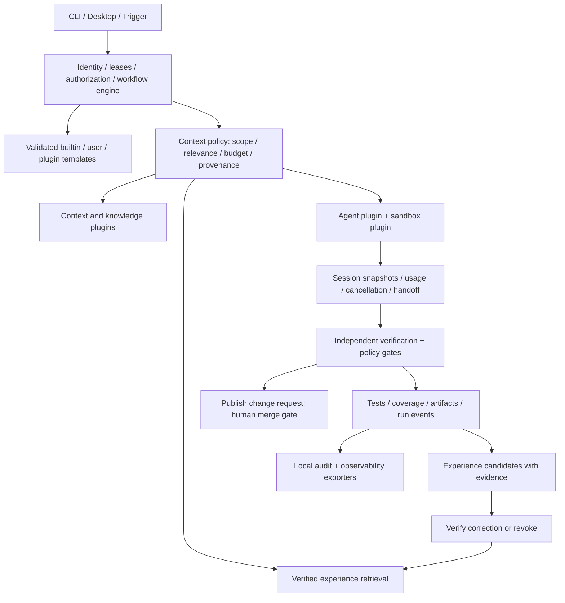

# Runtime learning and validation implementation plan

> **For agentic workers:** Use subagent-driven-development or executing-plans to implement the independent tasks below. Existing user authorization covers implementation and validation; no intermediate confirmation is required.

**Goal:** Deliver a runnable plugin system that governs agent sessions, supplies bounded context, preserves evidence, and reuses verified experience on later relevant tasks.

**Architecture:** Keep execution authority, identity, budgets, verification gates and publication policy in the kernel. Reuse the existing plugin registry, workflow dispatcher, session stores and SQLite storage. Plugins supply agents, execution environments, context, knowledge retrieval, verification and evidence transports; experience never changes authority or automatically executes instructions.

**Tech stack:** TypeScript, Node SQLite, existing Zod validation, Vitest, built CLI subprocesses and local HTTP/command fixtures.

## Current evidence and gaps

| Area | Existing implementation | Work required |
| --- | --- | --- |
| Context | Code/retrieval/knowledge-base/project-memory providers; lifecycle composition | Connect configured sources to actual execution with provenance, size limits and per-project isolation |
| Execution | Typed workflow plans, leases, cleanup, interruption, token/handoff/time budgets | Exercise the same path across plugins, retries and independent verification |
| Templates | YAML validation/compiler and plugin template registration | Ensure registered plugin templates can actually be selected by the engine |
| Hooks | Ordered init/before-agent/after-agent/before-publish/cleanup | Verify required hooks block execution/publication and cleanup runs in reverse |
| Sessions | Native snapshots, checksums, Markdown fallback, usage aggregation, ownership | Validate recovery, corrupt sessions, cross-generation budgets and repeated failures |
| Experience | Structured failure diagnostics and retrospective reports | Durable candidate/verified/revoked experience, bounded retrieval and actual prompt use |
| Knowledge | Local files and HTTP fragment retrieval | Distinguish knowledge retrieval from evidence-based learning; prevent cross-project contamination |
| Coverage | Tests and a root reporter configuration | Measure source coverage, report missing coverage and establish an honest CI gate |

## System flow

## Contracts and lifecycle

- Context remains `gather({scope, prompt, limit}, options) -> ContextFragment[]`. Source material is untrusted data. A context file carries source references; the execution prompt carries a bounded reference to it. Source errors are visible and cannot silently become authoritative instructions.
- Workflow templates use the existing validated workflow schema and typed system/agent steps. Explicit file selection takes precedence over named templates. Plugin removal removes its templates; a missing selection fails before agent launch.
- Hooks use the existing five phases. Required before-agent/before-publish failures stop the corresponding operation. Cleanup is reverse ordered and best effort. A hook cannot replace a lease, verification or human merge gate.
- Experience records contain `id`, `fingerprint`, `scope`, `status`, `trigger`, `rootCause`, `action`, `evidence`, source run/work item, timestamps, expiration and occurrence count. States are `candidate -> verified -> revoked`; candidates are never injected as trusted advice. Verification requires additional evidence and a run reference. The original failure is never deleted by promotion.
- Verification follows the actual managed lifecycle: independent QA must start and pass, then either finish successfully or publish a confirmed change at its matching human merge gate. Later failure disqualifies the run. Original failure fingerprints and bounded verification history survive corrections and recurrence; saturation still withdraws advice.
- Experience storage exposes `recordFailure`, `list`, `recall`, `verify`, `revoke`, `close`. Recall returns only relevant, unexpired verified entries from the exact project scope and respects count/character budgets. Duplicate failures increase occurrences instead of creating unbounded copies.
- Agent sessions retain provider-native identifiers separately from AFK run/work-item identity. Existing token, time and handoff limits remain authoritative across recovery; resume cannot reset them. Experience is advice, not a mechanism for raising budgets or bypassing checks.
- Reports identify real execution, local service/command simulation and unconfigured external services separately. Test counts never stand in for source line/branch coverage.

## Implementation sequence

### 1. Plugin matrix (independent workers)

- [x] Add built CLI tests in `tests/e2e/plugin-local-matrix.test.ts`, `tests/e2e/plugin-http-matrix.test.ts`, and `tests/e2e/plugin-execution-matrix.test.ts`.
- [x] Assert resulting files, HTTP requests, process arguments and lifecycle transitions; include disabled providers, invalid inputs, denied policies and failed operations.
- [x] Run `pnpm exec vitest run tests/e2e/plugin-*-matrix.test.ts --no-file-parallelism`; all tests must pass without personal secrets, external messages or personal Keychain writes.

### 2. Evidence-based experience (independent worker, then engine integration)

- [x] Add `packages/runtime/src/application/learning/experience-store.ts` using `openSqlite` and transactions; add focused real-file tests alongside it.
- [x] Reject missing evidence, invalid dates, oversized fields and cross-scope retrieval; test duplicate recording, reopen, verification, revocation, expiration and bounded retrieval.
- [x] Integrate candidate recording with structured runner failures and verified retrieval with actual agent context assembly. A green run alone does not prove the recorded proposed correction: promotion remains an explicit evidence-bearing operation.
- [x] Expose local list/recall/verify/revoke operations through the existing CLI command registration pattern, with JSON output and project scope. Update the command registry documentation and CLI version.

### 3. Context, templates and session governance

- [x] Reuse existing `ContextSource`, `TemplateLoader`, `PluginRuntime`, `SessionStoreChain`, `BudgetManager`, failure diagnostics and lifecycle dispatcher.
- [x] Connect plugin template selection and bounded context to both initial and subsequent execution rounds; preserve source attribution and prompt budgets.
- [x] Add a workflow integration test proving verified experience reaches the next agent while candidate/revoked/expired/other-project records do not.
- [x] Verify corrupt snapshot fallback, persistent usage budgets, interruption cleanup, required hook denial, and repeated failure termination without a retry-budget reset.

### 4. Measured coverage (independent worker)

- [x] Add an explicit coverage command/config with the matching Vitest V8 provider and JSON summary/LCOV/HTML output.
- [x] Include untested source files and report package scope. Desktop has its own toolchain and must not be represented as covered by the shared-runtime report.
- [x] Add CI collection and artifact upload; use measured thresholds or baseline nonregression, never an invented percentage.

### 5. End-to-end acceptance and delivery

- [x] Build/typecheck/test every changed package; run architecture and documentation checks and the CLI plugin matrix.
- [x] Execute a suitable real wiki backlog item with local Claude through the supported CLI; inspect the selected item's acceptance criteria first and preserve the human merge gate.
- [x] Record a failed attempt, validate a correction with evidence, then prove a later related run receives the verified experience. Revoke it and prove it disappears from recall.
- [x] Update `docs/architecture/plugins.md` and its Chinese pair plus testing documentation with measured results, exact limits and any external prerequisites.
- [x] Commit and push the task branch and publish a reviewable change request against the appropriate plugin baseline. Do not merge it.

## Acceptance boundaries

The local system is complete only when all local/mocked adapters run through the actual supported surfaces and the learning cycle is executable, not merely registered. External products requiring accounts or reachable infrastructure remain separately identified until exercised with those prerequisites. Repetition reduction is measured through duplicate fingerprints, occurrences and later use; no model can guarantee that it will never make another mistake.

## Completion phase: plugin operations and governance

Continue from the published baseline without repeating completed work. Independent workers own workspace cleanup, durable trigger delivery, artifact audit export, learning exchange, repository lifecycle and Desktop integration. The integration owner controls shared contracts, command registration, versions and final acceptance.

- [x] Inspect legacy execution manifests without granting deletion authority; target cleanup explicitly and refuse active, dirty, unknown or escaping paths.
- [x] Import Linear/Jira issues into a real managed repository backlog with deterministic provenance/idempotency, preserving canonical work identity; synchronize only explicitly selected external fields/states.
- [x] Expose validated repository preparation, checkout, publication and cleanup, with truthful provider capabilities and ownership checks.
- [x] Upload configured evidence to artifact providers while retaining local integrity and recording remote provenance/failure.
- [x] Persist authenticated trigger receipts, recover pending deliveries after restart and support bounded retry/replay with duplicate detection.
- [x] Capture successful lessons from independent QA evidence; exchange bounded records as untrusted candidates and measure retrieval, explicit adoption and recurrence separately.
- [x] Provide Desktop browser OAuth and scoped experience management through public runtime services.
- [x] Enforce measured source-coverage baselines in CI; report actual configured external checks separately from fixture tests.
- [x] Rebuild and test affected packages, review worker patches, update paired operational documentation and push a reviewable change without merging.

## Completion-phase evidence

Fresh acceptance on November 9 used macOS arm64 / Node 24.18.0, with unrestricted
process access and no process-probe substitute. CLI `0.2.44` is installed through
the standard installer at both local and PATH-leading entry points.

- Integration fixes: `snapshot` for the remote-workspace and special-git-backend providers
  keeps its original repository contract (an encoded path segment, or an absolute local path /
  validated HTTPS URL) while still refusing `.` / `..`, encoded dot segments, control bytes,
  credential-bearing URLs and option injection. Two focused provider regression tests were
  added. The malformed-webhook E2E now supplies an HMAC signature, the backend failure
  assertion uses the redacted message, and one listener warning-callback test closes the CLI
  function-coverage gap.
- Static checks and builds: `git diff --check`, typecheck, workspace build and Desktop
  production build passed. The architecture guard covered 456 source and 255 desktop client
  files with zero quarantined items; the link checker covered 420 files with zero broken links.
- Tests: the full shared-package, CLI and repository coverage run passed with 3,874 tests
  across 304 files, five tests skipped, and exit code 0. The real process-group termination
  case passed. Desktop separately passed 948 unit tests and all 99 Electron E2E cases.
  Both real Claude Code integrations passed using the existing local configuration directory.
- Coverage: 49,956/57,036 source lines (87.58%), functions 83.47%, branches 85.01%.
  Every package and the total exceed the unchanged November 8 measured seed in
  `scripts/coverage-baseline.json`; CI loads this baseline explicitly. Desktop and spawned
  subprocess internals are outside this source-coverage denominator.
- Installed CLI: the 0.2.44 archive passed isolated offline installation and all 23 command
  entry points. An installed-CLI 0.2.43 webhook/artifact smoke passed authenticated receipt,
  artifact-byte verification, restart persistence, deduplication with one attempt, pagination,
  retention, invalid replay rejection and clean shutdown. A real SSH command through
  `fangcloud-jumpserver` exited 0.
- External limits: Gmail browser authorization and recipient-confirmed delivery passed on
  November 7, and real refresh passed on November 8. The November 9 refresh attempt failed
  with `token.network`; no new message was sent. Live Desktop browser consent/revocation,
  Linear/Jira, object storage and remote workspaces are not established by mocked tests.
  Docker Desktop recovered through its supported restart command: two real Docker cases
  and one authenticated HTTP/Docker/Claude case passed, with independent host assertions.
  The latter is an opt-in regression requiring both real-test flags; Podman remains
  unavailable. Remote health without a probe is unknown, and an explicit Docker opt-in
  fails when the engine is unavailable. Plugins remain in-process trusted code and the
  human merge gate is retained.
- Delivery: CLI `0.2.43` (version bump in the implementation commit). Remote inspection
  confirms [PR #290](https://github.com/easyhaloo/afk/pull/290) was merged into `main`,
  and [PR #291](https://github.com/easyhaloo/afk/pull/291) into `feat/plugin-architecture`
  on November 8. [PR #292](https://github.com/easyhaloo/afk/pull/292) was merged by the
  user into `main` on November 9. Follow-up health and acceptance corrections are delivered
  on `fix/plugin-health-readiness` with CLI `0.2.44`. The agent performs no merges.

## Prior baseline and wiki acceptance evidence

- Shared packages / CLI / repository: 3,525 passed, four skipped; 47,922/55,041 reported source lines (87.06%), functions 82.92%, branches 84.27%. Desktop and subprocess internals are excluded from this coverage denominator.
- Plugin matrix: 97 local + 27 HTTP + 67 execution cases, plus one learning E2E including disable/re-enable and revocation.
- Desktop: typecheck, 921 unit tests and three Electron E2E passed. Real PTY: 16 passed. Real Claude Code: two local integration tests passed.
- Node 22.17.0 SQLite-warning regression passed. Workspace build/typecheck, architecture and documentation checks passed.
- Baseline CLI 0.2.42: its archive, offline installation and all 23 command entry points passed before the current 0.2.43 upgrade.
- Real wiki work item `gitlab:w.src.corp.qihoo.net/fang/services/llm-wiki#21`: managed local Claude execution `plugin-matrix-wiki-claude-20261108-2` passed independent QA and published [MR !198](https://w.src.corp.qihoo.net/fang/services/llm-wiki/-/merge_requests/198). Its intact 18-event audit ends at `human_gate.opened`, gate `merge:198`; the MR awaits human merge.
- Wiki acceptance: targeted CSV tests (4), existing page tests (6), typecheck and 8 browser assertions passed. The browser exercised the built application with a stubbed operations-summary GET: the backend endpoint is absent and Docker was unreachable. This verifies client-side downloads, SHA-256 redaction and the 5001-row confirmation/cancellation behavior, not a deployed backend chain. The full frontend suite had 263 passes and 7 pre-existing failures, reproduced identically on a clean baseline.
- Real learning: the earlier `qa.failed` ENOSPC incident is candidate `15eb278e-6d24-4f36-9749-fdef1f03f4a7`, now verified against the successful independent QA and publication evidence. Both `experience recall` and the installed `context.experience` provider's `gather` returned its scoped correction and provenance. Later-agent injection and revocation are separately covered by the learning E2E; the real incident remains available for future relevant runs.
- Baseline implementation `a5485dd6` supplied the November 8 coverage seed. Current delivery, merge destinations and installation evidence are recorded above.
