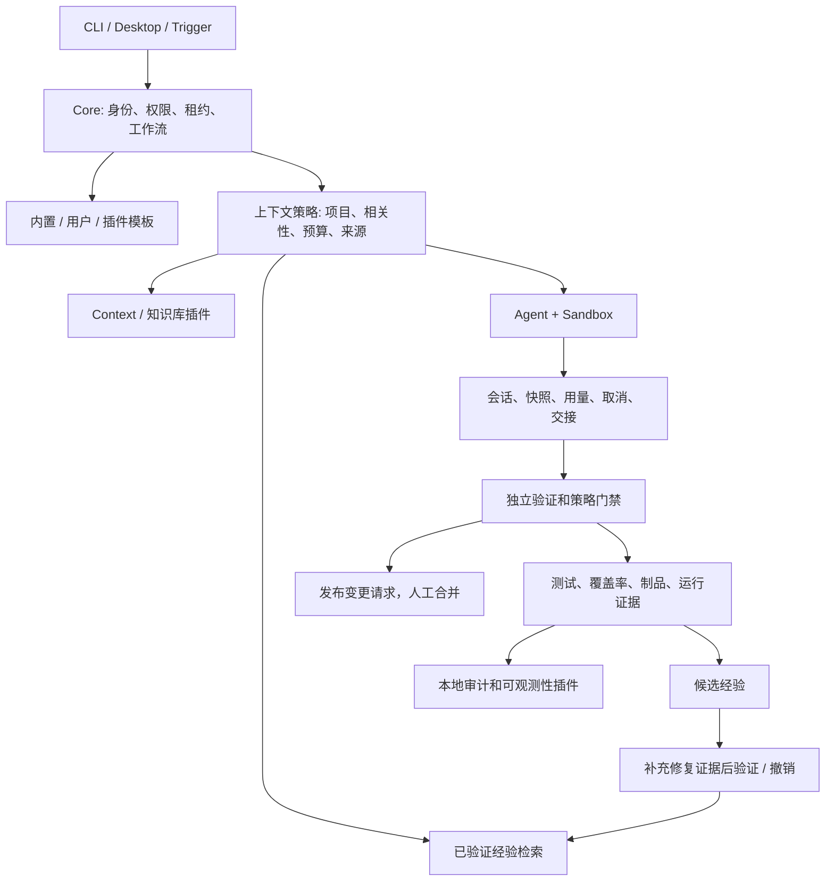

# 执行治理、经验复用与验证补充方案

对应的实施清单：[English implementation plan](2026-11-08-runtime-learning-and-validation.md)。用户已授权补完方案后持续实现、验证，中间无需再次确认。

## 目标和边界

形成可运行的闭环：任务开始前检索相关经验，执行中治理会话和预算，失败时保存原因及证据，修复经过验证后形成可复用经验，后续相关任务实际获得这些经验。

Core 保留身份、权限、租约、预算、状态机、验证和发布门禁。插件提供 Agent、Sandbox、Context、知识检索、验证器、制品和观测后端。经验只能提供建议，不能自动修改权限、跳过测试或合并变更。

## 当前缺口

| 能力 | 已有基础 | 本轮补齐 |
| --- | --- | --- |
| 上下文管理 | 代码、知识库、检索、项目记忆及生命周期组合 | 接入真实执行，限定项目、相关性、大小和来源 |
| 执行引擎 | 类型化工作流、租约、清理、中断及预算 | 插件组合、失败恢复和独立验证的交叉测试 |
| 工作流模板 | YAML 校验、编译及插件注册 | 确保插件注册的模板可被执行引擎选中 |
| Hooks | 初始化、执行前后、发布前和清理 | 必需 Hook 阻断；逆序清理；不能绕过 Core |
| Agent 会话 | 原生快照、校验和、交接回退、用量和所有权 | 损坏恢复、跨代预算、取消和重复失败终止 |
| 经验沉淀 | 结构化失败诊断和复盘报告 | 候选、验证、撤销、去重、过期和下次执行复用 |
| 知识仓储 | 本地文件及 HTTP 片段检索 | 将知识查询与经过验证的经验分开，隔离项目 |
| 测试覆盖 | 已有测试及根报告配置 | 实测行、分支、函数覆盖率和 CI 门禁 |

## 架构

## 标准协议

1. **上下文**：沿用 `gather({scope, prompt, limit}, options)`，返回带来源的片段。外部内容始终是待判断的数据。内容写入受控上下文文件，提示词只放有限大小的引用；读取失败必须可见。
2. **模板**：沿用工作流 schema，包含类型化 Agent / System 步骤。显式文件优先，插件停用后不能继续选用其模板，缺失模板在启动 Agent 前报错。
3. **Hooks**：沿用 `init / before-agent / after-agent / before-publish / cleanup`。必需执行前、发布前 Hook 失败即阻断；清理逆序执行，清理失败不阻止其他清理。
4. **经验**：包含指纹、项目作用域、触发条件、根因、建议动作、证据、来源运行与工作项、时间、有效期、出现次数。状态为 `candidate / verified / revoked`；仅相关、有效且已验证的经验可进入后续执行。
5. **经验操作**：`recordFailure / list / recall / verify / revoke / close`。重复失败合并计数；验证必须提供额外证据和运行引用。执行成功不能自动证明某条建议正确。
6. **会话治理**：保留 Provider 原生会话标识与系统运行、工作项标识的区别。恢复不重置 token、时间、交接或重试预算；只取消当前运行拥有的进程。未知所有权不能按名称强杀。
7. **测试证据**：真实运行、本地服务或命令模拟、未配置外部服务分开报告。测试数与代码覆盖率分别统计，覆盖率包含未执行源码及报告范围。

## 实施及验收顺序

1. 并行补齐本地、HTTP、Host / Trigger / 执行插件矩阵，检查实际文件、请求、命令参数、禁用、拒绝和失败结果。
2. 使用已有 SQLite 工具实现经验账本，验证去重、持久化、并发、项目隔离、验证、撤销、过期和检索预算。
3. 接入失败诊断、执行上下文和 CLI 管理入口；验证“失败记录 → 补充修复证据 → 验证 → 下次任务获得经验 → 撤销后不再命中”。
4. 补齐模板实际选择、Hook 阻断、快照损坏回退、预算持久化、中断清理和重复失败终止的交叉验证。
5. 收集实测覆盖率，输出 JSON、LCOV、HTML，接入 CI；Desktop 单独统计，不能混入共享运行时报告。
6. 按包执行构建、类型检查、测试，运行架构和文档校验；使用本地 Claude 走查合适的真实 wiki backlog 任务。
7. 写入实测结果与外部前置条件，提交、推送并发布可评审变更请求，保留人工合并边界。

## “越用越智能”的验收口径

衡量经验命中、重复失败次数、验证与撤销状态，以及后续运行是否实际接收经验。只生成复盘文档、只存聊天记录、只注册插件接口均不算闭环完成。目标是减少有证据的重复错误；不能承诺模型永远不再犯错。

## 补齐阶段：插件运行与治理

基于已发布基线继续，复用已完成工作。隔离子任务分别负责工作区清理、持久化触发器、证据上传、经验交换、仓库生命周期和桌面接入；主任务负责共享契约、命令注册、版本与最终验收。

- [x] 兼容旧执行清单的只读检查；显式指定清理目标，拒绝活动、脏、未知和越界路径。
- [x] 将 Linear/Jira 条目按稳定来源与幂等键导入真实代码仓库的受管 backlog，保留规范任务身份；仅同步显式选择的外部字段和状态。
- [x] 接入可验证的仓库准备、检出、发布和清理，能力声明与所有权检查必须真实。
- [x] 按配置上传证据，保留本地完整性并记录远程来源与失败。
- [x] 认证后持久化触发器回执，重启恢复待投递事件，支持有界重试、重放及重复检测。
- [x] 从独立 QA 证据沉淀成功经验；交换记录始终作为候选，分别统计检索、显式采纳和重复故障。
- [x] 桌面端通过 Runtime 公共服务提供浏览器 OAuth 和项目范围内的经验管理。
- [x] CI 启用实测源码覆盖率基线；已配置外部服务的真实检查与模拟测试分别报告。
- [x] 集成审查、按包构建测试、更新双语操作文档并推送可评审变更，不合并。

## 补齐阶段实测证据

11 月 9 日重新验收使用 macOS arm64 / Node 24.18.0，进程访问不受限，未使用进程探针替身。
CLI `0.2.43` 已通过标准安装器安装到本地入口和 PATH 优先入口。

- 集成修复：远程工作区与特殊 Git backend 的 `snapshot` 恢复原有仓库标识契约（编码路径段、
  本地绝对路径 / HTTPS URL），保留对 `.` / `..`、编码点段、控制字符、凭据 URL 和参数注入的
  拒绝；新增 2 项 Provider 回归测试。Webhook 无效 JSON 的 E2E 补齐 HMAC 签名，backend 失败
  断言改用脱敏后的错误消息，并新增 1 项 listener 警告回调测试以补齐 CLI 函数覆盖。
- 静态与构建：`git diff --check`、类型检查、工作区构建、Desktop 生产构建通过；架构检查覆盖
  454 个源文件与 255 个桌面客户端文件、0 隔离项；文档检查 420 份文件、0 断链。
- 测试：共享包、CLI 与仓库的完整覆盖率运行通过 303 个测试文件、3858 项测试，4 项跳过，
  退出码为 0；真实进程组终止测试通过。Desktop 另行通过 948 项单测和全部 99 项 Electron E2E。
  真实 Claude Code 的 2 项集成测试使用已有本地配置目录通过。
- 覆盖率：行 49931/57021（87.56%）、函数 83.43%、分支 84.98%；逐包与总量均超过
  `scripts/coverage-baseline.json` 中保持不变的 11 月 8 日实测基线。CI 显式加载同一基线；
  Desktop 和独立子进程内部不属于该源码覆盖率分母。
- 已安装 CLI：5.2 MiB 发行包通过隔离离线安装和全部 23 个命令入口验证。实际安装版的
  webhook/制品验证通过认证接收、制品字节校验、重启持久化、单次尝试去重、分页、保留期、
  无效重放拒绝和正常退出；经 `fangcloud-jumpserver` 执行真实 SSH 命令退出码为 0。
- 外部边界：Gmail 浏览器授权和用户确认收件已于 11 月 7 日通过，真实令牌刷新于 11 月 8 日
  通过；11 月 9 日刷新失败为 `token.network`，未再次发信。桌面浏览器真实授权/撤销、
  Linear/Jira、对象存储和远程工作区不能以模拟测试认定完成真实验收。Docker/Podman 当前
  不健康；插件仍为进程内可信代码模型，人工合并闸门保留。
- 交付：CLI `0.2.43`（实现提交含版本 bump）。远端核实 [PR #290](https://github.com/easyhaloo/afk/pull/290)
  已于 11 月 8 日合入 `main`，[PR #291](https://github.com/easyhaloo/afk/pull/291) 同日合入
  `feat/plugin-architecture`；后者集成树与本次验证的实现一致，其增量实现尚未进入 `main`。
  实现增量和验收文档在 `feat/plugin-acceptance` 向 `main` 交付，本次验收未执行合并。

## 前次基线与 wiki 验收证据

- 共享包、CLI 与仓库测试：3525 项通过、4 项跳过。源码行覆盖 47922 / 55041（87.06%）、函数 82.92%、分支 84.27%；Desktop 和子进程内部不计入这个覆盖率分母。
- 插件矩阵：本地 97、HTTP 27、执行 67 项，另有 1 项经验闭环 E2E，覆盖禁用、重新启用和撤销。
- Desktop：类型检查、921 项单测、3 项 Electron E2E 通过；真实 PTY 16 项通过，真实 Claude Code 本地集成 2 项通过。
- Node 22.17.0 的 SQLite 警告回归通过；工作区构建、类型检查、架构和文档检查通过。
- 基线 CLI 0.2.42：发行包、离线安装和全部 23 个命令入口在本次升级至 0.2.43 之前已验证。
- 真实 wiki 条目 `gitlab:w.src.corp.qihoo.net/fang/services/llm-wiki#21`：本地 Claude 受管运行 `plugin-matrix-wiki-claude-20261108-2` 通过独立 QA，已发布 [MR !198](https://w.src.corp.qihoo.net/fang/services/llm-wiki/-/merge_requests/198)。18 条事件的审计链完整，停在 `human_gate.opened`、闸门 `merge:198`，等待人工合并。
- wiki 验收：CSV 定向测试 4 项、既有页面测试 6 项、类型检查和浏览器断言 8 项通过。浏览器使用实际构建产物，并模拟一次 operations-summary GET；后端缺少该接口，Docker 当时不可用。因此验收范围为客户端文件下载、SHA-256 脱敏和 5001 行确认与取消，不代表部署后的后端全链路。前端全量测试为 263 项通过、7 项既有失败，已在干净基线上复现相同失败。
- 真实经验：前次 `qa.failed` 的 ENOSPC 故障已记录为 `15eb278e-6d24-4f36-9749-fdef1f03f4a7`，并以本次独立 QA 和发布证据完成验证。`experience recall` 与已安装的 `context.experience` 插件 `gather` 均返回了项目内的修复建议和来源。后续 Agent 注入与撤销另由经验 E2E 覆盖；本条真实经验保留供后续相关任务复用。
- 基线实现 `a5485dd6` 提供了 11 月 8 日覆盖率种子；当前交付、合并目标和安装证据见上。
