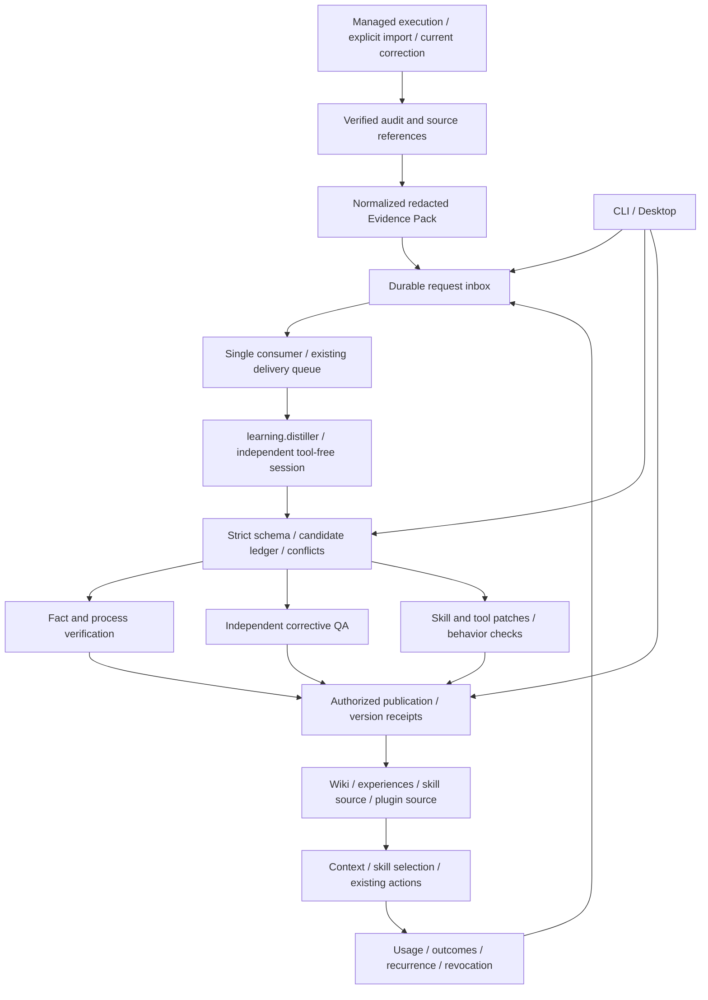
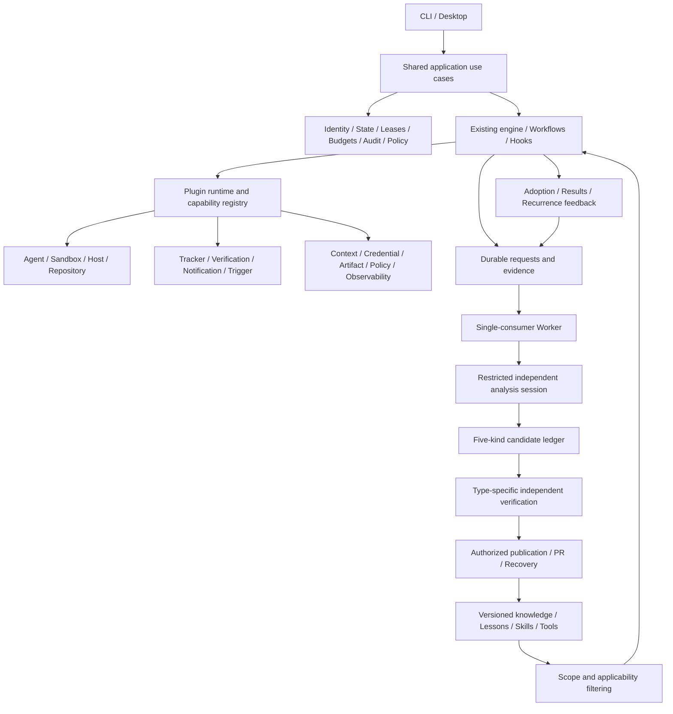
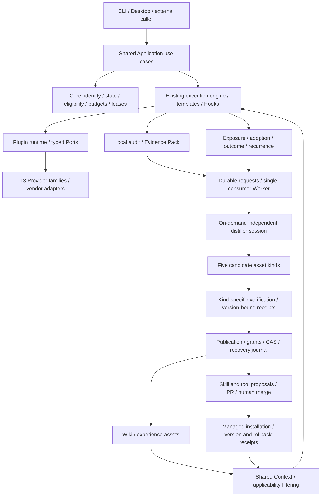
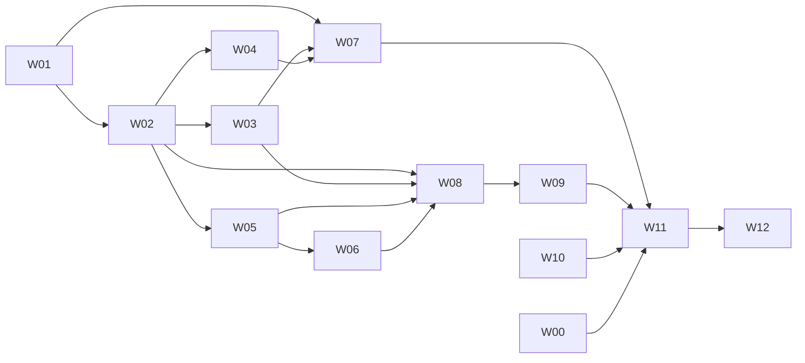
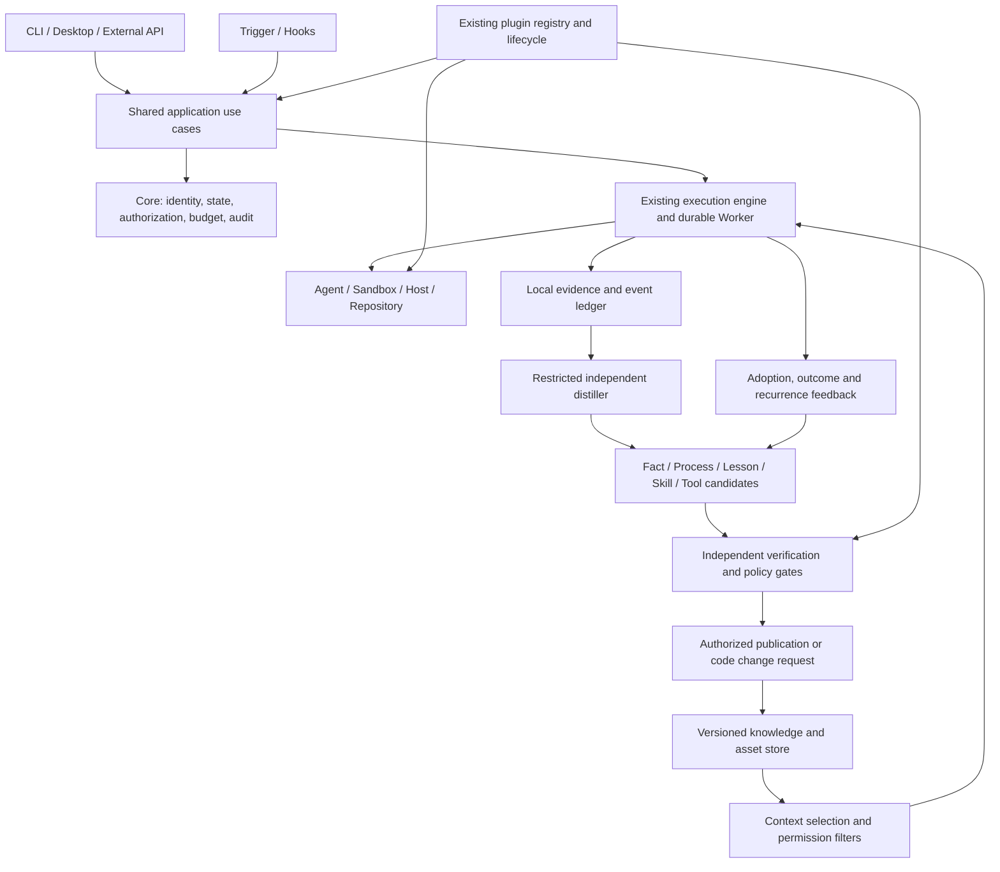
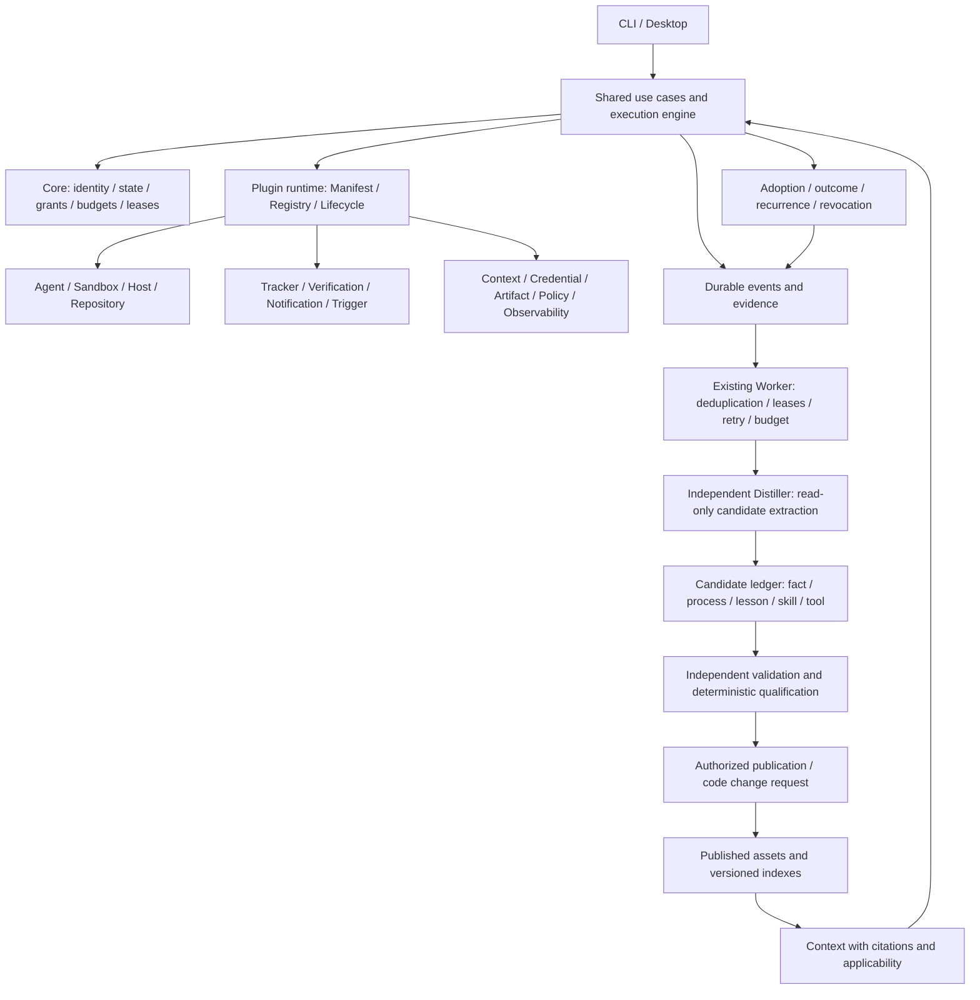
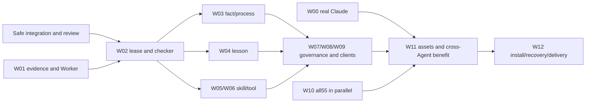

# Session Distillation and Reusable Assets Implementation Plan

**2026-11-20 historical control audit.** The four frozen environment and repair ledgers registered only the new edition. The three process revisions belonged to one candidate with a single committed publication. Across the three scenarios, zero of the six old-edition slots could be replayed. The historical experiment retains 12/18 observations. For the next study, freeze independently retrievable old and new releases and the scoring rules before the first consumer run.

**2026-11-20 installed release checks.** CLI 0.2.168 passed 24 recall checks for facts, processes, lessons and tools on fixed local cases. The local OpenCode 2.2.7 prompt adapter passed six skill checks. The two test filters left seven and three other tests unselected, respectively. These 30 checks count toward local recall regression. Production extraction and benefit studies use their own sample counts. The macOS arm64 archive passed ten release checks and an offline 0.2.166 → 0.2.168 upgrade with checksum rejection, configuration preservation and rollback.

**2026-11-19 tool reuse and edition comparison.** On installed 0.2.147, Claude produced a read-only manifest checker from a synthetic contract. Nine Docker checks qualified the source. Verification, explicit installation and a fresh OpenCode work item referenced the same digest. The consumer discovered the route, correctly identified three invalid lines out of six and preserved its input. An earlier draft failed verification. The independent prospective study ran eight preregistered Claude sessions on four paired tasks. Each experience edition answered three correctly. The updated edition used one fewer command and 1.262 seconds less in total, with 883 additional tokens. Offline rescoring reproduced the report. The original benchmark retains 12/18 observations.

In a local Claude marketplace, explicit rollback restored the original skill bytes. Refreshing the catalog exposed new behavior while the installed version still displayed 1.0.0. A rejected update left the skill unavailable until catalog repair. AFK's post-merge installation and its exposure to this host behavior require separate verification.

**2026-11-19 installed skill compatibility and macOS Keychain.** The installed guard passed 22 scope and routing cases. Claude Code 2.1.326 passed ten cases with a loopback model, covering manual loading, resource selection, denial and fallback in two skill editions. CLI 0.2.148 read a synthetic credential from a private file keychain through an explicitly scoped command. Its HTTPS consumer authenticated once. After item deletion a fresh CLI failed before sending a request. The runner verified cleanup and user keychain preferences. [Skill qualification](../../../tests/qualification/w05/README.md) · [Keychain qualification](../../../tests/qualification/w10/system-keychain.md)

**2026-11-19 business process qualification passed from development and independent QA through reuse.** Installed CLI 0.2.147 ran work item #750 with a local tracker and bare Git origin. Separate Claude implementation and QA sessions committed and checked two SQLite transitions. A third Claude session distilled both transcripts. An independent checker passed 13 assertions. After explicit publication to the private Wiki, fresh OpenCode work item #52 returned the expected steps, terminal state, version and source. All 40 private receipt checksums matched.

The paired benefit study has **12/18 observations**. Two pairs each covered environment setup, repair and a business process. All six pairs finished the task. The detour occurred in six runs without the asset and zero runs with the new asset. Environment runs used roughly 8,000 extra tokens each and one took 9.512 seconds longer. Repair saved six steps in each pair. Process saved two steps and one step respectively using the exact provider fragment delivered by the runner. Six old-version observations still require distinct authorized and verified earlier assets.

**2026-11-19 all 30 frozen cross-agent consumption cases passed.** Four new OpenCode sessions on the installed 0.2.143 release covered a mismatched precondition, a mismatched environment, a withdrawn lesson and a missing lesson. The provider returned zero fragments in each case and each native session wrote `{"fix":null,"source":null}`. Both active-profile controls retrieved the expected lesson. Each of the five asset types has six cases. Benefit measurements are tracked separately. On macOS arm64 the 0.2.147 CLI archive passed nine repository tests. Packaged Desktop 0.1.0 passed two publication, withdrawal and restart cases using a seeded fact, a deterministic checker and a loopback GitLab fixture.

**2026-11-19 cross-agent consumption covers 26/30 cases.** CLI 0.2.146 and OpenCode 2.2.7 exercised skill cases 01 and 03 through 06. Native sessions show one target skill load in the positive case and no exposure or load in the four inapplicable cases. Case 01 already counted toward the previous total. Facts, processes, skills and tools each cover six cases. Lessons cover two. Eight of the 18 benefit runs have recorded observations.

**2026-11-19 installed success review and tool controls.** On macOS arm64 0.2.146, `experience review --kind success` started with an empty job list and a synthetic QA event envelope from a real OpenCode SQLite transaction. Claude completed one analysis, the independent SQLite checker observed two transitions, and the CLI prepared edition 2. A separate publish command wrote the authorized temporary Wiki. A new OpenCode work item returned both steps and their source. The development task and QA event producer still need an integrated run. Tool cases 03–06 excluded the route in production, after revocation, before installation, and after uninstall. Four separately exported session hashes matched the receipts, and all four authorized controls returned version 2.0.2. Live consumption stands at 22/30, with 8/18 paired benefit observations.

**2026-11-19 live consumption covers 18/30 frozen cases.** Facts and processes account for six cases each. Skills, lessons and tools account for two each. In `skill-02` on 0.2.141, OpenCode loaded `reconcile-bags` through its native skill interface for the frozen alias question. The independent `lesson-02` replay on 0.2.143 verified 27 installed queries, two Claude attempts, four QA commits and eight OpenCode sessions. Work item #711 used the published second edition to correct a 5 mm offset to 0 mm. QA and publication referenced commit `372c3900`. Paired benefit observations stand at 8/18. Integration of the native guard for the four skill exclusions is in progress. On 0.2.146 the installed static scanner rejected TS2322 and accepted the corrected commit. The provider matrix now counts four account, six service, eight native, ten local, two partial and 25 fixture rows. Replay evidence is in `tools-146.QLOuxPbt/combined.IwkOfYKI` under `skill-02-replay.log`, `lesson-02-replay.log` and `static-scan.VauGpp/`.

**2026-11-19 installed tool reuse and repository QA.** The macOS arm64 `0.2.146` archive (SHA-256 `2460cc632272ffe7b8f16ae17340513d4eb6648730997e137945b202aaade8c7`) passed 23 command entry checks and nine repository QA cases. Shared grants bind the project, workspace, entry and dependency tree. Focused source tests passed 340/340. Two separate OpenCode work items discovered `tool.scan-manifest@2.0.2` by name and alias and invoked it through the installed CLI. Item #47 identified line 2 of three as invalid. Item #48 identified lines 1 and 4 of four. Both calls returned the expected exit code 1. Each answer matched the verifier and each input retained its original contents. The installed tool suite passed 7/7, including the two live Agent cases. Live consumption now covers 16/30 frozen cases, with 8/18 benefit observations. The tests installed the tool. Upstream distillation and delivery of the same tool from a Claude session remain open. Evidence is in `tools-146.QLOuxPbt/combined.IwkOfYKI`.

The full five-package 0.2.144 run recorded 8,793 passed, 117 skipped and two failures. The isolated snapshot omitted `Makefile`, and the branch publication test read Git state from its working directory. The 0.2.146 test snapshot includes the build file, and the test now verifies commit-before-push in its own temporary repository. The focused reruns passed 5/5 and 23/23 respectively.

**2026-11-19 installed managed repository QA.** Four of nine initial 0.2.145 installation tests failed when QA classified its own task context as an uncommitted change. QA now records a clean revision before preparing context and permits only the current run's untracked requirements file at agent launch. After execution it checks the file identity and contents, releases it, and verifies the whole checkout. The final macOS arm64 package `e783ad05a3be` passed 23 command smoke checks and all nine installed tests for local repositories, mounted remote workspaces, batch verification, hooks and replay using fixture agents. All 301 focused source tests passed. See `release-145.W5eKUXXc/installed-owned.log` and `qa145.Griom10p/joint-owned.log`.

**2026-11-19 cross-task lesson adoption and verified Git publication.** The frozen matrix reached 14/30 live cases and 8/18 paired benefit observations. In an independent installed build, work item #707 satisfied `lesson-01`. A fresh OpenCode session adopted edition 2 of a lesson extracted by Claude. Independent QA and the local Git remote recorded the same commit `519da0a0`. The synthetic label rig measured +4 mm initially and 0 mm on both reprints. This run had no benefit control. On the combined 0.2.145 source, all 300 QA, branch and repository regression tests passed, along with test and runtime type checks. A new real bare Git repository test rejects stale QA commits before push and confirms that moving the local branch during push still sends the verified commit to the remote. See `qa145.Griom10p/joint.log`.

**2026-11-19 full test results for 0.2.142.** The five-package run exited 0 with 8,793 tests passing and 113 skipped. Vitest worker coverage reached 90.13% for lines and statements, 88.22% for branches and 86.81% for functions. Desktop and separately spawned processes are outside these totals. See `coverage-142.8Tn4fDFl/full.log`.

**2026-11-19 skill routing and template verification.** Plugin 1.2.5 supports scoped recommendations through `recall-scope` and retains compatibility with previously installed editions. All 90 guard tests passed in a fresh checkout with the locked SDK. On CLI 0.2.144, ten workflow tests passed using fixture agents and prepared candidates. They cover implementation and conflict resolution reaching verification, analysis budget enforcement, publication preparation for success and repair reviews, and loading the built-in graphs. The installed CLI log is in `templates-144.4kVaEvRJ/installed.log`. The live cross-agent score remains 13/30.

**2026-11-19 cross-agent acceptance 13/30, benefit observations 8/18.** The installed 0.2.144 workflow runtime started real OpenCode, which loaded authorized edition 2 of `reconcile-bags` via its native skill tool. Comparing the handoff manifest with scanned bags, it identified missing bag B-147 and extra bag B-659. The receipt binds the installation, skill digest and native session. All nine repository and replay cases passed on the same package. When the second repository rejected publication, the work item exited with code 1, replay returned `failed`, both repositories retained their initial refs, and the server received zero MR requests. See `release-144.kyXvpqXt`. Ten suites passed 239/239 on the earlier 0.2.142 installation. The 0.2.143 self-update fix selected the invoked installation in a two-profile test recorded in `updater-143.ORBqpLEr`.

**2026-11-19 installed release and live reuse.** The macOS arm64 0.2.142 archive passed checksum and startup checks. Isolated installations passed six repository and verification-hook cases and two additional batch-gate cases. Rejecting the second repository yielded zero push requests. Both repositories completed verification before the first push in the success case. See `release-142.saPyl47d`. The packaged Electron learning GUI passed two tests on the SQLite slice and created its ledger with mode 0600. In the tool slice, managed OpenCode invoked an installed verifier and identified the second of three input rows as invalid. Integration into the combined build remains open. In work item #704 the product selected a published lesson at version 2 and OpenCode reduced an offset from 4 mm to zero. QA observed a dirty revision and publication used a different commit, so the CLI refused explicit adoption. Verified adoption and independently attributable benefit for this case remain open.

**2026-11-19 validation by version.** The isolated 0.2.140 suite passed 8,785 tests and skipped 105. Input digests matched before and after the run. Across the five scoped packages, lines and statements reached 90.11%, branches 88.28%, and functions 86.76%. Installed 0.2.141 passed six multi-repository, mounted-workspace and verification-hook cases using local Git HTTP, a shared filesystem and a fixture agent. That installation wrote its release package to the personal CLI store. The 0.2.142 working tree passed 112 candidate-store tests and all 19 installer tests, including profile isolation. A full build, regression run and release CI remain open for the combined changes. Receipts are in `coverage-140-isolated/full.log`, `remote-workspace-141/installed.log`, `candidate-locks-142-runtime.log` and `installer-isolation-142.log`.

**2026-11-19 cross-agent verification 12/30, benefit observations 8/18.** All six fact and six process cases passed. Two independent 0.2.139 profiles each published a process extracted from real return transactions and retrieved its unique source with the literal question. After the source read grant was revoked, OpenCode work item #56 returned four null fields. Source and Wiki page hashes stayed the same and the publication remained committed. In the second profile, CLI reconciliation withdrew the process. After the original authority record was restored, work item #57 still returned four null fields. The exported sessions contained 10 and nine messages respectively and contained neither the withheld source nor its state transitions. See `process-recheck-05-139.J5KgTr` and `process-recheck-06-139.oBToaT`.

The first revocation run reported a SQLite read error on a long-lived connection. A subsequent read-only `quick_check` of the retained database returned `ok`. Cross-process locking remains under investigation. The first withdrawal run returned an empty array for missing steps. Both cases ran again from fresh publication profiles with an explicit response format. Six real consumption cases each remain for lessons, skills and tools.

**2026-11-19 cross-agent verification 10/30, benefit observations 8/18.** Two independent 0.2.139 profiles recorded real OpenCode return transactions, Claude process extraction and Wiki publication. Pickup work item #54 returned four null fields. Switching off pickup allowed the original question to retrieve the publication. Work item `github:w11/parcel-archive#55` also returned four null fields. Its native session contained no process source or state transitions. The same literal question retrieved exactly one publication in the source project. Receipts are in `process-pickup-139.373mZm` and `process-project-direct-139.wAqK9y`.

The isolated 0.2.137 suite passed 8,775 tests, skipped 99 and failed one. Five-package coverage was 90.12% for lines and statements, 86.81% for functions and 88.27% for branches. A CLI wiring test detected GitLab from the isolated checkout and expected GitHub. Explicit tests for both platforms passed 3/3 in that file. The integrated 0.2.140 repository fix releases the managed task description before publication. Two installed tests used local Git HTTP repositories to verify publication through the human merge gate and rejection of an unrelated dirty file with no push. Both installed tests and 255 focused Runtime tests passed. The two label-repair experiments registered no old edition and their stores returned only the tested new edition. The historical comparison requires a separately authorized version receipt.

**2026-11-19 cross-agent verification 8/30, benefit observations 8/18.** On 0.2.138, neither of two real Wiki publications was retrieved by the literal paraphrase asking whether to check the bag ID or register the signature first. Instructions added by the workflow produced a hit in one case. When the normal score is zero, 0.2.139 also accepts two distinct Chinese character pairs matched in two different process steps. A fresh installation profile produced, validated and published the process from a real source session and Claude extraction. OpenCode work item #53 returned the two steps, source and product version. The literal question independently retrieved that source. Pickup and unknown pickup conditions yielded no results. See `process-alias-139.vmTFiE`. Three focused suites passed 198 tests.

Both arms of the second label repair pair reached 0 mm. With experience, actions fell from 11 to five, elapsed time fell by 30.006 seconds and usage fell by 38,126 tokens. The experiment runner injected selected experience. Explicit product adoptions remained zero. See `benefit-repair-repeat2-135` for independent replay. Installed 0.2.138 checked out, leased, published and released two local Git HTTP repositories. All 21 events passed integrity checks and the run reached the human merge gate. This test used a title-only requirement and a fixture agent. A nonempty task description generated `.afk/backlog-context.md` and blocked publication in a separate run. See `repository-managed-local-138`.

**2026-11-19 cross-agent verification 7/30, benefit observations 6/18.** On installed 0.2.138, managed OpenCode performed the process-01 transactions, Claude extracted the process, and an independent checker verified its conditions before Wiki publication. Another OpenCode session in a new work item answered the original question with both steps, the source and version. Retrieval returned no results for pickup or unknown pickup status. Version 0.2.137 had introduced an extra machine prerequisite that prevented recall after publication. Version 0.2.138 checks all three condition sets against the source during validation and publication. Six focused suites passed 431/431. Three installed integration suites passed 30 tests with six skipped. See `process-routing-138.B3uYXi`.

Both sessions in the first label repair pair reached 0 mm. With experience, redundant adjustments fell from two to zero and actions from 11 to five. The experiment runner supplied the experience selected by the installed CLI to Claude. Automatic product adoption remains open. See `benefit-repair-135` for offline replay. Seven tests failed in the 0.2.135 full run during concurrent changes to shared build output. Isolated 0.2.137 coverage and final-commit release qualification are tracked separately.

**2026-11-19 benefit observations 4/18, cross-agent verification 6/30.** In the second environment pair, both independent Claude sessions returned the correct record. Without the experience Claude searched staging and production. With it Claude read the catalog and queried only staging, took 17.688 fewer seconds, executed one additional action, used 8,014 more tokens and had one tool request denied. Duration moved in opposite directions across repetitions. Both avoided the unrelated read and incurred higher cost. See `benefit-repeat2-135` for the offline replay and byte-for-byte report verification.

The first live process extraction matched both SQLite-audited steps. Its declared session citations caused 0.2.135 validation to refuse publication with `insufficient_evidence`. The 0.2.136 prompt requires complete observed evidence for the whole process and each step. Two focused suites passed all 132 checks. The offline installer and startup check passed. During the 0.2.135 coverage run a concurrent build replaced shared output and triggered module-loading failures in the HTTP suite. All 27 HTTP cases passed against an independent 0.2.136 installation. Final-commit coverage remains open.

Repository workflow and QA routes require a lease spanning task execution and a locally executable checkout. Of the three built-ins only `multi-repository` currently implements `withLifecycleLease`. `remote-workspace` and `special-git-backend` can serve snapshots and protocol lifecycle operations. Both need a managed lease and trusted execution location. All three managed end-to-end lifecycles remain open.

**2026-11-19 cross-agent verification 6/30, benefit observations 2/18.** On installed 0.2.135, Claude extracted and published a fact in each of two isolated profiles. After two current authorities disagreed (`fact-05`) or the sole authority expired (`fact-06`), OpenCode returned three null fields in independent work items #47 and #48. Both runs retrieved zero fragments. Their native sessions contained neither the rule nor its source. Restoring the authorities made the same query retrieve the original publication. The six fact cases comprise two adoptions and four correct exclusions.

In the first matched environment pair, both real Claude sessions returned the correct staging record. Without the experience fragment Claude also read production. With the fragment it read the catalog and queried only staging, using one additional action, 9.512 more seconds, 8,391 more tokens and an estimated $0.01907 more. The experiment runner injected the fragment retrieved by the installed runtime. The old-version arm and further repetitions remain open. The main worktree replayed the archived traces offline and reproduced the report byte for byte with its current reporter. Evidence lives under `.codex/validation/request-lifecycle-20261118/fact-01-worker/` in `managed-opencode-135/fact-05`, `managed-opencode-135/fact-06` and `benefit-pair-135`.

**2026-11-19 cross-agent verification 4/30, benefit observations 1/18.** On installed 0.2.135, OpenCode answered the `fact-02` paraphrase in work item #45 with the correct rule, full source and product version. For `fact-03`, work item #46 in a separate project produced a null answer and its native transcript contained no source markers. A control query against the original project returned the source. The first isolation trial timed out at 120 seconds after the agent searched elsewhere when its input file was missing. The next trial made the end of the input lookup explicit. The four cases comprise two adoptions and two correct exclusions. In the first benefit observation, real Claude looked up a staging record in an isolated log snapshot and also read a production result. The no-memory run took 23.031 seconds and executed two tool actions. Paired effects await further observations.

The full workspace Runtime suite passed 7,341 tests and skipped 52. The CLI suite passed 925 and skipped two. Workflow and QA have repository routing, with 53 checks using fixture providers. The installed CLI passed 15 checks with local Git, backend commands and loopback HTTP. Each of the three built-in repository providers still needs full managed work-item lifecycle verification. Receipts are under `.codex/validation/request-lifecycle-20261118/fact-01-worker/` in `managed-opencode-135/`, `benefit-baseline-135/`, `full-runtime-135-preview-rerun.log` and `repository-installed-135.log`.

**2026-11-19 installed cross-agent verification 2/30.** Two fresh managed OpenCode sessions on 0.2.135 received the same frozen question in separate work items. For `fact-01`, the session cited the published manual redirect rule for product version 2.0. For `fact-04`, version 1.0 returned three null fields. The provider returned zero sources and the 13 exported session messages contained neither the rule nor its source markers. Querying the same copy with version 2.0 recovered the source. The two cases count as one adoption and one correct exclusion. Receipts are under `.codex/validation/request-lifecycle-20261118/fact-01-worker/managed-opencode-135/`.

**2026-11-18 cross-task adoption 1/30, benefit observations 0/18.** On installed 0.2.134, a fresh managed OpenCode session answered the frozen post-seal redirect question in work item `github:w11/parcel#43`. Its answer file gave the manual-review rule, the full Wiki source and parcel version 2.0, matching edition 2 of the fact published from a real Claude analysis. The run, publication and answer are stored in `.codex/validation/request-lifecycle-20261118/fact-01-worker/managed-opencode-134/`. All 30 local recall cases also passed on this installation.

**0.2.135 process completeness.** The independent workflow required archiving the receipt after publication. A candidate omitting that action previously passed because the terminal state was unchanged. Validation and publication now require the total number of independently observed steps. The related runtime suites passed 489 tests. Installed validation and recall passed 19 tests with 4 skipped. Ten installed template tests passed, exercising local Git commits, conflict resolution and a successful review preview with local agent and tracker fixtures. See `process-completeness-green.log`, `process-installed-135.log` and `workflow-templates-135.log` in the same evidence directory.

**2026-11-18 installed 0.2.134.** In the isolated parcel redirect scenario, the SQLite operation receipt recorded the policy identifier, applied rule text and resulting address change. One real Claude call extracted a fact. The independently configured checker validated it, the CLI published it to the test Wiki, and `context.knowledge` retrieved edition 2 of `seal-cutoff` for the frozen Chinese business question. Version 0.2.133 translated the rule from a comparable receipt and failed validation. The prompt now preserves observed policy identifiers and rule text, with room for natural language in the title and statement. Semantic verification of free-form claims from raw observations remains open. See `.codex/validation/request-lifecycle-20261118/fact-01-worker/policy-receipt-134.log`.

**2026-11-18 installed verification.** The same 0.2.132 CLI and Runtime installation passed 237 checks in ten suites and all 30 frozen recall cases across five asset families. Real Claude produced one candidate from the synthetic release approval evidence. Replay made zero additional calls. See `matched-ten-suites.log`, `five-assets-rerun.log` and `TEST-REPORT.md` under `.codex/validation/request-lifecycle-20261118/installed-132-live/`.

On the parcel redirect case, 0.2.132 rejected a process candidate that omitted an evidence gap. Version 0.2.133 uses one gap predicate for prompting and validation and passed 23 packaged startup checks. One real Claude call produced a fact and a process candidate. The fact summarized a successful QA run and omitted the post-seal review rule and publication target. Independent validation returned `unauthorized`. Wiki publication and second-agent adoption remain open. See `.codex/validation/request-lifecycle-20261118/fact-01-worker/live-133.log`. Cross-task adoption is 0/30 and benefit comparisons are 0/18.

With business labels on the SQLite result columns, one call on the same 0.2.133 installation extracted the direct pre-seal update and the post-seal manual review with the original address retained. The fact supplied `wiki:seal-cutoff` and one evidence reference. Its English subject and rule differed from the authority's subject identifier and Chinese rule. Independent validation returned `assertion_failed` and publication did not run. See `live-133-business-observation.log` in the same directory.

**2026-11-18 workspace 0.2.132.** Real Claude returned a Markdown fence for the fictional release-approval fixture. The previous run reported `MISSING_RESULT` with exit code 0, a matching session and zero tool calls. Restricted analysis now reads JSON inside a single complete fence. With the rebuilt Runtime the same E2E produced one candidate in one model call, replay made zero additional calls, and source invalidation moved the candidate to conflict. The focused regression suites passed 138 checks and skipped one. See `.codex/validation/request-lifecycle-20261118/recall-131/live-fence-fix.json`. Independent adoption across tasks remains at 0/30.

**2026-11-18 installed 0.2.131.** The externally installed CLI and Runtime passed 237/237 CLI E2E tests across ten files. All 30 frozen local recall cases across five asset families passed (33 checks passed overall, two duplicates skipped). The installed Runtime also passed the callback redaction check. On generated evidence, the bounded worker’s single real Claude attempt ended in `analysis_failed` with unknown usage and zero candidates. Real second-agent adoption remains at 0/30 and benefit comparisons at 0/18. See `.codex/validation/request-lifecycle-20261118/recall-131/`.

**2026-11-18 installed 0.2.130 remote-container loopback.** On the same host, the service returned HTTP 401 for unauthenticated health and 403 for an unlisted provider. The allowed probe exited 0 in an Alpine 3.20.10 Docker container. Its hostname matched the bind-mounted output, and closing the sandbox removed the container. See `.codex/validation/remote-container-installed-20261118/attempt-zzvkne/events.ndjson`.

**2026-11-18 desktop acceptance.** Two Playwright cases launched a locally built macOS arm64 `AFK Control.app` with an isolated profile and verified that Electron loaded the UI from `app.asar` in packaged mode. Both validated and published Wiki knowledge through Settings, observed it through shared context, invalidated the source, and confirmed that withdrawal survived an app restart. The project inventory came from a loopback GitLab fixture. The tests used a fixed candidate and checker. Another 18 source GUI cases passed, covering concurrent correction deduplication, missing and conflicting QA, experience verification and revocation, and persistence of workflow graph edits. Build, archive digest and both GUI logs are in `.codex/validation/request-lifecycle-20261118/desktop-packaged-130/`. End-to-end task execution for the three workflows remains open.

**2026-11-18 combined acceptance update.** One run observed all 30 frozen local cases, six each for facts, procedures, lessons, skills and tools. The CLI and Runtime used the external 0.2.130 installation. Tool discovery used a separate package archive. Skill routing used fresh local OpenCode sessions and an installed adapter. Three additional checks passed and two duplicate workspace cases were skipped. Real sessions reviewed by independent QA and adopted by a second agent stand at 0/30, with 0/18 benefit comparisons. See `.codex/validation/request-lifecycle-20261118/recall-130/five-assets-combined-installed.log`.

The same CLI installation ran the Docker provider on `alpine:3.20`, verified its bind mount and removed the owned container. A local OpenTelemetry Collector 0.165.0 received the expected span and a counter value of one. See `installed-docker.log` and `installed-otel-collector.log` in the same directory.

The full coverage command exited zero with 8,755 passes and 75 skips. Scoped line coverage reached 90.12% and branch coverage reached 88.25%. Application branch coverage reached 92.47% with zero policy violations across the report. Input manifests differed during execution. The final commit still needs its own run. See `completed-report.md`, `before.sha256` and `after.sha256` under `.codex/validation/request-lifecycle-20261118/frozen-130-rerun/`.

**2026-11-18 combined local run across five asset families.** Local observations passed 28 of 30 frozen recall cases. Facts, procedures, lessons and tools each passed six. Skills passed four. The externally installed CLI installed and invoked tools using a discovery plugin sourced from the workspace. Skill checks used fresh local OpenCode sessions and the workspace adapter. Project isolation and version filtering remain open for skills. The runner reported 30 passes including two scoring self-checks, two duplicate cases skipped, and two pending cases. Real cross-agent observations stand at 0/30. See `.codex/validation/request-lifecycle-20261118/recall-130/five-assets-local.log`.

**2026-11-18 installed CLI and desktop regression checks.** The external 0.2.130 CLI and Runtime passed all ten CLI E2E files (237 tests) with local endpoints for remote services. Eight desktop files covering learning and experience contracts, IPC, services and view components passed 264 tests. The preceding full suite recorded 8,752 passes, three failures and 75 skips. Application branch coverage reached 295/319 (92.47%) against a 92.06% floor. Both suites involved in the failures (authority read access and lesson alias receipts) passed together on the current sources, 75/75. See `.codex/validation/request-lifecycle-20261118/recall-130/installed-ten-suites.log`, `recall-130/current-runtime.log` and `frozen-130-rerun/` under the same validation directory.

**2026-11-18 external installation of 0.2.130.** Six frozen cases each for facts, procedures and lessons passed with two scoring checks, for 20 passes. Two duplicate workspace-only cases skipped. Conflicting or expired authorities suppressed published facts and restoring the sources retrieved the same publication. A symptom alias observed by the independent checker retrieved the lesson for a paraphrased question. The installer checked 23 command entries. Archive SHA-256 was `849509a62ccc4f050bda7173892559adb7adda211a8660f08adfed8bad0a6540`. See `.codex/validation/request-lifecycle-20261118/recall-130/installed-w11.log`. These cases use local fixture assets. Real second-agent observations remain at 0/30.

**2026-11-18 installed plugins and workflows.** The same external 0.2.129 CLI and Runtime passed the ten CLI E2E files. Plugin matrices, learning routes and observability passed 226 checks. Workflows, the local plugin and the lesson lifecycle passed another 11. External endpoints used controlled fixtures. See `integrated-plugins.log` and `cli-workflow-lifecycle.log` in `.codex/validation/request-lifecycle-20261118/source-access-129/`. The macOS identity regression sampled the initial identity with system ps and checked the target PID on the simulated identity change. It passed 12 consecutive independent runs. The guard and runner suites passed 50 checks with one platform skip. The benefit report reads native session IDs from observations, rejects reused sessions, and preserves raw measurements with unknown session identity while leaving paired gains empty. All seven reporting tests passed.

**2026-11-18 recall across three asset families on one installation.** The same external 0.2.129 installation passed 15 frozen cases (four facts, six procedures and five lessons) and both scoring checks. Lesson cases cover named product editions, applicability filtering, withdrawal and a clean profile. The paraphrase case `lesson-02` remains a todo. See `.codex/validation/request-lifecycle-20261118/source-access-129/combined-w11.log`. These cases use locally constructed published assets. Real second-agent observations remain at 0/30.

**2026-11-18 source read revocation.** On an external 0.2.129 installation, `process-05` first retrieved the published procedure. After revocation of its source read grant, two fresh CLI processes returned an empty result for the same query. The test checked the original evidence and wiki page bytes, the publication key, candidate ID, evidence digest and committed state. Ten frozen fact and process cases and two scoring checks passed. The archive SHA-256 was `754e2514e414ad2e537d8f9e986a3cff157e37ca7dd818a815567a7279e21ff7`. Results are in `.codex/validation/request-lifecycle-20261118/source-access-129/installed.log`.

**2026-11-18 full coverage results.** The 8 GiB rerun produced reports for five packages. Lines and statements reached 90.06%, functions 86.77%, and branches 88.20%. Application covered 292/318 branches (91.82%) against its 92.06% minimum. The run recorded 8,743 passes, one failure, 64 skips and one todo. The macOS PID identity test failed in isolation and passed once after adding guard exit diagnostics. Its stability remains open. Two execution-history regressions now exercise independent QA failure summaries, reasons and codes. All 80 application tests passed in isolation. The full report was retained in `.codex/validation/request-lifecycle-20261118/full-coverage-rerun-report.md`.

**2026-11-18 Chinese business alias recall.** Installed release 0.2.127 returned no fragments for `fact-02` because segmentation split the declared alias 截单点 into individual characters. Knowledge retrieval in 0.2.128 also matches exact Chinese titles and parenthesized aliases in the statement. With a fresh external installation, both the full question and the alias alone retrieved the same published edition. The partial name 截点 returned no fragments. Nine frozen fact and process cases and two scoring checks passed, with independent source read revocation tracked by `process-05`. The results are in `.codex/validation/request-lifecycle-20261118/alias-128/installed.log`. Separately, the 0.2.127 experience provider returned an empty result for a fresh profile and reproduced a missed published lesson when the query named the product version. Real second-agent observations stand at 0/30.

**2026-11-18 coverage and benefit evaluation.** The first full run recorded 8,719 passes, 23 failures and 55 skips. Three fixtures needed the current prompt result shape, a local linked Git worktree with a resolvable HEAD, and an existing verification directory. The three files passed 59/59 after the fixes. Test typechecking passed. V8 exhausted its approximately 4 GiB heap during reporting. The rerun uses an 8 GiB heap and the original baseline. Logs are in `.codex/validation/request-lifecycle-20261118/`.

The installed CLI passed seven frozen cases against temporary wikis. The fact cases covered retrieval of the correct edition and exclusion of the wrong edition. The process cases covered the original phrase, an alias, pickup and cross-project exclusions, and exclusion after withdrawal and restart. Together with the scoring checks, nine tests passed. Independent source read revocation in `process-05` awaits verification. Run `node scripts/learning-benefit-report.mjs --help` for the protocol covering three scenarios, two repeats and three asset assignments. Task success uses the frozen acceptance check and its evidence. Unchecked success stays unknown. The report records terminal status separately. All six report tests passed. All 18 real comparisons await collection.

**Installed provider matrix and recall evaluation, 2026-11-18.** The CLI and runtime from the same 0.2.127 installation passed 101 local provider checks, 27 loopback HTTP checks and 71 execution checks, for 199 total. Execution fixtures cover six agents across four sandboxes and four hosts across four triggers. The log is `.codex/validation/request-lifecycle-20261118/installed-matrix.log`. `tests/e2e/w11/recall-v1.ts` freezes six cases per asset family, including input, applicability and expected edition, with ten expected hits and twenty exclusions. Second-agent observations and eighteen benefit comparisons are pending.

**Learning runtime regression, 2026-11-18.** Fifteen independence checks now create an analysis attempt, atomically save its output and finish the attempt, then exercise delayed identity registration. The sandbox budget test allows time for SQLite ownership registration while still asserting rounding and output limits. Across 13 files, 966 tests passed and one was gated on Docker. The gated test passed separately with a pinned local Node image, checking two executions, cleanup and candidate state when business coverage is insufficient. Test typechecking passed. The final 0.2.127 archive checksum matched and all 28 installed CLI checks passed. Source logs are in `.codex/validation/request-lifecycle-20261118/`. The installed log is `.codex/validation/installed-learning-0.2.127.pGLFro/ipv4-projection/installed-regression.log`. Live cross-agent adoption and benefit measurements remain open.

**W09 packaged knowledge publication and withdrawal (2026-11-18, CLI 0.2.127).** The macOS arm64 development package passed both hostname and IPv4 project checks using an externally installed CLI, a loopback GitLab fixture, a seeded fact, a test checker, an isolated test keychain and a temporary Wiki. Production Settings validated, previewed and published a page that was readable through recall. After source invalidation the page carried a withdrawal marker. Restarting the app and replaying the old publication request returned the withdrawal and recall stayed empty. The IPv4 project used a digest-bound public identifier. Its page contained no original IP. Evidence is in `.codex/validation/installed-learning-0.2.127.pGLFro/ipv4-projection/desktop.log`. The parent directory contains `final.log` and `prepare-diagnosis.log` for the privacy rejection on the earlier build of the same version.

**W09 installed publication diagnosis (2026-11-18, CLI 0.2.126).** The macOS arm64 development package used an isolated Chromium test keychain and loopback GitLab fixture. Production Settings loaded two projects, rejected incorrect scope and version, and validated a candidate from v1 to v2. Preparing the knowledge preview failed. The installed CLI independently reproduced `knowledge_publication_source_unavailable` for the same project with an empty publication ledger. Evidence redaction replaced the IPv4 address in the work item identity before a literal source comparison. A control project without an IP reached preview. Acceptance covers the correct project, rejection of other projects with the same redacted shape, and packaged publication and withdrawal. The desktop failure is recorded in `.codex/validation/installed-learning-0.2.126.UJkt32/desktop-preview-diagnosis.log`.

**W09 desktop package (2026-11-18).** The local macOS arm64 development package 0.1.0 excludes Electron E2E entries. The archive check found the production main, preload, worker and renderer. With an isolated user profile the packaged app opened the experience and learning settings, disabled queries without project scope and rejected a query for an absent project over IPC. Packaged publication and withdrawal and signed distribution remain open. Evidence is in `.codex/validation/installed-learning-0.2.126.UJkt32/desktop-content.log` and the adjacent `desktop-settings-isolated.log`.

**W07/W08/W10 installed regression (2026-11-18).** Three additional E2E files ran against the same 0.2.126 installation. Learning template routing passed 16/16, candidate validation 7/7, and observability 2/2. The CLI ran in isolated workspaces. Validation used source fixtures to prepare SQLite data, a temporary Wiki and independent approval files to exercise process and lesson publication, recall and withdrawal. Observability loaded the installed Runtime, checked trace and metric export, HTTP 503 and re-enabling against a loopback HTTP fixture, and verified local evidence remained readable after a selected store returned mismatched bytes. The separate real local Collector qualification used 0.2.118. Per-case results are in `.codex/validation/installed-learning-0.2.126.UJkt32/installed-observe-routing-validation.log`.

**W08/W12 installation and experience compatibility (2026-11-18).** The offline darwin/arm64 0.2.126 archive passed three learning E2Es outside the repository using the installed CLI and Runtime, a model fixture and an independent audit fixture. In the same isolated home, 0.2.71 created one synthetic experience candidate. Version 0.2.126 read it intact and created a second candidate. Rolling back to 0.2.71 and upgrading again to 0.2.126 preserved both full JSON records. Each switch checked the installed CLI version. Evidence is in `.codex/validation/installed-learning-0.2.126.UJkt32/`. Other record types, cross-schema migration and failure recovery remain open.

**W10 catalog reconciliation (2026-11-18).** An independent read-only check compared the November 13 `provider-matrix.json` with the working tree's `configuredPluginManifests()`. Matrix SHA-256 was `19f3401ce59ff0f3739ddca34d35a53b62450cc5865b223575fe93015564de83`. The 13 families contain 55 unique acceptance rows. All 51 in-scope configuration IDs match by name, with `learning.distiller` listed separately. Trace and Metrics share a configuration ID. The November 13 snapshot records 52 wired rows and three partially wired Repository rows. Configuration, installation and live acceptance for the current source still require per-row run evidence.

**W04 first adoption after context selection (local CLI 0.2.126).** Two SQLite connections reproduced a first acknowledgement crediting a reverified lesson to a task that had selected only its earlier version. The adoption transaction now checks stored selections for that lesson, run and work item. Retrieving the updated version or selecting it for another work item leaves the count at zero. Selecting it for the consuming task permits one acknowledgement and idempotent replay. The ledger, outcome and recall suites passed 145 tests. Four compiled learning E2E suites passed 26 tests, including CLI rejection with synthetic audit data. The CLI and its dependencies built successfully. Test types, architecture and documentation checks passed. Live cross-agent adoption and benefit measurement remain open.

**W05/W06 catalog search before proposals (local CLI 0.2.125):** Skills and tools now use the existing lexical terms. Two regressions through proposal preparation failed before the fix and passed after it: an unspaced Chinese request finds an existing approval skill, and `port` no longer matches the unrelated tool `report`. All 88 tests in the proposal suite passed; the CLI and dependencies built successfully. These checks do not cover installation, a live model, cross-task adoption, or remote CI.

**W00/W01 no retry after executable identity changes (local CLI 0.2.124):** The worker previously recorded a generic failure, the request returned to pending on restart, and the CLI filtered out the diagnostic. The failed attempt and request block now commit together in SQLite, preserving existing source invalidation. Restarting does not analyze or reserve budget again for that request. `experience jobs --json` exposes the exact code. Worker/ledger (154), CLI command (434), and compiled learning E2E (26) tests passed. No live model was invoked. Trusted parent authorization and live experience reuse remain unverified.

**W00 pre-launch file check (local CLI 0.2.123):** Restricted analysis records file identity and change timestamps when selecting the executable and checks them before starting `--help` and analysis. A mismatch or unreadable identity returns `analysis_executable_changed` without starting the next stage. Two inert regression tests observed 1 and 2 guard calls before the fix, then 0 and 1; neither ran the modified file. All 17 selected Runtime checks and 26 compiled CLI learning E2Es passed. This does not atomically bind the signed release to actual execution. Trusted parent authorization, single-use accounting and independent closure evidence remain necessary. No live model was invoked.

**W03/W04 published knowledge recall (local CLI 0.2.122):** A temporary Wiki published Approval and Billing together. At limit one the previous provider failed five assertions, including the Chinese billing query and unrelated queries. Candidates are now ranked by distinct task terms matching business fields; no match returns nothing. Selected pages still require current authorization, source, version and applicability before consuming the 8000-byte and result limits. Both workflow and QA preparation include Approval for a relevant task and omit it for SQLite retry alone. Existing experience recall retained 24/24 positive hits and zero hits on 18 negatives; compiled CLI learning E2E passed 26/26. This used local processes and temporary data, not semantic retrieval, live Claude distillation, cross-agent adoption or benefit measurement. The first concurrent pnpm auto-install collided; the offline build with existing dependencies and automatic installation disabled passed.

**W00 restricted guard Node environment (local CLI 0.2.121):** The `--help` probe and analysis process share a guard. Before starting the guard's Node process, it removes `NODE_OPTIONS` and `NODE_PATH` from a copy of the child environment without changing the parent environment or ordinary agent startup. Both macOS regressions failed before the fix and passed afterwards: a model-free Node child saw neither setting with implicit or explicit environments, while `LANG` was preserved. Focused Runtime tests: 148 passed, one skipped; compiled CLI learning E2E: 26/26. CLI and dependency builds, test types and architecture checks passed. This does not attest the entire environment or bind the signed manifest to an actual launch. Trusted-parent single-use authorization and an independent close record remain open. No live model call or commit.

**W00 installed Claude release identity (2026-11-18):** Verified `2.1.326/manifest.json.sig` in an isolated keyring against the release signing fingerprint `31DDDE24DDFAB679F42D7BD2BAA929FF1A7ECACE` published in Anthropic's setup documentation. `gpgv` returned 0 for the original manifest and 1 (BADSIG) for a manifest with a changed platform size. Manifest SHA-256: `883e153b05d4a34e4225cdc90d692e4415ed4e46b26434b6430f128b6b8beb1e`. The signed `darwin-arm64` binary size (353037664) and SHA-256 (`e214ad76dcc0e846b03be28ed1c2734aacd4e27acb527cb7f8a9e2bed644e837`) both matched the npm-installed `claude`; strict macOS code signature verification passed. Public key, original manifest and signature are retained under `.codex/validation/claude-2.1.326-darwin-arm64-release/`. This identifies the binary at inspection time, not the entire npm package or a future launch. No model call or permit consumption. The trusted parent must still bind this expectation to the actual launch and final close record.

**W00/W01 single Worker launch claim (2026-11-18, local CLI 0.2.120):** Before the first probe, one SQLite write transaction checks the reservation's host, PID, nonterminal state, source blocking and processing receipt, and binds the first session identity. A replay is `analysis_outcome_unknown` and does not retry on restart; reading back the result identity remains idempotent. An inert analyzer reproduced duplicate admission and admission after source invalidation; the fix admitted one and zero respectively, with no budget refund. A separate Node process could not claim another process's reservation. If another caller completed a request before registration, its candidates and receipt remained intact. Three Runtime suites passed 188 tests with one skip; builds, test typechecking, architecture checks and all 26 compiled CLI learning E2E cases passed. The ledger claim does not supply trusted parent authority, installation identity or independent close evidence. No live model or commit.

**W00 identity registration before preflight (2026-11-18, local CLI 0.2.119):** The Worker records identity after executable resolution and before the first `--help` child. Registration failure and cancellation during registration each previously started one probe; both inert regressions failed before the fix and passed afterward. A late acknowledgement after registration times out cannot start either child. Three Runtime suites passed 184 tests with one skip; CLI and dependency builds, test typechecking and all 26 compiled CLI learning E2E cases passed. Registration is not launch authority; explicit retrospectives have no new permit requirement. Independent parent qualification of the installed invocation, atomic single-use authority and complete close receipts remain open. No live model or commit.

**W10 live local OTLP Collector (2026-11-18, darwin/arm64):** CLI 0.2.118 (archive SHA-256 below) was installed outside the repository under an isolated HOME, and both CLI and Runtime came from that installation. The official Collector 0.164.0 archive matched SHA-256 `8d8acf4ffce7fe1af35932d573d877d6a5ef395c29a18fda760711b800757e7d`. It listened only on loopback with OTLP/HTTP and the detailed debug exporter. The installed `plugin configure` selected `observability.otlp`, and the managed execution driver from `tests/e2e/observability.test.ts` exited 0. For service `installed-afk-collector-14750`, the Collector decoded a span for `github:acme/api#42`, the `afk.run_events_total` Sum and the `run.event_persistence_ms` Histogram. The local JSONL chain verified (run `collector-smoke-14750`, sequence 4, outcome `not_claimed`); the Collector shut down normally. This qualifies the installed trace/metrics path to a real local Collector. The work item and Tracker/claim path were fixtures; no Agent, remote backend, or remote Evidence service was exercised.

**W10 installed Evidence verification (2026-11-18; local CLI 0.2.118):** The standard packager produced a darwin/arm64 archive with SHA-256 `44c81cf3d170768195d50a1842b7c88d0a7cbac66aa3b473e12c11eff16d1b09`. The archive was verified and installed in a temporary HOME outside the repository; observability E2E passed 2/2 with both CLI and Runtime from that installation. After CLI installation of the fixture provider, neither an absent selection nor an out-of-scope project yielded any `put/get` calls; only the selected provider received an export. A readback byte mismatch produced a failure receipt linked to the source event; a separate process could still read the correct encrypted local evidence. The event chain remained valid and the run's terminal outcome was unchanged. Test typechecking passed. This uses a local provider fixture and loopback HTTP, not a live remote Evidence service, a real OTLP collector, or remote CI. No production code change or commit.

**W01 correction submission from both clients (2026-11-18; local CLI 0.2.118):** Compiled `experience correct` and a real Electron Settings click issued the same correction concurrently. Both returned the same request ID; the shared SQLite ledger added one pending request, and submission and replay neither analyzed nor modified the original candidate. With a deterministic analyzer in a separate Node process, two targeted runs of the real Worker recorded one successful attempt, one budget reservation and one processing receipt. Desktop observed the processed request and the unchanged original candidate. The focused test and both Electron suites (7/7) passed, as did E2E test typechecking. This qualifies the local correction entry points and Worker only, not live Claude, an installed release or remote CI.

**W01 queue saturation and crash recovery (2026-11-18; local CLI 0.2.118):** On a full queue, the Worker marks requests awaiting delivery `storage_blocked` and continues processing accepted deliveries. Global execution can prune successful deliveries under the existing seven-day retention policy; targeted execution neither prunes nor consumes other requests. A real Node subprocess was sent `SIGKILL` after the test analyzer recorded its identity. Restart preserved the original attempt and budget, marked the uncertain result `analysis_outcome_unknown` without retrying or refunding it, and completed another accepted request. Worker, intake and trigger queue passed 124/124; test typechecking passed. No live model call or commit.

**W00 Claude result session binding (2026-11-18; local CLI 0.2.117):** Six inert macOS regressions reproduced acceptance of missing or different session IDs, a later match masking a conflict, borrowing an ID from another frame, reusing an earlier candidate when the last frame lacked one, and accepting a bare completion marker. Guarded analysis now checks each native result frame against the requested session UUID; a later frame cannot clear a conflict. The last native result frame must carry its own candidate, without falling back to raw text or the logical Sandbox session name. Natural EOF and successful guard closure remain mandatory; ordinary agent execution is unchanged. All six regressions failed before the fix and passed afterward. Five focused suites passed 215 with one skipped; CLI and dependency builds, test typechecking, architecture checks, and compiled CLI learning E2E (26/26) passed. No live Claude call or commit. Local result binding does not qualify the installed identity and cold launch, independent complete receipts, or trusted-parent atomic authorization. W00 remains open.

**W00 Claude executable path binding (2026-11-18; local CLI 0.2.116):** Two inert macOS regressions showed that reordering PATH or retargeting the `claude` lookup symlink after preflight launched a different executable for analysis. The runner now selects an executable regular file from absolute PATH entries, resolves its real path once, and uses that path for both guarded launches. Ordinary agent execution is unchanged. Both regressions failed before the fix and passed afterward. Five focused suites passed 184 with one skipped; CLI and dependency builds, test typechecking, architecture checks, and compiled CLI learning E2E (26/26) passed. Path consistency does not freeze file bytes at the same path, the interpreter or its module dependencies. Nor does it qualify the installed identity, independent tail and close receipts, or trusted-parent atomic authorization. No live Claude call or commit; W00 remains open.

**W00 guarded analysis closure (2026-11-18; local CLI 0.2.115):** An inert local child reproduced early success on a result frame, killing a process with a pending tail, and recording success on timeout or with unread output. Guarded analysis now accepts a candidate only after natural EOF on both output streams and an actual guard `close(0, null)`. A late native error, nonzero exit, timeout or forced drain does not qualify. Ordinary batch semantics are unchanged. All five new regressions pass; streaming, Local Sandbox and analysis runner passed 135 with one skipped. Process guard and Worker passed 47/47, Runtime and CLI built, test typechecking passed, and compiled CLI learning E2E passed 26/26. No live Claude call or commit. This confirms local process termination only; trusted-parent authorization, actual installed identity, independent tail and close receipts, and an atomic single-use grant still block live Claude.

**W01 single Worker claim (2026-11-18; local CLI 0.2.114):** Two separate Node processes competing for one SQLite request produced two `started` attempts before the fix. The write transaction now rejects unresolved, exhausted and processed requests before charging, preserving identical `callId` replay and a permitted retry after failure. Losing a claim does not mark the owner's request as a storage failure, for either the first or the last allowed attempt. Ledger and Worker passed 145/145; Runtime and CLI builds and test typechecking passed; four compiled CLI learning E2E suites passed 26/26. No model call, Desktop or live plugin rerun, or commit occurred. This ledger fix does not establish W00 trusted-parent single-use authorization.

**W02 skill and tool verification grants (2026-11-18; local CLI 0.2.113):** Grants bind the exact candidate ID, version, candidate digest and evidence digest under host revision `proposal-validation-runtime-v4`; old grants are refused. Two focused suites passed 167/167; an overlapping six-suite run passed 331 with one skipped. Grant binding does not qualify the production skill interpreter, tool permission refusals, or recovery.

**W05 skill input isolation (2026-11-18; local CLI 0.2.112):** After verifying the full committed tree, skill validation stages only the selected `SKILL.md`, its declared resources and their parent directories. The original and amended skill share identical non-skill bytes; new skills do not stage an original. Tests inspect the actual build archives with a simulated Docker backend. Tool validation keeps the existing input. The production skill interpreter, trusted launcher and host-owned behavior observations are still pending.

**W05 native skill protocol probe (2026-11-18):** Claude Code 2.1.326 ran in separate temporary homes and working directories under macOS host isolation, with a loopback-only SSE model fixture. Three cases passed for each of the original and proposed skills: explicit invocation loaded only the selected skill body and native `Read` returned the resource bytes; the ordinary prompt did not load this manual skill; and host read denial returned a permission error without transmitting resource bytes. The failed Claude file-permission-rule case is retained separately; the passing refusal used the host policy. See `.codex/validation/native-skill-loading-20261118/REPORT.md`. This qualifies bounded native loading, not live model behavior or recovery. Production `skill-trace-v1` remains disabled until trusted loading, resources, authorization and host-owned expectations are bound to the frozen execution and normal/refusal/recovery cases pass. The full W00–W12 scope remains open.

**Focused CLI / Desktop E2E (2026-11-18, CLI worktree 0.2.111):** `pnpm test:e2e:cli` passed 236/236 across 10 files; Electron passed 7/7 in `learning-settings.spec.ts` and `experience-settings.spec.ts`. Desktop Settings exercised publication, recall, and withdrawal after source invalidation through real Electron Main, SQLite, and a temporary Wiki. The production guard correctly rejected the test publication request because it omitted the source audit's `workItemId`. After fixing that, the recall fixture also needed the saved validation configuration file and isolated HOME used by the production factory. Both changes were limited to fixtures; production guards were unchanged. Deterministic validation and test approvals do not qualify live models, production Wiki, release packages, or CI for this composition. Windows notifications were tested through command construction and a simulated process, not native display.

**W02/W03 local composition regression (2026-11-18, CLI worktree 0.2.111):** A `process` earns a validation receipt from candidate state before preview and publication to a temporary Wiki; no receipt is seeded. Runtime uses real SQLite and a Wiki subprocess with independent fixture approvals. It covers no writes on rejection or post-preview drift, version-matched recall, source invalidation, withdrawal, and no revival when the old judgment source is restored. Two early cases were correctly rejected because the fixture lacked an applicable version. After correcting the fixture and extending coverage, the validation, knowledge Runtime and publication subprocess suites passed 231 cases, superseding the earlier 230. The compiled CLI suite passed all 7 cases. The new case installs a local test plugin in an isolated HOME and uses a separate approval file to validate, publish, recall, withdraw on drift and confirm that restoring the old basis does not revive recall. Two earlier CLI runs failed at preview; the rerun passed after adjusting PATH for that case, without isolating the root cause. Test types passed. This does not qualify a native business provider, production Wiki or a release installation package. Production `fact` remains disabled.

**Current execution entry (2026-11-18; scoped local CLI snapshot 0.2.111):** W05 now binds explicitly declared skill resources to the inventory digest and compares their bytes with the committed input before either variant is staged. The bounded scan rejects undeclared, drifting, and out-of-scope resources. Three selected suites passed 194 test cases/9 real Docker cases skipped; persistent test types and Runtime/CLI builds passed. See `.codex/validation/skill-resource-binding-20261118/REPORT.md`. This is input qualification, not native skill execution. Next: prove exact skill/resource loading in independent, equivalently restricted executions using a host-owned oracle and saved expectations. The unsupported skill and tool permission-denied gates and all broader W00–W12 acceptance criteria remain unchanged. Treat the 0.2.110 entry below as historical evidence.

**Current execution entry (2026-11-18; scoped local CLI snapshot 0.2.110):** The shared observer now cancels queued and in-flight Event/Trace/Metrics exports with their parent run and combines configured and run signals for Artifact capture/upload. Local audit remains authoritative; cancellation, deadline and upload receipts retain distinct meanings, and late results do not rewrite them. This does not roll back remote effects. The full objective remains open: W00–W12, thirteen plugin families, 51 configured IDs / 55 acceptance rows, all five asset lifecycles, three complete live workflows and measured cross-Agent reuse.

The cancellation report at `.codex/validation/observability-run-cancellation-20261118/REPORT.md` records seven focused files / 258 assertions, including concurrent runs sharing one observer. Frozen-v3 completed 14/14 checks; lifecycle/learning source 350, CLI source 437 and compiled regression 90 assertions passed without skips. The 906 inputs and 1641 compiled outputs had no recorded drift. Groups overlap and are not summed. The report preserves intermediate failures, exact digests and bounded review scope. The preceding 0.2.109 skill/tool review wrapper and exact partial-result receipts remain documented in `.codex/validation/asset-optimization-workflow-20261118/REPORT.md`; its Desktop qualification is limited to six scoped checks and nine files / 273 assertions, not native GUI or installation evidence. Prior Hook and bounded recovery evidence retains its original scope.

**Next implementation:** W05 skill validation requires frozen skill/resource loading, equivalent fresh execution scopes, an enforced tool boundary and a host-owned oracle that checks actual output against independently saved expectations. No-tool analysis and ordinary development execution are not substitutes; keep unsupported cases blocked. Also open: five authoritative validators, real Claude/services, complete live workflows, real reuse/benefit, installation/native Desktop, exact-commit CI and full cleanup qualification. `repair-review-preview` consumes distinct saved failure/fix/independent-QA runs with synthetic analysis and observations, not live automatic repair. Bounded recovery qualifies returns/state only, and mandatory tool permission-denied remains blocked before repository selection. No new real model/service, native/helper/container, install, production Wiki, coverage or CI evidence was created. Production fact remains disabled; spent permits and prohibited probes remain unchanged.

The older-version entries below retain their historical scope and do not qualify the current worktree.

**Current execution entry (2026-11-18; working-tree CLI 0.2.103):** Preserve W00-W12, thirteen families/51 configured IDs/55 acceptance rows and all five assets. The concrete success-review-preview learning workflow and experience review CLI now return exact request/candidate/version/publication previews through the existing retrospective action. Canonical work-item identity binds initial intake, stored requests and Worker rechecks; wrong-task callers cannot invalidate valid requests. CLI timeout overflow is rejected before Runtime activation. Frozen-v2 passes all 17 checks: cancellation source 479, retrospective source 1042, learning workflow source 408, Verification source 232, CLI experience source 257 and compiled regression 89 assertions; 1233 source inputs and 1641 compiled outputs have no drift. Groups overlap and do not qualify the whole system. Original P2s, RED/green receipts, setup failures, exact digests and bounded independent static follow-up are retained in `.codex/validation/success-review-workflow-20261118/REPORT.md`; preceding routing evidence remains in `.codex/validation/learning-cli-route-20261118/REPORT.md`. Next: failure/repair/independent-QA lesson workflow with distinct source identities, then skill/tool optimization. Five real asset lifecycles, authoritative per-kind validation, real Claude extraction/services, installation, Desktop, measured cross-Agent benefit and exact-commit CI remain open. Analysis and the domain oracle in the product integration test are synthetic. This is uncommitted local work, not an installed release. Production fact remains disabled; spent permits and prohibited-operation boundaries remain unchanged.

**Current execution entry (2026-11-17; working-tree CLI 0.2.97):** Preserve W00-W12, thirteen families/51 configured IDs/55 acceptance rows and all five assets. Learning actions now accept strict direct DTOs or a once-unwrapped, validated WorkflowRunner context through their shared registration boundary; generic plugin contexts/options and saved authority remain unchanged. Final frozen-v3 verification passes all 14 checks, with 176 Runtime source, 203 CLI source and 74 compiled regression assertions; 1227 source inputs and 1641 outputs have no drift. Retain the v1 fixture-type and v2 test-architecture failures; independent SPEC/QUALITY returned limited static PASS for the scoped wrapper/tests/docs. See `.codex/validation/learning-workflow-input-20261117/REPORT.md`. W07 conditional-gate evidence retains its previous scope. The three actual learning workflows and exact request/candidate data flow, session/environment governance, five domain validators, real models/services, installation, Desktop, benefit and exact-commit CI remain open. Production fact remains disabled; spent permits and prohibited-action boundaries are unchanged.

**Current W10 increment:** Desktop tools follow the actual or explicitly configured platform. Email distinguishes the bare PATH binding from default/custom absolute paths. Windows submits a bounded notification script through stdin with finally cleanup and no dismissal requirement. Local metadata 12, inventory 16 and notification 29 assertions pass; preserve the five effective RED cases and the intermediate three failures caused by a missing trusted field in the test. The new combined report `.codex/validation/notification-readiness-20261117-v2/REPORT.md` exists: all 18 checks exited zero, with Runtime 508, CLI source 18 and compiled entries 74 passing in selected scopes, and no source/output drift. Retain the v1 test-type failure without inheriting 0.2.92 qualification. Windows covers script construction and mocked processes; Gmail uses synthetic credentials and loopback TLS. Neither qualifies live or whole-repository behavior. The original two upstream-402 review failures are retained. Independent reviewer Locke subsequently returned limited static PASS for both metadata and Windows construction, with eight source/test hashes matching v2; see `.codex/validation/notification-readiness-20261117-v2/STATIC-FOLLOWUP.md`. This is one reviewer across two scopes, not new test execution or current whole-worktree qualification. No native Windows display, real mail delivery, installed-product or exact-commit CI qualification is added.

**Next:** Local frozen validation of the W02 input-binding slice is complete; continue authoritative execution and per-kind domain validation. The host revision is now `proposal-validation-runtime-v2`; old execution grants require independent reauthorization and must never be silently rewritten. Adapter and semantic protocol remain v1. W04 actual-model/independent-QA and cross-Agent benefit remain open, followed by W03/W05/W06, W07–W09 and W11/W12. Production fact remains disabled; spent W00 permits and prohibited-action boundaries remain unchanged. Both W10 notification metadata/Windows reviews remain open after upstream 402. Retain the earlier Gmail review installation deviation. The entries below are historical; dispatch and qualification follow this entry and the matching frozen reports.

**Current plan entry (2026-11-17; working-tree CLI 0.2.92):** Section 18 retains the full scope, architecture, W00–W12, parallel ownership and final acceptance contract; section 18.18 and this latest entry govern dispatch. Thirteen families correspond to 51 configured plugin IDs and 55 acceptance rows. Implementation, wiring, configuration, live and installed qualification remain separate. The CLI query-context and local lesson-lifecycle slice has limited qualification; W10 notification dependency changes are implemented while receipt repairs remain in progress. The new combined freeze, commit and push are still open; dated older-version paragraphs retain their historical scope.

**Latest evidence and immediate execution order:** Retain knowledge-base credential wiring and the dependency-light schema-cycle fix. CLI recall now accepts strict, bounded (32 KiB), scope-matching context files for applicability only, without execution, adoption, QA or publication authority. The lesson fixture and production queries now share version context through existing executionContexts; the temporary direct-call diagnosis is removed and partial/inbox publication guards remain. All 16 v3 frozen checks exit zero: CLI experience 203, lesson lifecycle one, Runtime learning 494, context 495 and existing compiled regression 73 pass; 1,220 source inputs and 1,633 compiled outputs are unchanged, with limited independent SPEC/QUALITY PASS. Compiled CLI and WorkflowRunner verify publication, cross-work-item Context consumption, version-bound outcomes, immediate grant revocation, withdrawal and no resurrection after restart; missing/wrong versions cannot recall. Claude transport, semantics and QA are synthetic: adoptions=0 and benefit=unknown do not qualify actual model adoption or cross-Agent benefit. Preserve v1/v2 and collection failures. Latest report: `.codex/validation/knowledge-lesson-lifecycle-20261117-v3/REPORT.md`. Next run independent W02 authoritative domain validation, W04 real lesson qualification and W10 notification dependency/receipt cards, then W03/W05/W06, W07–W09 and final W11/W12 delivery. Full Desktop test types, live models/services, cross-Agent benefit, installed upgrade/recovery and exact-commit CI remain open; production fact stays disabled, spent W00 permits and prohibited-action boundaries remain unchanged. Do not add historical or overlapping reports.

**Confirmed W02 implementation gaps:** Production fact still lacks frozen-workspace execution wiring; process lacks a dedicated native business-path validator; current lesson semantic/QA fixtures do not qualify a real model. Skill accepts the reserved `skill-trace-v1` configuration but has no actual interpreter/trace adapter. The current tool semantic adapter cannot prepare mandatory permission-denied/recovery cases. Add authoritative execution and behavioral observation per kind while retaining mandatory coverage; widening enums, trusting self-reported JSON or an ordinary zero exit cannot close these gaps. Qualify kinds independently and deliver usable slices without waiting for all five.

**Minimal W02 development card (input binding locally verified; native domain qualification remains open):** For `node-json-argv-v1`, cancellation/timeout add `callInput: string` (at most 2048 characters, no NUL) as the third argv entry. It must be restricted JSON, pass the candidate's `tool.inputSchema` and reject absolute-path arguments; missing callInput remains unsupported. `input` still exactly matches the corresponding `ProposalCheck` scenario identity; normal/refusal forbid replacing their existing input with callInput. Configuration and standalone execution-authorization digests include callInput. Semantic receipts retain scenario identity in `inputDigest`, derive `deliveredInputDigest` from the actual raw callInput bytes, and rebuild identical argv during production execution and secondary verification. This slice grants no native permission/recovery or skill qualification: permission-denied/recovery/skill remain unsupported. Subsequent work reuses the native scratch observer for controlled file resources. All six scenario kinds already exist; preparation, execution wiring and host facts are missing. Capture the helper through the trusted runtime and validate configuration, grants, context and actual carrier argv consistently. Permission denial requires the candidate's actual operation, exact target and kernel refusal event. Recovery requires candidate-produced partial state followed by host interruption, confirmed descendant cleanup, and observed checkpoint reads/mutations during recovery and replay. Self-reporting, voluntary nonzero exit, host-prefilled partial state and final-byte equality do not qualify. Missing/overflowed traces, identity mismatch or unconfirmed cleanup remain unsupported; connecting current three-phase observation alone does not qualify recovery. New observation methods require existing execution gates and independent review without weakening isolation.

**W10 notification increment (in progress; no new combined qualification):** All five implementations have factories, registration and production invocation paths. Gmail now declares its fixed Google credential dependency, activates in dependency order and reuses the registered instance; missing, disabled or incompatible credentials reject activation, dependency disable leaves configuration unchanged, and the private fallback is removed. Main-thread checks pass all 196 configured cases and five selected dependency/three-state cases; retain the original four RED failures and four GREEN passes without adding overlapping subsets. Limited independent SPEC/QUALITY passes. The reviewer accidentally selected temporary npm-install cases with a broad filter; record that execution deviation rather than describing the entire review as installation-free. The first per-Provider receipt patch has two independently identified P2 findings: cancellation during completion auditing, and missing persistent Provider attribution when completion storage fails. Repair and re-review both, then serialize combined freeze, build/types, persisted-event checks and relevant regressions. Email/desktop external-tool declarations, readiness and platform lifecycle follow. This increment grants no new live, installed-product or CI qualification; sendmail acceptance and inbox delivery remain separate, and historical Gmail delivery does not qualify current source.

**Latest implementation increment (2026-11-17; working-tree CLI 0.2.88):** Actual verification results now reach existing audit and the local encrypted Evidence Store. Standalone QA persists replayable run initialization; initialization failure prevents Agent execution/publication. Limited independent SPEC/QUALITY passes close both known P2 findings. All 14 frozen checks exit zero: Runtime 582 pass/one deliberately name-filtered case, CLI 197 pass and compiled integration 73 pass; 1,218 source inputs are unchanged. This qualifies this slice, not the full repository, installed products, live models/services or CI. The legacy multi-repository publication sibling is fixed with limited independent follow-up review. Next: W04 production lesson lifecycle, W02 kind-specific validation and W10 per-Provider qualification. W00 permits are spent; continue only allowed non-model diagnosis without resetting them. The 13-family/55-row acceptance baseline, W00–W12 and complete five-asset delivery remain open; production fact stays disabled. Latest evidence: `.codex/validation/verification-receipts-20261117/REPORT.md`; retain earlier failures and historical scopes.

**Plan review (2026-11-17; current priority):** Task branch `feat/session-distillation`, HEAD `29a25e0b`, and uncommitted CLI version `0.2.87`. This outcomes increment passes 197 CLI tests and 11 actual compiled child invocations using synthetic SQLite with no model calls. Desktop passes 82 focused tests and limited independent read-only SPEC/QUALITY review. Main reports one actual Electron outcomes v2 test passing with source and compiled `changedInputs[]`: production Main and real Renderer, fixture inventory and synthetic SQLite, zero models and no installed-product qualification. Preserve the v1 final-assertion failure; section 18.18 explains recurrence demotion and the v2 assertion adjustment. The feedback-consistency v4 freeze of 1,221 inputs including 323 Desktop files, Runtime 419 / CLI 179 / Desktop 218 (including the 53-view subset), and v5 configuration repair remain historical scoped evidence without transferring qualification to this increment. Retain prior Runtime/CLI type, build/declaration and Desktop source/backend/IPC/E2E test-type results; this increment passes Desktop renderer/Electron/backend types. Full Desktop test typing remains blocked by missing `react-test-renderer` declarations. R02 author 143, limited independent QUALITY and frozen combined validation, and C02 limited SPEC/QUALITY closure of two receipt-loss P2 defects plus one actual Electron correction click retain their historical scope. Live models/services, installed products, exact-commit CI and complete system E2E remain open. Continue the real lesson lifecycle, W00 prerequisites, W02 kind-specific validation and W10 inventory. Full W00–W12, 13 families/55 rows and five-asset delivery remain open; production fact stays disabled. Historical evidence: `.codex/validation/feedback-consistency-20261117/REPORT.md`; current Electron evidence: `.codex/validation/experience-feedback-query-20261117/desktop-outcomes-electron-v2.json` and `desktop-outcomes-electron-v2-process.json`. Section 18.18 governs current dispatch; other dated/versioned paragraphs are historical snapshots and do not supersede this review.

**Historical scheduling snapshot (2026-11-17; CLI 0.2.85):** HEAD remains `29a25e0b`; CLI working-tree version `0.2.85` is uncommitted. W04 binds persisted audited outcomes/recurrence to historical selected snapshots through the actual configured builtin Provider, including when model learning is disabled. Canonically identified standalone QA owns start/QA/terminal audit; managed QA retains caller ownership. The 16-file Runtime regression passes 488 assertions, CLI experience passes 132, two compiled integration cases pass, and a separate default-factory→observer→SQLite compiled fixture check passes. The 126 focused checks are a Runtime subset; reruns are not cumulative. Runtime/CLI types, builds, declarations and structural checks pass. Initial compiled integration was 1 pass/1 failure because its adoption assertion still required v1; updating it to the current v2 contract yields two passes. The original failure is retained. No model was called; synthetic QA and selection evidence do not qualify real Agents, installed packages or system E2E.

Independent SPEC/QUALITY for this increment, external installation and exact-commit CI remain open; historical reviews do not cover new source. Outcomes record associations, not adoption or causal benefit; `benefit` remains `unknown`. Next independently review this increment, then implement correction/negative-feedback version handling and inspection, followed by real cross-Agent consumption and benefit comparison. All W00–W12, 13 families/55 rows, five assets and final delivery remain in scope; production fact stays disabled. Freeze v1 covers 832 inputs; v2 additionally freezes the root integration test without changing those 832 digests. See `.codex/validation/experience-outcome-feedback-20261117/report.md`.

**Development scheduling baseline (2026-11-16; supersedes historical snapshots):** Local HEAD is `29a25e0b`; the uncommitted CLI working-tree version is `0.2.84`. W04 builtin retrieved/selected feedback is wired into Workflow and the public QA entry, binding complete consumer identities, verification/context/fragment digests and publication identity. The frozen-v4 combined run passes 432 actual assertions across 13 files with no source drift before or after execution. Source and persistent-test types pass; independent SPEC/QUALITY close the findings within this slice. Subsets and reruns are not cumulative. Runtime/CLI builds and declarations also pass without source drift; installation and exact-commit CI remain open; see `.codex/validation/experience-context-feedback-20261116/report.md`. Selection proves executor acceptance of a final reference, not model reading, adoption or benefit. Earlier version-two adoption and W01 atomic-completion evidence retain their historical scopes. Next connect adopted/outcome/recurrence, corrections and negative benefit. Real distillation, five validators, asset publication/consumption, governance, both clients, all 13 families/55 rows and installed delivery remain governed by section 18.18.

**Plan calibration (2026-11-16; supersedes earlier same-day snapshots):** Local HEAD is29a25e0b; the0.2.82working-tree snapshot includes uncommitted changes. The published-lesson/ExperienceStore validity bridge binds actual committed keys,candidate versions and evidence;consumption and old adoption-receipt replay reread source,QA,configuration,grant,content and withdrawal. That snapshot passes196 across six Runtime files,130 CLI checks and143 across four Desktop files;34lesson lifecycle checks are a Runtime subset,and reruns are not cumulative. Desktop candidate reread failures after publication/reconciliation now retain checked receipts with candidateRefresh:unavailable;malformed data,future versions and final project revocation still fail. Actual service→hook→view checks cover explicit recovery without republishing. Independent SPEC/QUALITY closed the scoped Desktop P2;QUALITY also checked direct ExperienceStore recovery and close-fault assertions. Injected close faults do not prove leak-free native close failure before resource release. See `.codex/validation/published-experience-20261116/report.md`. Next persist consuming tasks and exact publication versions in new adoption receipts before completing the feedback chain. Installation,exact-commit CI,real Claude,all five assets,cross-Agent benefit,all13families/55rows and system delivery remain open.

**Latest local review (2026-11-16):** Local HEAD is29a25e0b;the working-tree CLI version is0.2.80 with uncommitted changes. Remote status was not queried this turn. W04 adds adoption receipts bound to verified content and actual context,with explicit legacy-unbound receipts. Final binding-slice checks report203Runtime passes across4files,129CLI passes across1file,and2compiled integration passes,including the latest capacity/transaction-rollback test. Persistent test types pass. Reports are under `.codex/validation/experience-adoption-binding-20261116/`. Independent QUALITY closed two coverage gaps;the second SPEC review confirmed one P2:adoption can bind an empty object despite trusted target context already present in an active run,missing drift. Separate context collection from successful-QA qualification,then repeat independent review and integrated delivery. Historical0.2.79applicability and W01 atomic-completion evidence remain below and are not added together. These results do not qualify real Claude,installed packages,Desktop,native Docker or system E2E. Production fact remains disabled;native qualification and independent review remain open. Five assets,cross-Agent benefit and all13families/55implementations remain incomplete. Historical Docker ownership/cleanup blockers remain;no new allocation or blind model retry. Section18.18 current baseline,development cards and acceptance contract govern the complete plan;later version snapshots retain only their historical scope.

> **For agentic workers:** REQUIRED SUB-SKILL: Use superpowers:subagent-driven-development (recommended) or superpowers:executing-plans to implement this plan task-by-task. Steps use checkbox (`- [ ]`) syntax for tracking.

**Goal:** Turn managed sessions and explicitly imported historical sessions into evidence-backed, validated, publishable and revocable business knowledge, business processes, corrective lessons, skills and tools, then measure their reuse in subsequent tasks.

**Architecture:** Execution events produce durable requests. A restricted independent `distiller` session proposes candidates; deterministic application code owns identity, evidence checks, validation, publication and feedback. Reuse the existing Agent / Sandbox, SQLite, durable delivery queue, retrospective, experience ledger, Wiki ingest, skill craft and plugin registration rather than building another agent framework or tool registry.

**Tech Stack:** TypeScript, Zod, Node SQLite, existing plugin runtime and Agent Providers, Vitest, existing Python Wiki utilities, Electron / React / Playwright.

**Status:** In progress; section18.18 Current execution board and Development execution cards and acceptance contract define the current baseline and blockers. Other increments retain their own snapshot scope. See [Chinese plan](2026-11-09-session-distillation.zh.md).

---

## 1. Goal, baseline and exclusions

The baseline is the implementation merged by the user in PR #294. Planning initially inspected `8b5a911a`; implementation verified the local `origin/main` at `7194f5eb` and uses `feat/session-distillation`. Recheck the baseline before subsequent integration. Automated fixtures are not live model tests; paid analysis and generated-tool installation retain their explicit execution prerequisites.

| Requirement | Required result |
| --- | --- |
| R1 | Durable requests from execution events, explicitly submitted corrections and historical imports; restart recovery and duplicate suppression |
| R2 | Independent analysis without execution, modification, MCP or automatic skill permissions; unsupported analysis capabilities block explicitly |
| R3 | Claim-level evidence, source completeness, project, version and applicability |
| R4 | Business terms, entities, rules, permissions, state constraints and cross-system processes; separate facts, proposals and conflicts |
| R5 | Specific validated corrective actions and exclusions, retaining independent QA, recurrence and revocation gates |
| R6 | Prefer patches to existing skills; preserve invocation restrictions, parameters, branches, recovery and completion checks |
| R7 | Prefer existing CLIs / scripts / plugins; tool proposals declare input/output, side effects and runnable checks |
| R8 | Publication respects persisted authorization, optimistic versions, recovery and the human merge decision |
| R9 | Cross-task / agent reuse within a project; cross-project exchange becomes a candidate without transferred authority |
| R10 | CLI and Desktop use the same use cases and state without duplicate consumers |
| R11 | Measure retrieval, selection, explicit adoption, execution results and recurrence separately |
| R12 | Repeatable real-Claude acceptance covering knowledge publication, skill/tool proposals and subsequent reuse |

No model training, graph database, vector service, multitenant cloud, automatic PR merging, transcript-derived authorization or blanket collection of personal sessions is included. Six executable agents do not imply six native transcript readers. Unsupported native sources require explicit exports and visible evidence gaps.

## 2. Reuse and confirmed implementation gaps

| Existing foundation | Reuse | Necessary change |
| --- | --- | --- |
| Automatic failure / success experiences | Preserve origin, QA and completion evidence | A diagnostic summary is not a demonstrated root cause; a QA workflow summary is not an extracted business process |
| `retro` | Extract shared evidence and analysis use cases while preserving CLI behavior | Remove fixed Claude invocation and personal absolute skill directory; connect report output to candidates |
| Transcript readers | Managed telemetry, Claude / Codex / OpenCode readers and Wiki import rules | Unify provenance, message locations, completeness and explicit import without another blanket scanner |
| Durable delivery queue | Dedicated distillation delivery database | Its constructor owns the consumer; independent producers cannot instantiate the same queue |
| SQLite helpers | Private files, migrations and transactions | Add a thin request inbox, candidates and receipts, not another general scheduler |
| Wiki ingest | Existing plan / preview / apply / hash / lint / recovery | Controlled candidate-to-plan adapter |
| Skill craft / catalog | Existing create, diagnose, refactor and recommendation | Preserve invocation metadata; add concrete patches, behavioral checks and version comparison |
| Plugins / System Actions | Register `learning.distill` and publication operations | Typed input/output and policy checks using the existing registry |

## 3. Ownership and event-driven architecture



- **Core / Application:** identity, scope, references, candidate states, verification authority, publication policy, budgets and audit. Models cannot grant verification, expand scope or alter policy.
- **`learning.distiller`:** extraction prompts and analysis strategy; registers `learning.distill` using existing `workflow.action`, with an injected Agent Provider. No product prefix in new plugin names.
- **Worker:** single-consumer ownership, budgets, cancellation and retries. Each job gets an independent session rather than an indefinitely accumulating agent conversation.
- **Publication adapters:** existing Wiki, Git, Verification, Repository and System Action facilities. Introduce a new seam only for an actual implementation variation.
- **CLI / Desktop:** shared use cases only; no renderer access to files, credentials or databases.

### 3.1 Durable lifecycle

1. Write the original audit first. Terminal events, repair checkpoints and explicit submissions create SQLite inbox requests. Analysis unavailability must not fail the original task.
2. Expose inbox-write failures. On startup and periodic reconciliation, verify source audits; commit each run's verified sequence / head and inbox requests in one ledger transaction. A full queue must not advance beyond unaccepted work.
3. Only the Worker constructs its dedicated `DurableTriggerQueue`. Producers write the inbox. The Worker enqueues then records handoff; a stable key recovers a crash between those steps.
4. Before invoking a model, check candidate / processing receipts. A completed source and analyzer version is not charged again even if an old queue delivery was pruned.
5. Changed source content produces a new key. Retrying the same key must retain its original evidence content and digest.
6. Analysis only creates candidates. Validation and publication are separate. Timeouts, invalid JSON and incomplete sources have explicit outcomes.
7. Stop new dispatch before cancellation. Existing queue `close()` drains, so add an optional stop-dispatch close mode while retaining its default behavior. Allow five seconds for owned analysis to stop, then terminate only owned processes; keep unfinished deliveries recoverable.
8. Mark learning runs `purpose=learning`; exclude their events from distillation triggers and ordinary success experiences to prevent feedback loops.

### 3.2 Trigger and initial budget policy

| Item | Planned behavior |
| --- | --- |
| Automatic source | Managed runs after explicit learning enablement; failures retain existing candidates, repaired runs may distill concrete corrections |
| Successful source | Independent QA plus successful completion, or the matching published-change human handoff; unmerged does not mean deployed |
| Correction | Explicit current submission with provenance; historical user-role text does not create current authority |
| Historical import | Explicit accessible run, session or export; no collection of all personal sessions or private remote platform API access |
| Repeated operations | Compare recorded tool names, parameter patterns and results; one success or a frequency threshold never grants publication |
| Concurrency / attempts | One Worker and one model job per user; at most two model attempts per delivery, with redacted first-error structure in the second |
| Time / size | 120 seconds per attempt; 128 KiB UTF-8 Evidence Pack, 32 KiB output, at most ten candidates. Split or block oversized inputs explicitly |
| Daily budget | Twenty model calls including retries by default, reserved atomically before invocation. Missing usage is unknown; monetary caps only where actually supported |
| Capacity / retention | Normal admission: 1,000 pending requests / 16 MiB and 2,000 ledger records / 32 MiB. Only transient source blocking and atomic invalidation may use a safety reserve, capped at twice normal record/byte limits; new work, model calls and publication cannot borrow it. The SQLite main file is physically capped at 128 MiB including page overhead. Temporary packs seven days, unpublished candidates ninety days. Preserve active references and unresolved publication recovery; report full capacity |
| Hosting | `experience worker --once` / `--watch`; Desktop hosts the same process using existing process facilities and pauses on exit by default. Background startup requires saved configuration, not installation of an OS service |

These are configurable initial limits, not measured throughput or a guarantee against future mistakes.

## 4. Proposed contracts

Use strict Zod schemas at application seams. Existing `ExperienceRecord` and version-1 exchange semantics remain compatible.

```typescript
type AssetKind = 'fact' | 'process' | 'lesson' | 'skill' | 'tool';
type CandidateState = 'candidate' | 'conflict' | 'validated' | 'published'
  | 'rejected' | 'superseded' | 'revoked';

interface EvidenceRef {
  id: string;
  kind: 'audit' | 'message' | 'tool-result' | 'code' | 'test' | 'human-confirmation';
  digest: string;
  locator: string;
  completeness: 'complete' | 'partial';
  authority: 'observed' | 'declared' | 'inferred';
}

interface DistillationRequest {
  version: 1;
  scope: string;
  sourceId: string;
  sourceRunId?: string;
  workItemId?: string;
  evidenceDigest: string;
  analyzerVersion: string;
  reason: 'completed' | 'repaired' | 'correction' | 'import';
}

interface CandidateProposal {
  kind: AssetKind;
  title: string;
  statement: string;
  evidenceIds: readonly string[];
  applicability: {
    project: string;
    environments: readonly string[];
    versions: readonly string[];
    preconditions: readonly string[];
    exclusions: readonly string[];
    invalidationConditions: readonly string[];
  };
  targetRef?: string;
  payload: unknown; // Discriminated strict schema by kind, as specified below.
}

interface DistillationOutput {
  version: 1;
  candidates: readonly CandidateProposal[];
  warnings: readonly string[];
}
```

| Kind | Required payload | Validation authority |
| --- | --- | --- |
| fact | Topic, subject, rule, fact/proposal classification and applicability | Matching code, contract, confirmation or observation; unresolved proposals cannot become facts |
| process | Entry, participating systems, prerequisites, steps, state changes, exception paths and completion | Node-level evidence and missing markers; a partial route cannot claim full-chain success |
| lesson | Trigger, hypothesized/confirmed cause, attempts, concrete fix and prevention check | Same-project correction and fresh independent QA, using existing verification gates |
| skill | Target or reason for addition, triggers/restrictions, inputs, branches, recovery, completion, patch and evaluation cases | Original version, structural checks, positive/negative cases and old/new behavior comparison |
| tool | Existing-tool search, input/output schema, dependencies, permissions, timeout, effects, idempotency/recovery, source proposal and tests | Isolated execution, invalid input, cancellation and permission denial; declare none for inapplicable side effects |

Models cannot supply system IDs, candidate state, verification authority, publication tokens or arbitrary absolute target paths. Application code assigns identity, checks that evidence belongs to the request, and resolves logical `targetRef` values to authorized destinations.

```typescript
import { createHash } from 'node:crypto';

// evidenceDigest covers the audit head, source hashes, message ranges and completeness.
function distillationKey(input: DistillationRequest): string {
  return createHash('sha256').update(JSON.stringify([
    input.scope, input.sourceId, input.evidenceDigest, input.analyzerVersion,
  ])).digest('hex');
}
```

`sourceRunId` identifies the original run, `jobId` the distillation request, and the analysis has a new `runId` / `sessionId`. None replaces `workItemId`.

Shared use cases: `submitDistillation`, `reconcileDistillationSources`, `processDistillation`, `validateLearningCandidate`, `publishLearningCandidate`, `revokeLearningCandidate`, `queryLearningState`. Implement application functions over existing ports; do not create an interface for every single implementation.

### 4.1 State, publication and feedback

- `candidate → validated → published`; conflicting evidence enters `conflict`; rejection, replacement and revocation retain reasons. Content changes create a new version requiring validation.
- Validation receipts bind candidate digest, validator version, evidence digest and results. Model confidence never grants state. Recheck receipts, evidence and target versions at publication time.
- Separate stable business rules from environment observations. Preserve existing lesson expiry and version-based skill/tool invalidation; do not apply one ninety-day expiry rule to everything.
- SQLite, files and Git cannot be treated as a single atomic transaction. Use `prepared → applied → committed` publication journals, expected hashes and recovery copies, reconciling unfinished publication on startup.
- If a restarted target already matches the intended result, finish the receipt. Third-party changes produce conflict rather than an overwrite. Reuse Wiki recovery receipts for partial page batches.
- Revocation removes knowledge authority and future context eligibility. Deployed tool revocation must report actual uninstall/rollback or `rollback_blocked`, not merely update the ledger.
- Feedback binds an exact asset version, target run/work item and result. Distinguish exposure, selection, explicit adoption, execution and success; success alone does not prove causality.

## 5. Security and generalization constraints

1. Analyze bounded redacted inline evidence. Do not mount source repositories, credential directories or whole raw transcripts for the model. Split large sources explicitly and retain message locations.
2. Existing Claude development commands skip permissions; do not reuse that command unchanged. Add an explicit `analysis` execution profile that removes bypass, disables tools, automatic skills, MCP, project/user hooks and session persistence, while retaining the legitimate existing authentication path.
3. Verify flags against installed CLI help and command construction tests. Tool prohibition is not OS isolation. Prove the model has no tools and the trusted CLI does not run project hooks/plugins. Unsupported providers return `analysis_unsupported`, never a writable fallback.
4. Messages, tool outputs and knowledge are untrusted evidence. Current authorization comes from invocation context, not transcript role labels or model prose.
5. Replace account names, IPs, personal paths and transient credentials with configuration/applicability. Do not generalize away permissions, business semantics or security checks.
6. Search before adding knowledge, skills or tools. Semantic similarity may suggest a merge; it cannot merge contradictory rules or overwrite verification history automatically.
7. Improve Chinese segmentation, explicit aliases and structured applicability first, with negative examples. New retrieval dependencies or vector services require measured need.
8. Automatic publication is limited by persisted policy specifying targets, actions, projects and asset types. Code proposals become human-reviewed PRs; a candidate is not directly installed or executed.

## 6. File ownership map

Repository-relative paths below are an engineering appendix. Keep changes local to existing modules; the plan does not prewrite production implementations.

| Area | New files | Existing files to change/reuse |
| --- | --- | --- |
| Contracts / candidates | `packages/runtime/src/application/learning/contracts.ts`, `candidate-store.ts` | `learning/experience-store.ts`, `infrastructure/storage/sqlite.ts` |
| Requests / Worker | `learning/requests.ts`, `worker.ts` | `application/plugins/trigger-queue.ts`, `plugins/observability.ts`, `workflows/execute-work-item.ts`, `application/workflow-engine.ts` |
| Evidence / retrospective | `learning/evidence.ts`, `analysis.ts` | `apps/cli/src/commands/retro.ts`, `infrastructure/observability/agent-telemetry.ts`, Wiki session reader |
| Restricted agent | Existing Agent / Sandbox | `domain/agents/types.ts`, `domain/agents/claude-code.ts` and necessary execution-profile plumbing |
| Plugin | `application/plugins/learning.ts` | `plugin-sdk/index.ts`, `application/plugins/runtime.ts`, `configured.ts`, `builtin-manifests.ts`, `operations.ts` |
| Publication / feedback | `learning/publication.ts`, `knowledge.ts`, `proposals.ts`, `feedback.ts` | `learning/runtime.ts`, `experience-store.ts`, existing Context / Verification / Repository ports |
| CLI | Extend `apps/cli/src/commands/experience.ts` | Registry, composition root and existing `retro` |
| Desktop | Extend `shared/experience-contract.ts`, Main `experience-service.ts`, renderer `ExperienceSettings.tsx` | Existing IPC/preload, process hosting, run detail and design system |
| Skills | Skill craft, its checklist and `skills/jev-agent-guard/scripts/skill-catalog.mjs` | Wiki `wiki.py`, `session_source.py` and tests; only change Wiki implementation if its contract requires it |
| Documentation | Extend bilingual plugins, execution and testing docs plus integration standard | Update execution entry points with command changes; canonical CLI/plugin versions in affected commits |

Each new TypeScript module has a matching `.test.ts`. Cross-process and E2E checks are separate from unit tests and measure externally observable behavior.

## 7. Implementation tasks

Each task follows failing check → confirmed failure → minimal implementation → focused passing checks → version/docs/commit. Continue under existing user authorization without repeated permission requests. Work on task/PRD slices, never the integration checkout.

### T01 — Contracts, states and keys (P0)

**Dependencies:** none. **Files:** `contracts.ts`, `contracts.test.ts`.

- [x] Implement section 4 strict schemas, discriminated payloads, state transitions, canonical scope checks and `distillationKey`.
- [x] Write rejection cases first: forged verified state, unowned evidence IDs, cross-project scope, oversized output and invalid work identity.
- [x] Fixed fixture `github:acme/api`, `run:r1`, identical evidence/analyzer yields one key; changing hash, scope or analyzer changes the key.
- [x] Run `pnpm --filter @afk/runtime exec vitest run src/application/learning/contracts.test.ts`; confirm red then green.
- [x] Export shared types and commit the contract slice without changing old exchange formats or commands.

### T02 — Private request/candidate ledger (P0)

**Dependencies:** T01. **Files:** `candidate-store.ts`, `requests.ts` and matching tests.

- [ ] Reuse SQLite transactions/migrations for requests, evidence references, candidate versions, processing receipts, publication journals and per-run source positions. Enforce unique request keys and reject model-owned states.
- [ ] Two real processes submitting the same key create one row; conflicting content is rejected; reopening retains results; missing evidence retains a visible block reason.
- [ ] Check migration rollback, private permissions, symlink refusal, active-reference capacity protection and optimistic state conflicts.
- [ ] Run `pnpm --filter @afk/runtime exec vitest run src/application/learning/candidate-store.test.ts src/application/learning/requests.test.ts`; assert no missing/duplicate rows.
- [ ] Commit inbox handoff receipts and cursors without duplicating delivery retry state.

### T03 — Evidence Pack and shared retrospective (P0)

**Dependencies:** T01. **Files:** `evidence.ts`, `analysis.ts`, matching tests, CLI `retro.ts` and its tests.

- [x] Extract evidence assembly and report parsing while preserving `retro run/show` output and signatures.
- [x] Reuse managed telemetry/readers; define message locators, audit sequences, completeness and source/content digests. An ID is not access permission.
- [x] Test corrupted audits, missing transcripts, malformed JSONL, explicit oversized-source splitting, secret/private-key redaction, source replacement and path escape. Insufficient evidence cannot produce a complete-process claim.
- [x] Run runtime `evidence.test.ts` / `analysis.test.ts` and `pnpm --filter afk exec vitest run src/commands/retro.test.ts`.
- [x] Remove personal directory dependencies and commit; report native-source support separately.

### T04 — Restricted independent profile and plugin (P0)

**Dependencies:** T01, T03. **Files:** plugin `learning.ts`/tests, agent command construction/profile plumbing and plugin configuration.

- [ ] Introduce the analysis profile with inline evidence and no original repository/session context; keep development behavior compatible.
- [ ] Command tests assert no permission bypass, empty tools, disabled MCP/automatic skills/untrusted hooks, working authentication and pre-start unsupported-provider refusal.
- [ ] Validate strict JSON and reject forged references, states, paths, more than ten candidates or output above 32 KiB. Analysis cannot invoke publication.
- [ ] Run `pnpm --filter @afk/runtime exec vitest run src/domain/agents/claude-code.test.ts src/application/plugins/learning.test.ts src/application/learning/analysis.test.ts` plus affected config/transport checks.
- [ ] Register `learning.distiller` / `learning.distill`, bump CLI version and update integration docs; execution support does not imply safe-analysis support.

### T05 — Worker, delivery and budgets (P0)

**Dependencies:** T02, T04. **Files:** `worker.ts`/tests; minimal compatible queue shutdown change and tests.

- [ ] One Worker owns the dedicated delivery queue; task/CLI/Desktop producers only write the inbox. Handoff uses stable keys.
- [ ] Crash after inbox commit, after queue insertion and after candidate persistence before acknowledgment; recover to one candidate set without a repeated model call for completed work.
- [ ] Reserve daily budget atomically; enforce two attempts, timeout/Abort, plugin disable and consumer ownership. Do not steal external or unverifiable owners.
- [ ] Test stop-dispatch shutdown, owned-only cancellation, compatible default drain and five-second recovery; run `worker.test.ts` and `trigger-queue.test.ts`.
- [ ] Commit observable starts, completions, retries, blocks, missing usage and budget results; exhausted jobs remain visibly blocked.

### T06 — Event capture and corrections (P0)

**Dependencies:** T02, T03, T05. **Files:** existing execution/observer seams, `requests.ts`, `requests.integration.test.ts`.

- [ ] Request successful/handoff and repaired checkpoints with original identities. Failures retain old candidates without inventing a confirmed correction.
- [ ] Reconcile a crash between original audit append and inbox write; commit source position and inbox together. Analysis failures do not change the source execution result.
- [ ] Corrections record current invocation provenance and create candidates/conflicts or invalidate demonstrated false assets. Historical messages confer no authority.
- [ ] Test duplicate terminal events, late QA failure, no learning recursion, and full-queue cursor protection via `requests.integration.test.ts`.
- [ ] Run managed execution through a fake distiller into the real ledger; commit runnable milestone M1.

### T07 — Concrete lessons, applicability and recall (P1)

**Dependencies:** T06. **Files:** learning runtime/store, `feedback.ts` and matching tests.

- [ ] Map lesson candidates through existing gates. Separate concrete action and hypothetical/confirmed cause; preserve original failure identity and recurrence history when corrections change.
- [ ] Recheck fresh independent QA and the exact target version. Another successful repair cannot verify this lesson.
- [ ] Add `Intl.Segmenter` Chinese terms, error/command identifiers, bounded explicit aliases and applicability filtering before new retrieval dependencies. Suspected duplicates do not overwrite history.
- [ ] Freeze at least twelve equivalent-query pairs and twelve inapplicable/opposite-condition queries across languages, projects and versions. Require no scope leakage; report old/new recall@5 and negative results without rewriting answers to pass.
- [ ] Run experience/exchange/runtime and feedback tests; imports stay candidates, revocation removes recall, duplicate feedback does not inflate counts. Deliver M2.

### T08 — Business knowledge/process publication (P1)

**Dependencies:** T06. **Files:** `knowledge.ts`, `publication.ts` and tests; existing Wiki reader/ingest.

- [ ] Convert fact/process candidates into existing version-1 ingest plans after search, full-page/rule reads and expected hashes; include backlinks/index updates.
- [ ] Separate rules from environment observations. Uncertain content uses the authorized inbox. Each process node has evidence or an explicit gap; partial success is not full-chain acceptance.
- [ ] Test idempotence, contradictory rules, concurrent human edits, sensitive/rule/escaping-target refusal and reuse of existing topics.
- [ ] In a temporary vault, run `python3 skills/wiki/scripts/wiki.py ingest --vault <fixture-vault> --plan <fixture-plan> --json` preview, then `--apply` under configured policy; verify hashes/lint. Real vault writes require existing explicit target authorization and are never pushed remotely.
- [ ] Implement publication journaling/partial recovery. Run knowledge/publication tests and `python3 -m unittest discover -s skills/wiki/scripts -p 'test_*.py'`; deliver M3.

### T09 — Skill proposals, generalization and metadata (P1)

**Dependencies:** T06; candidate/catalog work can run alongside T08, but publication integration waits for T08's tested publication use case. **Files:** `proposals.ts`/tests, skill craft/catalog and tests.

- [ ] Search existing skills with provenance. Prefer a patch; a new skill must explain why existing ones cannot be reused.
- [ ] Preserve/respect `disable-model-invocation`, invocation restrictions and source; prohibited automatic invocation must not be recommended for execution.
- [ ] Produce parameters, triggers/exclusions, branches, recovery and verification from evidence, removing personal/environment constants without deleting business/security rules.
- [ ] Include normal, recovery and rejection behavior cases plus old-version comparison; report structural conformance separately from effectiveness.
- [ ] Generate reviewable patches, validate in an owned task worktree and publish a PR. Bump plugin version with skill changes and never edit installed caches. Deliver the skill part of M4.

### T10 — Tool proposals and controlled execution (P1)

**Dependencies:** T09. **Files:** continue `proposals.ts`/tests; reuse Verification, Repository and System Actions.

- [ ] Detect repeated operation patterns and search existing CLIs/scripts/plugins first; repetition creates a candidate, not permission to execute it.
- [ ] Keep one-skill helpers under that skill's scripts; use existing actions for cross-workflow calls and plugins for actual backend/install variation. No product-prefixed names.
- [ ] Execute source proposals only in separate restricted verification tasks. Test valid/invalid inputs, timeout/cancel, retry effects and permission denial; do not interpolate arguments through shell text.
- [ ] Installation/publication follows persisted authority and existing dependency installers. Unsupported rollback remains blocked rather than merely changing ledger state.
- [ ] In a temporary repository demonstrate two input sets and malicious-input rejection, retaining source/tests/version/PR receipts; deliver M4.

### T11 — CLI operations (P1)

**Dependencies:** T05, T07–T10. **Files:** experience command, registry/composition and tests.

- [ ] Keep old commands compatible; add `experience distill`, `jobs`, `candidates`, `inspect`, `validate`, `publish`, `invalidate`, `feedback`, `worker`. Candidate IDs do not replace old experience identity semantics.
- [ ] Require scope for queries. `distill` accepts exactly one of `--run-id` / `--transcript`, explicit provider for historical sources, and `--correction-file` plus provenance for corrections; no private prose in arguments.
- [ ] `worker --once` handles currently processable requests then exits; `--watch` runs foreground. Report pending/blocked/failed/processed with safe codes, not tokens/raw transcripts.
- [ ] Black-box restart, pagination, duplicates, disabled providers, budgets, exit codes and old commands. Run focused CLI tests and root `tests/e2e/plugin-distillation.test.ts`.
- [ ] Update canonical CLI version, registry and bilingual execution entry points. Package and verify the actual command count, not the old count of twenty-three.

### T12 — Desktop shared governance (P1)

**Dependencies:** T11. **Files:** existing experience contract, Main service, IPC/preload, settings/run detail and tests.

- [ ] Follow Desktop architecture/design system; use shared use-case DTOs. The renderer cannot create Workers or access disk/models.
- [ ] Expose enablement/budget/provider settings, job state, evidence/gaps, candidate diffs, validation/publication/revocation and feedback; show unconfigured/unknown/unsupported explicitly.
- [ ] Simultaneous CLI/Desktop use still has one consumer; application restart preserves requests and never kills a CLI-owned process.
- [ ] Validate scope, IDs, sources, target authority and stale responses at IPC seams. Switching projects cannot show the previous project's results.
- [ ] Run Desktop typecheck/test/build, focused Playwright and full Electron E2E; deliver M5.

### T13 — Real acceptance, failure drills and release (P0 gate)

**Dependencies:** T01–T12. **Files:** `tests/e2e/plugin-distillation.test.ts`, `plugin-distillation-live.test.ts`, bilingual guides.

- [ ] Freeze credential-free evidence fixtures and expected claims before running a model: corrective lesson, business route, skill/tool changes, contradictions, injection and missing evidence.
- [ ] Require explicit `AFK_REAL_DISTILLATION_E2E=1` for real Claude using existing legitimate authentication. Default is visible skipped; opted-in missing dependencies fail. Record CLI/model/config/scope/time and unknown usage.
- [ ] Using an installed CLI, submit and restart a Worker, distill and independently inspect claim evidence, temporary-vault idempotence, skill/tool diffs and checks. A related task recalls the exact version; unrelated/cross-project tasks do not; revocation removes future context.
- [ ] Drill malicious transcript commands, hook sentinel writes, unexpected MCP, expired authority, publication crash, concurrent human edits, source replacement, queue/disk full, exhausted budget, duplicate events and orphan ownership with assertable outcomes.
- [ ] Separate spec review before quality review; repair and retest. Run section 10 checks, commit/push/PR for human merging, archive integrated worker checkouts and retain recovery evidence. Deliver M6.

## 8. Parallel execution and write scopes

| Batch | Parallel work | Integration owner retains |
| --- | --- | --- |
| A | Main T01; sidecar fixture/source inventory | Contracts, identity, states, baseline and version policy |
| B | Worker A T02; Worker B T03 | Contract integration and analysis-profile inspection |
| C | Worker A isolated Provider part of T04; after T04, main T05 → T06; Worker B catalog restrictions | Common agent types, config/manifests and shared queue edits; passing T06 completes M1 |
| D | After T06: A T07, B T08, C T09–T10 | Freeze publication use-case contracts first; one worker owns proposals continuously |
| E | Main T11; D T12 after CLI contract freeze; others T13 fixtures | Registry, versions, public exports and execution docs |
| F | Spec review → repair → quality review; independent environment acceptance | Final source tree, evidence, publication and cleanup |

One isolated worktree per worker with disjoint writes. Handoffs include patch, commands/exit codes, actual limits and changed paths. The integration owner alone handles shared types, root settings and version bumps.

With a PRD baseline, slices target `prd/<issue>` and a human merges the final baseline. Otherwise use task branches and reviewable PRs. Cleanup never force-deletes active, unknown or unpublished work.

## 9. Milestones and definition of done

| Milestone | Deliverable | Proof |
| --- | --- | --- |
| M1 / A–C | Event → independent agent → candidate | Recovery, no tools, provenance, budget and deduplication |
| M2 / D | Concrete corrective learning | Matching fix/QA, subsequent recall, negatives and recurrence/revocation |
| M3 / D | Business knowledge/process | Conflicts, idempotent writes, node evidence, concurrency and recovery |
| M4 / D | Skills/tools | Generalized inputs, behavior comparisons, permissions/versions and human-review PRs |
| M5 / E | CLI/Desktop operations | One consumer, shared state, project isolation and installed commands |
| M6 / F | Complete delivery | Quality gates, real-Claude E2E, docs, rollback and checkout cleanup |

Schedule follows these six dependent batches, each delivering a runnable slice. Model/network/account waiting is not completed development. Missing live prerequisites are reported as blocks, never replaced by fixture claims.

## 10. Verification, migration and rollout

### Check layers

- Contracts: unknown fields, forged authority, references, scope and old-format compatibility.
- Persistence: real concurrent/crashing child processes across input/cursor/delivery/candidate/publication boundaries.
- Analysis: no tools/automatic skills/MCP, unchanged hook sentinel, no secrets in packs/logs and no unsafe fallback.
- Asset quality: frozen positive/negative cases, traceable process nodes, old/new skills, multi-input tools and safe failures.
- E2E: actual CLI/IPC surfaces and independently checked model outputs. Raw transcripts are not final reports.

### Required repository checks

```bash
pnpm typecheck
pnpm build
pnpm architecture:check
pnpm docs:check
pnpm test
pnpm test:coverage
python3 -m unittest discover -s skills/wiki/scripts -p 'test_*.py'
pnpm --filter afk-control-electron typecheck
pnpm --filter afk-control-electron test
pnpm --filter afk-control-electron build
pnpm --filter afk-control-electron e2e
pnpm release:cli --output /tmp/session-distillation-release
```

Start with focused checks, then run full gates on the stable tree. Repeat only for new changes/failures. Keep existing per-package coverage baselines; report shared-source, Desktop and model subprocess scope separately.

### Migration and rollout

- Keep old experience version-1 exchange unchanged; use a separately versioned candidate database. Failed migration preserves the original database and source.
- Use consistent SQLite backups, not copying an active WAL main file. Old binaries cannot write new schemas; rollback requires a compatible reader or validated migration/snapshot recovery.
- Learning starts disabled without changing existing execution. Explicitly configure `learning.distiller`, run once, then enable a continuous Worker and already-authorized publication types.
- Missing Claude authentication, Python, vault rules, repository permissions or validators stays visibly blocked.
- Bump `.claude-plugin/plugin.json` with skill changes and `apps/cli/package.json` with CLI/runtime changes, relative to the canonical versions at implementation time. This plan reserves no release number.
- Check installed packages outside the repository with isolated HOME; real account tests are separate explicit opt-ins. Sending email/third-party notifications is not a default check.
- Push task branches, record measured scope/limits, inspect CI and leave merging to a person. Close/archive completed workers and retain evidence under policy.

## 11. Effectiveness and extension criteria

| Metric | Definition | Invalid interpretation |
| --- | --- | --- |
| Recall@5 / negatives | Relevant retrieval and exclusion on frozen data | Retrieval count proves usefulness |
| Selection/adoption/execution | Exact version, task and actor/execution evidence separately | Context exposure proves usage |
| Recurrence | Same failure family within applicability/version, with a denominator | Different wording means no recurrence |
| Repeated exploration | Comparable discovery steps, retries, duration and tokens | Unknown usage is zero or all improvement was caused by learning |
| Skill transfer | Original, parameter variation, recovery/rejection old/new comparisons | One successful account demonstrates generality |
| Tool value | Success, side-effect failures, manual steps and maintenance cost | More scripts are inherently better |

Initial acceptance requires computable evidence and passing positive/negative cases, not invented production gains. Add semantic retrieval, remote sharing or new publication backends only after measured need; organizational permissions, cloud memory and training need a separate explicit scope.

## 12. Execution checklist

- [ ] T01–T06: reliable tool-free distillation into candidates.
- [ ] T07–T10: parallel lessons, knowledge, skill and tool validation/publication.
- [ ] T11–T12: shared CLI/Desktop and operable Worker.
- [ ] T13: live use, fault drills, independent reviews, versions and PR delivery.

Implementation follows this order and continues along the dependencies. Existing authorization avoids repetitive substep questions, but never grants permission to merge or bypass target-system controls.

## 13. Implementation status and remaining queue (2026-11-10)

This table describes inspected code. Close each checklist only after implementation, validation and the required commit; passing a focused test does not complete the task or system.

Kernel commit `4b7295e9` is pushed to the task branch. Baseline validation: runtime full suite 3,018 passed/3 skipped, followed by 31 focused checks after the CLI-flag compatibility fix; CLI full suite 542 passed/2 skipped; skill catalog 86 passed. Runtime/CLI builds and typechecks, architecture and documentation checks passed.

Current slice on 2026-11-10: the latest full runtime suite passed 3,126 tests/4 skipped; CLI passed 542/2 skipped and repository tests passed 326/1 skipped. Running runtime and repository suites together at high concurrency timed out one existing Git integration test; after both runs finished, the complete runtime suite passed independently with at most four workers, without extending timeouts or changing that test. The native process guard is integrated and independently approved for specification and quality. Analysis currently supports only Darwin with `/usr/bin/sandbox-exec`; other platforms explicitly return unsupported. The latest live Claude kernel test took 38.58 seconds: one call, one candidate, returned usage, zero extra replay calls, no transcript-injection, malicious Hook or MCP sentinel writes, and invalidation after late QA failure. Synthetic audit and real local authentication do not cover installed CLI, Desktop or full asset publication. An earlier invalid model output was correctly rejected; one successful run does not establish stable output.

Repaired and independently re-reviewed: bounded SQLite journal unlink rechecks, intake scope/manual-import boundaries, transient unblock and diagnostics, temporary-permission classification, invalidation at capacity and interrupted-transaction rollback. Six deterministic subprocess regressions and 60 real cold-start pairs passed. These T01–T06 changes are committed and pushed in `2c807ece`. Old CI `42685710461` failed on database is locked at `PRAGMA journal_mode = WAL` during coverage. Jittered bounded backoff retains the three-second deadline, passed independent review, aggregate integration and 46 focused SQLite/intake checks, and is pushed as `23e21fbe`. The reproduced mechanism is not proof of the old failure's only cause. New CI `42799416559` was still running when checked; ordinary tests and existing Desktop E2E do not close this gate. The complete repository run of 326/1 skipped preceded the last two fixes and does not imply a full rerun after every final repair.

| Task | Current state | Next acceptance gate |
| --- | --- | --- |
| T01 | Committed as `d0190782`: strict contracts, candidate payloads, evidence binding and stable keys | Preserve compatibility and rerun boundary checks for subsequent contract changes |
| T02 | Requests, candidates, cursors, publications and budgets implemented; version 2 commits snapshots with requests/cursors, accounts snapshot bytes and preserves legacy reads; budget reservation rechecks source blocks transactionally | Review migration, capacity rollback and cross-process conditional state updates; integrate publication recovery |
| T03 | Evidence packs, immutable snapshots and shared prompts implemented; redaction, exact reference binding and frozen metrics fixed | Independent re-review and kernel commit complete; automatic intake remains T06 |
| T04 | Disabled plugin, dynamic Agent resolution and analysis profile committed in `2c807ece`; live Claude injection/Hook/MCP isolation verified | Preserve Darwin boundary and verify new CI |
| T05 | Worker/purpose and process guard integrated and committed; independent specification/quality approval includes parent SIGKILL and unrelated-process survival | Verify new CI; accept publication reconciliation wiring separately; no all-platform claim |
| T06 | Intake, reconciliation, scope/manual-import boundaries and diagnostics repaired and committed in `2c807ece`; independent re-review passed | Verify new CI before closing M1 release gate |
| T07 | Integrated but uncommitted: structured applicability, shared Context consumption and QA-target audit; 156 focused tests passed. Frozen evaluation 24/24, false positives 0/18, zero scope leakage; independent trusted fixture metadata was added while query text/answers remain unchanged, so this is not a same-input algorithm-benefit claim | Independent review, candidate lesson binding to actual repair semantics and QA, and trusted-target configuration entry points |
| T08 | Integrated but uncommitted: saved configuration, routing, three knowledge actions, Context provider, Worker reconciliation/cancellation; concurrent-call and cancellation repairs passed 89 tests; two actual Git worktrees receive knowledge and lose stale context on invalidation, followed by actual withdrawal | Production validation entry, cross-process publication ownership, independent review and CLI/Desktop loops; publication currently serializes per vault only within one process |
| T09 | Invocation/tool declarations retained in the skill catalog; YAML edge cases under review | Candidate patches, normal/recovery/rejection behavior comparison, original-version binding and PR receipts |
| T10 | Aggregate library integrated but uncommitted, 46 tests passed; sidecar reports repaired dirty-helper false improvement and missing command evidence, with 59 tests passed; independent re-review and integration remain pending | Wire trusted Repository staging, cancellation/recovery and publication; before/after digests do not replace immutable inputs; Darwin read-only execution is not full cross-platform M4 |
| T11 | Read-only jobs/candidates/inspect integrated; 128 focused tests passed, CLI full 579 passed/2 skipped; built-artifact empty queries create no ledger and missing candidates exit 1 | Distillation, validation, publication, invalidation, feedback and Worker control entry points; installed-package black-box verification |
| T12 | New learning-governance Desktop not connected | Shared state/consumer, IPC checks, project switching, process shutdown and Electron E2E |
| T13 | Live Claude kernel distillation E2E passed; full publication, installed-package and Desktop loops incomplete | Complete loop, fault drills, coverage, installed package, independent reviews, PR and worktree cleanup |

### Next parallel batches

Latest aggregate checks: runtime full 3298 passed/4 skipped, CLI 579 passed/2 skipped, workspace typecheck/build passed. The old Git ancestry fixture assumes master; only the test process sets that default, without changing system configuration or unrelated source. Previous coverage execution passed all 4198 tests but CLI functions 71.82% missed the existing 71.86% baseline. Coverage is rerunning after CLI integration; the baseline is unchanged. Later additions and repairs must still be assessed against their focused evidence.

1. Use pushed `23e21fbe` as the next common kernel baseline; verify repair CI and complete the coverage gate.
2. Continue T08 production validation and consumer wiring locally; sidecars close the four T07 failures and independently re-review T09–T10 isolation repairs. Library checks do not replace the product loop.
3. After M1 passes, use three worktrees for T07, T08 and T09–T10. Freeze the publication contract first and assign one writer per file.
4. Integrate T11 locally, including versions, command registry and public exports. Once contracts stabilize, use a separate worktree for T12 and another executor for T13 preparation.
5. Run T13 through a real model, filesystem/processes and user entry points, using local Claude Code first. Report remote-provider configuration and coverage separately; the earlier Gmail success does not validate this learning phase.
6. Push reviewable milestones and inspect CI; a person decides merging. Preserve changes and validation evidence before archiving completed worktrees and releasing their dependencies/build outputs.

### Complete-system delivery constraint

Continue using existing Agent, Sandbox, Host, Tracker, Verification, Notification, Trigger, Context/Memory, Credential/Auth, Artifact/Report, Repository/Workspace, Security/Policy and Observability interfaces. This phase closes the loop from their execution evidence to reusable assets without duplicating frameworks. Track each external Provider as implemented, configured and live-verified separately; missing configuration cannot count as passing.

### 13.1 Latest evidence update, 2026-11-10

This update supersedes earlier statements that repair CI was running and earlier test counts. Historical records remain, without implying current completion.

- Pushed `23e21fbe`: CI `42799416559` completed successfully; evidence is `.codex/validation/sqlite-ci-final.json`.
- Uncommitted aggregate source: Runtime 3,324 passed/4 skipped; CLI 581 passed/2 skipped. Trusted-context integration first reproduced 10 failures/2 passes, then passed all 12; the related eight-file suite passed 262 tests. Independent re-review remains a delivery requirement.
- The latest full coverage run had 4,320 passes/1 failure/7 skips. The failed simulated-Agent CLI E2E later passed in isolation, but the complete coverage gate has not passed again. A focused pass does not replace it.
- Saved trusted execution conditions and `learning.context` reach default implementation/QA composition. Integration tests cover inherited-property boundaries and manual QA work identity. Reproduced natural-language negation false recalls still require repair without losing positive cases.
- Queued publication cancellation passed independent review; cross-process publication ownership is missing. The proposal sidecar's 59-test repair passed specification review, with quality review and aggregate integration pending. Production candidate validation, frozen staging, complete write entry points, Desktop and five real asset loops remain undelivered.

## 14. Complete delivery roadmap and handoff (2026-11-10)

This is the delivery view of section 7, not another implementation. The current request is to complete the plan; uncommitted code, historical test counts and worker assignments are not final acceptance evidence.

### 14.1 Core, plugins and the independent Agent

| Layer | Responsibilities | Integration |
| --- | --- | --- |
| Core/shared use cases | Events and identity, frozen evidence, state transitions, idempotence, budgets, scopes, authorization, publication recovery and feedback | CLI, Desktop and Worker share use cases and state machines |
| Existing capability plugins | Agent execution, Sandbox isolation, retrieval, Verification, repositories, credentials, artifacts and observability backends | Reuse manifests, capability declarations, dependency installation and System Actions; no new plugin protocol |
| `learning.distiller` | Intake, restricted analysis, candidate queries and Worker coordination | Disabled by default; uses existing `workflow.action` |
| Independent analysis session | Derive fact/process/lesson/skill/tool candidates and applicability from redacted evidence | Local Claude Code first; no tools, publication authority or original task session |
| Validation execution | Fixed assertions, independent QA, skill behavior comparison and tool tests | Reuse Verification/Agent/Sandbox; learning-purpose runs cannot trigger distillation |
| Publication execution | Authorized knowledge changes or reviewable skill/tool changes | Recheck candidate, evidence and target versions; a person decides PR merging |

### 14.2 Six delivery batches

| Batch | Tasks and order | Exit criteria |
| --- | --- | --- |
| 1: reliable distillation M1 | Main completes T06 Observer wiring, startup/periodic reconciliation, corrections and recursion prevention; parallel T05 budget recovery and process shutdown; recheck T01–T04 | Unique requests from complete audits, durable restart, late negative evidence removes eligibility, intake failures preserve original execution, killed parent leaves no analyzer |
| 2: reusable lessons M2 | Separate worktree completes T07 applicability, versions, negation, adoption feedback and recurrence | Frozen positive/negative cases pass, no project leakage, subsequent real task receives accurate lessons, revoked lessons leave new contexts |
| 3: knowledge/processes M3 | T08 reuses Wiki plan/preview/apply/recovery, then integrates publication journals | Real temporary-vault writes, idempotence, node evidence, conflict protection and interrupted-publication recovery; unproven claims remain candidates |
| 4: skills/tools M4 | One worktree completes T09 then T10; publication integration waits for stable T08 contracts | Comparable normal/recovery/rejection skill behaviors; tool accepts two parameter sets and rejects malicious input; version, tests, change receipts and rollback outcome |
| 5: shared product entry points M5 | Main completes T11; separate T12 worktree follows frozen shared contracts | Installed CLI and Desktop share project state and one consumer; operable queries, validation, publication, invalidation, feedback and shutdown |
| 6: complete system M6 | T13 real-model loop, failure drills, coverage, independent specification/quality reviews and release cleanup | Release checks pass; live/simulated/unconfigured/skipped evidence separated; reviewable changes pushed; completed worktrees archived after evidence preservation |

Batches 2–4 run in parallel after M1; T08 adapter/test preparation may start earlier. Main owns shared contracts, public exports, versions and the CLI registry. Each worker has a disjoint write set followed by specification and quality reviews; existing capabilities are reused.

### 14.3 Context, session and environment governance

- Context: inject only project-scoped, applicable, current and non-revoked assets within a bounded budget; retain evidence references. Share assets across Agents, not private authentication or full conversations.
- Sessions: persist source run, purpose, model-call identity, budget and terminal state; expose cancellation, timeout, restart and unknown outcomes. Unknown outcomes cannot become guessed success or bypass attempt limits.
- Environment: reuse Host/Sandbox/Repository preparation, checks and cleanup; analysis proposes repairs while existing policy and validation govern execution. Disk, dependency and permission lessons carry applicability.
- Workflows/Hooks: retain existing template selection and Hook gates; learning audits cannot create recursive learning requests; analyzers do not load project/user execution Hooks.
- Feedback: distinguish exposure, selection, explicit adoption, execution, independent validation and recurrence, bound to asset versions. Missing duration/token measurements are not zero.

### 14.4 Existing capability regression and evidence matrix

Maintain implementation/configuration/test evidence for Agent, Sandbox, Host, Tracker, Verification, Notification, Trigger, Context/Memory, Credential/Auth, Artifact/Report, Repository/Workspace, Security/Policy and Observability. Report execution support and native transcript parsing separately for the six Agent providers.

- Automated regressions cover lifecycle, missing dependencies, input boundaries, cancellation, permission refusal and learning-event integration.
- Repeatable local live checks start with Claude Code, Local, temporary repositories and temporary vaults.
- External Providers use existing configuration and authorization; missing prerequisites include acquisition entry points and remain unverified until live checks run.
- Earlier Gmail receipt proves only that notification test; it does not validate this learning phase or other plugins. This plan sends no additional messages.

### 14.5 Completion and delivery records

- [ ] Attach implementation revision, commands, exit codes, evidence locations and limitations to each M1–M6 milestone.
- [ ] Freeze recall positive/negative cases and live-loop expectations; report old/new results without changing expected answers to pass.
- [ ] Preserve per-package coverage gates; state shared-source, Desktop and external-model measurement boundaries separately.
- [ ] Exercise source replacement, late failures, full disk/queue, exhausted budgets, parent SIGKILL, interrupted publication and concurrent human edits.
- [ ] Verify migration backups, publication recovery and invalidation effects on real targets; record `rollback_blocked` when necessary.
- [ ] Deliver bilingual guides, integration standard, operation/recovery procedures, installed-package checks, CI and reviewable PRs.
- [ ] Preserve unintegrated and active worktrees; close workers and archive disk usage only after integration and evidence preservation.

Advance by dependencies and close milestones individually. Do not promise unmeasured schedules, costs or production gains. Acceptance results define completion, not candidate/plugin counts or unit-test totals.

## 15. Complete execution backlog against the current baseline (2026-11-10)

This section assigns independently reviewable work packages within T01–T13 rather than creating a parallel roadmap. Status comes from source inspection, existing test records and independent reviews; worktree implementations and passing tests do not establish integrated delivery. Checkboxes remain open until implementation revisions and acceptance evidence are attached.

### 15.1 Close reliability and isolation gaps before accepting M1

**Q01 · Intake reliability; coordinator; T02 / T03 / T06; release blocker.**

- [ ] Reproduce and repair `nlink=0` during SQLite rollback-journal removal; narrowly retry or handle disappearance of sidecars while preserving external-hardlink, symlink, owner and database-identity rejection checks. Require deterministic regression and real two-producer cold starts before closure.
- [ ] Distinguish transient source changes from confirmed corruption. Concurrent append, partial trailing records and changes during reads must not permanently revoke assets. Verified rescans may clear transient blocks, never automatically clear confirmed replacement/tampering.
- [ ] Global reconciliation unions discovered event runs with persisted source runs. Deleting an audit must not leave its old source eligible for analysis, validation or recall. Targeted scans retain exact project/run identity.
- [ ] Define consistent snapshot persistence, reference and reclamation rules across ledger capacity failures and concurrent submissions. Repeated full-inbox captures cannot accumulate unbounded orphan files; never delete a same-digest snapshot referenced or being submitted by another producer.
- [ ] Preserve temporary permission/I/O error codes while resolving directories or files; restored access must permit retry instead of permanent revocation caused by sanitized error wrapping. A full ledger must still atomically persist source blocking and candidate conflicts within a strictly bounded safety reserve; repeat invalidation cannot grow records, and normal admission cannot borrow the reserve.
- [ ] Retain unresolved diagnostics by source. A healthy targeted scan cannot erase another run's failure; successful repair clears only the corresponding failure.
- [ ] Reproduce append/read races, capture-then-delete, full-capacity concurrent submissions and bad-source-then-good-source cases in intake, evidence, ledger and plugin tests. Assert request/cursor/candidate state and file counts, not only return codes.

**Q02 · Worker recovery and process ownership; recovery worktree; T05 / T06; release blocker.**

- [ ] Startup/periodic reconciliation cannot classify this Worker's active analysis as unknown; recover only unfinished calls whose owner is actually gone.
- [ ] Shutdown/Abort reaches in-flight analysis while reconciliation is pending; late cancelled output cannot commit candidates. Permit at most two model attempts; the second receives only sanitized structural error information.
- [ ] A queued invalid source reserves no budget and invokes no model. In-flight invalidation produces no candidates and preserves `source_invalidated` instead of replacing it with a generic storage failure.
- [ ] Normal exit, timeout and parent SIGKILL leave no owned analysis descendants. Test short-lived intermediaries and descendants detached from process groups; PID alone never authorizes termination.
- [ ] Exercise real subprocesses on every platform claiming support. Explicitly return unsupported when containment/cleanup cannot be established. A macOS-only implementation does not establish Linux/Windows support; skipping existing tests cannot hide regression.
- [ ] Integrate `reconcileSources` so one Worker owns startup and periodic reconciliation, avoiding duplicate plugin scans. `purpose=learning` retains audit but produces neither recursive learning nor ordinary experience capture.

**Q03 · Native analysis isolation review; coordinator and independent reviewer; T04 / T13; release blocker.**

- [ ] With existing legitimate Claude Code authentication, verify that safe analysis executes no user/project Hook, MCP, automatic skill or malicious transcript file-write instruction.
- [ ] Verify isolation preserves native authentication. Missing isolation blocks before launch rather than falling back to the development configuration.
- [ ] Repeat completed-delivery deduplication, invalid-source exclusion and exhausted-budget queries. Record actual CLI/model information; unavailable model or usage metadata remains unknown.

M1 exits only after all Q01–Q03 reproductions pass, T01–T06 pass independent specification and quality review, real managed execution automatically creates unique requests/candidates, cancellation/restart are safe, and implementation/docs/versions are committed for review. Publication defects separately block M3; M1 claims must not include unfinished publication.

### 15.2 Complete lessons, knowledge, skills and tools on a shared baseline

| Package / owner | Scope and dependency | Required delivery and verification |
| --- | --- | --- |
| Q04 · Experience worktree | T07; M1 | Independent QA and exact repair-version evidence feed existing lesson gates; Chinese/English recall, explicit negation, error-code/version distinction and project isolation; separate exposure/selection/adoption/execution/outcome records and recurrence invalidation |
| Q05 · Knowledge worktree | T08; M1 | Close recovery/applicability defects below; trusted authorization, per-node process evidence, real temporary-vault publication/withdrawal, publication enumeration and Context wiring; M3 |
| Q06 · Skills worktree | T09; M1, publication waits for Q05 | Preserve invocation restrictions; search and patch existing skills first; explicit parameters/branches/recovery/completion; compare old/new normal/recovery/refusal behavior; source change and human merge receipts |
| Q07 · Same skills worktree | T10; follows Q06 and reuses Q05 journal | Reuse existing CLI/scripts/plugins first; tool I/O, permissions, effects and idempotency; two parameter sets, malicious input, timeout/cancel and recovery tests; reviewable patches, dependency installation and rollback results; M4 |

Q04 cannot substitute keyword heuristics for applicability. Frozen regressions distinguish HTTP 429/TS2322 from Node versions, actual failures containing negative wording, unrelated exclusions, excluded foreign projects and explicit absence of a failure. Preserve expected answers. Share verified assets/references across Agents, never session secrets or private authentication; cross-project imports become unverified candidates. M2 requires second-task reuse evidence and negative recall after revocation.

Q05 first closes two reproduced defects:

- [ ] Kill immediately after hard-linking withdrawal intent but before unlinking its temporary name. Restart safely reconciles its own temporary links; link count two cannot permanently block recovery, while foreign hard-link/symlink protection remains enforced.
- [ ] Apply environment/version constraints to every constrained knowledge type, including `process`. A production-only process cannot be retrieved for staging; missing required target context cannot count as applicable.
- [ ] Resolve persistent authorization through trusted configuration. Enumerate every relevant publication by candidate, including committed/conflict entries. Source invalidation and restart reconciliation perform actual external withdrawal or record `rollback_blocked`.
- [ ] Context passes actual environment/version to the publication-read gate. Native Wiki search, other readers and caches cannot bypass revocation/scope restrictions. Prepare, apply and recovery recheck authorization and target hashes.

### 15.3 Integrate context, sessions, workflows and product entry points

**Q08 · Governance integration; coordinator; T06 / T07 / T08 / T11.**

- [ ] Trusted execution targets provide project/environment/version. Inject eligible assets/references within context limits. Recheck eligibility for new tasks and context refresh; historical injection does not establish current validity.
- [ ] Deliver three runnable templates through existing graphs/actions: post-completion distillation; failure → repair → independent QA → lesson; candidate → verification → authorized publication → subsequent use → feedback. Do not add another execution engine.
- [ ] Existing Hook gates carry structured events. Derived learning failure cannot overwrite the original run result; source text cannot register Hooks or grant execution rights.
- [ ] Link source runs, requests, analysis attempts, candidate versions and publication receipts in session queries. Show cancellation, timeout, recovery, budgets and unknown usage. Reuse Host/Sandbox/Repository prepare/check/cleanup for environment governance, preserving ownership and policy on repairs and reclamation.

**Q09 · CLI; coordinator; T11; shared Q04–Q08 use cases.**

- [ ] Register section 7 distill/jobs/candidates/inspect/validate/publish/invalidate/feedback/worker commands; preserve distinct legacy experience and candidate identities.
- [ ] Exact project filtering, pagination, safe error codes, explicit sources, correction-file input and foreground once/watch. Test invalid input, recovery and disabled states through an installed package rather than direct source calls.
- [ ] Synchronize registry, public exports, bilingual integration standard and canonical CLI version. Use existing dependency installation, initialization, diagnostics, activation/deactivation and uninstall lifecycle; failures are recoverable and no background service is silently installed.

**Q10 · Desktop; isolated desktop worktree; T12; frozen Q09 contracts.**

- [ ] Share CLI use cases and a single consumer. Provide settings/state/evidence/diffs/verification/publication/revocation/feedback; Renderer accesses neither database/secrets nor model execution.
- [ ] Test project switching, stale IPC, concurrent CLI/Desktop, window close and restart. Terminate only owned processes and preserve unfinished requests.
- [ ] Exercise publication/revocation through real Electron UI, not only Main service unit tests. Pass the desktop package's own typecheck/build/test and E2E before M5.

### 15.4 Q11: system acceptance, plugin regression, delivery and cleanup

Q11 maps to T13. An independent verification worktree prepares fixtures; the coordinator integrates evidence after M1–M5. Record one result row per concrete Provider, not one checkmark per category.

| Category | Implementations to cover |
| --- | --- |
| Agent | Claude Code, Codex, Cursor, Pi, OpenCode, Copilot; distinguish execution, safe analysis and native session parsing |
| Sandbox | Local, Docker, Podman, remote containers |
| Host | SSH, JumpServer, AWS SSM, Kubernetes Exec |
| Tracker | GitHub, GitLab, Linear, Jira |
| Verification | Test runner, static scanning, browser checks |
| Notification | Feishu, Slack, mail, Gmail OAuth, desktop notifications |
| Trigger | Webhook, schedules, Git Push, Issue events |
| Context / Memory | Code context, knowledge bases, retrieval services, project memory and new asset filtering |
| Credential / Auth | Keychain, OAuth, OIDC, enterprise authentication |
| Artifact / Report | Test reports, evidence packs, object storage, reporting platforms |
| Repository / Workspace | Multiple repositories, remote workspaces, special Git backends |
| Security / Policy | Secret scans, license checks, compliance policies |
| Observability | Existing logs, metrics, traces/exports and new intake/call/publication/revocation telemetry |

Each row records implementation/integration revision, dependencies/configuration, automated contract results, live scope, command/time/exit code, evidence location and uncovered reason. Use explicit states: unimplemented / implemented-unintegrated / integrated-not-live-tested / live-passed / blocked; mark mock and skipped separately. Missing configuration includes exact missing fields and official acquisition entry points. Mock success, HTTP reachability and historical Gmail receipt cannot establish complete acceptance. This plan does not resend mail or third-party messages.

Every unimplemented/unintegrated matrix entry becomes a required development slice: add failing category contract cases, implement the Provider, dependencies/configuration/lifecycle, shared-runtime wiring and product entry points, then perform contract and live validation. An implementation gap cannot be closed by relabeling it missing configuration. Live checks requiring external accounts or human authorization retain an explicit blocker and acquisition guidance.

- [ ] Complete fixed-input/live-distillation/independent-verification/publication/second-task-use/revocation loops for all five asset kinds. Skill/tool publication completion includes a human merge decision; before merge report verified and pending merge.
- [ ] Exercise source invalidation, exhausted budgets/disk/queue, parent SIGKILL, migration failure, interrupted publication, human concurrent edits, revoked permissions and cross-project/environment negative cases.
- [ ] Run per-package typecheck/build/test, architecture/docs checks and CLI/Electron E2E. Report lines/statements/functions/branches against actual repository baselines/configured gates; missing reports fail. Invent neither a common percentage nor child-process-internal coverage.
- [ ] Deliver packages, bilingual operation/recovery guides, plugin standard, migration/rollback receipts, live/unconfigured matrix and specification/quality findings. Commit/push task branches, verify CI, leave merge decisions to humans.
- [ ] Preserve patches/commits/evidence and check workspace references/active processes before archiving. Reclaim only integrated, unused sidecars; record freed space and preserve unintegrated changes/recovery scenes.

Order: `Q01 + Q02 + Q03 → M1 → Q04 / Q05 / Q06 → Q07 → Q08 → Q09 → Q10 → Q11`. Q08 governance seams that do not require publication may be prepared alongside Q04–Q07; Q11 fixtures may be prepared early. Every package uses an isolated worktree on the shared baseline. The coordinator owns shared contracts, public exports, versions, registries and publication integration. Review specification first, then quality; repair and retest blockers rather than compensating for them with later feature completion.

## 16. Integration standards frozen before execution (2026-11-10)

These constraints complete T07–T13 without another scheduler, plugin protocol or asset store. This update changes the complete plans/navigation only, without starting the next development phase or additional model calls.

### 16.1 Drivers and Agent responsibilities

Execution events and saved policy drive durable requests. The Worker starts a disposable independent analysis session per request, initially local Claude Code. Analysis proposes fact/process/lesson/skill/tool candidates without tools, verification, installation, authorization or publication rights. Deterministic application use cases coordinate existing Verification/Sandbox/independent QA and own validation, publication, recovery and withdrawal. Analysis and verification use separate run identities; persistent multi-role Agents are unnecessary.

### 16.2 Trusted applicability input: T07/T08/T11/T12

- [ ] At execution preparation, obtain canonical project, repository/workspace identity, target revision, environment and available product/runtime versions from Repository/Sandbox/saved trusted configuration; pass them into Context queries and asset reads. Distinguish asset version, QA revision and current task revision rather than requiring equality.
- [ ] Model output and prompt text cannot supply trusted fields. Exclude assets whose required fields are unknown and record why. Apply the same rules to experience, Wiki, retrieval caches and Context aggregation; invalidated sources must not reappear through old caches.
- [ ] Preserve frozen evaluation answers. Cover project, environment, product/runtime version, branch, QA revision, expiry, source withdrawal and unknown fields; report recall@5 and false-positive numerators/denominators.

### 16.3 Skill/tool behavior receipts: T09/T10

- [ ] Separate static checks from executed behavior. Every behavioral case binds asset/original-version digests, case identifier, input digest, expected assertions, actual results, test command and artifact references. One generic Provider pass cannot become several passed behavioral cases.
- [ ] Compare versions in the same canonical repository, worktree, Sandbox and inputs; check sandbox.worktreePath and Repository identity individually. Different repositories cannot establish version improvement.
- [ ] Explicit tool targets must exist in the trusted inventory, have the correct type and bind the current source digest; new targets use the creation flow. targetRef cannot bypass deduplication or modify arbitrary skills.
- [ ] Validate generated file-map keys and values. Reject absolute paths, traversal/symlink escapes and unknown targets; execute two input sets, malicious inputs, timeout/cancellation and applicable side-effect recovery.
- [ ] Produce reviewable patches, tests and target commit/PR receipts. Until human merge, do not inject them as deployed tools or active skills.

### 16.4 Knowledge publication and plugin wiring: T08/T11

- [ ] Resolve grant files, Wiki tooling and recovery directories from saved configuration; models provide logical targets only. Multiple grants for one scope require unique routing; ambiguity remains blocked.
- [ ] Separate grant metadata reads from write authorization so revoked grants remain diagnosable. Authorize writes, recovery and withdrawal individually; recovery cannot broaden permissions.
- [ ] Startup/periodic Worker reconciliation and source-invalidation paths share reconciliation across prepared/applied/committed/conflict. Invalidated committed content must actually be withdrawn. Report per-record blockers rather than silently skipping them.
- [ ] Reuse plugin installation, dependency checks, configuration, diagnostics, enablement, stop and uninstall. Disablement prevents new model calls; uninstall preserves shared knowledge, pending recovery receipts and active references.
- [ ] Test saved configuration → preview → publication → second-task reading → source invalidation → restart recovery → withdrawal in a real temporary vault; repeat through installed CLI and Desktop entry points.

### 16.5 Execution order and completion criteria

1. Close the known CI WAL-lock failure on common baseline 2c807ece, independently review its repair and rerun CI; kernel E2E remains kernel-only evidence.
2. Three isolated worktrees own T07, T08 and T09–T10. The main executor freezes trusted conditions and owns consumers, versions and public exports. Independently re-review reported proposal repairs before integrating actual snapshot and execution paths.
3. Each asset type requires specification review, quality review and actual publication/withdrawal. After T11 use cases freeze, Desktop worktree implements T12 while verification worktree prepares T13 black-box/fault scenarios.
4. T13 runs all five asset loops, coverage and the per-Provider matrix. Implement missing adapters; unavailable external accounts remain explicit blockers with official setup entry points, never passes.
5. Commit, push, verify CI and document installation/upgrade/rollback/recovery; humans decide merging. Preserve patches/evidence and check references/processes before archiving integrated worktrees and recording actual reclaimed space.

Final scenario: complete source-task evidence → independent distillation → type-specific verification → authorized publication or reviewable PR → actual reuse by a new same-project task using another Agent → outcome feedback → source withdrawal/new counterexample → prevention of reuse and target recovery. Accept all five asset types separately; missing product entry points, actual publication or withdrawal prevent closing M6.

## 17. Complete development plan and delivery contract

This section is the delivery view of T01–T13 in section 7. Section 13 owns status; worktree reports do not replace aggregate integration, independent review or final execution evidence. This plan update does not change production code.

### 17.1 Six runnable milestones

| Order | Scope and dependencies | Required delivery | Closure criteria |
| --- | --- | --- | --- |
| M1: reliable, safe distillation kernel | T01–T06; repair pushed, baseline CI successful | Preserve WAL/isolation evidence; inbox/snapshot/cursor consistency; restricted Claude; budget, cancellation and restart recovery | Baseline gates have evidence; rerun dual producers, held-lock exhaustion/recovery, migration rollback and isolation after contract changes; dirty source separately passes full CI and coverage gates |
| M2: lessons and cross-Agent context | T07; depends on M1 | Close four version failures; trusted project/revision/environment/version/conditions; independent QA bound to repair revision; persisted feedback | Frozen positives 24/24 in top five, false positives 0/18, zero cross-scope leakage; do not change answers to fit implementation; actual reuse in another task and rejection of wrong versions |
| M3: knowledge and business processes | T08; development parallel with M2, consumption acceptance depends on M2 | Production validation entry, saved grants, preview/publish/reconcile, node evidence, conflict handling and actual withdrawal | Fact and process each complete temporary-vault publication → new-task reading → source invalidation → restart withdrawal; shared-index growth cannot withdraw unrelated assets; missing applicability conditions deny reads |
| M4: skills and tools | T09–T10; development parallel, publication reuses M3 | Existing-capability search; patch/new proposals; trusted snapshot and safe staging; actual Sandbox behavior checks; reviewable PR | Old/new artifacts share a baseline; independent normal/recovery/refusal receipts; two tool inputs, escapes, cancellation and side-effect rollback pass; unmerged proposals are not installed capabilities |
| M5: unified product entry points | T11–T12; depends on M2–M4 use cases | Registered CLI; Desktop IPC/settings/details; single Worker; diagnostics, pagination, feedback and withdrawal; three workflow templates | Installed CLI and Electron each pass black-box loops; simultaneous use does not duplicate paid calls; project switching does not leak data; shutdown cancels owned children |
| M6: complete system delivery | T13; depends on M1–M5 | Five real asset loops, per-Provider evidence, coverage, installation/upgrade/recovery, bilingual docs and reviewable PR | Required gates pass with no open P0/P1; unavailable external prerequisites are explicitly blocked; preserve evidence before archiving integrated unreferenced worktrees |

### 17.2 Verification eligibility needs a production entry point

- [ ] Expose Candidate verification through a shared application use case. CLI/Desktop submit only scope, candidate ID, expected version and a configured checker ID. Resolve targets and checkers from trusted configuration; reject arbitrary commands, client target overrides and `passed=true`.
- [ ] Verifiers obtain candidate digest, source status, trusted target snapshot, execution identity and actual result themselves. Persist verifier identity, evidence, candidate version and target revision. Changed content, authorization or source during validation prevents promotion and retains the reason.
- [ ] Synchronously reread final authorization, source, target and checker after acquiring the SQLite write lock and before writing candidates/receipts, without an asynchronous yield. Use a monotonic deadline including synchronous verifier blocking and SQLite lock waits; rejection rolls back without late promotion.
- [ ] Facts check business assertions and authoritative sources; processes check evidence/gaps per node; lessons bind a concrete repair and independent QA; skills/tools run corresponding behavior harnesses. Unknown or unsupported assertions remain candidate/blocked; model self-assessment cannot promote them.
- [ ] Audit the QA target. Distinguish which code was tested from whether testing actually covered the repair stated in the lesson; the former does not prove the latter.
- [ ] Raw materials visible through existing Wiki/CLI or other legitimate readers are not automatically verified assets. All managed asset consumption shares source, status, authorization and applicability gates.

### 17.3 Parallel implementation write boundaries

| Executor | Exclusive write scope | Handoff to main executor |
| --- | --- | --- |
| Main executor | Shared contracts, trusted-context consumers, production validation entry, versions, public exports, CLI registry and aggregate integration | Freeze DTOs, inspect each diff, integrate only slices with focused tests and independent review |
| Reliability subtask | SQLite and dedicated subprocess regressions | Reproducer, bounded-backoff repair and Linux/Darwin results; retain CI coverage limitations |
| Experience subtask | Experience store, recall evaluation, workflow/QA consumption | Close four failures; preserve frozen answers and version refusals; only main edits shared Context contract |
| Knowledge subtask | Wiki planning, publication, recovery and tests | Authorization/concurrency/withdrawal tests; main integrates plugin registration and product entry points |
| Proposal subtask | Skill/tool proposals, behavior verification and tests | Independently review isolation/common baseline; do not claim unsupported effects, platforms or recovery paths complete |
| Desktop subtask | Main/preload/IPC/Renderer and Electron tests | Start after T11 DTO freeze; no separate storage, Worker or model invocation path |
| Independent verification subtask | Black-box/fault tests and acceptance evidence | Verify built artifacts; manually inserting ledger states is not a complete user-flow starting point |

Assign one writer per file. Each subtask returns changed files, commands, exit codes, evidence and uncovered scope. Worktrees start from a common committed version; rerun affected package checks after integration before closing subtasks and archiving.

### 17.4 Release, rollback and benefit acceptance

- [ ] Persist the chain from source → candidate version → verification → published target version → consuming task → feedback. It remains queryable after restart, with consistent CLI/Desktop state.
- [ ] Record exposure, selection, explicit adoption, execution and outcome separately. Compute recall@5, false positives, recurrence and repeated-exploration cost. Missing tokens/time are unknown; do not promise unmeasured benefit percentages.
- [ ] Disablement stops new analysis/publication while preserving recovery/diagnostics. Revocation immediately prevents managed reuse; failed external withdrawal is `rollback_blocked`. Human-merged code uses a subsequent revert proposal rather than rewriting others' commits.
- [ ] Run per-package typecheck/build/test, then section 10 full gates; push and inspect repaired CI. Report automation, real Claude, installed CLI, Desktop and each external Provider separately rather than one combined E2E claim.
- [ ] Back up consistent snapshots and rehearse recovery before installation/upgrades. Package required Wiki/verification resources without developer absolute paths. Older binaries cannot write unknown schemas; failures never delete the original store.
- [ ] Check live processes, session references, uncommitted patches and PR attachments before cleanup. Preserve evidence, archive completed worktrees and report actual reclaimed storage. Track delivery by closed gates rather than adding parallel subtask reports into a completion percentage.

### 17.5 Execution batches against the current code

Reuse section 6 file ownership and section 7 tasks T01–T13. Each row ships through counterexample reproduction, minimal implementation, focused checks, independent specification review, independent quality review and integration commit. Later functionality cannot compensate for unresolved defects below.

| Batch / task | Required implementation | Counterexamples and evidence |
| --- | --- | --- |
| A1 · T01–T06 | Verify `23e21fbe` CI, coverage and kill/restart recovery; preserve coverage baselines | Dual-process cold start, held-lock exhaustion, migration rollback, duplicate events, budget reservations and orphan Workers; complete repaired CI passes |
| A2 · T07 | Persist trusted per-project environment, product/runtime versions and conditions; pass these through default implementation and QA composition; obtain revision/dirty from Git | Actual product entry matches correct versions and rejects missing/wrong ones; Provider/resolver reject inherited top-level target/applicability |
| A3 · T08 | Queued publication cancellation returns immediately while preserving predecessor barriers; add cross-process publication ownership/recovery | Block A, cancel B, C still waits for A; two processes cannot duplicate publication or overwrite shared indexes; owner exit recovers |
| B1 · T07–T10 | Production `validateLearningCandidate` accepts scope, candidate ID, expected version and configured verifier ID; system loads evidence/targets | Forged passed fields, arbitrary commands and candidate/source/grant/target changes cannot promote; unavailable checks return blocked/unknown |
| B2 · T07 | Bind lessons to concrete fixes, assertions, independent QA and versions; integrate adoption and recurrence feedback | Generic QA does not prove the described fix; a second task recalls correctly, rejects wrong versions and loses eligibility after recurrence |
| B3 · T08 | Validate fact subject/rule/authority and each process entry/state transition/error branch/end state; connect preview/publication/reconciliation | Real temporary-vault write, two new-task reads, source invalidation and restart withdrawal; missing evidence is not complete; preserve third-party edits/unrelated indexes |
| B4 · T09–T10 | Independently re-review/integrate proposal input-tree/command receipts; Repository supplies managed snapshots and frozen staging; old/new assets share non-artifact inputs | Reject different helpers at the same commit, in-flight changes, symlinks and out-of-scope reads; retain argv/cwd/input/policy digests and execution ID |
| B5 · T09 | Search existing skills and prefer patches; preserve triggers, parameters and recovery; compare normal/recovery/rejection behavior | Generalization retains safety restrictions; another task uses different parameters; source diff/tests/version/reviewable PR; unmerged is not installed |
| B6 · T10 | Search existing CLI/scripts/plugins; declare tool I/O/dependencies/permissions/effects/recovery; reuse Sandbox/Verification | Actual receipts for two valid inputs, malicious input, timeout, cancellation, partial effects and blocked rollback; distinguish PR and installation |
| C1 · T06–T11 | Existing workflows/Hooks implement completion distillation, repair/QA and candidate/publication/feedback templates | Learning failure preserves original results; no recursion; replay does not bill twice; sources cannot register Hooks |
| C2 · T07–T11 | Integrate context, session tracing, shared Agent memory, feedback and environment governance in 17.7 | Assert scope/version/revocation/cache/project-switch/budget/cancel and process cleanup behavior |
| D1 · T11 | Add distill/validate/publish/invalidate/feedback/worker alongside jobs/candidates/inspect | Installed CLI submits through revocation; reads do not create ledgers; disabled/wrong-version/pagination/JSON/restart/exit-code checks |
| D2 · T12 | Same use cases/DTOs power settings, jobs, candidates, evidence, diffs, validation, publication, revocation and feedback | Electron user flow; simultaneous CLI has one consumer; late IPC/project switching cannot leak data; shutdown cancels owned processes only |
| E1 · T13 | Real Claude Code covers five assets; second task and another available Agent verify consumption | Each kind independently proves source/candidate/validation/publication or PR/new-task reuse/feedback/revocation; fixtures are not real-model tests |
| E2 · T13 | Complete missing Provider implementation, wiring, dependencies and lifecycle; regress each section 15.4 entry | Missing implementation requires development; missing accounts block only live checks; simulated/skipped/live results remain distinct |
| F · T13 | Installation/upgrade recovery, documentation, commits/push, CI and safe cleanup | No open P0/P1; installed output has no developer-directory dependency; preserve evidence and report reclaimed space; people decide merges |

A2, A3 and B4 may use independent worktrees in parallel. B2, B3 and B5–B6 proceed after the validation contract freezes; D2 waits for D1 DTOs, while E1 fixtures may start early. The coordinator owns public contracts, configuration, versions, registration and integration; one writer per file.

### 17.6 Independent Agent responsibilities

The driver is execution events, a durable Worker and on-demand independent analysis sessions. Independence means separate session/context/permissions, not another required Agent installation. The first live implementation uses existing local Claude Code authentication.

1. Event code records results, explicit corrections and audit positions and writes stable requests without calling a model.
2. The Worker checks enablement, source validity, scope and budget and acquires consumer ownership before analysis.
3. `learning.distiller` receives only a redacted Evidence Pack and returns five kinds of candidates; no repository reads, tool execution, publication or state changes. Each analysis session ends on completion.
4. Code selects trusted verifiers: authority assertions for facts/processes, concrete repairs plus independent QA for lessons, and frozen-snapshot execution for skills/tools. Patch development uses the existing managed development Agent, separate from read-only distillation.
5. Application use cases and existing plugins own publication, revocation, versions and recovery. Model output is not authorization; code changes become PRs for human merge decisions.
6. Feedback creates bounded requests. Improvement proposals go through validation again rather than changing published assets directly.

Do not add a permanent reflection Agent, Agent voting chain, vector database or another engine. Other models use existing Providers; restricted analysis may return `analysis_unsupported`, while execution and consumption are verified separately.

### 17.7 Context, session and environment governance

| Capability | Implementation and acceptance |
| --- | --- |
| Context | One use case filters project/source/state/environment/version/conditions; experience and knowledge share at most five fragments and fewer than 8,000 characters with exact versions/references. Actual default execution proves injection; revoked content cannot enter fresh files/caches. Do not claim historical messages already read by models were deleted |
| Shared task/Agent memory | Share versioned assets/references, isolate sessions/credentials, downgrade cross-project imports to candidates. Run two worktrees, Claude Code and an available different Agent; absent second Agent leaves live acceptance open |
| Session governance | Link work item/source run/job/attempt/candidate version/verification/publication/consuming run. Query cancellation/timeouts/retry/recovery/budget; unreported model/token usage stays unknown |
| Environment governance | Reuse Host/Sandbox/Repository preparation, health checks, dependency diagnosis and cleanup; fingerprint targets and reject incompatible versions. Repairs become managed tasks; reclaim only owned processes/resources |
| Workflows/Hooks | Three templates reuse graph/actions/policy gates. Replay is idempotent; disabling prevents new analysis/publication while preserving recovery. Derived tasks preserve original results |
| Effectiveness | Distinguish exposure/selection/adoption/execution/outcome/recurrence. Compare frozen cases and identical-input old/new behavior; measure repeated exploration/time, not asset counts/general success rates |

### 17.8 Final acceptance scripts for five asset kinds

Start with original evidence through product entry points rather than handwritten validated states. Record input digests, product/model versions, configuration digests, timestamps, commands, exit codes and evidence locations.

| Asset | Required actual scenario |
| --- | --- |
| fact | Session proposes rule; independent assertions verify subject/conditions/authority; publish temporary knowledge; new task cites; authority change stops injection and withdraws. Opposite rules remain conflict |
| process | Session executes path with error branch; each node has state-transition evidence; publish/reuse in correct environment; reject missing nodes/wrong versions; revoke fresh context |
| lesson | Original failure, concrete repair and independent QA covering it; publish; new task adopts correct version/rejects wrong one; recurrence/source invalidation revokes |
| skill | Parameterized existing-skill patch; same-baseline normal/recovery/rejection comparison; reviewable PR; human merge and explicit installation; new task loads exact version; later revert change |
| tool | Same tool/two inputs; malicious input/cancel/partial failure recovery; source/tests/PR; installed tool used by new task; actual rollback or rollback_blocked |

Run deterministic full loops in temporary repositories/vaults before real Claude. Pending human merge means proposal verification and installation/reuse acceptance are reported separately; M6 stays open. External Providers have individual results.

### 17.9 Integration checks and delivery order

Use all section 10 commands after focused checks. Do not omit these new-wiring checks:

```sh
pnpm --filter @afk/runtime typecheck
pnpm --filter @afk/runtime build
pnpm --filter @afk/runtime test
pnpm --filter afk typecheck
pnpm --filter afk build
pnpm --filter afk test
python3 -m unittest discover -s skills/wiki/scripts -p 'test_*.py'
pnpm test:coverage
pnpm test:e2e:cli
pnpm --filter afk-control-electron typecheck
pnpm --filter afk-control-electron build
pnpm --filter afk-control-electron test
pnpm --filter afk-control-electron e2e
pnpm architecture:check
pnpm docs:check
git diff --check
```

Automation requires exit zero and actual coverage gates; mock/fixture/skipped results are separate. T13 black-box/live tests must enter real configurations and E2E scripts, not merely exist as files. Live models use section 7 opt-in conditions; missing dependencies cannot become a passing skip.

### 17.10 Execution starting point and acceptance order

Do not replace the existing runtime or add a second Agent framework, scheduler or plugin protocol. Close the following gaps in dependency order; feature counts cannot compensate for failed gates.

1. **Reliable baseline and recall**: preserve successful kernel CI evidence; repair natural-language denials of a fault while retaining genuine absence faults such as `No space left on device`, missing configuration and permissions. Frozen evaluation and the original CLI E2E must both pass; rerun full coverage after affected implementations are integrated.
2. **Validation entry point**: implement actual fact/process assertions, then wire saved checker configuration, `learning.validate` and product entry points. Clients supply no targets, commands or results. Lesson/skill/tool remain blocked until their type-specific validators arrive in their milestones.
3. **Reliable knowledge publication**: bind validation to grants, sources, candidate/evidence and target versions. Cross-process same-vault publication serializes and deduplicates without overwriting unrelated indexes. Reproduce a killed parent with a surviving writer child; parent death alone cannot justify lock takeover. Recovery must prove no earlier writer remains.
4. **Skill/tool proposals**: integrate the existing 59-test repair after independent quality review. Managed Repository/Sandbox supplies frozen inputs, closing modify-and-restore windows. Actual receipts bind old/new artifacts, inputs, commands and policies and cover normal, recovery and refusal comparisons.
5. **Governance and unified entry points**: freeze shared DTOs before CLI writes, Worker controls and Desktop. Three workflows reuse the engine/Hooks. Correlate sessions, cost, verification, publication, use and feedback; verify revocation, disablement, project switching, cancellation and restart through product entry points.
6. **Real delivery**: deterministic temporary-repository/vault loops precede real local Claude Code, another Agent's consumption and individual Provider checks. Record skill/tool proposal, human merge, installation and reuse separately; a PR is not installation. Close M6 only after full gates, installation/upgrade, CI and safe cleanup.

Each item retains failing counterexamples, repaired results, independent specification/quality conclusions and the integration commit. External-account blockers affect their specific live acceptance only; local implementation and other checks continue. Order follows dependencies and evidence, without unmeasured schedule or benefit promises.

### 17.11 Implementation evidence and new findings, 2026-11-11

- Three trusted-context P1s covering runner inherited properties, manual QA canonical identity and shared knowledge-read gates passed the unchanged 12-test independent probe and bounded quality re-review.
- Seven aggregate CLI/plugin E2E suites passed 203 tests. These include simulated Agents and do not establish five live-model asset loops.
- Full coverage exited zero: 4,352 passed/7 skipped with existing package baselines unchanged; Runtime functions 86.08%, CLI functions 72.20%. This snapshot precedes the final missing-error-log recall repair; later changes require corresponding verification and are not covered by current HEAD CI.
- Recall regressions now cover four opaque-fault denials, missing protection, explicit error-code denial and absence-description subsets, with red/green evidence. Latest store/frozen-evaluation/SDK selection passed 64; frozen results remain 24/24 positives and 0/18 false-positive queries. Final independent re-review is pending.
- Candidate validation repaired external-state drift and synchronous doctor timeout counterexamples. Independent re-review found promotion after deadline while waiting for a SQLite write lock; this remains open and requires the post-lock gate in 17.2. The original 103 passing tests do not prove completion.
- Proposal cancellation has 62 regression tests; final independent review and aggregate integration remain pending. Vault shared-FD locking is under implementation in an isolated worktree; production Wiki/linter inheritance, cross-process publication and recovery are incomplete.

Deliver contracts/blocker repairs, five assets, governance/CLI/Desktop, live E2E/individual Providers, upgrade recovery, documentation/commit/push/CI, then human merge. Integrated unreferenced worktrees may be cleaned after preserving evidence without waiting for external accounts; preserve unintegrated changes/recovery material first.

### 17.12 Complete development overview and current execution gates

This section connects existing T01–T13, five assets, every Provider and delivery criteria into one plan. Completion requires an integrated version and its evidence; worktree implementations, library tests and product integration remain separate states.

#### Target structure and protocol



Core retains nondelegable identity, state and governance rules. Existing plugins handle vendor, transport, storage, retrieval and external execution differences. Business facts and paths are assets, not new plugin kinds per business concept. New plugin IDs omit the `afk` prefix; existing product/package identities remain compatible.

Use the [plugin integration standard v1](../../architecture/plugin-integration-standard.zh.md): Manifest `id/version/apiVersion/provides/requires/conflicts/configSchema`, typed Providers, System Actions, Workflow/Hook registration and `onDispose`. Installation validates dependencies and trust configuration; activation registers capabilities; health checks establish availability; disablement stops new work; disposal releases owned resources in reverse order. Learning inputs/outputs use strict schemas. Source/evidence keys deduplicate events; cancellation, deadlines, scope and correlation IDs travel with execution. Existing in-process plugins are not an untrusted-code sandbox; add no generic RPC protocol.

#### Independently deliverable work packages

| Package | Implementation and deliverables | Dependencies | Closing gate |
| --- | --- | --- | --- |
| P0 Baseline | Repair single-word recall compatibility while retaining denial, genuine absence, version and scope gates | Pushed `dd38ece6` | Unchanged Desktop `network` assertion passes; frozen evaluation, original CLI E2E, affected packages and new-commit CI pass |
| M1 Reliable kernel | Integrate T01–T06 events, inbox, evidence, Worker, budgets, migrations and recovery checks | P0 | Replay cannot double-charge; concurrency/kill recovery; disablement, cancellation and ownership assertions |
| M2 Production verification | Finish `validateLearningCandidate`, saved checker configuration and `learning.validate`; resolve evidence from managed sources rather than requiring a second user-maintained source map | M1; freeze contracts early | Real fact/process assertions; recheck source, grant, target, checker and deadline after acquiring SQLite write lock; block unsupported asset validators |
| M3 Knowledge/lessons | Wiki preview, publication, indexes, read/revoke gates; concrete lessons and independent QA; same-vault cross-process locking and child FD inheritance | M2 | Surviving child writers prevent takeover after parent kill; restart recovery, third-party edit protection, actual withdrawal and version-matched new-task consumption |
| M4 Skills/tools | Reuse or patch existing assets; freeze Repository/Sandbox inputs; bind command/environment/input/old-new receipts; produce code/test proposals | M2; reuse M3 publication | Normal/recovery/refusal comparisons; malicious input, partial effects and cancellation; distinguish PR, human merge, installation and reuse |
| M5 Governance/products | CLI writes and Worker controls; Desktop settings/evidence/diffs/governance; three templates, Hooks, context, session tracing, feedback and environment governance | Shared M2–M4 DTOs frozen | Installed CLI and actual Electron loops; one consumer across clients; no stale cross-project responses; revocation/disablement stop new consumption |
| M6 Providers/delivery | Each of the 13 Provider categories in 15.4; real Claude five-asset loops and another Agent's consumption; install/upgrade recovery, coverage, CI, docs and cleanup | M1–M5; Provider checks may start early | Per-Provider evidence states; no open P0/P1; mandatory live acceptance before claiming complete delivery |

M2/M3/M4 can proceed in parallel within 17.3 write boundaries. Product writes cannot bypass verification/publication gates. Analysis uses on-demand isolated sessions; patch development reuses managed Agents. Add no resident Agent swarm or second scheduler.

#### Slices currently awaiting integration

- [ ] Validation worktree: inspect the final post-lock commit guard and independently reproduce real SQLite lock-wait deadlines; wire the trusted-config wrapper through actual plugin/product entry points.
- [ ] Proposal worktree: integrate updated cancellation/receipt code. The reported 66 focused passes still require independent specification conclusions and aggregate reruns.
- [ ] Publication-lock worktree: independently review shared-FD locking, then wire publication, recovery and Wiki; staging lint must validate against its actual owning vault.
- [ ] Wiki FD inheritance: the existing 42 Python passes establish only this slice; integrated orphan linter/writer and cancellation checks remain. Never inject faults into the user's real vault.
- [ ] Main integration: retain sole ownership of shared contracts, versions, exports, registration and docs; check each package before commit/push and follow the resulting commit's CI.

#### Five asset contracts

| Asset | Structured result | Verification and reuse |
| --- | --- | --- |
| fact | Entities, terms, rules, conditions, authoritative sources | Independent assertions; retain conflicts; invalidate on source changes |
| process | Entry, nodes, state changes, exceptions, terminal state | Node evidence; explicit incompleteness; version matching |
| lesson | Fault, root cause, concrete action, independent QA, exclusions | Repair-specific behavior; reject denial queries; revoke on recurrence |
| skill | Triggers, parameters, steps, recovery/refusal, existing-asset diff | Same-baseline old/new comparison; retain trigger and permission restrictions |
| tool | Inputs/outputs, dependencies, permissions, effects, idempotence/recovery | Frozen execution; two inputs, malicious input, partial failure, cancellation |

Every asset connects source, candidate version, verification execution, publication target, consuming task and feedback. Share assets/references across Agents, not raw credentials. Cross-project imports become new candidates. Measure recall, exposure, selection, explicit adoption and outcome separately; missing usage is unknown. Evaluate fixed cases and comparable tasks, not asset counts.

#### Acceptance and completion

- [ ] Run the commands/scripts in sections 10, 17.8 and 17.9; each affected package passes typecheck/build/test independently, retaining saved coverage baselines and critical permission/state counterexamples.
- [ ] Fault injection covers evidence changes, credential/source expiry, target drift, SQLite lock waits, crashes, orphan children, interrupted publication, failed rollback and installation recovery. Skips are not passes.
- [ ] Start live-model verification with local Claude Code; separately record another Agent's consumption. All five asset flows start at product entry points rather than hand-written validated states.
- [ ] Each external Provider records implementation, wiring, automation, configuration and live results. Missing configuration blocks only that live check; continue local work. Historical Gmail receipt proves no other notification channel.
- [ ] When live checks need accounts/credentials, list exact missing fields and official setup entry points. Reuse local authentication without logging secrets. External messages require current explicit sending authorization.
- [ ] Deliver bilingual plans/standards, the Provider matrix, automated/live evidence, upgrade/recovery records, reviewable PR and its commit's CI. A human decides merging.
- [ ] Clean only integrated worktrees without process/session references, preserve patches/evidence first and report measured reclaimed space. Keep external blockers, human merge waits and uncovered platforms open.

## 18. Unified development plan and execution order (reviewed 2026-11-12)

This consolidates T01–T13 and section 17 without redefining existing milestones. W00–W12 identify work packages; historical counts cover their snapshots only. Closure requires an integrated commit, independent review and acceptance evidence for that commit. The [integration standard](../../architecture/plugin-integration-standard.zh.md) remains the protocol authority; section 6 maps implementation responsibilities to files.

### 18.1 Delivery goal and inspected evidence

Delivery loop: task → complete evidence → independent distillation → fact/process/lesson/skill/tool candidates → kind-specific verification → authorized publication/change proposal → subsequent-task and different-Agent reuse → feedback → invalidation/withdrawal after source changes or recurrence. CLI, Desktop and plugins share application use cases.

| Scope | Inspected evidence | Remaining closure |
| --- | --- | --- |
| Committed recall repair | `d18e7d5f`; saved CI `42958399025` success, including Shared Packages And CLI and Desktop E2E | Does not cover uncommitted work; accept current changes separately |
| Production validation | One aggregate snapshot passed 307 tests; independent specification review passed 39; subsequent quality/formal/spec probes passed 54 with no open P0/P1/P2 | Installed entry points and five semantic verifiers; bounded review does not cover the whole system |
| Knowledge publication | Specification and quality reviews passed; quality review ran 276 tests across seven files, 33 Wiki tests, five independent probe groups and three actual kill timings; original six probes independently closed null-reason P3 | Bounded local Darwin slice; integrated-commit and installed product entry acceptance remain; no Windows/NFS/power-loss claim |
| Wiki lock inheritance | Final bounded independent review passed: 33 Wiki tests, all 45 Python tests, plus inherited-lock/invalid-FD probes | No inference about every platform/network filesystem; integrated-commit acceptance remains |
| Lesson publication | Pushed `282ab63c`, CLI 0.2.55, exact CI `43082368306` success; authorization/read limits/write-lock guards passed both reviews; 19 type roots have zero diagnostics and 107 store/publication cases pass | This commit does not qualify uncommitted CLI/proposals/EvidenceStore; actual-model installed-product acceptance remains |
| Skill/tool proposals | Repository lifecycle, exact revision, immutable inputs and trusted oracle exist; bounded same-FD/identity source-read repair passes 163 formal cases including pinned actual Docker and the original 33 quality probes | Final independent rechecks and integration remain; dedicated validators, CAS/publication production wiring and installed reuse are missing |
| CLI | Knowledge commands and applicability/target forwarding exist; earlier CLI 608 pass/two skip; private-directory fixture repair gives six built-artifact passes; inherited-field rejection passes 43 formal cases | Independent quality found a P2: earlier union branches read inherited getters before the Context guard; repair before unified build/rechecks/black boxes; older artifacts do not qualify new source |
| Stdout protocol | Tail draining/truncated-JSON false completion repairs passed both independent reviews; diagnostic artifacts match source hashes | Integrate and run affected packages; local protocol repair does not prove actual Claude success |
| Real Claude | One bounded actual attempt returned native is_error, nativeExit 1, zero tools, no structured result and no post-exit data; user settings unchanged and no raw output retained | Still failed with unknown root cause; use safe non-model diagnosis, then another bounded attempt only when new evidence supports it |
| Provider audit | Twelve families have adapters and registration/explicit calls; Observability has local audit/OTLP; six-file explicit EvidenceStore consumption is frozen with 264 author-related tests passing | EvidenceStore independent reviews/integration remain; managed Repository and automatic Verification selection still need wiring; qualify each implementation independently |
| Desktop | Settings wires learning UI, Main and IPC/preload; latest complete runs passed 1,066 unit tests and 101 Electron E2E tests; production-Main learning E2E covers candidate v1, an installed checker, verification, preview, Wiki publication, trusted Context retrieval, source invalidation stopping recall, actual withdrawal and idempotent replay, plus rejection of an incorrect observation; configuration-race and UI receipt-loss/display-page filtering fixes have independent rechecks | Local results do not establish real-model or unconfigured external-service success; integrated-commit CI remains, as do five assets, pagination and complete governance productization |
| Trusted execution context | Independently found/fixed two P1s: observation overriding canonical backlog identity and execution repository becoming business scope; specification recheck passed original ten probes and twelve new identity cases; independent quality review passed those ten/twelve plus 117 formal tests, 139 total, with no new P0/P1/P2 | Integrated-commit acceptance remains; deterministic runner checks do not establish live cross-Agent reuse |
| Product/full delivery | Existing product and committed CI provide foundations | Five assets, cross-Agent reuse, per-Provider acceptance and upgrade recovery |

The historical full coverage snapshot exited 0: 325 files passed/four skipped, 4,763 tests passed/seven skipped, Runtime/CLI function coverage 86.42%/72.27%, total line coverage 88.49%, with no threshold violations in that run. It does not qualify current slices, Desktop or separately spawned processes. The Runtime 4,078-pass/11-skip record also predates all current changes and is not current aggregate acceptance. Three old worktrees were recoverably archived earlier: logical size approximately 3.24 GiB and contemporaneous filesystem availability gain approximately 1.86 GiB are separate measurements.

### 18.2 Architecture and driving responsibilities



- Core retains non-delegable identity, transitions, eligibility and governance; Application orchestrates use cases; Runtime hosts processes/persistence/plugins. Vendor/transport/storage differences belong in plugins.
- Event handlers persist requests; an owning Worker checks budgets and starts an on-demand independent analysis session through the existing Claude Code Provider.
- Analysis reads bounded redacted evidence and proposes candidates, without execution/publication/self-validation. A separate managed execution session develops patches; verifiers observe independently; application code publishes/cleans up.
- Facts/processes/lessons are assets, and skills/tools first improve existing implementations. No permanent Agent swarm, second scheduler or vector database. New plugin IDs have no `afk` prefix; existing commands/packages remain compatible.

### 18.3 Work packages and acceptance

Each package follows: counterexample → minimal implementation → focused regression → specification review → quality review → aggregate integration → version/docs → committed acceptance.

| Package / priority | Dependencies | Implementation/deliverables | Closure |
| --- | --- | --- | --- |
| W00 baseline blockers / P0 | None | Integrate reviewed `streaming.ts` repairs; diagnose the actual native error through `analysis-runner.ts` with safe bounded diagnostics | Actual valid Claude distillation with no tool/Hook/MCP permission relaxation; preserve failure evidence and attempt budgets |
| W01 kernel reliability / P0 | Existing contracts; parallel with W00 | Inspect inbox/cursor/idempotency/single consumer/budgets/migrations/recovery in `requests.ts`, `worker.ts`, `evidence.ts`, `candidate-store.ts`; execution audit wiring | CLI/Desktop producers do not duplicate charges; cancel/restart preserve requests; full queues, SQLite waits, budgets and incomplete sources have explicit outcomes |
| W02 independent validation / P0 | W01; freeze contracts earlier | Complete saved config, kind-specific verification and shared use cases in `validation.ts`, `validation-runtime.ts`, `plugins/learning.ts` | Reject caller passed/command/target; recheck source/config/grant/target/deadline after write lock; matching verifier per kind or blocked |
| W03 knowledge publication / P0 | W02 fact/process | Complete `knowledge.ts`, `knowledge-runtime.ts`, `publication.ts`, `publication-lock.ts` and Wiki preview/apply/lint/withdrawal | Concurrent index entries preserved; navigation-only drift creates new plan; content/template/grant drift rejects; kill/orphan/recovery/withdrawal pass |
| W04 lessons/shared memory / P1 | W02 lesson | Reuse ledger/independent QA/trusted Context/feedback/exchange; concrete fixes, exclusions, recurrence | Same-project cross-task/Agent reuse; wrong versions, negation, invalid/revoked sources excluded; cross-project imports become candidates; frozen answers unchanged |
| W05 skill improvement / P1 | W02; publication W03 | Wire `proposals.ts` to catalog/craft; inspect existing skills, parameterized normal/recovery/refusal patches; managed worktree comparison/PR | Same-baseline per-case old/new receipts; triggers preserved; no cache edits; proposal/merge/install/reuse tracked separately |
| W06 tool extraction / P1 | W02; W05 input mechanism | Reuse CLI/script/plugin inventory; Repository/Sandbox freezes source/input/command; dependencies/side effects/idempotency/recovery | Two inputs, malicious input, timeout/cancel, partial effects/rollback; pre/post hashes do not replace immutable staging; unsupported rollback blocked |
| W07 execution/governance / P1 | W01/W02; W03–W06 assets | Reuse execution graph/templates/Hooks/Policy/audit; three templates/context budget/session lineage/environment diagnosis | Actual templates; no recursive learning; required Hook failures block; cancel only owned processes; environment repairs use managed verification |
| W08 CLI product / P1 | W02; publication W03–W06 | Extend `experience.ts`/registry: submit/import/query/inspect/validate/publish/invalidate/feedback/worker once/watch; pagination/JSON/safe errors | Installed artifact independent of source; owned runtime disposal; missing config/disable/restart/cancel/recovery black-box checks; command docs/CLI version |
| W09 Desktop product / P1 | W08 DTO freeze | Extend experience contract/service/IPC/settings/details: evidence/version/validation/publication diff/withdrawal/budget/diagnostics | Real Electron validation/publication/withdrawal; late responses never cross projects; shared ledger/single consumer; no Renderer secrets/database |
| W10 complete plugins / P1 | Existing registry; parallel | Per 18.5 close implementation/dependency install/config/doctor/enable/disable/uninstall/wiring, prioritizing EvidenceStore, managed Repository and Verification selection | Per-implementation development/wiring/automation/config/live evidence; develop missing code; accounts never imply pass; no partial failed activation |
| W11 five assets/benefit / delivery P0 | W00, W03–W10; fixtures earlier | Extend E2E/fixed retrieval corpus/old-new controls; actual Claude candidates, different-Agent consumer; source invalidation/revocation | Every asset completes source/reuse/feedback/withdrawal; no hand-written validated starting state; unmerged skills/tools not installed |
| W12 release/cleanup / delivery P0 | W11; completed slices earlier | Package checks/coverage/architecture/install-upgrade/migration recovery/guides/push/PR/CI; preserve then archive | Required checks pass, no open P0/P1, exact-commit CI, human merge; integrated unreferenced worktrees archived and actual reclaimed space reported |

W00 cannot hide failures by skipping live tests or adding retries; W02 cannot substitute generic test success for semantic assertions; W03 cannot overwrite concurrent navigation or relax digest checks to pass.

### 18.4 Five-asset delivery protocol

| Kind | Candidate content | Independent verification | Publication/consumption |
| --- | --- | --- | --- |
| fact | Entity/term, rule, conditions, authority/evidence locator | Re-observe trusted-source assertions; retain conflicts/unknowns | Versioned Wiki; source changes block consumption and schedule withdrawal |
| process | Entry, systems, preconditions, node actions/states, exceptions/completion | Per-node evidence; missing nodes cannot imply full-path success | Wiki process; environment/product-version matching |
| lesson | Symptom, cause, concrete fix, independent QA, exclusions | QA of the corrective behavior/version, not just generic tests | Verified experience; deduplicated recurrence/revalidation/revocation; exact-version feedback |
| skill | Triggers, parameters, steps, normal/recovery/refusal, existing diff | Same-snapshot old/new behavior; no permission expansion/lost triggers | Patch/PR; human merge/managed install/actual invocation |
| tool | IO, dependencies, permission, effects, idempotency, timeout/recovery | Frozen execution with two inputs/malicious input/cancel/partial failure | Code/tests/version/install receipts; no direct candidate execution |

Bind scope, source run, evidence digest, candidate ID/version/digest, verifier execution/version, target revision, grant digest, publication receipt, consumer run and feedback. Keep existing candidate states; UI actions cannot turn failures into successes.

### 18.5 Full plugin matrix and integration steps

This is the required target list, not a full-live-success claim. Record `implemented / wired / contract_test / integration_test / configured / live_test / blocker / evidence` per Provider. Use pass/fail/blocked/not_run/not_applicable with reasons.

| Family | Implementations | Acceptance focus |
| --- | --- | --- |
| Agent | Claude Code, Codex, Cursor, Pi, OpenCode, Copilot | Execution/streaming/usage/resume/cancel; restricted analysis and native session parsing separately declared |
| Sandbox | Local, Docker, Podman, remote containers | Ownership/path mapping/isolation/cleanup; doctor for missing engines/protocols |
| Host | SSH, JumpServer, AWS SSM, Kubernetes Exec | Discovery/resolve/argv/auth/actual exit/timeout; per-transport evidence |
| Tracker | GitHub, GitLab, Linear, Jira | Query/write/relations/write-back; external issue keys distinct from canonical backlog identity |
| Verification | Test executor, static scan, browser checks | Actual exit/structured evidence/target version/cancel; dedicated semantic protocols |
| Notification | Feishu, Slack, mail, Gmail OAuth, desktop | Delivery receipts/auth refresh-revoke-expiry/browser callback; authorized sending |
| Trigger | Webhook, schedule, Git push, issue events | HMAC/replay/dedupe/durable queue/retry/downtime/single consumer |
| Context/Memory | Code, knowledge base, retrieval, project memory | Project/version/source/grant filters, budgets/references/cache invalidation |
| Credential/Auth | Keychain, OAuth, OIDC, enterprise auth | Private resolution/expiry/refresh/revoke; no claim to every enterprise product |
| Artifact/Report | Test reports, evidence bundles, object storage, report platform | Local authoritative audit/redaction/hash/timeout/upload failure; generic upload is not vendor signing SDK |
| Repository/Workspace | Multiple repos, remote workspaces, special Git | Declared snapshot/prepare/checkout/publish/cleanup; leases/manual-edit protection |
| Security/Policy | Secret scan, license, compliance | Required gates, fail closed, evidence/publication recheck |
| Observability | Logs/events, traces, metrics, evidence export | Local-first persistence, run/job/asset correlation, redaction/visible drops/retries |

Common integration sequence:

1. Select existing Ports; extend only for concrete gaps and document compatibility rather than adding one-implementation frameworks.
2. Supply Manifest/strict config/stable IDs/apiVersion/provides/requires/conflicts/optional capabilities and existing factory/activate/health/diagnostics/dispose.
3. Check platform/package/binary versions/dependencies; reuse installer for declared dependencies, roll back activation on failure; keep system permission rules and avoid silent permanent services.
4. Reuse Credential Providers/local authentication; store references. Missing fields have exact diagnostics and verified official setup links; never log secrets or assume credentials remain valid.
5. Register in shared composition and call typed Ports/actions; no duplicated CLI/Desktop connectors. Roll back partial registration, stop new work on disable, dispose idempotently by ownership.
6. Run contract/actual local transport-process/installed artifact/real service checks. Preserve user data/live references/recovery receipts on uninstall; refuse removal of active dependencies.

Confirmed 2026-11-12 wiring tasks belong to W10 and cannot be closed as configuration gaps:

- [ ] **EvidenceStore consumer:** persisted selection is wired into production observers, with local-first persistence, selected Provider put/get, scope/identity/digest/size checks and failure receipts. Local encrypted evidence remains authoritative and ArtifactSink semantics stay intact. Remaining: default production run cancellation wiring and live remote acceptance; injectable lower-level signal tests do not close production cancellation.
- [ ] **Managed Repository selection:** selected Providers are wired into shared work-item/workflow/independent-QA preparation using existing prepare/checkout/publish/cleanup and leases. Canonical business identity stays fixed; missing lifecycle capabilities block explicitly. Remaining: publication, recovery and installed acceptance for actual backends, respecting existing prohibited actions. Wiring review is not live backend qualification.
- [ ] **Verification selection:** persisted selection reaches lifecycle/QA and a production system-action path exists. The common dispatcher now binds explicit targets to canonical directories inside an explicitly authorized workspace; ordinary calls without workspace authority preserve Provider semantics. The 11 stale lifecycle fixture failures are fixed; 194 three-file assertions and the frozen-v2 Verification selection of 230 assertions pass. Bounded independent static review is recorded in `.codex/validation/plugin-production-wiring-20261117/verification-static-review.md`; combined snapshot evidence is in `.codex/validation/learning-workflow-lifecycle-20261117/REPORT.md`. Live Provider acceptance remains open. Generic executor success cannot award semantic qualification for the five asset kinds.

Distinguish generic HTTP uploads/OTLP from vendor-native SDKs. Native S3/OSS/COS/Prometheus/Langfuse are not completed implementations and this audit does not add an unrequested vendor-native commitment. All thirteen requested families and their listed implementations remain in scope.

### 18.6 Protocols and lifecycle

- Keep `apiVersion: 1`, Manifest and typed `register…Provider`: install checks → config validation → activate → operate/diagnose → stop accepting → drain/cancel owned work → reverse dispose → uninstall. Display state cannot replace resources.
- Keep `learning-validation-v1`; caller submits only `scope/candidateId/expectedVersion/checkerId`; saved config selects verifier/target/grant; results bind execution identity/assertion evidence.
- Reuse `learning.distill/capture/reconcile/jobs/candidates/validate`, `learning.knowledge.prepare/publish/reconcile`, `learning.worker.once`. Define shared use cases/strict DTOs before new CLI/IPC writes.
- Keep `prepared → applied → committed` and conflict; navigation replans create immutable successors and supersede old plans without rewriting digests or crossing candidate/scope.
- Require idempotent identity/version/signal/timeout/bounded output/structured errors/audit references. Separate external exit/auth/protocol/timeout. Contract changes update standards/tests together.
- Reuse required init/before-agent/after-agent/before-publish/cleanup Hooks. Do not claim generic per-tool interception; concrete needs require bounded actual-Agent adapters and separate acceptance.

### 18.7 Session, context, environment and benefit governance

- [ ] Link work item/source run/job/attempt/candidate version/verification/publication/consumer run; project queries expose cancel/timeout/budget/retry/recovery; missing usage is unknown.
- [ ] One experience/knowledge filter for grants/project/source/state/environment/version/expiry/conditions, accurate references and 17.7 limits. Revocation blocks new contexts/caches, without deleting model history claims.
- [ ] Share versioned assets/references, isolate credentials/raw sessions; cross-project imports inherit no QA authority/grants/adoption counts.
- [ ] Host/Sandbox/Repository own environment preparation/dependency diagnostics/fingerprints/health/disk/cleanup; suggestions enter managed tasks rather than direct system edits.
- [ ] Three templates: successful-task knowledge extraction; failure repair/independent QA/lessons; existing skill-tool improvement/behavior comparison/PR, sharing Hooks/Policy gates.
- [ ] Separate exposure/selection/adoption/execution/outcome/recurrence; compare fixed tasks for repeated exploration/success/time/known costs with no/old/new-asset controls; no unmeasured benefit promises.

Before execution, W11 freezes at least 30 recall assertions across five assets, wrong project/version, negation, revocation and invalid sources; the corpus permits no unauthorized or invalid recall. Select at least three repeated-exploration scenarios with saved actual failures, compare no/old/new assets in new tasks with changed parameters, and run each group at least twice independently within existing budgets. Report sample size, failures, unknown costs and environment differences. Count reuse as effective only when the observed known detour is avoided without correctness regression; do not generalize beyond measured scenarios.

### 18.8 Parallel ownership and dependencies



Main owns contracts/exports/versions/registration/CLI/integration. Separate workers own validation, knowledge, skills/tools, Desktop and independent acceptance. Freeze contracts; one writer per file; reviewers do not review their own implementations.

Batch one closes current publication/proposal/CLI slices while diagnosing W00, reviewing W01 and advancing W10 independently. Batch two starts W03/W04/W05 after W02 contract freeze, sharing frozen inputs with tools. Batch three productizes W07–W09/completes W10; W11–W12 finish. Actual-model failure blocks dependent acceptance rather than unrelated implementation or deterministic tests. Reuse current patches/worktrees instead of restarting work.

### 18.9 Commands and delivery gates

Use existing commands once dependencies are installed, building in dependency order. Diagnostics may call installed Node entry points to avoid implicit installs; silent output is not proof of exit status.

```sh
pnpm build
pnpm typecheck
pnpm architecture:check
pnpm docs:check
pnpm test
pnpm test:coverage
python3 -m unittest discover -s skills/wiki/scripts -p 'test_*.py'
pnpm test:e2e:cli
AFK_REAL_DISTILLATION_E2E=1 AFK_REAL_DISTILLATION_HOME="$HOME" node node_modules/vitest/vitest.mjs run tests/e2e/plugin-distillation-live.test.ts
pnpm --filter afk-control-electron typecheck
pnpm --filter afk-control-electron build
pnpm --filter afk-control-electron test
pnpm --filter afk-control-electron e2e
```

The live command covers existing real distillation only; W11 extends E2E and runs all five 17.8 asset scenarios through installed CLI and Electron. Fault injection uses temporary repos/vaults, never the user's real knowledge base.

- [ ] Independent typecheck/build/test per affected package, retaining coverage baselines; no lowered thresholds/deleted counterexamples/skipped required checks.
- [ ] Source/grant/target changes, SQLite waits, kills/orphans, full disk/queue, cancel/partial publication/failed withdrawal covered.
- [ ] Per-Provider development/wiring/automation/live reports; exact missing account fields/official links, blocked status and unrelated work continues.
- [ ] Evidence records commit/config digest/model-product versions/commands/exits/locations/limits; earlier CI/mocks/proposals/submitted PRs cannot replace execution.
- [ ] Standards/bilingual guides/five-asset acceptance-benefit controls/Provider matrix/install-upgrade-migration-recovery records/reviewable PR; human merge.
- [ ] Inspect references/processes/uncommitted work/recovery needs before preserving and archiving integrated unreferenced worktrees; report actual reclaimed space.

Authorized development/testing needs no repeated stage confirmations. Account availability, external messaging authorization and human merges are real prerequisites, never replaced by waiting; unrelated work continues.

### 18.10 Delivery batches and parallel ownership

This is an execution view of section 18.3, not another task namespace. W00–W12 retain completion ownership. Real Claude remains a final-delivery gate without preventing independent verifier, product, Provider or recovery work.

| Batch | Work packages and ownership | Ordered actions | Reviewable delivery and exit gate |
| --- | --- | --- | --- |
| A: converge current slice | Main: W00/W08; independent review: W02/W03/W09 | Inspect original failures and final evidence; close outstanding UI/resource/context reviews; add real withdrawal E2E; synchronize versions, protocols and bilingual docs; commit/push and inspect that commit's CI | Validation, knowledge publication and Desktop form a deliverable slice; unresolved Claude failure stays W00 and prevents a whole-system completion claim |
| B: complete five asset kinds | Knowledge: W03/W04; skills/tools: W05/W06; main: W02 | Bind lessons to repairs and independent QA; freeze staging for skill comparisons/tool boundary checks; bind receipts to actual execution inputs; wire publication/invalidation/withdrawal; review and integrate | Every kind has a verifier and explicit failure semantics; a skill/tool proposal is not a merge, installation or demonstrated reuse |
| C: product and governance | Main: W07/W08; Desktop: W09 | Extend shared use cases for submit/import, verify, publish, revoke, feedback and recovery; add pagination/budget diagnostics; wire three templates and required Hooks; test CLI/Desktop concurrent access | Installed products work without the source checkout; no duplicate consumers, cross-project data or late-response writes; blocked and partial success remain visible |
| D: full plugin integration | Providers: W10; independent review: contracts and actual call paths | Inspect each section 18.5 implementation for manifest/config/credentials/dependency installation/wiring/doctor/enable-disable/cancel/remove/upgrade; run negative contracts before live service checks | Each implementation has its own status/evidence; configuration gaps differ from development gaps; one SSH or Agent success does not establish a whole family |
| E: runtime acceptance and release | Main: W11/W12; independent acceptance reviewer | Run local Claude five-asset flows; reuse in a new task with another Agent; compare no/old/new assets; test withdrawal, upgrades, migration and recovery; run package gates, commit/push, follow exact-commit CI and archive unreferenced worktrees | Five assets, products, Providers, recovery and benefit reports complete; no open P0/P1; human merge; exact list of unmet external prerequisites |

- Main owns shared contracts, registration, exports, versions, integration and release. Freeze contracts before delegation; one writer per file.
- The diagnosis worker focuses on W00 and records only sanitized protocol shapes/classifications. Do not weaken isolation, enable tools or retry indefinitely to obtain a model response.
- Knowledge owns fact/process/lesson and trusted Context; skills/tools reuse one immutable-input mechanism; Desktop consumes frozen DTOs; Provider work uses disjoint adapter write scopes.
- Reviewers do not change author files or review their own implementation. Return findings to the author, then rerun the original counterexample. Contract changes require an actual-consumer impact check before parallel work resumes.
- Integrate reviewed existing patches first. Do not rewrite passing modules. Each batch can ship coherent slices, without replacing final batch E acceptance.

### 18.11 Final scenarios, failure handling and completion

| Scenario | Actions that must actually occur | Required observations |
| --- | --- | --- |
| Business facts/processes | Complete a managed task; distill evidence into fact/process candidates; independently observe rules/path nodes; preview/publish through CLI or Desktop; retrieve in a new task | Link original source, candidate version, verification and consumer run; reject conflicting rules/missing nodes; source invalidation stops new consumption and triggers withdrawal |
| Repair lessons | Fail, repair and run independent QA; produce a lesson; retrieve in another task/Agent; introduce recurrence | Concrete repair and exclusions; version-specific feedback; recurrence revalidates/revokes instead of remaining effective |
| Skill optimization | Find an existing skill; propose a managed patch; freeze baseline and compare normal/recovery/refusal cases; open PR; install after human merge and invoke in a new task | Preserve triggers/permissions; execution receipts for comparisons; remain a proposal before merge; installation failure restores the earlier version |
| Tool extraction | Find existing CLI/scripts/plugins; run two valid inputs and malicious inputs in isolation; test cancellation/timeouts/partial effects; invoke after merge and installation | Trace frozen source/input/command; diagnose dependencies/effects; failed recovery is blocked; candidate text never directly acquires execution permission |
| Cross-task/cross-Agent reuse | Another task and Agent retrieve and explicitly adopt a published version in the same authorized project; import across projects | Share assets/references, not credentials or unrestricted raw sessions; cross-project import produces a candidate without inherited verification/grants/adoption counts |
| Lifecycle/recovery | Install/enable; disable/cancel/exit/kill during execution; recover on restart; upgrade/remove | No new work after disable; clean only owned resources; no lost requests/duplicated external effects; inspect retained data/migration results |
| Utility/benefit | Run the same task set with no assets, old assets and new assets; record difficulty/version/environment/model controls | Separate retrieval/selection/adoption/results/recurrence/time/known cost; unobserved or incomparable measures stay unknown; asset growth is not a benefit result |

- Missing credentials/targets block only the corresponding live check. Report exact missing fields, configuration entry and next executable check; continue unrelated work and never request or print secrets.
- Preserve real failure evidence/classification before bounded diagnosis. Fixtures, cached answers and manually inserted validated state cannot substitute for live success.
- Reconcile partial publication using receipts/journals; a CLI exit code does not imply rollback. Failed withdrawal must remain visible in queries/UI and prevent further consumption.
- Changes to source, target, checker, policy or authorization invalidate the applicability of earlier verification to a new publication. Reverification produces a new receipt rather than rewriting history.
- Whole-system completion requires all batches A–E closed. Local units, fixture E2E, historical CI and an open PR establish only their own boundaries. Unmet external prerequisites require an explicitly limited delivery, not a whole-system completion claim.

### 18.12 Remaining delivery checklist and gates (reviewed 2026-11-12)

This checklist continues W00–W12 without reopening reviewed implementations. Integrate existing patches before filling gaps. Record real models, external services, installed artifacts and automated fixtures separately. Each work package retains its owner, dependencies, commit, counterexamples, review conclusions and final receipts.

The verified remote baseline is `9cfc3797`: CI `43064887874` success, six successful jobs and two path-filtered skips. Preserve the Wiki dependency-installation failure in `d8540007` CI `43059314459` attempt1; older CI does not qualify current work.

`282ab63c` locally commits lesson publication, authorization/write-lock guards and lightweight evidence extraction, not yet pushed. Pending integration comprises both-reviewed stdout repairs, proposal foundations awaiting quality closure, and CLI/Context awaiting both reviews plus passing built-artifact E2E. EvidenceStore consumption is a separate implementation and must not enter a reviewed commit before its own reviews.

#### Phase one: establish the baseline and trusted execution (W00 / W01 / W02)

The latest actual Claude diagnostic used one model invocation and returned a native error, exit 1, zero tools and no structured result, without observed tail loss. Its root cause is unknown; do not infer authentication/quota/network/parsing or repeat the same call speculatively. Current CLI 608 passing tests do not negate the actual built-artifact prepare failure.

- [ ] Fix built-artifact prepare under isolated HOME; qualify publication, correct/wrong-version recall, QA invalidation and withdrawal without manually promoting candidates.
- [ ] Bind stdout/proposal/CLI reviews to final digests; run affected packages/persistent test types, commit/push qualified slices and verify exact-commit CI.
- [ ] Use supported non-model diagnostics/local probes first; new evidence is required before another bounded actual attempt with recorded call/time/output limits.
- [ ] Connect proposal foundations to skill/tool-specific validators, persisted checkers, receipts, CAS and production actions; reject candidate-supplied commands, success flags and replacement targets.
- [ ] Check inbox durability, unique consumption, cancellation, backlog, budgets, database lock waits and restart recovery. Unknown cost remains unknown; failures do not trigger unlimited retries.

Exit gate: safe analysis succeeds live; a request does not execute repeatedly at model cost; receipts identify actual input, command, target and environment; cleanup failures have recoverable records.

#### Phase two: close each asset loop (W03 / W04 / W05 / W06)

| Asset | Remaining implementation | Required counterexamples | Delivery evidence |
| --- | --- | --- | --- |
| fact | Authoritative business-source observers, conflicts and change detection | Model claims, incomplete sources, contradictory rules, foreign project evidence | Independent observation, Wiki version, actual consumer reference, invalidation/withdrawal |
| process | Check nodes, actors, preconditions, branches and results | Terminal-only success, missing intermediate nodes, wrong permission/order | Node-level evidence, published path, applicability in a new task |
| lesson | Real audit, repair commit and independent QA; domain checks for root cause, action and exclusions | Passing QA unrelated to the root cause, foreign QA, late failure, repair drift | Exact repair/QA binding, domain assertions, reuse feedback and recurrence revocation |
| skill | Existing catalog deduplication, managed patches, frozen old/new behavior comparison, PR/install tracking | Broadened triggers, elevated permissions, refusal/recovery regressions | Comparison receipts, human merge state, installed version, new-task invocation |
| tool | Reuse existing tools; validate execution contract, dependencies, effects, idempotency and recovery | Malicious arguments, two inputs, timeout, cancellation, partial writes, repeated invocation | Isolated execution receipts, managed change, installation and execution results |

Exit gate: each type progresses from source through validation, publication/proposal, consumption, feedback and invalidation. Record proposal, PR, merge, installation and reuse separately; before human merge, code remains a proposal. Neither passing QA nor container exit zero alone proves semantic correctness.

#### Phase three: product entry points and governance (W07 / W08 / W09)

- [ ] Installed CLI and Electron share application use cases for import, paginated queries, validation, preview, publication, revocation, feedback, one-shot and continuous consumption. Freeze strict DTOs before new writes.
- [ ] Execute three actual templates: successful retrospective/knowledge; failure/repair/independent QA; skill or tool optimization/behavior comparison. Required Hook failure blocks execution/publication; learning events cannot recursively trigger themselves.
- [ ] Unify session correlation, context budgets, source references, timeouts, cancellation, recovery and diagnostics. Cross-task/Agent reuse shares authorized assets; cross-project imports become candidates again.
- [ ] Turn environment diagnosis and remediation into reviewable tasks; retain knowledge only after verification. Workspace cleanup checks active processes, sessions, leases and unintegrated edits and reclaims only owned, unreferenced resources.
- [ ] Check late responses after project switches, CLI/Desktop concurrency, refresh failure after successful operations, no recall after withdrawal, and retained historical receipts.

Exit gate: operation works outside the source checkout without duplicate execution implementations or consumers. UI explicitly distinguishes unconfigured, blocked, partially successful and withdrawn states.

#### Phase four: qualify individual Providers (W10, parallel to phases one–three)

Cover all 13 families in section 18.5, checking concrete Providers individually. The 2026-11-11 read-only inventory lists 63 capability surfaces: 58 existing implementation surfaces and five illustrative native vendor gaps. These are neither 63 unique plugins nor additional vendor commitments.

- [x] Remove directory creation from local report health checks and audit-key initialization from configured inventory composition. list/doctor must not write with missing directories or read-only HOME; actual managed operations initialize on demand. Pushed in `d94b2607` with passing exact-commit CI.
- [ ] Separate binary presence, configuration completeness, authentication state, target reachability and business validation, preserving unknown. Exit zero, static healthy and an executable on PATH do not establish business readiness.
- [ ] Explicitly configure existing Context, Repository, Verification and Policy Providers for local projects and retain real tool/Git receipts instead of reimplementing existing adapters.
- [ ] Check installation, configuration, dependencies, registration, invocation, cancellation, disable, removal and upgrade. Track implementation, wiring, automation, configuration and live status for each.
- [ ] Preserve protocol boundaries for generic HTTP upload, remote workspace and knowledge base integrations. Add required signing/authentication/object-model support before claiming a particular vendor. OTLP/HTTP compatibility does not imply native Prometheus, Langfuse or cloud SDK support.
- [ ] Missing external configuration blocks only that Provider's live qualification. Report missing fields, official setup entry and the next command; reuse existing credential references and never put secrets in arguments, plans or logs. Notification sends require explicit authorization.

Exit gate: all explicitly requested implementations have production wiring and contract checks; each live qualification has independent evidence. Missing accounts and unimplemented vendor features remain visible open items.

#### Phase five: measure benefits and deliver (W11 / W12)

- [ ] Fix the task set, input, environment and versions and compare no assets, old assets and new assets. Another Agent explicitly adopts an asset in a new task with correlated results/feedback.
- [ ] Report retrieval relevance, explicit adoption, task success, recurrence, elapsed time, known token/cost, validation failure and misuse separately. Do not promise improvement percentages or substitute asset counts for outcomes.
- [ ] Use temporary repositories/vaults for source drift, expired authentication, interrupted publication, forced termination/recovery, failed withdrawal, failed plugin upgrade and migration recovery. Do not damage real knowledge stores to inject faults.
- [ ] Run section 18.9 per-package typecheck/build/test, coverage, architecture and documentation checks plus separate Desktop units/Electron E2E. Final receipts bind exact commits/configuration; distinguish skips, fixtures and live runs.
- [ ] Update CLI/skill versions and bilingual protocols, commit/push and follow the corresponding CI. Preserve human PR merge decisions; retain evidence before archiving integrated, unreferenced workspaces and reporting storage changes.

Final delivery package: bilingual plan/integration standard, per-implementation matrix across 13 families, five-asset receipts, real Claude/cross-Agent reuse report, installation/upgrade/recovery record, benefit report, known limits, reviewable PR and matching commit CI. Declare whole-system delivery only after every required item closes; local operation with outstanding external qualifications is an explicitly limited delivery.

### 18.13 Dispatchable development tasks and milestones

This section expands the existing work packages rather than introducing another numbering system or replacing historical receipts. Sections 18.2 and 18.5 and the [plugin integration standard](../../architecture/plugin-integration-standard.zh.md) own architecture, implementation scope and contracts. These are development tasks and acceptance requirements, not declarations that proposed APIs already exist.

#### Current slices and integration order

| Slice | Local evidence | Next action | Completion gate |
| --- | --- | --- | --- |
| Read-only diagnostics | `d94b2607` pushed; both reviews and exact-commit CI passed | Preserve evidence; regress when shared wiring changes | This slice is closed; other Providers retain their own business qualification |
| Lesson validation | `d8540007` pushed; both reviews/identity-race closure and CI shared packages/CLI passed; overall CI failed at Wiki installation | Preserve failure and qualify the next integrated commit; connect publication, invalidation and recurrence | Unrelated QA/wrong root causes rejected; trusted new-task reuse and withdrawal |
| Lesson publication | Both reviews/test-type rebinding closed; zero diagnostics across 19 roots and 107 passing cases; pushed `282ab63c`, exact CI `43082368306` success | Preserve commit evidence; finish actual-model installed entry points | Publication/read/invalidation/withdrawal and idempotent restart recovery close end to end without invalidating sibling assets |
| Frozen container | Both reviews/57 independent checks and 62 real-Docker cases passed; exact CI `43064887874` for `9cfc3797`/CLI 0.2.54 succeeded | Connect Repository proposals; primitive qualification does not qualify higher use cases | Immutable actual inputs; traceable resource ownership; uncertain cleanup retains recovery state |
| Desktop QA errors | `d8540007` pushed; both reviews, four local scenarios and CI Electron 103 scenarios passed; overall run still failed | Qualify subsequent integration CI; add real publication/withdrawal scenarios with their use cases | QA errors rendered accurately with explicit Electron coverage boundaries |
| Stdout tail | Draining and truncated-JSON rejection passed both reviews and original probes | Integrate the frozen repair and run package checks | Reject truncated/error frames while preserving complete native tails, valid raw signals, cancellation and bounded draining |
| Test type gate | Lesson/proposal formal test types repaired; new critical tests enter persistent checks | Recheck affected scope after later changes; preserve red evidence | No any, exclusions or weakened interfaces to suppress diagnostics |
| CLI/Context | Knowledge commands/applicability forwarding implemented; private-directory fixture fix gives six built passes; inherited-field rejection passes 43 formal cases | Repair inherited-getter pre-union P2, refreeze/review, then unified build/package/black-box checks | Built commands preview/publish/recall/invalidate/withdraw; invalid input executes neither inherited getters nor Providers |
| Proposal foundation | Immutable inputs/source-read race repair frozen; 163 formal cases including actual Docker and original 33 quality probes pass | Final independent recheck, integrate, then connect dedicated validators/CAS | Qualify foundation and skill/tool semantics separately |
| EvidenceStore consumer | Explicit selection, local-first redacted mirroring/readback checks frozen across six files; 264 author-related tests pass | Independent specification/quality review, unified build, then managed Repository/Verification selection | Zero private bytes to unselected Providers; remote failures/invalid readbacks never replace local authoritative evidence |
| Real Claude | Bounded actual attempt failed with native error/exit 1, no lost post-exit tail | Safe non-model diagnosis, then new evidence before another bounded attempt | Valid structured production result with tool/MCP/Hook isolation preserved |

Integrate reviewed slices, complete semantic/execution wiring, finish product/governance and qualify real operation. W00 blocks final delivery without blocking independent work. Each source commit updates the CLI version; skill changes update plugin versions. Tests from different snapshots cannot be combined as one acceptance run.

#### M0: freeze contracts and close reliability blockers (W00–W02)

- [ ] Main freezes file digests, baseline commit, Provider inventory and counterexamples; tracks implementation, integration, automation, configuration and live qualification independently.
- [ ] Diagnostics checks actual Claude requests, supported flags, native results, event consumption and schema. Each reproduction states time/output/call limits, retains classified failures and stops rather than repeating paid guesses.
- [ ] Kernel reviews `requests.ts` / `worker.ts` / `evidence.ts` / `candidate-store.ts` for dual producers, a single consumer, lease expiry, crash recovery, bounded queues, duplicate events, cancellation, budgets and database lock waits.
- [ ] Validation freezes `validation.ts` / `validation-runtime.ts` inputs/receipts: callers select candidates and saved checkers; reject injected commands, results, targets and self-awarded states; recheck time and authorization after acquiring the write lock.
- [ ] Independent reviewers check specification and quality separately. Authors fix findings and rerun unchanged counterexamples before per-package typecheck/build/test.

Deliver trusted requests/validation, a real Claude diagnostic conclusion and commit-bound evidence. M0 remains partial until W00 succeeds.

#### M1: validate and revoke each asset type (W03–W06)

- [ ] Knowledge reuses authoritative observers in `knowledge.ts` / `knowledge-runtime.ts`: facts bind sources; processes bind roles, nodes, order and branches. Missing intermediate path evidence blocks validation.
- [ ] Publication checks concurrent index merging, target drift, old-plan replay, changed grants, process termination, recovery and actual withdrawal in `publication.ts` / `publication-lock.ts`. Only navigation drift permits a fresh preview.
- [ ] Lessons bind specific root cause, fix, prevention and applicability to independent QA in `lesson-validation.ts` / `validation-runtime.ts`; add post-validation source changes, QA invalidation, recurrence demotion and withdrawal propagation.
- [ ] Skills use `proposals.ts` / `proposal-runtime.ts` to discover existing skills before patching, preserve triggers and compare normal/refusal/recovery behavior on identical frozen inputs, producing managed PRs.
- [ ] Tools reuse proposal/container mechanisms, checking dependencies, arguments, side effects, idempotency, cancellation, timeouts and recovery. Passing candidates produce versioned changes rather than automatic host installation.
- [ ] Acceptance checks source → candidate → independent validation → publication/proposal → consumption → feedback → invalidation for each type. Skill/tool merge, installation and actual invocation require separate receipts.

Deliver actual execution evidence for all five types. Model analysis, a zero test exit or a generated PR alone cannot establish publication or reuse.

#### M2: session governance, shared Context and usable products (W07–W09)

- [ ] Governance correlates business work item, source run, analysis job, attempt, candidate version, validation, publication and consumer run. Queries, cancellation, timeouts, budgets, recovery and retention reuse existing audit/storage.
- [ ] Context filters permission, project, revision, environment, conditions, source completeness and expiry; deduplicates/trims within budget and cites sources. Withdrawal invalidates subsequent reads/caches; cross-project imports are revalidated.
- [ ] Workflow runs three templates: successful retrospective, failure/fix/independent QA, and skill/tool optimization. Connect existing required Hooks and test failure blocking and non-recursive learning events.
- [ ] Environment uses existing Host/Sandbox/Repository diagnostics for targets, tool versions, dependencies, workspace and disk. Repairs are managed tasks; cleanup requires owned resources without processes, leases, references or unpreserved changes.
- [ ] CLI extends `experience.ts` and the registry for submission/import, paged queries, validation, preview, publication, withdrawal, feedback and worker operation. Test installed artifacts and synchronize execution documentation.
- [ ] Desktop reuses shared DTOs/use cases for evidence, version diffs, validation/publication, withdrawal, budgets and diagnostics. Real Electron checks project-switch races, refresh failures after successful operations and CLI concurrency.

Deliver equivalent operations from installed CLI/Desktop without duplicate databases, execution implementations or consumers.

#### M3: qualify all thirteen plugin families per implementation (W10, parallel)

Section 18.5 owns the full implementation list. Each concrete Provider follows one delivery card: Manifest/Port → strict configuration/credential references → dependency installation/failure recovery → composition wiring → invocation/cancellation → doctor → disable/removal/upgrade → contract and real qualification.

- [ ] Execution group: six Agents; Local/Docker/Podman/remote containers; four Hosts; three Repository forms. Check session semantics, actual targets, mounts, leases and cleanup separately.
- [ ] Collaboration group: four Trackers; three Verification forms; Feishu/Slack/mail/Gmail/desktop notifications; four Trigger forms. Check actual identity, business outcomes, authorized sending, deduplication and retry.
- [ ] Data/governance group: four Context/Memory forms; Keychain/OAuth/OIDC/enterprise authentication; four Artifact/Report forms; three Security/Policy forms; Observability. Check read authorization, credential lifecycle, evidence integrity, required gates and export failure.
- [ ] Retain installation, wiring, contract, configuration and live status per implementation. Doctor separately reports binary presence, configuration completeness, authentication, target reachability and business validation; unknown stays unknown.
- [ ] Read existing configuration/credential references first. Missing configuration blocks only that live qualification and produces required fields, official setup entry and the next command. Generic HTTP/OTLP testing cannot establish a vendor-native implementation.

Deliver the complete explicitly requested implementation matrix with independent account/remote-infrastructure qualification states. Illustrative SDK gaps do not create unrequested all-vendor development commitments.

#### M4: end-to-end and benefit evidence (W11)

- [ ] A real local Claude managed session generates all five candidate types through production validation, publication/proposal, retrieval and feedback; do not start from hand-written validated data.
- [ ] A new task using another configured Agent consumes shared versioned assets. Raw sessions, private credentials and project permissions are not propagated with shared assets.
- [ ] Fix tasks, inputs and environment and compare no assets, old assets and new assets. Separately measure retrieval relevance, explicit adoption, task success, repeated exploration, recurrence, elapsed time and known token/cost.
- [ ] Inject source invalidation, wrong applicability, revoked authorization and asset withdrawal; prove later tasks stop consuming them. Retain failures and unknowns in comparisons.

Deliver five asset-chain receipts, a cross-Agent report, and benefit/misuse evidence. Framework availability does not prove learning improves outcomes; consumption results must demonstrate it.

#### M5: release, recovery and storage reclamation (W12)

- [ ] Run existing section 18.9 per-package commands and Desktop/Electron checks. Preserve coverage thresholds, test positive/negative critical branches, and identify package/commit/statistical boundaries for all coverage numbers.
- [ ] In temporary projects test first install, upgrade, configuration/database migration, expired authentication, offline operation, interrupted publication, failed upgrade and recovery, retaining idempotent recovery receipts.
- [ ] Synchronize versions, protocols, command registration and bilingual documentation, then commit/push slices; verify exact-commit CI and publish reviewable PRs, preserving human merge decisions.
- [ ] Preserve unintegrated code and acceptance evidence before archiving finished, unreferenced workspaces; report archived directory size separately from observed available-space changes.

Deliver installable software, the configuration qualification matrix, recovery records, asset/benefit reports, known limits, exact CI and safe cleanup evidence. Declare whole-system completion only when all required M0–M5 gates close.

#### Parallelism and estimation

Main owns contracts, shared entry points, versions and integration. Separate workers own knowledge, lessons, skills/tools, Providers and Desktop; reviewers are independent of authors. Reuse existing subagents/isolated workspaces, keep one writer per file, and build against frozen dependency contracts. Serialize integration before assigning another task that needs the same files.

Each card follows counterexample → minimal fix → focused checks → specification/quality review → package checks → versions/docs → commit CI. Review existing implementation before estimating remaining effort. Report real Claude, remote accounts, environment availability and human merging as separate waits; do not invent fixed completion dates without execution evidence. Progress reports list closed gates, current blockers, the next card and evidence rather than code volume or total test count.

### 18.14 First dispatch cards, driving responsibilities and requirement tracing

#### Driving responsibilities

Execution events and the existing Worker drive durable tasks. An independent distiller only returns candidates and evidence references. Deterministic application code owns deduplication, budgets, leases, permissions, versions, promotion and publication. Independent verifiers observe actual targets through existing Verification Providers; not every check requires a model. Managed development Agents generate skill/tool patches within Repository/Sandbox boundaries, with separate analysis, verification and publication identities. Existing workflows orchestrate these responsibilities without a resident Agent fleet or another scheduler.

#### First dispatch cards

These cards expand W00–W12. Ordering follows dependencies; independent cards can run concurrently. Separate author, specification review and quality review, freezing shared files before handoff.

| Card | Scope and action | Dependency | Required acceptance evidence |
| --- | --- | --- | --- |
| W02/W03 committed slice | Pushed `282ab63c`, exact CI `43082368306` success; preserve reviewed publication/guards/lightweight extraction | Pushed commit and both review receipts | This commit is qualified; new slices require their own acceptance |
| W08/W04 built artifact/input boundary | Original prepare failure fixed with 0700 fixture, six built cases pass; repair Context inherited-getter pre-union P2 while preserving Provider error propagation | Original failure, independent getter counterexample and 43 formal cases; no actual model needed | After unified source rebuild, production-QA lesson completes prepare/publish/Context/invalidation/recall blocking/reconcile withdrawal; sibling assets remain and invalid getters never run |
| W00 tail integration | Preserve both-reviewed tail/truncated-JSON repair and qualify package integration | Frozen source/specification/quality evidence | Original probes plus valid tails, is_error, nonzero exit, inherited FDs, cancellation/timeout pass without asserting real Claude success |
| W00 native error | Inspect supported non-model status/configuration/local protocol; define another bounded actual attempt only with new evidence | Saved native is_error/exit 1 with no lost tail | No raw output/secrets/settings changes/blind repeat; close W00 only on valid actual distillation |
| W05/W06 proposal foundation | Source-read boundary repair frozen; 163 formal cases including actual Docker and original 33 quality probes pass; final independent rechecks precede integration | Pinned image, actual Repository lifecycle and bounded same-FD source hashes | Original probes, zero diagnostics and no allocation/execution after revocation during registration; author tests do not replace quality review |
| W05/W06 dedicated validation and wiring | Define skill-behavior/tool-side-effect assertions; connect saved checkers, receipts and CAS promotion; reuse the workshop, managed proposals and installed-version tracking | Reviewed foundation and frozen W02 contracts | Normal/rejection/recovery comparisons, two tool inputs and malicious inputs, actual withdrawal; proposal/human merge/install/reuse tracked separately |
| W10 three wiring gaps | EvidenceStore implementation frozen; close both independent reviews/integration, then managed Repository/Verification selection per 18.5 and the per-implementation matrix | Confirmed audit gaps; freeze config/shared entry contracts | Zero private bytes to unselected Providers; local authority preserved; managed runs use selected workspace/checker with correct identity/cancel/leases/cleanup |
| W08/W09 product and W07 governance | Wire CLI/Desktop/Context/three templates/Hooks after use cases freeze; reuse existing entry points and complete missing writes/invalidation refreshes | Corresponding asset use cases frozen; dedicated validation cannot be bypassed | Installed-product black boxes, real Electron publication/withdrawal, one consumer with concurrent CLI, project-switch races, required failure gates and source-invalidation recall blocking |

After first-slice closure continue M1 five assets → M2 product/governance alongside M3 all plugins → M4 benefit evaluation → M5 release/recovery. W00/W10 retain independent qualification status without blocking unrelated local development. Outstanding required live tests prevent whole-system completion claims.

#### Requirement coverage and delivery tracking

| User requirement | Work packages | Final deliverable |
| --- | --- | --- |
| Installable dependencies/modules and all 13 plugin families | W10/W12 | Per-implementation matrix, standard, install/disable/uninstall/upgrade and failure recovery |
| Business knowledge/processes/reusable lessons | W02/W03/W04 | fact/process/lesson source, independent validation, authorized publication, versioned recall and withdrawal receipts |
| Generalizable skill improvements and tools | W05/W06 | Managed patches, frozen inputs, old/new comparisons, versioned proposals and installed reuse evidence |
| Cross-task/cross-Agent shared memory | W04/W07/W11 | Two actual Agents consuming the same asset version, scope isolation and cross-project revalidation |
| Session/context/environment governance | W01/W04/W07 | Correlation chain, budgets/recovery, bounded context, environment fingerprints and owned-resource cleanup |
| Workflow templates and Hooks | W07 | Three executed templates, required gates, idempotency, cancellation and recursion prevention |
| Shared CLI/Desktop implementation | W08/W09 | Same use cases/ledger, installed-artifact and Electron operation evidence |
| Observability, coverage and increasing usefulness | W10/W11/W12 | Authoritative local audit/export, per-package coverage, fixed-task no/old/new-asset comparisons and negative results |
| Runnable/recoverable system and reclaimed storage | W12 | Packages, migration/failure recovery, exact-commit CI, human-review PR, unreferenced-workspace archive and actual space report |

Each card records one work package, author/reviewers, dependency hashes, commit, configuration qualification, execution evidence, open defects and completion gates. Do not count one change repeatedly across reports. Missing configuration produces exact fields and verified official acquisition links while other work continues; do not ask for configuration already available locally.

### 18.15 Aggregate acceptance delta (2026-11-12)

- [x] Context getter P2 repaired: own-data checks now precede the entire invocation union. Formal 52, original independent 14 and new quality 55 cases pass, plus built SDK/CLI black boxes. Provider errors retain identity and legitimate null-prototype objects work.
- [x] Proposal source-read P2 final independent quality passes original 33, original two counterexamples, eight added probes and 163 formal cases including actual Docker. Original specification 19 passes with actual Repository/Docker enabled. Four-file freeze matches; three unrelated documentation changes are recorded separately without claiming repository-wide stillness.
- [x] Unified Runtime/CLI builds/declarations, package typechecks, persistent test types, architecture/import checks and documentation links pass. CLI full suite: 608 pass/two skip; built learning E2E: six of six.
- [x] First full Runtime run: 4179 pass/twelve skip/one failure in existing host descendant cancellation. The original isolated file passes 31/31, followed by a full rerun of 4180 pass/twelve skip. Preserve the first failure; no production change or weakened assertion, and no claim that the intermittent cause is explained.
- [x] EvidenceStore independent specification passes 93 formal plus 14 independent cases and two typechecks. The public SDK `setPluginAuditEvidence` export is added; rebuilt SDK black boxes verify default-off, selected consumption after local persistence, redaction/encryption, project isolation and invalid readback preserving local authority.
- [x] Final independent Context specification delta passes two groups of 21. EvidenceStore runtime-unavailable local-audit P2 is repaired: retain the original two counterexamples and all original 125 cases; 128/128 including new formal cases pass. Independent builtSDK unload/ambiguity/capability-loss scenarios and two-root strict types pass. Explicitly invalid selections still reject; retain original RED evidence.
- [x] The exact frozen CLI 0.2.56 batch is committed and pushed as `e9a4e59c93370dfa7ebbe09a85570c811b87e122`; PR #295 remains draft and unmerged.
- [x] Exact-commit CI `43158891111` completed successfully, with head SHA matching `e9a4e59c93370dfa7ebbe09a85570c811b87e122`: six jobs pass; PRD and advisory PTY are path-filtered skips. Preserve the boundaries of incremental local checks and earlier full runs; record final CI independently.
- [ ] The next W05/W06 slice develops the dedicated validation use case, reusing proposal execution and actual CandidateStore CAS. Saved configuration, `learning.validate` routing, code publication/installation and consumption still require production wiring and independent review.
- [ ] Next W10 saved Verification selection and shared lifecycle wiring: independent specification found a P1 bypass when disabling `workflow.integrations`. Preserve original RED; repair actual loaded-plugin identity checks, including saved policies. Final independent requalification is in progress. Focused default-runtime/integrations/QARunner suites pass 172/172; full Runtime 4284 pass/13 skip; CLI 608 pass/two skip; three built E2E files 105/105. Built artifacts complete four QA scenarios with actual Git worktrees, LocalSandbox and Node child processes; Agent protocol output and remote publication remain fixtures. A persistent typecheck overlapped a build clearing dist and failed; the unchanged check passes after build. Temporarily including the entire existing QA test exposed older type errors; restore the original check scope and retain failure logs without weakening assertions. Release archives, complete session cancellation and CLI 0.2.57 commit remain outstanding.
- [ ] After the W05/W06 author suite passed 66 cases and initial independent QUALITY passed 91, an added identity counterexample found P1: omitted optional source-run identity permits the same verification run to promote. Preserve original counterexample and actual SQLite receipts; the author is repairing it. These files are excluded from the integration commit and do not have final review approval.
- [x] W10 saved Verification selection and gate-bypass repair pass final independent specification and quality reviews. Preserve the original main probe's old assertion failure caused by earlier init rejection; ten direct rejection probes establish closure. Quality passes 91 formal plus 29 original independent and twelve added cases, 132/132 total. Six-file freeze matches. Runtime tests scoped to this commit pass 4219/twelve skips, excluding the separate unqualified proposal-validation tests. CLI/built E2E, types and builds retain the evidence above; this does not qualify release archives, global cancellation or all W10.
- [ ] Actual Claude distillation, managed Repository/automatic Verification, W07–W09 product/governance, W11 benefit evidence and W12 release/recovery remain unfinished.

### 18.16 Current baseline and remaining complete development plan

This is the 2026-11-12 continuation of W00–W12, the architecture in 18.2, the complete Provider inventory in 18.5 and the integration standard. It adds no scheduler. Updating the plan neither completes implementation nor starts another model call or resets a spent diagnostic attempt.

#### Verified starting point

- [x] `ddcecd50927740ffbbe5ea82996287476c794f10` is committed and pushed, CLI 0.2.57. Saved Verification selection, policy-first execution and required-module bypass protection have exact-commit CI `43168885190` success: six successful jobs and two path-based skips. This does not qualify the uncommitted 0.2.58 batch or all Providers.
- [x] Source-identity P1 has independent specification and quality approval. The original skill/tool counterexamples for non-observed oracle results now independently pass. These close their specific findings, not the complete proposal specification.
- [ ] Two proposal blockers remain: seven experiments repeating the same command and constant output do not prove semantic coverage; snapshot failure after Repository allocation can leak an owned workspace. Require actual behavior evidence and independent safe-cleanup rechecks before production wiring.
- [ ] The latest actual Claude call exited 1 without valid distillation. One model launch occurred, raw output was not retained and user settings were unchanged. Diagnostics were unavailable. Offline reproduction found a system temporary-path alias violating the canonical writer contract; this explains a report-unavailability mechanism, not the Claude failure. Repair the diagnostic path and add offline regression without resetting the spent attempt or blindly retrying.

#### Six delivery phases

| Phase | Packages / dependencies | Required development | Closing evidence |
| --- | --- | --- | --- |
| A Reliability and independent verification | W00–W02; parallel with Provider inventory | Diagnostic path; independent/source identity; strict oracle results; allocation-failure recovery; queue, lease, budget and CAS guards | Original counterexamples pass, independent dual review, no promotion under authorization/source drift; W00 stays open until actual Claude succeeds |
| B Five asset loops | W03–W06; relevant verification contracts | fact/process publication; independent QA for lessons; old/new skill behavior; tool inputs, side effects, recovery and managed changes; invalidation/withdrawal | Each kind reaches source→candidate→independent verification→authorized publication/proposal→consumption→feedback→invalidation; code merge and installation are separate |
| C Product and governance | W07–W09; consume stable B use cases | Installed CLI, Electron, pagination/safe errors; three templates, required Hooks, cancellation, context budgets, session identity and environment diagnostics | Operates outside source checkout; shared ledger/consumer; no late-response project crossover; cancellation preserves unrelated processes |
| D Complete plugin integration | W10; parallel with A–C | Every concrete implementation in all 13 families: install, dependencies, configuration, registration, operations, diagnostics, disable, uninstall and upgrade; prioritize managed Repository selection | Separate implementation/wiring/automation/configuration/live qualifications per Provider; actual selected workspace; missing accounts remain unqualified |
| E Actual reuse and benefit | W11; W00 and B–D | Local Claude origin, another Agent/new task consumption; five-asset failure exercises; fixed no-asset/old-asset/new-asset comparison | At least 30 retrieval assertions; three recurring-detour scenarios, at least two independent runs per group; success, recurrence, duration and known cost reported |
| F Installation, delivery and reclamation | W12; E, with earlier qualified cleanup allowed | Per-package checks, coverage, archive install, migration/failed-upgrade rollback, bilingual guide, commit/CI/PR, safe cleanup | Runnable install, executable recovery, required checks pass, no open P0/P1 or core acceptance blockers; human merge decision; actual reclaimed space |

#### Next executable cards

1. **Close semantic verification.** Preserve the failing constant-output/ignored-input case. Extend existing Case/Observation contracts with actual input delivery, independent assertions and control outcomes. Observe normal/refusal/recovery branches and state; observe actual termination/resource release for cancellation/deadlines; observe rejection at a specified permission boundary. Stdout alone is insufficient. Return unsupported when readonly/network-disabled execution cannot exercise a side effect. Skills require a supported actual interpreter or remain blocked.
2. **Close allocation leakage.** Reproduce allocation success followed by snapshot failure. Reuse ownership and locking to release only owned clean allocations. Preserve dirty/foreign/user-modified workspaces. Cleanup failure retains recoverable identity and safe diagnostics. Independently rerun the original leak case and normal cleanup.
3. **Freeze production validation.** Client fields remain `scope/candidateId/expectedVersion/checkerId`; saved configuration selects checker, grants, target and experiments. Receipts bind independent identity, actual input, target revision, source, control outcomes and configuration. Recheck after cleanup and synchronously under the database write lock before CAS. Validation grants do not grant publication.
4. **Wire production use cases.** Dispatch shared `learning.validate` by asset type; CLI/IPC reuse the same DTO/application logic. Then connect managed change requests, human merge status, managed installation, version rollback and later consumption. Wiki fact/process grants cannot authorize skill/tool code writes.
5. **Qualify before committing.** Run each affected package's typecheck/build/tests; add persistent test type roots and behavior E2E; synchronize bilingual standards and freeze the 0.2.58 batch. Exclude unqualified files from qualified commits. Update review evidence after exact-commit CI passes.

#### Agents and parallel ownership

Events and the existing Worker drive execution; models start on demand. The distiller proposes candidates, a development Agent produces managed patches, independent verification observes behavior, and Core owns promotion, authorization and recovery. No resident model controls the state machine. The main agent owns contracts, versions, shared entry points and integration. Sidecars own disjoint semantic-verification, Repository lifecycle, knowledge/lesson, Provider, Desktop and acceptance files. Authors, specification reviewers and quality reviewers remain separate. Freeze contracts before parallel consumption; do not rebuild shared outputs concurrently with checks depending on them.

#### Final deliverables

- [ ] Runnable installed CLI/Desktop with five assets, three templates, Hooks, session/context/environment governance and cross-task/cross-Agent sharing.
- [ ] Per-implementation qualification matrix for all 13 plugin families, integration standard and dependency/install/upgrade/uninstall receipts; new plugin IDs have no `afk` prefix.
- [ ] Actual five-asset lifecycle report, per-package tests/coverage and fixed-evaluation benefit report; live service, fixture and skipped evidence distinguished.
- [ ] Migration, publication interruption, source invalidation, withdrawal and failed-upgrade recovery evidence; missing service configuration and unknown costs disclosed.
- [ ] Exact commit/CI, unmerged PR, installation package/guide, workspace-reference audit, preserved evidence and disk-reclamation report.

Close phases by evidence, not dates or total test counts. Track account, actual-Claude and human-merge waits separately while independent development continues.

#### 18.16 Implementation delta: input, assertions and host control

- [x] The semantic foundation now uses the existing proposal runtime: fixed artifact argv delivers original input; the host recalculates JSON-member, raw-output, exit-code and control-fact assertions. Independent review found array length treated as a JSON member; the root fix and formal counterexamples are implemented, with final semantic review in progress.
- [x] Author actual local Git/managed Repository/fixed Docker tests pass: one two-input old/new comparison, one actual refusal and two host cancellation/timeout cases. Remaining experiments stay blocked; four focused cases do not qualify a complete candidate. The initial control E2E failed because the new proposal's recovery digest was not synchronized; the corrected fixture passes both cases in a new evidence directory, preserving the original failure.
- [x] Allocation-failure cleanup passes independent production Store-path verification; persistent executor failure preserves resources when safe deletion cannot be confirmed. A separate caller-cancellation finding dropped recovery errors; immutable RepositoryPreparationCleanupError is now preserved first. Independent original 21 cases, two new cases, five selected formal cases and strict types pass. Non-cancelled validation returns storage_failed without private paths.
- [x] Canonical diagnostic temporary paths pass independent eight-case offline review plus actual reruns of five launcher and 87 classifier checks. Actual Claude failure, old ready and spent attempt remain unchanged; no new model call occurred.
- [x] Lower host control passes 30 independent cases, including five actual Docker cases, plus 73 formal passes/seven skips and strict five-root types. Qualification covers observed execution, forced termination and owned cleanup, not business recovery or permission semantics.
- [ ] The 0.2.58 batch is uncommitted. Final semantic dual review, aggregate checks/build and exact-commit CI remain. Legacy callback foundation is not removed; production skill/tool dispatch, an actual skill interpreter, recovery/permission experiments, baseline early-exit comparison and durable recovery after global cancellation remain open.
- [x] Semantic v2 passes bounded independent specification and quality review; the original array-member counterexample is closed. Full Runtime passes 4382/nineteen skips, CLI 608/two skips and built E2E 105/105. Runtime build/declarations/types, CLI build/types, persistent test types, architecture and documentation checks pass. A separate independent actual normal run first exceeded its deadline, then passed an isolated rerun with the same limit; preserve the first failure rather than claiming every run was green. Two reviewers accidentally shared a report filename, invalidating the older report digest; raw test logs/JSON remain and a separately located traceable report is being reconstructed without backfilling the original hash. This supersedes matching pending checks above; commit/exact CI and complete domain qualification remain open.

### 18.17 Complete development execution checklist (reviewed 2026-11-13)

Keep the existing W00–W12 work packages. Section 18.3 assigns responsibilities and section 18.5 defines per-implementation scope; the ordering, exit criteria and baseline below govern dispatch. Before modifying code, expand each assigned task into concrete counterexamples, a minimal patch and exact test commands. Parallel consumers must wait for their interface to be frozen.

#### Baseline and delivery boundary

- Pushed commit: `4280f69de7a6e79749240c15f8b49e4ba15f36f5`, CLI `0.2.58`. It includes proposal input/assertion binding, observed host cancellation/timeouts, allocation-failure cleanup and validation foundations. Local Runtime 4382 passes/19 skips, CLI 608 passes/two skips and built E2E 105/105 qualify only their corresponding snapshot and scope.
- Exact-commit CI `43231304792` completed successfully through `workflow_dispatch`, with the full SHA confirmed. Shared Packages And CLI, Verify + Desktop E2E, advisory CLI PTY E2E and the other five jobs all succeeded. This does not qualify subsequent working-tree changes. PR #295 was updated through AFK CLI and remains unmerged.
- The independent 56-case quality report has been reconstructed in a new directory. Its recovery manifest explicitly identifies the overwritten report and mismatching old digest; original logs remain. The separate 11-case review has its own freeze. Do not combine counts or backfill the old digest.
- Actual Claude has no valid analysis result and its cause remains unknown. The old exit 1 belongs to the launcher/Vitest process and does not establish Claude's native exit or upstream error. Offline diagnostic repair made no new model call and did not reset the old attempt marker. The next diagnostic generation must distinguish native and outer processes, wait state, deadline source and receipt-writer status.
- Lower-control early exit and its semantic consumer are implemented, frozen and independently specification/quality reviewed. Combined quality covered 30 independent probes, 204 formal tests and four actual Docker cases. This does not qualify complete candidates, production configuration or durable recovery. Working-tree CLI `0.2.59` still needs final integration, commit and exact-commit CI.
- The original specification reviewer independently closed both durable Repository v2 P2 findings through the original three counterexamples, 19 new boundaries and the original 33-case set: 55 independent cases, plus 163/163 formal cases. The first SQLite concurrent reopen/list/close run had one child exit 1 without retained stderr. Ten isolated runs and the complete set passed after adding diagnostics, which does not prove a harness-only cause. Independent quality continues; overall acceptance remains open and unknown-ownership, missing-path and foreign-workspace protections remain mandatory.
- Public recovery has strict inputs, private-field stripping and failure exit status. Method/capability getter leakage is repaired, with source specification revalidation 53/53. Independent source quality has 56 probe passes and 57 formal passes, with 48 filtered skips; actual built CLI quality is 12/12. Final built getter specification delivery remains open. Bind each report to its own scope rather than summing them as unique total coverage.
- Frozen 0.2.59 source rebuilds and declaration generation pass, together with CLI typecheck, persistent test types and architecture/import guards. Runtime full: 4434 passes/24 skips; CLI: 609 passes/two skips; built E2E: 107/107; actual Repository→Docker orchestration: nine passes, temporary HOME removed, no model calls. The first Runtime run omitted the process-scoped Git default-branch convention, failing two existing ancestry fixtures expecting master; the normalized full rerun passed without changing user configuration or source. Preserve the failure. Exclusive recovery-integration-0259-20261112 evidence does not qualify future source, pending independent quality or committed CI.
- Subsequent independent quality is REQUEST CHANGES with three P2s: the private guard rejects real SHM nlink=0 during SQLite close/unlink and the creation-before-chmod window; prepare-failure compensation reacquires a lease without binding its generation; temporary close failure after actual empty-reservation deletion leaves both compensation and explicit recovery unable to settle. Focused cases are four passes/four failures; two of 19 SQLite children actually exited 1, with complete stderr/timings and 109 frozen evidence files. The original SPEC event without stderr remains unattributable. The author is implementing v3 within the original four files; replay and independent revalidation are required, rather than cancelling findings through older package checks or successful reruns.
- Actual built getter specification revalidation passed: original two REDs 2/2, additional capability getters 2/2 and positive cases 2/2, with 1672 artifact bindings and actual dependencies stable. A separate read-only inventory confirmed no remaining containers/images for the nine actual Docker scenarios' 23 operations. Neither qualifies underlying v3 recovery.
- New Claude diagnostics are offline-only, finally 24/24: 23 cases have host network denial; one existing-guard fixed local Node case lacks that outer sandbox because of nested-sandbox limitations. Old failures remain. Implementation and 38 launch bindings are frozen; independent SPEC is active, with independent quality and current-build checks still required before main can authorize one new diagnostic. No ready/attempt exists and the old attempt is unchanged; non-model local version verification is Claude Code 2.1.322.
- Completion means installed CLI/Desktop five-asset lifecycles, every required implementation across 13 plugin families, cross-task/cross-Agent reuse and recoverable governance. Interfaces, registration, fixtures or one successful case do not close the full goal.

#### Drivers and authority

1. Task completion, QA, failures, human corrections and explicit historical imports create durable requests. The existing Worker owns deduplication, leases, budgets, delivery and recovery.
2. An independent distiller starts on demand through an existing Agent Provider, reads bounded redacted evidence and proposes business facts, processes, corrective lessons, skills and tools. It has no publication authority.
3. A separate managed development session produces skill/tool patches when needed. Independent verification observes fixed revisions through managed Repository/Sandbox execution; application code recalculates results.
4. Core retains identity, state transitions, authorization, audit ordering, promotion, cancellation, budgets and recovery authority. Application orchestrates; Runtime owns processes and persistence; plugins provide typed capabilities; CLI/Desktop call shared use cases.
5. Publication requires type-specific qualification, current sources and authorization. Skill/tool changes produce change requests for human merge, followed by separate installation and rollback qualification. Actual usage feedback drives retention, generalization, demotion and withdrawal.

#### M0: Confirm the baseline and trusted execution (W00 / W01 / W02)

- [x] Confirm successful exact-commit CI for `4280f69d` and distinguish required checks, advisory and skipped checks. Later source changes still need a new commit qualification.
- [x] Complete independent specification/quality review for baseline early-exit control and semantic consumption: discriminate triggered control from natural exit before the trigger. Only consistent actual attach/inspect and cleanup form a trusted observation. Early exit records an unsuccessful experiment and permits comparison; external cancellation, infrastructure errors and cleanup failures remain blocking. Never invent running, kill or 137 observations. Final committed integration acceptance remains separate under M6.
- [ ] Cover old failure/new success, both failures, baseline early exit, ignored input, constant-output false success, wrong targets/digests and concurrent cancellation. Verify with the existing fixed local image.
- [ ] Complete recovery, permission and partial-side-effect experiments. Declare observable state, permissions and recovered terminal state first. Experiments unsupported by the read-only/network-free environment remain unsupported. Permission refusal needs actual operation/boundary evidence; recovery needs before/after state, retries and idempotency evidence.
- [ ] Integrate an actual supported skill interpreter, including trigger restrictions, arguments, normal, refusal and recovery branches. Missing interpreters remain blocked; tool output cannot substitute for skill execution.
- [ ] Add durable resource recovery after global cancellation: record allocation intent before allocation, bind actual ownership and reconcile after cancellation/crashes. Persist failed-cleanup recovery records; retain dirty, foreign, actively referenced and unknown-ownership resources.
- [ ] Diagnose actual Claude through offline configuration/protocol/error classification first. Only new supporting evidence permits a separately bounded attempt with explicit budget and diagnostic availability. Preserve the old failure; do not retry blindly or relax permissions.

Exit: trustworthy control observations and sufficiently complete experiments for production validation, plus actionable cancellation/restart recovery. Claude diagnosis may proceed independently, but a real valid distillation result is required before complete system release.

#### M1: Production type-specific validation (W02 / W08 / W09 contracts)

Use strict v2 configuration while retaining v1 knowledge validation. V2 dispatches explicit knowledge/repository-asset modes with globally unique scope/checkerId. Assets require a separate execution grant bound to repository, target commit, catalog, sandbox, built-in adapter, permissions and budget; Wiki publication grants do not authorize execution. Implement shared configuration/grant schemas first, then update configuration and lesson-publication readers together, followed by trusted catalog, ownership and dedicated validation. A parser alone does not qualify production wiring. Reuse the existing semantic schema rather than copying the experiment protocol or adding a promotion engine.

- [ ] Save skill/tool checkers, frozen experiments, target revisions, managed Repository/Sandbox and dedicated validation grants. Check Wiki-writing and code-publication grants separately.
- [ ] Dispatch shared `learning.validate` by the five asset kinds. Clients still provide only `scope / candidateId / expectedVersion / checkerId`, never arbitrary commands, target paths, assertions or passed status.
- [ ] Require complete domain semantics for production qualification and close legacy callback-foundation bypasses. Asset kinds without a dedicated validator remain blocked.
- [ ] Bind sources, candidate version, revision, inputs, actual execution, independent observations, configuration, authorization and cleanup into receipts. Re-read authoritative snapshots under the write lock before CAS. Drift, deadlines, revoked grants and missing evidence prevent promotion.
- [ ] Use one DTO/application path for CLI and IPC. Black-box tests go from saved configuration to actual execution and persisted state. Concurrent validations permit one effective promotion; replays cannot duplicate effects.

Exit: installed entry points invoke each of the five validators; forgery, drift and unauthorized requests cannot obtain publication qualification.

#### M2: Complete each asset lifecycle (W03–W06)

| Asset | Required delivery | Acceptance scenario |
| --- | --- | --- |
| fact | Sources/references, project/version constraints, conflict checks, Wiki preview/publication/withdrawal | Source changes stop recall; concurrent index updates retain both contents |
| process | Preconditions, roles, steps, decisions, failure and rollback paths | Normal/exception business paths remain traceable; incompatible versions are not recommended |
| lesson | Symptoms, root cause, concrete repair, positive/negative applicability, independent QA and recurrence links | Another task reuses it; cross-project reuse becomes a candidate; incorrect lessons can be withdrawn |
| skill | Prefer improving existing skills; parameters, triggers, old/new behavior and managed proposals | Actual interpreter execution, human merge, installation, another Agent's use and version rollback |
| tool | Prefer existing CLI/scripts; I/O, dependencies, side effects, idempotency and recovery | Two inputs, malicious input, cancellation/timeouts, partial effects, upgrade and rollback |

- [ ] Independently exercise distillation→candidate→validation→authorized publication/proposal→new-task consumption→feedback→invalidation→withdrawal→restart recovery for each kind.
- [ ] Record skill/tool proposal, validation, change request, human merge, installation and actual reuse separately. A generated PR does not establish effectiveness.
- [ ] Publication interruption, lost locks, target changes and revoked grants remain recoverable. Withdrawal handles indexes, caches and installation references while preserving project/source/authorization boundaries.

Exit: five kinds each have real product entry points and independent lifecycle evidence; one kind cannot qualify another.

#### M3: Shared memory, sessions and environment governance (W04 / W07)

- [ ] Unified Context returns fragments, references, source revisions, applicability and validity. Filter by project, version, authorization and budget before injecting execution context.
- [ ] Share the ledger/knowledge base across tasks and Agents within a project, preserving summary and raw-evidence access boundaries. Cross-project generalization requires validation; revocation/source invalidation clears affected indexes/caches.
- [ ] Correlate work item, run, attempt, native session, asset version and feedback. Control tokens/time/cost, concurrency, recovery and cancellation. Unavailable usage/cost remains unknown.
- [ ] Run three templates: develop→verify→retrospect; fail→diagnose→repair→prevent recurrence; historical import→distill→review→publish. Required Hook failures block; optional failures have receipts; learning events do not recursively enqueue learning work.
- [ ] Environment doctor checks dependency versions, authentication, disk, workspace ownership and service availability. Distinguish managed repairs from external configuration; repairs require authorization, validation and rollback, without unrelated user-configuration changes.

Exit: another Agent receives correct memory in a new task and records adoption; wrong-project, expired, negatively applicable and withdrawn assets never enter context.

#### M4: Every implementation across 13 plugin families (W10, parallel)

| Family | Required implementations | Closing evidence |
| --- | --- | --- |
| Agent | Claude Code, Codex, Cursor, Pi, OpenCode, Copilot | Actual launch, streaming, capability declaration, cancellation and supported recovery |
| Sandbox | Local, Docker, Podman, remote containers | Actual execution, boundaries, ownership, cancellation and cleanup |
| Host | SSH, JumpServer, AWS SSM, Kubernetes Exec | Actual target discovery/resolution, execution, authentication and exit status |
| Tracker | GitHub, GitLab, Linear, Jira | Queries, managed writes, relations/writeback and identity mapping |
| Verification | Test executors, static scans, browser checks | Actual target-revision execution, structured results and cancellation |
| Notification | Feishu, Slack, email, Gmail OAuth, desktop | Authorized actual test delivery/receipts; OAuth refresh/invalidation |
| Trigger | Webhook, schedules, Git Push, Issue events | Authentication, idempotency, durable delivery and restart boundaries |
| Context / Memory | Code context, knowledge base, retrieval, project memory | Actual retrieval, references, authorization filtering and invalidation |
| Credential / Auth | Keychain, OAuth, OIDC, enterprise adapter | Private consumption, expiry, refresh/revocation and failure classification |
| Artifact / Report | Test reports, evidence packs, object upload, report platforms | Actual reads/writes/delivery, redaction, integrity and recovery |
| Repository / Workspace | Multi-repository, remote workspace, special Git backend | Actual prepare/checkout/publish/cleanup, leases and modification protection |
| Security / Policy | Secret Scan, License, compliance | Actual violation/pass counterexamples and required gates |
| Observability | Local logs/events, Trace, Metrics, Evidence export | Local-first persistence, correlation, redaction, export errors and deadlines |

- [ ] First verify committed EvidenceStore production consumption, then wire managed Repository selection and saved Verification selection. Execution and independent QA consume the selected capability without silently falling back.
- [ ] Each implementation records implemented, wired, contract, integration, configured, live, installed, blocker, evidence and version. One provider does not qualify its siblings.
- [ ] Use Manifest / `apiVersion: 1` / existing typed Ports: staged install→dependency/strict-config validation→dependency-ordered activation→run/doctor→stop admission→drain/cancel owned tasks→reverse disposal→uninstall. Roll back partial registration on activation failure and restore the last usable version on failed upgrades; uninstall protects active references and user data.
- [ ] New IDs have no `afk` prefix. Declare actual vendor capability, platforms, dependencies, credential references and optional features. Distinguish host-process plugins from process/Sandbox isolation.
- [ ] Read existing local configuration/authentication first. Missing fields produce precise diagnostics, verified official setup entry points and secret-free steps. Missing accounts block only their live qualification, not independent implementation, and never count as passing.

Scope remains section 18.5: disclose generic upload, enterprise credentials and OTLP limits; do not label them universal vendor-native SDKs.

#### M5: Installed products, real E2E and measured benefit (W08 / W09 / W11)

- [ ] Installed CLI supports querying, candidates, validation, preview/publication, withdrawal, feedback, Worker, pagination and JSON. Run outside source directories; exercise missing config, disabled providers, cancellation and restart.
- [ ] Desktop uses shared use cases for assets/versions, validation basis, publication diffs, withdrawal, budgets, diagnostics and recovery. Late project responses cannot cross scopes; Renderer reads neither secrets nor databases. Concurrent CLI/Desktop cannot duplicate distillation/billing.
- [ ] An actual local Claude task generates evidence, followed by independent distillation/validation and actual reuse in a new task and at least one other Agent implementation. M4 still qualifies every target Agent separately.
- [ ] Freeze at least 30 recall assertions and three detour classes: environment, business paths and repairs. Run no-assets/old-assets/new-assets groups at least twice independently per class. Freeze inputs/scoring and report success, recurrence, duration, known tokens/cost, sample size and failures.
- [ ] Report per-package/critical-path coverage, uncovered branches and skip/blocked reasons. Coverage cannot substitute for actual behavior, faults or services.

Exit: installed real five-asset lifecycles, three templates, shared product entry points and cross-Agent reuse pass. Preserve non-improvement results and correct policies rather than editing scores to remove failures.

#### M6: Upgrade recovery, delivery and safe reclamation (W12)

- [ ] Typecheck/build/test each changed package; run architecture/import guards, persistent-test types, doc links, built CLI E2E and separate Desktop checks. Use installed local tools without unrelated dependency upgrades.
- [ ] Exercise clean installation, existing-data migration, interrupted upgrades, damaged config, expired authentication, forced termination, interrupted publication, network loss and disk exhaustion. Recovery establishes actual asset/workspace state.
- [ ] Deliver installable artifacts, bilingual integration/operations guides, per-implementation matrix, E2E/coverage/benefit/recovery reports and residual blockers. Bind evidence to actual source commits/tool versions and update the unmerged PR after required exact-commit CI succeeds.
- [ ] Enumerate Agent/task/PR/process/lease workspace references and preserve uncommitted work/evidence first. Reclaim only completed, unreferenced managed resources. Retain external user resources and report before/after bytes and actual freed space.

Final completion: no open P0/P1 or core acceptance blockers; every required implementation has explicit qualification. Missing configuration/live failures cannot count as full-system acceptance. Deliver code unmerged for the user's merge decision.

#### Dispatch, dependencies and batch contract

| Parallel role | Exclusive write responsibility | Dependency/handoff |
| --- | --- | --- |
| Main/integration | Shared contracts, production dispatch, versions, bilingual plan, final commits | Freeze interfaces; serialize aggregate builds/integration and evidence index |
| Execution author | Frozen control, semantic experiments, skill-interpreter files | Early exit first; freeze API before validation consumers |
| Lifecycle author | Repository ownership, durable recovery and safe cleanup | Parallel to experiments; no shared-validation entry-point edits |
| Asset authors | Knowledge/lesson publication and sharing; separate skill/tool proposal slices | Depend on M1; parallel only after disjoint files are assigned |
| Provider authors | Concrete providers, factory integration and tests | Disjoint assignments; main integrates conflicting factory edits |
| Product authors | CLI or Desktop entry points/tests | Start after shared DTO freeze; no second business state machine |
| Independent reviewers/acceptance | Specification counterexamples, quality and actual acceptance evidence | Authors do not self-review; separate evidence directories bound to frozen hashes |

Critical dependency: M0 experiments→M1 production validation→M2 publication/installation→M3 consumption→M5 real lifecycle→M6 delivery. M4, Claude diagnosis, recovery, product shells and templates may proceed in parallel after their contracts freeze. One author per source file; do not run shared builds concurrently with checks consuming dist.

Each batch delivers counterexample/expectation→minimal implementation→focused tests→independent specification review→independent quality review→integration/package checks→version/docs→commit/push→exact-commit CI. States are observed pass, fail, blocked, not-run or justified not-applicable. Preserve historical failures and archive new evidence separately. The next batch closes early exit and durable recovery before complete semantics and dedicated production validation.

#### Current review increment and immediate sequence

- Repository v3 freezes four source files; the author reports eight migration probes,19 SQLite children and196 formal passes. Main's existing local replay passed8/8, and each of19 child receipts was inspected for code0/signal null; the new main-recheck-20261113 freeze does not replace independent acceptance. Automatic approval review rejected independent revalidation for possible cybersecurity risk; preserve the rejection and open gate without bypassing review. Closed rows, empty witness directories and parent entries remain without GC; these bytes are not reclaimed space.
- Claude diagnostic stderr/EPIPE and child cleanup are independently closed. This increment checked the current build,792 inputs and39 startup bindings, then made one native CLI model launch. It ended analysis_timed_out at about120100ms, with native close observed, no outer deadline, writer succeeded and settingsUnchanged=true.313039 bytes/1594 stdout JSON lines produced no valid terminal result. There were no parse failures or recognized JSON error events; this does not establish valid authentication/network or root cause. Preserve original ready/attempt/result and safe summary; this generation's permit is consumed. W00 remains open and usage/cost unknown.
- The original strict-configuration snapshot passed independent SPEC:102 formal,402 knowledge regression and51 independent cases. Later consumers/assembly have separate A2 v3 incremental SPEC and independent QUALITY. Full semantics are incomplete, so W02 stays open.
- Ownership original SPEC passed128 formal,51 original probes and35 five-guard matrix cases. Independent QUALITY's additive contract-clarification confirms a bounded pass for internal synchronous guards. Ordinary async mistakes must still be synchronously rejected, rolled back and have their returned rejection consumed. Preserve original native-Promise-tampering RED; do not promise arbitrary same-process JavaScript isolation or add global rejection handlers.
- A2 v3 R1 passed original SPEC and independent QUALITY: the unchanged two original probes are GREEN; four late resolve/reject cases never call validator/ledger; shared compatibility passed525/skipped1, independent boundaries19 and additional QUALITY13 passed. QUALITY also ran215/215 publication cases and strict38 roots/172 sources with zero diagnostics. Qualification is bounded to supported contracts. Preserve v1/v2 and original RED; no complete production-ready qualification is granted.
- Post-repair full Runtime passed4727/skipped24, CLI609/skipped2 and related typechecks passed.0.2.59 build, learning blackbox6/6 and seven other CLI/plugin suites207/207 passed. A roughly5.3MiB local acceptance package passed offline installation and23 command-entry checks; the same learning blackbox passed6/6 against an installation outside source. Temporary HOME was removed and792 inputs did not drift. Matrices include simulated Agents/transports and do not qualify vendor live services. Full tool/skill still returns `insufficient_coverage`.
- Sequence: investigate Claude's nonterminal output without blind retry. Separate worktrees implement Cursor/Pi real recovery and tool-state facts before corresponding production semantics and asset lifecycles. Preserve the Repository independent-gate rejection without equivalent retries or substituting author evidence. The current increment is documented in ignored integration-0.2.59-20261113/post-r1. Evidence remains snapshot-bound and build/packaging serialized.

#### Immediate implementation checkpoints

- [x] W02 slice: ownership v2 original SPEC and contract-clarified independent QUALITY passed. Preserve both freezes and original RED; this does not close all of W02.
- [x] W02 slice: race the second import against the same cancellation and preserve checkBudget; two persistent regressions went RED→GREEN. Substituted ready qualifies orchestration only.
- [x] W02 slice: new v3 freeze, original SPEC and separate QUALITY passed. Original RED and v1/v2 remain unchanged; complete W02 stays open.
- [x] W00 attempt: after qualified build/39 bindings, make one real Claude launch and record120-second analysis_timed_out, native exit and unchanged settings. This generation's permit is consumed.
- [ ] W00 result: use safe observations to identify nonterminal-output causes and produce a verifiable fix. Keep open without valid candidates; no blind retry, relaxed permissions or permit reset.
- [ ] W01: complete host observations, permission denial, retry idempotency, partial-side-effect recovery and skill interpretation. Qualify a complete candidate through saved configuration, the selected Provider and the validation ledger while rejecting forged success.
- [ ] W08/W12: current CLI build/package/outside-source blackbox passed; continue Desktop and complete delivery checks. Commit/push qualified slices and inspect exact-commit CI. Close assets, governance and Providers on their own evidence; old CI does not qualify current uncommitted source.

#### Target architecture and authority



| Layer | Authority and responsibility | Replaceable portion |
| --- | --- | --- |
| Core | Work identity, transitions, authorization, budgets, versions and audit rules | Plugins cannot rewrite qualification/publication state |
| Application | Execution, learning, validation, publication, retrieval, feedback and recovery use cases | Selected typed Ports |
| Runtime | Processes, durable queue, leases, resource ownership, cancellation and recovery | Platform/service adapters |
| Plugin | Vendor protocols, capabilities, private credential consumption, dependency checks and result conversion | All 13 families and optional features |
| CLI / Desktop | Interaction, setup guidance, presentation and user actions | Shared use cases/DTOs without a second business state machine |

Independent Agents are roles in the learning pipeline: a distiller interprets evidence and proposes candidates; a managed skill/tool development session produces patches; separate validation develops counterexamples and observes execution. All reuse existing Agent Providers. Events, the Worker and deterministic code drive lifecycle rather than a permanent Agent that schedules, validates and approves its own output.

#### Plugin implementation contract

The [integration standard](../../architecture/plugin-integration-standard.zh.md) and existing SDK own the protocol. These are delivery gates, not a second interface definition.

1. Use existing Manifest `apiVersion: 1`, unique ID/version and provides/requires/conflicts declarations. New IDs have no `afk` prefix. Dedicated schemas validate configuration; secrets use CredentialRef.
2. Stage installation, resolve supported platforms/dependencies and validate before activation. Reuse the dependency handler; define package installation, rollback, offline and uninstall boundaries. Install only selected capabilities' dependencies; do not run undeclared installation scripts.
3. `activate` registers typed Providers through SetupContext; `health/diagnostics` expose actual status; `onDispose` unregisters and releases owned resources. Reject declared capabilities missing actual methods.
4. Roll back partial registration on activation failure. Stop admission, drain/cancel owned work and dispose in reverse order. Restore the last usable version after a failed upgrade. Active sessions, referenced assets and user data prevent unsafe uninstall.
5. The public dispatcher uses capability/provider/operation/input envelopes, operation allowlists and dedicated input/output schemas. Agent/Sandbox and credentials retain dedicated entry points. Represent cancellation, timeout, authentication, remote nonzero exit and unsupported capabilities separately.
6. Each implementation ships setup instructions, redacted doctor, contract tests, production selection, actual-service and installed-product verification. One successful Provider does not qualify its siblings.

#### Dispatchable development cards

Continue W00–W12 without a second task scheme. Every card follows frozen input/expectation, failing counterexample, minimal implementation, focused checks, independent SPEC/QUALITY and integration. Commands and examples remain in sections 18.9/18.13 and the relevant frozen contracts; do not present an unconfirmed API as implemented.

| Work package / stage | Inputs and ownership | Required executable acceptance and exit |
| --- | --- | --- |
| W00 / M0 | Original Claude failure, diagnostic repair freeze and current build; main coordinates original SPEC and separate QUALITY | Synchronous/OS-pipe noninterference; one-attempt budget, deadlines and distinct native/outer exit. After gates, one bounded actual distillation with valid structured output closes live qualification |
| W01 / M0 | Fixed candidate input, old/new revisions and experiment schema; execution author adds host observations, recovery/permission semantics and skill interpreter | Reject constant output, ignored input, wrong targets, early exits and fake recovery. Observe actual permission boundaries, idempotent retries and partial-side-effect terminal state |
| W02 / M0–M1 | v3 ownership records, strict configuration, dedicated grant and trusted catalog; split lifecycle and validation authors | Crash/expired lease/concurrent SQLite/empty reservation settlement counterexamples; reject drift, revoked grants, wrong hashes and user-path injection. Cleanup failure blocks qualification and remains recoverable |
| W03 / M2 | Fact/process candidates and source references; knowledge author reuses Wiki publication/locks | Normal/exception business paths, non-overwriting conflicts and safe concurrent updates. Source changes stop recall; preview, authorized publication, withdrawal and restart agree |
| W04 / M2–M3 | Lesson applicability, independent QA, experience ledger and Context; lesson author wires feedback | New task and another Agent reuse within scope. Wrong project, negative conditions, obsolete and withdrawn versions are not injected. Cross-project reuse requires new validation |
| W05 / M2 | Existing skills, old/new patches and interpreter capability; skill author improves existing skills first | Parameter/trigger restrictions, normal/rejection/recovery branches over at least two task classes; independent comparisons, reviewable PR and post-human-merge install/rollback evidence |
| W06 / M2 | Existing CLI/scripts, candidate tools and side-effect declarations; tool author generalizes existing tools first | Two valid input sets, malicious input, timeout/cancellation, retries/idempotency, partial effects and dependency upgrade/rollback. Stdout alone never establishes qualification |
| W07 / M3 | Run identities, Context, budgets and existing templates/Hooks; governance author uses shared execution | Work item/run/attempt/native-session correlation; three actual templates; required Hook blocking, optional receipts, recursion prevention and cancellation recovery |
| W08 / M1, M5 | Frozen validation/publication/recovery DTOs; CLI author adapts interaction, canonical version and command docs | Installed outside source; JSON/pagination/exit codes; five-asset operations through feedback/withdrawal; missing config, revoked grants, restart and concurrency preserve permissions/idempotency |
| W09 / M1, M5 | Same DTOs/use cases; Desktop author owns desktop files | Project/late-response isolation; no Renderer credentials/database access; actionable setup, evidence, diffs, cancel and recovery; concurrent CLI/Desktop cannot duplicate billing |
| W10 / M4 | All implementations across 13 families, credential references and selection rules; independent Provider slices | Separate implemented/wired/contract/integration/configured/live/installed evidence. Missing configuration blocks live; failed selected Providers never silently switch to defaults |
| W11 / M5 | Published assets, fixed tasks and scoring; independent evaluator | At least 30 recall assertions; three detour classes × three asset groups × at least two independent runs. Report recurrence, success, duration and known cost, retaining non-improvement |
| W12 / M6 | Final source, installation artifacts, migrations and owned-resource references; main integrates, independent acceptance | Per-package checks, install/upgrade/interruption/network/disk recovery and exact-commit CI. Preserve local changes/active references; separate actual freed space from retained metadata |

#### Code ownership and parallel windows

Reuse existing locations before adding files: assets in `packages/runtime/src/application/learning/`, production plugin operations in `packages/runtime/src/application/plugins/`, vendor adapters/recovery in `packages/runtime/src/infrastructure/providers/`, public types in `packages/runtime/src/plugin-sdk/`, clients in `apps/cli/` and `apps/desktop/`, complete scenarios in `tests/e2e/`. Preserve Core rules in `packages/core/` and the existing application layering; this plan does not authorize module relocation. Read Desktop architecture/design rules before editing it.

| Batch | Parallel work | Integration gate |
| --- | --- | --- |
| A: Close current repairs | Repair A2 R1 and obtain v3 dual review; verify closed ownership/diagnostic bindings; retain Repository independent-acceptance blocker | New regression, original SPEC and separate QUALITY pass; full Runtime green cannot erase an open finding |
| B: Trusted execution/routing | Recovery/permission experiments and interpreter; catalog/grant/ownership; independent Provider gap inventory | W01/W02 qualify; five-type routing has no callback bypass; owned resources recover |
| C: Assets/governance | Fact/process, lesson/Context, skill and tool slices; session governance/templates | W03–W07 lifecycles, shared memory and Hook counterexamples pass |
| D: Products/Providers | CLI, Desktop and W10 slices; local Claude/Local/Repository/Verification/Memory first, then external services | Installed saved-config-to-selected-capability flow; each implementation qualifies independently |
| E: Actual reuse/benefits | Independent E2E, cross-Agent reuse, coverage and W11 comparisons | Five assets/three templates operate; external live evidence is specific; do not revise scores to hide non-improvement |
| F: Delivery | One build/package window, install/upgrade/fault recovery and reference-safe reclamation | W12 and exact-commit CI pass, PR stays unmerged, matrix/limitations delivered |

Each subagent uses an isolated worktree and exclusive write set. Slices already frozen in the aggregate receive read-only review in place so unnecessary relocation does not break evidence bindings. Main serializes shared SDK/factories/version/bilingual docs. Never build shared dist concurrently with checks consuming it. Unconfigured services continue implementation, contracts and offline checks while keeping live blocked, without stopping unrelated slices.

#### Work-package dependencies and minimum deliverable slices

Dependencies apply per asset/Provider: qualified fact validation can advance to fact publication without waiting for tool interpretation. Unsupported types remain blocked and cannot inherit another type's qualification.

| Package | Start condition | Required runnable result | Consumers |
| --- | --- | --- | --- |
| W00 | Current diagnostic bindings, qualified build and existing analysis authorization/budget | Real Claude receives an evidence pack and returns valid candidates in a restricted session; bounded timeout/exit receipts | Real W03–W06 candidates, W11 |
| W01 | Existing frozen execution and state-observation design | Inbox/idempotency/budget/recovery wiring; tool state observations, permission/recovery counterexamples, skill interpreter and old/new behavior comparison | Corresponding W02 type |
| W02 | Corresponding W01 semantics; trusted configuration, grants, catalog and resource ownership | Five-type dispatch, source/target/authorization rechecks, validation-ledger CAS, explicit failure and cleanup recovery; close R1 first | W03–W06, W08/W09 |
| W03 | W02 fact/process validation and Wiki publication protocol | Terms/entities/rules/process preview, conflict handling, publication, invalidation and withdrawal | Context, W08/W09, W11 |
| W04 | W02 lesson validation, exact QA and revision evidence | Concrete fix/exclusions, cross-task/cross-Agent recall, adoption/recurrence feedback and revocation | W07, W11 |
| W05 | W02 skill-interpreter validation | Existing-skill patch, parameters/trigger restrictions, behavior comparison, PR, post-merge install and rollback | W07, W11 |
| W06 | W02 constrained tool-execution validation | Reuse existing CLI/scripts or propose a patch; inputs/outputs/effects/recovery, PR, install and revision rollback | W07, W11 |
| W07 | Existing engine and at least one qualified asset; add other types individually | Shared Context, session identity/budgets, environment doctor, three workflows and required/optional Hooks | Every execution entry, W11 |
| W08 | Frozen shared use cases/DTOs; qualified types can be wired first | Installed CLI configuration/distillation/validation/publication/withdrawal/feedback/recovery; stable JSON and exits | W11/W12 |
| W09 | Same use cases/DTOs as W08; Desktop architecture rules | Desktop operations, evidence/diff views, cancellation/recovery, project isolation and deduplication with CLI | W11/W12 |
| W10 | Existing plugin contract; Providers start independently | Dependency installation, production selection, doctor, staged qualification and configuration guidance for every implementation in13 families | W07–W09, W11/W12 |
| W11 | Published/installed assets, real Agents and frozen scoring tasks | Five-asset lifecycle and cross-Agent reuse,30 retrieval assertions, detour comparison, coverage/benefit report | W12 |
| W12 | All required slices, independent review and W11 results | Migration/install/upgrade/interruption recovery, exact-commit CI, delivery package, reference audit and safe reclamation | Final delivery |

Use short independent Agent sessions by role: the distiller reads evidence and proposes candidates; development sessions produce patches in owned workspaces; verification sessions propose counterexamples while deterministic checks and actual execution decide qualification. All reuse existing Agent Providers. Authors cannot approve their own output; the Worker owns lifecycle and models do not own scheduling/publication authority.

Shared memory retrieves project-scoped asset revisions with source references and applicability rather than directly sharing native session history. Reuse existing stores/Context interfaces for code context, business knowledge, lessons and skill/tool catalogs. Agents consume the same published assets; cross-project imports become candidates requiring validation. Revocation, stale sources and permission changes remove retrieval/cache entries. Negative feedback returns to candidates/revalidation; usage counts alone never promote trust.

#### Acceptance order and coverage boundaries

Run commands in this plan's aggregate workspace. The checklist itself does not establish a pass; current results come from this section's latest baseline and corresponding execution receipts.

| Order | Command/check | Required retained result |
| --- | --- | --- |
| 1: R1 regression | `pnpm --filter @afk/runtime exec vitest run src/application/learning/validation-runtime.test.ts src/application/learning/proposal-validation-runtime.test.ts` | Stalled-import cancellation/deadline counterexamples turn GREEN; unsupported full semantics remain blocked |
| 2: Source gates | `pnpm --filter @afk/runtime typecheck`; `pnpm exec tsc -p tsconfig.tests.json --noEmit`; `pnpm architecture:check` | Each exit and source digest; do not claim checks on old tests outside type roots |
| 3: Independent review | New author freeze, original SPEC replay, then separate QUALITY; new evidence directory each time | R1 repair and contract boundaries; substituted ready does not establish production semantics |
| 4: Serialized build/blackbox | `pnpm build`, then `pnpm exec vitest run tests/e2e/plugin-learning-validation.test.ts` | Current0.2.59 artifact version/hash and GREEN corresponding to the old authorization-route RED |
| 5: Package/product regression | Each changed package's independent typecheck/build/test; `pnpm test:e2e:cli`; `pnpm --filter afk-control-electron test`; `pnpm --filter afk-control-electron e2e` | Separate package/Desktop reports; scripts rebuild, so never consume shared dist concurrently |
| 6: Live/installed acceptance | One bounded real Claude distillation; install CLI/Desktop outside source and exercise five assets, three templates and each Provider | Native-process/service receipts, exact asset revisions and install hashes; fixtures do not replace live services |
| 7: Coverage/delivery | `pnpm test:coverage`; `pnpm docs:check`; `git diff --check`; exact-commit CI | Four coverage metrics by package; fail missing reports; evidence/blockers/skips and actual reclaimed bytes |

Reuse the coverage script for lines/statements/functions/branches and untested files. Freeze measured package baselines before configuring changed-file thresholds; do not invent a current percentage. Critical denial, authorization, cancellation, recovery and withdrawal branches each need runnable behavior checks. Existing V8 reports exclude independent CLI/model/container child processes and Desktop's toolchain; use separate reports or behavior evidence and never combine these into an unmeasured whole-system coverage claim.

When external configuration is missing, W10 first reads existing local configuration and safe authentication status, then provides field-level guidance: capability/Provider, missing fields, verified official acquisition entry, minimum permissions, safe secret storage, doctor and live-test results. Missing configuration allows implementation/offline acceptance only; blocked never becomes pass and previously supplied configuration is not repeatedly requested. Benefit evaluation freezes tasks, inputs, revisions and scoring. For environment, business-process and corrective-lesson detours, compare no-asset/old-asset/new-asset groups with at least two independent runs each; report recurrence, success, time and known cost, preserving unknown usage.

#### Final runnable-system delivery package

- [ ] Installed CLI/Desktop, compatible configuration, on-demand dependencies and upgrade/rollback instructions; migrations cover existing data/authorization.
- [ ] Every implementation in 13 families has qualification, setup sources and doctor; each state binds versions/evidence/blockers rather than a single completion percentage.
- [ ] Each of five assets has distillation, validation, publication/installation, reuse, feedback, invalidation, withdrawal and recovery evidence. Code assets retain human merge authority.
- [ ] Actual product verification of cross-task/cross-Agent memory, three templates, Hooks, session budgets/cancellation and environment doctor.
- [ ] Per-package/critical-path coverage, actual-service E2E, benefit comparison, migration/fault recovery and limitations; explicitly retain failures/skips/unconfigured services.
- [ ] Exact-commit CI, unmerged PR, rollback-capable artifacts and safe reclamation receipts; retained evidence/witness bytes are never reported as freed storage.

#### Current dispatch and staged delivery board (2026-11-13)

This board refines existing M0–M6 and W00–W12 without another state machine or milestone system. Acceptance dependencies determine start times; external authorization and human merges are outside guaranteed development estimates. Each slice must deliver runnable behavior before proceeding; extending plans alone must not displace implementation closure.

| Current task | Author / write boundary | Next delivery and acceptance | Dependency and status |
| --- | --- | --- | --- |
| W00 Claude non-terminal diagnosis | Main coordinates diagnostic author; analysis runner/stream protocol and regressions only | First distinguish protocol parsing, terminal detection, budget exhaustion and native errors offline; preserve failed generations. Only a verifiable hypothesis and existing gates permit a new bounded real attempt producing valid candidates | Previous permit consumed; no reset or permission expansion; open |
| W10 Cursor/Pi production resume | Agent-adapter/remote-bridge authors; keep engine/handoff in a separate write set | Original remote-composition failures repaired, formal129/129. Independent SPEC adds nine RED: post-SIGINT resume while still running P1, six invalid-generation cases and two lost-continuation-prompt cases P2. Repair shared boundaries, replay original probes, then separate QUALITY | SPEC not passed, not integrated; full batch handoff, interactive tmux native identity and vendor live remain open |
| W01 tool S1 state facts | Frozen-execution and minimal helper/input/container interfaces; Sartre repairs shared preflight/tests only | Independent SPEC found leading-dash artifact interpreted as Node options P1. Shared-entry rejection author reports persistent16 RED→24 GREEN, original independent3 RED→14 GREEN, pure168 passed/24 skipped and10 actual-host probes passed | Author repair awaits independent replay; actual Docker this run0, old container evidence does not qualify the new freeze; S2/S3/skill/full tool qualification remain open |
| W07 batch session governance | Main; streaming execution and persistent regressions | Original context/activity4 RED and completion-priority1 RED turn GREEN; Runtime4738 pass/24 skip, types/architecture pass; original SPEC and separate QUALITY pass within the two-source scope | Current CLI/Desktop builds pass, built three-file74/74, Desktop104-file1076/1076 and five-file Electron E2E8/8; installed/full batch handoff qualification remains open, coverage5805 passed/27 skipped, Runtime lines91.91% and CLI lines70.85%; later resume deltas excluded |
| W02 resource lifecycle | Independent resource author; Repository allocations, leases and durable recovery | Separate existing author/main evidence from missing independent gates; keep open until accepted. Failed cleanup remains queryable/recoverable; retain unknown ownership, active resources and unpublished work | Preserve original automatic-review rejection; no equivalent retries or replacing independent acceptance with author checks |
| W09 current Desktop | Separate product author; read Desktop architecture, freeze shared DTOs, then own only IPC/UI/tests | Current aggregate source typecheck/build/test/E2E, followed by installation outside source; project changes, CLI deduplication, cancellation and authorization remain consistent | Can run alongside lower-layer development; serialize builds and checks using shared dist |

The following tool slices are ordered; S1 success cannot substitute for complete tool behavior:

| Slice | Actual implementation | Minimum exit evidence |
| --- | --- | --- |
| S1: state facts | Real scratch reads/writes under fixed permissions; protected helper/FD channel, input/revision binding and process-family quiescence | Candidate creates partial files and independent reader verifies them; forgery/wrong binding fail. Report exact missing offline build prerequisites |
| S2: recovery/idempotency | Actual fault leaves partial effects in the same managed session, followed by recovery/replay and independent effect audit | Before/after fault state and actual final state without lost recovery; distinguish final-state idempotency from exactly-once and never infer execution history from final state |
| S3: permission denial | Actual candidate syscall-denial witness or refusal audit from the tool's actual Provider | Verifiable operation, arguments/path, errno or Provider refusal identity; distinguish preflight from actual execution refusal; missing platform support stays open |
| S4: production wiring | Consume S1–S3 facts through saved configuration, independent grant, catalog, selected Repository/Sandbox, receipt and CAS | Installed entry covers two normal inputs, malicious input, cancellation/deadline, recovery, denial, source drift and cleanup counterexamples; only complete candidates qualify |

Keep a separate actual skill-interpreter task reusing S1–S3 tool facts and existing Agent execution. It must load old/new skill sources and verify invocation constraints, arguments, steps, refusal and recovery traces. Markdown parsing or host-authored predetermined demonstrations cannot qualify; restricted analysis sessions do not execute skills.

| Delivery batch | Existing work packages | Required runnable product scenarios | Exit |
| --- | --- | --- | --- |
| 1: trusted foundation | M0/M1; W00–W02 and facts slices above | Valid distillation, actual tool/skill behavior, independent verification, cancellation and durable recovery; qualified asset types may individually enter batch2 | Original counterexamples fixed, independent SPEC/QUALITY and saved-route receipts; unsupported types remain blocked |
| 2: five asset lifecycles | M2; W03–W06 | Each fact/process/lesson/skill/tool runs source → distillation → validation → publication/proposal → consumption → feedback → invalidation → withdrawal → restart recovery | Five independent lifecycle records; distinguish skill/tool PR, human merge, installation and reuse |
| 3: product/governance | M3 and product portion of M5; W07–W09 | Versioned memory shared across tasks/Agents within project, revalidation across projects; budgets, context selection, environment doctor, development/repair/knowledge-curation templates and required/optional Hooks | Installed CLI/Desktop share use cases; withdrawn content is not recalled; Hook failure, recursion and duplicate events are bounded |
| 4: all plugins | M4; W10, parallel with batches1–3 | Each implementation in this section's13 families independently covers dependency install, configuration, activation, actual selection, operations, diagnosis, upgrade rollback, disable and uninstall | Separate implemented/wired/contract/integration/configured/live/installed evidence; one sibling never qualifies another |
| 5: effectiveness/real E2E | M5; W11 | Local Claude start and another Agent's reuse; at least30 retrieval assertions; no/old/new assets for three detour classes with at least two independent runs per group | Four coverage metrics per package; success/recurrence/time/known cost and negative benefit reported unchanged; unknown cost remains unknown |
| 6: release/recovery | M6; W12 | Migration, installation, failed-upgrade rollback, forced-exit recovery, exact-commit CI and cleanup-reference audit | Runnable CLI/Desktop and unmerged PR; reclaim only completed/unreferenced resources and report actual freed space separately |

Shared per-batch checklist:

- [ ] Freeze requirements, inputs, expected refusals, one file author and independent reviewers; reproduce counterexamples before minimal implementation.
- [ ] Pass targeted checks plus the changed package's own typecheck/build/test; complete shared builds before dist-dependent blackbox/installation checks.
- [ ] Freeze author output for separate SPEC/QUALITY review; preserve original RED and rerun original probes after repair without overwriting old evidence.
- [ ] Production entries use saved Provider/authorization; label UI, simulated Agent, local HTTP fixture, real service and installed evidence separately.
- [ ] Include required version and bilingual documentation in the same commit; push the task branch, verify exact-SHA CI, publish PR and retain human merge authority.
- [ ] Update corresponding W results, remaining gaps and evidence; required live/recovery/independent-validation gaps prevent whole-system completion.

#### Complete execution order for the next development cycle

This checklist implements existing work packages without another framework or plugin protocol. File responsibilities remain in section6; task commands remain in section7 and the acceptance execution table above. Unfrozen changes cannot inherit completed reviews.

**First batch: repair reproducible blockers and deliver trusted execution (W00–W02, W07, W10).**

- [ ] Resume authors first replay the nine independent SPEC failures. Validate successor generation and forward continuation prompts at shared execution boundaries. Local/remote interruption must retain active identity, hard deadlines and kill capability while a process survives; confirm the old execution stops before starting another. Accept actual PIDs, continuation stdin and captured checkpoints, not logical aborted as proof of exit.
- [ ] Batch-handoff authors complete capture → confirmed stop → native resume or handoff-document startup → continued execution. Missing native resume uses the batch path. Budget exhaustion, cancellation, lease loss and cleanup failures must not leave overlapping executions; qualify interactive execution separately.
- [ ] Independently replay and QUALITY-review the tool artifact-option-binding repair; run actual-container checks on the new freeze when the service is available. Continue S2 recovery/replay, S3 actual denial, then S4 saved-configuration production wiring. Add a separate actual skill interpreter.
- [ ] Diagnose Claude's non-terminal outcome with offline stream counterexamples first. A new bounded live distillation requires a verifiable hypothesis and existing execution conditions. Keep Repository's independent gate open without bypassing the prior review refusal.
- [ ] Collect terminal receipts and four per-package metrics from the running coverage measurement. Changed sources require new freezes and targeted checks; older coverage cannot qualify the new delta.

**Second batch: finish five reusable asset types (W03–W06).**

| Output | Required implementation | Minimum product acceptance |
| --- | --- | --- |
| fact | Business terms, entity relationships, rules, permissions and state constraints bound to project, revision, evidence and applicability | Claims match source/API/confirmation; preserve conflicts; changed sources immediately leave recall |
| process | Entry, participating systems, normal/exception paths, preconditions, state transitions and completion | At least one normal and one exceptional path have node-level evidence; identify unobserved nodes |
| lesson | Symptoms, established cause, failed attempts, concrete fix, exclusions and prevention | Independent QA validates repair; another task adopts it; reject negative cases; recurrence triggers downgrade/revalidation |
| skill | Prefer improving existing skills; explicit invocation/exclusion, arguments, branches, recovery and completion assertions | Actually execute old/new skill sources with at least two normal inputs and an inapplicable case; reviewable PR, human merge and separate installed acceptance |
| tool | Prefer existing CLI/script/plugin; fixed schemas, dependencies, permissions, effects, deadlines, recovery and revision | Execute two inputs, malicious input, cancellation, timeout, denial and recovery; retain separate code/test/PR/install/rollback receipts |

Each type independently covers source → candidate → validation → authorized publication/proposal → consumption → feedback → invalidation/withdrawal → restart recovery. Qualified fact/process/lesson types can ship first. Keep skill/tool gaps open without delaying qualified types or reducing the complete goal.

**Third batch: shared memory, session governance and product entries (W04, W07–W09).**

- [ ] Share by project, asset revision, source and applicability across tasks/Agents; cross-project imports return to candidate. Filter permissions/validity before retrieval, then assemble within budget. Withdrawal, changed sources and permissions invalidate related caches.
- [ ] Preserve objective, progress, decisions, failed attempts, recovery checkpoints and asset references. Compression/handoff cannot promote unconfirmed summaries to authority. Audit native session identities separately from logical run/session identities.
- [ ] Environment doctor checks dependencies, authentication, workspaces, disk, network and execution prerequisites; bind recommendations to environment fingerprints and verified fixes. Preserve user data, active workspaces and unknown ownership; recheck after optimization.
- [ ] Development, repair and knowledge-curation templates share events, learning and verification. Required Hook failures block subsequent effects; optional failures record degradation. Bound duplicate events, learning recursion and duplicate Workers.
- [ ] CLI/Desktop share submission, validation, publication, withdrawal, query and recovery use cases. Show candidates, sources, conflicts, verification, budgets and failures. Cover project switching, concurrency, late responses, expired authorization and cancellation using current installations outside source.

**Fourth batch: complete every plugin implementation (W10, parallel with preceding batches on stable contracts).**

- [ ] The13-family inventory above remains the complete scope: Agent, Sandbox, Host, Tracker, Verification, Notification, Trigger, Context/Memory, Credential/Auth, Artifact/Report, Repository/Workspace, Security/Policy and Observability.
- [ ] Every Provider independently covers on-demand dependencies, configuration Schema, credential references, registration/selection, actual operations, doctor, failed-upgrade rollback, disable/uninstall and active-reference protection. Registry or adapter alone does not establish integration.
- [ ] Read existing local configuration first. For missing fields, guide through verified official acquisition entries, minimum permissions and safe storage. Missing configuration remains unaccepted; do not request existing secrets again or inherit a sibling Provider's qualification.
- [ ] Record implemented, wired, contract, integration, configured, live and installed evidence separately for each Provider, with versions, times, failures and blockers. Observability correlates the whole chain without exposing raw credentials or unauthorized context.

**Fifth batch: prove reuse benefits and release (W11–W12).**

- [ ] First complete actual local Claude distillation/publication, then reuse the same asset from another task and another Agent in the same project. Qualify each asset type independently; one email or knowledge write cannot replace the whole chain.
- [ ] Freeze at least30 retrieval assertions covering Chinese aliases, similar symptoms/different causes, cross-project negatives, stale sources, withdrawal and conflicts. For environment, business-process and corrective-lesson cases, compare no/old/new assets with at least two independent runs per group. Report success, recurrence, time and known costs, retaining negative benefit and unknowns.
- [ ] After current-source package typecheck/build/test, Desktop/installed E2E, coverage and recovery checks pass, produce rollback-capable artifacts. Include required CLI/skill versions and bilingual docs in the same commit, push and verify exact-SHA CI, then publish PR for human merge.
- [ ] Before cleanup, audit workspace/thread/PR/run/lease/asset/recovery references. Reclaim only completed, unreferenced resources; preserve failure evidence and unresolved work. Report actual disk measurements before/after.

**Parallel ownership.** Main owns shared configuration/factories/versions/schema/composition/build windows. FiveD08 consumers delivered;fresh D02+D04 dual review/binding/installation/sourceDesktop complete,do not redispatch. HostR1 has scoped review,OTLP needs complete sealed review,W00gates remain. Ended worker slots reused,HTTP402 not blindly retried. Asset/client writers disjoint;main serializes shared registry/SDK/engine/QA/dist,minimal hunks only.

#### Complete development execution confirmation (2026-11-13)

This updates the starting point while retaining M0–M6, W00–W12 and the per-Provider scope above. Deliver an installed, runnable, recoverable system with verified reuse. Distinguish author-pass, independent-pass, integrated, installed and live-service qualification; do not invent a completion percentage.

**Drivers and roles.** Events and the durable Worker schedule work. An independent distiller proposes assets, managed development produces skill/tool patches, and independent verification proves behavior. These are on-demand roles on existing Agent/Sandbox infrastructure, not new resident services. Deterministic code owns deduplication, leases, budgets, identity, authorization, CAS promotion and audit. Distillation cannot execute candidates, install, publish or increase privileges; development receives only granted task permissions.

**Latest starting point.** Original Agent generation, continuation-prompt and direct-child repairs passed independent replay. Latest SPEC still has a detached-descendant P1 and failed-deadline-stop retry P2:209 formal passes do not cancel three independent REDs. Batch SPEC has67 formal passes but six independent REDs for canonical-identity document paths and initial pending-start cancellation, two P1s. Tool leading-dash repair passed independent SPEC/QUALITY for admission only; full S1/S2/S3/S4 and skill interpretation remain open. Gmail passive diagnostics has48 author passes and21 baseline REDs, awaiting independent SPEC/QUALITY; no new production type diagnostics, six existing test diagnostics retained; no live qualification. Real Claude distillation and Repository independent gates remain open.

| Stage / packages | Development order and deliverable | Required behavioral acceptance |
| --- | --- | --- |
| M0 reliability / W01,W07,W10 | Process-family stopping/retry; parallel batch canonical IDs, reader compatibility and initial cancellation; integrate resume/budgets | No successful stop/successor while owned descendants live after root exit; retry failures; clean late initial/subsequent starts; readable native/fresh/terminal documents; actual Node/remote counterexamples pass |
| M0 tool/skill / W01 | S1 complete facts/quiescence→S2 same-session fault/recovery/replay→S3 actual permission rejection; real old/new skill interpretation separately | Bind input/revision/phase; stdout cannot spoof facts; distinguish terminal idempotence/effect history; missing observation stays unsupported; old Docker results do not qualify new source |
| M0 real distillation / W00 | Offline actual-Claude nonterminal analysis→verify protocol/terminal hypothesis→bounded real attempt under existing authorization/budget conditions | A real typed candidate with provenance; separate native/outer exit and progress/terminal; no consumed-permit reset or blind retry |
| M1 validation / W02 | Persist checker/grant/catalog→selected Repository/Sandbox→five-type dispatch→locked reread/CAS | Wrong source/target, configuration drift, revocation, concurrency/cancellation cannot promote; durable cleanup recovery; installed entry uses selected capability |
| M2 knowledge/lessons / W03,W04 | Fact/process provenance/conflict/publication/revocation→lesson independent QA/fix/exclusions→cross-task use/recurrence | Each type completes distillation→validation→publication→new-task use→feedback→invalidation/revocation→restart recovery; separate fact/inference; preserve conflicts; cross-project imports are candidates |
| M2 skills/tools / W05,W06 | Reuse existing capability→old/new experiment→managed patch/PR→post-human-merge install/use/rollback | Separate validated/merged/installed states; two inputs plus malicious/rejection/recovery cases; actual interpretation/effects; Agents do not merge PRs |
| M3 memory/governance / W04,W07 | Project/permission filters→applicability/revision/evidence context→budgets/handoff/cancellation/environment doctor→three templates/Hooks | Two real Agents consume one valid version; invalidation stops recall; development/repair/knowledge-curation execute; required blocking, optional receipts, deduplication/recursion bounds; owned cleanup only |
| M4 plugins / W10 | Each named implementation in13 families: dependencies, registration, production selection, configuration, doctor/lifecycle; inspect existing configuration first | Per-implementation implemented/wired/contract/integration/configured/live/installed/evidence; missing fields, verified official setup URLs/least privilege; passive diagnostics do not replace live checks |
| M5 products/benefit / W08,W09,W11 | Shared use cases into CLI/IPC/Desktop→outside-source install→real local Claude lifecycle→another Agent reuses→fixed evaluation | Shared ledger/single consumer, project isolation, five-asset real E2E;30 recall assertions; three detour classes×no/old/new assets×two independent runs/group; success/recurrence/time/known cost/failures |
| M6 delivery/cleanup / W12 | Freeze integrated source→serial builds/package checks→install/upgrade/interruption recovery→exact-commit CI→reference audit/reclamation | Rollback-capable CLI/Desktop, bilingual standards, per-implementation qualification and coverage/E2E/benefit/recovery reports, unmerged PR; preserve edits/ignored evidence, measure freed bytes |

**Plugin contract.** Retain existing Manifest, `apiVersion: 1`, typed Ports and operation schemas; new IDs have no `afk` prefix. Check platform/version/integrity separately for system dependencies, vendor CLIs and modules; stage before activation. Roll back partial registration/current installation records without deleting shared dependencies. Credentials use managed references, never generic dispatcher output. Lifecycle: stage→dependency/configuration validation→dependency-order activation→run/diagnose→stop admission→drain/cancel owned work→reverse dispose→upgrade/uninstall. Protect active references/user data. In-process loading is not isolation; use existing process/Sandbox boundaries. Keep details in the existing integration standard.

**Common asset contract.** Record scope, provenance digest, target revision/environment, applicability/exclusions, independent verification, authorization, version, invalidation and consumption feedback. Processes add roles/states/decisions/failure/rollback; skills/tools add dependencies/permissions/I/O/assertions/recovery. Measure recall, selection, adoption, execution and recurrence separately. Drift, withdrawal or negative feedback first degrades/stops recall; independent validation decides republication. No self-reinforcement of unverified conclusions.

**First parallel responsibilities.** Agent author owns process-provider, streaming and remote client/server; batch owns workflow-engine/handoff and declares resource-scope/store extensions first. Tool continues S2 in its own worktree. Freeze Gmail's four files for independent review. Claude diagnostics writes exclusive ignored evidence only. Exact paths follow each card's frozen write set. Main owns shared contracts/composition/version/docs/commits. One writer per shared file; serialize builds/shared-dist consumers. Root exit/faster polling is not process-family proof; reuse existing cancellation mechanisms.

**Per-card steps and receipt.** Original counterexample→minimal shared repair→targeted regression→freeze→independent SPEC→separate QUALITY→integrate→applicable installed/live checks. Record dependencies, source/tool revisions, write set/freeze, RED/GREEN, reviews, fixture/live boundary, configuration blockers, cleanup/rollback. Rerun affected acceptance after source changes; unrelated cards proceed. Plan-only edits run `pnpm docs:check` and `git diff --check`, without builds/model calls.

**Final stopping condition.** Current-commit evidence covers every required package, named implementation in13 families, five assets, installed products, real cross-Agent reuse and recovery, with no open P0/P1/core blocker. Missing accounts, failed live checks and pending human merges remain explicit blockers; independent development proceeds. Preserve the original Repository automatic-review rejection; do not retry equivalent operations to bypass it.

**Dispatch return increment.** Both batch P1s have frozen author repairs: shared canonical-ID encoding for writer/reader/prompt, and scope cleanup registered before the initial await. Author replay passed22 original probes,18 new regressions went RED→GREEN, combined126/126 and strict types passed. This is not independent acceptance: the original SPEC reviewer has been assigned replay, followed by separate QUALITY. Claude offline diagnostics passed16 checks without model/network calls; fixed event categories prove that old summaries could not distinguish text/thinking progress. Native `errors: string[]` detail loss is separately reproduced and requires a product fix/persistent regressions; it does not explain the consumed timeout. Terminal loss versus unfinished generation remains unresolved. Preserve old permits/receipts; independent offline review precedes any further justified attempt.

**Current implementation receipts.** Original batch SPEC independently passed135/135 and cleaned101 controlled Nodes, closing F1/F2 within that freeze; separate QUALITY is assigned. Agent descendant/retry author checks passed213 formal/24 corrected-oracle probes/strict types; original SPEC is reviewing. This manages ordinary inherited-marker descendants, not malicious-code isolation. Main accidentally reran self-writing old SPEC probes and overwrote seven observation JSON files; original bytes are unknown and the incident is recorded. Original logs/reporter/report/freeze remain; subsequent probes run from copied new directories. Do not claim all old evidence is unchanged. Gmail QUALITY found a health-getter sanitization P2; minimal repair/persistent RED→49 GREEN are awaiting original QUALITY replay. Production types have zero diagnostics; six old test diagnostics remain. Built doctor changed from unknown after rebuilding; full fixture HTTP/TLS matrix27/27 passed, distinguishing passive doctor from synthetic refresh/send without Google live qualification. After offline SPEC16+18 passed, Claude error-array details were repaired in two files with author34/34/strict types; independent SPEC is assigned. This does not explain the real timeout. The current build binds Gmail only, excluding concurrent Claude changes; unified integration/install/commit/exact-CI gates remain open.

#### Completed coverage measurement (2026-11-13)

All configured package/repository tests passed5805/skipped27 on the aggregate source snapshot, exit0,792 input hashes unchanged and temporary HOME removed. Preserve original reports separately from whole-file changed-source reports against`4280f69d`; the latter only regenerate reports from the existing measurement, without rerunning tests or configuring new changed-file thresholds.

| Package | Lines | Statements | Functions | Branches |
| --- | --- | --- | --- | --- |
| Core | 97.40% | 97.40% | 100.00% | 82.79% |
| Application | 97.46% | 97.46% | 93.02% | 92.06% |
| Workflow Graph | 99.00% | 99.00% | 100.00% | 84.39% |
| Runtime | 91.91% | 91.91% | 87.00% | 87.20% |
| CLI | 70.85% | 70.85% | 72.33% | 77.05% |

Existing measured per-package baselines passed. Desktop and separately spawned CLI/model/container processes are outside this V8 scope; zero-covered files remain in the report. Subsequent resume changes in the isolated worktree are outside this snapshot and cannot inherit its qualification. Preserve the first report-only invocation's ENOENT caused by a wrong runner cwd argument; corrected arguments exited0. This was neither a product failure nor another passing test run.

### 18.18 Complete development plan handoff (reviewed2026-11-17)

**Current dispatch increment (0.2.91; supersedes older snapshots below):** W04-L1's synthetic local compiled-CLI/production-WorkflowRunner lifecycle passes all 16 v3 frozen checks and limited independent review. Record CLI203, lesson1, learning494, context495 and existing compiled73 separately without adding historical counts. Missing/wrong applicability versions cannot recall; partial-publication protection remains intact. Actual distillation/adoption benefit, cross-Agent use, installation and exact-commit CI remain open. W10-C1 is wired; next complete Gmail's fixed Credential dependency and per-Provider notification receipts. W02-V1 follows the authoritative-observation card in the latest entry. Main integration/shared builds stay serial; both read-only review Agents completed and were released without creating worktrees merely for planning.

**Plan addendum (2026-11-17; read-only source inventory):** All thirteen families have implementation evidence, but 55 rows count acceptance items rather than plugin IDs. The first twelve families correspond to 50 configured IDs; `observability.otlp` supplies both Trace and Metrics, while existing facilities/contracts supply local logs, events and Evidence interfaces/export. This scope therefore has 51 configured IDs and 55 acceptance items. List `learning.distiller` separately; do not use it to fill the count. This inventory ran no tests, builds, installation or live services and grants no new runtime qualification.

**Concrete additional gaps.** The knowledge-base configured factory currently accepts an endpoint without credential-reference wiring. Reuse Credential and operation-secret contracts for operation-time resolution, rejection, expiry, cancellation and redaction. Default retrieval documents, multi-repository collections and compliance rules are empty; several Provider families also require explicit integration selection. Registration does not establish effective consumption. Full Host policy closure remains open; preserve existing policy denials without equivalent-action bypasses. Simulated Agent/transport matrices qualify protocol/orchestration only.

**Next parallel cards and integration exits.**

| Card | Work and ownership | Completion condition |
| --- | --- | --- |
| W04-L1 | Lesson author completes production publication→Context→version-bound feedback→revocation through existing stores/entries | Record local production-entry and compiled-process evidence separately; distinguish synthetic semantics/Agents from live-model qualification; retain restart, drift and duplicate-feedback counterexamples |
| W02-V1 | Validator author checks fact/process/lesson/skill/tool checkers and host execution observations separately | Kind-specific semantic evidence and refusal paths; exit zero does not establish domain validity; production fact stays disabled until its gates pass |
| W10-C1 | Context author adds operation-time credential transport to the existing knowledge-base Provider | No new authentication framework; failures, cancellation and output do not expose secrets; Provider-only work precedes shared-factory changes |
| W10-I1 | Main separates 51 IDs from 55 acceptance rows, then integrates strict configuration, dependencies and consumers after C1 contracts stabilize | Saved configuration→selected Provider→actual invocation→observable result; retain source/contract/integration/configured/live/installed evidence per item |

**Overall stage exits.** First freeze the baseline and qualification matrix. Second deliver the lesson lifecycle, Worker reliability, kind-specific validation and knowledge-base authentication. Third deliver fact/process publication and skill/tool proposals, installation after human merge, and rollback. Fourth complete three templates, Hooks, cross-task/Agent memory, session/environment governance and CLI/Desktop. Fifth qualify each implementation, benefit comparisons, external installation/upgrade/recovery, exact-commit CI and safe cleanup. W10 spans these stages. Live-model/service and policy-denied operations retain their own gates without blocking independent local work. The remaining W00–W12 responsibilities, estimates and delivery criteria below remain authoritative; do not reimplement already qualified slices.

**Current dispatch update (0.2.88; supersedes historical snapshots below):** Verification receipt production wiring and replayable standalone QA initialization pass limited independent SPEC/QUALITY. All 14 frozen checks exit zero: Runtime 582 pass/one deliberately filtered case, CLI 197 pass and compiled integration 73 pass; 1,218 inputs are unchanged. Historical/subset/rerun counts are not cumulative. Receipts bind host execution ID, authoritative run context, phase, real workspace and before/after HEAD/branch while retaining actual results/failures. Execution, cancellation, persistence or audit errors block required gates. Endpoint revision checks do not freeze dirty/untracked inputs; parsed persistence grants neither native provenance nor domain-validation qualification. The legacy multi-repository publication follow-up has limited independent review. Next card: W04 production lesson publication→actual Context consumption→version-bound feedback→revocation; W02 domain validation and W10 per-implementation inventory may proceed with disjoint write sets. W00 permits are spent: non-model diagnosis only, no blind retries. Installed/live/exact-commit CI, all thirteen plugin families and complete five-asset delivery remain open.

This section defines architecture, scope, responsibility, sequencing, parallel ownership and final acceptance. Reuse the existing implementation and work packages instead of introducing another scheduler, store or plugin protocol. Section6 owns file responsibilities, T01–T13 own implementation steps, and18.17 owns detailed Provider scope.

**Current first execution cards:** CLI 0.2.87 outcomes passes 197 CLI tests, 11 actual compiled child invocations and 82 focused Desktop tests. Synthetic SQLite paths make no model calls; Desktop has limited independent read-only SPEC/QUALITY passes. Main reports one scoped actual Electron outcomes v2 pass with unchanged source/compiled inputs; preserve the v1 failure and O01 boundaries. R02 repairs, C02 correction clicks and v4 Runtime 419 / CLI 179 / Desktop 218 (v5 only repairs validation configuration) remain historical scoped evidence without transferring current qualification. Continue the real lesson lifecycle and preserve query regressions and uncovered boundaries. Full Desktop test typing lacks `react-test-renderer` declarations; installed products, live models/services and exact-commit CI remain open. Historical receipts grant no current eligibility; selected is not adopted, success proves no benefit, and false recurrence does not prove no recurrence. W00 trusted Claude, W02 kind-specific verification and W10 Provider inventory proceed on disjoint write sets. Full W00–W12, 13 families/55 rows and five-asset delivery remain open; production fact stays disabled.

#### Current starting point and plan rules

As of2026-11-17, the task branch is `feat/session-distillation`, the working-tree CLI version is0.2.87, and validation, proposal, recovery, Worker atomic-completion, adoption-applicability, version-two receipts, builtin context/outcome feedback, standalone QA audit, version-bound correction and read-only outcomes query changes remain uncommitted. Neither that version nor historical CI qualifies the current composition. Scope remains all13families/55capability acceptance rows, five learning assets, cross-task/Agent sharing, execution/session governance, CLI/Desktop, installation/recovery and safe reclamation.

**New review facts and immediate execution priority.** This table supersedes next-step statements in historical snapshots below. Static counterexamples are not recorded as dynamically reproduced, and author reports do not replace independent acceptance.

| Card | Known fact | Next implementation and acceptance |
| --- | --- | --- |
| R01 / W04 workflow feedback transaction | Configured Provider/store, single feedback ownership, transaction and idempotency repairs have limited independent SPEC/QUALITY passes | Retain capacity rollback, durable audit and replay regression. Current evidence does not include a dedicated multi-process selection/outcome race; do not broaden qualification |
| R02 / W04 published-lesson recurrence | Final author run passes 143; limited independent QUALITY covers original audit identity, legacy aliases, ambiguity rejection, revocation and transactional rollback. New Runtime composition passes 419 | Preserve exact-version recurrence, ongoing source checks and rollback regressions. Multiple real observers concurrently repairing one legacy publication remain uncovered. Matching summaries do not prove root cause; previously committed receipts are not rewritten |
| R03 / W04 audit-directory ownership | Composition uses one absolute audit root. Valid RED has 19 passes/2 failures; GREEN has 21 passes and limited independent review qualification | Retain default, explicit, relative-root and custom-homeDir regression. Same-process reconstruction does not qualify cross-process discovery after environment changes |
| C01 / W04 and W08 correction | Version binding and raw UTF-8 limits pass SPEC. CLI v3 has 179 passes; compiled actual-CLI child admission/rejection integration passes without a live model | Retain unchanged old candidates, exact version/scope binding, idempotency and safe errors. Independently check remaining QUALITY, installation and new combined delivery. Admission does not prove analysis or validation of a new candidate |
| C02 / W08 and W09 product feedback | Historical composition passes 218, including 53 view assertions as a subset. Service RED 81 pass/10 fail and view RED 49 pass/4 fail remain; the fixed two-file run passes 144. Limited SPEC/QUALITY close both P2 findings; one actual Electron correction click passes | Preserve strict receipts, malformed postflight data, awaited-cleanup recovery and revocation regressions; record new query evidence separately under O01. Real cleanup-failure residue, immediate Provider revocation, full test typing and installed packages remain unqualified. Viewing must not start models |
| O01 / W08 and W09 read-only outcomes queries | CLI 0.2.87: 197 passes and 11 actual compiled child invocations (synthetic SQLite, zero models). Desktop passes 82 focused tests and renderer/Electron/backend types, with limited independent read-only SPEC/QUALITY passes. Main reports one actual Electron v2 pass, source/compiled `changedInputs[]`; production Main + real Renderer, fixture inventory/synthetic SQLite, zero models, no installed product | Retain exact scope+run+workItem binding, missing-work-item rejection, limit 0..100, no success on close failure, sanitization, fixed IPC whitelist and UI late-result isolation; queries activate no plugins or models. E2E covers success/recurrence/unknown-benefit order, wrong work item empty, restored query with two receipts, two revoked-history receipts and zero adoptions. Real close-failure cleanup, live revocation, A→B→A/unmount late results and Desktop limit truncation boundaries remain uncovered; installed products, live services and exact-commit CI remain open |

Main owns O01 actual Electron evidence: `.codex/validation/experience-feedback-query-20261117/desktop-outcomes-electron-v2.json` and `desktop-outcomes-electron-v2-process.json`. Preserve v1 failure: its old final assertion expected verifiedEvidence after newly injected recurrence, while Runtime intentionally demotes and clears qualification. V2 changes E2E assertions only: verified before recurrence, candidate with no verified evidence after recurrence, revoked with no verified evidence after revocation. This is not a product-source change and grants no current eligibility from historical receipts.

Correction Runtime evidence spans `.codex/validation/learning-correction-20261117/runtime-focused-v1.json` through `runtime-focused-v3.json`. Preserve original failures and do not add repeated runs to the test count. Prior outcome evidence is `.codex/validation/experience-outcome-feedback-20261117/report.md`. Refreeze inputs and validate after source changes; old reports do not qualify the current composition. Correction admission stores new evidence without automatically revoking an existing published asset. Explicit revocation and independent source invalidation retain their existing use cases.

**Dispatchable execution order.**

1. Preserve current changes, source digests and resource references. Complete R01–R03 and C01, then independently review them; historical green checks cannot override new counterexamples.
2. On disjoint write sets, advance W00 real-Claude prerequisites, W02 five-kind checkers and W10 inventory of 55 acceptance rows. Deliver the lesson vertical slice first, then fact/process and skill/tool according to their own verification qualification.
3. Complete W04/W07 cross-task sharing, invalidation and recurrence feedback. Connect W08/W09 in parallel after shared use cases freeze; run the three templates, Hooks and session/environment governance with the asset lifecycle.
4. Qualify each W10 row separately for implementation, production wiring, contract, integration, configuration, live service and installation. Missing credentials block that row while independent work proceeds; do not introduce another plugin protocol.
5. W11 runs five assets, two real Agents, at least 30 frozen retrieval assertions and 18 fixed comparisons in the installed product. W12 completes current-commit package checks, coverage, CI, upgrade recovery, rollback and reference-safe reclamation.

The work-package scope, M0–M6 exits, 55-row inventory, five-asset contracts, provisional 63–103 person-day estimate and parallel handoff rules below remain authoritative. The estimate excludes account/service/merge waiting and is revised after the first gap-closing batch; it is not a fixed completion date. New correction code and these review facts do not establish system E2E completion.

- Inspect existing call chains before implementing gaps. Record implementation, production wiring, contract, integration, configuration, live-service and installation qualification separately. Unverified implementations are neither assumed absent nor declared complete.
- The frozen0.2.76candidate passed488/skipped7 in both source and compiled checks of the same495cases; do not add those counts. The current ownership bridge has540passes across8focused files with no failures/skips,recorded in `.codex/validation/fact-ownership-20261116/integration-curated-v4.json`,qualifying only that slice. Default production fact remains unwired/disabled,with native qualification and independent SPEC/QUALITY open.
- Expanded integration-v2 reports737passed/1skipped, but mistakenly selected the entire Repository file containing recovery cases; the process had already exited when checked. Preserve the report and scope deviation without granting restricted native recovery qualification. Future runs use reviewed, permitted case lists and do not repeat the whole file.
- The readonly-signal test assignment is fixed. Runtime/dependency builds,Runtime types,persistent test types and architecture checks pass. Returned receipts now bind operation/execution/request/checker/target/image/input/context to durable ownership;ordinary objects still cannot obtain native execution identity. This increment has no independent dual review or outside-source installation qualification,and these checks do not replace complete-package tests.
- Original native Repository recovery-v3/equivalent probes and original D08 dynamic probes remain excluded. No new Docker allocation, pull or restart until historical allocation ownership and cleanup are resolved. Affected live acceptance remains open rather than exempted. Continue deterministic work while model/review services are unavailable; do not retry blindly.

**W01 implementation receipt (working tree0.2.78).** A SQLite fault trigger proved that the old implementation committed candidates/processing receipts before failing to store successful analysis status;the fix reuses the existing transaction. `learning-atomic-completion-20261116/worker-chain-v1.json` records85passes/1platform skip,including all29Worker checks;`store-focused-v2.json` records13passes/92name-filter exclusions and `store-compatibility-v1.json` records10passes/95name-filter exclusions. These three reports cover108distinct passed checks;do not add the earlier standalone29Worker checks. Reports are under `.codex/validation/`. Coverage includes failed-write rollback,recovery using remaining attempts,durable replay,no budget refunds,terminal conflicts and invalid inputs. Historical unknown outcomes are not guessed or repaired;no live model call occurred. Runtime build/types,persistent test types,architecture and diff-whitespace checks pass;independent dual review,outside-source installation and exact-commit CI remain open.

Retain the initial RED and two failed test-correction runs. The first store invocation exited before tests during concurrent pnpm automatic-install contention and has no assertion result. That install ran dependency lifecycle scripts and reported Puppeteer browser-cache downloads;subsequent checks invoked installed Node tools directly. Do not claim the environment remained untouched.

**Fixed contract per development card.** Establish current baseline, existing implementation, exclusive write set, inputs/outputs and dependencies before dispatch. Deliver a minimal patch, interface changes, positive/rejection/cancellation/recovery checks and evidence. Track author completion, independent SPEC, independent QUALITY, main integration, installed-package checks and exact-commit CI separately. Main serializes shared schema/SDK, default factories, registry, versions and build windows; more agents do not replace independent deliverable write sets.

**Milestone exits.** Use the same M0–M6 as the phase table below: M0 trusted execution/reliable Worker;M1 production validation for five kinds;M2 five asset lifecycles;M3 shared memory/session governance;M4 all13families/55plugin rows;M5 installed product/real reuse benefit;M6 release,recovery and cleanup. Interleave assets by their own validation dependencies,with W10 throughout. A phase stays open while its required live,independent-review or recovery evidence is missing.

Implementation after plan delivery includes the minimal W01 change above,with no new author worktrees,commits/pushes,model calls or Docker allocations. The architecture,W00–W12,implementation matrix and current execution board below form the complete implementation authority.

**First development cards after this review.** These supersede next-step statements in historical snapshots without reimplementing delivered slices.

| Card / write stream | Next action | Exit and dependencies |
| --- | --- | --- |
| M0 / main | Preserve current composition and evidence scope;integrate only minimal reviewed changes while protecting uncommitted files | Current slice types/build pass;complete composition,installation and exact-commit CI remain separate |
| W01 / Worker | Atomic-completion defect reproduced and minimally fixed;108distinct local checks pass;next independent SPEC/QUALITY and installed/recovery qualification | Local checks do not close W01 or M1;retain initial RED and infrastructure failure;historical unknown outcomes remain unknown;real Claude is separate |
| W02 / asset verification | Independently SPEC/QUALITY-review the ownership increment covered by540checks;verify native prerequisites,execution grants and domain consumers | Continue permitted deterministic checks while native prerequisites remain unmet;keep production fact disabled and preserve Docker cleanup blockers |
| W00 / Claude | Reuse existing authorization,observer and single-use budget guards;finish offline qualification and failure diagnosis first | Bounded live calls only after existing execution prerequisites hold;no new call means no new live-distillation success |
| W10 / Providers | Review code,production selection,configuration,live and installed evidence for all13families/55rows | Each row records gaps,dependencies,configuration entry points and next check;unconfigured rows remain open |
| W03–W09 / downstream authors | Consume frozen interfaces and progress publication,memory,skills/tools and clients according to each asset's qualification | Ship individual qualified vertical flows without waiting for all five;main serializes shared factories/SDK and build integration |

**W04 implementation receipt (working tree0.2.79).** Adoption reuses recall applicability rules before either a new write or replay. The CLI extracts context from intact audit evidence matching the project,a clean target and successful QA commit. Missing or incompatible context rejects constrained adoption without changing counts;compatible acceptance and replay count once. Reports under `.codex/validation/experience-adoption-context-20261116/` are `runtime-suite-v2.json` with91passes,`cli-suite-v1.json` with129passes,and `compiled-e2e-v1.json` with2passes;earlier red/green runs and reruns are not added. Compiled integration generates synthetic QA evidence through the public verification entry point;it is not real Claude,vendor-live or outside-source installation evidence. Adoption remains explicit acknowledgment;receipts are not yet bound to candidate versions or actual execution outcomes. The lesson-publication bridge,recurrence linkage and real cross-Agent reuse remain open;W04 is not closed.

**W04 bound-receipt increment (working tree0.2.80,local validation complete,delivery open).** Reuse the existing experience receipt table to bind the verification digest,actual-context digest,source run and acknowledgment time. Equivalent replay returns the original receipt and counts once;reverification or context drift cannot reuse the old binding. Historical placeholder receipts return legacy-unbound without an invented verified version. Adoption metrics are excluded from failure-source and independent-verification provenance;capacity counts actual text bytes. Final `runtime-v3.json` reports203passes (CandidateStore106,ExperienceStore59,Exchange13,Runtime25),`cli-v1.json`129,and `compiled-e2e-v1.json`2. Persistent test types,Runtime/CLI builds/types,architecture and workspace imports pass. The capacity/rollback check is included in203and COMMIT rollback in106;do not add them again. Independent QUALITY re-review closed two coverage gaps;the second SPEC review confirmed a P2 dropping trusted active-run context;repair/re-review and source-external installation/exact-commit CI remain open. See `.codex/validation/experience-adoption-binding-20261116/report.md`. These results close neither W01 nor W04 and do not prove candidate/publication-version linkage,live models or cross-Agent benefit.

**Next five cards,in dependency order.**

1. Scoped local checks and dual reviews for W04 receipts and W01 atomic completion are complete;retain their source hashes and evidence limits. Combined installation and exact-commit CI remain open.
2. Frozen v4 of retrieved/selected passes 432 scoped assertions, types, Runtime/CLI builds and declarations, and independent dual review. Installation and exact-commit CI remain open. Keep Provider returns, budget selection, executor reference acceptance and actual Agent reading distinct; origin strings do not establish trusted asset qualification.
3. Persist retrieved,selected,adopted,outcome and recurrence separately against target runs and asset versions. Cover duplicate events,corrections,recurrence and negative benefit;task success alone cannot establish asset benefit.
4. In parallel,progress W00 trusted-Claude diagnosis,W02 independent validation and W10 per-Provider inventory. Respect existing authorization and environment prerequisites;finish one real lesson flow before extending fact/process and skill/tool flows.
5. Consume frozen use cases for W07–W09 governance and CLI/Desktop,then deliver W11 real cross-Agent/fixed benefit comparisons and W12 installation,recovery and exact-commit CI. Keep unfinished cards individually open.

#### Goal and architecture

Deliver installable CLI/Desktop software that can be configured, executed, recovered and shown to benefit from reuse. New plugin IDs have no afk prefix; preserve existing product names and command compatibility. Core owns identity, state, budget, grants, leases, events and asset qualification. Plugins supply replaceable capabilities; clients call shared use cases.



Distiller, developer and verifier are bounded managed sessions using existing Agent Providers. Worker and deterministic code own scheduling and publication qualification. Models cannot approve their own candidates; deterministic checks do not require model sessions. Record skill/tool proposal, human merge, installation and reuse separately.

#### Starting point and immediate blockers

The following table and incremental records preserve earlier snapshots; the current starting point is the later "First execution batch after this review" section. Repair current CI failures before inheriting any historical green qualification.

| Slice | Confirmed scope | Next execution card |
| --- | --- | --- |
| Aggregate | Pushed4254befb,CLI0.2.61; CI43569013282 failed; parent8da53aa1 eight-job success does not transfer | Diagnose missing Provider in actual npm installation and Desktop learning-settings result mismatch; preserve the original scope of local16gates/six suites/five installed groups |
| Batch handoff | History glob repaired; author97/97, original QUALITY92/92 and strict types passed; eight roots integrated exactly | Aggregate and installed checks after Agent dependencies integrate; preserve old failures |
| Agent resume | Agent/remote, Streaming and five native-container path files integrated; container SPEC194 and QUALITY212 passed; authoritative revocation is independent of cancellation status, latest SPEC56 and QUALITY72 passed | Aggregate build, individual package typechecks, persistent tests and both Desktop typechecks passed; full coverage and remote-container dual-path composition retain separate gates; no broader platform/isolation claim |
| Tool experiments | onOwnership contract passed independent SPEC70+39, QUALITY70+39+29 and fresh strict types; author237 passed/38 skipped | Source/pure gates closed; actual Linux helper/container, complete S1/S2, replay witness and effect-history qualification remain open |
| Gmail | Passive diagnosis and command-guidance delta independently passed; guidance49/49 plus5/5; historical HTTP/TLS fixture27/27 | Unified rebuild/installed replay; Google live needs a separate receipt |
| Claude extraction | Minimal parser contract accepted; Streaming UTF-8 repair passed independent SPEC and original QUALITY including native/legacy counterexamples; source integrated exactly | Actual extraction still timed out without candidates; preserve consumed permit and unresolved cause |
| Repository | Author implementation and partial checks exist; independent qualification open | Preserve automatic review rejection; no equivalent retry to bypass it; continue independent work |

This is a starting point, not a completion percentage. Preserve the incident in which seven old self-writing observation JSONs were overwritten. Unknown original bytes cannot be reconstructed as original evidence. Copy subsequent probes into new directories.

Aggregate replay: two Streaming files and seven Tool files integrated, retaining the previous aggregate Tool changes; 1163 build/source/test inputs frozen. Fourteen Agent/batch/Gmail source files passed395/395; nineteen learning/Tool files passed1243 with48 skipped. Workspace build, individual package typechecks and persistent test typecheck exited0. The built execution matrix passed64 and failed7: remote Codex runtime rejected, four missing-usage cases for Cursor/Pi in Docker/Podman, an OpenCode remote subprocess that did not exit, and the aggregate coverage assertion. Preserve failures, repair execution paths and replay without weakening assertions; fixtures do not establish vendor live qualification. Evidence: `.codex/validation/session-runtime-integrated-20261113/`.

Follow-up: container completion consumes all usage/error/session/tool events, binds host checkpoint provenance separately from execution cwd and uses native cwd in Codex commands. Remote exec settings are preserved; logical sessions do not become native threads, and remote telemetry does not read local transcripts. Identity revocation clears server snapshots, rejects late client capture responses and blocks stale resume. Wire `sessionInvalidated` preserves the fact through interrupt/deadline status normalization; contradictory completed responses are rejected. Author, independent review and integration receipts remain separate. The latest1165-input aggregate freeze is `58424014da8c513597d40d777b7f2dae2acccf05d3195f3c31059649bd85a39a`.

Installed verification: an earlier aggregate snapshot produced the5.4MB0.2.59 CLI archive;23 installed command entries,28 local/HTTP tests and6 learning-validation tests passed. Archive SHA is `037c2501cbf6acf05c0dcc8ab541f1f13d8bb70b5aef9a358d9a6d7dfff4f01e`; this does not qualify later container changes as installed. CLI609 passed/2 skipped and117 shared-package tests bind their recorded snapshots. The first full V8 run hit the verification harness600-second limit; partial2329 passed/14 failed/21 skipped and missing-temporary-file logs remain unqualified. With a short private TMPDIR,26 native-analysis tests passed/1 skipped and two built counterexamples passed, establishing focused evidence only. The full rerun with a30-minute harness limit exited0 with no drift across1165 frozen inputs. Per-assertion results across353 test files are6232 passed/55 skipped/0 failed; execution matrix71/71 passed. Vitest top-level JSON counts skipped assertions as passed, so6287 is not the actual pass count. Scoped Lines/Statements89.24%, Functions85.62%, Branches86.80%; package baselines passed. Desktop and separately spawned CLI/Agent/container processes are excluded. Preserved reports: `.codex/validation/session-native-integrated-final-20261113/qualified-coverage/`. Separately, Desktop1076 unit tests and its full typecheck/build exited0; all103 Electron E2E tests passed, with0 skipped/failed/flaky and no frozen-input drift. Evidence: `.codex/validation/session-desktop-final-20261113/`. Actual Electron main/preload/IPC/renderer use isolated Provider fixtures; vendor-live and packaged-Desktop qualification remain separate.

The remote ContainerSandbox host/native path slice is integrated. Original SPEC75 passed/2 failed/66 skipped and its trailing-slash P2 remain preserved. After the shared client accepted original/trimmed-equivalent binding, original SPEC passed89 with66 filtered and strict0; complete four-file QUALITY passed179 case executions (174 unique fullNames), strict0. All four integrated files exactly match reviewed candidates;1161 other inputs are unchanged. The new1165-input freeze is `1073f8e72b7d320e589a542de2d1cdb23391bb70122f7d4bcb7813cabed68590`. Affected source285/285, individual package typechecks, persistent-test types and architecture/import checks passed. New0.2.59 archive SHA is `898602ead5ea12887024d5ad0088e3282838d6d628ba29db1ac9204673b6e424`; installation outside source,23 entry checks and71/71 execution-matrix tests passed. Full coverage on the new freeze exited0:6254 actual passes/55 skips/0 failures across353 files; Lines/Statements89.24%, Functions85.65%, Branches86.82%, package baselines passed and inputs unchanged. Desktop and independent subprocess coverage remain excluded. The new path snapshot separately passed complete Desktop build/typecheck,1076 unit tests and103 Electron E2E tests; all1165 inputs match the new freeze without drift. Evidence: `.codex/validation/session-desktop-remote-path-20261113/`. This does not establish live/daemon, packaged-Desktop or complete five-asset qualification. Integration report: `.codex/validation/session-remote-path-integrated-20261113/report.zh.md`. The full objective remains unchanged.

#### Milestones and runnable deliverables

Installed increment: four E2E files now honor the existing CLI/Runtime installation selectors without changing assertions. Source freeze is `0e3cf4687a1d6b48a1474569d959997a639ce9e05d86d59ad041dcca57fb3eaf`. The new0.2.59 archive SHA is `0b89fafee5907d4e3fac606205acd021639f5cee03fa79c8182268a83822c26d`; installation outside source and23 entry checks passed. Eight installed suites passed205 assertions, with10 ordinary Repository snapshot/argv cases passing separately:215 distinct passes and2 managed recovery cases left unrun after the prior review rejection. Preserve fixture/live and snapshot boundaries; the pending remote path patch is excluded. Report: `.codex/validation/session-runtime-delivery-20261113/report.zh.md`.

| Stage | Packages and dependencies | Required development | Exit condition |
| --- | --- | --- | --- |
| M0 Trusted execution | W00/W01 and execution part of W07; start now | Handoff identity; stop/cancel/resume; owned processes/workspaces; budgets; tool S1 state/S2 recovery/S3 permissions; actual skill interpreter; Claude diagnosis | No related open P0/P1; independent SPEC/QUALITY; unsupported observations explicit; actual extraction gate tracked separately |
| M1 Production validation | W02, after relevant M0 asset semantics | Saved checker configuration, trusted catalog, independent grant, managed Repository/Sandbox, five-type dispatch, locked reread/CAS, cleanup recovery | Product actually selects configured capabilities; forgery/drift/revocation/concurrency/cancel cannot promote invalid assets |
| M2 Five assets | W03–W06, individually after M1 | Extraction, validation, publication/proposal, consumption, feedback, invalidation, revocation and restart recovery per type | Independent lifecycle receipts for each type |
| M3 Memory and governance | W04/W07, incrementally on qualified assets | Permission/version/applicability retrieval; cross-task/cross-Agent sharing; session budgets/handoff; environment doctor; development/fix/knowledge workflows and Hooks | Two real Agents consume the same valid asset; invalid content leaves retrieval; required/optional/idempotency/recursion rules verified |
| M4 All plugins | W10, independent implementations after stable contracts | Every named implementation: dependencies, registration, production routing, configuration, diagnosis, upgrade rollback, disable/uninstall | Separate implemented/wired/contract/integration/configured/live/installed evidence for each |
| M5 Product and benefit | W08/W09/W11, after relevant lifecycles | Shared CLI/IPC/Desktop; installation outside source; actual five-asset E2E; cross-Agent reuse; controlled comparison; coverage | Three templates and five assets usable in installed product; fixed retrieval and benefit experiments including failures |
| M6 Release and recovery | W12, after required gates | Migration, interrupted upgrade, offline/kill/disk-full recovery, exact-commit CI, bilingual docs and reference-aware cleanup | Rollback-capable installation, unmerged PR, acceptance matrix and measured disk changes |

Independent W10 Providers can progress before M2 is complete; W08/W09 can consume frozen qualified use cases. Actual M5 reuse requires corresponding publication/installation. Claude diagnosis can run independently but actual extraction remains required at final delivery. Estimate author, review and external waiting separately per card instead of inventing fixed completion dates.

#### Five asset contracts

| Asset | Content/publication | Minimum behavioral acceptance |
| --- | --- | --- |
| fact | Terms/entities/rules, fact vs inference, source/version, Wiki publication | Invalid source stops retrieval; conflicts do not overwrite; preview/publish/revoke recover |
| process | Preconditions, actors, steps, decisions, exceptions and rollback | Normal/exceptional paths cite evidence; incompatible versions are not recommended |
| lesson | Symptom, cause, concrete fix, applicability/negative conditions and independent QA | New task actually adopts it; wrong lessons, recurrence and revocation remain traceable |
| skill | Prefer improving existing skills; parameters, triggers, dependencies and behavioral comparison | Actual interpreter; normal/denied/recovery; proposal/human merge/install/reuse/rollback separately recorded |
| tool | Prefer existing CLI/scripts; I/O, dependencies, permissions, effects and recovery | Two input sets, malicious inputs, cancel/timeout, external state observation; terminal idempotency is not exactly-once effects |

All types bind source digest, scope, candidate/asset version, target revision, applicability, grant, validation receipt and feedback. Cross-project imports become candidates requiring revalidation. Native session histories are not a shared memory dump. Measure retrieval, selection, adoption, success and recurrence separately; popularity alone does not raise trust.

#### All plugins and common integration

Scope includes every named implementation in18.17: six Agents; Local/Docker/Podman/remote container; SSH/JumpServer/SSM/Kubernetes Exec; GitHub/GitLab/Linear/Jira; test/static/browser verification; Feishu/Slack/mail/Gmail/desktop notifications; webhook/schedule/Git Push/Issue; code/knowledge/retrieval/project memory; Keychain/OAuth/OIDC/enterprise auth; reports/evidence/object upload/report platform; multi-repository/remote workspace/special Git; secret/license/compliance; logs/events/Trace/Metrics/Evidence export.

The55rows count separately qualified capabilities, not55installation packages. The existing matrix contains Agent6,Sandbox4,Host4,Tracker4,Verification3,Notification5,Trigger4,Context5(including experience),Credential5(including google-oauth),Artifact4,Repository3,Policy3,and Observability5(logs,events,Trace,Metrics,Evidence). OTLP Trace and Metrics share a plugin but require separate acceptance; shared code does not combine their qualification.

- [ ] Use existing Manifest/apiVersion1 and typed Ports in the integration standard; no second universal call interface.
- [ ] Stage install→validate dependencies/configuration→activate in dependency order→register→run/doctor→stop intake→drain/cancel owned tasks→dispose in reverse order→uninstall. Activation/upgrade failures restore the prior usable state.
- [ ] Verify configured Providers are actually consumed by execution, independent validation and clients; no silent default fallback. Check optional capabilities before calling them.
- [ ] Read existing configuration first. Missing configuration produces fields, minimum permissions, verified official acquisition entry points and safe guidance; never require secrets in chat. Missing accounts block only their live checks.
- [ ] Gmail retains browser account selection and automatic callback without another email field. Resolve credentials privately. Passive doctor performs no refresh/browser/send; cached state is not live permission.
- [ ] Describe generic object upload, enterprise credential adapters and OTLP according to their real scope; do not claim every vendor SDK. Qualify scheduling, reconnect and platform differences separately.

#### Parallel ownership and handoff

The per-Provider audit covers13 categories and55 implementation rows; an adapter does not establish a complete lifecycle. Continue these concrete slices within W10 rather than creating a parallel master plan. Per-row evidence: `.codex/validation/provider-delivery-audit-20261113/provider-matrix.json`. Its historical snapshot boundaries remain; later full coverage and Desktop receipts are updated above.

| Slice | Confirmed development gap | Current progress |
| --- | --- | --- |
| D01 / D02 | External-tool declarations,host/backend diagnosis,on-demand installation | SDK delivered. D01nine files including knowledge-capability repair passedSPEC/QUALITY and are byte-exact in the working tree,not committed/installation-qualified;selected backend remains open. D02 deployment asset loss and managed-target binding are under repair;first recipe does not qualify full55-row installation catalogue |
| D03 | Restore usable version after upgrade activation failure | Delivered in4254befb after independentSPEC/QUALITY; one-line manager mock typing separately QUALITY-reviewed. Installed CLI exercised v1→v2 registration then failure→cleanup→v1 restoration→fresh-process reuse→removal. Preserve historical failures and unconfirmed-cleanup limits |
| D04 | Selected Repository consumed by managed execution/workflows/independent QA | Learning proposals and explicit invocation already consume it; managed-engine wiring remains, prior recovery review rejection preserved |
| D05 | Trusted cancellation through capabilities,Hooks,SystemActions,execution/QA | Early-claim/resource/QA changes delivered8e48d3ad. Five sibling failures closed by root-cause analysis,stronger tests and independentSPEC/QUALITY;QA typing preserves exact JS. CompleteRuntime4988pass/21skip and installed cancellation/recovery pass;exactCI remains separate |
| D06 | Verification receipts bind actual argv/cwd/exit, target revision and evidence | Depends on D05; ordinary passed does not establish domain-asset qualification |
| D07 | Context reads trusted execution worktree and memory filters source/version/revocation | Reuse ExperienceStore; no parallel memory database |
| D08 | Generic Credential references retain expiry and resolve at operation time | Preserve report-platform author repair. Static/ordinary-data limited review13/13 passes does not qualify the original dynamic security review or all D08. Original review block remains; do not rerun blocked getter/Proxy probes. Wire OTLP/tracker/remote auth/notifications/inner references individually; preserve Google refresh |
| D09 | Schedules use the existing durable queue | Nine-file slice/minimalCLI wiring and scheduled-action-warning repair delivered8e48d3ad. OriginalSPEC139/QUALITY140 and warningdualreview pass;root344 and installed214matrix pass. Identity/action/input,retry and stopownership limits retained;vendor-live separate |
| D10 | Queryable logging/export/capture failure accounting | Eleven-fileB delivered8e48d3ad;originalSPEC436/QUALITY425 and new complete regressions pass. Capture failure differs from SDK delivery;late metadata cannot rewrite terminal business state. ExactCI/coverage and liveexport services remain separately qualified |

W00's complete offline structural-observation channel passed SPEC and QUALITY; QUALITY covered22 observed scenes plus22 controls,30 assertion groups and122 schema mutations. Qualification is offline only; actual production bootstrap/runner wiring and offline revalidation remain. It creates no live permit, reuses no spent attempt and establishes no cause for the latest actual Claude timeout. Actual extraction remains open. New cancellation/dependency slices are isolated in author worktrees and do not inherit the aggregate6254-test coverage qualification above.

| Lane | Exclusive responsibility | Consumer |
| --- | --- | --- |
| Main integrator | Shared contracts/configuration/factories/version/integration/build window | All authors; serialize shared writes |
| Execution authors | Agent/remote/streaming; separate batch/handoff card | W07 and product |
| Experiment authors | Tool S1–S3 and actual skill interpreter in isolated worktrees | W02/W05/W06 |
| Asset authors | Separate fact/process, lesson, skill and tool write sets | Context and product |
| Provider authors | W10 per implementation; return common registration edits to main | Qualification matrix |
| Product authors | Disjoint CLI/Desktop writes consuming frozen shared use cases | W11 and installed acceptance |
| Independent reviewers | SPEC and QUALITY separately, neither by the author | Failures return to author; replay original counterexamples in new directories |

Reuse existing subagents/worktrees. Register dependency, write set, acceptance and resource ownership before each card. Serialize shared dist builds/consumers; freeze source while reviewing. Each card follows counterexample→minimal shared fix→focused check→freeze→SPEC→QUALITY→integration→affected package/installation checks→commit/push/exact CI. This planning handoff starts no additional product edit or model call.

#### Dispatchable cards on the current baseline

These cards refine existing work packages without another framework, asset state or master plan. Paths are repository-relative. Trace every caller before editing and fix shared entry points where possible. Each card follows frozen inputs→failing counterexample→minimal patch→focused checks→SPEC→QUALITY→integration/installed checks; only the last step establishes integration. File ownership remains in section6. Put copied probes and receipts in new validation directories.

| Order / package | Modify/reuse entry points | Counterexample and acceptance to freeze first |
| --- | --- | --- |
| First / D05 shared cancellation | `application/plugins/{operations,integrations,runtime,default-runtime,cancellation}.ts`, `application/workflows/{lifecycle,system-actions}.ts`, `infrastructure/verification/command.ts`, all under `packages/runtime/src/` | Integrate the exact dual-reviewed nine-file freeze; retain late Repository handles/original errors, reject typed late PASS, forward signal through the default closure, and return after direct-child close. Re-run affected checks and freeze aggregate inputs; reuse qualified patches |
| First / D05 engine and QA | `packages/runtime/src/application/workflow-engine.ts`, `application/runners/qa-runner.ts` and matching tests | Copy the original SPEC probe into a new directory: normal kill still passes; kill failure becomes a queryable terminal failure rather than success/completed. Run remaining independent cleanup and retain ownership/recovery records for unconfirmed resources. Record already-performed publication separately rather than claiming it was undone |
| First / W00 actual extraction | `packages/runtime/src/application/learning/analysis-runner.ts` and existing Agent/Streaming startup | Wire dual-reviewed observation into the actual runner/bootstrap. Offline assertions separate native output, parsing, transport, terminal detection and candidates without changing results, permissions or settings. Prepare a new bounded actual attempt only after a testable hypothesis; valid actual Claude candidates close W00, never replay a spent permit |
| First / D01 product wiring | `packages/runtime/src/plugin-sdk/profile.ts`, `application/plugins/{builtin-manifests,configured,manager}.ts`, `apps/cli/src/commands/plugin.ts` | First repair D01-QUALITY-001: host/backend × cancel/timeout must retain cleanup:unconfirmed from late PROBE_CLEANUP_UNCONFIRMED alongside the original cancellation/timeout reason; settled is not cleanup confirmation. Renew independent review before exact integration. Static list/manifests never construct plugins, resolve secrets or run tools. Project custom binaries and host/backend locations correctly; explicit doctor probes only trusted exact commands/argv without host fallback. Await close on timeout and report unconfirmed cleanup |
| First parallel / D03 upgrade recovery | `packages/runtime/src/application/plugins/{manager,loader}.ts` and matching tests | Callable v1→static v2 install→import/factory/post-registration activation failure→v1 remains usable; reclaim old version only after success. Cover interrupted restart, configuration CAS, ESM/relative-dependency caches and failed registrations/disposers; use local fixtures for development |
| Second / D02 on-demand installation | Reuse staging, locks, atomic configuration and npm installation in `application/plugins/manager.ts`; wire `apps/cli/src/commands/plugin.ts` | Explicitly install required dependencies and capability modules. A source declaration does not authorize running an installer. Select pinned, trusted acquisition by platform/architecture/execution location and validate before switching. Test corrupt/hash-mismatched artifacts, offline/disk-full/concurrent/cancel/uninstall-reference paths. Passive discovery never installs; do not execute arbitrary download instructions through generic shell |
| Second / D04 and D06 production validation | `application/workflows/execute-work-item.ts`, `application/workflow-engine.ts`, `application/runners/qa-runner.ts`, `application/learning/validation-runtime.ts`, `infrastructure/verification/command.ts`, under `packages/runtime/src/` | Production actually consumes selected Repository/Verification without silent defaults. Bind actual checkout/revision and observed argv/cwd/exit/evidence; target drift, forged passed, non-independent validation and cancellation cannot promote assets. Preserve the recovery-review block separately; do not retry an equivalent rejected action |
| Second parallel / D07 and D08 | `packages/runtime/src/infrastructure/providers/{context,credentials,artifacts}.ts`, `application/plugins/configured.ts`, existing ExperienceStore | Context reads managed worktrees, rejects project/path/version escapes, and stops new retrieval on revocation; native chat history is not shared memory. Retain credential expiresAt and resolve at actual operation time; cover expiry/revocation/refresh failure/concurrency without secret leaks or breaking Gmail refresh |
| Second parallel / D09 and D10 | `packages/runtime/src/application/plugins/{trigger-queue,observability}.ts`, existing Trigger and diagnostics/audit consumers | Interval events use the durable queue with stable tick identity, restart recovery, explicit full-queue rejection and bounded shutdown. Inject repeated export failures/drops; query bounded counters and retain local audit. Unreachable external sinks do not become audit success. Q04 separately verifies explicitly selected EvidenceStore put/get outside source, including unknown Provider, denied access and content mismatch without default-Store fallback |
| Third / W01–W06 asset lifecycles | `packages/runtime/src/application/learning/{requests,worker,evidence,candidate-store,validation,knowledge,publication,proposals}.ts`, existing experience/feedback cases | Independently exercise source→candidate→validation→publication/proposal→actual consumption→feedback→revocation→restart for fact/process/lesson/skill/tool. Record changed source digests, conflicts, duplicate events, dual producers, exhausted budgets and interrupted publication. Skills/tools require actual behavior; proposal/merge/install/reuse remain separate |
| Fourth / W07–W09 governance and product | Existing Session/Handoff/Context, `apps/cli/src/commands/experience.ts`, section6 Desktop service/IPC/UI | Development/fix/knowledge templates; session budget/timeout/retry/handoff/resume; environment doctor and Hooks; identical CLI/Desktop use cases/results. Required failures block, optional failures are recorded, cancellation propagates and learning does not recursively learn itself. State platform observation limits without expanding isolation guarantees |
| Cross-batch / W10 all Providers | Section18.17 implementation inventory and existing configuration/factory/registration entry points | Track implemented/wired/contract/integration/configured/live/installed independently across13 categories/55 rows. Exercise selection/call/auth failure/cancel/timeout/upgrade/disable/uninstall per implementation. Generic adapters do not claim vendor-specific support; missing configuration blocks only its live qualification and does not shrink delivery scope |
| Final / W11 and W12 | Existing `tests/e2e/`, Desktop E2E, packaging/coverage scripts, bilingual docs and CI | Freeze final source; outside-source installation runs actual Claude→five assets→another Agent consuming them. Exercise recovery/revocation and controlled benefit comparisons; exact-commit CI, unmerged PR and rollback-capable artifacts. Reclaim completed owned workspaces after reference audit and measure released bytes |

D05 engine/QA P1,fixture types and sibling-test repairs were reviewed and committed8e48d3ad. D03 recovery is committed4254befb. D01SDK7 is delivered;the dual-reviewed nine-file product composition is in the current manager working tree,with documentation/installation/backend qualification still separate. D02 depends on D01 declarations/D03 recovery,D06 on D05/D04 execution identity,and D07 retrieval on corresponding publication qualification. The main integrator serializes configuration/factories/versions/dist. Dispatch older cards using this current status rather than rebuilding completed fixes.

#### Independent Agents, shared memory and improvement loop

- **Distillation session:** Existing Worker responds to managed terminal events, verified fixes, current user corrections or explicit imports with a short, read-only analysis session. It emits five candidate types and evidence references, never directly writing Wiki/skills/tools or validated status.
- **Development session:** Only authorized skill/tool proposals enter isolated workspaces. Search existing capabilities first, then patch or implement with normal/denied/recovery behavior evidence. Generalize parameters only where at least two actual input sets demonstrate the need; retain invocation restrictions and effect declarations.
- **Independent verification and deterministic checkers:** Use distinct identity and restricted targets. Check fact/process sources, replay lesson fixes and run actual skill interpreters/tool programs with external effect observation. Candidate self-reports and model agreement cannot replace behavioral evidence.
- **Publication and reclamation:** Existing deterministic cases own grants, version CAS, index publication and revocation; code proposals await human merge. Published assets retain source/scope/revision/applicability/version/receipts. Every retrieval rechecks permissions and invalidation; revoked cache entries cannot enter new sessions.
- **Context and benefit:** Retrieve published project/task assets and inject cited fragments under token budgets. Record retrieved/selected/adopted/outcome/recurrence separately. Agents share governed assets/tool protocols rather than all raw histories; native-session resume and knowledge reuse have separate acceptance.

**Driving implementation contract.** Reuse Worker,DurableTriggerQueue,CandidateStore and AgentProvider. Independent means a short session with separate identity,context,grant and budget,not another always-on Agent service. Claude Code is the first analyzer; current executeAnalysis accepts only a claude-code Provider declaring analysis. Other Agents need execution/consumption compatibility and do not implicitly acquire distillation support.

| Stage | Deterministic responsibility | Agent responsibility | Acceptance |
| --- | --- | --- | --- |
| Trigger | Managed terminal runs,QA-confirmed fixes,user corrections,explicit imports; purpose prevents recursion | None | Same source/version does not create another model call; changed source creates another request |
| Evidence | Freeze commands,diffs,failures/successes,QA/corrections; redact and bind scope/sourceRunId/workItemId/evidenceDigest | None | Missing evidence blocks; mismatched source refuses execution; runId never substitutes workItemId |
| Schedule | Atomic budgets,durable delivery,unique consumer,lease/recovery,cancel/deadline | None | Two consumers do not double-process; crash recovery; no new work after shutdown |
| Distill | Restricted read-only prompt,Schema/reference/size validation | Propose five asset types with positive/negative applicability | Invalid or uncited output never publishes; zero candidates is explicit |
| Generalize | Search existing assets,version and conflict handling | Analyze scope/parameters; developer sessions only for granted code proposals | Prefer updates; two distinct input groups justify generalization and limitations remain |
| Verify | Independent grants,target binding,checker dispatch,actual execution/receipts | Separate semantic verifier when needed | Self-reported passed,ordinary green tests and model agreement never grant publication alone |
| Publish | Authorization,CAS,journal,index,revocation/recovery | No self-authorization; reviewable skill/tool changes only | Before human merge only a proposal; failed publication creates no partly active asset |
| Consume | Filter project/grants/version/environment/expiry; budget cited context | Execution Agent uses assets and provides traceable feedback | Different Agents share valid assets; revoked assets never enter new sessions |
| Improve | Aggregate outcomes,recurrence,cost,failure modes; create new versions | Distiller explains failure and proposes candidates | Validated versions are not overwritten; negative benefit triggers downgrade/revocation |

Keep current limits:120seconds/call,2attempts/request,20model calls/day,128KiB evidence,32KiB output,10candidates,1000pending requests/16MiB. Missing configuration,expired auth,invalid output and exhausted budget keep separate reasons. Recoverable delivery errors use bounded existing retries; repeated model calls cannot conceal failure. Validate new configuration strictly; unavailable usage/cost remains unknown.

**Reuse acceptance.** fact/process capture scoped knowledge and business paths; lesson retains concrete fixes and negative applicability; skill carries executable procedures/trigger limits; tool carries stable I/O and effects. Similar sessions propose a new version of an existing asset. Cross-project generalization requires fresh verification after instance parameters are removed. Reuse keyword/reference/version retrieval; vector stores/knowledge graphs are not prerequisites.

W00 production-wiring increment: private sidecar wires actual executeAnalysis/OS guard and real CandidateStore; bounded Store RED→GREEN8/8 and syntax16/16. Actual guard exited71 with operation_not_permitted before fixed fake claude help; fake was not reached and five guarded E2E scenarios remain unverified. Guard/sandbox were not weakened, no vendor/model/new live permit. Author handoff awaits independent review and does not inherit old offline-channel qualification; evidence: `.codex/validation/claude-production-observer-author-20261114/REVIEW.zh.md`.

**Additional independent development and generalization acceptance contracts.** These extend existing work packages without another scheduler or resident Agent. Two input sets alone do not prove reliable dispatch, independent support or applicability to unseen scenarios.

| Contract | Ownership and binding | Required negative cases and exit |
| --- | --- | --- |
| Independent development dispatch | W05/W06 reuse W01 delivery and W07 sessions; bind authorized candidate version, development task, independent session and patch/proposal receipt | Duplicate delivery produces the same proposal; interrupted launch recovers; revoked authorization prevents development/result acceptance; late patches cannot overwrite a newer version |
| Multi-session generalization evidence | W01 and W03–W06 freeze source identities, versions and digests with effective access intersected; record repeated observations separately from independent support | Similar summaries do not establish a shared fact or cause; contradictions become conflict candidates; invalidation of a relied-on source requires revalidation or removal of the corresponding qualification |
| Independent generalization scenarios | W02/W11 coordinate, W03/W05/W06 supply assets; freeze at least one applicable scenario excluded from distillation and one inapplicable counterexample before validation | Check knowledge applicability, skill parameterization and actual tool outputs/effects under changed input; failure narrows applicability rather than changing frozen assertions to fit |

Only deterministic state transitions advance dispatch. A model suggestion is not execution authorization. Include these receipts alongside same-version validation, publication, installation and feedback receipts in W11/W12 delivery evidence.

#### Complete execution plan after this review (current dispatch authority)

This board uses the verified2026-11-16starting point and supersedes earlier in-progress snapshots. W00–W12, D01–D10 and section6ownership remain in force. Finish existing cards without creating author worktrees merely to rewrite the plan; qualify each frozen increment separately.

**Current execution board.** This board supersedes old in-progress version descriptions below. Reuse completed implementations; review of an isolated candidate does not qualify production wiring.

| Batch | Deliverable and existing starting point | Dependency / exit |
| --- | --- | --- |
| P0 / Close0.2.70 | Cancellation/coverage sealed and PR updated; actual targeted retry8passed/8failed because CLI/shared build is absent | No further unchanged-SHA rerun; V5 adds prerequisite; next exact-SHA CI must verify real PTY assertions, not advisory green |
| P1 / Safe main integration | V3 recheck accepted original GC/QA boundaries but found three omissions; V5 binds current completion identity, loop alive selection, known completion and PTY build | V5 has16gates/145focused/installed qualification; full six packages pass, independent QUALITY blocked; then selected integration preserving dirty work and new-SHA CI |
| P2 / Trusted validation bridge |0.2.72–0.2.75evidence retained;frozen0.2.76has1792unchanged inputs/16gates/488passed7skipped in each source/compiled check. Final0.2.77ownership bridge has540passes across8files and the type error is fixed;see this section's implementation receipt for0.2.78Worker evidence | Uncommitted;dual review open;default production fact disabled. Actual grants,domain qualification,default factory,native/restart/remote each need acceptance. Historical Docker cleanup remains unconfirmed:no new allocations. integration-v2scope deviation grants no restricted recovery qualification |
| P3 / Knowledge and lessons | Trusted-context/QA-separation defects are source re-reviewed; the lesson/ExperienceStore bridge is wired in the working tree. Finish combined,Desktop,dual-review and installation evidence,then versioned feedback/recurrence; qualify fact/process separately | Every kind completes candidate,verification,preview,publication,consumption,feedback,invalidation,withdrawal and recovery. Local projection does not qualify real cross-task/Agent reuse or other asset kinds |
| P4 / Skills and tools | Reuse existing candidates and search existing capabilities; real interpreter/program validation, generalization, code proposals, installation and rollback | Two input sets plus normal/rejection/recovery cases; externally observed partial effects; proposal/human merge/install/reuse recorded separately |
| P5 / Governance and clients | Shared Context, session handoff/budgets, environment doctor, three templates, required/optional Hooks; shared CLI/Desktop use cases | Cross-task/Agent consumption of eligible versions; no new recall after revocation; three runnable templates; listing resolves no secret or model; same states and blockers in both clients |
| P6 / All13families55implementations | Reuse the per-implementation matrix; parallelize missing production selection, dependency installation, setup guidance, diagnostics, upgrades, disable/uninstall | Separate implemented/wired/contract/integration/configured/live/installed evidence per row; missing configuration blocks that row rather than passing or exempting it |
| P7 / System delivery | Installed CLI and packaged Desktop; real Claude five assets and another real Agent; thirty recall assertions/eighteen fixed comparisons; migrations, forced shutdown, offline and full-disk recovery | Current package/coverage/CI gates pass; report benefit/failure/unknown costs; reversible artifacts and unmerged PR; preserve then archive unreferenced worktrees with measured reclaimed bytes |

W00 real Claude and W01 reliable Worker may proceed beside P1/P2 on disjoint write sets; P6 spans all stages. P5 clients can consume frozen contracts before actual reuse is qualified. Main serializes SDK/factory/version/build integration; author, SPEC and QUALITY stay separate. V3 passed all six packages but failed independent review; this does not qualify V5, whose current exit is recorded above. The existing63–103person-day / roughly5–8effective parallel working-week range requires per-card re-estimation and excludes external accounts, policy blocks and human merge waits.

Review-service recheck: the smaller SenseNova partition still returned429; interruption was requested at the first observed retry and idle confirmed, while original subagent402 remains recorded. Existing Claude Code settings/permissions/Hooks were retained for static development review; its configured model is GLM5.3. Both whole and low-effort small partitions reached their respective120-second deadlines without an assistant verdict; CLI closed and no tools ran, so QUALITY remains unqualified. These are not product Distiller/W00 calls and do not establish its timeout root cause. Coordinator replays of old cases do not replace independent review.

#### Development execution cards and acceptance contract (2026-11-15, full implementation entry)

**Goal and scope.** Deliver all13families/55implementations and session→five assets→later task/another Agent→feedback→invalidation/withdrawal. Retain W00–W12; P0–P7 describe delivery order only. Section6/T01–T13 own file responsibilities, and the [integration standard](../../architecture/plugin-integration-standard.zh.md) owns production interfaces. Inspect existing work before implementing a gap; old unchecked boxes do not justify rebuilding completed features.

**Architecture.** Reuse TypeScript/Zod,SQLite,durable events,Worker,AgentProvider and plugin runtime. Core owns identity/state/permissions/budgets/qualification; Application orchestrates; Runtime owns IO/lifecycle; plugins implement vendor/protocol differences; CLI/Desktop call shared use cases. Improve existing search/Wiki/ExperienceStore before adding a vector database. Do not create another scheduler,tool registry or permanent Agent group.

| Role | Responsibility | Boundary |
| --- | --- | --- |
| Deterministic Worker | Events,requests,deduplication,atomic budget,leases,cancellation,recovery | One consumer; learning failure does not corrupt the original task |
| Independent on-demand Claude Code Distiller | Redacted Evidence Pack→fact/process/lesson/skill/tool candidates | Historical instructions confer no authority; no verification/publication state or grant; supported analysis mode without weaker safety settings |
| Development Agent | Existing-capability search,selected skill/tool,managed patch/tests/PR | No merging or installed-cache edits |
| Checker/independent verifier | Frozen target/input,domain assertions,controls,separate execution grant | Host observes actual results; passed/self-agreement alone confers no trust |
| Deterministic publication/retrieval/feedback | Receipts,persisted publication grant,asset/target versions | Lock-time rechecks,CAS,recovery,withdrawal; popularity does not confer truth |

**Data contract.** Existing strict DTOs bind scope,original workItemId/runId,distillation jobId,evidence digest/range,candidate id/version,asset version,checker version/config digest,target revision,grant,applicability/exclusions and receipts. Analysis has a new run/session identity. Source/content changes require new versions/revalidation. Preserve candidate→validated→published and explicit blocked/conflict/revoked reasons; code assets separately record proposed/merged/installed/adopted.

**Integration contract.** Typed Port→Manifest/API v1/strict config→dependencies/conflicts/tools→static discovery→explicit staged installation/contained entry/integrity→dependency-ordered activation/registration→production selection→bounded operation→health→stop intake/drain or cancel owned work→reverse disposal→uninstall after reference checks. Failed upgrade cleans its instance before restoring the previous version; unknown cleanup retains ownership/recovery. New IDs have no afk prefix. Trusted in-process plugins are not an untrusted-code sandbox; serialized data does not retain private object identity.

**W00 · Real Claude; P0; parallel with W01/W10.**

- [ ] Bind prior failures,installed artifact,invocation identity/grant; distinguish launch/stream/terminal/close/deadline. Development-review timeouts do not diagnose the product failure.
- [ ] Reuse runner/observer/parent authorization; finish installed identity,invocation closure/lifecycle and atomic attempt accounting; run existing offline regressions/strict types first.
- [ ] After independent SPEC/QUALITY, live verification requires a valid unconsumed existing permit. Exhausted/blocked stays blocked; no resets/blind retries/auth changes/weaker guards. Dedicated limits override defaults:one executeAnalysis,at most two guarded starts,help≤10seconds,total analysis≤120seconds.
- [ ] Exit: real Claude yields legal source-referenced candidates; malicious transcript/tool request/unknown field/reference/cancel/timeout outcomes are deterministic. Other five Agents' execution/consumption does not imply analysis support.

**W01 · Evidence/Worker/ledger; P0.**

- [ ] Produce bounded packs from managed audit/explicit imports; expose redaction,missing source and incompleteness rather than treating truncation as complete.
- [ ] Check dual producers,stable key,one consumer,atomic budget,handoff receipt/transactional cursor and nonrecursive purpose=learning.
- [ ] Two-process duplicates,interrupted handoff,SQLite contention,full queue/disk,cancel/restart must preserve accepted work and avoid duplicate charges; unknown usage remains unknown.
- [ ] Exit: traceable request→execution→candidate,recovery,existing capacity/retention/active-reference protection; reuse queue.

**W02 · Five validators; P0; fact vertical slice first.**

- [ ] Seal0.2.72regression/compiled-archive binding/installation/independent dual review; old59synthetic positive cases are not current provenance.
- [ ] Resolve actual target from execution manifest and Repository/Sandbox identity. Reuse exclusive ownership/leases; verify canonical cwd/Provider/workspace ID/revision/live lease before execution and commit. Missing capability is unsupported; random new workspaces cannot impersonate configured targets.
- [ ] Freeze executable/scripts/transitive dependencies and exact environment; execution/publication grants stay separate. Before/after hashes do not prove execution-time immutability.
- [ ] Enable fact-command only with a real production fact adapter; check native identity before schema cloning. Copies/JSON/frozen lookalikes/injected claims/wrong revision/drift/revocation/late success/lost lease cannot promote.
- [ ] Wire process/lesson/skill/tool saved configurations/domain checkers separately. Ordinary passed is not a domain assertion. Re-read source/grant/target/deadline under ledger lock before CAS; cleanup failure retains recovery identity.
- [ ] Exit: actual input/domain counterexamples for all five,explicit blocked for missing capability,no client-injected qualification.

**W03 · Facts/processes; P0; each depends on its W02.**

- [ ] Fact:terms/entities/rules/permissions/constraints/provenance,fact/proposal/conflict. Process:entry/roles/preconditions/decisions/state/errors/terminal outcomes,per-node evidence/gaps.
- [ ] Wire existing Wiki prepare/preview/apply/lint/versioned index; lock-time validation/grant/target recheck. Content drift rejects; navigation-only drift needs a new preview/plan.
- [ ] Verify concurrent updates preserve both candidates,interrupted publication/restart repairs receipts,third-party edits conflict,invalid sources stop retrieval and withdrawal actually applies.
- [ ] Exit: independent fact/process candidate→publication→later consumption→withdrawal; Wiki write success alone does not prove correctness.

**W04 · Lessons/shared memory; P1; depends on lesson validation.**

- [ ] Reuse ExperienceStore for symptom,proven root cause,failed attempts,concrete repair/prevention,applicability/exclusions,independent QA/publication receipts.
- [ ] Filter Context by project/permission/version/environment before structured/Chinese-term/alias retrieval; return exact version/provenance. Cross-project imports become candidates; raw sessions/grants/qualification do not transfer.
- [ ] Distinguish exposure/selection/adoption/execution/recurrence. Wrong version,revocation,changed source,withdrawal,stale cache cannot trigger new recall. Existing sessions mark invalidation/reacquire at the next checkpoint; do not claim to erase model-internal context.
- [ ] Exit: another task and another real Agent consume the same valid project asset; recurrence produces revalidation/new candidate; negative outcomes remain visible.

**W05 · Skills; P1; depends on its validator.**

- [ ] Search existing skills; patch first or justify new capability. Parameterize project differences,preserve invocation restrictions/normal/rejection/recovery/completion.
- [ ] Compare frozen old/new versions using an actual supported interpreter,≥2different inputs plus rejection/recovery/inapplicability; lint is not behavioral acceptance.
- [ ] Managed patch/tests/PR and source skill version bump; after human merge separately record installation/invocation/rollback; never edit installed caches.
- [ ] Exit: a real existing skill is improved/reused with separate proposal/merge/install/adoption receipts.

**W06 · Tools; P1; reuse W05 input/proposal mechanism.**

- [ ] Search CLI/scripts/plugins first; define I/O,dependencies,permissions,effects,idempotency,deadline,cancel,recovery,environment.
- [ ] Deliver two distinct actual inputs and observe effects; test constant output,ignored/malicious input,denied permissions,timeout/cancel,partial effects/recovery.
- [ ] State,recovery,permission require separate evidence. Terminal idempotency is not exactly-once effects. Unobservable/unsafe experiments remain blocked; no image pulls/environment restarts around restrictions.
- [ ] Exit: tracked proposal/human merge/dependency install/invocation/rollback; no new tool platform.

**W07 · Execution/context/session/environment; P1.**

- [ ] Existing graph runs development,bug-fix,knowledge-organization templates with Provider selection,I/O,verification,deadline,retry,compensation; auto-retry only with idempotency/recovery.
- [ ] Existing Hooks/Policy:required failures block,optional audited,event dedupe,bounded time/recursion,no recursive learning/no secret logging.
- [ ] Correlate work item/run/session/native thread,summary/decisions/open work; resume only where supported. Context respects permission/applicability/freshness/budget and retains references when compacted; cancel only owned resources.
- [ ] Passive doctor inspects existing config/tools/disk/ports/workspaces without auth/send/repair. Managed repair has plan/effect verification/rollback; per-tool interception only for supporting Agents.
- [ ] Exit: all three templates run and Hook/budget/cancel/handoff/invalid-context/environment-degradation cases pass.

**W08/W09 · CLI/Desktop; P1; parallel after shared use cases stabilize.**

- [ ] Extend existing registry/experience for explicit import/distill,queries/evidence,validate,publish/withdraw,feedback,worker once/watch,doctor/recovery; pagination/JSON/safe errors/exit codes.
- [ ] Desktop existing learning contract/service/IPC shows identical state/evidence/version/diff/budget/blocker/install/recovery; Main calls shared use cases,Renderer has no secret/DB/arbitrary-command bridge.
- [ ] Share ledger/consumer; late project responses stay scoped,receipts survive refresh failure,listing invokes no model/credential refresh.
- [ ] Exit: outside-source CLI and packaged Desktop user operations pass separately; canonical version/bilingual command docs updated; source Electron is not installed-Desktop qualification.

**W10 ·13families/55implementations; P1; parallel throughout.**

- [ ] Audit the existing55-row inventory:source/registration/production selection/evidence; separate implemented/wired/contract/integration/configured/live/installed/blocker. Registration count is not completion.
- [ ] Complete per-row dependency origin/version/platform/integrity,failed install recovery,schema/credential refs,health/doctor,deadline/cancel,upgrade rollback,disable/uninstall/reverse references.
- [ ] Read existing nonsecret config first; missing config gets official acquisition URL/minimal fields/safe local entry. Gmail retains browser account selection/automatic callback/account discovery. External effects stay within prior explicit authorization; no secrets in chat.
- [ ] Per-Agent streaming/usage/resume/analysis; actually select Repository/Verification; remote failure never silently falls back to Local. Qualify local audit/events/Trace/Metrics/Evidence separately; remote failure cannot fabricate evidence.
- [ ] Exit: every row has scoped installation/real-boundary receipts,platforms/services separate. Missing configuration/policy blocks that qualification only; continue others and never relabel exempt.

**W11 · Five assets/benefit; delivery P0.**

- [ ] Start from actual new Claude candidates; each type independently traverses validation,authorized publication/proposal,consumption,feedback,invalidation/withdrawal/restart. No handwritten validated state or borrowing another type's success.
- [ ] A second real Agent consumes exact versions in new tasks; absent/wrong-environment/wrong-version/conflict/revocation/expired-source cases avoid attributing polluted old context to memory.
- [ ] Freeze≥30retrieval assertions;environment/business-process/repair×no/old/new assets×≥2runs/group=≥18comparisons. Report success/recurrence/steps/human correction/time/available usage/cost,unknowns/negative benefit/small sample limits.
- [ ] Exit: rerunnable lifecycle/benefit report; improvements require observed evidence,no invented target percentage.

**W12 · Release/recovery/cleanup; delivery P0.**

- [ ] Close main QUALITY/new origin-composition dual review,preserve failures,commit selected hunks without unrelated proposal/recovery/Host dirt; no integration-line edits.
- [ ] Frozen build window:each package build/typecheck/test,persisted test types,architecture/import/docs/coverage,CLI/PTY/Desktop/outside-source install. Fix PTY build prerequisite; new exact-SHA assertions must pass,advisory green is insufficient.
- [ ] Upgrade/migration/offline/interruption/full disk/source withdrawal/partial install/publication recovery on allowed owned resources only; do not rerun prohibited native recovery/equivalent probes.
- [ ] Push task branch/update unmerged PR; bind CI head/artifacts/source/dependencies/config. Human merge remains human; waiting code-asset lifecycle remains open.
- [ ] Close finished sessions,inspect task/PR/process/lease/reverse refs,preserve dirty/ignored evidence,archive completed unreferenced owned worktrees,remove duplicate outputs. Report logical size and actual available-space change separately.
- [ ] Exit:runnable CLI/Desktop,protocol/config guidance,55-row matrix,asset/benefit/coverage/recovery reports,exact CI/unmerged PR/cleanup receipts; no open P0/P1 or core blockers.

**Parallel dispatch.** Coordinator owns SDK/schema/shared factories/version/integration tree/build window. Four/five effective author flows:Claude/Worker;validation/Repository;knowledge/lessons→skill/tools;CLI/Desktop disjoint writes;independent Providers. Non-authors perform SPEC then QUALITY.402/429/no verdict is not approval; no blind retries or coordinator substitution. Reuse suitable worktrees/release finished sessions; no repeat permission questions for authorized implementation.



**Verification commands.** Reuse existing scripts; build before focused checks. Full delivery:

```bash
pnpm architecture:check
pnpm build
pnpm typecheck
pnpm test
pnpm docs:check
pnpm test:coverage
pnpm test:e2e:cli
pnpm test:e2e:pty
pnpm --filter afk-control-electron typecheck
pnpm --filter afk-control-electron test
pnpm --filter afk-control-electron build
pnpm --filter afk-control-electron e2e
```

Real model/services run separately with matching authorization/config/budget/provenance; this list does not opt in. Existing total minimum coverage:Lines/Statements87.06%,Functions82.92%,Branches84.27%,plus every package baseline; totals cannot hide CLI/package regressions. Same-HEAD89.10/89.10/86.09/87.92does not qualify uncommitted0.2.72. Desktop/PTY/independent processes/containers disclose separate measurement boundaries/cases.

**Effort.** Retain provisional63–103person-days/~5–8working weeks with four/five effective author flows; not a promised date or an addition to previous estimates. First seal candidates/audit55gaps,then re-estimate each card's remaining implementation/two reviews/integration/external wait. Account/policy/model-service/human-merge waiting is separate and cannot shrink scope.

**Planning-turn limits.** Docs only:no fact enablement,new model/service calls,product commit/push.0.2.72receipt currently showsCore36/Application78/Graph9/Runtime5694passed21skipped/CLI620passed2skipped/root345passed1skipped;parent process exited0,all six regressions pass,independent review/final asset binding remain open. Stale0.2.71scope prose cannot override manifest/archive identity. ArchiveSHA256`29f2fae85fb1f52221132f0aad86621ca0610f582464622852311f7a00f1a6ec`qualifies only scoped CLI packaging/installation,not five-assets/vendor-live/installed Desktop.

**W02 increment: synchronous lease checks, not delivered.**0.2.72final sealing now binds1785unchanged inputs/437runtime assets and six packages:Core36/Application78/Graph9/Runtime5694passed21skipped/CLI620passed2skipped/root345passed1skipped;independent review/production wiring remain open. Its isolated0.2.73candidate has6paths/1786inputs,tree`a1d6dd35114cf36104a643fce0bf20e421f4854e`:FilesystemClaimLock synchronously checks actual generation/expiry/closing state;RepositoryLeases forwards this and checks claim-identity observations. Legitimate child references survive parent return;closed handles cannot borrow other references for checks/heartbeats.16gates/19focused cases pass;61filtered cases were not run;11compiled ordinary-lease checks pass. Preserve initial3REDs,two retained-child regressions,two old mock type omissions and27unchanged extra legacy-fixture diagnostics;new diagnostics0,official persisted test typing passes. No new model/expired-owner/native Repository recovery probes,no commit/push,SPEC/QUALITY open.

**Current W02 increment (2026-11-16).**0.2.74native workspace-lease baseline tree`fc6f9c0dc21b99b9f672266904614c9bb94c5515`retains scoped evidence of16gates,330source,198compiled and19ownership passes/61filtered. Its0.2.75candidate tree`5d5762b8b4ecdfe4a8c31ca9990b0b93301212de`reuses captured input,exact local image,read-only offline container and cleanup mechanisms for checker/directory dependencies,request and target snapshots;binds digests/argv and handles deadline,cancel and cleanup failure.6paths/1792unchanged inputs,16gates and316passed/7skipped in each source and compiled check;the same cases are not632independent scenarios. Initial11missing-implementation REDs,signal-interface TS2322 and earlier real Docker failure are retained;signal now bridges through native AbortController. The real failure omitted nested causes/operation ID;subsequent daemon inventory was unreachable,no matching live process,and cleanup unconfirmed. No allocation retry,pull,restart or global cleanup. Adapter does not attest native provenance or domain qualification;separate actual authorization,domain consumer,default factory and dual review remain open. Production fact stays disabled,no commit/push. Records:`frozen-checker-runtime-20261116`;native lease details remain in`fact-workspace-scope-20261116`. Next verify native resource ownership/cleanup,then complete authorization/consumer;older whole-package,coverage,installation,Desktop or vendor qualifications do not transfer.

**Historical delivery snapshots, not the current starting point.** E2 and earlier evidence below retain their original scope.

**Reviewed starting point.** Pushed HEAD4d94c04edec664fb538e76c31ea25d91271b89a4 / CLI0.2.66 has all eight exact CI43686768244 jobs successful,including ordinary tests,coverage,Desktop/PTY E2E;old0.2.65 failure retained. Delivered E2:1764inputs/13changes,tree `a3231a42dbacc2534a189447055496749a9b1b85`;1780working files unchanged,index empty. Full local regressions:Core36,Application78,Workflow Graph9,Runtime5377/21skip,CLI616/2skip,root344/1skip;17gates/467focused pass. Six-package execution belongs to E;E2 differs only in two documents,other1762inputs byte-identical. Delivery evidence: `.codex/validation/credential-otlp-final-delivery-20261115/DELIVERY.md`.

E2 official archive SHA256 is`32832ee9e382b1805ddca33ca3a1c6865ebbc6678f5cc010b6df4801384bc85e`,430runtime files/assets bound,214outside-source matrix cases and236credential/OTLP regressions pass. Independent SPEC435cases/1581assertions and QUALITY368/1329 pass;QUALITY is terminal and its reviewer released. Evidence starts at`.codex/validation/credential-otlp-ci-docs-v2-20261115/DELIVERY-PENDING.md` and adjacent independent review directories. All eight new-SHA CI jobs pass;source coverage/Desktop qualify through separate CI receipts. PackagedDesktop remains unqualified;ordinary offline/fixture results do not establish actualClaude/browser/Repository recovery.

**Architecture choice.** Reuse event-driven Worker and short-lived Distiller in the existing runtime. Synchronous distillation in the main Agent adds task latency and confuses execution with self-evaluation;a permanent multi-Agent platform adds state/recovery cost. Independent Agent sessions handle semantic extraction,authorized code development or semantic checking. Existing deterministic code owns deduplication,budgets,authority,versions,publication and revocation.

**Verified delta for this plan handoff.** Current0.2.69 adds OIDC operation-scoped assertion/subject metadata and exact owners,one discovery/input/exchange/body deadline,legacy string/callback compatibility and response-derived minted expiry atop delivered0.2.68. New composition1768inputs/10files,manifest `a8054ab56d930473bfe76459ba6a3d40712f2d5f1a61e39367d5ab7d484c7b29`,tree823ed559,pushed01fea19a.17gates/persisted types/742focused/full6packages pass:Core36/Application78/Graph9/Runtime5478pass21skip/CLI616pass2skip/root344pass1skip. CurrentSPEC158 andQUALITY174 distinct/executed passing cases,zero failed,strict/seals pass. ArchiveSHA256 `b4d802a1ef9dbe8317e1be932417e6f06291639ef0f2cbe51dc7a99ac60cf78b`,431assets bound,installed214matrix/628ordinary pass,no source/payload/projection drift,owned temps removed. ExactCI43704315325 running,no prior coverage/Desktop transfer. Prerequisite0.2.68/ed5a63a6 exactCI43700474523 all8jobs passed;source lines/statements89.06%,functions86.07%,branches87.88%,violations[],498reports hash-bound. Desktop/PTY pass separately,outside percentages. OriginalF1 eager-assumption failures,installed-v2/v3 namespace-spy failures and all author/reviewer harness mistakes retain original identities. Native old-remote archive completed;only byte-verified duplicate ignored residue removed. ProtectedContext checkout retained. Next production-validation audit will identify a concrete five-asset write set rather than redispatch qualified credential slices.

**First dispatchable cards.** Every card inherits section6 file ownership and T01–T13 concrete test steps. Handoff includes dependencies,exclusive write set,failing counterexamples,patch,frozen identity,reviews and resource ownership. Do not rebuild already-qualified candidates.

| Order / card | Inputs,development action and owner | Exit |
| --- | --- | --- |
| 0 / E2 delivery (done) | Main verifies candidate/review seals,13product blobs and working-file protection;commits exact prepared tree,pushes task branch,updates PR via AFK CLI and reads it back | 4d94c04e pushed;CI43686768244 all eight jobs pass,496reports sealed;PR read-back equal/unmerged;1780files unchanged/index empty |
| 1A / W00 trusted distillation | Execution author uses existing0.2.63 dedicated baseline to finish trusted-parent authority,installed identity,runner/observer closure,invocation tail/close and atomic single-use budget;offline review precedes bounded actual attempt | ActualClaude returns valid sourced candidate;at most one executeAnalysis/two guarded launches,help≤10s and analysis including help≤120s;no consumed permits,guard weakening or blind retries |
| 1B / W01 reliable Worker | Ledger author verifies event→evidence→inbox→single consumer→candidate receipt;both clients only submit;deduplicate scope/source/digest/analyzerVersion | Counterexamples for dual producers,lock competition,budget exhaustion,full queue,close/restart;accepted requests retained;purpose=learning never recursively learns |
| 1C / D08 credentials and D07 composition | The0.2.68 composition is delivered;do not reimplement. OIDC0.2.69 passed dual review,full six packages,installation and commit/push;main follows the same exact CI to terminal and seals its own coverage/delivery receipts | Exact0.2.68 CI passed;0.2.69 currently has seven successful jobs and Shared Packages And CLI running. No premature closure or old-percentage transfer;retain Gmail refresh and passive discovery |
| 1D / W10 matrix | Provider author checks55rows;records implemented/wired/contract/integration/configured/live/installed/blocker,takes only actual gaps | Bind each row to source/archive/platform/config digest/evidence;missing account blocks that row's live only,with safe setup guidance;no transferred qualification |
| 2 / W02-F1 actual fact validation | Reuse existing learning-candidate-validation author checkout/shared validator;separate semantic request from cwd,bind saved checker/execution authority/selected Repository-Sandbox/host observation;complete contracts and negative cases before dependencies permit an actual positive run | A real pending fact enters the production action with independent semantic evidence and observed argv/cwd/exit/revision. Locked reread rejects forgery/replay/drift/revocation/cancel/late success;ordinary Verification directory-target semantics remain;cleanup failure never qualifies |
| 3 / five vertical asset slices | Knowledge,lesson,skill,tool authors own disjoint writes and await their own checker;fact/process/lesson first,then skill/tool behavior/proposal/installation | Each kind independently completes extraction→validation→publication/proposal→consumption→feedback→revocation→recovery;CLI/Desktop may consume frozen use cases in parallel |

Later execution retains existing autonomous authorization. This plan delivery changes documentation only,no new product edits,commits or model calls. Preserve Host16-file partial;automatic PreToolUse rejected remaining SSH/Desktop edits with`Local policy blocks destructive or credential-related access.` Never reconstruct equivalent blocked actions. Other cards may continue;unqualified Host hunks must not enter a composition.

**Common acceptance record.** Reuse existing matrix/receipts;record workPackage,sourceCommit or diffDigest,artifactDigest,provider,platform,configurationDigest,testKind,command/exit,evidence references,blocker and cleanup. Distinguish contract fixtures,actual local boundaries,vendor live,outside-source installation. No cross-kind qualification. Retain current source coverage gates and executable counterexamples for new critical failure branches;percentages cannot replace five-asset/55row lifecycle checks. Milestones,effort,later cards and completion criteria follow below.

**Development table after this audit.** This is the remaining dispatch order within W00–W12. Pending qualification does not mean missing implementation:inspect existing candidates before filling gaps. W02 contracts/negative cases can proceed without a model;actual closure still requires W00.

| Package | Concrete remaining work | Dependencies and acceptance exit |
| --- | --- | --- |
| W00 / actual Claude extraction | On the existing dedicated baseline finish trusted-parent authority,installed identity,invocation/final-close binding and atomic single-use budget;offline review before bounded analysis | Actual Claude yields valid sourced candidates;offline refusal is not model success;no guard bypass/blind retry |
| W01 / collection and Worker | Verify terminal-run,independent-QA,user-correction and explicit-import entry points;redact/freeze evidence;deduplication,leases,budget reservation,recovery and recursion isolation | Dual clients do not double-consume/charge;kills,queue full and SQLite contention have explicit results;accepted requests recover |
| W02 / five independent validators | Ship W02-F1 first;then process-path assertions,lesson independent QA,skill interpreter and tool state/recovery/permission semantics;save exact checker and execution authority per kind | Each kind uses production entry with semantic evidence plus host observation;locked CAS rejects drift;unsupported kinds remain blocked |
| W03 / fact-process publication | Source/rule conflicts;Wiki preview,authorized publication,concurrent index,revocation/recovery;recheck fact/process checker configuration and target proof at publication | Source/config/grant/target drift cannot publish;concurrent index updates retain content;kill recovery resumes the original plan |
| W04 / lesson and shared memory | Symptoms,root cause,concrete fix and exclusions; bind published lessons into existing ExperienceStore using actual publication key,candidate version and evidence; check validity before consumption; complete feedback/recurrence linkage | Working-tree projection and local focused checks exist; combined,installed and CI qualification are separate. A second real task and another real Agent must prove exact-version adoption,withdrawal and invalidation |
| W05 / skill generalization | Search existing skills→minimal patch/new skill→preserved triggers/parameters→actual-interpreter old/new comparison→proposal→installation/rollback after human merge | Normal,denial,recovery and two input sets pass;proposal/merge/install/use have separate receipts;never edit installed cache |
| W06 / reusable tools | Reuse CLI/scripts/plugins;freeze source/input/dependencies;define I/O,effects,permissions,idempotency,timeout/recovery;managed behavior experiments/proposals | Two inputs,malicious inputs,cancel,partial effects/recovery have external observation;unsupported permission/recovery cannot be replaced with exit=0 |
| W07 / execution-governance | Development,repair,knowledge templates;required/optional Hooks;session identity/budgets/recovery;context filtering/environment doctor | Three templates actually execute;required blocks,optional is audited;learning cannot recurse;per-tool governance only where Agent supports it |
| W08 / CLI | Shared collection/import,query,evidence,validation,preview/publish,revoke,feedback,worker once/watch;JSON,pagination,error codes | Outside-source installed lifecycle works;passive reads invoke no model;version/registry/bilingual docs stay synchronized |
| W09 / Desktop | Shared DTO/service/IPC for candidates,evidence,verification,diffs,revoke,budgets/diagnostics;dependency installation/login guidance | Electron click path agrees with CLI;late project responses stay isolated;renderer has no secrets/DB;source E2E and packaged app qualify separately |
| W10 /13families55implementations | Per existing list fill actual implementation,production selection,dependency installation,configuration,doctor,upgrade rollback,disable/removal | Per-row implemented/wired/contract/integration/configured/live/installed;missing config blocks only that live check,never erases implementation gaps |
| W11 / actual lifecycle-benefit | Actual Claude candidates→per-kind validation/publication or code proposal→another actual Agent's new task→feedback/invalidation/revocation;freeze evaluation set | At least30retrieval assertions and18fixed comparisons;report success/recurrence/time/known usage-cost,retain negative benefit,no seeded validated starting state |
| W12 / release-cleanup | Exact-composition six packages/Desktop,coverage,install/upgrade/migration/recovery;exact CI,rollback package,bilingual guide/PR;reference audit | No open P0/P1 or core blocker;human merges;preserve and archive only completed unreferenced worktrees,never bypass active-task protection |

**W02-F1 executable card.** Audit input:`.codex/validation/learning-validation-next-card-audit-20261115/next-card.json`. Knowledge validation currently sends semantic JSON in `VerificationRequest.target`,while the command Provider uses target as cwd. Only custom semantic fixtures work;no shipped workspace-bound observation bridge exists. Adding a doctor declaration to an ordinary runner cannot confer domain qualification.

- [ ] Freeze existing author candidates/relevant main inputs;trace `validation-configuration.ts`,`validation-runtime.ts`,`validation.ts` and all callers;preserve unrelated dirty work.
- [ ] Preserve RED cases in existing tests:semantic target used as cwd,outer passed alone,missing observation,forged/replayed observations,target/config/grant drift,cancel followed by late success.
- [ ] Save exact checker,target and independent execution authority. Until actual target dependencies qualify,deliver contracts/negative cases only and keep positive blocked;no self-authored grant/fixture substitution.
- [ ] Separate semantic request and execution cwd in the existing shared contract/command Provider;obtain actual workspace/revision through authorized Repository/Sandbox and record argv/cwd/exit plus semantic evidence. Fact/process source file SHA256 and Git commit are distinct bindings.
- [ ] Reuse cancellation/absolute deadline/resource ownership;unknown or failed cleanup retains recovery status and cannot qualify.
- [ ] Under the writer lock synchronously reread source,candidate version,configuration,grant,checker and target;CAS permits only a current valid receipt and one effective concurrent transition.
- [ ] Main serializes minimal hunks in `plugins/learning.ts`,SDK,`infrastructure/verification/command.ts` and production E2E;no proposal/recovery/credential/Host/engine rewrites.
- [ ] Run `pnpm --filter @afk/runtime exec vitest run src/application/learning/validation-configuration.test.ts src/application/learning/validation-runtime.test.ts src/application/learning/validation.test.ts`,then `pnpm exec vitest run tests/e2e/plugin-learning-validation.test.ts`. After target qualification,obtain positive proof from a pending fact through production entry;retain ordinary directory-target regressions.
- [ ] Non-author SPEC/QUALITY,affected-package typecheck/build/test,persisted test types and installed entry must pass before version/docs/commit/exact-CI delivery. This card closes neither the other four asset kinds nor actual Claude.

**Parallel ownership and critical path.** Main owns shared schema/SDK/factories/version,composition,build window/delivery. Four disjoint author streams cover execution-Claude/Worker,asset validation,knowledge-lessons/skills-tools as dependencies permit,and CLI-Desktop/independent Providers;SPEC/QUALITY are non-author reviews. W02-F1 is the next product card;W00 and55row inventory proceed independently. Critical path:W02-F1→published/reused fact→process/lesson→actual skill/tool behavior→shared governance/two clients→five-asset/cross-Agent/55row acceptance→W12. Frozen DTO consumers and independent Providers need not await the whole chain.

**This planning turn.** Update bilingual plans only;no product-source edits,new author worktrees,commit/push or model permits. Later work retains existing autonomous authorization;policy-blocked operations remain blocked while independent work proceeds. Existing63–103person-days/5–8working-week estimate has not been re-estimated row by row and is not a delivery promise;re-estimate actual55row gaps/external dependencies after each batch.

This section supersedes earlier in-progress snapshots using verified2026-11-15 state. Keep W00–W12,D01–D10 and section6 ownership. Finish existing cards without creating author worktrees just to rewrite a plan. Attribute implementation increments to their own frozen snapshots.

**Current delivery:0.2.65 committed/pushed.** Current commit3804eacf970fd2a2f622023a3bf59c7778e77c3e retains the frozen tree/archive below. ExactCI43679307758 terminalfailure,seven jobs successful/shared coverage9test failures;local fullRuntime reproduces8. OldwatchHTTP timeout was observation failure,no run restart. Exact e584c9d6 CI43630401968 succeeded;coverage excludes later edits. D02+D04/missing-authority repair passes fresh SPEC19/19,QUALITY29/29,strict types and67binding checks. ActualHEAD delta43files,1762inputs,tree`17ffa16447bd2bd47bbf23340007fefcfc6cb629`;older44-file transport repeated Desktop prose already inHEAD and remains preserved. Minimal hunks integrated,1756unrelated file contents unchanged,index empty;do not stage whole dirty learning/recovery files. ArchiveSHA256`6ae6adf8d4b99eb668250fc98f2924354221818c3c7ae0b960efe501591223c3`:23entries/430runtime-file-and-asset binding and12actual outside-source npm/PlaywrightCLI/Repository-forwarding/refusal steps pass. Repository inert,no actualGit/browser/model. Fresh Core36,Application78,WorkflowGraph9,CLI616/2skip,root344/1skip,81composition,2actualNode/17gates pass,not a fresh fullRuntime suite. Fresh Desktop build/types,1078unit/104actualElectronE2E pass,0skip/flaky/retry,source-only. Commit/push complete,1778working-file bytes unchanged;failedSHA CI is sealed;fix fixture contracts/environment dependency and Special deadline classification before qualifying new source,no old-run restart. Receipts:plugin-system-working-integration-20261115/prepared-commit.json,plugin-system-delivery-v1-20261115,plugin-system-delivery-binding-audit-20261115/receipt.json;Desktop:schedule-durable-delivery worktree/plugin-system-desktop-v1-20261115.

**Earlier delivered snapshot.** e584c9d6dc1623e6d8fa781c5e99c6df4e892ae1,CLI0.2.64,exacttreece8e99e99725056eec7d7291353a61451bbff9bd. The23-file credential candidate plus Desktop authentication documentation are committed/pushed;scoped binding audit passes. All1764working-file bytes remain unchanged across commit,and unrelated edits in seven partial working files remain. Official archiveSHA256d238f7ef476eb21d41745fb5441fc8de935df9811dfd882cb3fb5d241a8f2465 passes23entries,214distinct installed matrix cases and125ordinary credential regressions. The214count combines205in seven first-run suites plus9in the finalCLI suite;the initial overall run failed and no full214rerun is claimed. Fresh Desktop build/typechecks,1078unit/104ElectronE2E pass,0skip/0flaky. Original Python-environment and missing-projection-file failures remain. All422packaged workspaceJS members match candidate compiled bytes. PR295 remains draft/unmerged;AFKCLI metadata updates are read back and verified. ExactCI43630401968 succeeded in all eight jobs;coverage boundaries are stated above. Evidence:credential-operation-delivery-v2-20261115/DELIVERY.md and adjacent independent review areas.

**Delivered baseline and evidence boundaries.** Commit1882978ddeabc3e0f818c55b3c184086d1324c3f is pushed,CLI0.2.63,PR295 remains draft/unmerged. The21-file slice delivers D01 static discovery,loaded compatibility,Streaming frame identity and stop ordering. ExactCI43614507487 targets this commit: all eight jobs succeeded;source lines/statements89.23%,functions86.25%,branches87.75%,zero policy violations/package baselines pass. The492 downloaded report files are hash-bound;Desktop,PTY/separate processes are excluded. Preserve failed43583716052. Final archive SHA256:6877c0b2a41004ec4ad8182c05007ff6abbb8040b662aed9160d03967489487a. The214 installed assertions belong to the preceding archive;final qualification additionally includes7297-member equivalence and five lifecycle/cancellation groups,not a claimed rerun of214 against the final archive. Existing agent-stream-ci-fix-main-20261114/product-final receipts own these facts.

**Driving responsibilities.** Reuse events,SQLite,Worker,durable delivery and AgentProvider. Worker owns triggering,deduplication,budgets,leases/recovery. A short independent Claude Code session proposes candidates;separate development sessions implement authorized code proposals;independent checkers/verifiers validate;deterministic use cases grant qualification,publish,revoke and record feedback. No new always-on Agent service. Claude Code with declared analysis support is the first distiller;the other five Agents qualify execution/consumption separately.

**Core and plugin contract.** Core owns work identity,state,authorization,budgets,leases,evidence and asset qualification;Application orchestrates workflows,sessions,context/publication. Plugins supply replaceable implementations;CLI/Desktop share use cases/connections. Retain apiVersion1,Manifest,strict configuration,typed registration/onDispose and distinct plugin/capability/provider identities. No new generic string-call protocol. New plugin IDs have no afk prefix. Existing ports carry cancellation,absolute deadlines,bounded output,structured failures/audit. Check optional capabilities before use.

**Dispatchable cards.** Each row is one work card;author patch,SPEC,QUALITY,integration,installation and exact-commitCI are separate qualifications. Reuse dependencies/implementations before extending a shared Port.

**Current slice queue.** Do not dispatch the delivered five-consumer D08 slice or its completed Desktop,installation,commit and CI work again. Continue by qualification:

| Slice | Existing qualification | Next work and open boundaries |
| --- | --- | --- |
| D02 / CLI0.2.65 | Dual review/67binding/12installed/sourceDesktop pass;3804eacf committed and pushed | Exact CI failed;repair in uncommitted0.2.66. Full uninstall/actual browser/further platforms/Desktop tool-install UI open |
| D04 ordinary routing | SPEC41/41,QUALITY27/27,fresh composition review/installed forwarding-refusal/task integration complete | ActualGit,remote/special materialization/leases/recovery separate;inert fixture not actual qualification |
| Host interactive R1 | Scoped SPEC/QUALITY on the exact repair | Minimal integration;retain the broader 34-diagnostic non-green boundary;native external-terminal lifecycle,Desktop SSM/Kubernetes selection and full-package qualification remain open |
| D08 OTLP and remote | CLI0.2.66 pushed4d94c04e;SPEC435/1581,QUALITY368/1329 and all eight exact CI43686768244 jobs pass;interrupted original remote0.2.67reviews remain historical | Continue existing0.2.68remote/Context composition's full regressions,installed checks,final dual review and exact-commitCI;uncommitted composition inherits neither0.2.66nor standaloneContext qualification |
| D07 / Chinese Context | Isolated feat/context-lexical-recall on4d94c04e reuses experience tokenization across three Providers and filters added Chinese question words;two three-case REDs retained;final71focused/17gates/persisted typing and three actual compiled Provider positive-negative controls pass | Standalone six-package regressions and SPEC14/14 passed;continue the0.2.68composition above for installed/combined regressions/dual review/commit/newCI;no actual cross-Agent or asset lifecycle qualification |
| W00 Claude | Scoped dual-reviewed observer;scoped offline launch-gate SPEC | Complete trusted parent authority,invocation-bound tail/lifecycle and atomic single-use budgets,then review qualification;no new actual Claude invocation |

- [ ] Resume unfinished independent review when resources recover;do not repeatedly retry HTTP402. Continue deterministic work without that dependency.
- [ ] Freeze D02,D04,Host and OTLP separately;main serializes shared-file composition and requalifies changed combinations without editing frozen inputs.
- [ ] Increment the canonical version for each CLI-source commit,synchronize bilingual docs/command contracts and qualify exact-commit CI;humans decide merges.

Claude observer fault transparency,final flush and tail receipts now have scoped dual review. Actual deployment identity,module closure,Node options and a fresh bounded parent-authorization gate must precede deferred product imports;trusted-parent completion recording remains required. No new actualClaude attempt occurred. Managed cleanup refused plugin-registry archival because another active task still references it;12files were preserved,zero bytes reclaimed,and manual bypass is prohibited.

| Batch / card | Dependencies and concrete implementation | Required acceptance |
| --- | --- | --- |
| A / baseline | Done:archive e584c9d6/CLI0.2.64 CI43630401968,coverage/package/install receipts;do not restart successful workflows. Bind later qualification to the new commit | All8jobs succeeded;new candidates cannot borrow itsCI/coverage/archive results |
| A / D01 backend | Bind explicit probes to the selected backend and real execution location on delivered static discovery | Unavailable backend produces diagnosis;no host fallback;passive list/doctor performs no authentication,secret resolution,network or installation |
| B / D02 installation | Depends D01/D03;0.2.65 implements trusted workspace authority and the first pinned Playwright recipe. Review/deliver that candidate first,then required platforms/recipes,Desktop install-tool UI and full uninstall | Current qualification is darwin/arm64,Node≥22.16,installed no-browser CLI only;browser acquisition/execution is separate. Corrupt/offline/cancel/concurrent/disk-full/activation failure cannot partly activate;known safe references permit removal,active/unknown references refuse it;shared dependencies remain protected |
| B / Host unification | Reuse author patches;fix settlement before child close and fingerprint endpoint differing from the actual selected Provider endpoint | CLI/Desktop share resolution/connection;jms sftp follows actual contract;signal/remaining deadline survive discovery/call;endpoint matches;await close or retain unconfirmed ownership |
| B / Host interactive resources | Add actual provider-owned interactive sessions/leases through unified Host flow;an argv plan is not a connected resource | Open/interact/disconnect/cancel/close/late resource/app exit/restart ownership is explicit;never kill other tasks;live-test one valid SSH target without restoring deleted invalid aliases |
| B / D08 composition | Delivered e584c9d6/CLI0.2.64:ReportPlatform,Feishu,Slack,OAuth clientSecret,Enterprise values;retain regression and original metadata validation | Current Desktop,official archive,outside-source checks and exact CI pass;qualification does not transfer to remaining consumers or the full security family |
| B / D08 remaining consumers | OTLP E2 delivered in0.2.66;remote container/workspace bearer pair continues qualification in existing0.2.68composition;then four Trackers,Webhook,OIDC internal references;env timing separate | Per-consumer rotation/expiry/revocation/cancel/deadline/dispose;retain Gmail refresh;no original dynamic/equivalent probes;canonical CLI bump per source commit |
| C / D04 Repository | Scoped dual review passes ordinary routing/released-parent retention repair;integrate managed work item/workflow/QA selected prepare/checkout/publish/cleanup and leases | SPEC/QUALITY each11checks/8unique controls qualify ordinary contracts only;fix native multi-repository afk/<runId> versus engine branch mismatch;remote/special require actual leases/executable workspace;unsupported is not completion |
| C / D06 Verification | DependsD04/deliveredD05;persist checker selection,type-specific dispatch;bind observed argv/cwd/revision/exit/evidence | Clients cannot submit passed or arbitrary command/target as authority;recheck sources/config/grant/version under lock;fakePASS/drift/cancel/deadline cannot advance;ordinary test green is not domain qualification |
| C / D07 Context | Reuse Context/ExperienceStore for trusted workspace reads,published filtering,citations/token budgets | Wrong project/version,path escape,invalid source,negative applicability/revoked caches never enter new sessions;two Agents consume one valid asset;cross-project exchange becomes a fresh candidate |
| C / Evidence/D10 | Extend delivered observability with explicit EvidenceStore put/get and actual export-endpoint validation | Local audit remains authoritative;digest/size/project/identity match;failures/drops queryable;unknown Provider cannot fall back;Trace/Metrics/Event/Evidence qualify separately |
| D / W00 actualClaude | Develop the gate against sealed installed0.2.63;before an actual attempt rebind the chosen archive,observer/runner and closure,then verify trusted parent authority,invocation-bound tail/lifecycle and atomic budgets | Synthetic success is not actual model qualification;Claude must return valid sourced candidates. Prior120s cause remains unknown/lost raw unreconstructed. Fresh authority permits at most one executeAnalysis,two guarded launches(help≤10s,total analysis including help≤120s);no consumed permits,blind retries,auth changes or guard weakening |
| D / W01 requests/Worker | Finish events→evidence→inbox→unique consumer→ledger,reconciliation,dedup,budget/transactions/migration | CLI/Desktop cannot double-charge;duplicate source/version does not analyze again;changed source gets new identity;kill/locks/full queue/budget/shutdown preserve accepted work;purpose=learning prevents recursion |
| D / W02 domain verification | Freeze five checker configurations/receipts/shared use cases onC's trusted targets/grants | Separate domain contract per type;missing checker is blocked;model self-rating,ordinary runner passed or UI toggles never grant qualification |
| E / W03 fact/process | Depends respectiveW02;Wiki preview/apply/lint,versioned index,conflicts/revocation/recovery | fact checks rules/entities/sources;process checks roles/preconditions/decisions/exceptions/terminal nodes;concurrent index writes retained;drift refused;interrupted publication leaves no partly valid asset |
| E / W04 lesson/shared memory | Dependslesson checker;store symptom/cause/concrete repair/positive and negative applicability;cross-task retrieval/feedback/recurrence | A later actual task adopts the exact version;wrong/revoked lessons excluded;recurrence creates revalidation/new candidate;governed assets shared acrossAgents,native resume separately qualified |
| E / W05 skill | Search catalogue first;prefer existing skill patch with trigger limits/parameters/normal/refusal/recovery and old/new behavior comparison | Actual interpreter;two distinct input groups justify generalization;PR,human merge,installation,use/rollback separately recorded;never edit installed caches |
| E / W06 tool | Reuse CLI/script/plugin;freeze input/source/dependency/image or real environment;defineI/O/permissions/effects/idempotency/deadline/recovery | Two input groups,malicious input,cancel/deadline/partial effects observed externally;S1state/S2recovery/S3permissions separate;terminal idempotency is not exactly-once effects;nonrollback limits explicit |
| F / W07 governance | Reuse execution graph/lifecycle/Policy/audit;development/repair/knowledge templates,context budgets,session identity/handoff/recovery/environment doctor | Three templates actually run;requiredHooks block,optional failures audit,cancellation survives;controlled environment repair;per-tool interception only where Agent supports it;platform isolation boundaries retained |
| F / W08 CLI | Shared submit/import/query/inspect/validate/publish/revoke/feedback/worker once/watch,pagination/JSON/diagnosis/registry | Installed outside source;disabled/missing config/cancel/restart black-box checks;owned runtime closed;canonical version |
| F / W09 Desktop | StableDTO→same service/IPC;candidate/evidence/diff/publication/revocation/budget/diagnosis/Worker controls | ActualElectron click flow;project-switch late results isolated;Renderer holds no secrets/DB;same ledger/results/unique consumer asCLI |
| Across batches / W10 | Complete each of55 implementations across13families:install/config/production selection/health/upgrade/disable/uninstall/live | Qualification never transfers across rows;fixture/local boundary/vendor live/installed package distinct;missing config gives official acquisition guidance and blocks only corresponding live checks |
| G / W11 actualreuse/benefit | Depends published/installed assets;actualClaude→each asset→another actualAgent/new task→feedback/revocation | Per-type full lifecycle;30fixed retrieval assertions;three detour classes×no/old/newassets×at least2runs=at least18comparisons;report success/recurrence/time/known usage/cost including negative results |
| G / W12 delivery | Freeze final source/deps;per-package build/typecheck/test,architecture/docs/coverage,CLI/Desktop/installed regression;upgrade/migration/offline/kill/disk-full recovery | Exact-commitCI;rollback artifacts,standard/setup/matrix/unmergedPR;reference audit before reclaim,preserve dirty/ignored evidence and measure actual freed bytes |

**All13families/55rows.** Names follow the existing matrix without adding vendor-specific SDK promises. Each row records implemented/wired/contract/integration/configured/live/installed/blocker and exact source/archive/platform/configuration/evidence.

| Family | Required implementations |
| --- | --- |
| Agent(6) | Claude Code,Codex,Cursor,Pi,OpenCode,Copilot |
| Sandbox(4) | Local,Docker,Podman,remote-container |
| Host(4) | SSH,JumpServer,AWS SSM,Kubernetes Exec |
| Tracker(4) | GitHub,GitLab,Linear,Jira |
| Verification(3) | Test runner,static scan,browser check |
| Notification(5) | Feishu,Slack,email,Gmail,desktop |
| Trigger(4) | Webhook,schedule,Git Push,Issue event |
| Context/Memory(5) | Code,knowledge base,retrieval,project memory,experience context |
| Credential/Auth(5) | SystemKeychain,OAuth,OIDC,enterprise,GoogleOAuth |
| Artifact/Report(4) | Localtest report,evidence bundle,object storage,report platform |
| Repository/Workspace(3) | Multi-repository,remote workspace,specialGit backend |
| Security/Policy(3) | Secret scan,license,compliance |
| Observability(5) | Local logs,local events,OTLP Trace,OTLP Metrics,Evidence interface/export |

**Integration/installation lifecycle.** ExistingPort→Manifest/strict config→dependencies→static discovery→explicit staging→origin/integrity/closure checks→dependency-ordered activation/registration→production selection/call→health/diagnostics→stop intake→drain/cancel owned work→reverse dispose→reference-checked removal. Failed activation/upgrade restores the last usable version;uncertain cleanup retains ownership/recovery records. Static discovery and explicit probes are distinct. Read existing configuration first;never collect secrets in chat. Gmail keeps browser account selection/automatic callback/account discovery without another email field;passive doctor never refreshes tokens or sends mail.

**Parallel ownership.** Main owns shared configuration/factories/versions/schema/composition/build windows. D08 five consumers are delivered;D02/D04 routing composition delivered in0.2.65;OTLP E2 delivered in0.2.66;remote bearers/Chinese Context continue qualification in existing0.2.68composition;Host R1 scoped review does not close full Host policy blockage. W00 observer repair has dual review;identity/authority gates still need a minimal task. Release finished authors/reviewers before reusing slots;old assignments never justify duplicate tasks. Upstream model402 is environment failure,not a product test,and causes no blind retry. Knowledge/lesson/skill/tool andCLI/Desktop have disjoint writers. Main serializes default-runtime/configured/builtin-manifests/SDK/engine/QA/dist composition using minimal hunks.

**Dependencies.** A restores exact baseline;B/C independent write sets run in parallel. OfflineD Worker/observation can overlapB/C;model calls retain binding/budget gates. EachE asset waits for its ownW02 rather than all five. F may consume frozenDTO early;W10 spans every batch. G only accepts actual published/installed assets,never manually seeded validated rows.

**Current slice and remaining Repository cards.** Branch/ref wiring,fresh dual review,installed/sourceDesktop and task integration complete;preserve original SPEC28/29,9/10 failures/transport.

- [x] Typed checkout/base/implementation/QA branches,pinned commits/conflict refusal/publish-cleanup binding;missing authority observes verification0/publish0/cleanup1.
- [x] Bind43-file tree/archive/sourceDesktop/task hunks,67binding checks;validation helper excluded.
- [x] Confirm originalHEAD/task branch/no staging,commit prepared tree/CAS update,verify1778unchanged working files,push3804eacf/update PR throughAFKCLI/read back/unmerged.
- [x] Seal exactSHA CI43679307758 failure,496coverage files/full log;seven jobs successful/shared coverage9failures,no release qualification.
- [x] E2 CI repair independently SPEC/QUALITY reviewed;preserve RED/original run;full six-package regressions pass for frozen local candidate.
- [x] Exact E2 tree committed/pushed4d94c04e;CI43686768244 all eight jobs pass,coverage/sourceDesktop/496reports bound to this commit;old failure and packagedDesktop boundaries retained.
- [ ] Permitted ordinary actualGit prepare→implementation checkout→independentQA checkout→owned-target publish→cleanup;observe branches/revisions/exits. No prohibited native recoveryv3/equivalents,bypasses or false qualification.
- [ ] Remote/special executable paths/location/leases/cancellation/deadlines;no host fallback;real service separate from forwarding.
- [ ] Full uninstall/reverse references,actual browser,packagedDesktop/tool-installUI/further platforms separate;no inherited fixture/darwin-arm64 qualification.

**Staffing and effort estimate.** Plan at most five independent writing streams:main/integration,execution/Repository,asset validation,knowledge/experience,and skills/tools or CLI/Desktop product work as dependencies permit. SPEC/QUALITY are non-author roles,not permanent services. Remaining engineering estimates below are person-days,not completion commitments;account waits,unavailable model proxies,human merges and newly discovered blockers are excluded.

| Runnable delivery stage | Remaining work | Person-days | Exit |
| --- | --- | --- | --- |
| A–C execution | D02 closure,D04 branches,Host integration,remaining credentials and Verification/Context/Evidence production wiring | 12–20 | Installed selection/execution/verification/audit work safely;cards can ship independently |
| D–E learning | W00 gates/actual diagnosis,Worker reliability,five checkers and asset publication/revocation/recovery | 18–30 | Runnable fact/process/lesson first,then skill/tool proposals and installation contracts |
| F governance/product | Shared memory,three templates/Hooks,session/environment governance,shared CLI/Desktop use cases,tool-install UI | 10–16 | Both clients operate the same lifecycle/Worker with project/permission isolation |
| W10 implementations | Audit55 rows,fill implementation/setup/lifecycle/platform/live gaps | 15–25 | Complete per-row matrix;missing configuration/live blockers remain open |
| G system delivery | Real five-asset E2E,cross-Agent reuse,benefit comparisons,final coverage/CI/recovery/cleanup | 8–12 | Full checklist,unmerged PR,rollback artifacts and unreferenced resource reclamation |

Provisional total63–103 person-days. With four to five effective parallel writing streams,plan5–8 working weeks and re-estimate after each batch. Current test totals cannot predict remaining implementation effort across55 rows;external authentication/model blockers can extend elapsed time.

**Shared asset lifecycle.** Retain candidate/conflict/validated/published/rejected/superseded/revoked with source digest,scope,asset version,targetrevision,applicability,grant,verification/feedback receipts. fact/process publish to knowledge;lesson to experience;skill/tool create code proposals. PR,human merge,install and reuse are distinct facts. Similarity proposes a merge/update,never overwrites conflicting rules;cross-project imports lose publication qualification and require fresh verification.

**Session insights/improvement.** Context filters project/grants/version/environment/expiry before cited budgeted injection;retrieved/selected/adopted/outcome/recurrence remain distinct. Preserve detour conditions,failed attempts,effective repair and exclusions;recurrence/business changes/negative benefit propose new versions or revocation rather than confidence by usage count. Retain120seconds/call,2attempts/request,20calls/day,128KiB evidence,32KiB output,10candidates,1000pending/16MiB;limits are not automatic retry promises,cost unknown stays unknown. Reuse keyword/alias/structured filters;no new vector/graph database or model training.

**Concrete session-insight steps.**

| Card | Implementation | Runnable acceptance |
| --- | --- | --- |
| W03 knowledge | Frozen evidence→terms/entities/rules/states/permissions→observation/declaration/inference→existing-page search→create/revise/conflict→Wiki | Source drift refuses;opposing rules conflict;preview/apply/lint/index/revoke/restart receipts |
| W03 paths | Entry,actors/systems,preconditions,steps,decisions,exceptions/end,citations/partial gaps | Normal/exception independently verified;partial never full-path;version/permission mismatches excluded |
| W04 lessons | Trigger,failed attempts,cause/certainty,fix,verification/negative applicability;independentQA | Second actual task adopts exact version;recurrence revalidates/revokes;failed attempts never replace needed diagnosis |
| W05 skills | Existing-skill patch first;evidenced parameters,triggers/non-triggers/dependencies/recovery/completion;old/new comparison | Two inputs/normal/refusal/recovery;source/version sync;proposal/merge/install/invoke/rollback separate |
| W06 tools | SearchCLI/scripts/plugins;freeze I/O/source/deps/permissions/effects/timeout/idempotency/recovery | Isolated actual two/invalid inputs;cancel/timeout/partial effects observed;one success never proves generality |
| W07 improve | Permission/project/version/environment filter→retrieval/selection/budget→version/run-bound feedback→invalidity/negative-benefit candidates | Two actualAgents share valid assets;revoked never recalled;exposure/selection/adoption/outcome/recurrence distinct |

**Dispatchable insight-pipeline sequence.** These steps refine W01–W07 using section4 contracts and the integration standard. They are a verification/gap checklist, not a claim that all implementation is missing. Trace existing callers and tests before changing only actual gaps.

1. **Sources/triggers, W01.** Normalize references for task,session,messages,tool results,code revision and independent QA;retain source completeness/read authority. Completion maps to `completed`,verified repair to `repaired`,current correction to `correction`,explicit history import to `import`. Failed runs first retain original experience,not a published root cause. Track execution/consumption separately from native transcript readers for all six Agents;use explicit export when no reader exists. Acceptance:duplicate source yields one request;unknown/corrupt sources block with diagnostics.
2. **Evidence/request, W01.** Reuse EvidencePack;redact and freeze message range,tool I/O,repair diff and checks,retaining observed/declared/inferred and complete/partial. Deduplicate by scope/sourceId/evidenceDigest/analyzerVersion and transactionally save request/reconciliation cursor. Acceptance:changed source gets a new request,old digest stays immutable;over128KiB explicitly shard/block,never silently truncate into purported complete evidence.
3. **Distillation, W00/W01.** Worker atomically reserves budget/sole-consumer ownership,then starts Claude Code under existing analysis profile. Only bounded evidence enters;output uses existing `goal_complete` envelope/version1 five-kind candidates. No historical instruction execution,tools or storage writes. Check bytes,strict schema,scope and evidence IDs;system assigns identity. Acceptance:one actualClaude returns valid sourced candidates;malicious history,unknown fields,forged references,timeout,missing tool restrictions and cancellation have explicit outcomes,no model-assigned publication authority.
4. **Comparison/generalization, W03–W06.** Search knowledge,experience,skills/tools first;classify create,revise,conflict or no new value. Retain knowledge scope/version,path-node evidence,failed attempts/exclusions;prefer existing-skill patches and existingCLI/scripts. Parameterize evidenced variations only;addresses,IDs/secrets never become general template constants. Acceptance:no duplicate published asset for valueless repetition,opposing rules conflict,no automatic cross-project qualification.
5. **Kind-specific validation, W02.** Use saved checker configuration/trusted target. fact checks authority;process checks nodes/gaps;lesson requires independentQA;skill requires normal/refusal/recovery and old-version comparison;tool requires independent I/O/effect observation. Acceptance:target revision,candidate digest,configuration version,grant and receipts agree before promotion;missing checker blocks and `verify.passed` alone grants no domain qualification.
6. **Publication/recovery, W03–W06.** Require publication policy/grant and re-read under lock. fact/process use Wiki preview/apply/lint;lesson uses experience;skill/tool produce managed patches/change requests,installed only after human merge. Existing prepared/applied/committed receipts recover interruptions;third-party changes conflict,never overwrite on retry. Acceptance:interruption,revocation,concurrency,duplicate publication and revoke/restart stay consistent;proposal/merge/install/run are distinct facts.
7. **Cross-task/Agent consumption, W04/W07.** Shared application layer filters permission,project,revision/version,environment,expiry/exclusions before relevance,deduplication and context budgets;inject cited fragments through each Agent's existing inputs. Bind asset ID/version to target run;native resume identity stays Provider-owned. Acceptance:Claude and another actualAgent consume the same valid version in separate tasks;new queries exclude revoked assets;active sessions record invalidation at the next managed checkpoint,without claiming to erase already-read model context.
8. **Feedback/relearning, W04/W07/W11.** Record retrieved,selected,adopted,outcome,recurrence separately. Retrieval is not adoption and task success alone proves no asset benefit. Current corrections,recurrence,business changes/negative benefit create new evidenced requests/versions;repeated failure adds no confidence. Acceptance:recurrence traces the consumed version,invalidation conditions and correction;report30frozen retrieval assertions separately from at least18old/new behavior comparisons.

**Governance/product checklist, W07–W09.**

- [ ] Context:retain source,selection reason,size/budget;check Chinese,identifiers,unrelated queries,wrong project/version,revocation/cache invalidation. Reduce injected fragments when oversized,never rewrite evidence completeness.
- [ ] Sessions:map logical run to native session/thread,Provider capabilities,tool/model duration and usage;bound retries,timeout,cancel,handoff/recovery. Handoff carries goals,verified results,remaining steps/asset references;anotherAgent's native ID is not a resumable identity here.
- [ ] Environment:doctor reports selected-backend tools/dependencies,credential-reference status and disk first;repairs use supported install paths/Policy,never silent mutation. Unconfirmed process/workspace cleanup retains ownership to prevent duplicate startup/wrong reclamation.
- [ ] Templates:development,repair and knowledge-curation bind actualAgent/Sandbox/Repository/Verification selections,inputs,outputs,failure exits and final evidence. Learning is a post-task request;its failure never rewrites original execution success.
- [ ] Hooks:reuse lifecycle registration;required failure blocks subsequent stages,optional failure is audited;check timeout,cancel,duplicates/learning recursion. Declare per-tool interception only where Provider supports it;before/after-task Hooks do not imply complete tool governance.
- [ ] CLI/Desktop:share query/submit/validate/publish/revoke/feedback/Worker use cases;freeze command/IPC DTO changes first,keep candidate and old experience IDs distinct. Static views neither create ledgers,resolve secrets nor start analysis;late responses from another project are excluded.

**Staged enablement/rollback.** Preserve existing settings on install/upgrade;never silently enable models,backgroundWorkers or auto-publication. Progress through static checks→explicit one-shot distillation→candidate inspection/validation→authorized publication of selected kinds→continuousWorker→feedback,with queryable blockers at every stage. Disabling learning stops admission/cancels owned analysis while retaining inbox/receipts and original engine service;reenabling reconciles the same identities. Knowledge revocation removes valid indexes;skill/tool rollback binds actual installed version/resource references and retains rollback_blocked on failure. Deleting candidates is not uninstalling. Until55row acceptance completes,show per-implementation qualifications rather than a global complete label.

**Execution order.** 0.2.68 is delivered;0.2.69 awaits exact-CI terminal/delivery sealing. Next product card W02-F1 proceeds beside trusted-Claude diagnostics and55row inventory→fact/process/lesson vertical lifecycles→skill/tool behavior/proposal installation→templates/Hooks/session/environment/both clients→55rows/cross-Agent benefit/installed recovery. W10/non-model work parallel;close evidenced cards only. W00single-use limits override generic attempts,no blanket retry.

**Per-card implementation steps.**

- [ ] Verify baseline,all callers,dependencies,write set/resource ownership and smallest shared repair.
- [ ] Preserve the actual failing counterexample;RED→minimal change→GREEN with original failures/controls retained.
- [ ] Check affected package build/typecheck/test and strict test typing;freeze source/dependency/artifact identities.
- [ ] IndependentSPEC/QUALITY by nonauthors;return findings to the author;review adapted compositions again.
- [ ] Main integrates minimal hunks and verifies installed production entry points outside source;never transfer uncovered snapshot qualification.
- [ ] Include canonicalCLI bump,registry/bilingual docs in the same commit;push task/PRD slice,qualify exact-commitCI,and leave merging to the human.

**Final completion.** Plugin/test counts alone never complete the goal. Require actual five-asset lifecycles,cross-task/cross-Agent reuse,operable templates/Hooks/session governance,all55row qualifications,mandatory service-live receipts,current-commit coverage/CI,recovery/rollback and safe-reclamation evidence,no openP0/P1/core blocker. Missing config/unverified live remains open rather than not_applicable. Rejected native Repository recovery and originalD08 dynamic probes remain prohibited;their blocks stay recorded while other work continues.

#### Committed slice and current delivery evidence

On November 20, 2026, the [four-platform build](https://github.com/easyhaloo/afk/actions/runs/44595292353) for `987eac6c` passed installation, workflow and artifact audit checks on Linux and macOS, each on x64 and arm64. All four downloaded archives matched their SHA-256 checksums. Using that macOS arm64 archive (`19ba337c1977027d422d8946508a18f2ee386f2f6873a138314740ce7fe59eb2`) outside the source tree, Pi answered `16 + 23 = 39` using local Ollama. The native session and AFK both recorded 514 input tokens and 80 output tokens. The two-repository work item passed implementation and standalone QA checks. Both scenarios ended with zero leases and zero managed worktrees. The work item used a scripted agent and a loopback tracker. Cross-host mounts still need qualification.

On November 21, 2026 (Asia/Shanghai), Release CLI run `44782222425` verified CLI `0.2.181` from `f751e430` on macOS and Linux, each on x64 and arm64. Offline installation, upgrade and rollback against run `44773404254`, installed repository workflows and artifact audits passed on all four platforms. The downloaded archives matched their SHA-256 files and declared platform, architecture and version. Publication was skipped in verify-only mode.

The macOS arm64 archive also passed all [15 installed workflow template tests](../../../tests/qualification/w07/README.md). The tests cover required Hook failure, optional Hook receipts and audit replay using scripted Agents, a loopback Tracker and temporary Git repositories. The real-model Desktop learning flow remains open.

On November 20, 2026 (Asia/Shanghai), GitHub Actions run `44559190766` succeeded for `7012631d`. The coverage suite passed 8,913 tests and skipped 241. Across core, application, workflow-graph, runtime and CLI, line and statement coverage were 89.98%, function coverage was 86.78%, and branch coverage was 88.75%. The separate Desktop E2E suite passed 106 tests.

On November 21, 2026 (Asia/Shanghai), GitHub Actions run `44779309112` succeeded for `f751e430`. Its `source-coverage` artifact reports 90.17% line and statement coverage, 86.95% function coverage and 88.81% branch coverage. The overall and five package baselines passed with zero violations. Desktop E2E passed in a separate job. These results apply to CLI `0.2.181` at this commit. The local `0.2.182` workspace reclamation patch has focused regression results and still needs full CI.

The updated `0.2.182` reclamation patch passed 80 runtime tests and seven CLI command tests. The macOS arm64 archive, with SHA-256 `77fd35551b828f8da174c439d245f69637cf430501a0672ef8539f620c12a824`, passed both doctor E2E cases from an installation outside the repository. Both modes retained an expired, unclosed claim. After release, `--fix` reclaimed the test workspace, removed its Git worktree registration and archived the stale active record as `failed`. The post-reclamation inventory and reclamation report had no diagnostics, and the command exited 0. The prior QA workspace remains pending recovery.

On November 19, 2026, the `w11-recall-v1` audit checked historical installed releases against all six second-consumer cases for each of five asset types. All 10 expected hits and 20 expected exclusions matched.

| Asset | Consumer CLI | Provenance |
| --- | --- | --- |
| Facts, processes, repair lessons | 0.2.135, 0.2.138, 0.2.139, 0.2.143 | All 18 cases trace to actual extraction, validation and authorized publication. A further process consumption receipt uses 0.2.147. |
| Skills | 0.2.141, 0.2.146 | Six cases loaded or excluded historical edition 2. The extracted revision still needs human merge, installation and consumption receipts matching its digest. |
| Tools | 0.2.142, 0.2.146 | The source digest links extraction, Docker verification, installation and invocation of 2.0.3 for `tool-01`. Formal promotion and human merge receipts are outstanding. Five cases cover consumption or exclusion of 2.0.2. |

The benefit comparison covers 12 of 18 independent runs. Each of the environment, process and repair scenarios has two `none`/`new` pairs. Both arms passed the task checker. The predefined detour occurred in all six `none` runs and in zero `new` runs. The two process pairs saved 7.334 and 7.451 seconds. Each scenario still lacks two `old` runs with an independently retrievable previous release. The benefit for work item `#765` is still `unknown`, as are actual billed costs.

On November 20, 2026, installed CLI `0.2.180` at `f3f9f8ed` produced two successive releases for the synthetic parcel handoff process. Real Claude Code ran implementation and independent QA for each edition. A QA Hook read the committed SQLite database and recorded the state transitions in the run audit. The independent checker passed 15 assertions for the old edition and 13 for the new edition. Both publications are `committed` in their isolated Wiki profiles. The new edition cites its predecessor in the verified audit and removes the duplicate checklist step. The [prospective protocol](../../../scripts/w11-prospective/README.md) froze and checked all three process arms. `none` returned zero fragments and `old` and `new` each returned exactly their assigned publication with matching page bytes. The freeze SHA-256 is `11acc42166e8e8d34c82462c19c9c7ae5e72d1ac328e855f913c2127be6f3258`. Six process seats are pending and 12 environment and repair seats await release pairs. The prospective run used zero model calls and zero reserved cents. The historical score remains 12/18.

On 2026-11-20, live Claude analyzed the synthetic manifest session using the installed 0.2.162 package. New candidate `e1316adc38460632b234887bb4e15cc0c5d770ff33c1b4ba47bdddfc5818a584` supplied three normal cases, one refusal and an empty permission list for the pure computation. Formal validation passed proposal preparation and returned `blocked/insufficient_coverage`. The permission-denial experiment lacks a supported observation protocol. The ledger records `candidate`. This run is outside the 30 frozen samples.

D01 SDK completed the first independent delivery: commit `9ed99fb681eb2842f0886a8c5d7ba155a8d9026d`, tree `bbd22ef6eb3b17a96c1331db4267e0760bb35184`, CLI0.2.59. Real index is empty and all1,749 captured working-file bytes are unchanged. Runtime4447/skipped21, CLI608/skipped2, root338/skipped1; core30, application78 and workflow-graph9 pass. Sixteen build/type/architecture/import/docs checks exit0. Original Python3.9.6 failures and supported3.13.7 comparison remain; no assertions/timeouts changed. No new Desktop/coverage qualification for this exact tree.

The5,268,903-byte CLI archive SHA256 is`3c228176fd83999366310888803579bd6b4012b12c99e7ff14d187ae5f0af810`. Official outside-source23 entries and independent installed SDK8 pass; owned temporary installs removed. Initial driver mistake and both offline-metadata failures remain. Existing pnpm with auto-dependency verification disabled, ignore-scripts and prefer-offline completed packaging; registry metadata fetching is not called fully offline or proof shared cache stayed unchanged. Receipts: `.codex/validation/plugin-external-tools-integration-20261114/commit-snapshot-v2/DELIVERY.md`. PR295 updated; exacthead9ed99fb6 CI43554331331 all eight jobs succeed, including Desktop E2E/PTY. First watch API timeout only reconnected to the same run, never restarted workflow. V8 Linux Node22.23.4 full-configured source coverage lines/statements88.78%, functions85.49%, branches87.10%, violations=[] and package baselines retained; Desktop,PTY/separately spawned processes excluded. Authoritative run and490 downloaded artifact hashes retained; no merge.

#### Acceptance and delivery checklist

- [ ] Per-package typecheck/build/test plus `pnpm architecture:check`, `pnpm typecheck`, `pnpm build`, `pnpm test`, `pnpm docs:check`, in a serialized frozen build window; exit0 throughout. Root green cannot replace package results.
- [ ] `pnpm test:e2e:cli`, independent Desktop typecheck/test/build/e2e, then installation outside source. Service fixtures are not vendor-live evidence.
- [ ] `pnpm test:coverage` reports Lines/Statements/Functions/Branches and untested critical paths. Keep existing thresholds; new critical failure branches need runnable counterexamples. State Desktop/subprocess/container coverage boundaries.
- [ ] At least30 frozen retrieval assertions. Environment/business-path/fix scenarios each compare no/old/new assets with at least two independent runs per group. Report samples, success, recurrence, time and known usage/cost; unknown stays unknown.
- [ ] Bind each implementation/lifecycle to source commit/pending diff digest, tool/configuration summary, command, exit, raw results, SPEC/QUALITY, fixture/live boundary and cleanup evidence. Historical evidence never qualifies later source.
- [ ] Deliver installation artifacts, integration standard, setup guidance, architecture diagram, per-implementation matrix, five-asset E2E, coverage/benefit/recovery reports, rollback instructions, exact CI and unmerged PR.
- [ ] Audit task/Agent/PR/process/lease references before cleanup, preserve dirty changes and ignored evidence, reclaim only completed unreferenced owned resources and measure actual released bytes.

Completion requires current evidence for all mandatory scope, no open P0/P1 or core acceptance blocker. Missing configuration, unverified live services and pending human merge remain open. The user decides merges; Agents do not merge.
