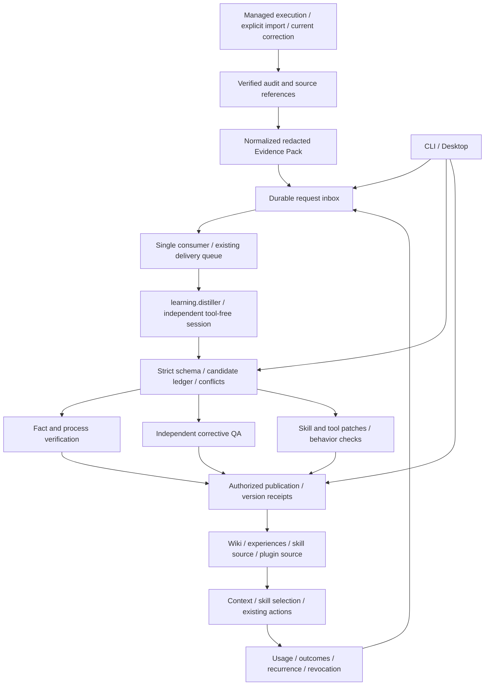
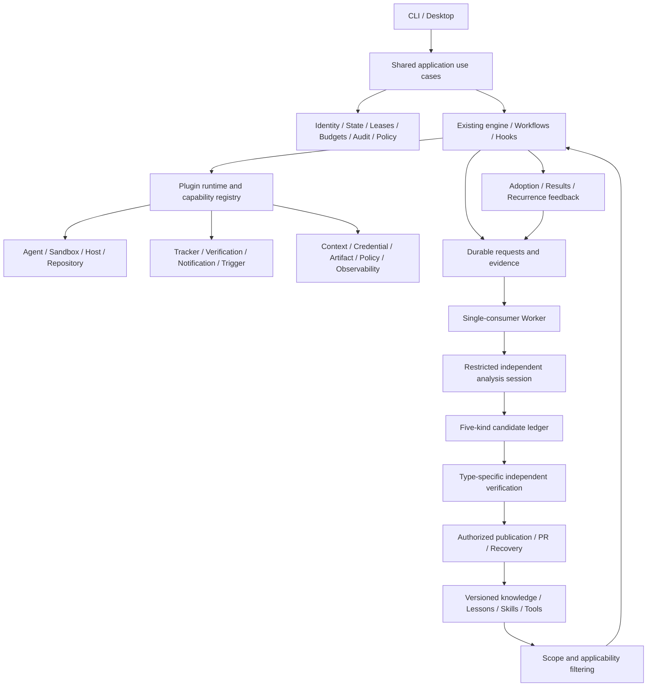
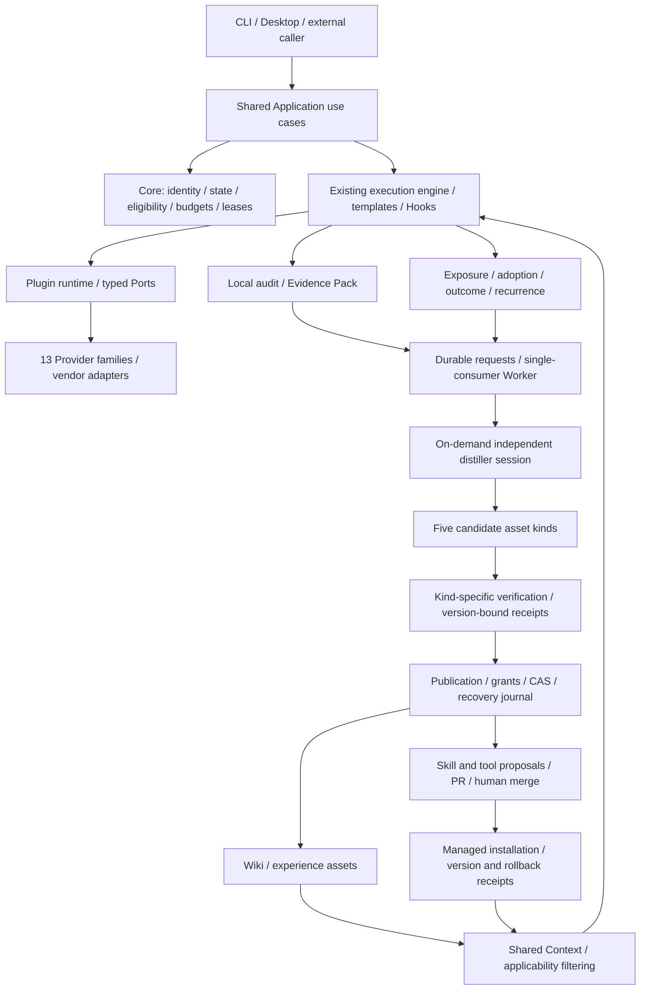
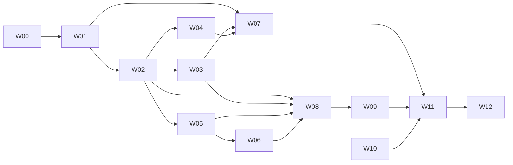

# Session Distillation and Reusable Assets Implementation Plan

> **For agentic workers:** REQUIRED SUB-SKILL: Use superpowers:subagent-driven-development (recommended) or superpowers:executing-plans to implement this plan task-by-task. Steps use checkbox (`- [ ]`) syntax for tracking.

**Goal:** Turn managed sessions and explicitly imported historical sessions into evidence-backed, validated, publishable and revocable business knowledge, business processes, corrective lessons, skills and tools, then measure their reuse in subsequent tasks.

**Architecture:** Execution events produce durable requests. A restricted independent `distiller` session proposes candidates; deterministic application code owns identity, evidence checks, validation, publication and feedback. Reuse the existing Agent / Sandbox, SQLite, durable delivery queue, retrospective, experience ledger, Wiki ingest, skill craft and plugin registration rather than building another agent framework or tool registry.

**Tech Stack:** TypeScript, Zod, Node SQLite, existing plugin runtime and Agent Providers, Vitest, existing Python Wiki utilities, Electron / React / Playwright.

**Status:** In progress; reviewed 2026-11-12. Read-only diagnostics shipped in `d94b2607`; matching CI `43027634218` succeeded with six selected jobs passing and two path-filtered jobs skipped, without qualifying subsequent slices. The lesson commit-time identity race, container helper-pipe finalization and Desktop QA boundary have passed independent rechecks and are entering integration; all four local learning Electron scenarios passed. Lesson publication guards, knowledge wiring and skill/tool proposals remain under development. The latest real Claude distillation still failed with `MISSING_RESULT`; the complete five-asset system is not delivered. Sections 13, 17.11 and 17.12 preserve historical snapshots; section 18 owns the unified plan, section 18.12 remaining gates and section 18.13 task cards. See the [Chinese plan](2026-11-09-session-distillation.zh.md) and [previous phase](2026-11-08-runtime-learning-and-validation.md).

---

## 1. Goal, baseline and exclusions

The baseline is the implementation merged by the user in PR #294. Planning initially inspected `8b5a911a`; implementation verified the local `origin/main` at `7194f5eb` and uses `feat/session-distillation`. Recheck the baseline before subsequent integration. Automated fixtures are not live model tests; paid analysis and generated-tool installation retain their explicit execution prerequisites.

| Requirement | Required result |
| --- | --- |
| R1 | Durable requests from execution events, explicitly submitted corrections and historical imports; restart recovery and duplicate suppression |
| R2 | Independent analysis without execution, modification, MCP or automatic skill permissions; unsupported analysis capabilities block explicitly |
| R3 | Claim-level evidence, source completeness, project, version and applicability |
| R4 | Business terms, entities, rules, permissions, state constraints and cross-system processes; separate facts, proposals and conflicts |
| R5 | Specific validated corrective actions and exclusions, retaining independent QA, recurrence and revocation gates |
| R6 | Prefer patches to existing skills; preserve invocation restrictions, parameters, branches, recovery and completion checks |
| R7 | Prefer existing CLIs / scripts / plugins; tool proposals declare input/output, side effects and runnable checks |
| R8 | Publication respects persisted authorization, optimistic versions, recovery and the human merge decision |
| R9 | Cross-task / agent reuse within a project; cross-project exchange becomes a candidate without transferred authority |
| R10 | CLI and Desktop use the same use cases and state without duplicate consumers |
| R11 | Measure retrieval, selection, explicit adoption, execution results and recurrence separately |
| R12 | Repeatable real-Claude acceptance covering knowledge publication, skill/tool proposals and subsequent reuse |

No model training, graph database, vector service, multitenant cloud, automatic PR merging, transcript-derived authorization or blanket collection of personal sessions is included. Six executable agents do not imply six native transcript readers. Unsupported native sources require explicit exports and visible evidence gaps.

## 2. Reuse and confirmed implementation gaps

| Existing foundation | Reuse | Necessary change |
| --- | --- | --- |
| Automatic failure / success experiences | Preserve origin, QA and completion evidence | A diagnostic summary is not a demonstrated root cause; a QA workflow summary is not an extracted business process |
| `retro` | Extract shared evidence and analysis use cases while preserving CLI behavior | Remove fixed Claude invocation and personal absolute skill directory; connect report output to candidates |
| Transcript readers | Managed telemetry, Claude / Codex / OpenCode readers and Wiki import rules | Unify provenance, message locations, completeness and explicit import without another blanket scanner |
| Durable delivery queue | Dedicated distillation delivery database | Its constructor owns the consumer; independent producers cannot instantiate the same queue |
| SQLite helpers | Private files, migrations and transactions | Add a thin request inbox, candidates and receipts, not another general scheduler |
| Wiki ingest | Existing plan / preview / apply / hash / lint / recovery | Controlled candidate-to-plan adapter |
| Skill craft / catalog | Existing create, diagnose, refactor and recommendation | Preserve invocation metadata; add concrete patches, behavioral checks and version comparison |
| Plugins / System Actions | Register `learning.distill` and publication operations | Typed input/output and policy checks using the existing registry |

## 3. Ownership and event-driven architecture



- **Core / Application:** identity, scope, references, candidate states, verification authority, publication policy, budgets and audit. Models cannot grant verification, expand scope or alter policy.
- **`learning.distiller`:** extraction prompts and analysis strategy; registers `learning.distill` using existing `workflow.action`, with an injected Agent Provider. No product prefix in new plugin names.
- **Worker:** single-consumer ownership, budgets, cancellation and retries. Each job gets an independent session rather than an indefinitely accumulating agent conversation.
- **Publication adapters:** existing Wiki, Git, Verification, Repository and System Action facilities. Introduce a new seam only for an actual implementation variation.
- **CLI / Desktop:** shared use cases only; no renderer access to files, credentials or databases.

### 3.1 Durable lifecycle

1. Write the original audit first. Terminal events, repair checkpoints and explicit submissions create SQLite inbox requests. Analysis unavailability must not fail the original task.
2. Expose inbox-write failures. On startup and periodic reconciliation, verify source audits; commit each run's verified sequence / head and inbox requests in one ledger transaction. A full queue must not advance beyond unaccepted work.
3. Only the Worker constructs its dedicated `DurableTriggerQueue`. Producers write the inbox. The Worker enqueues then records handoff; a stable key recovers a crash between those steps.
4. Before invoking a model, check candidate / processing receipts. A completed source and analyzer version is not charged again even if an old queue delivery was pruned.
5. Changed source content produces a new key. Retrying the same key must retain its original evidence content and digest.
6. Analysis only creates candidates. Validation and publication are separate. Timeouts, invalid JSON and incomplete sources have explicit outcomes.
7. Stop new dispatch before cancellation. Existing queue `close()` drains, so add an optional stop-dispatch close mode while retaining its default behavior. Allow five seconds for owned analysis to stop, then terminate only owned processes; keep unfinished deliveries recoverable.
8. Mark learning runs `purpose=learning`; exclude their events from distillation triggers and ordinary success experiences to prevent feedback loops.

### 3.2 Trigger and initial budget policy

| Item | Planned behavior |
| --- | --- |
| Automatic source | Managed runs after explicit learning enablement; failures retain existing candidates, repaired runs may distill concrete corrections |
| Successful source | Independent QA plus successful completion, or the matching published-change human handoff; unmerged does not mean deployed |
| Correction | Explicit current submission with provenance; historical user-role text does not create current authority |
| Historical import | Explicit accessible run, session or export; no collection of all personal sessions or private remote platform API access |
| Repeated operations | Compare recorded tool names, parameter patterns and results; one success or a frequency threshold never grants publication |
| Concurrency / attempts | One Worker and one model job per user; at most two model attempts per delivery, with redacted first-error structure in the second |
| Time / size | 120 seconds per attempt; 128 KiB UTF-8 Evidence Pack, 32 KiB output, at most ten candidates. Split or block oversized inputs explicitly |
| Daily budget | Twenty model calls including retries by default, reserved atomically before invocation. Missing usage is unknown; monetary caps only where actually supported |
| Capacity / retention | Normal admission: 1,000 pending requests / 16 MiB and 2,000 ledger records / 32 MiB. Only transient source blocking and atomic invalidation may use a safety reserve, capped at twice normal record/byte limits; new work, model calls and publication cannot borrow it. The SQLite main file is physically capped at 128 MiB including page overhead. Temporary packs seven days, unpublished candidates ninety days. Preserve active references and unresolved publication recovery; report full capacity |
| Hosting | `experience worker --once` / `--watch`; Desktop hosts the same process using existing process facilities and pauses on exit by default. Background startup requires saved configuration, not installation of an OS service |

These are configurable initial limits, not measured throughput or a guarantee against future mistakes.

## 4. Proposed contracts

Use strict Zod schemas at application seams. Existing `ExperienceRecord` and version-1 exchange semantics remain compatible.

```typescript
type AssetKind = 'fact' | 'process' | 'lesson' | 'skill' | 'tool';
type CandidateState = 'candidate' | 'conflict' | 'validated' | 'published'
  | 'rejected' | 'superseded' | 'revoked';

interface EvidenceRef {
  id: string;
  kind: 'audit' | 'message' | 'tool-result' | 'code' | 'test' | 'human-confirmation';
  digest: string;
  locator: string;
  completeness: 'complete' | 'partial';
  authority: 'observed' | 'declared' | 'inferred';
}

interface DistillationRequest {
  version: 1;
  scope: string;
  sourceId: string;
  sourceRunId?: string;
  workItemId?: string;
  evidenceDigest: string;
  analyzerVersion: string;
  reason: 'completed' | 'repaired' | 'correction' | 'import';
}

interface CandidateProposal {
  kind: AssetKind;
  title: string;
  statement: string;
  evidenceIds: readonly string[];
  applicability: {
    project: string;
    environments: readonly string[];
    versions: readonly string[];
    preconditions: readonly string[];
    exclusions: readonly string[];
    invalidationConditions: readonly string[];
  };
  targetRef?: string;
  payload: unknown; // Discriminated strict schema by kind, as specified below.
}

interface DistillationOutput {
  version: 1;
  candidates: readonly CandidateProposal[];
  warnings: readonly string[];
}
```

| Kind | Required payload | Validation authority |
| --- | --- | --- |
| fact | Topic, subject, rule, fact/proposal classification and applicability | Matching code, contract, confirmation or observation; unresolved proposals cannot become facts |
| process | Entry, participating systems, prerequisites, steps, state changes, exception paths and completion | Node-level evidence and missing markers; a partial route cannot claim full-chain success |
| lesson | Trigger, hypothesized/confirmed cause, attempts, concrete fix and prevention check | Same-project correction and fresh independent QA, using existing verification gates |
| skill | Target or reason for addition, triggers/restrictions, inputs, branches, recovery, completion, patch and evaluation cases | Original version, structural checks, positive/negative cases and old/new behavior comparison |
| tool | Existing-tool search, input/output schema, dependencies, permissions, timeout, effects, idempotency/recovery, source proposal and tests | Isolated execution, invalid input, cancellation and permission denial; declare none for inapplicable side effects |

Models cannot supply system IDs, candidate state, verification authority, publication tokens or arbitrary absolute target paths. Application code assigns identity, checks that evidence belongs to the request, and resolves logical `targetRef` values to authorized destinations.

```typescript
import { createHash } from 'node:crypto';

// evidenceDigest covers the audit head, source hashes, message ranges and completeness.
function distillationKey(input: DistillationRequest): string {
  return createHash('sha256').update(JSON.stringify([
    input.scope, input.sourceId, input.evidenceDigest, input.analyzerVersion,
  ])).digest('hex');
}
```

`sourceRunId` identifies the original run, `jobId` the distillation request, and the analysis has a new `runId` / `sessionId`. None replaces `workItemId`.

Shared use cases: `submitDistillation`, `reconcileDistillationSources`, `processDistillation`, `validateLearningCandidate`, `publishLearningCandidate`, `revokeLearningCandidate`, `queryLearningState`. Implement application functions over existing ports; do not create an interface for every single implementation.

### 4.1 State, publication and feedback

- `candidate → validated → published`; conflicting evidence enters `conflict`; rejection, replacement and revocation retain reasons. Content changes create a new version requiring validation.
- Validation receipts bind candidate digest, validator version, evidence digest and results. Model confidence never grants state. Recheck receipts, evidence and target versions at publication time.
- Separate stable business rules from environment observations. Preserve existing lesson expiry and version-based skill/tool invalidation; do not apply one ninety-day expiry rule to everything.
- SQLite, files and Git cannot be treated as a single atomic transaction. Use `prepared → applied → committed` publication journals, expected hashes and recovery copies, reconciling unfinished publication on startup.
- If a restarted target already matches the intended result, finish the receipt. Third-party changes produce conflict rather than an overwrite. Reuse Wiki recovery receipts for partial page batches.
- Revocation removes knowledge authority and future context eligibility. Deployed tool revocation must report actual uninstall/rollback or `rollback_blocked`, not merely update the ledger.
- Feedback binds an exact asset version, target run/work item and result. Distinguish exposure, selection, explicit adoption, execution and success; success alone does not prove causality.

## 5. Security and generalization constraints

1. Analyze bounded redacted inline evidence. Do not mount source repositories, credential directories or whole raw transcripts for the model. Split large sources explicitly and retain message locations.
2. Existing Claude development commands skip permissions; do not reuse that command unchanged. Add an explicit `analysis` execution profile that removes bypass, disables tools, automatic skills, MCP, project/user hooks and session persistence, while retaining the legitimate existing authentication path.
3. Verify flags against installed CLI help and command construction tests. Tool prohibition is not OS isolation. Prove the model has no tools and the trusted CLI does not run project hooks/plugins. Unsupported providers return `analysis_unsupported`, never a writable fallback.
4. Messages, tool outputs and knowledge are untrusted evidence. Current authorization comes from invocation context, not transcript role labels or model prose.
5. Replace account names, IPs, personal paths and transient credentials with configuration/applicability. Do not generalize away permissions, business semantics or security checks.
6. Search before adding knowledge, skills or tools. Semantic similarity may suggest a merge; it cannot merge contradictory rules or overwrite verification history automatically.
7. Improve Chinese segmentation, explicit aliases and structured applicability first, with negative examples. New retrieval dependencies or vector services require measured need.
8. Automatic publication is limited by persisted policy specifying targets, actions, projects and asset types. Code proposals become human-reviewed PRs; a candidate is not directly installed or executed.

## 6. File ownership map

Repository-relative paths below are an engineering appendix. Keep changes local to existing modules; the plan does not prewrite production implementations.

| Area | New files | Existing files to change/reuse |
| --- | --- | --- |
| Contracts / candidates | `packages/runtime/src/application/learning/contracts.ts`, `candidate-store.ts` | `learning/experience-store.ts`, `infrastructure/storage/sqlite.ts` |
| Requests / Worker | `learning/requests.ts`, `worker.ts` | `application/plugins/trigger-queue.ts`, `plugins/observability.ts`, `workflows/execute-work-item.ts`, `application/workflow-engine.ts` |
| Evidence / retrospective | `learning/evidence.ts`, `analysis.ts` | `apps/cli/src/commands/retro.ts`, `infrastructure/observability/agent-telemetry.ts`, Wiki session reader |
| Restricted agent | Existing Agent / Sandbox | `domain/agents/types.ts`, `domain/agents/claude-code.ts` and necessary execution-profile plumbing |
| Plugin | `application/plugins/learning.ts` | `plugin-sdk/index.ts`, `application/plugins/runtime.ts`, `configured.ts`, `builtin-manifests.ts`, `operations.ts` |
| Publication / feedback | `learning/publication.ts`, `knowledge.ts`, `proposals.ts`, `feedback.ts` | `learning/runtime.ts`, `experience-store.ts`, existing Context / Verification / Repository ports |
| CLI | Extend `apps/cli/src/commands/experience.ts` | Registry, composition root and existing `retro` |
| Desktop | Extend `shared/experience-contract.ts`, Main `experience-service.ts`, renderer `ExperienceSettings.tsx` | Existing IPC/preload, process hosting, run detail and design system |
| Skills | Skill craft, its checklist and `skills/jev-agent-guard/scripts/skill-catalog.mjs` | Wiki `wiki.py`, `session_source.py` and tests; only change Wiki implementation if its contract requires it |
| Documentation | Extend bilingual plugins, execution and testing docs plus integration standard | Update execution entry points with command changes; canonical CLI/plugin versions in affected commits |

Each new TypeScript module has a matching `.test.ts`. Cross-process and E2E checks are separate from unit tests and measure externally observable behavior.

## 7. Implementation tasks

Each task follows failing check → confirmed failure → minimal implementation → focused passing checks → version/docs/commit. Continue under existing user authorization without repeated permission requests. Work on task/PRD slices, never the integration checkout.

### T01 — Contracts, states and keys (P0)

**Dependencies:** none. **Files:** `contracts.ts`, `contracts.test.ts`.

- [x] Implement section 4 strict schemas, discriminated payloads, state transitions, canonical scope checks and `distillationKey`.
- [x] Write rejection cases first: forged verified state, unowned evidence IDs, cross-project scope, oversized output and invalid work identity.
- [x] Fixed fixture `github:acme/api`, `run:r1`, identical evidence/analyzer yields one key; changing hash, scope or analyzer changes the key.
- [x] Run `pnpm --filter @afk/runtime exec vitest run src/application/learning/contracts.test.ts`; confirm red then green.
- [x] Export shared types and commit the contract slice without changing old exchange formats or commands.

### T02 — Private request/candidate ledger (P0)

**Dependencies:** T01. **Files:** `candidate-store.ts`, `requests.ts` and matching tests.

- [ ] Reuse SQLite transactions/migrations for requests, evidence references, candidate versions, processing receipts, publication journals and per-run source positions. Enforce unique request keys and reject model-owned states.
- [ ] Two real processes submitting the same key create one row; conflicting content is rejected; reopening retains results; missing evidence retains a visible block reason.
- [ ] Check migration rollback, private permissions, symlink refusal, active-reference capacity protection and optimistic state conflicts.
- [ ] Run `pnpm --filter @afk/runtime exec vitest run src/application/learning/candidate-store.test.ts src/application/learning/requests.test.ts`; assert no missing/duplicate rows.
- [ ] Commit inbox handoff receipts and cursors without duplicating delivery retry state.

### T03 — Evidence Pack and shared retrospective (P0)

**Dependencies:** T01. **Files:** `evidence.ts`, `analysis.ts`, matching tests, CLI `retro.ts` and its tests.

- [x] Extract evidence assembly and report parsing while preserving `retro run/show` output and signatures.
- [x] Reuse managed telemetry/readers; define message locators, audit sequences, completeness and source/content digests. An ID is not access permission.
- [x] Test corrupted audits, missing transcripts, malformed JSONL, explicit oversized-source splitting, secret/private-key redaction, source replacement and path escape. Insufficient evidence cannot produce a complete-process claim.
- [x] Run runtime `evidence.test.ts` / `analysis.test.ts` and `pnpm --filter afk exec vitest run src/commands/retro.test.ts`.
- [x] Remove personal directory dependencies and commit; report native-source support separately.

### T04 — Restricted independent profile and plugin (P0)

**Dependencies:** T01, T03. **Files:** plugin `learning.ts`/tests, agent command construction/profile plumbing and plugin configuration.

- [ ] Introduce the analysis profile with inline evidence and no original repository/session context; keep development behavior compatible.
- [ ] Command tests assert no permission bypass, empty tools, disabled MCP/automatic skills/untrusted hooks, working authentication and pre-start unsupported-provider refusal.
- [ ] Validate strict JSON and reject forged references, states, paths, more than ten candidates or output above 32 KiB. Analysis cannot invoke publication.
- [ ] Run `pnpm --filter @afk/runtime exec vitest run src/domain/agents/claude-code.test.ts src/application/plugins/learning.test.ts src/application/learning/analysis.test.ts` plus affected config/transport checks.
- [ ] Register `learning.distiller` / `learning.distill`, bump CLI version and update integration docs; execution support does not imply safe-analysis support.

### T05 — Worker, delivery and budgets (P0)

**Dependencies:** T02, T04. **Files:** `worker.ts`/tests; minimal compatible queue shutdown change and tests.

- [ ] One Worker owns the dedicated delivery queue; task/CLI/Desktop producers only write the inbox. Handoff uses stable keys.
- [ ] Crash after inbox commit, after queue insertion and after candidate persistence before acknowledgment; recover to one candidate set without a repeated model call for completed work.
- [ ] Reserve daily budget atomically; enforce two attempts, timeout/Abort, plugin disable and consumer ownership. Do not steal external or unverifiable owners.
- [ ] Test stop-dispatch shutdown, owned-only cancellation, compatible default drain and five-second recovery; run `worker.test.ts` and `trigger-queue.test.ts`.
- [ ] Commit observable starts, completions, retries, blocks, missing usage and budget results; exhausted jobs remain visibly blocked.

### T06 — Event capture and corrections (P0)

**Dependencies:** T02, T03, T05. **Files:** existing execution/observer seams, `requests.ts`, `requests.integration.test.ts`.

- [ ] Request successful/handoff and repaired checkpoints with original identities. Failures retain old candidates without inventing a confirmed correction.
- [ ] Reconcile a crash between original audit append and inbox write; commit source position and inbox together. Analysis failures do not change the source execution result.
- [ ] Corrections record current invocation provenance and create candidates/conflicts or invalidate demonstrated false assets. Historical messages confer no authority.
- [ ] Test duplicate terminal events, late QA failure, no learning recursion, and full-queue cursor protection via `requests.integration.test.ts`.
- [ ] Run managed execution through a fake distiller into the real ledger; commit runnable milestone M1.

### T07 — Concrete lessons, applicability and recall (P1)

**Dependencies:** T06. **Files:** learning runtime/store, `feedback.ts` and matching tests.

- [ ] Map lesson candidates through existing gates. Separate concrete action and hypothetical/confirmed cause; preserve original failure identity and recurrence history when corrections change.
- [ ] Recheck fresh independent QA and the exact target version. Another successful repair cannot verify this lesson.
- [ ] Add `Intl.Segmenter` Chinese terms, error/command identifiers, bounded explicit aliases and applicability filtering before new retrieval dependencies. Suspected duplicates do not overwrite history.
- [ ] Freeze at least twelve equivalent-query pairs and twelve inapplicable/opposite-condition queries across languages, projects and versions. Require no scope leakage; report old/new recall@5 and negative results without rewriting answers to pass.
- [ ] Run experience/exchange/runtime and feedback tests; imports stay candidates, revocation removes recall, duplicate feedback does not inflate counts. Deliver M2.

### T08 — Business knowledge/process publication (P1)

**Dependencies:** T06. **Files:** `knowledge.ts`, `publication.ts` and tests; existing Wiki reader/ingest.

- [ ] Convert fact/process candidates into existing version-1 ingest plans after search, full-page/rule reads and expected hashes; include backlinks/index updates.
- [ ] Separate rules from environment observations. Uncertain content uses the authorized inbox. Each process node has evidence or an explicit gap; partial success is not full-chain acceptance.
- [ ] Test idempotence, contradictory rules, concurrent human edits, sensitive/rule/escaping-target refusal and reuse of existing topics.
- [ ] In a temporary vault, run `python3 skills/wiki/scripts/wiki.py ingest --vault <fixture-vault> --plan <fixture-plan> --json` preview, then `--apply` under configured policy; verify hashes/lint. Real vault writes require existing explicit target authorization and are never pushed remotely.
- [ ] Implement publication journaling/partial recovery. Run knowledge/publication tests and `python3 -m unittest discover -s skills/wiki/scripts -p 'test_*.py'`; deliver M3.

### T09 — Skill proposals, generalization and metadata (P1)

**Dependencies:** T06; candidate/catalog work can run alongside T08, but publication integration waits for T08's tested publication use case. **Files:** `proposals.ts`/tests, skill craft/catalog and tests.

- [ ] Search existing skills with provenance. Prefer a patch; a new skill must explain why existing ones cannot be reused.
- [ ] Preserve/respect `disable-model-invocation`, invocation restrictions and source; prohibited automatic invocation must not be recommended for execution.
- [ ] Produce parameters, triggers/exclusions, branches, recovery and verification from evidence, removing personal/environment constants without deleting business/security rules.
- [ ] Include normal, recovery and rejection behavior cases plus old-version comparison; report structural conformance separately from effectiveness.
- [ ] Generate reviewable patches, validate in an owned task worktree and publish a PR. Bump plugin version with skill changes and never edit installed caches. Deliver the skill part of M4.

### T10 — Tool proposals and controlled execution (P1)

**Dependencies:** T09. **Files:** continue `proposals.ts`/tests; reuse Verification, Repository and System Actions.

- [ ] Detect repeated operation patterns and search existing CLIs/scripts/plugins first; repetition creates a candidate, not permission to execute it.
- [ ] Keep one-skill helpers under that skill's scripts; use existing actions for cross-workflow calls and plugins for actual backend/install variation. No product-prefixed names.
- [ ] Execute source proposals only in separate restricted verification tasks. Test valid/invalid inputs, timeout/cancel, retry effects and permission denial; do not interpolate arguments through shell text.
- [ ] Installation/publication follows persisted authority and existing dependency installers. Unsupported rollback remains blocked rather than merely changing ledger state.
- [ ] In a temporary repository demonstrate two input sets and malicious-input rejection, retaining source/tests/version/PR receipts; deliver M4.

### T11 — CLI operations (P1)

**Dependencies:** T05, T07–T10. **Files:** experience command, registry/composition and tests.

- [ ] Keep old commands compatible; add `experience distill`, `jobs`, `candidates`, `inspect`, `validate`, `publish`, `invalidate`, `feedback`, `worker`. Candidate IDs do not replace old experience identity semantics.
- [ ] Require scope for queries. `distill` accepts exactly one of `--run-id` / `--transcript`, explicit provider for historical sources, and `--correction-file` plus provenance for corrections; no private prose in arguments.
- [ ] `worker --once` handles currently processable requests then exits; `--watch` runs foreground. Report pending/blocked/failed/processed with safe codes, not tokens/raw transcripts.
- [ ] Black-box restart, pagination, duplicates, disabled providers, budgets, exit codes and old commands. Run focused CLI tests and root `tests/e2e/plugin-distillation.test.ts`.
- [ ] Update canonical CLI version, registry and bilingual execution entry points. Package and verify the actual command count, not the old count of twenty-three.

### T12 — Desktop shared governance (P1)

**Dependencies:** T11. **Files:** existing experience contract, Main service, IPC/preload, settings/run detail and tests.

- [ ] Follow Desktop architecture/design system; use shared use-case DTOs. The renderer cannot create Workers or access disk/models.
- [ ] Expose enablement/budget/provider settings, job state, evidence/gaps, candidate diffs, validation/publication/revocation and feedback; show unconfigured/unknown/unsupported explicitly.
- [ ] Simultaneous CLI/Desktop use still has one consumer; application restart preserves requests and never kills a CLI-owned process.
- [ ] Validate scope, IDs, sources, target authority and stale responses at IPC seams. Switching projects cannot show the previous project's results.
- [ ] Run Desktop typecheck/test/build, focused Playwright and full Electron E2E; deliver M5.

### T13 — Real acceptance, failure drills and release (P0 gate)

**Dependencies:** T01–T12. **Files:** `tests/e2e/plugin-distillation.test.ts`, `plugin-distillation-live.test.ts`, bilingual guides.

- [ ] Freeze credential-free evidence fixtures and expected claims before running a model: corrective lesson, business route, skill/tool changes, contradictions, injection and missing evidence.
- [ ] Require explicit `AFK_REAL_DISTILLATION_E2E=1` for real Claude using existing legitimate authentication. Default is visible skipped; opted-in missing dependencies fail. Record CLI/model/config/scope/time and unknown usage.
- [ ] Using an installed CLI, submit and restart a Worker, distill and independently inspect claim evidence, temporary-vault idempotence, skill/tool diffs and checks. A related task recalls the exact version; unrelated/cross-project tasks do not; revocation removes future context.
- [ ] Drill malicious transcript commands, hook sentinel writes, unexpected MCP, expired authority, publication crash, concurrent human edits, source replacement, queue/disk full, exhausted budget, duplicate events and orphan ownership with assertable outcomes.
- [ ] Separate spec review before quality review; repair and retest. Run section 10 checks, commit/push/PR for human merging, archive integrated worker checkouts and retain recovery evidence. Deliver M6.

## 8. Parallel execution and write scopes

| Batch | Parallel work | Integration owner retains |
| --- | --- | --- |
| A | Main T01; sidecar fixture/source inventory | Contracts, identity, states, baseline and version policy |
| B | Worker A T02; Worker B T03 | Contract integration and analysis-profile inspection |
| C | Worker A isolated Provider part of T04; after T04, main T05 → T06; Worker B catalog restrictions | Common agent types, config/manifests and shared queue edits; passing T06 completes M1 |
| D | After T06: A T07, B T08, C T09–T10 | Freeze publication use-case contracts first; one worker owns proposals continuously |
| E | Main T11; D T12 after CLI contract freeze; others T13 fixtures | Registry, versions, public exports and execution docs |
| F | Spec review → repair → quality review; independent environment acceptance | Final source tree, evidence, publication and cleanup |

One isolated worktree per worker with disjoint writes. Handoffs include patch, commands/exit codes, actual limits and changed paths. The integration owner alone handles shared types, root settings and version bumps.

With a PRD baseline, slices target `prd/<issue>` and a human merges the final baseline. Otherwise use task branches and reviewable PRs. Cleanup never force-deletes active, unknown or unpublished work.

## 9. Milestones and definition of done

| Milestone | Deliverable | Proof |
| --- | --- | --- |
| M1 / A–C | Event → independent agent → candidate | Recovery, no tools, provenance, budget and deduplication |
| M2 / D | Concrete corrective learning | Matching fix/QA, subsequent recall, negatives and recurrence/revocation |
| M3 / D | Business knowledge/process | Conflicts, idempotent writes, node evidence, concurrency and recovery |
| M4 / D | Skills/tools | Generalized inputs, behavior comparisons, permissions/versions and human-review PRs |
| M5 / E | CLI/Desktop operations | One consumer, shared state, project isolation and installed commands |
| M6 / F | Complete delivery | Quality gates, real-Claude E2E, docs, rollback and checkout cleanup |

Schedule follows these six dependent batches, each delivering a runnable slice. Model/network/account waiting is not completed development. Missing live prerequisites are reported as blocks, never replaced by fixture claims.

## 10. Verification, migration and rollout

### Check layers

- Contracts: unknown fields, forged authority, references, scope and old-format compatibility.
- Persistence: real concurrent/crashing child processes across input/cursor/delivery/candidate/publication boundaries.
- Analysis: no tools/automatic skills/MCP, unchanged hook sentinel, no secrets in packs/logs and no unsafe fallback.
- Asset quality: frozen positive/negative cases, traceable process nodes, old/new skills, multi-input tools and safe failures.
- E2E: actual CLI/IPC surfaces and independently checked model outputs. Raw transcripts are not final reports.

### Required repository checks

```bash
pnpm typecheck
pnpm build
pnpm architecture:check
pnpm docs:check
pnpm test
pnpm test:coverage
python3 -m unittest discover -s skills/wiki/scripts -p 'test_*.py'
pnpm --filter afk-control-electron typecheck
pnpm --filter afk-control-electron test
pnpm --filter afk-control-electron build
pnpm --filter afk-control-electron e2e
pnpm release:cli --output /tmp/session-distillation-release
```

Start with focused checks, then run full gates on the stable tree. Repeat only for new changes/failures. Keep existing per-package coverage baselines; report shared-source, Desktop and model subprocess scope separately.

### Migration and rollout

- Keep old experience version-1 exchange unchanged; use a separately versioned candidate database. Failed migration preserves the original database and source.
- Use consistent SQLite backups, not copying an active WAL main file. Old binaries cannot write new schemas; rollback requires a compatible reader or validated migration/snapshot recovery.
- Learning starts disabled without changing existing execution. Explicitly configure `learning.distiller`, run once, then enable a continuous Worker and already-authorized publication types.
- Missing Claude authentication, Python, vault rules, repository permissions or validators stays visibly blocked.
- Bump `.claude-plugin/plugin.json` with skill changes and `apps/cli/package.json` with CLI/runtime changes, relative to the canonical versions at implementation time. This plan reserves no release number.
- Check installed packages outside the repository with isolated HOME; real account tests are separate explicit opt-ins. Sending email/third-party notifications is not a default check.
- Push task branches, record measured scope/limits, inspect CI and leave merging to a person. Close/archive completed workers and retain evidence under policy.

## 11. Effectiveness and extension criteria

| Metric | Definition | Invalid interpretation |
| --- | --- | --- |
| Recall@5 / negatives | Relevant retrieval and exclusion on frozen data | Retrieval count proves usefulness |
| Selection/adoption/execution | Exact version, task and actor/execution evidence separately | Context exposure proves usage |
| Recurrence | Same failure family within applicability/version, with a denominator | Different wording means no recurrence |
| Repeated exploration | Comparable discovery steps, retries, duration and tokens | Unknown usage is zero or all improvement was caused by learning |
| Skill transfer | Original, parameter variation, recovery/rejection old/new comparisons | One successful account demonstrates generality |
| Tool value | Success, side-effect failures, manual steps and maintenance cost | More scripts are inherently better |

Initial acceptance requires computable evidence and passing positive/negative cases, not invented production gains. Add semantic retrieval, remote sharing or new publication backends only after measured need; organizational permissions, cloud memory and training need a separate explicit scope.

## 12. Execution checklist

- [ ] T01–T06: reliable tool-free distillation into candidates.
- [ ] T07–T10: parallel lessons, knowledge, skill and tool validation/publication.
- [ ] T11–T12: shared CLI/Desktop and operable Worker.
- [ ] T13: live use, fault drills, independent reviews, versions and PR delivery.

Implementation follows this order and continues along the dependencies. Existing authorization avoids repetitive substep questions, but never grants permission to merge or bypass target-system controls.

## 13. Implementation status and remaining queue (2026-11-10)

This table describes inspected code. Close each checklist only after implementation, validation and the required commit; passing a focused test does not complete the task or system.

Kernel commit `4b7295e9` is pushed to the task branch. Baseline validation: runtime full suite 3,018 passed/3 skipped, followed by 31 focused checks after the CLI-flag compatibility fix; CLI full suite 542 passed/2 skipped; skill catalog 86 passed. Runtime/CLI builds and typechecks, architecture and documentation checks passed.

Current slice on 2026-11-10: the latest full runtime suite passed 3,126 tests/4 skipped; CLI passed 542/2 skipped and repository tests passed 326/1 skipped. Running runtime and repository suites together at high concurrency timed out one existing Git integration test; after both runs finished, the complete runtime suite passed independently with at most four workers, without extending timeouts or changing that test. The native process guard is integrated and independently approved for specification and quality. Analysis currently supports only Darwin with `/usr/bin/sandbox-exec`; other platforms explicitly return unsupported. The latest live Claude kernel test took 38.58 seconds: one call, one candidate, returned usage, zero extra replay calls, no transcript-injection, malicious Hook or MCP sentinel writes, and invalidation after late QA failure. Synthetic audit and real local authentication do not cover installed CLI, Desktop or full asset publication. An earlier invalid model output was correctly rejected; one successful run does not establish stable output.

Repaired and independently re-reviewed: bounded SQLite journal unlink rechecks, intake scope/manual-import boundaries, transient unblock and diagnostics, temporary-permission classification, invalidation at capacity and interrupted-transaction rollback. Six deterministic subprocess regressions and 60 real cold-start pairs passed. These T01–T06 changes are committed and pushed in `2c807ece`. Old CI `42685710461` failed on database is locked at `PRAGMA journal_mode = WAL` during coverage. Jittered bounded backoff retains the three-second deadline, passed independent review, aggregate integration and 46 focused SQLite/intake checks, and is pushed as `23e21fbe`. The reproduced mechanism is not proof of the old failure's only cause. New CI `42799416559` was still running when checked; ordinary tests and existing Desktop E2E do not close this gate. The complete repository run of 326/1 skipped preceded the last two fixes and does not imply a full rerun after every final repair.

| Task | Current state | Next acceptance gate |
| --- | --- | --- |
| T01 | Committed as `d0190782`: strict contracts, candidate payloads, evidence binding and stable keys | Preserve compatibility and rerun boundary checks for subsequent contract changes |
| T02 | Requests, candidates, cursors, publications and budgets implemented; version 2 commits snapshots with requests/cursors, accounts snapshot bytes and preserves legacy reads; budget reservation rechecks source blocks transactionally | Review migration, capacity rollback and cross-process conditional state updates; integrate publication recovery |
| T03 | Evidence packs, immutable snapshots and shared prompts implemented; redaction, exact reference binding and frozen metrics fixed | Independent re-review and kernel commit complete; automatic intake remains T06 |
| T04 | Disabled plugin, dynamic Agent resolution and analysis profile committed in `2c807ece`; live Claude injection/Hook/MCP isolation verified | Preserve Darwin boundary and verify new CI |
| T05 | Worker/purpose and process guard integrated and committed; independent specification/quality approval includes parent SIGKILL and unrelated-process survival | Verify new CI; accept publication reconciliation wiring separately; no all-platform claim |
| T06 | Intake, reconciliation, scope/manual-import boundaries and diagnostics repaired and committed in `2c807ece`; independent re-review passed | Verify new CI before closing M1 release gate |
| T07 | Integrated but uncommitted: structured applicability, shared Context consumption and QA-target audit; 156 focused tests passed. Frozen evaluation 24/24, false positives 0/18, zero scope leakage; independent trusted fixture metadata was added while query text/answers remain unchanged, so this is not a same-input algorithm-benefit claim | Independent review, candidate lesson binding to actual repair semantics and QA, and trusted-target configuration entry points |
| T08 | Integrated but uncommitted: saved configuration, routing, three knowledge actions, Context provider, Worker reconciliation/cancellation; concurrent-call and cancellation repairs passed 89 tests; two actual Git worktrees receive knowledge and lose stale context on invalidation, followed by actual withdrawal | Production validation entry, cross-process publication ownership, independent review and CLI/Desktop loops; publication currently serializes per vault only within one process |
| T09 | Invocation/tool declarations retained in the skill catalog; YAML edge cases under review | Candidate patches, normal/recovery/rejection behavior comparison, original-version binding and PR receipts |
| T10 | Aggregate library integrated but uncommitted, 46 tests passed; sidecar reports repaired dirty-helper false improvement and missing command evidence, with 59 tests passed; independent re-review and integration remain pending | Wire trusted Repository staging, cancellation/recovery and publication; before/after digests do not replace immutable inputs; Darwin read-only execution is not full cross-platform M4 |
| T11 | Read-only jobs/candidates/inspect integrated; 128 focused tests passed, CLI full 579 passed/2 skipped; built-artifact empty queries create no ledger and missing candidates exit 1 | Distillation, validation, publication, invalidation, feedback and Worker control entry points; installed-package black-box verification |
| T12 | New learning-governance Desktop not connected | Shared state/consumer, IPC checks, project switching, process shutdown and Electron E2E |
| T13 | Live Claude kernel distillation E2E passed; full publication, installed-package and Desktop loops incomplete | Complete loop, fault drills, coverage, installed package, independent reviews, PR and worktree cleanup |

### Next parallel batches

Latest aggregate checks: runtime full 3298 passed/4 skipped, CLI 579 passed/2 skipped, workspace typecheck/build passed. The old Git ancestry fixture assumes master; only the test process sets that default, without changing system configuration or unrelated source. Previous coverage execution passed all 4198 tests but CLI functions 71.82% missed the existing 71.86% baseline. Coverage is rerunning after CLI integration; the baseline is unchanged. Later additions and repairs must still be assessed against their focused evidence.

1. Use pushed `23e21fbe` as the next common kernel baseline; verify repair CI and complete the coverage gate.
2. Continue T08 production validation and consumer wiring locally; sidecars close the four T07 failures and independently re-review T09–T10 isolation repairs. Library checks do not replace the product loop.
3. After M1 passes, use three worktrees for T07, T08 and T09–T10. Freeze the publication contract first and assign one writer per file.
4. Integrate T11 locally, including versions, command registry and public exports. Once contracts stabilize, use a separate worktree for T12 and another executor for T13 preparation.
5. Run T13 through a real model, filesystem/processes and user entry points, using local Claude Code first. Report remote-provider configuration and coverage separately; the earlier Gmail success does not validate this learning phase.
6. Push reviewable milestones and inspect CI; a person decides merging. Preserve changes and validation evidence before archiving completed worktrees and releasing their dependencies/build outputs.

### Complete-system delivery constraint

Continue using existing Agent, Sandbox, Host, Tracker, Verification, Notification, Trigger, Context/Memory, Credential/Auth, Artifact/Report, Repository/Workspace, Security/Policy and Observability interfaces. This phase closes the loop from their execution evidence to reusable assets without duplicating frameworks. Track each external Provider as implemented, configured and live-verified separately; missing configuration cannot count as passing.

### 13.1 Latest evidence update, 2026-11-10

This update supersedes earlier statements that repair CI was running and earlier test counts. Historical records remain, without implying current completion.

- Pushed `23e21fbe`: CI `42799416559` completed successfully; evidence is `.codex/validation/sqlite-ci-final.json`.
- Uncommitted aggregate source: Runtime 3,324 passed/4 skipped; CLI 581 passed/2 skipped. Trusted-context integration first reproduced 10 failures/2 passes, then passed all 12; the related eight-file suite passed 262 tests. Independent re-review remains a delivery requirement.
- The latest full coverage run had 4,320 passes/1 failure/7 skips. The failed simulated-Agent CLI E2E later passed in isolation, but the complete coverage gate has not passed again. A focused pass does not replace it.
- Saved trusted execution conditions and `learning.context` reach default implementation/QA composition. Integration tests cover inherited-property boundaries and manual QA work identity. Reproduced natural-language negation false recalls still require repair without losing positive cases.
- Queued publication cancellation passed independent review; cross-process publication ownership is missing. The proposal sidecar's 59-test repair passed specification review, with quality review and aggregate integration pending. Production candidate validation, frozen staging, complete write entry points, Desktop and five real asset loops remain undelivered.

## 14. Complete delivery roadmap and handoff (2026-11-10)

This is the delivery view of section 7, not another implementation. The current request is to complete the plan; uncommitted code, historical test counts and worker assignments are not final acceptance evidence.

### 14.1 Core, plugins and the independent Agent

| Layer | Responsibilities | Integration |
| --- | --- | --- |
| Core/shared use cases | Events and identity, frozen evidence, state transitions, idempotence, budgets, scopes, authorization, publication recovery and feedback | CLI, Desktop and Worker share use cases and state machines |
| Existing capability plugins | Agent execution, Sandbox isolation, retrieval, Verification, repositories, credentials, artifacts and observability backends | Reuse manifests, capability declarations, dependency installation and System Actions; no new plugin protocol |
| `learning.distiller` | Intake, restricted analysis, candidate queries and Worker coordination | Disabled by default; uses existing `workflow.action` |
| Independent analysis session | Derive fact/process/lesson/skill/tool candidates and applicability from redacted evidence | Local Claude Code first; no tools, publication authority or original task session |
| Validation execution | Fixed assertions, independent QA, skill behavior comparison and tool tests | Reuse Verification/Agent/Sandbox; learning-purpose runs cannot trigger distillation |
| Publication execution | Authorized knowledge changes or reviewable skill/tool changes | Recheck candidate, evidence and target versions; a person decides PR merging |

### 14.2 Six delivery batches

| Batch | Tasks and order | Exit criteria |
| --- | --- | --- |
| 1: reliable distillation M1 | Main completes T06 Observer wiring, startup/periodic reconciliation, corrections and recursion prevention; parallel T05 budget recovery and process shutdown; recheck T01–T04 | Unique requests from complete audits, durable restart, late negative evidence removes eligibility, intake failures preserve original execution, killed parent leaves no analyzer |
| 2: reusable lessons M2 | Separate worktree completes T07 applicability, versions, negation, adoption feedback and recurrence | Frozen positive/negative cases pass, no project leakage, subsequent real task receives accurate lessons, revoked lessons leave new contexts |
| 3: knowledge/processes M3 | T08 reuses Wiki plan/preview/apply/recovery, then integrates publication journals | Real temporary-vault writes, idempotence, node evidence, conflict protection and interrupted-publication recovery; unproven claims remain candidates |
| 4: skills/tools M4 | One worktree completes T09 then T10; publication integration waits for stable T08 contracts | Comparable normal/recovery/rejection skill behaviors; tool accepts two parameter sets and rejects malicious input; version, tests, change receipts and rollback outcome |
| 5: shared product entry points M5 | Main completes T11; separate T12 worktree follows frozen shared contracts | Installed CLI and Desktop share project state and one consumer; operable queries, validation, publication, invalidation, feedback and shutdown |
| 6: complete system M6 | T13 real-model loop, failure drills, coverage, independent specification/quality reviews and release cleanup | Release checks pass; live/simulated/unconfigured/skipped evidence separated; reviewable changes pushed; completed worktrees archived after evidence preservation |

Batches 2–4 run in parallel after M1; T08 adapter/test preparation may start earlier. Main owns shared contracts, public exports, versions and the CLI registry. Each worker has a disjoint write set followed by specification and quality reviews; existing capabilities are reused.

### 14.3 Context, session and environment governance

- Context: inject only project-scoped, applicable, current and non-revoked assets within a bounded budget; retain evidence references. Share assets across Agents, not private authentication or full conversations.
- Sessions: persist source run, purpose, model-call identity, budget and terminal state; expose cancellation, timeout, restart and unknown outcomes. Unknown outcomes cannot become guessed success or bypass attempt limits.
- Environment: reuse Host/Sandbox/Repository preparation, checks and cleanup; analysis proposes repairs while existing policy and validation govern execution. Disk, dependency and permission lessons carry applicability.
- Workflows/Hooks: retain existing template selection and Hook gates; learning audits cannot create recursive learning requests; analyzers do not load project/user execution Hooks.
- Feedback: distinguish exposure, selection, explicit adoption, execution, independent validation and recurrence, bound to asset versions. Missing duration/token measurements are not zero.

### 14.4 Existing capability regression and evidence matrix

Maintain implementation/configuration/test evidence for Agent, Sandbox, Host, Tracker, Verification, Notification, Trigger, Context/Memory, Credential/Auth, Artifact/Report, Repository/Workspace, Security/Policy and Observability. Report execution support and native transcript parsing separately for the six Agent providers.

- Automated regressions cover lifecycle, missing dependencies, input boundaries, cancellation, permission refusal and learning-event integration.
- Repeatable local live checks start with Claude Code, Local, temporary repositories and temporary vaults.
- External Providers use existing configuration and authorization; missing prerequisites include acquisition entry points and remain unverified until live checks run.
- Earlier Gmail receipt proves only that notification test; it does not validate this learning phase or other plugins. This plan sends no additional messages.

### 14.5 Completion and delivery records

- [ ] Attach implementation revision, commands, exit codes, evidence locations and limitations to each M1–M6 milestone.
- [ ] Freeze recall positive/negative cases and live-loop expectations; report old/new results without changing expected answers to pass.
- [ ] Preserve per-package coverage gates; state shared-source, Desktop and external-model measurement boundaries separately.
- [ ] Exercise source replacement, late failures, full disk/queue, exhausted budgets, parent SIGKILL, interrupted publication and concurrent human edits.
- [ ] Verify migration backups, publication recovery and invalidation effects on real targets; record `rollback_blocked` when necessary.
- [ ] Deliver bilingual guides, integration standard, operation/recovery procedures, installed-package checks, CI and reviewable PRs.
- [ ] Preserve unintegrated and active worktrees; close workers and archive disk usage only after integration and evidence preservation.

Advance by dependencies and close milestones individually. Do not promise unmeasured schedules, costs or production gains. Acceptance results define completion, not candidate/plugin counts or unit-test totals.

## 15. Complete execution backlog against the current baseline (2026-11-10)

This section assigns independently reviewable work packages within T01–T13 rather than creating a parallel roadmap. Status comes from source inspection, existing test records and independent reviews; worktree implementations and passing tests do not establish integrated delivery. Checkboxes remain open until implementation revisions and acceptance evidence are attached.

### 15.1 Close reliability and isolation gaps before accepting M1

**Q01 · Intake reliability; coordinator; T02 / T03 / T06; release blocker.**

- [ ] Reproduce and repair `nlink=0` during SQLite rollback-journal removal; narrowly retry or handle disappearance of sidecars while preserving external-hardlink, symlink, owner and database-identity rejection checks. Require deterministic regression and real two-producer cold starts before closure.
- [ ] Distinguish transient source changes from confirmed corruption. Concurrent append, partial trailing records and changes during reads must not permanently revoke assets. Verified rescans may clear transient blocks, never automatically clear confirmed replacement/tampering.
- [ ] Global reconciliation unions discovered event runs with persisted source runs. Deleting an audit must not leave its old source eligible for analysis, validation or recall. Targeted scans retain exact project/run identity.
- [ ] Define consistent snapshot persistence, reference and reclamation rules across ledger capacity failures and concurrent submissions. Repeated full-inbox captures cannot accumulate unbounded orphan files; never delete a same-digest snapshot referenced or being submitted by another producer.
- [ ] Preserve temporary permission/I/O error codes while resolving directories or files; restored access must permit retry instead of permanent revocation caused by sanitized error wrapping. A full ledger must still atomically persist source blocking and candidate conflicts within a strictly bounded safety reserve; repeat invalidation cannot grow records, and normal admission cannot borrow the reserve.
- [ ] Retain unresolved diagnostics by source. A healthy targeted scan cannot erase another run's failure; successful repair clears only the corresponding failure.
- [ ] Reproduce append/read races, capture-then-delete, full-capacity concurrent submissions and bad-source-then-good-source cases in intake, evidence, ledger and plugin tests. Assert request/cursor/candidate state and file counts, not only return codes.

**Q02 · Worker recovery and process ownership; recovery worktree; T05 / T06; release blocker.**

- [ ] Startup/periodic reconciliation cannot classify this Worker's active analysis as unknown; recover only unfinished calls whose owner is actually gone.
- [ ] Shutdown/Abort reaches in-flight analysis while reconciliation is pending; late cancelled output cannot commit candidates. Permit at most two model attempts; the second receives only sanitized structural error information.
- [ ] A queued invalid source reserves no budget and invokes no model. In-flight invalidation produces no candidates and preserves `source_invalidated` instead of replacing it with a generic storage failure.
- [ ] Normal exit, timeout and parent SIGKILL leave no owned analysis descendants. Test short-lived intermediaries and descendants detached from process groups; PID alone never authorizes termination.
- [ ] Exercise real subprocesses on every platform claiming support. Explicitly return unsupported when containment/cleanup cannot be established. A macOS-only implementation does not establish Linux/Windows support; skipping existing tests cannot hide regression.
- [ ] Integrate `reconcileSources` so one Worker owns startup and periodic reconciliation, avoiding duplicate plugin scans. `purpose=learning` retains audit but produces neither recursive learning nor ordinary experience capture.

**Q03 · Native analysis isolation review; coordinator and independent reviewer; T04 / T13; release blocker.**

- [ ] With existing legitimate Claude Code authentication, verify that safe analysis executes no user/project Hook, MCP, automatic skill or malicious transcript file-write instruction.
- [ ] Verify isolation preserves native authentication. Missing isolation blocks before launch rather than falling back to the development configuration.
- [ ] Repeat completed-delivery deduplication, invalid-source exclusion and exhausted-budget queries. Record actual CLI/model information; unavailable model or usage metadata remains unknown.

M1 exits only after all Q01–Q03 reproductions pass, T01–T06 pass independent specification and quality review, real managed execution automatically creates unique requests/candidates, cancellation/restart are safe, and implementation/docs/versions are committed for review. Publication defects separately block M3; M1 claims must not include unfinished publication.

### 15.2 Complete lessons, knowledge, skills and tools on a shared baseline

| Package / owner | Scope and dependency | Required delivery and verification |
| --- | --- | --- |
| Q04 · Experience worktree | T07; M1 | Independent QA and exact repair-version evidence feed existing lesson gates; Chinese/English recall, explicit negation, error-code/version distinction and project isolation; separate exposure/selection/adoption/execution/outcome records and recurrence invalidation |
| Q05 · Knowledge worktree | T08; M1 | Close recovery/applicability defects below; trusted authorization, per-node process evidence, real temporary-vault publication/withdrawal, publication enumeration and Context wiring; M3 |
| Q06 · Skills worktree | T09; M1, publication waits for Q05 | Preserve invocation restrictions; search and patch existing skills first; explicit parameters/branches/recovery/completion; compare old/new normal/recovery/refusal behavior; source change and human merge receipts |
| Q07 · Same skills worktree | T10; follows Q06 and reuses Q05 journal | Reuse existing CLI/scripts/plugins first; tool I/O, permissions, effects and idempotency; two parameter sets, malicious input, timeout/cancel and recovery tests; reviewable patches, dependency installation and rollback results; M4 |

Q04 cannot substitute keyword heuristics for applicability. Frozen regressions distinguish HTTP 429/TS2322 from Node versions, actual failures containing negative wording, unrelated exclusions, excluded foreign projects and explicit absence of a failure. Preserve expected answers. Share verified assets/references across Agents, never session secrets or private authentication; cross-project imports become unverified candidates. M2 requires second-task reuse evidence and negative recall after revocation.

Q05 first closes two reproduced defects:

- [ ] Kill immediately after hard-linking withdrawal intent but before unlinking its temporary name. Restart safely reconciles its own temporary links; link count two cannot permanently block recovery, while foreign hard-link/symlink protection remains enforced.
- [ ] Apply environment/version constraints to every constrained knowledge type, including `process`. A production-only process cannot be retrieved for staging; missing required target context cannot count as applicable.
- [ ] Resolve persistent authorization through trusted configuration. Enumerate every relevant publication by candidate, including committed/conflict entries. Source invalidation and restart reconciliation perform actual external withdrawal or record `rollback_blocked`.
- [ ] Context passes actual environment/version to the publication-read gate. Native Wiki search, other readers and caches cannot bypass revocation/scope restrictions. Prepare, apply and recovery recheck authorization and target hashes.

### 15.3 Integrate context, sessions, workflows and product entry points

**Q08 · Governance integration; coordinator; T06 / T07 / T08 / T11.**

- [ ] Trusted execution targets provide project/environment/version. Inject eligible assets/references within context limits. Recheck eligibility for new tasks and context refresh; historical injection does not establish current validity.
- [ ] Deliver three runnable templates through existing graphs/actions: post-completion distillation; failure → repair → independent QA → lesson; candidate → verification → authorized publication → subsequent use → feedback. Do not add another execution engine.
- [ ] Existing Hook gates carry structured events. Derived learning failure cannot overwrite the original run result; source text cannot register Hooks or grant execution rights.
- [ ] Link source runs, requests, analysis attempts, candidate versions and publication receipts in session queries. Show cancellation, timeout, recovery, budgets and unknown usage. Reuse Host/Sandbox/Repository prepare/check/cleanup for environment governance, preserving ownership and policy on repairs and reclamation.

**Q09 · CLI; coordinator; T11; shared Q04–Q08 use cases.**

- [ ] Register section 7 distill/jobs/candidates/inspect/validate/publish/invalidate/feedback/worker commands; preserve distinct legacy experience and candidate identities.
- [ ] Exact project filtering, pagination, safe error codes, explicit sources, correction-file input and foreground once/watch. Test invalid input, recovery and disabled states through an installed package rather than direct source calls.
- [ ] Synchronize registry, public exports, bilingual integration standard and canonical CLI version. Use existing dependency installation, initialization, diagnostics, activation/deactivation and uninstall lifecycle; failures are recoverable and no background service is silently installed.

**Q10 · Desktop; isolated desktop worktree; T12; frozen Q09 contracts.**

- [ ] Share CLI use cases and a single consumer. Provide settings/state/evidence/diffs/verification/publication/revocation/feedback; Renderer accesses neither database/secrets nor model execution.
- [ ] Test project switching, stale IPC, concurrent CLI/Desktop, window close and restart. Terminate only owned processes and preserve unfinished requests.
- [ ] Exercise publication/revocation through real Electron UI, not only Main service unit tests. Pass the desktop package's own typecheck/build/test and E2E before M5.

### 15.4 Q11: system acceptance, plugin regression, delivery and cleanup

Q11 maps to T13. An independent verification worktree prepares fixtures; the coordinator integrates evidence after M1–M5. Record one result row per concrete Provider, not one checkmark per category.

| Category | Implementations to cover |
| --- | --- |
| Agent | Claude Code, Codex, Cursor, Pi, OpenCode, Copilot; distinguish execution, safe analysis and native session parsing |
| Sandbox | Local, Docker, Podman, remote containers |
| Host | SSH, JumpServer, AWS SSM, Kubernetes Exec |
| Tracker | GitHub, GitLab, Linear, Jira |
| Verification | Test runner, static scanning, browser checks |
| Notification | Feishu, Slack, mail, Gmail OAuth, desktop notifications |
| Trigger | Webhook, schedules, Git Push, Issue events |
| Context / Memory | Code context, knowledge bases, retrieval services, project memory and new asset filtering |
| Credential / Auth | Keychain, OAuth, OIDC, enterprise authentication |
| Artifact / Report | Test reports, evidence packs, object storage, reporting platforms |
| Repository / Workspace | Multiple repositories, remote workspaces, special Git backends |
| Security / Policy | Secret scans, license checks, compliance policies |
| Observability | Existing logs, metrics, traces/exports and new intake/call/publication/revocation telemetry |

Each row records implementation/integration revision, dependencies/configuration, automated contract results, live scope, command/time/exit code, evidence location and uncovered reason. Use explicit states: unimplemented / implemented-unintegrated / integrated-not-live-tested / live-passed / blocked; mark mock and skipped separately. Missing configuration includes exact missing fields and official acquisition entry points. Mock success, HTTP reachability and historical Gmail receipt cannot establish complete acceptance. This plan does not resend mail or third-party messages.

Every unimplemented/unintegrated matrix entry becomes a required development slice: add failing category contract cases, implement the Provider, dependencies/configuration/lifecycle, shared-runtime wiring and product entry points, then perform contract and live validation. An implementation gap cannot be closed by relabeling it missing configuration. Live checks requiring external accounts or human authorization retain an explicit blocker and acquisition guidance.

- [ ] Complete fixed-input/live-distillation/independent-verification/publication/second-task-use/revocation loops for all five asset kinds. Skill/tool publication completion includes a human merge decision; before merge report verified and pending merge.
- [ ] Exercise source invalidation, exhausted budgets/disk/queue, parent SIGKILL, migration failure, interrupted publication, human concurrent edits, revoked permissions and cross-project/environment negative cases.
- [ ] Run per-package typecheck/build/test, architecture/docs checks and CLI/Electron E2E. Report lines/statements/functions/branches against actual repository baselines/configured gates; missing reports fail. Invent neither a common percentage nor child-process-internal coverage.
- [ ] Deliver packages, bilingual operation/recovery guides, plugin standard, migration/rollback receipts, live/unconfigured matrix and specification/quality findings. Commit/push task branches, verify CI, leave merge decisions to humans.
- [ ] Preserve patches/commits/evidence and check workspace references/active processes before archiving. Reclaim only integrated, unused sidecars; record freed space and preserve unintegrated changes/recovery scenes.

Order: `Q01 + Q02 + Q03 → M1 → Q04 / Q05 / Q06 → Q07 → Q08 → Q09 → Q10 → Q11`. Q08 governance seams that do not require publication may be prepared alongside Q04–Q07; Q11 fixtures may be prepared early. Every package uses an isolated worktree on the shared baseline. The coordinator owns shared contracts, public exports, versions, registries and publication integration. Review specification first, then quality; repair and retest blockers rather than compensating for them with later feature completion.

## 16. Integration standards frozen before execution (2026-11-10)

These constraints complete T07–T13 without another scheduler, plugin protocol or asset store. This update changes the complete plans/navigation only, without starting the next development phase or additional model calls.

### 16.1 Drivers and Agent responsibilities

Execution events and saved policy drive durable requests. The Worker starts a disposable independent analysis session per request, initially local Claude Code. Analysis proposes fact/process/lesson/skill/tool candidates without tools, verification, installation, authorization or publication rights. Deterministic application use cases coordinate existing Verification/Sandbox/independent QA and own validation, publication, recovery and withdrawal. Analysis and verification use separate run identities; persistent multi-role Agents are unnecessary.

### 16.2 Trusted applicability input: T07/T08/T11/T12

- [ ] At execution preparation, obtain canonical project, repository/workspace identity, target revision, environment and available product/runtime versions from Repository/Sandbox/saved trusted configuration; pass them into Context queries and asset reads. Distinguish asset version, QA revision and current task revision rather than requiring equality.
- [ ] Model output and prompt text cannot supply trusted fields. Exclude assets whose required fields are unknown and record why. Apply the same rules to experience, Wiki, retrieval caches and Context aggregation; invalidated sources must not reappear through old caches.
- [ ] Preserve frozen evaluation answers. Cover project, environment, product/runtime version, branch, QA revision, expiry, source withdrawal and unknown fields; report recall@5 and false-positive numerators/denominators.

### 16.3 Skill/tool behavior receipts: T09/T10

- [ ] Separate static checks from executed behavior. Every behavioral case binds asset/original-version digests, case identifier, input digest, expected assertions, actual results, test command and artifact references. One generic Provider pass cannot become several passed behavioral cases.
- [ ] Compare versions in the same canonical repository, worktree, Sandbox and inputs; check sandbox.worktreePath and Repository identity individually. Different repositories cannot establish version improvement.
- [ ] Explicit tool targets must exist in the trusted inventory, have the correct type and bind the current source digest; new targets use the creation flow. targetRef cannot bypass deduplication or modify arbitrary skills.
- [ ] Validate generated file-map keys and values. Reject absolute paths, traversal/symlink escapes and unknown targets; execute two input sets, malicious inputs, timeout/cancellation and applicable side-effect recovery.
- [ ] Produce reviewable patches, tests and target commit/PR receipts. Until human merge, do not inject them as deployed tools or active skills.

### 16.4 Knowledge publication and plugin wiring: T08/T11

- [ ] Resolve grant files, Wiki tooling and recovery directories from saved configuration; models provide logical targets only. Multiple grants for one scope require unique routing; ambiguity remains blocked.
- [ ] Separate grant metadata reads from write authorization so revoked grants remain diagnosable. Authorize writes, recovery and withdrawal individually; recovery cannot broaden permissions.
- [ ] Startup/periodic Worker reconciliation and source-invalidation paths share reconciliation across prepared/applied/committed/conflict. Invalidated committed content must actually be withdrawn. Report per-record blockers rather than silently skipping them.
- [ ] Reuse plugin installation, dependency checks, configuration, diagnostics, enablement, stop and uninstall. Disablement prevents new model calls; uninstall preserves shared knowledge, pending recovery receipts and active references.
- [ ] Test saved configuration → preview → publication → second-task reading → source invalidation → restart recovery → withdrawal in a real temporary vault; repeat through installed CLI and Desktop entry points.

### 16.5 Execution order and completion criteria

1. Close the known CI WAL-lock failure on common baseline 2c807ece, independently review its repair and rerun CI; kernel E2E remains kernel-only evidence.
2. Three isolated worktrees own T07, T08 and T09–T10. The main executor freezes trusted conditions and owns consumers, versions and public exports. Independently re-review reported proposal repairs before integrating actual snapshot and execution paths.
3. Each asset type requires specification review, quality review and actual publication/withdrawal. After T11 use cases freeze, Desktop worktree implements T12 while verification worktree prepares T13 black-box/fault scenarios.
4. T13 runs all five asset loops, coverage and the per-Provider matrix. Implement missing adapters; unavailable external accounts remain explicit blockers with official setup entry points, never passes.
5. Commit, push, verify CI and document installation/upgrade/rollback/recovery; humans decide merging. Preserve patches/evidence and check references/processes before archiving integrated worktrees and recording actual reclaimed space.

Final scenario: complete source-task evidence → independent distillation → type-specific verification → authorized publication or reviewable PR → actual reuse by a new same-project task using another Agent → outcome feedback → source withdrawal/new counterexample → prevention of reuse and target recovery. Accept all five asset types separately; missing product entry points, actual publication or withdrawal prevent closing M6.

## 17. Complete development plan and delivery contract

This section is the delivery view of T01–T13 in section 7. Section 13 owns status; worktree reports do not replace aggregate integration, independent review or final execution evidence. This plan update does not change production code.

### 17.1 Six runnable milestones

| Order | Scope and dependencies | Required delivery | Closure criteria |
| --- | --- | --- | --- |
| M1: reliable, safe distillation kernel | T01–T06; repair pushed, baseline CI successful | Preserve WAL/isolation evidence; inbox/snapshot/cursor consistency; restricted Claude; budget, cancellation and restart recovery | Baseline gates have evidence; rerun dual producers, held-lock exhaustion/recovery, migration rollback and isolation after contract changes; dirty source separately passes full CI and coverage gates |
| M2: lessons and cross-Agent context | T07; depends on M1 | Close four version failures; trusted project/revision/environment/version/conditions; independent QA bound to repair revision; persisted feedback | Frozen positives 24/24 in top five, false positives 0/18, zero cross-scope leakage; do not change answers to fit implementation; actual reuse in another task and rejection of wrong versions |
| M3: knowledge and business processes | T08; development parallel with M2, consumption acceptance depends on M2 | Production validation entry, saved grants, preview/publish/reconcile, node evidence, conflict handling and actual withdrawal | Fact and process each complete temporary-vault publication → new-task reading → source invalidation → restart withdrawal; shared-index growth cannot withdraw unrelated assets; missing applicability conditions deny reads |
| M4: skills and tools | T09–T10; development parallel, publication reuses M3 | Existing-capability search; patch/new proposals; trusted snapshot and safe staging; actual Sandbox behavior checks; reviewable PR | Old/new artifacts share a baseline; independent normal/recovery/refusal receipts; two tool inputs, escapes, cancellation and side-effect rollback pass; unmerged proposals are not installed capabilities |
| M5: unified product entry points | T11–T12; depends on M2–M4 use cases | Registered CLI; Desktop IPC/settings/details; single Worker; diagnostics, pagination, feedback and withdrawal; three workflow templates | Installed CLI and Electron each pass black-box loops; simultaneous use does not duplicate paid calls; project switching does not leak data; shutdown cancels owned children |
| M6: complete system delivery | T13; depends on M1–M5 | Five real asset loops, per-Provider evidence, coverage, installation/upgrade/recovery, bilingual docs and reviewable PR | Required gates pass with no open P0/P1; unavailable external prerequisites are explicitly blocked; preserve evidence before archiving integrated unreferenced worktrees |

### 17.2 Verification eligibility needs a production entry point

- [ ] Expose Candidate verification through a shared application use case. CLI/Desktop submit only scope, candidate ID, expected version and a configured checker ID. Resolve targets and checkers from trusted configuration; reject arbitrary commands, client target overrides and `passed=true`.
- [ ] Verifiers obtain candidate digest, source status, trusted target snapshot, execution identity and actual result themselves. Persist verifier identity, evidence, candidate version and target revision. Changed content, authorization or source during validation prevents promotion and retains the reason.
- [ ] Synchronously reread final authorization, source, target and checker after acquiring the SQLite write lock and before writing candidates/receipts, without an asynchronous yield. Use a monotonic deadline including synchronous verifier blocking and SQLite lock waits; rejection rolls back without late promotion.
- [ ] Facts check business assertions and authoritative sources; processes check evidence/gaps per node; lessons bind a concrete repair and independent QA; skills/tools run corresponding behavior harnesses. Unknown or unsupported assertions remain candidate/blocked; model self-assessment cannot promote them.
- [ ] Audit the QA target. Distinguish which code was tested from whether testing actually covered the repair stated in the lesson; the former does not prove the latter.
- [ ] Raw materials visible through existing Wiki/CLI or other legitimate readers are not automatically verified assets. All managed asset consumption shares source, status, authorization and applicability gates.

### 17.3 Parallel implementation write boundaries

| Executor | Exclusive write scope | Handoff to main executor |
| --- | --- | --- |
| Main executor | Shared contracts, trusted-context consumers, production validation entry, versions, public exports, CLI registry and aggregate integration | Freeze DTOs, inspect each diff, integrate only slices with focused tests and independent review |
| Reliability subtask | SQLite and dedicated subprocess regressions | Reproducer, bounded-backoff repair and Linux/Darwin results; retain CI coverage limitations |
| Experience subtask | Experience store, recall evaluation, workflow/QA consumption | Close four failures; preserve frozen answers and version refusals; only main edits shared Context contract |
| Knowledge subtask | Wiki planning, publication, recovery and tests | Authorization/concurrency/withdrawal tests; main integrates plugin registration and product entry points |
| Proposal subtask | Skill/tool proposals, behavior verification and tests | Independently review isolation/common baseline; do not claim unsupported effects, platforms or recovery paths complete |
| Desktop subtask | Main/preload/IPC/Renderer and Electron tests | Start after T11 DTO freeze; no separate storage, Worker or model invocation path |
| Independent verification subtask | Black-box/fault tests and acceptance evidence | Verify built artifacts; manually inserting ledger states is not a complete user-flow starting point |

Assign one writer per file. Each subtask returns changed files, commands, exit codes, evidence and uncovered scope. Worktrees start from a common committed version; rerun affected package checks after integration before closing subtasks and archiving.

### 17.4 Release, rollback and benefit acceptance

- [ ] Persist the chain from source → candidate version → verification → published target version → consuming task → feedback. It remains queryable after restart, with consistent CLI/Desktop state.
- [ ] Record exposure, selection, explicit adoption, execution and outcome separately. Compute recall@5, false positives, recurrence and repeated-exploration cost. Missing tokens/time are unknown; do not promise unmeasured benefit percentages.
- [ ] Disablement stops new analysis/publication while preserving recovery/diagnostics. Revocation immediately prevents managed reuse; failed external withdrawal is `rollback_blocked`. Human-merged code uses a subsequent revert proposal rather than rewriting others' commits.
- [ ] Run per-package typecheck/build/test, then section 10 full gates; push and inspect repaired CI. Report automation, real Claude, installed CLI, Desktop and each external Provider separately rather than one combined E2E claim.
- [ ] Back up consistent snapshots and rehearse recovery before installation/upgrades. Package required Wiki/verification resources without developer absolute paths. Older binaries cannot write unknown schemas; failures never delete the original store.
- [ ] Check live processes, session references, uncommitted patches and PR attachments before cleanup. Preserve evidence, archive completed worktrees and report actual reclaimed storage. Track delivery by closed gates rather than adding parallel subtask reports into a completion percentage.

### 17.5 Execution batches against the current code

Reuse section 6 file ownership and section 7 tasks T01–T13. Each row ships through counterexample reproduction, minimal implementation, focused checks, independent specification review, independent quality review and integration commit. Later functionality cannot compensate for unresolved defects below.

| Batch / task | Required implementation | Counterexamples and evidence |
| --- | --- | --- |
| A1 · T01–T06 | Verify `23e21fbe` CI, coverage and kill/restart recovery; preserve coverage baselines | Dual-process cold start, held-lock exhaustion, migration rollback, duplicate events, budget reservations and orphan Workers; complete repaired CI passes |
| A2 · T07 | Persist trusted per-project environment, product/runtime versions and conditions; pass these through default implementation and QA composition; obtain revision/dirty from Git | Actual product entry matches correct versions and rejects missing/wrong ones; Provider/resolver reject inherited top-level target/applicability |
| A3 · T08 | Queued publication cancellation returns immediately while preserving predecessor barriers; add cross-process publication ownership/recovery | Block A, cancel B, C still waits for A; two processes cannot duplicate publication or overwrite shared indexes; owner exit recovers |
| B1 · T07–T10 | Production `validateLearningCandidate` accepts scope, candidate ID, expected version and configured verifier ID; system loads evidence/targets | Forged passed fields, arbitrary commands and candidate/source/grant/target changes cannot promote; unavailable checks return blocked/unknown |
| B2 · T07 | Bind lessons to concrete fixes, assertions, independent QA and versions; integrate adoption and recurrence feedback | Generic QA does not prove the described fix; a second task recalls correctly, rejects wrong versions and loses eligibility after recurrence |
| B3 · T08 | Validate fact subject/rule/authority and each process entry/state transition/error branch/end state; connect preview/publication/reconciliation | Real temporary-vault write, two new-task reads, source invalidation and restart withdrawal; missing evidence is not complete; preserve third-party edits/unrelated indexes |
| B4 · T09–T10 | Independently re-review/integrate proposal input-tree/command receipts; Repository supplies managed snapshots and frozen staging; old/new assets share non-artifact inputs | Reject different helpers at the same commit, in-flight changes, symlinks and out-of-scope reads; retain argv/cwd/input/policy digests and execution ID |
| B5 · T09 | Search existing skills and prefer patches; preserve triggers, parameters and recovery; compare normal/recovery/rejection behavior | Generalization retains safety restrictions; another task uses different parameters; source diff/tests/version/reviewable PR; unmerged is not installed |
| B6 · T10 | Search existing CLI/scripts/plugins; declare tool I/O/dependencies/permissions/effects/recovery; reuse Sandbox/Verification | Actual receipts for two valid inputs, malicious input, timeout, cancellation, partial effects and blocked rollback; distinguish PR and installation |
| C1 · T06–T11 | Existing workflows/Hooks implement completion distillation, repair/QA and candidate/publication/feedback templates | Learning failure preserves original results; no recursion; replay does not bill twice; sources cannot register Hooks |
| C2 · T07–T11 | Integrate context, session tracing, shared Agent memory, feedback and environment governance in 17.7 | Assert scope/version/revocation/cache/project-switch/budget/cancel and process cleanup behavior |
| D1 · T11 | Add distill/validate/publish/invalidate/feedback/worker alongside jobs/candidates/inspect | Installed CLI submits through revocation; reads do not create ledgers; disabled/wrong-version/pagination/JSON/restart/exit-code checks |
| D2 · T12 | Same use cases/DTOs power settings, jobs, candidates, evidence, diffs, validation, publication, revocation and feedback | Electron user flow; simultaneous CLI has one consumer; late IPC/project switching cannot leak data; shutdown cancels owned processes only |
| E1 · T13 | Real Claude Code covers five assets; second task and another available Agent verify consumption | Each kind independently proves source/candidate/validation/publication or PR/new-task reuse/feedback/revocation; fixtures are not real-model tests |
| E2 · T13 | Complete missing Provider implementation, wiring, dependencies and lifecycle; regress each section 15.4 entry | Missing implementation requires development; missing accounts block only live checks; simulated/skipped/live results remain distinct |
| F · T13 | Installation/upgrade recovery, documentation, commits/push, CI and safe cleanup | No open P0/P1; installed output has no developer-directory dependency; preserve evidence and report reclaimed space; people decide merges |

A2, A3 and B4 may use independent worktrees in parallel. B2, B3 and B5–B6 proceed after the validation contract freezes; D2 waits for D1 DTOs, while E1 fixtures may start early. The coordinator owns public contracts, configuration, versions, registration and integration; one writer per file.

### 17.6 Independent Agent responsibilities

The driver is execution events, a durable Worker and on-demand independent analysis sessions. Independence means separate session/context/permissions, not another required Agent installation. The first live implementation uses existing local Claude Code authentication.

1. Event code records results, explicit corrections and audit positions and writes stable requests without calling a model.
2. The Worker checks enablement, source validity, scope and budget and acquires consumer ownership before analysis.
3. `learning.distiller` receives only a redacted Evidence Pack and returns five kinds of candidates; no repository reads, tool execution, publication or state changes. Each analysis session ends on completion.
4. Code selects trusted verifiers: authority assertions for facts/processes, concrete repairs plus independent QA for lessons, and frozen-snapshot execution for skills/tools. Patch development uses the existing managed development Agent, separate from read-only distillation.
5. Application use cases and existing plugins own publication, revocation, versions and recovery. Model output is not authorization; code changes become PRs for human merge decisions.
6. Feedback creates bounded requests. Improvement proposals go through validation again rather than changing published assets directly.

Do not add a permanent reflection Agent, Agent voting chain, vector database or another engine. Other models use existing Providers; restricted analysis may return `analysis_unsupported`, while execution and consumption are verified separately.

### 17.7 Context, session and environment governance

| Capability | Implementation and acceptance |
| --- | --- |
| Context | One use case filters project/source/state/environment/version/conditions; experience and knowledge share at most five fragments and fewer than 8,000 characters with exact versions/references. Actual default execution proves injection; revoked content cannot enter fresh files/caches. Do not claim historical messages already read by models were deleted |
| Shared task/Agent memory | Share versioned assets/references, isolate sessions/credentials, downgrade cross-project imports to candidates. Run two worktrees, Claude Code and an available different Agent; absent second Agent leaves live acceptance open |
| Session governance | Link work item/source run/job/attempt/candidate version/verification/publication/consuming run. Query cancellation/timeouts/retry/recovery/budget; unreported model/token usage stays unknown |
| Environment governance | Reuse Host/Sandbox/Repository preparation, health checks, dependency diagnosis and cleanup; fingerprint targets and reject incompatible versions. Repairs become managed tasks; reclaim only owned processes/resources |
| Workflows/Hooks | Three templates reuse graph/actions/policy gates. Replay is idempotent; disabling prevents new analysis/publication while preserving recovery. Derived tasks preserve original results |
| Effectiveness | Distinguish exposure/selection/adoption/execution/outcome/recurrence. Compare frozen cases and identical-input old/new behavior; measure repeated exploration/time, not asset counts/general success rates |

### 17.8 Final acceptance scripts for five asset kinds

Start with original evidence through product entry points rather than handwritten validated states. Record input digests, product/model versions, configuration digests, timestamps, commands, exit codes and evidence locations.

| Asset | Required actual scenario |
| --- | --- |
| fact | Session proposes rule; independent assertions verify subject/conditions/authority; publish temporary knowledge; new task cites; authority change stops injection and withdraws. Opposite rules remain conflict |
| process | Session executes path with error branch; each node has state-transition evidence; publish/reuse in correct environment; reject missing nodes/wrong versions; revoke fresh context |
| lesson | Original failure, concrete repair and independent QA covering it; publish; new task adopts correct version/rejects wrong one; recurrence/source invalidation revokes |
| skill | Parameterized existing-skill patch; same-baseline normal/recovery/rejection comparison; reviewable PR; human merge and explicit installation; new task loads exact version; later revert change |
| tool | Same tool/two inputs; malicious input/cancel/partial failure recovery; source/tests/PR; installed tool used by new task; actual rollback or rollback_blocked |

Run deterministic full loops in temporary repositories/vaults before real Claude. Pending human merge means proposal verification and installation/reuse acceptance are reported separately; M6 stays open. External Providers have individual results.

### 17.9 Integration checks and delivery order

Use all section 10 commands after focused checks. Do not omit these new-wiring checks:

```sh
pnpm --filter @afk/runtime typecheck
pnpm --filter @afk/runtime build
pnpm --filter @afk/runtime test
pnpm --filter afk typecheck
pnpm --filter afk build
pnpm --filter afk test
python3 -m unittest discover -s skills/wiki/scripts -p 'test_*.py'
pnpm test:coverage
pnpm test:e2e:cli
pnpm --filter afk-control-electron typecheck
pnpm --filter afk-control-electron build
pnpm --filter afk-control-electron test
pnpm --filter afk-control-electron e2e
pnpm architecture:check
pnpm docs:check
git diff --check
```

Automation requires exit zero and actual coverage gates; mock/fixture/skipped results are separate. T13 black-box/live tests must enter real configurations and E2E scripts, not merely exist as files. Live models use section 7 opt-in conditions; missing dependencies cannot become a passing skip.

### 17.10 Execution starting point and acceptance order

Do not replace the existing runtime or add a second Agent framework, scheduler or plugin protocol. Close the following gaps in dependency order; feature counts cannot compensate for failed gates.

1. **Reliable baseline and recall**: preserve successful kernel CI evidence; repair natural-language denials of a fault while retaining genuine absence faults such as `No space left on device`, missing configuration and permissions. Frozen evaluation and the original CLI E2E must both pass; rerun full coverage after affected implementations are integrated.
2. **Validation entry point**: implement actual fact/process assertions, then wire saved checker configuration, `learning.validate` and product entry points. Clients supply no targets, commands or results. Lesson/skill/tool remain blocked until their type-specific validators arrive in their milestones.
3. **Reliable knowledge publication**: bind validation to grants, sources, candidate/evidence and target versions. Cross-process same-vault publication serializes and deduplicates without overwriting unrelated indexes. Reproduce a killed parent with a surviving writer child; parent death alone cannot justify lock takeover. Recovery must prove no earlier writer remains.
4. **Skill/tool proposals**: integrate the existing 59-test repair after independent quality review. Managed Repository/Sandbox supplies frozen inputs, closing modify-and-restore windows. Actual receipts bind old/new artifacts, inputs, commands and policies and cover normal, recovery and refusal comparisons.
5. **Governance and unified entry points**: freeze shared DTOs before CLI writes, Worker controls and Desktop. Three workflows reuse the engine/Hooks. Correlate sessions, cost, verification, publication, use and feedback; verify revocation, disablement, project switching, cancellation and restart through product entry points.
6. **Real delivery**: deterministic temporary-repository/vault loops precede real local Claude Code, another Agent's consumption and individual Provider checks. Record skill/tool proposal, human merge, installation and reuse separately; a PR is not installation. Close M6 only after full gates, installation/upgrade, CI and safe cleanup.

Each item retains failing counterexamples, repaired results, independent specification/quality conclusions and the integration commit. External-account blockers affect their specific live acceptance only; local implementation and other checks continue. Order follows dependencies and evidence, without unmeasured schedule or benefit promises.

### 17.11 Implementation evidence and new findings, 2026-11-11

- Three trusted-context P1s covering runner inherited properties, manual QA canonical identity and shared knowledge-read gates passed the unchanged 12-test independent probe and bounded quality re-review.
- Seven aggregate CLI/plugin E2E suites passed 203 tests. These include simulated Agents and do not establish five live-model asset loops.
- Full coverage exited zero: 4,352 passed/7 skipped with existing package baselines unchanged; Runtime functions 86.08%, CLI functions 72.20%. This snapshot precedes the final missing-error-log recall repair; later changes require corresponding verification and are not covered by current HEAD CI.
- Recall regressions now cover four opaque-fault denials, missing protection, explicit error-code denial and absence-description subsets, with red/green evidence. Latest store/frozen-evaluation/SDK selection passed 64; frozen results remain 24/24 positives and 0/18 false-positive queries. Final independent re-review is pending.
- Candidate validation repaired external-state drift and synchronous doctor timeout counterexamples. Independent re-review found promotion after deadline while waiting for a SQLite write lock; this remains open and requires the post-lock gate in 17.2. The original 103 passing tests do not prove completion.
- Proposal cancellation has 62 regression tests; final independent review and aggregate integration remain pending. Vault shared-FD locking is under implementation in an isolated worktree; production Wiki/linter inheritance, cross-process publication and recovery are incomplete.

Deliver contracts/blocker repairs, five assets, governance/CLI/Desktop, live E2E/individual Providers, upgrade recovery, documentation/commit/push/CI, then human merge. Integrated unreferenced worktrees may be cleaned after preserving evidence without waiting for external accounts; preserve unintegrated changes/recovery material first.

### 17.12 Complete development overview and current execution gates

This section connects existing T01–T13, five assets, every Provider and delivery criteria into one plan. Completion requires an integrated version and its evidence; worktree implementations, library tests and product integration remain separate states.

#### Target structure and protocol



Core retains nondelegable identity, state and governance rules. Existing plugins handle vendor, transport, storage, retrieval and external execution differences. Business facts and paths are assets, not new plugin kinds per business concept. New plugin IDs omit the `afk` prefix; existing product/package identities remain compatible.

Use the [plugin integration standard v1](../../architecture/plugin-integration-standard.zh.md): Manifest `id/version/apiVersion/provides/requires/conflicts/configSchema`, typed Providers, System Actions, Workflow/Hook registration and `onDispose`. Installation validates dependencies and trust configuration; activation registers capabilities; health checks establish availability; disablement stops new work; disposal releases owned resources in reverse order. Learning inputs/outputs use strict schemas. Source/evidence keys deduplicate events; cancellation, deadlines, scope and correlation IDs travel with execution. Existing in-process plugins are not an untrusted-code sandbox; add no generic RPC protocol.

#### Independently deliverable work packages

| Package | Implementation and deliverables | Dependencies | Closing gate |
| --- | --- | --- | --- |
| P0 Baseline | Repair single-word recall compatibility while retaining denial, genuine absence, version and scope gates | Pushed `dd38ece6` | Unchanged Desktop `network` assertion passes; frozen evaluation, original CLI E2E, affected packages and new-commit CI pass |
| M1 Reliable kernel | Integrate T01–T06 events, inbox, evidence, Worker, budgets, migrations and recovery checks | P0 | Replay cannot double-charge; concurrency/kill recovery; disablement, cancellation and ownership assertions |
| M2 Production verification | Finish `validateLearningCandidate`, saved checker configuration and `learning.validate`; resolve evidence from managed sources rather than requiring a second user-maintained source map | M1; freeze contracts early | Real fact/process assertions; recheck source, grant, target, checker and deadline after acquiring SQLite write lock; block unsupported asset validators |
| M3 Knowledge/lessons | Wiki preview, publication, indexes, read/revoke gates; concrete lessons and independent QA; same-vault cross-process locking and child FD inheritance | M2 | Surviving child writers prevent takeover after parent kill; restart recovery, third-party edit protection, actual withdrawal and version-matched new-task consumption |
| M4 Skills/tools | Reuse or patch existing assets; freeze Repository/Sandbox inputs; bind command/environment/input/old-new receipts; produce code/test proposals | M2; reuse M3 publication | Normal/recovery/refusal comparisons; malicious input, partial effects and cancellation; distinguish PR, human merge, installation and reuse |
| M5 Governance/products | CLI writes and Worker controls; Desktop settings/evidence/diffs/governance; three templates, Hooks, context, session tracing, feedback and environment governance | Shared M2–M4 DTOs frozen | Installed CLI and actual Electron loops; one consumer across clients; no stale cross-project responses; revocation/disablement stop new consumption |
| M6 Providers/delivery | Each of the 13 Provider categories in 15.4; real Claude five-asset loops and another Agent's consumption; install/upgrade recovery, coverage, CI, docs and cleanup | M1–M5; Provider checks may start early | Per-Provider evidence states; no open P0/P1; mandatory live acceptance before claiming complete delivery |

M2/M3/M4 can proceed in parallel within 17.3 write boundaries. Product writes cannot bypass verification/publication gates. Analysis uses on-demand isolated sessions; patch development reuses managed Agents. Add no resident Agent swarm or second scheduler.

#### Slices currently awaiting integration

- [ ] Validation worktree: inspect the final post-lock commit guard and independently reproduce real SQLite lock-wait deadlines; wire the trusted-config wrapper through actual plugin/product entry points.
- [ ] Proposal worktree: integrate updated cancellation/receipt code. The reported 66 focused passes still require independent specification conclusions and aggregate reruns.
- [ ] Publication-lock worktree: independently review shared-FD locking, then wire publication, recovery and Wiki; staging lint must validate against its actual owning vault.
- [ ] Wiki FD inheritance: the existing 42 Python passes establish only this slice; integrated orphan linter/writer and cancellation checks remain. Never inject faults into the user's real vault.
- [ ] Main integration: retain sole ownership of shared contracts, versions, exports, registration and docs; check each package before commit/push and follow the resulting commit's CI.

#### Five asset contracts

| Asset | Structured result | Verification and reuse |
| --- | --- | --- |
| fact | Entities, terms, rules, conditions, authoritative sources | Independent assertions; retain conflicts; invalidate on source changes |
| process | Entry, nodes, state changes, exceptions, terminal state | Node evidence; explicit incompleteness; version matching |
| lesson | Fault, root cause, concrete action, independent QA, exclusions | Repair-specific behavior; reject denial queries; revoke on recurrence |
| skill | Triggers, parameters, steps, recovery/refusal, existing-asset diff | Same-baseline old/new comparison; retain trigger and permission restrictions |
| tool | Inputs/outputs, dependencies, permissions, effects, idempotence/recovery | Frozen execution; two inputs, malicious input, partial failure, cancellation |

Every asset connects source, candidate version, verification execution, publication target, consuming task and feedback. Share assets/references across Agents, not raw credentials. Cross-project imports become new candidates. Measure recall, exposure, selection, explicit adoption and outcome separately; missing usage is unknown. Evaluate fixed cases and comparable tasks, not asset counts.

#### Acceptance and completion

- [ ] Run the commands/scripts in sections 10, 17.8 and 17.9; each affected package passes typecheck/build/test independently, retaining saved coverage baselines and critical permission/state counterexamples.
- [ ] Fault injection covers evidence changes, credential/source expiry, target drift, SQLite lock waits, crashes, orphan children, interrupted publication, failed rollback and installation recovery. Skips are not passes.
- [ ] Start live-model verification with local Claude Code; separately record another Agent's consumption. All five asset flows start at product entry points rather than hand-written validated states.
- [ ] Each external Provider records implementation, wiring, automation, configuration and live results. Missing configuration blocks only that live check; continue local work. Historical Gmail receipt proves no other notification channel.
- [ ] When live checks need accounts/credentials, list exact missing fields and official setup entry points. Reuse local authentication without logging secrets. External messages require current explicit sending authorization.
- [ ] Deliver bilingual plans/standards, the Provider matrix, automated/live evidence, upgrade/recovery records, reviewable PR and its commit's CI. A human decides merging.
- [ ] Clean only integrated worktrees without process/session references, preserve patches/evidence first and report measured reclaimed space. Keep external blockers, human merge waits and uncovered platforms open.

## 18. Unified development plan and execution order (2026-11-11)

This consolidates T01–T13 and section 17 without redefining existing milestones. W00–W12 identify work packages; historical counts cover their snapshots only. Closure requires an integrated commit, independent review and acceptance evidence for that commit. The [integration standard](../../architecture/plugin-integration-standard.zh.md) remains the protocol authority; section 6 maps implementation responsibilities to files.

### 18.1 Delivery goal and inspected evidence

Delivery loop: task → complete evidence → independent distillation → fact/process/lesson/skill/tool candidates → kind-specific verification → authorized publication/change proposal → subsequent-task and different-Agent reuse → feedback → invalidation/withdrawal after source changes or recurrence. CLI, Desktop and plugins share application use cases.

| Scope | Inspected evidence | Remaining closure |
| --- | --- | --- |
| Committed recall repair | `d18e7d5f`; saved CI `42958399025` success, including Shared Packages And CLI and Desktop E2E | Does not cover uncommitted work; accept current changes separately |
| Production validation | One aggregate snapshot passed 307 tests; independent specification review passed 39; subsequent quality/formal/spec probes passed 54 with no open P0/P1/P2 | Installed entry points and five semantic verifiers; bounded review does not cover the whole system |
| Knowledge publication | Specification and quality reviews passed; quality review ran 276 tests across seven files, 33 Wiki tests, five independent probe groups and three actual kill timings; original six probes independently closed null-reason P3 | Bounded local Darwin slice; integrated-commit and installed product entry acceptance remain; no Windows/NFS/power-loss claim |
| Wiki lock inheritance | Final bounded independent review passed: 33 Wiki tests, all 45 Python tests, plus inherited-lock/invalid-FD probes | No inference about every platform/network filesystem; integrated-commit acceptance remains |
| Skill/tool proposals | Proposal module and 66-test snapshot | Immutable staging, actual Repository/Sandbox wiring, installation/subsequent reuse |
| CLI | Independent specification and quality reviews passed; 169 focused and 595 full CLI tests passed; main-thread built-artifact E2E passed 207 tests across eight files, including four installed-checker tests | Integrated-commit CI remains; independent tests and HTTP/transport fixtures do not establish external-service or real-model success |
| Real Claude | Restricted forwarding controls returned the exact nonce with a minimal system and an upstream greeting with the default system; an analysis-only explicit-system patch exists. Latest diagnosed direct distillation returned failed / nativeExit 0 / `MISSING_RESULT` / tools 0 / no structured goal_complete / usage known; a full local SSE chain distinguishes a valid envelope from incorrect text | Live distillation still fails; its artifact lacked the subsequently added exact-flag preflight and is not final-commit acceptance. Safe classifications do not establish response text or upstream root cause; retain schema and isolation |
| Desktop | Settings wires learning UI, Main and IPC/preload; latest complete runs passed 1,066 unit tests and 101 Electron E2E tests; production-Main learning E2E covers candidate v1, an installed checker, verification, preview, Wiki publication, trusted Context retrieval, source invalidation stopping recall, actual withdrawal and idempotent replay, plus rejection of an incorrect observation; configuration-race and UI receipt-loss/display-page filtering fixes have independent rechecks | Local results do not establish real-model or unconfigured external-service success; integrated-commit CI remains, as do five assets, pagination and complete governance productization |
| Trusted execution context | Independently found/fixed two P1s: observation overriding canonical backlog identity and execution repository becoming business scope; specification recheck passed original ten probes and twelve new identity cases; independent quality review passed those ten/twelve plus 117 formal tests, 139 total, with no new P0/P1/P2 | Integrated-commit acceptance remains; deterministic runner checks do not establish live cross-Agent reuse |
| Product/full delivery | Existing product and committed CI provide foundations | Five assets, cross-Agent reuse, per-Provider acceptance and upgrade recovery |

The latest full source-coverage rerun exited 0: 325 files passed, four skipped; 4,763 tests passed, seven skipped. Direct installed Node/tsx invocation removed isolated-HOME package-manager timeouts; earlier failure evidence remains. Runtime/CLI function coverage measured 86.42%/72.27%, total line coverage 88.49%, with no baseline threshold violations. Desktop and separately spawned processes are outside that measurement, so it does not establish whole-system coverage. Three old learning worktrees without process references were recoverably archived: removed directories totaled approximately 3.24 GiB, while filesystem availability increased approximately 1.86 GiB during the observation window. Concurrent disk activity prevents equating logical directory size with actual reclaimed blocks.

### 18.2 Architecture and driving responsibilities



- Core retains non-delegable identity, transitions, eligibility and governance; Application orchestrates use cases; Runtime hosts processes/persistence/plugins. Vendor/transport/storage differences belong in plugins.
- Event handlers persist requests; an owning Worker checks budgets and starts an on-demand independent analysis session through the existing Claude Code Provider.
- Analysis reads bounded redacted evidence and proposes candidates, without execution/publication/self-validation. A separate managed execution session develops patches; verifiers observe independently; application code publishes/cleans up.
- Facts/processes/lessons are assets, and skills/tools first improve existing implementations. No permanent Agent swarm, second scheduler or vector database. New plugin IDs have no `afk` prefix; existing commands/packages remain compatible.

### 18.3 Work packages and acceptance

Each package follows: counterexample → minimal implementation → focused regression → specification review → quality review → aggregate integration → version/docs → committed acceptance.

| Package / priority | Dependencies | Implementation/deliverables | Closure |
| --- | --- | --- | --- |
| W00 baseline blockers / P0 | None | Repair runtime narrowing/ownership in `experience.ts`; diagnose actual Claude failure through `analysis-runner.ts`; retain redacted classification | CLI typecheck/build/command tests pass; actual safe Claude analysis succeeds without relaxing tools/Hook/MCP restrictions |
| W01 kernel reliability / P0 | W00; prepare probes earlier | Inspect inbox/cursor/idempotency/single consumer/budgets/migrations/recovery in `requests.ts`, `worker.ts`, `evidence.ts`, `candidate-store.ts`; execution audit wiring | CLI/Desktop producers do not duplicate charges; cancel/restart preserve requests; full queues, SQLite waits, budgets and incomplete sources have explicit outcomes |
| W02 independent validation / P0 | W01; freeze contracts earlier | Complete saved config, kind-specific verification and shared use cases in `validation.ts`, `validation-runtime.ts`, `plugins/learning.ts` | Reject caller passed/command/target; recheck source/config/grant/target/deadline after write lock; matching verifier per kind or blocked |
| W03 knowledge publication / P0 | W02 fact/process | Complete `knowledge.ts`, `knowledge-runtime.ts`, `publication.ts`, `publication-lock.ts` and Wiki preview/apply/lint/withdrawal | Concurrent index entries preserved; navigation-only drift creates new plan; content/template/grant drift rejects; kill/orphan/recovery/withdrawal pass |
| W04 lessons/shared memory / P1 | W02 lesson | Reuse ledger/independent QA/trusted Context/feedback/exchange; concrete fixes, exclusions, recurrence | Same-project cross-task/Agent reuse; wrong versions, negation, invalid/revoked sources excluded; cross-project imports become candidates; frozen answers unchanged |
| W05 skill improvement / P1 | W02; publication W03 | Wire `proposals.ts` to catalog/craft; inspect existing skills, parameterized normal/recovery/refusal patches; managed worktree comparison/PR | Same-baseline per-case old/new receipts; triggers preserved; no cache edits; proposal/merge/install/reuse tracked separately |
| W06 tool extraction / P1 | W02; W05 input mechanism | Reuse CLI/script/plugin inventory; Repository/Sandbox freezes source/input/command; dependencies/side effects/idempotency/recovery | Two inputs, malicious input, timeout/cancel, partial effects/rollback; pre/post hashes do not replace immutable staging; unsupported rollback blocked |
| W07 execution/governance / P1 | W01/W02; W03–W06 assets | Reuse execution graph/templates/Hooks/Policy/audit; three templates/context budget/session lineage/environment diagnosis | Actual templates; no recursive learning; required Hook failures block; cancel only owned processes; environment repairs use managed verification |
| W08 CLI product / P1 | W02; publication W03–W06 | Extend `experience.ts`/registry: submit/import/query/inspect/validate/publish/invalidate/feedback/worker once/watch; pagination/JSON/safe errors | Installed artifact independent of source; owned runtime disposal; missing config/disable/restart/cancel/recovery black-box checks; command docs/CLI version |
| W09 Desktop product / P1 | W08 DTO freeze | Extend experience contract/service/IPC/settings/details: evidence/version/validation/publication diff/withdrawal/budget/diagnostics | Real Electron validation/publication/withdrawal; late responses never cross projects; shared ledger/single consumer; no Renderer secrets/database |
| W10 complete plugins / P1 | Existing registry; parallel | Per 18.5 close implementation/dependency install/config/doctor/enable/disable/uninstall/wiring; standards/contract checks | Per-implementation development/wiring/automation/config/live evidence; develop missing code; accounts never imply pass; no partial failed activation |
| W11 five assets/benefit / delivery P0 | W03–W10; fixtures earlier | Extend E2E/fixed retrieval corpus/old-new controls; actual Claude candidates, different-Agent consumer; source invalidation/revocation | Every asset completes source/reuse/feedback/withdrawal; no hand-written validated starting state; unmerged skills/tools not installed |
| W12 release/cleanup / delivery P0 | W11; completed slices earlier | Package checks/coverage/architecture/install-upgrade/migration recovery/guides/push/PR/CI; preserve then archive | Required checks pass, no open P0/P1, exact-commit CI, human merge; integrated unreferenced worktrees archived and actual reclaimed space reported |

W00 cannot hide failures by skipping live tests or adding retries; W02 cannot substitute generic test success for semantic assertions; W03 cannot overwrite concurrent navigation or relax digest checks to pass.

### 18.4 Five-asset delivery protocol

| Kind | Candidate content | Independent verification | Publication/consumption |
| --- | --- | --- | --- |
| fact | Entity/term, rule, conditions, authority/evidence locator | Re-observe trusted-source assertions; retain conflicts/unknowns | Versioned Wiki; source changes block consumption and schedule withdrawal |
| process | Entry, systems, preconditions, node actions/states, exceptions/completion | Per-node evidence; missing nodes cannot imply full-path success | Wiki process; environment/product-version matching |
| lesson | Symptom, cause, concrete fix, independent QA, exclusions | QA of the corrective behavior/version, not just generic tests | Verified experience; deduplicated recurrence/revalidation/revocation; exact-version feedback |
| skill | Triggers, parameters, steps, normal/recovery/refusal, existing diff | Same-snapshot old/new behavior; no permission expansion/lost triggers | Patch/PR; human merge/managed install/actual invocation |
| tool | IO, dependencies, permission, effects, idempotency, timeout/recovery | Frozen execution with two inputs/malicious input/cancel/partial failure | Code/tests/version/install receipts; no direct candidate execution |

Bind scope, source run, evidence digest, candidate ID/version/digest, verifier execution/version, target revision, grant digest, publication receipt, consumer run and feedback. Keep existing candidate states; UI actions cannot turn failures into successes.

### 18.5 Full plugin matrix and integration steps

This is the required target list, not a full-live-success claim. Record `implemented / wired / contract_test / integration_test / configured / live_test / blocker / evidence` per Provider. Use pass/fail/blocked/not_run/not_applicable with reasons.

| Family | Implementations | Acceptance focus |
| --- | --- | --- |
| Agent | Claude Code, Codex, Cursor, Pi, OpenCode, Copilot | Execution/streaming/usage/resume/cancel; restricted analysis and native session parsing separately declared |
| Sandbox | Local, Docker, Podman, remote containers | Ownership/path mapping/isolation/cleanup; doctor for missing engines/protocols |
| Host | SSH, JumpServer, AWS SSM, Kubernetes Exec | Discovery/resolve/argv/auth/actual exit/timeout; per-transport evidence |
| Tracker | GitHub, GitLab, Linear, Jira | Query/write/relations/write-back; external issue keys distinct from canonical backlog identity |
| Verification | Test executor, static scan, browser checks | Actual exit/structured evidence/target version/cancel; dedicated semantic protocols |
| Notification | Feishu, Slack, mail, Gmail OAuth, desktop | Delivery receipts/auth refresh-revoke-expiry/browser callback; authorized sending |
| Trigger | Webhook, schedule, Git push, issue events | HMAC/replay/dedupe/durable queue/retry/downtime/single consumer |
| Context/Memory | Code, knowledge base, retrieval, project memory | Project/version/source/grant filters, budgets/references/cache invalidation |
| Credential/Auth | Keychain, OAuth, OIDC, enterprise auth | Private resolution/expiry/refresh/revoke; no claim to every enterprise product |
| Artifact/Report | Test reports, evidence bundles, object storage, report platform | Local authoritative audit/redaction/hash/timeout/upload failure; generic upload is not vendor signing SDK |
| Repository/Workspace | Multiple repos, remote workspaces, special Git | Declared snapshot/prepare/checkout/publish/cleanup; leases/manual-edit protection |
| Security/Policy | Secret scan, license, compliance | Required gates, fail closed, evidence/publication recheck |
| Observability | Logs/events, traces, metrics, evidence export | Local-first persistence, run/job/asset correlation, redaction/visible drops/retries |

Common integration sequence:

1. Select existing Ports; extend only for concrete gaps and document compatibility rather than adding one-implementation frameworks.
2. Supply Manifest/strict config/stable IDs/apiVersion/provides/requires/conflicts/optional capabilities and existing factory/activate/health/diagnostics/dispose.
3. Check platform/package/binary versions/dependencies; reuse installer for declared dependencies, roll back activation on failure; keep system permission rules and avoid silent permanent services.
4. Reuse Credential Providers/local authentication; store references. Missing fields have exact diagnostics and verified official setup links; never log secrets or assume credentials remain valid.
5. Register in shared composition and call typed Ports/actions; no duplicated CLI/Desktop connectors. Roll back partial registration, stop new work on disable, dispose idempotently by ownership.
6. Run contract/actual local transport-process/installed artifact/real service checks. Preserve user data/live references/recovery receipts on uninstall; refuse removal of active dependencies.

### 18.6 Protocols and lifecycle

- Keep `apiVersion: 1`, Manifest and typed `register…Provider`: install checks → config validation → activate → operate/diagnose → stop accepting → drain/cancel owned work → reverse dispose → uninstall. Display state cannot replace resources.
- Keep `learning-validation-v1`; caller submits only `scope/candidateId/expectedVersion/checkerId`; saved config selects verifier/target/grant; results bind execution identity/assertion evidence.
- Reuse `learning.distill/capture/reconcile/jobs/candidates/validate`, `learning.knowledge.prepare/publish/reconcile`, `learning.worker.once`. Define shared use cases/strict DTOs before new CLI/IPC writes.
- Keep `prepared → applied → committed` and conflict; navigation replans create immutable successors and supersede old plans without rewriting digests or crossing candidate/scope.
- Require idempotent identity/version/signal/timeout/bounded output/structured errors/audit references. Separate external exit/auth/protocol/timeout. Contract changes update standards/tests together.
- Reuse required init/before-agent/after-agent/before-publish/cleanup Hooks. Do not claim generic per-tool interception; concrete needs require bounded actual-Agent adapters and separate acceptance.

### 18.7 Session, context, environment and benefit governance

- [ ] Link work item/source run/job/attempt/candidate version/verification/publication/consumer run; project queries expose cancel/timeout/budget/retry/recovery; missing usage is unknown.
- [ ] One experience/knowledge filter for grants/project/source/state/environment/version/expiry/conditions, accurate references and 17.7 limits. Revocation blocks new contexts/caches, without deleting model history claims.
- [ ] Share versioned assets/references, isolate credentials/raw sessions; cross-project imports inherit no QA authority/grants/adoption counts.
- [ ] Host/Sandbox/Repository own environment preparation/dependency diagnostics/fingerprints/health/disk/cleanup; suggestions enter managed tasks rather than direct system edits.
- [ ] Three templates: successful-task knowledge extraction; failure repair/independent QA/lessons; existing skill-tool improvement/behavior comparison/PR, sharing Hooks/Policy gates.
- [ ] Separate exposure/selection/adoption/execution/outcome/recurrence; compare fixed tasks for repeated exploration/success/time/known costs with no/old/new-asset controls; no unmeasured benefit promises.

### 18.8 Parallel ownership and dependencies



Main owns contracts/exports/versions/registration/CLI/integration. Separate workers own validation, knowledge, skills/tools, Desktop and independent acceptance. Freeze contracts; one writer per file; reviewers do not review their own implementations.

Batch one closes W00 and reviews W01/prepares W10. Batch two starts W03/W04/W05 after W02 contract freeze, sharing frozen inputs with tools. Batch three productizes W07–W09/completes W10; W11–W12 finish. Inspect/reuse current patches/worktrees instead of restarting work.

### 18.9 Commands and delivery gates

Use existing commands once dependencies are installed, building in dependency order. Diagnostics may call installed Node entry points to avoid implicit installs; silent output is not proof of exit status.

```sh
pnpm build
pnpm typecheck
pnpm architecture:check
pnpm docs:check
pnpm test
pnpm test:coverage
python3 -m unittest discover -s skills/wiki/scripts -p 'test_*.py'
pnpm test:e2e:cli
AFK_REAL_DISTILLATION_E2E=1 AFK_REAL_DISTILLATION_HOME="$HOME" node node_modules/vitest/vitest.mjs run tests/e2e/plugin-distillation-live.test.ts
pnpm --filter afk-control-electron typecheck
pnpm --filter afk-control-electron build
pnpm --filter afk-control-electron test
pnpm --filter afk-control-electron e2e
```

The live command covers existing real distillation only; W11 extends E2E and runs all five 17.8 asset scenarios through installed CLI and Electron. Fault injection uses temporary repos/vaults, never the user's real knowledge base.

- [ ] Independent typecheck/build/test per affected package, retaining coverage baselines; no lowered thresholds/deleted counterexamples/skipped required checks.
- [ ] Source/grant/target changes, SQLite waits, kills/orphans, full disk/queue, cancel/partial publication/failed withdrawal covered.
- [ ] Per-Provider development/wiring/automation/live reports; exact missing account fields/official links, blocked status and unrelated work continues.
- [ ] Evidence records commit/config digest/model-product versions/commands/exits/locations/limits; earlier CI/mocks/proposals/submitted PRs cannot replace execution.
- [ ] Standards/bilingual guides/five-asset acceptance-benefit controls/Provider matrix/install-upgrade-migration-recovery records/reviewable PR; human merge.
- [ ] Inspect references/processes/uncommitted work/recovery needs before preserving and archiving integrated unreferenced worktrees; report actual reclaimed space.

Authorized development/testing needs no repeated stage confirmations. Account availability, external messaging authorization and human merges are real prerequisites, never replaced by waiting; unrelated work continues.

### 18.10 Delivery batches and parallel ownership

This is an execution view of section 18.3, not another task namespace. W00–W12 retain completion ownership. Real Claude remains a final-delivery gate without preventing independent verifier, product, Provider or recovery work.

| Batch | Work packages and ownership | Ordered actions | Reviewable delivery and exit gate |
| --- | --- | --- | --- |
| A: converge current slice | Main: W00/W08; independent review: W02/W03/W09 | Inspect original failures and final evidence; close outstanding UI/resource/context reviews; add real withdrawal E2E; synchronize versions, protocols and bilingual docs; commit/push and inspect that commit's CI | Validation, knowledge publication and Desktop form a deliverable slice; unresolved Claude failure stays W00 and prevents a whole-system completion claim |
| B: complete five asset kinds | Knowledge: W03/W04; skills/tools: W05/W06; main: W02 | Bind lessons to repairs and independent QA; freeze staging for skill comparisons/tool boundary checks; bind receipts to actual execution inputs; wire publication/invalidation/withdrawal; review and integrate | Every kind has a verifier and explicit failure semantics; a skill/tool proposal is not a merge, installation or demonstrated reuse |
| C: product and governance | Main: W07/W08; Desktop: W09 | Extend shared use cases for submit/import, verify, publish, revoke, feedback and recovery; add pagination/budget diagnostics; wire three templates and required Hooks; test CLI/Desktop concurrent access | Installed products work without the source checkout; no duplicate consumers, cross-project data or late-response writes; blocked and partial success remain visible |
| D: full plugin integration | Providers: W10; independent review: contracts and actual call paths | Inspect each section 18.5 implementation for manifest/config/credentials/dependency installation/wiring/doctor/enable-disable/cancel/remove/upgrade; run negative contracts before live service checks | Each implementation has its own status/evidence; configuration gaps differ from development gaps; one SSH or Agent success does not establish a whole family |
| E: runtime acceptance and release | Main: W11/W12; independent acceptance reviewer | Run local Claude five-asset flows; reuse in a new task with another Agent; compare no/old/new assets; test withdrawal, upgrades, migration and recovery; run package gates, commit/push, follow exact-commit CI and archive unreferenced worktrees | Five assets, products, Providers, recovery and benefit reports complete; no open P0/P1; human merge; exact list of unmet external prerequisites |

- Main owns shared contracts, registration, exports, versions, integration and release. Freeze contracts before delegation; one writer per file.
- The diagnosis worker focuses on W00 and records only sanitized protocol shapes/classifications. Do not weaken isolation, enable tools or retry indefinitely to obtain a model response.
- Knowledge owns fact/process/lesson and trusted Context; skills/tools reuse one immutable-input mechanism; Desktop consumes frozen DTOs; Provider work uses disjoint adapter write scopes.
- Reviewers do not change author files or review their own implementation. Return findings to the author, then rerun the original counterexample. Contract changes require an actual-consumer impact check before parallel work resumes.
- Integrate reviewed existing patches first. Do not rewrite passing modules. Each batch can ship coherent slices, without replacing final batch E acceptance.

### 18.11 Final scenarios, failure handling and completion

| Scenario | Actions that must actually occur | Required observations |
| --- | --- | --- |
| Business facts/processes | Complete a managed task; distill evidence into fact/process candidates; independently observe rules/path nodes; preview/publish through CLI or Desktop; retrieve in a new task | Link original source, candidate version, verification and consumer run; reject conflicting rules/missing nodes; source invalidation stops new consumption and triggers withdrawal |
| Repair lessons | Fail, repair and run independent QA; produce a lesson; retrieve in another task/Agent; introduce recurrence | Concrete repair and exclusions; version-specific feedback; recurrence revalidates/revokes instead of remaining effective |
| Skill optimization | Find an existing skill; propose a managed patch; freeze baseline and compare normal/recovery/refusal cases; open PR; install after human merge and invoke in a new task | Preserve triggers/permissions; execution receipts for comparisons; remain a proposal before merge; installation failure restores the earlier version |
| Tool extraction | Find existing CLI/scripts/plugins; run two valid inputs and malicious inputs in isolation; test cancellation/timeouts/partial effects; invoke after merge and installation | Trace frozen source/input/command; diagnose dependencies/effects; failed recovery is blocked; candidate text never directly acquires execution permission |
| Cross-task/cross-Agent reuse | Another task and Agent retrieve and explicitly adopt a published version in the same authorized project; import across projects | Share assets/references, not credentials or unrestricted raw sessions; cross-project import produces a candidate without inherited verification/grants/adoption counts |
| Lifecycle/recovery | Install/enable; disable/cancel/exit/kill during execution; recover on restart; upgrade/remove | No new work after disable; clean only owned resources; no lost requests/duplicated external effects; inspect retained data/migration results |
| Utility/benefit | Run the same task set with no assets, old assets and new assets; record difficulty/version/environment/model controls | Separate retrieval/selection/adoption/results/recurrence/time/known cost; unobserved or incomparable measures stay unknown; asset growth is not a benefit result |

- Missing credentials/targets block only the corresponding live check. Report exact missing fields, configuration entry and next executable check; continue unrelated work and never request or print secrets.
- Preserve real failure evidence/classification before bounded diagnosis. Fixtures, cached answers and manually inserted validated state cannot substitute for live success.
- Reconcile partial publication using receipts/journals; a CLI exit code does not imply rollback. Failed withdrawal must remain visible in queries/UI and prevent further consumption.
- Changes to source, target, checker, policy or authorization invalidate the applicability of earlier verification to a new publication. Reverification produces a new receipt rather than rewriting history.
- Whole-system completion requires all batches A–E closed. Local units, fixture E2E, historical CI and an open PR establish only their own boundaries. Unmet external prerequisites require an explicitly limited delivery, not a whole-system completion claim.

### 18.12 Remaining delivery checklist and gates (reviewed 2026-11-11)

This checklist continues W00–W12 without reopening reviewed implementations. Integrate existing patches before filling gaps. Record real models, external services, installed artifacts and automated fixtures separately. Each work package retains its owner, dependencies, commit, counterexamples, review conclusions and final receipts.

Verified in this pass: CI `43007899210` for `64044a27` failed because of inconsistent plugin manifest versions and omitted XAUTHORITY under the isolated HOME; shared packages, Wiki Python and docs passed. Corrective commit `f99e9aa2` passed CI `43014598002`: shared packages/CLI, metadata, Wiki Python, docs and Linux Electron checks succeeded, including 102 Electron cases. Two advisory/PRD jobs were skipped by path conditions. This CI does not qualify subsequent uncommitted read-only diagnostics, lesson or frozen execution work.

2026-11-12 update: read-only diagnostics and JumpServer unknown shipped in `d94b2607`; exact-commit CI `43027634218` succeeded, with six selected jobs passing and two advisory/PRD jobs skipped. Independent lesson quality review found a P1: late analysisRunId/sessionId binding escaped the SQLite commit guard. The guard now rereads current identities while holding the writer lock; three permanent regressions went red-to-green and the three related files passed 334 tests, pending independent repair review. The unchanged independent probes returned 17 pass /2 fail after repair: both worker collisions now trigger guard rejection, but the probe fails to assign elapsed time on exceptions. Preserve that result; the reviewer must correct timing instrumentation while retaining business and wait assertions. The container helper-pipe P2 is author-repaired pending independent recheck. Four Desktop learning Electron scenarios exited zero, including actual Main qa_unconfigured, blocked UI, unchanged v1 and zero checker calls; the other four QA codes do not thereby gain real Electron coverage.

Subsequent rechecks: the reviewer moved only elapsed-time assignment into finally, preserving business assertions, the 100ms writer wait, guard-call counts and reopened-ledger checks. All 19 independently executed probes passed, closing the lesson P1. Container P2 recheck independently passed the original 22 probes, original 16 P1 probes, 16 native CLI cases and three real Docker cases: 57 total. Five owned operations left no containers/images; the base image remained. Desktop five-file specification and quality reviews passed without establishing full five-asset publication. These conclusions permit integration of their slices; they do not qualify the lesson publication guard and knowledge wiring currently under development.

#### Phase one: establish the baseline and trusted execution (W00 / W01 / W02)

- [ ] Record the actual CI outcome for `64044a27`; earlier CI cannot qualify this commit. Freeze the files and digests of pending implementations so tests from different snapshots cannot be combined into release evidence.
- [ ] Run bounded Claude diagnosis using a build containing exact CLI flag preflight. Check the request, native exit, structured result and parser boundary. Close W00 only after actual valid distillation; retain tool, Hook, MCP and environment isolation.
- [ ] Independently review frozen container execution: immutable input, fixed local image, no candidate-controlled Dockerfile, no network, bounded output/time, exact cancellation reasons and late resource cleanup. Authors repair findings before the original counterexamples are rerun and integrated.
- [ ] Connect Repository leases, clean baseline, frozen inputs, real Sandbox execution, trusted oracle and verification receipts. Reject candidate-supplied executable commands, success flags or replacement verification targets.
- [ ] Check inbox durability, unique consumption, cancellation, backlog, budgets, database lock waits and restart recovery. Unknown cost remains unknown; failures do not trigger unlimited retries.

Exit gate: safe analysis succeeds live; a request does not execute repeatedly at model cost; receipts identify actual input, command, target and environment; cleanup failures have recoverable records.

#### Phase two: close each asset loop (W03 / W04 / W05 / W06)

| Asset | Remaining implementation | Required counterexamples | Delivery evidence |
| --- | --- | --- | --- |
| fact | Authoritative business-source observers, conflicts and change detection | Model claims, incomplete sources, contradictory rules, foreign project evidence | Independent observation, Wiki version, actual consumer reference, invalidation/withdrawal |
| process | Check nodes, actors, preconditions, branches and results | Terminal-only success, missing intermediate nodes, wrong permission/order | Node-level evidence, published path, applicability in a new task |
| lesson | Real audit, repair commit and independent QA; domain checks for root cause, action and exclusions | Passing QA unrelated to the root cause, foreign QA, late failure, repair drift | Exact repair/QA binding, domain assertions, reuse feedback and recurrence revocation |
| skill | Existing catalog deduplication, managed patches, frozen old/new behavior comparison, PR/install tracking | Broadened triggers, elevated permissions, refusal/recovery regressions | Comparison receipts, human merge state, installed version, new-task invocation |
| tool | Reuse existing tools; validate execution contract, dependencies, effects, idempotency and recovery | Malicious arguments, two inputs, timeout, cancellation, partial writes, repeated invocation | Isolated execution receipts, managed change, installation and execution results |

Exit gate: each type progresses from source through validation, publication/proposal, consumption, feedback and invalidation. Record proposal, PR, merge, installation and reuse separately; before human merge, code remains a proposal. Neither passing QA nor container exit zero alone proves semantic correctness.

#### Phase three: product entry points and governance (W07 / W08 / W09)

- [ ] Installed CLI and Electron share application use cases for import, paginated queries, validation, preview, publication, revocation, feedback, one-shot and continuous consumption. Freeze strict DTOs before new writes.
- [ ] Execute three actual templates: successful retrospective/knowledge; failure/repair/independent QA; skill or tool optimization/behavior comparison. Required Hook failure blocks execution/publication; learning events cannot recursively trigger themselves.
- [ ] Unify session correlation, context budgets, source references, timeouts, cancellation, recovery and diagnostics. Cross-task/Agent reuse shares authorized assets; cross-project imports become candidates again.
- [ ] Turn environment diagnosis and remediation into reviewable tasks; retain knowledge only after verification. Workspace cleanup checks active processes, sessions, leases and unintegrated edits and reclaims only owned, unreferenced resources.
- [ ] Check late responses after project switches, CLI/Desktop concurrency, refresh failure after successful operations, no recall after withdrawal, and retained historical receipts.

Exit gate: operation works outside the source checkout without duplicate execution implementations or consumers. UI explicitly distinguishes unconfigured, blocked, partially successful and withdrawn states.

#### Phase four: qualify individual Providers (W10, parallel to phases one–three)

Cover all 13 families in section 18.5, checking concrete Providers individually. The 2026-11-11 read-only inventory lists 63 capability surfaces: 58 existing implementation surfaces and five illustrative native vendor gaps. These are neither 63 unique plugins nor additional vendor commitments.

- [ ] Remove directory creation from local report health checks and audit-key initialization from configured inventory composition. list/doctor must not write with missing directories or read-only HOME; actual managed operations initialize on demand.
- [ ] Separate binary presence, configuration completeness, authentication state, target reachability and business validation, preserving unknown. Exit zero, static healthy and an executable on PATH do not establish business readiness.
- [ ] Explicitly configure existing Context, Repository, Verification and Policy Providers for local projects and retain real tool/Git receipts instead of reimplementing existing adapters.
- [ ] Check installation, configuration, dependencies, registration, invocation, cancellation, disable, removal and upgrade. Track implementation, wiring, automation, configuration and live status for each.
- [ ] Preserve protocol boundaries for generic HTTP upload, remote workspace and knowledge base integrations. Add required signing/authentication/object-model support before claiming a particular vendor. OTLP/HTTP compatibility does not imply native Prometheus, Langfuse or cloud SDK support.
- [ ] Missing external configuration blocks only that Provider's live qualification. Report missing fields, official setup entry and the next command; reuse existing credential references and never put secrets in arguments, plans or logs. Notification sends require explicit authorization.

Exit gate: all explicitly requested implementations have production wiring and contract checks; each live qualification has independent evidence. Missing accounts and unimplemented vendor features remain visible open items.

#### Phase five: measure benefits and deliver (W11 / W12)

- [ ] Fix the task set, input, environment and versions and compare no assets, old assets and new assets. Another Agent explicitly adopts an asset in a new task with correlated results/feedback.
- [ ] Report retrieval relevance, explicit adoption, task success, recurrence, elapsed time, known token/cost, validation failure and misuse separately. Do not promise improvement percentages or substitute asset counts for outcomes.
- [ ] Use temporary repositories/vaults for source drift, expired authentication, interrupted publication, forced termination/recovery, failed withdrawal, failed plugin upgrade and migration recovery. Do not damage real knowledge stores to inject faults.
- [ ] Run section 18.9 per-package typecheck/build/test, coverage, architecture and documentation checks plus separate Desktop units/Electron E2E. Final receipts bind exact commits/configuration; distinguish skips, fixtures and live runs.
- [ ] Update CLI/skill versions and bilingual protocols, commit/push and follow the corresponding CI. Preserve human PR merge decisions; retain evidence before archiving integrated, unreferenced workspaces and reporting storage changes.

Final delivery package: bilingual plan/integration standard, per-implementation matrix across 13 families, five-asset receipts, real Claude/cross-Agent reuse report, installation/upgrade/recovery record, benefit report, known limits, reviewable PR and matching commit CI. Declare whole-system delivery only after every required item closes; local operation with outstanding external qualifications is an explicitly limited delivery.

### 18.13 Dispatchable development tasks and milestones

This section expands the existing work packages rather than introducing another numbering system or replacing historical receipts. Sections 18.2 and 18.5 and the [plugin integration standard](../../architecture/plugin-integration-standard.zh.md) own architecture, implementation scope and contracts. These are development tasks and acceptance requirements, not declarations that proposed APIs already exist.

#### Current slices and integration order

| Slice | Local evidence | Next action | Completion gate |
| --- | --- | --- | --- |
| Read-only diagnostics | Artifact health/lazy evidence initialization, JumpServer unknown and built-CLI counterexamples implemented; independent specification and quality reviews passed | Integrate frozen files and verify commit CI | Inventory/doctor write nothing; actual writes work; exact-commit CI |
| Lesson | QA identity, audit digest, completion ordering, commit guard and semantic assertions implemented | Independent specification/quality review; connect publication, invalidation and recurrence | Unrelated QA/wrong root causes rejected; trusted new-task reuse and withdrawal |
| Frozen container | Independent specification recheck passed; quality review found a P2 where inherited helper pipes block timeout finalization | Fix shared CLI finalization and rerun unchanged probes before Repository proposal wiring | Immutable actual inputs; traceable resource ownership; uncertain cleanup retains recovery state |
| Desktop QA errors | Shared DTO and service regressions implemented | Independent review and corresponding Electron scenario | Unconfigured/non-independent QA and changed audit states rendered accurately |
| Real Claude | Latest real distillation failed; local diagnostics distinguish valid envelopes from wrong text | Bounded diagnosis of actual execution and result consumption, retaining original failure | Valid structured production result with tool/MCP/Hook isolation preserved |

Integrate reviewed slices, complete semantic/execution wiring, finish product/governance and qualify real operation. W00 blocks final delivery without blocking independent work. Each source commit updates the CLI version; skill changes update plugin versions. Tests from different snapshots cannot be combined as one acceptance run.

#### M0: freeze contracts and close reliability blockers (W00–W02)

- [ ] Main freezes file digests, baseline commit, Provider inventory and counterexamples; tracks implementation, integration, automation, configuration and live qualification independently.
- [ ] Diagnostics checks actual Claude requests, supported flags, native results, event consumption and schema. Each reproduction states time/output/call limits, retains classified failures and stops rather than repeating paid guesses.
- [ ] Kernel reviews `requests.ts` / `worker.ts` / `evidence.ts` / `candidate-store.ts` for dual producers, a single consumer, lease expiry, crash recovery, bounded queues, duplicate events, cancellation, budgets and database lock waits.
- [ ] Validation freezes `validation.ts` / `validation-runtime.ts` inputs/receipts: callers select candidates and saved checkers; reject injected commands, results, targets and self-awarded states; recheck time and authorization after acquiring the write lock.
- [ ] Independent reviewers check specification and quality separately. Authors fix findings and rerun unchanged counterexamples before per-package typecheck/build/test.

Deliver trusted requests/validation, a real Claude diagnostic conclusion and commit-bound evidence. M0 remains partial until W00 succeeds.

#### M1: validate and revoke each asset type (W03–W06)

- [ ] Knowledge reuses authoritative observers in `knowledge.ts` / `knowledge-runtime.ts`: facts bind sources; processes bind roles, nodes, order and branches. Missing intermediate path evidence blocks validation.
- [ ] Publication checks concurrent index merging, target drift, old-plan replay, changed grants, process termination, recovery and actual withdrawal in `publication.ts` / `publication-lock.ts`. Only navigation drift permits a fresh preview.
- [ ] Lessons bind specific root cause, fix, prevention and applicability to independent QA in `lesson-validation.ts` / `validation-runtime.ts`; add post-validation source changes, QA invalidation, recurrence demotion and withdrawal propagation.
- [ ] Skills use `proposals.ts` / `proposal-runtime.ts` to discover existing skills before patching, preserve triggers and compare normal/refusal/recovery behavior on identical frozen inputs, producing managed PRs.
- [ ] Tools reuse proposal/container mechanisms, checking dependencies, arguments, side effects, idempotency, cancellation, timeouts and recovery. Passing candidates produce versioned changes rather than automatic host installation.
- [ ] Acceptance checks source → candidate → independent validation → publication/proposal → consumption → feedback → invalidation for each type. Skill/tool merge, installation and actual invocation require separate receipts.

Deliver actual execution evidence for all five types. Model analysis, a zero test exit or a generated PR alone cannot establish publication or reuse.

#### M2: session governance, shared Context and usable products (W07–W09)

- [ ] Governance correlates business work item, source run, analysis job, attempt, candidate version, validation, publication and consumer run. Queries, cancellation, timeouts, budgets, recovery and retention reuse existing audit/storage.
- [ ] Context filters permission, project, revision, environment, conditions, source completeness and expiry; deduplicates/trims within budget and cites sources. Withdrawal invalidates subsequent reads/caches; cross-project imports are revalidated.
- [ ] Workflow runs three templates: successful retrospective, failure/fix/independent QA, and skill/tool optimization. Connect existing required Hooks and test failure blocking and non-recursive learning events.
- [ ] Environment uses existing Host/Sandbox/Repository diagnostics for targets, tool versions, dependencies, workspace and disk. Repairs are managed tasks; cleanup requires owned resources without processes, leases, references or unpreserved changes.
- [ ] CLI extends `experience.ts` and the registry for submission/import, paged queries, validation, preview, publication, withdrawal, feedback and worker operation. Test installed artifacts and synchronize execution documentation.
- [ ] Desktop reuses shared DTOs/use cases for evidence, version diffs, validation/publication, withdrawal, budgets and diagnostics. Real Electron checks project-switch races, refresh failures after successful operations and CLI concurrency.

Deliver equivalent operations from installed CLI/Desktop without duplicate databases, execution implementations or consumers.

#### M3: qualify all thirteen plugin families per implementation (W10, parallel)

Section 18.5 owns the full implementation list. Each concrete Provider follows one delivery card: Manifest/Port → strict configuration/credential references → dependency installation/failure recovery → composition wiring → invocation/cancellation → doctor → disable/removal/upgrade → contract and real qualification.

- [ ] Execution group: six Agents; Local/Docker/Podman/remote containers; four Hosts; three Repository forms. Check session semantics, actual targets, mounts, leases and cleanup separately.
- [ ] Collaboration group: four Trackers; three Verification forms; Feishu/Slack/mail/Gmail/desktop notifications; four Trigger forms. Check actual identity, business outcomes, authorized sending, deduplication and retry.
- [ ] Data/governance group: four Context/Memory forms; Keychain/OAuth/OIDC/enterprise authentication; four Artifact/Report forms; three Security/Policy forms; Observability. Check read authorization, credential lifecycle, evidence integrity, required gates and export failure.
- [ ] Retain installation, wiring, contract, configuration and live status per implementation. Doctor separately reports binary presence, configuration completeness, authentication, target reachability and business validation; unknown stays unknown.
- [ ] Read existing configuration/credential references first. Missing configuration blocks only that live qualification and produces required fields, official setup entry and the next command. Generic HTTP/OTLP testing cannot establish a vendor-native implementation.

Deliver the complete explicitly requested implementation matrix with independent account/remote-infrastructure qualification states. Illustrative SDK gaps do not create unrequested all-vendor development commitments.

#### M4: end-to-end and benefit evidence (W11)

- [ ] A real local Claude managed session generates all five candidate types through production validation, publication/proposal, retrieval and feedback; do not start from hand-written validated data.
- [ ] A new task using another configured Agent consumes shared versioned assets. Raw sessions, private credentials and project permissions are not propagated with shared assets.
- [ ] Fix tasks, inputs and environment and compare no assets, old assets and new assets. Separately measure retrieval relevance, explicit adoption, task success, repeated exploration, recurrence, elapsed time and known token/cost.
- [ ] Inject source invalidation, wrong applicability, revoked authorization and asset withdrawal; prove later tasks stop consuming them. Retain failures and unknowns in comparisons.

Deliver five asset-chain receipts, a cross-Agent report, and benefit/misuse evidence. Framework availability does not prove learning improves outcomes; consumption results must demonstrate it.

#### M5: release, recovery and storage reclamation (W12)

- [ ] Run existing section 18.9 per-package commands and Desktop/Electron checks. Preserve coverage thresholds, test positive/negative critical branches, and identify package/commit/statistical boundaries for all coverage numbers.
- [ ] In temporary projects test first install, upgrade, configuration/database migration, expired authentication, offline operation, interrupted publication, failed upgrade and recovery, retaining idempotent recovery receipts.
- [ ] Synchronize versions, protocols, command registration and bilingual documentation, then commit/push slices; verify exact-commit CI and publish reviewable PRs, preserving human merge decisions.
- [ ] Preserve unintegrated code and acceptance evidence before archiving finished, unreferenced workspaces; report archived directory size separately from observed available-space changes.

Deliver installable software, the configuration qualification matrix, recovery records, asset/benefit reports, known limits, exact CI and safe cleanup evidence. Declare whole-system completion only when all required M0–M5 gates close.

#### Parallelism and estimation

Main owns contracts, shared entry points, versions and integration. Separate workers own knowledge, lessons, skills/tools, Providers and Desktop; reviewers are independent of authors. Reuse existing subagents/isolated workspaces, keep one writer per file, and build against frozen dependency contracts. Serialize integration before assigning another task that needs the same files.

Each card follows counterexample → minimal fix → focused checks → specification/quality review → package checks → versions/docs → commit CI. Review existing implementation before estimating remaining effort. Report real Claude, remote accounts, environment availability and human merging as separate waits; do not invent fixed completion dates without execution evidence. Progress reports list closed gates, current blockers, the next card and evidence rather than code volume or total test count.
