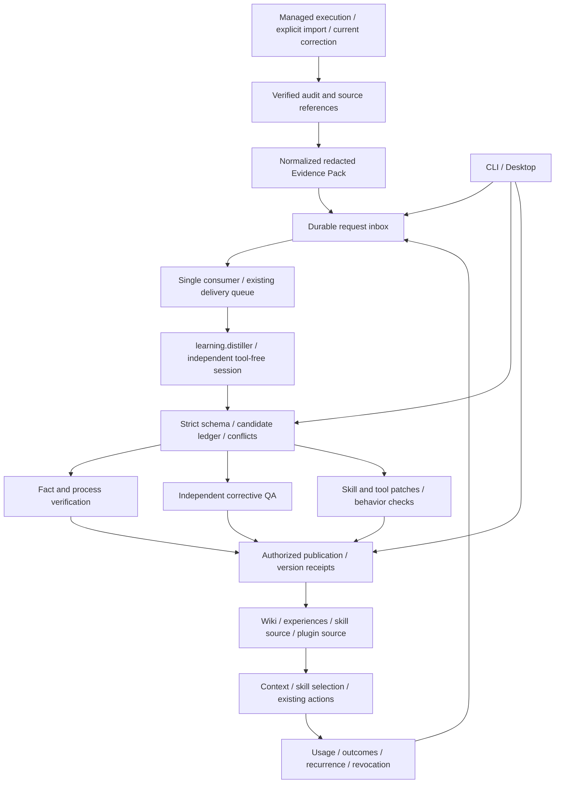

# Session Distillation and Reusable Assets Implementation Plan

> **For agentic workers:** REQUIRED SUB-SKILL: Use superpowers:subagent-driven-development (recommended) or superpowers:executing-plans to implement this plan task-by-task. Steps use checkbox (`- [ ]`) syntax for tracking.

**Goal:** Turn managed sessions and explicitly imported historical sessions into evidence-backed, validated, publishable and revocable business knowledge, business processes, corrective lessons, skills and tools, then measure their reuse in subsequent tasks.

**Architecture:** Execution events produce durable requests. A restricted independent `distiller` session proposes candidates; deterministic application code owns identity, evidence checks, validation, publication and feedback. Reuse the existing Agent / Sandbox, SQLite, durable delivery queue, retrospective, experience ledger, Wiki ingest, skill craft and plugin registration rather than building another agent framework or tool registry.

**Tech Stack:** TypeScript, Zod, Node SQLite, existing plugin runtime and Agent Providers, Vitest, existing Python Wiki utilities, Electron / React / Playwright.

**Status:** In progress; updated 2026-11-10. T01 is committed; section 13 tracks the remaining tasks. An implementation is not complete until its acceptance gates pass. See the [Chinese plan](2026-11-09-session-distillation.zh.md) and [previous completed phase](2026-11-08-runtime-learning-and-validation.md).

---

## 1. Goal, baseline and exclusions

The baseline is the implementation merged by the user in PR #294. Planning initially inspected `8b5a911a`; implementation verified the local `origin/main` at `7194f5eb` and uses `feat/session-distillation`. Recheck the baseline before subsequent integration. Automated fixtures are not live model tests; paid analysis and generated-tool installation retain their explicit execution prerequisites.

| Requirement | Required result |
| --- | --- |
| R1 | Durable requests from execution events, explicitly submitted corrections and historical imports; restart recovery and duplicate suppression |
| R2 | Independent analysis without execution, modification, MCP or automatic skill permissions; unsupported analysis capabilities block explicitly |
| R3 | Claim-level evidence, source completeness, project, version and applicability |
| R4 | Business terms, entities, rules, permissions, state constraints and cross-system processes; separate facts, proposals and conflicts |
| R5 | Specific validated corrective actions and exclusions, retaining independent QA, recurrence and revocation gates |
| R6 | Prefer patches to existing skills; preserve invocation restrictions, parameters, branches, recovery and completion checks |
| R7 | Prefer existing CLIs / scripts / plugins; tool proposals declare input/output, side effects and runnable checks |
| R8 | Publication respects persisted authorization, optimistic versions, recovery and the human merge decision |
| R9 | Cross-task / agent reuse within a project; cross-project exchange becomes a candidate without transferred authority |
| R10 | CLI and Desktop use the same use cases and state without duplicate consumers |
| R11 | Measure retrieval, selection, explicit adoption, execution results and recurrence separately |
| R12 | Repeatable real-Claude acceptance covering knowledge publication, skill/tool proposals and subsequent reuse |

No model training, graph database, vector service, multitenant cloud, automatic PR merging, transcript-derived authorization or blanket collection of personal sessions is included. Six executable agents do not imply six native transcript readers. Unsupported native sources require explicit exports and visible evidence gaps.

## 2. Reuse and confirmed implementation gaps

| Existing foundation | Reuse | Necessary change |
| --- | --- | --- |
| Automatic failure / success experiences | Preserve origin, QA and completion evidence | A diagnostic summary is not a demonstrated root cause; a QA workflow summary is not an extracted business process |
| `retro` | Extract shared evidence and analysis use cases while preserving CLI behavior | Remove fixed Claude invocation and personal absolute skill directory; connect report output to candidates |
| Transcript readers | Managed telemetry, Claude / Codex / OpenCode readers and Wiki import rules | Unify provenance, message locations, completeness and explicit import without another blanket scanner |
| Durable delivery queue | Dedicated distillation delivery database | Its constructor owns the consumer; independent producers cannot instantiate the same queue |
| SQLite helpers | Private files, migrations and transactions | Add a thin request inbox, candidates and receipts, not another general scheduler |
| Wiki ingest | Existing plan / preview / apply / hash / lint / recovery | Controlled candidate-to-plan adapter |
| Skill craft / catalog | Existing create, diagnose, refactor and recommendation | Preserve invocation metadata; add concrete patches, behavioral checks and version comparison |
| Plugins / System Actions | Register `learning.distill` and publication operations | Typed input/output and policy checks using the existing registry |

## 3. Ownership and event-driven architecture



- **Core / Application:** identity, scope, references, candidate states, verification authority, publication policy, budgets and audit. Models cannot grant verification, expand scope or alter policy.
- **`learning.distiller`:** extraction prompts and analysis strategy; registers `learning.distill` using existing `workflow.action`, with an injected Agent Provider. No product prefix in new plugin names.
- **Worker:** single-consumer ownership, budgets, cancellation and retries. Each job gets an independent session rather than an indefinitely accumulating agent conversation.
- **Publication adapters:** existing Wiki, Git, Verification, Repository and System Action facilities. Introduce a new seam only for an actual implementation variation.
- **CLI / Desktop:** shared use cases only; no renderer access to files, credentials or databases.

### 3.1 Durable lifecycle

1. Write the original audit first. Terminal events, repair checkpoints and explicit submissions create SQLite inbox requests. Analysis unavailability must not fail the original task.
2. Expose inbox-write failures. On startup and periodic reconciliation, verify source audits; commit each run's verified sequence / head and inbox requests in one ledger transaction. A full queue must not advance beyond unaccepted work.
3. Only the Worker constructs its dedicated `DurableTriggerQueue`. Producers write the inbox. The Worker enqueues then records handoff; a stable key recovers a crash between those steps.
4. Before invoking a model, check candidate / processing receipts. A completed source and analyzer version is not charged again even if an old queue delivery was pruned.
5. Changed source content produces a new key. Retrying the same key must retain its original evidence content and digest.
6. Analysis only creates candidates. Validation and publication are separate. Timeouts, invalid JSON and incomplete sources have explicit outcomes.
7. Stop new dispatch before cancellation. Existing queue `close()` drains, so add an optional stop-dispatch close mode while retaining its default behavior. Allow five seconds for owned analysis to stop, then terminate only owned processes; keep unfinished deliveries recoverable.
8. Mark learning runs `purpose=learning`; exclude their events from distillation triggers and ordinary success experiences to prevent feedback loops.

### 3.2 Trigger and initial budget policy

| Item | Planned behavior |
| --- | --- |
| Automatic source | Managed runs after explicit learning enablement; failures retain existing candidates, repaired runs may distill concrete corrections |
| Successful source | Independent QA plus successful completion, or the matching published-change human handoff; unmerged does not mean deployed |
| Correction | Explicit current submission with provenance; historical user-role text does not create current authority |
| Historical import | Explicit accessible run, session or export; no collection of all personal sessions or private remote platform API access |
| Repeated operations | Compare recorded tool names, parameter patterns and results; one success or a frequency threshold never grants publication |
| Concurrency / attempts | One Worker and one model job per user; at most two model attempts per delivery, with redacted first-error structure in the second |
| Time / size | 120 seconds per attempt; 128 KiB UTF-8 Evidence Pack, 32 KiB output, at most ten candidates. Split or block oversized inputs explicitly |
| Daily budget | Twenty model calls including retries by default, reserved atomically before invocation. Missing usage is unknown; monetary caps only where actually supported |
| Capacity / retention | Normal admission: 1,000 pending requests / 16 MiB and 2,000 ledger records / 32 MiB. Only transient source blocking and atomic invalidation may use a safety reserve, capped at twice normal record/byte limits; new work, model calls and publication cannot borrow it. The SQLite main file is physically capped at 128 MiB including page overhead. Temporary packs seven days, unpublished candidates ninety days. Preserve active references and unresolved publication recovery; report full capacity |
| Hosting | `experience worker --once` / `--watch`; Desktop hosts the same process using existing process facilities and pauses on exit by default. Background startup requires saved configuration, not installation of an OS service |

These are configurable initial limits, not measured throughput or a guarantee against future mistakes.

## 4. Proposed contracts

Use strict Zod schemas at application seams. Existing `ExperienceRecord` and version-1 exchange semantics remain compatible.

```typescript
type AssetKind = 'fact' | 'process' | 'lesson' | 'skill' | 'tool';
type CandidateState = 'candidate' | 'conflict' | 'validated' | 'published'
  | 'rejected' | 'superseded' | 'revoked';

interface EvidenceRef {
  id: string;
  kind: 'audit' | 'message' | 'tool-result' | 'code' | 'test' | 'human-confirmation';
  digest: string;
  locator: string;
  completeness: 'complete' | 'partial';
  authority: 'observed' | 'declared' | 'inferred';
}

interface DistillationRequest {
  version: 1;
  scope: string;
  sourceId: string;
  sourceRunId?: string;
  workItemId?: string;
  evidenceDigest: string;
  analyzerVersion: string;
  reason: 'completed' | 'repaired' | 'correction' | 'import';
}

interface CandidateProposal {
  kind: AssetKind;
  title: string;
  statement: string;
  evidenceIds: readonly string[];
  applicability: {
    project: string;
    environments: readonly string[];
    versions: readonly string[];
    preconditions: readonly string[];
    exclusions: readonly string[];
    invalidationConditions: readonly string[];
  };
  targetRef?: string;
  payload: unknown; // Discriminated strict schema by kind, as specified below.
}

interface DistillationOutput {
  version: 1;
  candidates: readonly CandidateProposal[];
  warnings: readonly string[];
}
```

| Kind | Required payload | Validation authority |
| --- | --- | --- |
| fact | Topic, subject, rule, fact/proposal classification and applicability | Matching code, contract, confirmation or observation; unresolved proposals cannot become facts |
| process | Entry, participating systems, prerequisites, steps, state changes, exception paths and completion | Node-level evidence and missing markers; a partial route cannot claim full-chain success |
| lesson | Trigger, hypothesized/confirmed cause, attempts, concrete fix and prevention check | Same-project correction and fresh independent QA, using existing verification gates |
| skill | Target or reason for addition, triggers/restrictions, inputs, branches, recovery, completion, patch and evaluation cases | Original version, structural checks, positive/negative cases and old/new behavior comparison |
| tool | Existing-tool search, input/output schema, dependencies, permissions, timeout, effects, idempotency/recovery, source proposal and tests | Isolated execution, invalid input, cancellation and permission denial; declare none for inapplicable side effects |

Models cannot supply system IDs, candidate state, verification authority, publication tokens or arbitrary absolute target paths. Application code assigns identity, checks that evidence belongs to the request, and resolves logical `targetRef` values to authorized destinations.

```typescript
import { createHash } from 'node:crypto';

// evidenceDigest covers the audit head, source hashes, message ranges and completeness.
function distillationKey(input: DistillationRequest): string {
  return createHash('sha256').update(JSON.stringify([
    input.scope, input.sourceId, input.evidenceDigest, input.analyzerVersion,
  ])).digest('hex');
}
```

`sourceRunId` identifies the original run, `jobId` the distillation request, and the analysis has a new `runId` / `sessionId`. None replaces `workItemId`.

Shared use cases: `submitDistillation`, `reconcileDistillationSources`, `processDistillation`, `validateLearningCandidate`, `publishLearningCandidate`, `revokeLearningCandidate`, `queryLearningState`. Implement application functions over existing ports; do not create an interface for every single implementation.

### 4.1 State, publication and feedback

- `candidate → validated → published`; conflicting evidence enters `conflict`; rejection, replacement and revocation retain reasons. Content changes create a new version requiring validation.
- Validation receipts bind candidate digest, validator version, evidence digest and results. Model confidence never grants state. Recheck receipts, evidence and target versions at publication time.
- Separate stable business rules from environment observations. Preserve existing lesson expiry and version-based skill/tool invalidation; do not apply one ninety-day expiry rule to everything.
- SQLite, files and Git cannot be treated as a single atomic transaction. Use `prepared → applied → committed` publication journals, expected hashes and recovery copies, reconciling unfinished publication on startup.
- If a restarted target already matches the intended result, finish the receipt. Third-party changes produce conflict rather than an overwrite. Reuse Wiki recovery receipts for partial page batches.
- Revocation removes knowledge authority and future context eligibility. Deployed tool revocation must report actual uninstall/rollback or `rollback_blocked`, not merely update the ledger.
- Feedback binds an exact asset version, target run/work item and result. Distinguish exposure, selection, explicit adoption, execution and success; success alone does not prove causality.

## 5. Security and generalization constraints

1. Analyze bounded redacted inline evidence. Do not mount source repositories, credential directories or whole raw transcripts for the model. Split large sources explicitly and retain message locations.
2. Existing Claude development commands skip permissions; do not reuse that command unchanged. Add an explicit `analysis` execution profile that removes bypass, disables tools, automatic skills, MCP, project/user hooks and session persistence, while retaining the legitimate existing authentication path.
3. Verify flags against installed CLI help and command construction tests. Tool prohibition is not OS isolation. Prove the model has no tools and the trusted CLI does not run project hooks/plugins. Unsupported providers return `analysis_unsupported`, never a writable fallback.
4. Messages, tool outputs and knowledge are untrusted evidence. Current authorization comes from invocation context, not transcript role labels or model prose.
5. Replace account names, IPs, personal paths and transient credentials with configuration/applicability. Do not generalize away permissions, business semantics or security checks.
6. Search before adding knowledge, skills or tools. Semantic similarity may suggest a merge; it cannot merge contradictory rules or overwrite verification history automatically.
7. Improve Chinese segmentation, explicit aliases and structured applicability first, with negative examples. New retrieval dependencies or vector services require measured need.
8. Automatic publication is limited by persisted policy specifying targets, actions, projects and asset types. Code proposals become human-reviewed PRs; a candidate is not directly installed or executed.

## 6. File ownership map

Repository-relative paths below are an engineering appendix. Keep changes local to existing modules; the plan does not prewrite production implementations.

| Area | New files | Existing files to change/reuse |
| --- | --- | --- |
| Contracts / candidates | `packages/runtime/src/application/learning/contracts.ts`, `candidate-store.ts` | `learning/experience-store.ts`, `infrastructure/storage/sqlite.ts` |
| Requests / Worker | `learning/requests.ts`, `worker.ts` | `application/plugins/trigger-queue.ts`, `plugins/observability.ts`, `workflows/execute-work-item.ts`, `application/workflow-engine.ts` |
| Evidence / retrospective | `learning/evidence.ts`, `analysis.ts` | `apps/cli/src/commands/retro.ts`, `infrastructure/observability/agent-telemetry.ts`, Wiki session reader |
| Restricted agent | Existing Agent / Sandbox | `domain/agents/types.ts`, `domain/agents/claude-code.ts` and necessary execution-profile plumbing |
| Plugin | `application/plugins/learning.ts` | `plugin-sdk/index.ts`, `application/plugins/runtime.ts`, `configured.ts`, `builtin-manifests.ts`, `operations.ts` |
| Publication / feedback | `learning/publication.ts`, `knowledge.ts`, `proposals.ts`, `feedback.ts` | `learning/runtime.ts`, `experience-store.ts`, existing Context / Verification / Repository ports |
| CLI | Extend `apps/cli/src/commands/experience.ts` | Registry, composition root and existing `retro` |
| Desktop | Extend `shared/experience-contract.ts`, Main `experience-service.ts`, renderer `ExperienceSettings.tsx` | Existing IPC/preload, process hosting, run detail and design system |
| Skills | Skill craft, its checklist and `skills/jev-agent-guard/scripts/skill-catalog.mjs` | Wiki `wiki.py`, `session_source.py` and tests; only change Wiki implementation if its contract requires it |
| Documentation | Extend bilingual plugins, execution and testing docs plus integration standard | Update execution entry points with command changes; canonical CLI/plugin versions in affected commits |

Each new TypeScript module has a matching `.test.ts`. Cross-process and E2E checks are separate from unit tests and measure externally observable behavior.

## 7. Implementation tasks

Each task follows failing check → confirmed failure → minimal implementation → focused passing checks → version/docs/commit. Continue under existing user authorization without repeated permission requests. Work on task/PRD slices, never the integration checkout.

### T01 — Contracts, states and keys (P0)

**Dependencies:** none. **Files:** `contracts.ts`, `contracts.test.ts`.

- [x] Implement section 4 strict schemas, discriminated payloads, state transitions, canonical scope checks and `distillationKey`.
- [x] Write rejection cases first: forged verified state, unowned evidence IDs, cross-project scope, oversized output and invalid work identity.
- [x] Fixed fixture `github:acme/api`, `run:r1`, identical evidence/analyzer yields one key; changing hash, scope or analyzer changes the key.
- [x] Run `pnpm --filter @afk/runtime exec vitest run src/application/learning/contracts.test.ts`; confirm red then green.
- [x] Export shared types and commit the contract slice without changing old exchange formats or commands.

### T02 — Private request/candidate ledger (P0)

**Dependencies:** T01. **Files:** `candidate-store.ts`, `requests.ts` and matching tests.

- [ ] Reuse SQLite transactions/migrations for requests, evidence references, candidate versions, processing receipts, publication journals and per-run source positions. Enforce unique request keys and reject model-owned states.
- [ ] Two real processes submitting the same key create one row; conflicting content is rejected; reopening retains results; missing evidence retains a visible block reason.
- [ ] Check migration rollback, private permissions, symlink refusal, active-reference capacity protection and optimistic state conflicts.
- [ ] Run `pnpm --filter @afk/runtime exec vitest run src/application/learning/candidate-store.test.ts src/application/learning/requests.test.ts`; assert no missing/duplicate rows.
- [ ] Commit inbox handoff receipts and cursors without duplicating delivery retry state.

### T03 — Evidence Pack and shared retrospective (P0)

**Dependencies:** T01. **Files:** `evidence.ts`, `analysis.ts`, matching tests, CLI `retro.ts` and its tests.

- [x] Extract evidence assembly and report parsing while preserving `retro run/show` output and signatures.
- [x] Reuse managed telemetry/readers; define message locators, audit sequences, completeness and source/content digests. An ID is not access permission.
- [x] Test corrupted audits, missing transcripts, malformed JSONL, explicit oversized-source splitting, secret/private-key redaction, source replacement and path escape. Insufficient evidence cannot produce a complete-process claim.
- [x] Run runtime `evidence.test.ts` / `analysis.test.ts` and `pnpm --filter afk exec vitest run src/commands/retro.test.ts`.
- [x] Remove personal directory dependencies and commit; report native-source support separately.

### T04 — Restricted independent profile and plugin (P0)

**Dependencies:** T01, T03. **Files:** plugin `learning.ts`/tests, agent command construction/profile plumbing and plugin configuration.

- [ ] Introduce the analysis profile with inline evidence and no original repository/session context; keep development behavior compatible.
- [ ] Command tests assert no permission bypass, empty tools, disabled MCP/automatic skills/untrusted hooks, working authentication and pre-start unsupported-provider refusal.
- [ ] Validate strict JSON and reject forged references, states, paths, more than ten candidates or output above 32 KiB. Analysis cannot invoke publication.
- [ ] Run `pnpm --filter @afk/runtime exec vitest run src/domain/agents/claude-code.test.ts src/application/plugins/learning.test.ts src/application/learning/analysis.test.ts` plus affected config/transport checks.
- [ ] Register `learning.distiller` / `learning.distill`, bump CLI version and update integration docs; execution support does not imply safe-analysis support.

### T05 — Worker, delivery and budgets (P0)

**Dependencies:** T02, T04. **Files:** `worker.ts`/tests; minimal compatible queue shutdown change and tests.

- [ ] One Worker owns the dedicated delivery queue; task/CLI/Desktop producers only write the inbox. Handoff uses stable keys.
- [ ] Crash after inbox commit, after queue insertion and after candidate persistence before acknowledgment; recover to one candidate set without a repeated model call for completed work.
- [ ] Reserve daily budget atomically; enforce two attempts, timeout/Abort, plugin disable and consumer ownership. Do not steal external or unverifiable owners.
- [ ] Test stop-dispatch shutdown, owned-only cancellation, compatible default drain and five-second recovery; run `worker.test.ts` and `trigger-queue.test.ts`.
- [ ] Commit observable starts, completions, retries, blocks, missing usage and budget results; exhausted jobs remain visibly blocked.

### T06 — Event capture and corrections (P0)

**Dependencies:** T02, T03, T05. **Files:** existing execution/observer seams, `requests.ts`, `requests.integration.test.ts`.

- [ ] Request successful/handoff and repaired checkpoints with original identities. Failures retain old candidates without inventing a confirmed correction.
- [ ] Reconcile a crash between original audit append and inbox write; commit source position and inbox together. Analysis failures do not change the source execution result.
- [ ] Corrections record current invocation provenance and create candidates/conflicts or invalidate demonstrated false assets. Historical messages confer no authority.
- [ ] Test duplicate terminal events, late QA failure, no learning recursion, and full-queue cursor protection via `requests.integration.test.ts`.
- [ ] Run managed execution through a fake distiller into the real ledger; commit runnable milestone M1.

### T07 — Concrete lessons, applicability and recall (P1)

**Dependencies:** T06. **Files:** learning runtime/store, `feedback.ts` and matching tests.

- [ ] Map lesson candidates through existing gates. Separate concrete action and hypothetical/confirmed cause; preserve original failure identity and recurrence history when corrections change.
- [ ] Recheck fresh independent QA and the exact target version. Another successful repair cannot verify this lesson.
- [ ] Add `Intl.Segmenter` Chinese terms, error/command identifiers, bounded explicit aliases and applicability filtering before new retrieval dependencies. Suspected duplicates do not overwrite history.
- [ ] Freeze at least twelve equivalent-query pairs and twelve inapplicable/opposite-condition queries across languages, projects and versions. Require no scope leakage; report old/new recall@5 and negative results without rewriting answers to pass.
- [ ] Run experience/exchange/runtime and feedback tests; imports stay candidates, revocation removes recall, duplicate feedback does not inflate counts. Deliver M2.

### T08 — Business knowledge/process publication (P1)

**Dependencies:** T06. **Files:** `knowledge.ts`, `publication.ts` and tests; existing Wiki reader/ingest.

- [ ] Convert fact/process candidates into existing version-1 ingest plans after search, full-page/rule reads and expected hashes; include backlinks/index updates.
- [ ] Separate rules from environment observations. Uncertain content uses the authorized inbox. Each process node has evidence or an explicit gap; partial success is not full-chain acceptance.
- [ ] Test idempotence, contradictory rules, concurrent human edits, sensitive/rule/escaping-target refusal and reuse of existing topics.
- [ ] In a temporary vault, run `python3 skills/wiki/scripts/wiki.py ingest --vault <fixture-vault> --plan <fixture-plan> --json` preview, then `--apply` under configured policy; verify hashes/lint. Real vault writes require existing explicit target authorization and are never pushed remotely.
- [ ] Implement publication journaling/partial recovery. Run knowledge/publication tests and `python3 -m unittest discover -s skills/wiki/scripts -p 'test_*.py'`; deliver M3.

### T09 — Skill proposals, generalization and metadata (P1)

**Dependencies:** T06; candidate/catalog work can run alongside T08, but publication integration waits for T08's tested publication use case. **Files:** `proposals.ts`/tests, skill craft/catalog and tests.

- [ ] Search existing skills with provenance. Prefer a patch; a new skill must explain why existing ones cannot be reused.
- [ ] Preserve/respect `disable-model-invocation`, invocation restrictions and source; prohibited automatic invocation must not be recommended for execution.
- [ ] Produce parameters, triggers/exclusions, branches, recovery and verification from evidence, removing personal/environment constants without deleting business/security rules.
- [ ] Include normal, recovery and rejection behavior cases plus old-version comparison; report structural conformance separately from effectiveness.
- [ ] Generate reviewable patches, validate in an owned task worktree and publish a PR. Bump plugin version with skill changes and never edit installed caches. Deliver the skill part of M4.

### T10 — Tool proposals and controlled execution (P1)

**Dependencies:** T09. **Files:** continue `proposals.ts`/tests; reuse Verification, Repository and System Actions.

- [ ] Detect repeated operation patterns and search existing CLIs/scripts/plugins first; repetition creates a candidate, not permission to execute it.
- [ ] Keep one-skill helpers under that skill's scripts; use existing actions for cross-workflow calls and plugins for actual backend/install variation. No product-prefixed names.
- [ ] Execute source proposals only in separate restricted verification tasks. Test valid/invalid inputs, timeout/cancel, retry effects and permission denial; do not interpolate arguments through shell text.
- [ ] Installation/publication follows persisted authority and existing dependency installers. Unsupported rollback remains blocked rather than merely changing ledger state.
- [ ] In a temporary repository demonstrate two input sets and malicious-input rejection, retaining source/tests/version/PR receipts; deliver M4.

### T11 — CLI operations (P1)

**Dependencies:** T05, T07–T10. **Files:** experience command, registry/composition and tests.

- [ ] Keep old commands compatible; add `experience distill`, `jobs`, `candidates`, `inspect`, `validate`, `publish`, `invalidate`, `feedback`, `worker`. Candidate IDs do not replace old experience identity semantics.
- [ ] Require scope for queries. `distill` accepts exactly one of `--run-id` / `--transcript`, explicit provider for historical sources, and `--correction-file` plus provenance for corrections; no private prose in arguments.
- [ ] `worker --once` handles currently processable requests then exits; `--watch` runs foreground. Report pending/blocked/failed/processed with safe codes, not tokens/raw transcripts.
- [ ] Black-box restart, pagination, duplicates, disabled providers, budgets, exit codes and old commands. Run focused CLI tests and root `tests/e2e/plugin-distillation.test.ts`.
- [ ] Update canonical CLI version, registry and bilingual execution entry points. Package and verify the actual command count, not the old count of twenty-three.

### T12 — Desktop shared governance (P1)

**Dependencies:** T11. **Files:** existing experience contract, Main service, IPC/preload, settings/run detail and tests.

- [ ] Follow Desktop architecture/design system; use shared use-case DTOs. The renderer cannot create Workers or access disk/models.
- [ ] Expose enablement/budget/provider settings, job state, evidence/gaps, candidate diffs, validation/publication/revocation and feedback; show unconfigured/unknown/unsupported explicitly.
- [ ] Simultaneous CLI/Desktop use still has one consumer; application restart preserves requests and never kills a CLI-owned process.
- [ ] Validate scope, IDs, sources, target authority and stale responses at IPC seams. Switching projects cannot show the previous project's results.
- [ ] Run Desktop typecheck/test/build, focused Playwright and full Electron E2E; deliver M5.

### T13 — Real acceptance, failure drills and release (P0 gate)

**Dependencies:** T01–T12. **Files:** `tests/e2e/plugin-distillation.test.ts`, `plugin-distillation-live.test.ts`, bilingual guides.

- [ ] Freeze credential-free evidence fixtures and expected claims before running a model: corrective lesson, business route, skill/tool changes, contradictions, injection and missing evidence.
- [ ] Require explicit `AFK_REAL_DISTILLATION_E2E=1` for real Claude using existing legitimate authentication. Default is visible skipped; opted-in missing dependencies fail. Record CLI/model/config/scope/time and unknown usage.
- [ ] Using an installed CLI, submit and restart a Worker, distill and independently inspect claim evidence, temporary-vault idempotence, skill/tool diffs and checks. A related task recalls the exact version; unrelated/cross-project tasks do not; revocation removes future context.
- [ ] Drill malicious transcript commands, hook sentinel writes, unexpected MCP, expired authority, publication crash, concurrent human edits, source replacement, queue/disk full, exhausted budget, duplicate events and orphan ownership with assertable outcomes.
- [ ] Separate spec review before quality review; repair and retest. Run section 10 checks, commit/push/PR for human merging, archive integrated worker checkouts and retain recovery evidence. Deliver M6.

## 8. Parallel execution and write scopes

| Batch | Parallel work | Integration owner retains |
| --- | --- | --- |
| A | Main T01; sidecar fixture/source inventory | Contracts, identity, states, baseline and version policy |
| B | Worker A T02; Worker B T03 | Contract integration and analysis-profile inspection |
| C | Worker A isolated Provider part of T04; after T04, main T05 → T06; Worker B catalog restrictions | Common agent types, config/manifests and shared queue edits; passing T06 completes M1 |
| D | After T06: A T07, B T08, C T09–T10 | Freeze publication use-case contracts first; one worker owns proposals continuously |
| E | Main T11; D T12 after CLI contract freeze; others T13 fixtures | Registry, versions, public exports and execution docs |
| F | Spec review → repair → quality review; independent environment acceptance | Final source tree, evidence, publication and cleanup |

One isolated worktree per worker with disjoint writes. Handoffs include patch, commands/exit codes, actual limits and changed paths. The integration owner alone handles shared types, root settings and version bumps.

With a PRD baseline, slices target `prd/<issue>` and a human merges the final baseline. Otherwise use task branches and reviewable PRs. Cleanup never force-deletes active, unknown or unpublished work.

## 9. Milestones and definition of done

| Milestone | Deliverable | Proof |
| --- | --- | --- |
| M1 / A–C | Event → independent agent → candidate | Recovery, no tools, provenance, budget and deduplication |
| M2 / D | Concrete corrective learning | Matching fix/QA, subsequent recall, negatives and recurrence/revocation |
| M3 / D | Business knowledge/process | Conflicts, idempotent writes, node evidence, concurrency and recovery |
| M4 / D | Skills/tools | Generalized inputs, behavior comparisons, permissions/versions and human-review PRs |
| M5 / E | CLI/Desktop operations | One consumer, shared state, project isolation and installed commands |
| M6 / F | Complete delivery | Quality gates, real-Claude E2E, docs, rollback and checkout cleanup |

Schedule follows these six dependent batches, each delivering a runnable slice. Model/network/account waiting is not completed development. Missing live prerequisites are reported as blocks, never replaced by fixture claims.

## 10. Verification, migration and rollout

### Check layers

- Contracts: unknown fields, forged authority, references, scope and old-format compatibility.
- Persistence: real concurrent/crashing child processes across input/cursor/delivery/candidate/publication boundaries.
- Analysis: no tools/automatic skills/MCP, unchanged hook sentinel, no secrets in packs/logs and no unsafe fallback.
- Asset quality: frozen positive/negative cases, traceable process nodes, old/new skills, multi-input tools and safe failures.
- E2E: actual CLI/IPC surfaces and independently checked model outputs. Raw transcripts are not final reports.

### Required repository checks

```bash
pnpm typecheck
pnpm build
pnpm architecture:check
pnpm docs:check
pnpm test
pnpm test:coverage
python3 -m unittest discover -s skills/wiki/scripts -p 'test_*.py'
pnpm --filter afk-control-electron typecheck
pnpm --filter afk-control-electron test
pnpm --filter afk-control-electron build
pnpm --filter afk-control-electron e2e
pnpm release:cli --output /tmp/session-distillation-release
```

Start with focused checks, then run full gates on the stable tree. Repeat only for new changes/failures. Keep existing per-package coverage baselines; report shared-source, Desktop and model subprocess scope separately.

### Migration and rollout

- Keep old experience version-1 exchange unchanged; use a separately versioned candidate database. Failed migration preserves the original database and source.
- Use consistent SQLite backups, not copying an active WAL main file. Old binaries cannot write new schemas; rollback requires a compatible reader or validated migration/snapshot recovery.
- Learning starts disabled without changing existing execution. Explicitly configure `learning.distiller`, run once, then enable a continuous Worker and already-authorized publication types.
- Missing Claude authentication, Python, vault rules, repository permissions or validators stays visibly blocked.
- Bump `.claude-plugin/plugin.json` with skill changes and `apps/cli/package.json` with CLI/runtime changes, relative to the canonical versions at implementation time. This plan reserves no release number.
- Check installed packages outside the repository with isolated HOME; real account tests are separate explicit opt-ins. Sending email/third-party notifications is not a default check.
- Push task branches, record measured scope/limits, inspect CI and leave merging to a person. Close/archive completed workers and retain evidence under policy.

## 11. Effectiveness and extension criteria

| Metric | Definition | Invalid interpretation |
| --- | --- | --- |
| Recall@5 / negatives | Relevant retrieval and exclusion on frozen data | Retrieval count proves usefulness |
| Selection/adoption/execution | Exact version, task and actor/execution evidence separately | Context exposure proves usage |
| Recurrence | Same failure family within applicability/version, with a denominator | Different wording means no recurrence |
| Repeated exploration | Comparable discovery steps, retries, duration and tokens | Unknown usage is zero or all improvement was caused by learning |
| Skill transfer | Original, parameter variation, recovery/rejection old/new comparisons | One successful account demonstrates generality |
| Tool value | Success, side-effect failures, manual steps and maintenance cost | More scripts are inherently better |

Initial acceptance requires computable evidence and passing positive/negative cases, not invented production gains. Add semantic retrieval, remote sharing or new publication backends only after measured need; organizational permissions, cloud memory and training need a separate explicit scope.

## 12. Execution checklist

- [ ] T01–T06: reliable tool-free distillation into candidates.
- [ ] T07–T10: parallel lessons, knowledge, skill and tool validation/publication.
- [ ] T11–T12: shared CLI/Desktop and operable Worker.
- [ ] T13: live use, fault drills, independent reviews, versions and PR delivery.

Implementation follows this order and continues along the dependencies. Existing authorization avoids repetitive substep questions, but never grants permission to merge or bypass target-system controls.

## 13. Implementation status and remaining queue (2026-11-10)

This table describes inspected code. Close each checklist only after implementation, validation and the required commit; passing a focused test does not complete the task or system.

Kernel commit `4b7295e9` is pushed to the task branch. Baseline validation: runtime full suite 3,018 passed/3 skipped, followed by 31 focused checks after the CLI-flag compatibility fix; CLI full suite 542 passed/2 skipped; skill catalog 86 passed. Runtime/CLI builds and typechecks, architecture and documentation checks passed.

Current slice on 2026-11-10: the latest full runtime suite passed 3,126 tests/4 skipped; CLI passed 542/2 skipped and repository tests passed 326/1 skipped. Running runtime and repository suites together at high concurrency timed out one existing Git integration test; after both runs finished, the complete runtime suite passed independently with at most four workers, without extending timeouts or changing that test. The native process guard is integrated and independently approved for specification and quality. Analysis currently supports only Darwin with `/usr/bin/sandbox-exec`; other platforms explicitly return unsupported. The latest live Claude kernel test took 38.58 seconds: one call, one candidate, returned usage, zero extra replay calls, no transcript-injection, malicious Hook or MCP sentinel writes, and invalidation after late QA failure. Synthetic audit and real local authentication do not cover installed CLI, Desktop or full asset publication. An earlier invalid model output was correctly rejected; one successful run does not establish stable output.

The reproduced cold-start race is repaired: SQLite rollback-journal removal can produce `nlink=0`, now handled by bounded sidecar-only rechecks while preserving owner, symlink, external-hardlink and database-identity checks. Six deterministic subprocess regressions and 60 real producer pairs pass; independent specification and quality reviews approve the repair. The existing PR CI failure reports the corresponding cold-start error. Scope, manual-import ownership, transient-unblock ordering and diagnostic fixes passed independent specification re-review. Subsequent quality findings—temporary path-permission misclassification and inability to persist invalidation at capacity—are repaired and independently re-approved; an interrupted-write regression verifies complete rollback. The latest complete runtime suite passed 3,126/4 skipped and CLI passed 542/2 skipped. Final commit and new CI are pending, so M1 remains open.

| Task | Current state | Next acceptance gate |
| --- | --- | --- |
| T01 | Committed as `d0190782`: strict contracts, candidate payloads, evidence binding and stable keys | Preserve compatibility and rerun boundary checks for subsequent contract changes |
| T02 | Requests, candidates, cursors, publications and budgets implemented; version 2 commits snapshots with requests/cursors, accounts snapshot bytes and preserves legacy reads; budget reservation rechecks source blocks transactionally | Review migration, capacity rollback and cross-process conditional state updates; integrate publication recovery |
| T03 | Evidence packs, immutable snapshots and shared prompts implemented; redaction, exact reference binding and frozen metrics fixed | Independent re-review and kernel commit complete; automatic intake remains T06 |
| T04 | Disabled plugin, dynamic Agent resolution and analysis profile implemented; live Claude rejects transcript injection and malicious Hooks/MCP while preserving authentication | Preserve Darwin support boundary; complete final integrated regression and commit |
| T05 | Worker/purpose and process guard integrated; guard independently approved for specification/quality, including parent SIGKILL, detached-descendant refusal and unrelated-process survival | Complete consumption/conditional-state re-review, final regression and commit; no all-platform support claim |
| T06 | Root registration, scope/manual-import ownership, complete-prefix negative evidence, transient-unblock ordering and diagnostics repaired; 26 intake and 13 plugin tests pass, specification and quality findings independently re-reviewed; uncommitted | Complete commit and new CI before accepting M1 |
| T07 | Retained worktree frozen recall@5 22/24, false positives 0/18; 64 tests pass and four version cases fail; not integrated | Add structured applicability from trusted execution context and QA provenance, not more prompt-version heuristics |
| T08 | Sidecar withdrawal-receipt SIGKILL recovery and applicability filtering across classifications independently approved for specification/quality; not integrated | Wire trusted authorization, complete publication enumeration/actual withdrawal and unified Context read gate; complete real temporary-vault loop |
| T09 | Invocation/tool declarations retained in the skill catalog; YAML edge cases under review | Candidate patches, normal/recovery/rejection behavior comparison, original-version binding and PR receipts |
| T10 | Tool-proposal validation and delivery not implemented | Existing-tool search, two parameter sets, safe failures, cancellation, side-effect recovery and reviewable changes |
| T11 | New learning-governance CLI not connected | Shared use cases, global Worker, scoped queries, failure replay and installed-package black-box checks |
| T12 | New learning-governance Desktop not connected | Shared state/consumer, IPC checks, project switching, process shutdown and Electron E2E |
| T13 | Live Claude kernel distillation E2E passed; full publication, installed-package and Desktop loops incomplete | Complete loop, fault drills, coverage, installed package, independent reviews, PR and worktree cleanup |

### Next parallel batches

1. Integrate T02–T05 locally, close review findings and commit the verified kernel as the common worktree baseline.
2. Complete T06 locally; sidecars prepare T07 negative/applicability cases, T08's existing Wiki publication seam and T09–T10 behavior fixtures. Preparation does not replace automatic intake.
3. After M1 passes, use three worktrees for T07, T08 and T09–T10. Freeze the publication contract first and assign one writer per file.
4. Integrate T11 locally, including versions, command registry and public exports. Once contracts stabilize, use a separate worktree for T12 and another executor for T13 preparation.
5. Run T13 through a real model, filesystem/processes and user entry points, using local Claude Code first. Report remote-provider configuration and coverage separately; the earlier Gmail success does not validate this learning phase.
6. Push reviewable milestones and inspect CI; a person decides merging. Preserve changes and validation evidence before archiving completed worktrees and releasing their dependencies/build outputs.

### Complete-system delivery constraint

Continue using existing Agent, Sandbox, Host, Tracker, Verification, Notification, Trigger, Context/Memory, Credential/Auth, Artifact/Report, Repository/Workspace, Security/Policy and Observability interfaces. This phase closes the loop from their execution evidence to reusable assets without duplicating frameworks. Track each external Provider as implemented, configured and live-verified separately; missing configuration cannot count as passing.

## 14. Complete delivery roadmap and handoff (2026-11-10)

This is the delivery view of section 7, not another implementation. The current request is to complete the plan; uncommitted code, historical test counts and worker assignments are not final acceptance evidence.

### 14.1 Core, plugins and the independent Agent

| Layer | Responsibilities | Integration |
| --- | --- | --- |
| Core/shared use cases | Events and identity, frozen evidence, state transitions, idempotence, budgets, scopes, authorization, publication recovery and feedback | CLI, Desktop and Worker share use cases and state machines |
| Existing capability plugins | Agent execution, Sandbox isolation, retrieval, Verification, repositories, credentials, artifacts and observability backends | Reuse manifests, capability declarations, dependency installation and System Actions; no new plugin protocol |
| `learning.distiller` | Intake, restricted analysis, candidate queries and Worker coordination | Disabled by default; uses existing `workflow.action` |
| Independent analysis session | Derive fact/process/lesson/skill/tool candidates and applicability from redacted evidence | Local Claude Code first; no tools, publication authority or original task session |
| Validation execution | Fixed assertions, independent QA, skill behavior comparison and tool tests | Reuse Verification/Agent/Sandbox; learning-purpose runs cannot trigger distillation |
| Publication execution | Authorized knowledge changes or reviewable skill/tool changes | Recheck candidate, evidence and target versions; a person decides PR merging |

### 14.2 Six delivery batches

| Batch | Tasks and order | Exit criteria |
| --- | --- | --- |
| 1: reliable distillation M1 | Main completes T06 Observer wiring, startup/periodic reconciliation, corrections and recursion prevention; parallel T05 budget recovery and process shutdown; recheck T01–T04 | Unique requests from complete audits, durable restart, late negative evidence removes eligibility, intake failures preserve original execution, killed parent leaves no analyzer |
| 2: reusable lessons M2 | Separate worktree completes T07 applicability, versions, negation, adoption feedback and recurrence | Frozen positive/negative cases pass, no project leakage, subsequent real task receives accurate lessons, revoked lessons leave new contexts |
| 3: knowledge/processes M3 | T08 reuses Wiki plan/preview/apply/recovery, then integrates publication journals | Real temporary-vault writes, idempotence, node evidence, conflict protection and interrupted-publication recovery; unproven claims remain candidates |
| 4: skills/tools M4 | One worktree completes T09 then T10; publication integration waits for stable T08 contracts | Comparable normal/recovery/rejection skill behaviors; tool accepts two parameter sets and rejects malicious input; version, tests, change receipts and rollback outcome |
| 5: shared product entry points M5 | Main completes T11; separate T12 worktree follows frozen shared contracts | Installed CLI and Desktop share project state and one consumer; operable queries, validation, publication, invalidation, feedback and shutdown |
| 6: complete system M6 | T13 real-model loop, failure drills, coverage, independent specification/quality reviews and release cleanup | Release checks pass; live/simulated/unconfigured/skipped evidence separated; reviewable changes pushed; completed worktrees archived after evidence preservation |

Batches 2–4 run in parallel after M1; T08 adapter/test preparation may start earlier. Main owns shared contracts, public exports, versions and the CLI registry. Each worker has a disjoint write set followed by specification and quality reviews; existing capabilities are reused.

### 14.3 Context, session and environment governance

- Context: inject only project-scoped, applicable, current and non-revoked assets within a bounded budget; retain evidence references. Share assets across Agents, not private authentication or full conversations.
- Sessions: persist source run, purpose, model-call identity, budget and terminal state; expose cancellation, timeout, restart and unknown outcomes. Unknown outcomes cannot become guessed success or bypass attempt limits.
- Environment: reuse Host/Sandbox/Repository preparation, checks and cleanup; analysis proposes repairs while existing policy and validation govern execution. Disk, dependency and permission lessons carry applicability.
- Workflows/Hooks: retain existing template selection and Hook gates; learning audits cannot create recursive learning requests; analyzers do not load project/user execution Hooks.
- Feedback: distinguish exposure, selection, explicit adoption, execution, independent validation and recurrence, bound to asset versions. Missing duration/token measurements are not zero.

### 14.4 Existing capability regression and evidence matrix

Maintain implementation/configuration/test evidence for Agent, Sandbox, Host, Tracker, Verification, Notification, Trigger, Context/Memory, Credential/Auth, Artifact/Report, Repository/Workspace, Security/Policy and Observability. Report execution support and native transcript parsing separately for the six Agent providers.

- Automated regressions cover lifecycle, missing dependencies, input boundaries, cancellation, permission refusal and learning-event integration.
- Repeatable local live checks start with Claude Code, Local, temporary repositories and temporary vaults.
- External Providers use existing configuration and authorization; missing prerequisites include acquisition entry points and remain unverified until live checks run.
- Earlier Gmail receipt proves only that notification test; it does not validate this learning phase or other plugins. This plan sends no additional messages.

### 14.5 Completion and delivery records

- [ ] Attach implementation revision, commands, exit codes, evidence locations and limitations to each M1–M6 milestone.
- [ ] Freeze recall positive/negative cases and live-loop expectations; report old/new results without changing expected answers to pass.
- [ ] Preserve per-package coverage gates; state shared-source, Desktop and external-model measurement boundaries separately.
- [ ] Exercise source replacement, late failures, full disk/queue, exhausted budgets, parent SIGKILL, interrupted publication and concurrent human edits.
- [ ] Verify migration backups, publication recovery and invalidation effects on real targets; record `rollback_blocked` when necessary.
- [ ] Deliver bilingual guides, integration standard, operation/recovery procedures, installed-package checks, CI and reviewable PRs.
- [ ] Preserve unintegrated and active worktrees; close workers and archive disk usage only after integration and evidence preservation.

Advance by dependencies and close milestones individually. Do not promise unmeasured schedules, costs or production gains. Acceptance results define completion, not candidate/plugin counts or unit-test totals.

## 15. Complete execution backlog against the current baseline (2026-11-10)

This section assigns independently reviewable work packages within T01–T13 rather than creating a parallel roadmap. Status comes from source inspection, existing test records and independent reviews; worktree implementations and passing tests do not establish integrated delivery. Checkboxes remain open until implementation revisions and acceptance evidence are attached.

### 15.1 Close reliability and isolation gaps before accepting M1

**Q01 · Intake reliability; coordinator; T02 / T03 / T06; release blocker.**

- [ ] Reproduce and repair `nlink=0` during SQLite rollback-journal removal; narrowly retry or handle disappearance of sidecars while preserving external-hardlink, symlink, owner and database-identity rejection checks. Require deterministic regression and real two-producer cold starts before closure.
- [ ] Distinguish transient source changes from confirmed corruption. Concurrent append, partial trailing records and changes during reads must not permanently revoke assets. Verified rescans may clear transient blocks, never automatically clear confirmed replacement/tampering.
- [ ] Global reconciliation unions discovered event runs with persisted source runs. Deleting an audit must not leave its old source eligible for analysis, validation or recall. Targeted scans retain exact project/run identity.
- [ ] Define consistent snapshot persistence, reference and reclamation rules across ledger capacity failures and concurrent submissions. Repeated full-inbox captures cannot accumulate unbounded orphan files; never delete a same-digest snapshot referenced or being submitted by another producer.
- [ ] Preserve temporary permission/I/O error codes while resolving directories or files; restored access must permit retry instead of permanent revocation caused by sanitized error wrapping. A full ledger must still atomically persist source blocking and candidate conflicts within a strictly bounded safety reserve; repeat invalidation cannot grow records, and normal admission cannot borrow the reserve.
- [ ] Retain unresolved diagnostics by source. A healthy targeted scan cannot erase another run's failure; successful repair clears only the corresponding failure.
- [ ] Reproduce append/read races, capture-then-delete, full-capacity concurrent submissions and bad-source-then-good-source cases in intake, evidence, ledger and plugin tests. Assert request/cursor/candidate state and file counts, not only return codes.

**Q02 · Worker recovery and process ownership; recovery worktree; T05 / T06; release blocker.**

- [ ] Startup/periodic reconciliation cannot classify this Worker's active analysis as unknown; recover only unfinished calls whose owner is actually gone.
- [ ] Shutdown/Abort reaches in-flight analysis while reconciliation is pending; late cancelled output cannot commit candidates. Permit at most two model attempts; the second receives only sanitized structural error information.
- [ ] A queued invalid source reserves no budget and invokes no model. In-flight invalidation produces no candidates and preserves `source_invalidated` instead of replacing it with a generic storage failure.
- [ ] Normal exit, timeout and parent SIGKILL leave no owned analysis descendants. Test short-lived intermediaries and descendants detached from process groups; PID alone never authorizes termination.
- [ ] Exercise real subprocesses on every platform claiming support. Explicitly return unsupported when containment/cleanup cannot be established. A macOS-only implementation does not establish Linux/Windows support; skipping existing tests cannot hide regression.
- [ ] Integrate `reconcileSources` so one Worker owns startup and periodic reconciliation, avoiding duplicate plugin scans. `purpose=learning` retains audit but produces neither recursive learning nor ordinary experience capture.

**Q03 · Native analysis isolation review; coordinator and independent reviewer; T04 / T13; release blocker.**

- [ ] With existing legitimate Claude Code authentication, verify that safe analysis executes no user/project Hook, MCP, automatic skill or malicious transcript file-write instruction.
- [ ] Verify isolation preserves native authentication. Missing isolation blocks before launch rather than falling back to the development configuration.
- [ ] Repeat completed-delivery deduplication, invalid-source exclusion and exhausted-budget queries. Record actual CLI/model information; unavailable model or usage metadata remains unknown.

M1 exits only after all Q01–Q03 reproductions pass, T01–T06 pass independent specification and quality review, real managed execution automatically creates unique requests/candidates, cancellation/restart are safe, and implementation/docs/versions are committed for review. Publication defects separately block M3; M1 claims must not include unfinished publication.

### 15.2 Complete lessons, knowledge, skills and tools on a shared baseline

| Package / owner | Scope and dependency | Required delivery and verification |
| --- | --- | --- |
| Q04 · Experience worktree | T07; M1 | Independent QA and exact repair-version evidence feed existing lesson gates; Chinese/English recall, explicit negation, error-code/version distinction and project isolation; separate exposure/selection/adoption/execution/outcome records and recurrence invalidation |
| Q05 · Knowledge worktree | T08; M1 | Close recovery/applicability defects below; trusted authorization, per-node process evidence, real temporary-vault publication/withdrawal, publication enumeration and Context wiring; M3 |
| Q06 · Skills worktree | T09; M1, publication waits for Q05 | Preserve invocation restrictions; search and patch existing skills first; explicit parameters/branches/recovery/completion; compare old/new normal/recovery/refusal behavior; source change and human merge receipts |
| Q07 · Same skills worktree | T10; follows Q06 and reuses Q05 journal | Reuse existing CLI/scripts/plugins first; tool I/O, permissions, effects and idempotency; two parameter sets, malicious input, timeout/cancel and recovery tests; reviewable patches, dependency installation and rollback results; M4 |

Q04 cannot substitute keyword heuristics for applicability. Frozen regressions distinguish HTTP 429/TS2322 from Node versions, actual failures containing negative wording, unrelated exclusions, excluded foreign projects and explicit absence of a failure. Preserve expected answers. Share verified assets/references across Agents, never session secrets or private authentication; cross-project imports become unverified candidates. M2 requires second-task reuse evidence and negative recall after revocation.

Q05 first closes two reproduced defects:

- [ ] Kill immediately after hard-linking withdrawal intent but before unlinking its temporary name. Restart safely reconciles its own temporary links; link count two cannot permanently block recovery, while foreign hard-link/symlink protection remains enforced.
- [ ] Apply environment/version constraints to every constrained knowledge type, including `process`. A production-only process cannot be retrieved for staging; missing required target context cannot count as applicable.
- [ ] Resolve persistent authorization through trusted configuration. Enumerate every relevant publication by candidate, including committed/conflict entries. Source invalidation and restart reconciliation perform actual external withdrawal or record `rollback_blocked`.
- [ ] Context passes actual environment/version to the publication-read gate. Native Wiki search, other readers and caches cannot bypass revocation/scope restrictions. Prepare, apply and recovery recheck authorization and target hashes.

### 15.3 Integrate context, sessions, workflows and product entry points

**Q08 · Governance integration; coordinator; T06 / T07 / T08 / T11.**

- [ ] Trusted execution targets provide project/environment/version. Inject eligible assets/references within context limits. Recheck eligibility for new tasks and context refresh; historical injection does not establish current validity.
- [ ] Deliver three runnable templates through existing graphs/actions: post-completion distillation; failure → repair → independent QA → lesson; candidate → verification → authorized publication → subsequent use → feedback. Do not add another execution engine.
- [ ] Existing Hook gates carry structured events. Derived learning failure cannot overwrite the original run result; source text cannot register Hooks or grant execution rights.
- [ ] Link source runs, requests, analysis attempts, candidate versions and publication receipts in session queries. Show cancellation, timeout, recovery, budgets and unknown usage. Reuse Host/Sandbox/Repository prepare/check/cleanup for environment governance, preserving ownership and policy on repairs and reclamation.

**Q09 · CLI; coordinator; T11; shared Q04–Q08 use cases.**

- [ ] Register section 7 distill/jobs/candidates/inspect/validate/publish/invalidate/feedback/worker commands; preserve distinct legacy experience and candidate identities.
- [ ] Exact project filtering, pagination, safe error codes, explicit sources, correction-file input and foreground once/watch. Test invalid input, recovery and disabled states through an installed package rather than direct source calls.
- [ ] Synchronize registry, public exports, bilingual integration standard and canonical CLI version. Use existing dependency installation, initialization, diagnostics, activation/deactivation and uninstall lifecycle; failures are recoverable and no background service is silently installed.

**Q10 · Desktop; isolated desktop worktree; T12; frozen Q09 contracts.**

- [ ] Share CLI use cases and a single consumer. Provide settings/state/evidence/diffs/verification/publication/revocation/feedback; Renderer accesses neither database/secrets nor model execution.
- [ ] Test project switching, stale IPC, concurrent CLI/Desktop, window close and restart. Terminate only owned processes and preserve unfinished requests.
- [ ] Exercise publication/revocation through real Electron UI, not only Main service unit tests. Pass the desktop package's own typecheck/build/test and E2E before M5.

### 15.4 Q11: system acceptance, plugin regression, delivery and cleanup

Q11 maps to T13. An independent verification worktree prepares fixtures; the coordinator integrates evidence after M1–M5. Record one result row per concrete Provider, not one checkmark per category.

| Category | Implementations to cover |
| --- | --- |
| Agent | Claude Code, Codex, Cursor, Pi, OpenCode, Copilot; distinguish execution, safe analysis and native session parsing |
| Sandbox | Local, Docker, Podman, remote containers |
| Host | SSH, JumpServer, AWS SSM, Kubernetes Exec |
| Tracker | GitHub, GitLab, Linear, Jira |
| Verification | Test runner, static scanning, browser checks |
| Notification | Feishu, Slack, mail, Gmail OAuth, desktop notifications |
| Trigger | Webhook, schedules, Git Push, Issue events |
| Context / Memory | Code context, knowledge bases, retrieval services, project memory and new asset filtering |
| Credential / Auth | Keychain, OAuth, OIDC, enterprise authentication |
| Artifact / Report | Test reports, evidence packs, object storage, reporting platforms |
| Repository / Workspace | Multiple repositories, remote workspaces, special Git backends |
| Security / Policy | Secret scans, license checks, compliance policies |
| Observability | Existing logs, metrics, traces/exports and new intake/call/publication/revocation telemetry |

Each row records implementation/integration revision, dependencies/configuration, automated contract results, live scope, command/time/exit code, evidence location and uncovered reason. Use explicit states: unimplemented / implemented-unintegrated / integrated-not-live-tested / live-passed / blocked; mark mock and skipped separately. Missing configuration includes exact missing fields and official acquisition entry points. Mock success, HTTP reachability and historical Gmail receipt cannot establish complete acceptance. This plan does not resend mail or third-party messages.

Every unimplemented/unintegrated matrix entry becomes a required development slice: add failing category contract cases, implement the Provider, dependencies/configuration/lifecycle, shared-runtime wiring and product entry points, then perform contract and live validation. An implementation gap cannot be closed by relabeling it missing configuration. Live checks requiring external accounts or human authorization retain an explicit blocker and acquisition guidance.

- [ ] Complete fixed-input/live-distillation/independent-verification/publication/second-task-use/revocation loops for all five asset kinds. Skill/tool publication completion includes a human merge decision; before merge report verified and pending merge.
- [ ] Exercise source invalidation, exhausted budgets/disk/queue, parent SIGKILL, migration failure, interrupted publication, human concurrent edits, revoked permissions and cross-project/environment negative cases.
- [ ] Run per-package typecheck/build/test, architecture/docs checks and CLI/Electron E2E. Report lines/statements/functions/branches against actual repository baselines/configured gates; missing reports fail. Invent neither a common percentage nor child-process-internal coverage.
- [ ] Deliver packages, bilingual operation/recovery guides, plugin standard, migration/rollback receipts, live/unconfigured matrix and specification/quality findings. Commit/push task branches, verify CI, leave merge decisions to humans.
- [ ] Preserve patches/commits/evidence and check workspace references/active processes before archiving. Reclaim only integrated, unused sidecars; record freed space and preserve unintegrated changes/recovery scenes.

Order: `Q01 + Q02 + Q03 → M1 → Q04 / Q05 / Q06 → Q07 → Q08 → Q09 → Q10 → Q11`. Q08 governance seams that do not require publication may be prepared alongside Q04–Q07; Q11 fixtures may be prepared early. Every package uses an isolated worktree on the shared baseline. The coordinator owns shared contracts, public exports, versions, registries and publication integration. Review specification first, then quality; repair and retest blockers rather than compensating for them with later feature completion.
