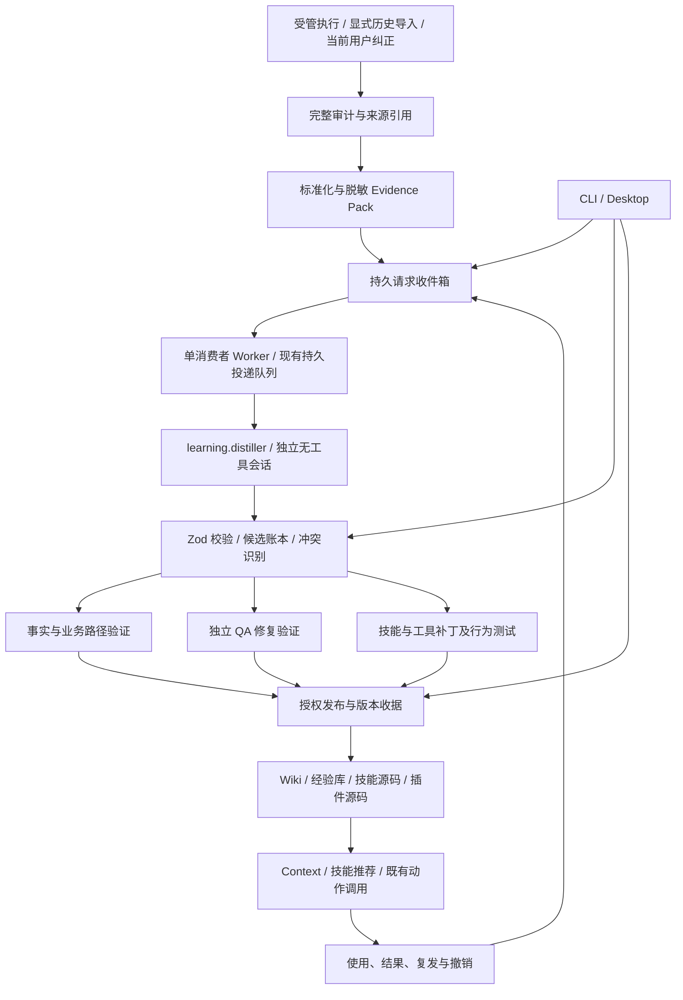

# 会话洞察与知识、技能、工具沉淀开发计划

> **For agentic workers:** REQUIRED SUB-SKILL: Use superpowers:subagent-driven-development (recommended) or superpowers:executing-plans to implement this plan task-by-task. Steps use checkbox (`- [ ]`) syntax for tracking.

**Goal:** 将受管会话及明确导入的历史会话转化为有证据、可验证、可发布、可撤销的业务知识、业务路径、修复经验、技能和工具，并在后续任务中验证复用效果。

**Architecture:** 执行事件驱动持久化提炼请求；受限的独立 `distiller` 会话生成候选，确定性代码负责身份、证据校验、验证、发布与反馈。复用现有 Agent / Sandbox、SQLite、持久投递队列、复盘、经验库、Wiki 摄入、技能工坊和插件注册，不新增 Agent 框架或通用工具注册中心。

**Tech Stack:** TypeScript、Zod、Node SQLite、现有插件运行时与 Agent Provider、Vitest、已有 Python Wiki 工具、Electron / React / Playwright。

**Status:** 实施中；2026-11-10 更新。T01 已提交，其余任务状态见第 13 节；未通过对应验收门禁的能力不能算完成。对应 [English plan](2026-11-09-session-distillation.md)。替代性扩展范围以本计划为准；已有能力的完成证据仍见 [前一阶段计划](2026-11-08-runtime-learning-and-validation.zh.md)。

---

## 1. 目标、基线与非目标

基线是用户已合并的 PR #294 实现。计划最初编写 checkout 为 `8b5a911a`；实施已核实本地 `origin/main` 为 `7194f5eb`，当前任务分支为 `feat/session-distillation`。后续集成仍需实时核对基线。自动化 fixtures 不等于真实模型测试，收费分析和生成工具安装分别受其明确执行条件约束。

| 编号 | 必须实现的结果 |
| --- | --- |
| R1 | 根据运行事件、明确提交的纠正和显式历史导入产生持久请求，重启不丢失，重复事件不重复产出 |
| R2 | 独立分析会话没有执行、修改、MCP 或自动技能权限；未知分析能力明确阻断 |
| R3 | 每个结论绑定具体证据、来源完整性、项目、版本和适用条件 |
| R4 | 提炼业务术语、实体、规则、权限、状态约束和跨系统路径，区分事实、建议及未决冲突 |
| R5 | 修复经验包含经验证的具体动作与不适用条件，保留现有独立 QA、复发、撤销门禁 |
| R6 | 对已有技能优先提出补丁，保留触发限制、泛化参数、分支、恢复和验证条件 |
| R7 | 重复操作优先复用既有 CLI / 脚本 / 插件；工具候选有输入输出、副作用和运行测试 |
| R8 | 发布遵守持久授权、乐观版本校验、恢复和人工合并规则 |
| R9 | 同项目跨任务 / Agent 复用；跨项目交换降为候选，不携带验证与授权 |
| R10 | CLI、Desktop 访问同一用例和状态，不各自启动重复分析 |
| R11 | 分别计量检索、选择、显式采纳、执行结果与复发，评价收益而非只统计资产数 |
| R12 | 有真实 Claude、本地知识写入、技能 / 工具变更和后续复用的可重复端到端验收 |

本轮不建设模型训练、知识图数据库、向量服务、多租户云平台，不自动合并 PR，不把历史消息中的命令当授权，不接管用户全部外部会话。执行支持六种 Agent 不等于已支持六种原生会话解析；未提供解析器的来源使用明确导出，缺失证据必须可见。

## 2. 已有基础与本轮必须修正的具体问题

| 基础 | 复用方式 | 本轮差距 |
| --- | --- | --- |
| 自动失败 / 成功经验 | 继续保存原始来源、QA 和完成证据 | 初始失败摘要不等于根因；成功工作流摘要不等于业务路径 |
| `retro` | 下沉共享证据与分析用例，保持已有命令兼容 | 当前固定 Claude 调用及个人技能绝对路径，产出止于报告 |
| 会话读取 | 复用受管遥测、Claude / Codex / OpenCode 读取与 Wiki 导入规范 | 统一来源、消息定位、完整性和显式导入，不另建一套全量扫描器 |
| 持久投递队列 | 用独立队列文件承载提炼投递 | 现有构造器独占消费者所有权；生产者不能各自实例化该队列 |
| SQLite | 复用私有文件、迁移和事务实现 | 新增薄请求收件箱、候选及发布收据；不再实现通用调度器 |
| Wiki 摄入 | 使用已有 plan / preview / apply / hash / lint / recovery | 当前没有从运行候选到该计划的受控适配 |
| 技能工坊 / 目录 | 复用现有创建、诊断、重构和推荐入口 | 目录丢失调用限制元数据；缺少补丁、行为测试和版本效果 |
| 插件 / System Action | 注册 `learning.distill` 及发布动作 | 需要类型化输入、输出和策略门禁，不引入新的工具注册系统 |

## 3. 责任和驱动架构



- **Core / Application 持有：** 身份、项目作用域、证据引用、候选状态、验证权限、发布策略、预算和审计。模型不能自报 `verified`、扩大作用域或改变策略。
- **`learning.distiller` 插件持有：** 提炼提示词和分析策略；通过现有 `workflow.action` 注册 `learning.distill`，注入所选 Agent Provider。插件名称不加产品前缀。
- **Worker 持有：** 单消费者、预算、中断与重试；按任务创建独立分析会话，不是一个长期积累未受控上下文的 Agent。
- **知识、技能、工具发布适配：** 复用现有 Wiki、Git、Verification、Repository 和 System Action 接口；只有出现真实实现差异才提取新的 seam。
- **CLI / Desktop：** 只调用共享用例。Renderer 不访问文件、密钥或数据库。

### 3.1 请求、投递和模型会话的生命周期

1. 原任务先写审计。终态、修复检查点或显式请求保存到 SQLite 收件箱；队列暂不可用不能使原任务变为失败。
2. 收件箱记录写入失败必须暴露降级状态。Worker 启动和周期性补查完整审计；每运行的已验证序列 / head 与请求在同一账本事务提交。队列满时不越过未接收位置。
3. 只有 Worker 实例化提炼专用 `DurableTriggerQueue`；生产者只写收件箱。Worker 入队后再记录交接收据，中途崩溃通过稳定 key 重放恢复。
4. 消费投递时先查候选 / 处理收据。已经完成的同一来源和策略版本不再次调用模型，即使队列旧投递已被清理。
5. Evidence Pack 内容改变时形成新 key；重试同一 key 必须使用原内容，不能把源文件后来的内容绑定到旧 digest。
6. 分析输出只产生候选；验证和发布分别执行。模型超时、JSON 错误和来源不完整均有明确状态。
7. 关闭先停止接收并发起拥有权范围内取消。现有队列 `close()` 会 drain，需增加可选停止派发模式，默认行为保持兼容；最多等 5 秒后只终止本 Worker 拥有的分析进程，保留未完成投递供恢复。
8. 学习任务标记 `purpose=learning`，其审计不再次触发学习，也不生成普通成功经验，防止自循环。

### 3.2 触发与默认预算

| 项 | 本轮确定行为 |
| --- | --- |
| 自动入口 | 用户启用学习后处理 AFK 受管运行；失败先保存原经验候选，修复后再提炼具体建议 |
| 成功入口 | 独立 QA 通过且运行成功，或到达匹配发布变更的人工合并闸门；未合并不得总结为已上线 |
| 用户纠正 | 明确提交当前纠正及其来源；历史转录中的“用户”文本不自动获得当前授权 |
| 历史导入 | 必须指定运行、可访问会话或导出文件；不扫描全部个人会话，不接入远程平台私有 API |
| 同类操作识别 | 从已保存的工具名称、参数模式及结果生成候选；一次成功不证明通用性，不按次数自动发布 |
| 并发 / 尝试 | 每用户一个 Worker、一个模型任务并发；每投递最多两次模型尝试，第二次含首次错误的脱敏结构说明 |
| 时间 / 文本 | 单次 120 秒；Evidence Pack 128 KiB UTF-8、模型输出 32 KiB、最多 10 个候选；超出则显式分片或阻断，不能静默截成完整来源 |
| 日预算 | 默认最多 20 次模型调用，含重试，启动前原子预留；无用量回报显示 unknown；金额预算仅在 Provider 实际支持时提供 |
| 容量 / 保留 | 普通准入最多 1,000 个待处理请求 / 16 MiB、2,000 条账本记录 / 32 MiB；仅来源暂态阻断和原子失效可使用安全预留，总记录 / 字节不超过普通上限两倍，不允许借此新增工作、模型调用或发布；SQLite 主文件物理上限 128 MiB，包含页开销。短期包默认 7 天，未发布候选 90 天；活跃引用和未决发布恢复禁止淘汰，满额明确阻断 |
| 启停 | `experience worker --once` / `--watch`；Desktop 用现有子进程托管机制启动同一 Worker，退出默认暂停；自动后台模式必须是已保存配置，不能暗装系统服务 |

上述为可配置的初始产品上限，不是性能测量或“从此不再犯错”的承诺。

## 4. 标准数据和用例契约

以下类型表示 Application 契约；边界以 strict Zod schema 实现，拒绝未知字段。已有 `ExperienceRecord` 和 version-1 交换格式不改名、不静默改变语义。

```typescript
type AssetKind = 'fact' | 'process' | 'lesson' | 'skill' | 'tool';
type CandidateState = 'candidate' | 'conflict' | 'validated' | 'published'
  | 'rejected' | 'superseded' | 'revoked';

interface EvidenceRef {
  id: string;
  kind: 'audit' | 'message' | 'tool-result' | 'code' | 'test' | 'human-confirmation';
  digest: string;
  locator: string;
  completeness: 'complete' | 'partial';
  authority: 'observed' | 'declared' | 'inferred';
}

interface DistillationRequest {
  version: 1;
  scope: string;
  sourceId: string;
  sourceRunId?: string;
  workItemId?: string;
  evidenceDigest: string;
  analyzerVersion: string;
  reason: 'completed' | 'repaired' | 'correction' | 'import';
}

interface CandidateProposal {
  kind: AssetKind;
  title: string;
  statement: string;
  evidenceIds: readonly string[];
  applicability: {
    project: string;
    environments: readonly string[];
    versions: readonly string[];
    preconditions: readonly string[];
    exclusions: readonly string[];
    invalidationConditions: readonly string[];
  };
  targetRef?: string;
  payload: unknown; // 按 kind 使用判别 schema，字段见下表。
}

interface DistillationOutput {
  version: 1;
  candidates: readonly CandidateProposal[];
  warnings: readonly string[];
}
```

| kind | payload 必需内容 | 验证凭据 |
| --- | --- | --- |
| fact | 主题、主体、规则、事实 / 提议类别、有效范围 | 对应事实的源码、接口、用户确认或观察；未决提议不能发布为事实 |
| process | 入口、参与系统、前置条件、步骤、状态变化、异常分支、结束条件 | 逐节点证据及缺失标记；局部路径不能宣称全链路通过 |
| lesson | 触发、根因假设 / 已证实根因、尝试、具体修复、预防检查 | 同项目修复与新增独立 QA 证据；沿用现有经验验证 |
| skill | 目标技能或新增理由、触发与禁用条件、输入、分支、恢复、完成条件、补丁、评价用例 | 原技能版本、结构检查、正反例与旧版行为比较 |
| tool | 既有工具搜索结果、输入输出 schema、依赖、权限、超时、副作用、幂等 / 恢复、源码提案及测试 | 隔离执行结果、失败输入、取消与权限拒绝；无适用副作用时显式 none |

模型不能输出系统 id、候选状态、验证权限、发布令牌或任意目标绝对路径。系统分配身份，校验证据 ID 是否属于本请求并解析逻辑 `targetRef` 到授权目标。

```typescript
import { createHash } from 'node:crypto';

// 稳定去重：evidenceDigest 覆盖审计 head、来源哈希、消息范围和完整性。
function distillationKey(input: DistillationRequest): string {
  return createHash('sha256').update(JSON.stringify([
    input.scope, input.sourceId, input.evidenceDigest, input.analyzerVersion,
  ])).digest('hex');
}
```

`sourceRunId` 是原始运行，`jobId` 是提炼请求，分析会话拥有新的 `runId` / `sessionId`。它们均不得替换原始 `workItemId`。

共享用例名确定为：`submitDistillation`、`reconcileDistillationSources`、`processDistillation`、`validateLearningCandidate`、`publishLearningCandidate`、`revokeLearningCandidate`、`queryLearningState`。实现为应用函数，依赖现有具体端口；不为每个函数再建单实现接口。

### 4.1 候选、发布和反馈

- `candidate → validated → published`；证据冲突进入 `conflict`；拒绝、替代与撤销分别保留原因。内容变更形成新版本并重新验证。
- 验证收据绑定候选 digest、验证器版本、证据 digest 和测试结果；模型 confidence 不授予状态。发布时重新核对收据、来源和目标版本。
- 业务事实与易变快照分开；经验保持现有有效期；技能 / 工具按版本失效。不得统一套用 90 天失效语义。
- 发布状态、目标内容与收据不能假装跨 SQLite / 文件 / Git 原子。使用 `prepared → applied → committed` 发布日志、目标 hash 和恢复副本，启动时处理未完成发布。
- 重启后目标已符合预期时补写收据；目标出现第三方修改时标为 conflict，禁止重试覆盖。多页 Wiki 恢复复用现有 recovery receipt。
- 撤销知识标记其权威失效，移出上下文；撤销已部署工具不能只删候选，必须产生具体卸载 / 回滚结果或 `rollback_blocked`，不抹去历史。
- 反馈绑定准确资产版本、目标运行 / 工作项及结果。区别曝光、选择、显式采纳、执行和成功；成功不直接归因为该资产。

## 5. 安全和泛化约束

1. 提炼器接收已脱敏、大小受限的内联证据包；不把源码仓库、密钥目录或原始全量会话挂给模型。必要大来源显式分片并保留消息位置。
2. 现有 Claude 开发命令默认含跳过权限参数，不能原样用于提炼。增加明确的 `analysis` 执行配置，移除该参数；禁用内置工具、自动技能、MCP、项目 / 用户 Hooks 和会话持久化，保留已有合法认证链路。
3. 用已安装 CLI 的 `--help` 和命令构造测试核对支持项。原生工具禁用不是操作系统隔离承诺；验证模型无法请求工具，并验证受信任 CLI 不触发项目 Hooks / 插件。不能证明的 Provider 返回 `analysis_unsupported`，不得退回可写开发模式。
4. 消息、工具输出、知识内容都按不可信数据处理。当前用户授权来自调用上下文，不能从转录角色名或模型文本生成。
5. 去掉账号、IP、个人路径和一次性凭证；项目差异通过参数和适用条件表达。权限规则、业务语义与安全检查不能被“泛化”删除。
6. 先搜索已有知识、技能和工具。候选可建议合并，系统不得用语义相似直接合并相反规则或覆盖验证历史。
7. 检索先改善中文分词、别名和结构化适用性，增加负例；引入额外依赖或向量后端需要实测证明当前方式达不到目标。
8. 自动发布仅在既有持久策略授权内进行。Wiki 目标、允许的动作、项目与资产类型均显式配置；代码变更发布 PR 供人工合并，候选不会直接安装执行。

## 6. 实现文件与职责映射

这是执行人员附录，全部路径相对仓库根。目标是修改最少的既有模块；新文件按以下责任组织，不把生产实现写入计划文档。

| 工作域 | 新增模块 | 修改 / 复用现有模块 |
| --- | --- | --- |
| 契约与候选 | `packages/runtime/src/application/learning/contracts.ts`、`candidate-store.ts` | `learning/experience-store.ts`、`infrastructure/storage/sqlite.ts` |
| 请求与 Worker | `learning/requests.ts`、`worker.ts` | `application/plugins/trigger-queue.ts`、`plugins/observability.ts`、`workflows/execute-work-item.ts`、`application/workflow-engine.ts` |
| 证据与复盘 | `learning/evidence.ts`、`analysis.ts` | `apps/cli/src/commands/retro.ts`、`infrastructure/observability/agent-telemetry.ts`、Wiki 会话 reader |
| 受限 Agent | 复用 Agent / Sandbox，不新增独立进程框架 | `domain/agents/types.ts`、`domain/agents/claude-code.ts` 及所需执行配置传递模块 |
| 插件 | `application/plugins/learning.ts` | `plugin-sdk/index.ts`、`application/plugins/runtime.ts`、`configured.ts`、`builtin-manifests.ts`、`operations.ts` |
| 发布与反馈 | `learning/publication.ts`、`knowledge.ts`、`proposals.ts`、`feedback.ts` | `learning/runtime.ts`、`experience-store.ts`、现有 Context / Verification / Repository 端口 |
| CLI | 扩展 `apps/cli/src/commands/experience.ts` | `command-registry.ts`、`composition-root.ts`、既有 `retro` 命令 |
| Desktop | 扩展 `shared/experience-contract.ts`、`electron/services/experience-service.ts`、`src/features/settings/ExperienceSettings.tsx` | 既有 IPC / preload、进程托管、运行详情和设计系统 |
| 技能 | 修改 `skills/afk-skill-craft/SKILL.md`、其 checklist 和 `skills/jev-agent-guard/scripts/skill-catalog.mjs` | `skills/wiki/scripts/wiki.py`、`session_source.py` 与测试；需要协议变更才修改 Wiki 实现 |
| 契约文档 | 扩展 `docs/architecture/plugins.md/.zh.md`、接入标准、执行文档、测试指南 | 每次命令变化同步执行入口；skills / CLI 变化分别同步其 canonical version |

每个新增 TypeScript 模块有同名 `.test.ts`；跨进程与端到端测试另列，避免把实现镜像测试当收益验证。

## 7. 分任务实施清单

每项按“先红测试 → 确认具体失败 → 最小实现 → 定向绿测试 → 版本 / 文档 / 提交”执行；用户已授权继续实施时不重复询问。以下检查框完成后才推进其依赖项。提交在任务分支或 PRD 切片上完成，不在集成线原地开发。

### T01 — 契约、状态与幂等键（P0）

**依赖：** 无。**写入：** `contracts.ts`、`contracts.test.ts`。

- [x] 定义第 4 节 strict schema、逐类型 payload、状态转换及上述 `distillationKey`，验证规范项目身份。
- [x] 先写反例：伪造 `state=verified`、未知 evidence ID、跨项目适用范围、超长输出、非法 work item 均拒绝。
- [x] 固定输入例 `scope=github:acme/api`、`sourceId=run:r1`、同 evidence / analyzer 产生同 key；改变任一 hash / scope / analyzer 必须不同。
- [x] 运行 `pnpm --filter @afk/runtime exec vitest run src/application/learning/contracts.test.ts`，预期先失败后全部通过。
- [x] 导出共享类型，提交契约切片；不增加命令或修改旧交换格式。

### T02 — 私有请求与候选账本（P0）

**依赖：** T01。**写入：** `candidate-store.ts`、`candidate-store.test.ts`、`requests.ts`、`requests.test.ts`。

- [ ] 使用现有 SQLite 事务 / 迁移，保存请求、证据引用、候选版本、处理收据、发布日志及每运行扫描位置。请求唯一 key，模型输出无状态写权限。
- [ ] 测试两个独立进程提交同 key 只有一条；相同 key 不同内容拒绝；重开库仍可查询；来源缺失保留阻断信息。
- [ ] 测试迁移失败回滚、私有权限、符号链接拒绝、达到容量保护活动引用且不吞请求、状态的乐观版本冲突。
- [ ] 运行 `pnpm --filter @afk/runtime exec vitest run src/application/learning/candidate-store.test.ts src/application/learning/requests.test.ts`，预期无丢失 / 重复记录。
- [ ] 实现收件箱交接收据与持续 cursor，提交；不复制队列的重试状态机。

### T03 — 统一 Evidence Pack 和共享复盘用例（P0）

**依赖：** T01。**写入：** `evidence.ts`、`analysis.ts` 及测试；修改 `retro.ts` 和相应测试。

- [x] 从 `retro` 提取证据组装和报告解析，保留 `retro run/show` 输出兼容；不改变正式 CLI 签名。
- [x] 复用受管遥测与本地 reader，定义消息定位、审计序列、完整性、原始摘要 / 内容 digest；sourceId 不是访问权限。
- [x] 加入损坏审计、缺失转录、部分 JSONL、超大来源分片、secret / 私钥脱敏、文件替换和越界路径测试。没有足够来源时不得生成“完整业务路径”。
- [x] 运行 `pnpm --filter @afk/runtime exec vitest run src/application/learning/evidence.test.ts src/application/learning/analysis.test.ts` 与 `pnpm --filter afk exec vitest run src/commands/retro.test.ts`。
- [x] 移除个人目录依赖，提交；不同原生来源解析能力须独立报告。

### T04 — 受限独立分析配置与插件（P0）

**依赖：** T01、T03。**写入：** `plugins/learning.ts` 及测试；修改 Agent 命令构造、配置传递和插件配置。

- [ ] 新增可明确识别的分析执行配置，Claude 接收内联证据，无原任务仓库与会话上下文；原开发配置保持兼容。
- [ ] 命令测试断言分析不含跳过权限参数、工具列表为空、MCP / 自动技能 / 非受信 Hooks 被禁用，合法认证可用；未知 Provider 在启动前返回 unsupported。
- [ ] 提炼 action 返回 strict JSON；拒绝模型伪造证据、状态、目标路径及超出 10 条 / 32 KiB 的结果。模型不能执行发布动作。
- [ ] 运行 `pnpm --filter @afk/runtime exec vitest run src/domain/agents/claude-code.test.ts src/application/plugins/learning.test.ts src/application/learning/analysis.test.ts`，再运行受影响配置 / transport 测试。
- [ ] 注册 `learning.distiller`、`learning.distill`，同步 CLI version 与插件接入文档，提交。不是所有执行 Agent 都自动获得安全分析资格。

### T05 — Worker、投递和预算（P0）

**依赖：** T02、T04。**写入：** `worker.ts`、`worker.test.ts`；仅为必要的关闭语义修改原队列及其测试。

- [ ] Worker 单独拥有专用投递队列；原任务 / CLI / Desktop 并发生产者只提交收件箱；按稳定 key 交接并处理。
- [ ] 测试“收件箱提交后崩溃”“入队后未写交接收据”“候选落库后未 ack”三个窗口，最终一组候选且不重复收费调用已完成任务。
- [ ] 实现启动前日预算预留、两次尝试、超时 / Abort、插件禁用、单消费者冲突；存量外部 / 不明 owner 不抢占。
- [ ] 测试关闭不启动新任务、只取消拥有的进程、默认队列 drain 兼容、5 秒后可恢复；运行 `pnpm --filter @afk/runtime exec vitest run src/application/learning/worker.test.ts src/application/plugins/trigger-queue.test.ts`。
- [ ] 记录开始、结束、重试、阻断、用量缺失及预算，提交。预算不足停在可观察的 blocked，不无限重试。

### T06 — 事件驱动和持久纠正入口（P0）

**依赖：** T02、T03、T05。**写入：** 现有执行 / 观察调用点和 `requests.ts`；新增 `requests.integration.test.ts`。

- [ ] 成功 / 发布交接、修复检查点产生请求，附既有运行身份；失败先沿用原经验记录，未修复不宣称有有效修复。
- [ ] 原审计 append 与请求之间崩溃，通过完整审计补查恢复；扫描位置和收件箱插入同事务。原执行主结果不受分析不可用影响。
- [ ] 纠正入口记录当前调用者来源，只创建候选 / 冲突或撤销已证伪资产；历史消息不授予授权。
- [ ] 运行 `pnpm --filter @afk/runtime exec vitest run src/application/learning/requests.integration.test.ts`；断言重复终态去重、晚到 QA 失败撤回、learning 运行不递归、队列满不越过 cursor。
- [ ] 用 fake distiller 跑通真实受管执行到候选账本，提交第一个可运行里程碑 M1。

### T07 — 具体修复经验、适用性和召回（P1）

**依赖：** T06。**写入：** `learning/runtime.ts`、`experience-store.ts`、`feedback.ts` 及测试。

- [ ] 将 lesson 候选映射到旧经验门禁；具体动作与假设 / 已证实根因分开，修复内容变化仍保留原失败身份及复发历史。
- [ ] 验证器复核新增独立 QA 和精确目标版本；当前成功不能替另一个修复背书。缺证据保持候选。
- [ ] 在既有词项匹配上加入 `Intl.Segmenter` 中文词项、错误码 / 命令标识、有限显式别名和适用性过滤；语义疑似重复只提示，不覆盖旧记录。
- [ ] 固定评价集含至少 12 对等价查询与 12 个不适用 / 相反条件查询，覆盖中英表达、同码不同项目 / 版本；要求全部项目隔离用例无泄漏，并报告旧版 / 新版 recall@5 与负例。不能为过评价改写答案。
- [ ] 运行现有经验 / 交换 / runtime 测试及 `feedback.test.ts`；验证导入仍降级、撤销退出召回、去重反馈不虚增，完成 M2。

### T08 — 业务知识和业务路径发布（P1）

**依赖：** T06。**写入：** `knowledge.ts`、`publication.ts` 及测试；复用 Wiki reader / ingest。

- [ ] 将 fact / process 转为已有 Wiki version-1 ingest plan；先检索、读完整目标及规则、绑定 expected hash，包含回链和索引。
- [ ] 业务事实和环境表分开；未证实内容落授权收件箱；过程每节点有证据或明确缺失，不凭一次 UI / API 成功推断全链路。
- [ ] 测试重复摄入不重写、相反规则 conflict、人工并发修改不覆盖、敏感 / 规则 / 越界文件拒绝、目标知识已经存在时复用。
- [ ] 用临时 vault 跑 `python3 skills/wiki/scripts/wiki.py ingest --vault <fixture-vault> --plan <fixture-plan> --json`，先 preview；允许策略下再加 `--apply`，核对 hash 和 lint。真实用户 vault 仅在已有明确写入授权下复测，不推远端。
- [ ] 实现 prepared / applied / committed 与部分失败恢复，运行 `knowledge.test.ts`、`publication.test.ts` 及 `python3 -m unittest discover -s skills/wiki/scripts -p 'test_*.py'`，完成 M3。

### T09 — 技能候选、泛化补丁与元数据（P1）

**依赖：** T06；候选与目录工作可并行 T08，发布集成必须等待 T08 的 publication 用例通过测试。**写入：** `proposals.ts`、`proposals.test.ts`、技能工坊 / 目录及其测试。

- [ ] 先检索已有技能、保留 provenance；旧技能优先 patch，新技能必须说明缺少可复用对象的证据。
- [ ] 修正目录保留 / 尊重 `disable-model-invocation`、调用限制和来源；禁用技能不得自动推荐执行。
- [ ] 由证据生成参数、触发 / 不适用条件、分支、恢复与验证；去掉个人路径和环境硬编码，不删业务 / 安全约束。
- [ ] 每个技能变更包含正常、恢复、拒绝三个代表性行为用例及旧版比较；结构合规与行为有效分别报告。
- [ ] 生成可审查补丁，在受管任务 worktree 验证并发布 PR；skills 改动同提交 bump 插件 version，安装缓存不编辑。通过相关单测和模板 / 文档检查后完成 M4 的技能部分。

### T10 — 工具候选和受控验证（P1）

**依赖：** T09。**写入：** 继续 `proposals.ts` / 测试；复用 Verification、Repository 和既有 System Action。

- [ ] 识别重复工具调用模式，先查询已有 CLI / 脚本 / 插件；重复出现仅生成候选，不自动授予执行资格。
- [ ] 单技能辅助放其 scripts；跨工作流调用用已有 action；存在真实多后端 / 按需安装需求才做插件，命名无产品前缀。
- [ ] 源码提案在另一受限验证任务执行，模型提炼进程不运行其输出。测试正常输入、错误输入、超时 / 取消、重试副作用和权限拒绝，验证参数不经 shell 插值。
- [ ] 工具安装 / 发布依据持久授权，插件依赖走已有安装器；无回滚能力显式 blocked，不能只把账本标为 revoked。
- [ ] 在临时仓库演示同一工具处理两组输入并拒绝恶意输入，形成代码 / 测试 / 版本 / PR 收据，完成 M4。

### T11 — CLI 与可运维入口（P1）

**依赖：** T05、T07、T08、T09、T10。**写入：** `experience.ts`、registry / composition 及测试。

- [ ] 保持旧命令兼容，新增 `experience distill`、`jobs`、`candidates`、`inspect`、`validate`、`publish`、`invalidate`、`feedback`、`worker`；候选状态命令不得复用旧经验 id 的语义。
- [ ] 所有查询必需项目 scope；请求入口使用 `--run-id` 或 `--transcript` 二选一，历史来源显式 provider；纠正由 `--correction-file` 和明确来源提交，不把内容放命令行。
- [ ] `worker --once` 处理当前可处理请求后退出，`--watch` 前台运行；输出 pending / blocked / failed / processed 与安全阶段码，不暴露 token 或原文。
- [ ] 黑盒测试 restart、分页、重复请求、禁用 Provider、无预算、错误退出码及旧命令；运行 CLI 定向 Vitest 与 root 新增 `tests/e2e/plugin-distillation.test.ts`。
- [ ] 更新 canonical CLI version、命令注册表和双语执行入口；运行打包脚本验证实际全部命令入口数量，不沿用旧的 23。

### T12 — Desktop 共享治理（P1）

**依赖：** T11。**写入：** 现有 experience 合约、Main 服务、preload / IPC、设置和运行详情及测试。

- [ ] 阅读 Desktop 架构与设计系统；共享用例返回 DTO，Renderer 不能创建 Worker、访问磁盘或直接调用模型。
- [ ] 增加启停 / 预算 / Provider 设置、任务状态、证据与缺失提示、候选差异、验证 / 发布 / 撤销和反馈入口；明确显示未配置、未知及无原生解析器。
- [ ] CLI 与 Desktop 同时打开仍只一个消费者；关闭 / 重启应用不丢请求，不误杀 CLI 启动的进程。
- [ ] IPC 校验 scope、id、来源选择、目标权限及 stale response；测试切换项目不展示前项目结果。
- [ ] 运行 `pnpm --filter afk-control-electron typecheck`、`test`、`build`，再运行相关 Playwright 用例和完整 Electron E2E，完成 M5。

### T13 — 真实闭环、故障演练与交付（P0 发布门禁）

**依赖：** T01–T12。**写入：** `tests/e2e/plugin-distillation.test.ts`、`tests/e2e/plugin-distillation-live.test.ts`、双语指南。

- [ ] 准备不含真实业务凭证的固定会话证据集：修复案例、业务路径、技能变更、工具变更、相反规则、提示注入及缺失证据；期望结论和负例在模型运行前冻结。
- [ ] 真实 Claude 测试必须显式开启 `AFK_REAL_DISTILLATION_E2E=1`，使用已有合法认证；默认显示 skipped，显式开启但缺依赖则失败。记录 CLI / 模型、配置、范围、耗时及用量未知项。
- [ ] 用实际安装版产生请求、重启 Worker、提炼；独立宿主检查候选证据、临时 vault 幂等、技能 / 工具 diff 和测试；第二个相关任务可召回准确版本，不相关 / 跨项目任务不可召回；撤销后立即退出新上下文。
- [ ] 分别演练恶意转录要求执行命令、项目 Hook 写哨兵、未知 MCP、过期权限、发布中断、人工并发改文件、来源被替换、队列 / 磁盘满、预算耗尽、重复事件和孤儿 owner；每项有确定可断言结果。
- [ ] 独立规格审查后再独立质量审查，修复发现并复测；执行第 10 节发布检查，提交 / 推送 / PR，等待人工合并。归档已集成子任务 worktree，保留当前主任务和恢复证据，完成 M6。

## 8. 并行实施与写入归属

| 批次 | 可并行内容 | 协调者保留的工作 |
| --- | --- | --- |
| A | T01 主线程；旁路盘点现有会话和测试 fixtures | 契约、身份、状态、基线与版本策略 |
| B | Worker A: T02；Worker B: T03 | 集成契约、准备 T04 的安全命令检查 |
| C | Worker A: T04 的独立 Provider 文件；完成 T04 后主线程依次 T05 → T06；Worker B: 技能目录限制元数据修复 | Agent 公共类型、配置 / manifest、共享队列改动只由主线程整合；T06 通过完成 M1 |
| D | T06 集成后：Worker A: T07；Worker B: T08；Worker C: T09–T10 | `publication.ts` 先冻结接口；proposals 文件由同一 worker 连续维护 |
| E | 主线程 T11；CLI 契约冻结后 Worker D: T12；其他 worker 准备 T13 fixture | CLI registry、版本、公共导出和执行文档 |
| F | 独立规格审查 → 修复 → 独立质量审查；可并行不同环境验收 | 最终源树、实测证据、发布与清理 |

每个 worker 一个隔离 worktree，禁止共享写集。交付包含补丁、测试命令 / 退出码、实际限制和文件清单。公共类型、根配置与版本由协调者维护，不能由多个 worker 分别 bump 后覆盖。

PRD 有基线时切片合入 `prd/<issue>`，最终由人合入集成线；无 PRD 时使用任务分支并发布可评审 PR。禁止为清理磁盘强删活动、未知或未发布工作区。

## 9. 里程碑和完成定义

| 里程碑 | 交付 | 必须证明 |
| --- | --- | --- |
| M1 / 批次 A–C | 事件到独立 Agent 再到候选的可运行链路 | 崩溃恢复、无工具分析、来源可追溯、预算与去重 |
| M2 / 批次 D | 具体修复经验闭环 | 修复与 QA 对应、后续任务命中、负例拒绝和复发撤销 |
| M3 / 批次 D | 业务知识与路径闭环 | 冲突不覆盖、幂等写入、节点证据、并发保护和恢复 |
| M4 / 批次 D | 技能与工具闭环 | 泛化输入、行为比较、权限与版本、可审查 PR，无自动合并 |
| M5 / 批次 E | CLI / Desktop 一致入口 | 一个消费者、同一状态、项目隔离、安装版命令可用 |
| M6 / 批次 F | 完整交付 | 全部质量门禁、真实 Claude E2E、文档、可回滚、工作区清理 |

排期按以上六批次和依赖推进；每批通过后交付可运行切片。模型、网络和账户等待不算开发完成；真实服务不满足前置条件时准确报告阻断，不能以模拟矩阵替代。

## 10. 测试、迁移和上线检查

### 自动化与真实测试

- 契约 / 状态：未知字段、伪造权威、证据引用、跨项目、旧格式兼容。
- 持久性：真实子进程并发与崩溃，不只模拟 Promise；输入 / 游标 / 投递 / 候选 / 发布收据的关键窗口。
- 分析安全：无工具、无自动技能 / MCP、Hook 哨兵不变、敏感信息不进入包 / 日志、unsupported 无权限回退。
- 资产质量：冻结正反例，业务节点可追溯，技能新旧版比较，工具多输入与安全失败。
- E2E：通过实际 CLI / IPC 调用；模型生成结果由另一执行者或固定宿主断言检验；原始转录不能作为最终展示结果。

### 必须执行的仓库命令

```bash
pnpm typecheck
pnpm build
pnpm architecture:check
pnpm docs:check
pnpm test
pnpm test:coverage
python3 -m unittest discover -s skills/wiki/scripts -p 'test_*.py'
pnpm --filter afk-control-electron typecheck
pnpm --filter afk-control-electron test
pnpm --filter afk-control-electron build
pnpm --filter afk-control-electron e2e
pnpm release:cli --output /tmp/session-distillation-release
```

先运行每任务定向测试，源树稳定后运行上述完整检查；仅当新变更或失败需要时重跑。保留现有逐包覆盖率基线，不为了通过而降低。共享源码覆盖率、Desktop 和模型子进程内部的范围分别报告。

### 迁移与发布

- 不修改旧经验 version-1 交换协议；新候选数据库单独 versioned schema。迁移失败保留原库和源码，禁止自动删除重建。
- SQLite 备份通过一致性方式完成，不能直接复制正在写的 WAL 主文件。旧二进制不得写新 schema；回滚使用兼容 reader 或经验证的迁移 / 快照恢复。
- 学习功能初始禁用，不改变已有执行；显式配置 `learning.distiller` 后才允许模型调用。先一次性处理，再启用持续 Worker，再启用已经授权的发布类型。
- 缺 Claude 认证、Python、vault 规则、目标仓库权限或验证器时保持明确 blocked，不能静默省略目标能力。
- 技能变更同提交 bump `.claude-plugin/plugin.json`；CLI / 共享运行时代码变更同提交 bump `apps/cli/package.json`，以开发开始时的 canonical version 递增，不在本计划预占版本号。
- 安装版测试在仓库外隔离 HOME 完成；真实账号测试单独显式开启。不得发新邮件或通知第三方作为默认验收步骤。
- 推送任务分支、附实测范围和限制、检查 CI，人工决定合并。完成 worker 关闭并归档，原始证据按保留策略保存。

## 11. 效果评价与后续扩展条件

| 指标 | 定义 | 不允许的解释 |
| --- | --- | --- |
| recall@5 / 负例 | 冻结评价集的相关命中与不适用资产排除 | 用召回次数证明建议有效 |
| 选择 / 采纳 / 执行 | 分别记录资产版本、任务和操作者 / 执行证据 | 模型看到上下文就算实际采用 |
| 复发率 | 相同失败族、适用范围和版本内的再次失败，报告分母 | 内容指纹不同就视为没有复发 |
| 重复探索成本 | 同类任务的查证步骤、重试、耗时和 token 对比 | 未采集 token 当作零，或把所有改善归因于学习 |
| 技能迁移效果 | 原场景、参数变化、恢复 / 拒绝场景的新旧版本比较 | 当前账号一次成功就证明通用 |
| 工具收益 | 成功率、副作用失败、人工步骤和维护成本 | 脚本数量越多越好 |

初版验收要求证据和指标可计算、正反例通过，不编造生产收益百分比。只有评价显示需要时增加语义检索、远端共享或新的发布后端；跨组织权限、云端记忆和训练另立有明确前置条件的方案。

## 12. 本轮计划交付与执行顺序

- [ ] T01–T06：先形成可靠且无写权限的提炼链路。
- [ ] T07–T10：在共同契约上并行补齐经验、知识、技能与工具验证 / 发布。
- [ ] T11–T12：接入统一 CLI、Desktop 和可运维 Worker。
- [ ] T13：完成真实使用、故障演练、独立审查、版本与 PR 交付。

已按此顺序实施；未完成项继续沿依赖推进。该顺序不要求用户在已经授权的每个子步骤重复确认，也不授予 Agent 代替人合并或突破目标系统权限的能力。

## 13. 实施进度与剩余开发队列（2026-11-10）

此表描述已检查的代码状态；任务清单只有在实现、验证和提交均满足时才整体关闭。局部测试通过不等于该任务或系统已交付。

内核已在 `4b7295e9` 提交并推送至任务分支。基线验证：Runtime 全包 3,018 项通过、3 项跳过；参数兼容修复的定向 31 项通过；CLI 全包 542 项通过、2 项跳过；技能目录 86 项通过。Runtime / CLI 构建与类型检查、架构与文档检查通过。

2026-11-10 当前切片：最新 Runtime 全包 3,126 项通过、4 项跳过，CLI 全包 542 项通过、2 项跳过，仓库级 326 项通过、1 项跳过。Runtime 与仓库测试同时高并发运行时，一项既有 Git 集成测试超时；待运行结束后，Runtime 以最多 4 个 worker 独立完整重跑通过，未延长超时或修改该测试。原生进程 guard 已集成，独立规格与质量审查通过；当前只支持具有 `/usr/bin/sandbox-exec` 的 Darwin，其他平台分析明确 unsupported。最新真实 Claude 内核测试耗时 38.58 秒：一次调用生成 1 个候选，用量已返回，重放新增调用为 0，转录注入、恶意 Hook 和 MCP 均未写出哨兵文件，晚到 QA 失败使候选失效。测试使用合成审计和真实本地认证，不覆盖安装版、Desktop 或完整资产发布。较早的非法模型输出被正确拒绝，不能据单次成功认定输出稳定。

已修复可复现的并发冷启动故障：SQLite 删除 rollback journal 时可能读到 `nlink=0`，现在仅对 SQLite sidecar 有限重查，保留 owner、符号链接、外部硬链接和主库身份校验。六个确定性子进程回归及 60 对真实冷启动通过，独立规格、质量审查通过；该竞争也是 PR 既有 CI 冷启动失败的对应错误。自动摄入的作用域、手工导入边界、暂态解除和诊断修复已通过独立规格复审。后续质量审查发现的路径解析临时权限误判、满账本无法持久化失效均已修复并复审通过；事务中途拒写的回归验证整体回滚。最新完整 Runtime 为 3,126 通过 / 4 跳过，CLI 为 542 / 2。最终提交与新 CI 尚未完成，M1 保持开放。

| 任务 | 当前状态 | 下一验收点 |
| --- | --- | --- |
| T01 | 已提交 `d0190782`；严格契约、候选载荷、证据绑定与幂等键已实现 | 后续契约改动保持兼容并重跑边界测试 |
| T02 | 请求、候选、游标、发布日志及预算账本已实现；新增 version 2 将证据快照与请求 / cursor 同事务保存，容量计入快照，旧文件兼容；来源阻断在预算预留事务内复核 | 新迁移、容量回滚和跨进程状态比较复审；发布恢复集成 |
| T03 | 证据包、不可变快照及共享提示已实现；脱敏、精确引用绑定和冻结指标已修复 | 已完成独立复审并提交内核；自动触发入口继续由 T06 完成 |
| T04 | 默认关闭插件、动态 Agent 解析和分析配置已实现；真实 Claude 注入、恶意 Hook / MCP 不执行且保留认证已验证 | 保持 Darwin 支持边界；完成最终集成回归与提交 |
| T05 | Worker / purpose 和进程 guard 已集成；guard 独立规格及质量审查通过，包含父进程强杀、脱离后代拒绝与无关进程保留 | 完成来源消费及状态比较的独立复审、最终回归与提交；不宣称全平台支持 |
| T06 | 根目录登记、作用域及手工导入边界、完整前缀负面证据、暂态解除和诊断已修复；26 项摄入及 13 项插件测试通过，规格和质量问题已完成独立复审；未提交 | 完成提交及新 CI，再验收 M1 |
| T07 | 保留工作区冻结评价 recall@5 为 22/24，负例误召回 0/18；64 测试通过、4 版本相关失败，未合入 | 通过可信执行条件及 QA provenance 补齐结构化适用性；不继续用 prompt 词法推断替代版本门禁 |
| T08 | 子工作区的撤销收据强杀恢复与全部分类适用性过滤已通过独立规格及质量审查，未集成 | 接入可信授权配置、完整发布枚举与实际撤销、Context 统一读取门禁；完成临时 vault 真实闭环 |
| T09 | 技能目录的调用限制和工具声明保留已实现，YAML 边界复审中 | 候选到补丁、正常 / 恢复 / 拒绝行为比较、原版本绑定、PR 收据 |
| T10 | 尚未实现工具提案的验证与交付 | 已有工具查重、两组参数、安全失败、取消、副作用恢复和可审查变更 |
| T11 | 新学习治理 CLI 尚未接入 | 共享用例、全局 Worker、按项目查询、故障重放及安装版黑盒验证 |
| T12 | 新学习治理 Desktop 尚未接入 | 同一数据与消费者、IPC 校验、项目切换、进程关闭与 Electron E2E |
| T13 | 真实 Claude 内核提炼 E2E 已通过；完整资产发布、安装版及 Desktop 闭环未完成 | 完整闭环、故障演练、覆盖率、安装包、独立审查、PR 与工作区清理 |

### 接下来的并行批次

1. 主线程集成 T02–T05，独立审查关闭已发现缺口；将验证通过的内核提交为后续 worktree 的共同基线。
2. 主线程完成 T06；旁路先准备 T07 的负例与适用性、T08 的现有 Wiki 发布接缝、T09–T10 的行为 fixtures。不能以这些准备工作替代自动入口。
3. M1 通过后，分别由三个 worktree 完成 T07、T08、T09–T10。先冻结 publication 契约；同一文件只有一个写入者。
4. 主线程接入 T11 并维护版本、命令注册表和公共导出；契约稳定后独立 worktree 完成 T12，另一执行者准备 T13。
5. 执行 T13 的真实模型、真实文件 / 进程与用户入口闭环；默认本地用 Claude Code。远程服务验证单独报告配置与覆盖范围，不以已有 Gmail 成功证明本次学习能力通过。
6. 按里程碑推送可审查变更、检查 CI；人工决定合并。保存变更与测试证据后归档已完成 worktree，释放其依赖和构建产物占用。

### 完整系统的交付约束

插件仍使用既有 Agent、Sandbox、Host、Tracker、Verification、Notification、Trigger、Context / Memory、Credential / Auth、Artifact / Report、Repository / Workspace、Security / Policy 与 Observability 接口。此阶段补齐从这些执行证据到可复用资产的闭环，不重复创建框架。每项外部 Provider 的“已实现”“已配置”“已通过真实验证”分开记录；缺配置不能标记为通过。

## 14. 完整交付路线与执行交接（2026-11-10）

本节是第 7 节任务的交付视图，不另建一套实现。当前请求是补齐开发计划；未提交代码、历史测试数和子任务分工不作为最终验收证明。

### 14.1 Core、插件与独立 Agent 的边界

| 层 | 必须负责 | 接入方式 |
| --- | --- | --- |
| Core / 共享用例 | 事件与身份、证据快照、状态机、幂等、预算、作用域、授权检查、发布恢复及反馈 | CLI、Desktop、Worker 调用同一用例；不复制状态机 |
| 既有能力插件 | Agent 执行、Sandbox 隔离、知识检索、Verification、仓库、凭据、制品及可观测性后端 | 沿用插件 manifest、能力声明、依赖安装器及 System Action；不新增插件协议 |
| `learning.distiller` | 请求受理、调用受限分析、候选查询及 Worker 协调 | 默认关闭；通过现有 `workflow.action` 接入 |
| 独立分析会话 | 从脱敏证据提炼 fact / process / lesson / skill / tool 候选及适用边界 | 首先支持本地 Claude Code；不获得工具、发布权限或原任务会话 |
| 验证执行 | 运行固定断言、独立 QA、技能行为比较及工具测试 | 复用 Verification / Agent / Sandbox；学习用途不触发再次提炼 |
| 发布执行 | 根据持久授权更新知识目标，或形成技能 / 工具可审查变更 | 每次核对候选、证据和目标版本；PR 由人决定合并 |

### 14.2 六个交付批次

| 批次 | 任务及实施顺序 | 退出条件 |
| --- | --- | --- |
| 1：可靠提炼 M1 | 主线程完成 T06 Observer 接入、启动 / 周期补查、用户纠正及防递归；并行补齐 T05 预算恢复和进程退出；复核 T01–T04 | 完整审计能产生唯一候选请求；重启不丢失；晚到失败撤销资格；原任务不受摄入失败影响；强杀父进程不留分析子进程 |
| 2：经验复用 M2 | 独立工作区完成 T07 适用性、版本、否定条件、采纳反馈与复发处理 | 冻结正反例通过；跨项目零泄漏；后续真实任务获得准确经验；撤销经验不再进入新上下文 |
| 3：知识与路径 M3 | T08 先复用现有 Wiki plan / preview / apply / recovery，再集成发布日志 | 临时 vault 真实写入、重复幂等、逐节点证据、冲突保护和中断恢复通过；未证实结论保留候选身份 |
| 4：技能与工具 M4 | 同一工作区连续完成 T09 → T10；发布集成等待 T08 契约稳定 | 技能正常 / 恢复 / 拒绝行为可比较；工具两组参数及恶意输入验证通过；有版本、测试、变更收据及回滚结果 |
| 5：统一产品入口 M5 | 主线程完成 T11；共享契约冻结后独立工作区完成 T12 | 安装版 CLI、Desktop 共用项目状态和唯一消费者；查询、验证、发布、撤销、反馈和安全退出可操作 |
| 6：完整系统 M6 | T13 真实模型闭环、故障演练、覆盖率、独立规格 / 质量审查及发布清理 | 发布检查全部通过；真实、模拟、未配置和跳过分别报告；推送可评审变更；保存证据后归档已完成工作区 |

批次 2–4 在 M1 通过后并行实施；T08 适配及测试准备可提前进行。共享契约、公共导出、版本与 CLI 注册由主线程维护。每个子任务只写自己的文件，集成后分别进行规格与质量审查，不重复开发既有能力。

### 14.3 上下文、会话和环境治理验收

- 上下文：仅注入当前项目、适用版本、未过期且未撤销资产；限制总量，保留证据引用；跨 Agent 共享资产而非私有认证或完整对话。
- 会话：记录来源运行、用途、模型调用身份、预算及终态；取消、超时、重启、未知结果均可查询。未知结果不伪装成功，也不绕过尝试上限重调。
- 环境：用既有 Host / Sandbox / Repository 准备、检查并清理环境；提炼器只建议修复，执行变更仍走现有策略和验证。磁盘 / 依赖 / 权限故障的修复经验必须带适用条件。
- 工作流与 Hooks：模板选择和 Hook 门禁继续复用现有机制；学习任务的审计不得回流为新学习请求，分析进程不加载项目或用户自定义执行 Hook。
- 反馈：分别记录检索曝光、选择、明确采纳、实际执行、独立验证与复发；结果绑定资产版本，无法测量的耗时 / token 不填零。

### 14.4 原有插件能力的回归与证据矩阵

为 Agent、Sandbox、Host、Tracker、Verification、Notification、Trigger、Context / Memory、Credential / Auth、Artifact / Report、Repository / Workspace、Security / Policy、Observability 每类建立实现 / 配置 / 测试证据矩阵。六种 Agent 的执行支持与原生会话解析支持分开记录。

- 自动化回归覆盖生命周期、依赖缺失、输入边界、取消、权限拒绝及与学习事件的衔接。
- 本地优先使用 Claude Code、Local、临时仓库和临时 vault 完成可重复真实闭环。
- 外部 Provider 使用已有配置及既有授权检查；缺配置准确列出缺项和获取入口，真实验证之前保持未验证。
- Gmail 既往收信证明只覆盖当次通知链路，不作为本次提炼或其他插件通过的证据；计划不额外发送消息。

### 14.5 完成清单与交付记录

- [ ] M1–M6 分别附实现版本、测试命令、退出码、证据位置与已知限制。
- [ ] 冻结召回正反例及真实闭环预期；记录旧版 / 新版结果，不为通过测试修改预期答案。
- [ ] 保持现有逐包覆盖率门禁；共享源码、Desktop、外部模型分别说明统计范围。
- [ ] 演练来源替换、晚到失败、磁盘 / 队列满、预算耗尽、父进程强杀、发布中断和人工并发修改。
- [ ] 验证迁移备份、发布恢复和撤销对真实目标的影响；无法回滚明确记录 `rollback_blocked`。
- [ ] 交付双语指南、接入标准、运行 / 恢复步骤、安装包验证、CI 和可评审 PR。
- [ ] 保留未合入和活动工作区；变更与证据保存且完成集成后，关闭子任务并归档释放磁盘。

按依赖推进并逐个关闭里程碑，不预报未经实测的工期、成本或生产收益。完整系统交付以以上验收结果为准，不以候选数量、插件注册数量或单元测试总数代替。

## 15. 当前基线上的完整开发执行表（2026-11-10）

本节把完整交付拆成可分配、可独立审查的工作包，细化 T01–T13，不另建平行路线。当前状态来自源树、已有测试记录和独立审查；工作区中的实现及测试通过均不等于已集成发布。下列检查框初始保持未关闭，必须附对应提交和验收证据后更新。

### 15.1 先关闭可靠性与隔离缺口，验收 M1

**Q01 · 自动摄入可靠性；主线程；对应 T02 / T03 / T06；发布阻断。**

- [ ] 复现并修复 SQLite rollback journal 消失期间的 `nlink=0` 竞争；限定 sidecar 重查 / 消失处理，保留外部硬链接、符号链接、owner 和数据库身份拒绝测试。确定性回归及真实双生产者冷启动均通过后再关闭。
- [ ] 把来源读取中的暂态变化与已证实损坏分开。并发追加、部分尾行和读取期间变化不得永久撤销已有资产；暂态阻断经完整复核可恢复，已证实替换 / 篡改不得自动恢复。
- [ ] 全量补查合并事件目录中的运行与账本已记录的来源运行；删除审计后不能留下仍可分析、验证或召回的旧来源。定向补查仍保持精确项目 / 运行身份。
- [ ] 为证据快照的落盘、账本容量失败及并发提交建立一致的引用和回收规则。满收件箱反复触发不得累计无界孤儿文件；不得删除另一个生产者已引用或正在提交的同摘要快照。
- [ ] 目录或文件解析的临时权限 / I/O 错误保留错误码，恢复访问后可重试；不能因脱敏包装丢失错误分类而永久撤销。账本满额仍可原子保存来源阻断及候选冲突，使用有绝对上限的安全预留；重复失效不增长，普通准入不能借用预留。
- [ ] 诊断按来源保留未解决阻断，健康运行的定向补查不清空其他运行的错误；来源修复并成功复核后只清除相应错误。
- [ ] 在 `intake.test.ts`、`evidence.test.ts`、`candidate-store.test.ts` 和插件测试中分别复现并修复：追加与读取竞争、捕获后删文件、满容量并发提交、坏来源后处理好来源。断言请求、cursor、候选状态和文件数，而不只检查返回码。

**Q02 · Worker 恢复与进程所有权；恢复工作区；对应 T05 / T06；发布阻断。**

- [ ] 启动 / 周期补查不把本 Worker 的活跃分析标成未知；只对确实失去拥有者的未完成调用做恢复处置。
- [ ] 补查仍未返回时，关闭 / Abort 立即传播到在途分析；取消后的晚到输出不得提交候选。最多两次模型尝试，第二次只携带脱敏的结构错误信息。
- [ ] 已排队但来源失效的请求不预留预算、不调用模型；在途失效不落候选，保留 `source_invalidated`，不得覆盖成一般存储错误。
- [ ] 普通退出、超时及父进程强杀均不能遗留本 Worker 的分析后代；短命中间进程和脱离进程组的后代纳入测试，禁止只凭 PID 杀进程。
- [ ] 在声明支持的平台完成真实子进程测试；缺少可证明隔离 / 清理能力的平台明确返回 unsupported。macOS 特有实现不能被当成 Linux / Windows 支持，也不能靠跳过原测试掩盖回归。
- [ ] 集成 `reconcileSources` 后由同一 Worker 负责启动及周期补查，避免插件入口重复补查。`purpose=learning` 保留审计但不再触发学习及普通经验生成。

**Q03 · 原生分析隔离复核；主线程与独立审查者；对应 T04 / T13；发布阻断。**

- [ ] 使用已有 Claude Code 合法认证，真实验证安全分析配置不执行用户 / 项目 Hook、MCP、自动技能及恶意转录中的写文件要求。
- [ ] 验证隔离措施不会破坏原生认证；在隔离能力缺失时启动前阻断，不回退到普通开发配置。
- [ ] 复测重复投递不增加已完成调用、来源失效阻止候选、预算耗尽可查询；记录实际 CLI / 模型信息，未返回的模型或用量标为 unknown。

M1 退出条件：Q01–Q03 的失败重现全部转绿；T01–T06 独立规格及质量审查通过；真实受管执行能自动生成唯一请求及候选，取消和重启安全；实现、文档及版本进入可评审提交。知识发布缺口另阻断 M3，不把未完成发布能力混入 M1 完成声明。

### 15.2 在共同基线上并行完成经验、知识、技能和工具

| 工作包 / 所有者 | 范围与依赖 | 必须交付和验证 |
| --- | --- | --- |
| Q04 · 经验工作区 | T07；依赖 M1 | lesson 通过独立 QA 和准确修复版本进入旧经验门禁；中文 / 英文召回、明确否定、错误码与版本区分、跨项目隔离；曝光 / 选择 / 采纳 / 执行 / 结果独立记录，复发后撤销适用资格 |
| Q05 · 知识工作区 | T08；依赖 M1 | 关闭下述恢复及适用性缺陷；可信授权、逐节点路径证据、临时 vault 真实发布与撤销、发布枚举和 Context 接入；完成 M3 |
| Q06 · 技能工作区 | T09；依赖 M1，发布等待 Q05 | 目录完整保留调用限制；先查重、优先旧技能补丁，参数 / 分支 / 恢复 / 完成条件明确；正常 / 恢复 / 拒绝三类旧新行为比较；源码变更和人工合并收据 |
| Q07 · 同一技能工作区 | T10；顺序接续 Q06，复用 Q05 发布日志 | 先复用现有 CLI / 脚本 / 插件；工具输入输出、权限、副作用和幂等声明；两组参数、恶意输入、超时 / 取消和失败恢复测试；交付可审查补丁、依赖安装与回滚结果，完成 M4 |

Q04 不以启发式关键词数量代替适用性。冻结测试增加 HTTP 429 / TS2322 与 Node 版本的区分、包含否定措辞的真实故障、无关排除项、被排除的外部项目，以及“故障未发生”的明确反例；保持原答案。跨 Agent 共享已验证资产和引用，不共享会话密钥或私有认证；跨项目导入降为待验证候选。完成 M2 时须有第二个真实任务复用证据及撤销后的反例。

Q05 先关闭两个已复现缺陷：

- [ ] 撤销意图收据在 hard-link 后、删除临时名之前强杀，重启可识别并安全收敛自身临时链接；不因 link count 为 2 永久阻断，也不放宽对外部硬链接 / 符号链接的保护。
- [ ] 环境及版本限制适用于所有带约束的知识，包含 `process`；production 流程在 staging 查询中必须不可见，缺少必要目标信息也不得按适用处理。
- [ ] 由可信配置解析持久授权路径；账本按候选枚举 committed / conflict 等全部相关发布；来源失效与重启补查都实际执行外部撤销或记录 `rollback_blocked`。
- [ ] Context 统一调用发布读取门禁并提供真实目标环境 / 版本；原生 Wiki 搜索、其他读取入口和内存缓存不能绕过撤销或范围限制。准备、写入和恢复阶段均复核授权及目标 hash。

### 15.3 接入上下文、会话、工作流与统一产品入口

**Q08 · 治理集成；主线程；对应 T06 / T07 / T08 / T11。**

- [ ] 上下文由受信执行目标提供项目、环境和版本；在容量上限内注入有效资产和引用。新任务及刷新上下文时重查资格，不能用历史已注入内容证明资产仍有效。
- [ ] 在既有工作流图和 action 机制上交付三条可运行模板：任务完成后提炼；失败 → 修复 → 独立 QA → 经验；候选 → 验证 → 授权发布 → 后续使用 → 反馈。不新增第二执行引擎。
- [ ] Hooks 通过已有门禁传递结构化事件；原运行结果不因派生学习失败被覆盖；来源文本不能注册 Hook 或授予执行权限。
- [ ] 会话查询连通原运行、提炼请求、分析尝试、候选版本和发布收据；展示取消、超时、恢复、预算和未知用量。环境治理复用 Host / Sandbox / Repository 的准备、检查和清理，所有修复及释放动作遵守已有所有权和策略。

**Q09 · CLI；主线程；对应 T11，依赖 Q04–Q08 的共享用例。**

- [ ] 注册第 7 节的 distill / jobs / candidates / inspect / validate / publish / invalidate / feedback / worker 命令；旧经验 id 和新候选 id 不混用。
- [ ] 实现精确项目过滤、分页、安全错误码、来源选择、纠正文件输入和前台 once / watch；用安装版而非源码直调验证输入错误、恢复和禁用场景。
- [ ] 命令注册、共享公共导出、双语接入标准和 canonical CLI version 同步；插件装依赖、初始化、诊断、启停和卸载接入现有生命周期，失败可恢复、不暗装后台服务。

**Q10 · Desktop；独立桌面工作区；对应 T12，依赖 Q09 契约冻结。**

- [ ] 使用与 CLI 相同的共享用例和唯一消费者，提供配置、状态、证据、候选差异、验证、发布、撤销和反馈；Renderer 无数据库、密钥或模型调用能力。
- [ ] 测试项目切换、过期 IPC 响应、CLI 与 Desktop 同时运行、窗口关闭和重启；只关闭自己拥有的进程，保留未完成请求。
- [ ] Electron 实测从用户入口操作至发布 / 撤销，不能用 Main 服务单测替代；通过桌面包自身 typecheck / build / test 及 E2E 后关闭 M5。

### 15.4 Q11：系统验收、插件回归、交付与清理

Q11 对应 T13，由独立验证工作区准备 fixtures，主线程整合结果；依赖 M1–M5。下表每个具体 Provider 各占一行结果，不能只按类别勾选。

| 类别 | 本轮应覆盖的实现 |
| --- | --- |
| Agent | Claude Code、Codex、Cursor、Pi、OpenCode、Copilot；分别记录执行、分析隔离和原生会话解析支持 |
| Sandbox | Local、Docker、Podman、远程容器 |
| Host | SSH、JumpServer、AWS SSM、Kubernetes Exec |
| Tracker | GitHub、GitLab、Linear、Jira |
| Verification | 测试执行器、静态扫描、浏览器检查 |
| Notification | 飞书、Slack、邮件、Gmail OAuth、桌面通知 |
| Trigger | Webhook、定时、Git Push、Issue 事件 |
| Context / Memory | 代码上下文、知识库、检索服务、项目记忆及新资产过滤 |
| Credential / Auth | Keychain、OAuth、OIDC、企业认证 |
| Artifact / Report | 测试报告、证据包、对象存储、报告平台 |
| Repository / Workspace | 多仓库、远程工作区、特殊 Git 后端 |
| Security / Policy | Secret Scan、License 检查、合规策略 |
| Observability | 现有日志、指标、追踪、导出及新的摄入 / 调用 / 发布 / 撤销观测 |

每行记录：实现与接入版本、依赖和配置状态、自动化契约结果、真实验证范围、测试命令 / 时间 / 退出码、证据位置、未覆盖原因。状态明确使用“未实现 / 已实现未接入 / 已接入未实测 / 真实通过 / 阻断”，另标注模拟与 skipped。缺少配置时列出准确缺项和官方获取入口；不将 mock 通过、HTTP 可达或既往 Gmail 收信推广为完整通过。本轮计划不重新发送邮件或第三方消息。

矩阵发现“未实现 / 未接入”时，登记为必须关闭的开发切片：先补该类别的契约反例，再完成 Provider 适配、依赖 / 配置与生命周期、共享运行时接线及产品入口，最后执行契约与真实场景验证。不能把实现缺口改标为“缺配置”后关闭；依赖用户外部账户或人工授权的真实验证单独保留阻断及获取说明。

- [ ] 完成五类资产的固定输入、真实提炼、独立验证、发布、第二任务使用和撤销闭环；技能 / 工具发布完成条件包括人决定合并，合并前只报告验证完成与待合并状态。
- [ ] 完成来源失效、预算 / 磁盘 / 队列满、父进程强杀、迁移失败、发布中断、人工并发变更、权限撤销和跨项目 / 环境负例。
- [ ] 执行逐包 typecheck / build / test、架构检查、文档检查、CLI / Electron E2E；覆盖率输出 lines / statements / functions / branches，执行仓库实际基线和配置门禁，缺报告失败，不编造统一百分比或子进程内部覆盖。
- [ ] 交付安装包、双语操作与恢复指南、插件接入标准、迁移 / 回滚记录、真实及未配置清单、规格 / 质量审查结论；提交推送任务分支、核验 CI，人工决定合并。
- [ ] 归档前保存补丁、提交和验收证据，检查工作区引用与活跃进程；只清理已集成且不再使用的子工作区，记录释放空间，保留未合入实现和恢复现场。

依赖顺序为 `Q01 + Q02 + Q03 → M1 → Q04 / Q05 / Q06 → Q07 → Q08 → Q09 → Q10 → Q11`；Q08 中不依赖资产发布的治理接缝可与 Q04–Q07 并行准备，Q11 可提前准备 fixtures。每个工作包在共同基线上独立工作区实施；共享契约、公共导出、版本、注册表与发布日志集成由主线程统一维护。先规格审查、再质量审查；发现阻断就修复和定向复测，不能用后续功能完成抵消未关闭缺陷。
