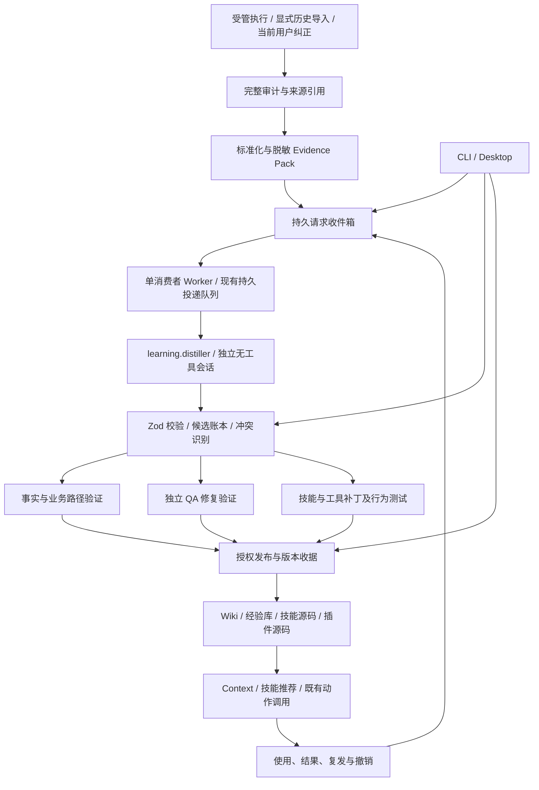
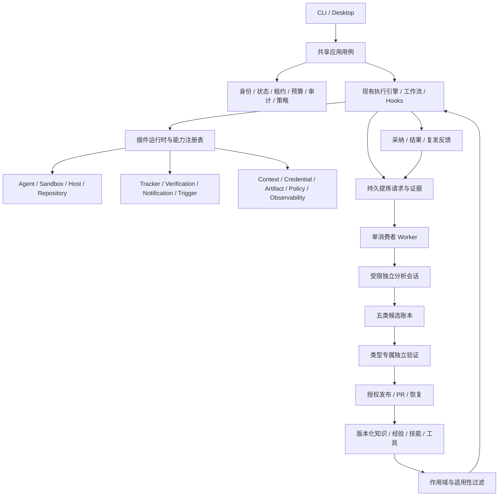
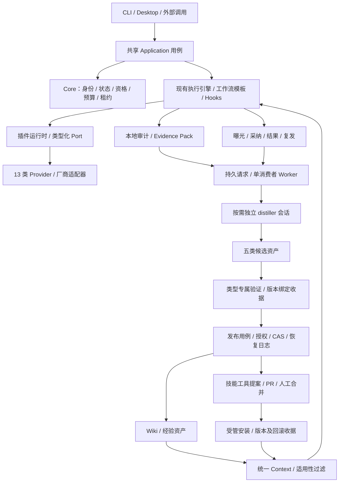
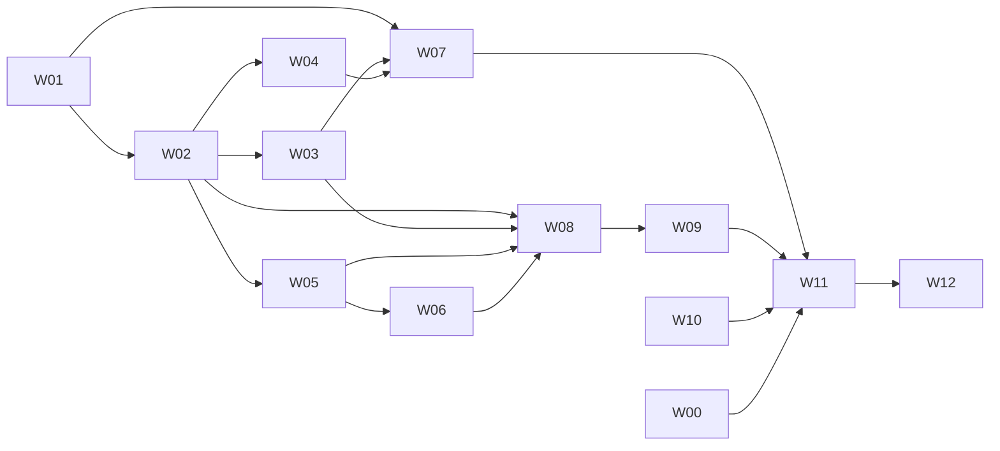

# 会话洞察与知识、技能、工具沉淀开发计划

**最新集成状态：** 第 18.16 节更新当前起点和剩余开发顺序，第 18.15 节保留验收历史；二者覆盖下方较早快照的对应状态。不把历史阻断继续列为当前缺陷。

> **For agentic workers:** REQUIRED SUB-SKILL: Use superpowers:subagent-driven-development (recommended) or superpowers:executing-plans to implement this plan task-by-task. Steps use checkbox (`- [ ]`) syntax for tracking.

**Goal:** 将受管会话及明确导入的历史会话转化为有证据、可验证、可发布、可撤销的业务知识、业务路径、修复经验、技能和工具，并在后续任务中验证复用效果。

**Architecture:** 执行事件驱动持久化提炼请求；受限的独立 `distiller` 会话生成候选，确定性代码负责身份、证据校验、验证、发布与反馈。复用现有 Agent / Sandbox、SQLite、持久投递队列、复盘、经验库、Wiki 摄入、技能工坊和插件注册，不新增 Agent 框架或通用工具注册中心。

**Tech Stack:** TypeScript、Zod、Node SQLite、现有插件运行时与 Agent Provider、Vitest、已有 Python Wiki 工具、Electron / React / Playwright。

**Status:** 实施中；2026-11-12 复核。lesson 发布及授权 / 写锁守卫、轻量证据依赖修复已推送 `282ab63c`（CLI 0.2.55），精确提交 CI `43082368306` success；较早 `d8540007` 的 Wiki 安装失败仍保留。构建产物 prepare 失败已定位为测试复制目录权限 0755，正式 fixture 修为 0700 后发布 E2E 六项通过，生产私有目录门禁未放宽。Context 的继承字段拒绝已通过 43 项正式测试，但独立质量复审发现 union 先读取继承 getter 的 P2，须在聚合重建前修复。提案来源读取竞态已修复，163 项正式测试含真实 Docker 通过，等待最终独立复核。EvidenceStore 显式消费六文件已冻结、作者相关测试 264 项通过，独立审查未关闭。以上新增切片尚未提交；CLI 0.2.56 为当前待提交版本。真实 Claude 分析仍失败且根因未知；非模型 auth status 仅证明已登录。受管 Repository 与 Verification 自动选择仍待接线。完整五资产系统未交付。第 18 节是当前执行依据；历史测试和旧构建不覆盖后续源码。对应 [English plan](2026-11-09-session-distillation.md)，已有基础见 [前一阶段计划](2026-11-08-runtime-learning-and-validation.zh.md)。

---

## 1. 目标、基线与非目标

基线是用户已合并的 PR #294 实现。计划最初编写 checkout 为 `8b5a911a`；实施已核实本地 `origin/main` 为 `7194f5eb`，当前任务分支为 `feat/session-distillation`。后续集成仍需实时核对基线。自动化 fixtures 不等于真实模型测试，收费分析和生成工具安装分别受其明确执行条件约束。

| 编号 | 必须实现的结果 |
| --- | --- |
| R1 | 根据运行事件、明确提交的纠正和显式历史导入产生持久请求，重启不丢失，重复事件不重复产出 |
| R2 | 独立分析会话没有执行、修改、MCP 或自动技能权限；未知分析能力明确阻断 |
| R3 | 每个结论绑定具体证据、来源完整性、项目、版本和适用条件 |
| R4 | 提炼业务术语、实体、规则、权限、状态约束和跨系统路径，区分事实、建议及未决冲突 |
| R5 | 修复经验包含经验证的具体动作与不适用条件，保留现有独立 QA、复发、撤销门禁 |
| R6 | 对已有技能优先提出补丁，保留触发限制、泛化参数、分支、恢复和验证条件 |
| R7 | 重复操作优先复用既有 CLI / 脚本 / 插件；工具候选有输入输出、副作用和运行测试 |
| R8 | 发布遵守持久授权、乐观版本校验、恢复和人工合并规则 |
| R9 | 同项目跨任务 / Agent 复用；跨项目交换降为候选，不携带验证与授权 |
| R10 | CLI、Desktop 访问同一用例和状态，不各自启动重复分析 |
| R11 | 分别计量检索、选择、显式采纳、执行结果与复发，评价收益而非只统计资产数 |
| R12 | 有真实 Claude、本地知识写入、技能 / 工具变更和后续复用的可重复端到端验收 |

本轮不建设模型训练、知识图数据库、向量服务、多租户云平台，不自动合并 PR，不把历史消息中的命令当授权，不接管用户全部外部会话。执行支持六种 Agent 不等于已支持六种原生会话解析；未提供解析器的来源使用明确导出，缺失证据必须可见。

## 2. 已有基础与本轮必须修正的具体问题

| 基础 | 复用方式 | 本轮差距 |
| --- | --- | --- |
| 自动失败 / 成功经验 | 继续保存原始来源、QA 和完成证据 | 初始失败摘要不等于根因；成功工作流摘要不等于业务路径 |
| `retro` | 下沉共享证据与分析用例，保持已有命令兼容 | 当前固定 Claude 调用及个人技能绝对路径，产出止于报告 |
| 会话读取 | 复用受管遥测、Claude / Codex / OpenCode 读取与 Wiki 导入规范 | 统一来源、消息定位、完整性和显式导入，不另建一套全量扫描器 |
| 持久投递队列 | 用独立队列文件承载提炼投递 | 现有构造器独占消费者所有权；生产者不能各自实例化该队列 |
| SQLite | 复用私有文件、迁移和事务实现 | 新增薄请求收件箱、候选及发布收据；不再实现通用调度器 |
| Wiki 摄入 | 使用已有 plan / preview / apply / hash / lint / recovery | 当前没有从运行候选到该计划的受控适配 |
| 技能工坊 / 目录 | 复用现有创建、诊断、重构和推荐入口 | 目录丢失调用限制元数据；缺少补丁、行为测试和版本效果 |
| 插件 / System Action | 注册 `learning.distill` 及发布动作 | 需要类型化输入、输出和策略门禁，不引入新的工具注册系统 |

## 3. 责任和驱动架构



- **Core / Application 持有：** 身份、项目作用域、证据引用、候选状态、验证权限、发布策略、预算和审计。模型不能自报 `verified`、扩大作用域或改变策略。
- **`learning.distiller` 插件持有：** 提炼提示词和分析策略；通过现有 `workflow.action` 注册 `learning.distill`，注入所选 Agent Provider。插件名称不加产品前缀。
- **Worker 持有：** 单消费者、预算、中断与重试；按任务创建独立分析会话，不是一个长期积累未受控上下文的 Agent。
- **知识、技能、工具发布适配：** 复用现有 Wiki、Git、Verification、Repository 和 System Action 接口；只有出现真实实现差异才提取新的 seam。
- **CLI / Desktop：** 只调用共享用例。Renderer 不访问文件、密钥或数据库。

### 3.1 请求、投递和模型会话的生命周期

1. 原任务先写审计。终态、修复检查点或显式请求保存到 SQLite 收件箱；队列暂不可用不能使原任务变为失败。
2. 收件箱记录写入失败必须暴露降级状态。Worker 启动和周期性补查完整审计；每运行的已验证序列 / head 与请求在同一账本事务提交。队列满时不越过未接收位置。
3. 只有 Worker 实例化提炼专用 `DurableTriggerQueue`；生产者只写收件箱。Worker 入队后再记录交接收据，中途崩溃通过稳定 key 重放恢复。
4. 消费投递时先查候选 / 处理收据。已经完成的同一来源和策略版本不再次调用模型，即使队列旧投递已被清理。
5. Evidence Pack 内容改变时形成新 key；重试同一 key 必须使用原内容，不能把源文件后来的内容绑定到旧 digest。
6. 分析输出只产生候选；验证和发布分别执行。模型超时、JSON 错误和来源不完整均有明确状态。
7. 关闭先停止接收并发起拥有权范围内取消。现有队列 `close()` 会 drain，需增加可选停止派发模式，默认行为保持兼容；最多等 5 秒后只终止本 Worker 拥有的分析进程，保留未完成投递供恢复。
8. 学习任务标记 `purpose=learning`，其审计不再次触发学习，也不生成普通成功经验，防止自循环。

### 3.2 触发与默认预算

| 项 | 本轮确定行为 |
| --- | --- |
| 自动入口 | 用户启用学习后处理 AFK 受管运行；失败先保存原经验候选，修复后再提炼具体建议 |
| 成功入口 | 独立 QA 通过且运行成功，或到达匹配发布变更的人工合并闸门；未合并不得总结为已上线 |
| 用户纠正 | 明确提交当前纠正及其来源；历史转录中的“用户”文本不自动获得当前授权 |
| 历史导入 | 必须指定运行、可访问会话或导出文件；不扫描全部个人会话，不接入远程平台私有 API |
| 同类操作识别 | 从已保存的工具名称、参数模式及结果生成候选；一次成功不证明通用性，不按次数自动发布 |
| 并发 / 尝试 | 每用户一个 Worker、一个模型任务并发；每投递最多两次模型尝试，第二次含首次错误的脱敏结构说明 |
| 时间 / 文本 | 单次 120 秒；Evidence Pack 128 KiB UTF-8、模型输出 32 KiB、最多 10 个候选；超出则显式分片或阻断，不能静默截成完整来源 |
| 日预算 | 默认最多 20 次模型调用，含重试，启动前原子预留；无用量回报显示 unknown；金额预算仅在 Provider 实际支持时提供 |
| 容量 / 保留 | 普通准入最多 1,000 个待处理请求 / 16 MiB、2,000 条账本记录 / 32 MiB；仅来源暂态阻断和原子失效可使用安全预留，总记录 / 字节不超过普通上限两倍，不允许借此新增工作、模型调用或发布；SQLite 主文件物理上限 128 MiB，包含页开销。短期包默认 7 天，未发布候选 90 天；活跃引用和未决发布恢复禁止淘汰，满额明确阻断 |
| 启停 | `experience worker --once` / `--watch`；Desktop 用现有子进程托管机制启动同一 Worker，退出默认暂停；自动后台模式必须是已保存配置，不能暗装系统服务 |

上述为可配置的初始产品上限，不是性能测量或“从此不再犯错”的承诺。

## 4. 标准数据和用例契约

以下类型表示 Application 契约；边界以 strict Zod schema 实现，拒绝未知字段。已有 `ExperienceRecord` 和 version-1 交换格式不改名、不静默改变语义。

```typescript
type AssetKind = 'fact' | 'process' | 'lesson' | 'skill' | 'tool';
type CandidateState = 'candidate' | 'conflict' | 'validated' | 'published'
  | 'rejected' | 'superseded' | 'revoked';

interface EvidenceRef {
  id: string;
  kind: 'audit' | 'message' | 'tool-result' | 'code' | 'test' | 'human-confirmation';
  digest: string;
  locator: string;
  completeness: 'complete' | 'partial';
  authority: 'observed' | 'declared' | 'inferred';
}

interface DistillationRequest {
  version: 1;
  scope: string;
  sourceId: string;
  sourceRunId?: string;
  workItemId?: string;
  evidenceDigest: string;
  analyzerVersion: string;
  reason: 'completed' | 'repaired' | 'correction' | 'import';
}

interface CandidateProposal {
  kind: AssetKind;
  title: string;
  statement: string;
  evidenceIds: readonly string[];
  applicability: {
    project: string;
    environments: readonly string[];
    versions: readonly string[];
    preconditions: readonly string[];
    exclusions: readonly string[];
    invalidationConditions: readonly string[];
  };
  targetRef?: string;
  payload: unknown; // 按 kind 使用判别 schema，字段见下表。
}

interface DistillationOutput {
  version: 1;
  candidates: readonly CandidateProposal[];
  warnings: readonly string[];
}
```

| kind | payload 必需内容 | 验证凭据 |
| --- | --- | --- |
| fact | 主题、主体、规则、事实 / 提议类别、有效范围 | 对应事实的源码、接口、用户确认或观察；未决提议不能发布为事实 |
| process | 入口、参与系统、前置条件、步骤、状态变化、异常分支、结束条件 | 逐节点证据及缺失标记；局部路径不能宣称全链路通过 |
| lesson | 触发、根因假设 / 已证实根因、尝试、具体修复、预防检查 | 同项目修复与新增独立 QA 证据；沿用现有经验验证 |
| skill | 目标技能或新增理由、触发与禁用条件、输入、分支、恢复、完成条件、补丁、评价用例 | 原技能版本、结构检查、正反例与旧版行为比较 |
| tool | 既有工具搜索结果、输入输出 schema、依赖、权限、超时、副作用、幂等 / 恢复、源码提案及测试 | 隔离执行结果、失败输入、取消与权限拒绝；无适用副作用时显式 none |

模型不能输出系统 id、候选状态、验证权限、发布令牌或任意目标绝对路径。系统分配身份，校验证据 ID 是否属于本请求并解析逻辑 `targetRef` 到授权目标。

```typescript
import { createHash } from 'node:crypto';

// 稳定去重：evidenceDigest 覆盖审计 head、来源哈希、消息范围和完整性。
function distillationKey(input: DistillationRequest): string {
  return createHash('sha256').update(JSON.stringify([
    input.scope, input.sourceId, input.evidenceDigest, input.analyzerVersion,
  ])).digest('hex');
}
```

`sourceRunId` 是原始运行，`jobId` 是提炼请求，分析会话拥有新的 `runId` / `sessionId`。它们均不得替换原始 `workItemId`。

共享用例名确定为：`submitDistillation`、`reconcileDistillationSources`、`processDistillation`、`validateLearningCandidate`、`publishLearningCandidate`、`revokeLearningCandidate`、`queryLearningState`。实现为应用函数，依赖现有具体端口；不为每个函数再建单实现接口。

### 4.1 候选、发布和反馈

- `candidate → validated → published`；证据冲突进入 `conflict`；拒绝、替代与撤销分别保留原因。内容变更形成新版本并重新验证。
- 验证收据绑定候选 digest、验证器版本、证据 digest 和测试结果；模型 confidence 不授予状态。发布时重新核对收据、来源和目标版本。
- 业务事实与易变快照分开；经验保持现有有效期；技能 / 工具按版本失效。不得统一套用 90 天失效语义。
- 发布状态、目标内容与收据不能假装跨 SQLite / 文件 / Git 原子。使用 `prepared → applied → committed` 发布日志、目标 hash 和恢复副本，启动时处理未完成发布。
- 重启后目标已符合预期时补写收据；目标出现第三方修改时标为 conflict，禁止重试覆盖。多页 Wiki 恢复复用现有 recovery receipt。
- 撤销知识标记其权威失效，移出上下文；撤销已部署工具不能只删候选，必须产生具体卸载 / 回滚结果或 `rollback_blocked`，不抹去历史。
- 反馈绑定准确资产版本、目标运行 / 工作项及结果。区别曝光、选择、显式采纳、执行和成功；成功不直接归因为该资产。

## 5. 安全和泛化约束

1. 提炼器接收已脱敏、大小受限的内联证据包；不把源码仓库、密钥目录或原始全量会话挂给模型。必要大来源显式分片并保留消息位置。
2. 现有 Claude 开发命令默认含跳过权限参数，不能原样用于提炼。增加明确的 `analysis` 执行配置，移除该参数；禁用内置工具、自动技能、MCP、项目 / 用户 Hooks 和会话持久化，保留已有合法认证链路。
3. 用已安装 CLI 的 `--help` 和命令构造测试核对支持项。原生工具禁用不是操作系统隔离承诺；验证模型无法请求工具，并验证受信任 CLI 不触发项目 Hooks / 插件。不能证明的 Provider 返回 `analysis_unsupported`，不得退回可写开发模式。
4. 消息、工具输出、知识内容都按不可信数据处理。当前用户授权来自调用上下文，不能从转录角色名或模型文本生成。
5. 去掉账号、IP、个人路径和一次性凭证；项目差异通过参数和适用条件表达。权限规则、业务语义与安全检查不能被“泛化”删除。
6. 先搜索已有知识、技能和工具。候选可建议合并，系统不得用语义相似直接合并相反规则或覆盖验证历史。
7. 检索先改善中文分词、别名和结构化适用性，增加负例；引入额外依赖或向量后端需要实测证明当前方式达不到目标。
8. 自动发布仅在既有持久策略授权内进行。Wiki 目标、允许的动作、项目与资产类型均显式配置；代码变更发布 PR 供人工合并，候选不会直接安装执行。

## 6. 实现文件与职责映射

这是执行人员附录，全部路径相对仓库根。目标是修改最少的既有模块；新文件按以下责任组织，不把生产实现写入计划文档。

| 工作域 | 新增模块 | 修改 / 复用现有模块 |
| --- | --- | --- |
| 契约与候选 | `packages/runtime/src/application/learning/contracts.ts`、`candidate-store.ts` | `learning/experience-store.ts`、`infrastructure/storage/sqlite.ts` |
| 请求与 Worker | `learning/requests.ts`、`worker.ts` | `application/plugins/trigger-queue.ts`、`plugins/observability.ts`、`workflows/execute-work-item.ts`、`application/workflow-engine.ts` |
| 证据与复盘 | `learning/evidence.ts`、`analysis.ts` | `apps/cli/src/commands/retro.ts`、`infrastructure/observability/agent-telemetry.ts`、Wiki 会话 reader |
| 受限 Agent | 复用 Agent / Sandbox，不新增独立进程框架 | `domain/agents/types.ts`、`domain/agents/claude-code.ts` 及所需执行配置传递模块 |
| 插件 | `application/plugins/learning.ts` | `plugin-sdk/index.ts`、`application/plugins/runtime.ts`、`configured.ts`、`builtin-manifests.ts`、`operations.ts` |
| 发布与反馈 | `learning/publication.ts`、`knowledge.ts`、`proposals.ts`、`feedback.ts` | `learning/runtime.ts`、`experience-store.ts`、现有 Context / Verification / Repository 端口 |
| CLI | 扩展 `apps/cli/src/commands/experience.ts` | `command-registry.ts`、`composition-root.ts`、既有 `retro` 命令 |
| Desktop | 扩展 `shared/experience-contract.ts`、`electron/services/experience-service.ts`、`src/features/settings/ExperienceSettings.tsx` | 既有 IPC / preload、进程托管、运行详情和设计系统 |
| 技能 | 修改 `skills/afk-skill-craft/SKILL.md`、其 checklist 和 `skills/jev-agent-guard/scripts/skill-catalog.mjs` | `skills/wiki/scripts/wiki.py`、`session_source.py` 与测试；需要协议变更才修改 Wiki 实现 |
| 契约文档 | 扩展 `docs/architecture/plugins.md/.zh.md`、接入标准、执行文档、测试指南 | 每次命令变化同步执行入口；skills / CLI 变化分别同步其 canonical version |

每个新增 TypeScript 模块有同名 `.test.ts`；跨进程与端到端测试另列，避免把实现镜像测试当收益验证。

## 7. 分任务实施清单

每项按“先红测试 → 确认具体失败 → 最小实现 → 定向绿测试 → 版本 / 文档 / 提交”执行；用户已授权继续实施时不重复询问。以下检查框完成后才推进其依赖项。提交在任务分支或 PRD 切片上完成，不在集成线原地开发。

### T01 — 契约、状态与幂等键（P0）

**依赖：** 无。**写入：** `contracts.ts`、`contracts.test.ts`。

- [x] 定义第 4 节 strict schema、逐类型 payload、状态转换及上述 `distillationKey`，验证规范项目身份。
- [x] 先写反例：伪造 `state=verified`、未知 evidence ID、跨项目适用范围、超长输出、非法 work item 均拒绝。
- [x] 固定输入例 `scope=github:acme/api`、`sourceId=run:r1`、同 evidence / analyzer 产生同 key；改变任一 hash / scope / analyzer 必须不同。
- [x] 运行 `pnpm --filter @afk/runtime exec vitest run src/application/learning/contracts.test.ts`，预期先失败后全部通过。
- [x] 导出共享类型，提交契约切片；不增加命令或修改旧交换格式。

### T02 — 私有请求与候选账本（P0）

**依赖：** T01。**写入：** `candidate-store.ts`、`candidate-store.test.ts`、`requests.ts`、`requests.test.ts`。

- [ ] 使用现有 SQLite 事务 / 迁移，保存请求、证据引用、候选版本、处理收据、发布日志及每运行扫描位置。请求唯一 key，模型输出无状态写权限。
- [ ] 测试两个独立进程提交同 key 只有一条；相同 key 不同内容拒绝；重开库仍可查询；来源缺失保留阻断信息。
- [ ] 测试迁移失败回滚、私有权限、符号链接拒绝、达到容量保护活动引用且不吞请求、状态的乐观版本冲突。
- [ ] 运行 `pnpm --filter @afk/runtime exec vitest run src/application/learning/candidate-store.test.ts src/application/learning/requests.test.ts`，预期无丢失 / 重复记录。
- [ ] 实现收件箱交接收据与持续 cursor，提交；不复制队列的重试状态机。

### T03 — 统一 Evidence Pack 和共享复盘用例（P0）

**依赖：** T01。**写入：** `evidence.ts`、`analysis.ts` 及测试；修改 `retro.ts` 和相应测试。

- [x] 从 `retro` 提取证据组装和报告解析，保留 `retro run/show` 输出兼容；不改变正式 CLI 签名。
- [x] 复用受管遥测与本地 reader，定义消息定位、审计序列、完整性、原始摘要 / 内容 digest；sourceId 不是访问权限。
- [x] 加入损坏审计、缺失转录、部分 JSONL、超大来源分片、secret / 私钥脱敏、文件替换和越界路径测试。没有足够来源时不得生成“完整业务路径”。
- [x] 运行 `pnpm --filter @afk/runtime exec vitest run src/application/learning/evidence.test.ts src/application/learning/analysis.test.ts` 与 `pnpm --filter afk exec vitest run src/commands/retro.test.ts`。
- [x] 移除个人目录依赖，提交；不同原生来源解析能力须独立报告。

### T04 — 受限独立分析配置与插件（P0）

**依赖：** T01、T03。**写入：** `plugins/learning.ts` 及测试；修改 Agent 命令构造、配置传递和插件配置。

- [ ] 新增可明确识别的分析执行配置，Claude 接收内联证据，无原任务仓库与会话上下文；原开发配置保持兼容。
- [ ] 命令测试断言分析不含跳过权限参数、工具列表为空、MCP / 自动技能 / 非受信 Hooks 被禁用，合法认证可用；未知 Provider 在启动前返回 unsupported。
- [ ] 提炼 action 返回 strict JSON；拒绝模型伪造证据、状态、目标路径及超出 10 条 / 32 KiB 的结果。模型不能执行发布动作。
- [ ] 运行 `pnpm --filter @afk/runtime exec vitest run src/domain/agents/claude-code.test.ts src/application/plugins/learning.test.ts src/application/learning/analysis.test.ts`，再运行受影响配置 / transport 测试。
- [ ] 注册 `learning.distiller`、`learning.distill`，同步 CLI version 与插件接入文档，提交。不是所有执行 Agent 都自动获得安全分析资格。

### T05 — Worker、投递和预算（P0）

**依赖：** T02、T04。**写入：** `worker.ts`、`worker.test.ts`；仅为必要的关闭语义修改原队列及其测试。

- [ ] Worker 单独拥有专用投递队列；原任务 / CLI / Desktop 并发生产者只提交收件箱；按稳定 key 交接并处理。
- [ ] 测试“收件箱提交后崩溃”“入队后未写交接收据”“候选落库后未 ack”三个窗口，最终一组候选且不重复收费调用已完成任务。
- [ ] 实现启动前日预算预留、两次尝试、超时 / Abort、插件禁用、单消费者冲突；存量外部 / 不明 owner 不抢占。
- [ ] 测试关闭不启动新任务、只取消拥有的进程、默认队列 drain 兼容、5 秒后可恢复；运行 `pnpm --filter @afk/runtime exec vitest run src/application/learning/worker.test.ts src/application/plugins/trigger-queue.test.ts`。
- [ ] 记录开始、结束、重试、阻断、用量缺失及预算，提交。预算不足停在可观察的 blocked，不无限重试。

### T06 — 事件驱动和持久纠正入口（P0）

**依赖：** T02、T03、T05。**写入：** 现有执行 / 观察调用点和 `requests.ts`；新增 `requests.integration.test.ts`。

- [ ] 成功 / 发布交接、修复检查点产生请求，附既有运行身份；失败先沿用原经验记录，未修复不宣称有有效修复。
- [ ] 原审计 append 与请求之间崩溃，通过完整审计补查恢复；扫描位置和收件箱插入同事务。原执行主结果不受分析不可用影响。
- [ ] 纠正入口记录当前调用者来源，只创建候选 / 冲突或撤销已证伪资产；历史消息不授予授权。
- [ ] 运行 `pnpm --filter @afk/runtime exec vitest run src/application/learning/requests.integration.test.ts`；断言重复终态去重、晚到 QA 失败撤回、learning 运行不递归、队列满不越过 cursor。
- [ ] 用 fake distiller 跑通真实受管执行到候选账本，提交第一个可运行里程碑 M1。

### T07 — 具体修复经验、适用性和召回（P1）

**依赖：** T06。**写入：** `learning/runtime.ts`、`experience-store.ts`、`feedback.ts` 及测试。

- [ ] 将 lesson 候选映射到旧经验门禁；具体动作与假设 / 已证实根因分开，修复内容变化仍保留原失败身份及复发历史。
- [ ] 验证器复核新增独立 QA 和精确目标版本；当前成功不能替另一个修复背书。缺证据保持候选。
- [ ] 在既有词项匹配上加入 `Intl.Segmenter` 中文词项、错误码 / 命令标识、有限显式别名和适用性过滤；语义疑似重复只提示，不覆盖旧记录。
- [ ] 固定评价集含至少 12 对等价查询与 12 个不适用 / 相反条件查询，覆盖中英表达、同码不同项目 / 版本；要求全部项目隔离用例无泄漏，并报告旧版 / 新版 recall@5 与负例。不能为过评价改写答案。
- [ ] 运行现有经验 / 交换 / runtime 测试及 `feedback.test.ts`；验证导入仍降级、撤销退出召回、去重反馈不虚增，完成 M2。

### T08 — 业务知识和业务路径发布（P1）

**依赖：** T06。**写入：** `knowledge.ts`、`publication.ts` 及测试；复用 Wiki reader / ingest。

- [ ] 将 fact / process 转为已有 Wiki version-1 ingest plan；先检索、读完整目标及规则、绑定 expected hash，包含回链和索引。
- [ ] 业务事实和环境表分开；未证实内容落授权收件箱；过程每节点有证据或明确缺失，不凭一次 UI / API 成功推断全链路。
- [ ] 测试重复摄入不重写、相反规则 conflict、人工并发修改不覆盖、敏感 / 规则 / 越界文件拒绝、目标知识已经存在时复用。
- [ ] 用临时 vault 跑 `python3 skills/wiki/scripts/wiki.py ingest --vault <fixture-vault> --plan <fixture-plan> --json`，先 preview；允许策略下再加 `--apply`，核对 hash 和 lint。真实用户 vault 仅在已有明确写入授权下复测，不推远端。
- [ ] 实现 prepared / applied / committed 与部分失败恢复，运行 `knowledge.test.ts`、`publication.test.ts` 及 `python3 -m unittest discover -s skills/wiki/scripts -p 'test_*.py'`，完成 M3。

### T09 — 技能候选、泛化补丁与元数据（P1）

**依赖：** T06；候选与目录工作可并行 T08，发布集成必须等待 T08 的 publication 用例通过测试。**写入：** `proposals.ts`、`proposals.test.ts`、技能工坊 / 目录及其测试。

- [ ] 先检索已有技能、保留 provenance；旧技能优先 patch，新技能必须说明缺少可复用对象的证据。
- [ ] 修正目录保留 / 尊重 `disable-model-invocation`、调用限制和来源；禁用技能不得自动推荐执行。
- [ ] 由证据生成参数、触发 / 不适用条件、分支、恢复与验证；去掉个人路径和环境硬编码，不删业务 / 安全约束。
- [ ] 每个技能变更包含正常、恢复、拒绝三个代表性行为用例及旧版比较；结构合规与行为有效分别报告。
- [ ] 生成可审查补丁，在受管任务 worktree 验证并发布 PR；skills 改动同提交 bump 插件 version，安装缓存不编辑。通过相关单测和模板 / 文档检查后完成 M4 的技能部分。

### T10 — 工具候选和受控验证（P1）

**依赖：** T09。**写入：** 继续 `proposals.ts` / 测试；复用 Verification、Repository 和既有 System Action。

- [ ] 识别重复工具调用模式，先查询已有 CLI / 脚本 / 插件；重复出现仅生成候选，不自动授予执行资格。
- [ ] 单技能辅助放其 scripts；跨工作流调用用已有 action；存在真实多后端 / 按需安装需求才做插件，命名无产品前缀。
- [ ] 源码提案在另一受限验证任务执行，模型提炼进程不运行其输出。测试正常输入、错误输入、超时 / 取消、重试副作用和权限拒绝，验证参数不经 shell 插值。
- [ ] 工具安装 / 发布依据持久授权，插件依赖走已有安装器；无回滚能力显式 blocked，不能只把账本标为 revoked。
- [ ] 在临时仓库演示同一工具处理两组输入并拒绝恶意输入，形成代码 / 测试 / 版本 / PR 收据，完成 M4。

### T11 — CLI 与可运维入口（P1）

**依赖：** T05、T07、T08、T09、T10。**写入：** `experience.ts`、registry / composition 及测试。

- [ ] 保持旧命令兼容，新增 `experience distill`、`jobs`、`candidates`、`inspect`、`validate`、`publish`、`invalidate`、`feedback`、`worker`；候选状态命令不得复用旧经验 id 的语义。
- [ ] 所有查询必需项目 scope；请求入口使用 `--run-id` 或 `--transcript` 二选一，历史来源显式 provider；纠正由 `--correction-file` 和明确来源提交，不把内容放命令行。
- [ ] `worker --once` 处理当前可处理请求后退出，`--watch` 前台运行；输出 pending / blocked / failed / processed 与安全阶段码，不暴露 token 或原文。
- [ ] 黑盒测试 restart、分页、重复请求、禁用 Provider、无预算、错误退出码及旧命令；运行 CLI 定向 Vitest 与 root 新增 `tests/e2e/plugin-distillation.test.ts`。
- [ ] 更新 canonical CLI version、命令注册表和双语执行入口；运行打包脚本验证实际全部命令入口数量，不沿用旧的 23。

### T12 — Desktop 共享治理（P1）

**依赖：** T11。**写入：** 现有 experience 合约、Main 服务、preload / IPC、设置和运行详情及测试。

- [ ] 阅读 Desktop 架构与设计系统；共享用例返回 DTO，Renderer 不能创建 Worker、访问磁盘或直接调用模型。
- [ ] 增加启停 / 预算 / Provider 设置、任务状态、证据与缺失提示、候选差异、验证 / 发布 / 撤销和反馈入口；明确显示未配置、未知及无原生解析器。
- [ ] CLI 与 Desktop 同时打开仍只一个消费者；关闭 / 重启应用不丢请求，不误杀 CLI 启动的进程。
- [ ] IPC 校验 scope、id、来源选择、目标权限及 stale response；测试切换项目不展示前项目结果。
- [ ] 运行 `pnpm --filter afk-control-electron typecheck`、`test`、`build`，再运行相关 Playwright 用例和完整 Electron E2E，完成 M5。

### T13 — 真实闭环、故障演练与交付（P0 发布门禁）

**依赖：** T01–T12。**写入：** `tests/e2e/plugin-distillation.test.ts`、`tests/e2e/plugin-distillation-live.test.ts`、双语指南。

- [ ] 准备不含真实业务凭证的固定会话证据集：修复案例、业务路径、技能变更、工具变更、相反规则、提示注入及缺失证据；期望结论和负例在模型运行前冻结。
- [ ] 真实 Claude 测试必须显式开启 `AFK_REAL_DISTILLATION_E2E=1`，使用已有合法认证；默认显示 skipped，显式开启但缺依赖则失败。记录 CLI / 模型、配置、范围、耗时及用量未知项。
- [ ] 用实际安装版产生请求、重启 Worker、提炼；独立宿主检查候选证据、临时 vault 幂等、技能 / 工具 diff 和测试；第二个相关任务可召回准确版本，不相关 / 跨项目任务不可召回；撤销后立即退出新上下文。
- [ ] 分别演练恶意转录要求执行命令、项目 Hook 写哨兵、未知 MCP、过期权限、发布中断、人工并发改文件、来源被替换、队列 / 磁盘满、预算耗尽、重复事件和孤儿 owner；每项有确定可断言结果。
- [ ] 独立规格审查后再独立质量审查，修复发现并复测；执行第 10 节发布检查，提交 / 推送 / PR，等待人工合并。归档已集成子任务 worktree，保留当前主任务和恢复证据，完成 M6。

## 8. 并行实施与写入归属

| 批次 | 可并行内容 | 协调者保留的工作 |
| --- | --- | --- |
| A | T01 主线程；旁路盘点现有会话和测试 fixtures | 契约、身份、状态、基线与版本策略 |
| B | Worker A: T02；Worker B: T03 | 集成契约、准备 T04 的安全命令检查 |
| C | Worker A: T04 的独立 Provider 文件；完成 T04 后主线程依次 T05 → T06；Worker B: 技能目录限制元数据修复 | Agent 公共类型、配置 / manifest、共享队列改动只由主线程整合；T06 通过完成 M1 |
| D | T06 集成后：Worker A: T07；Worker B: T08；Worker C: T09–T10 | `publication.ts` 先冻结接口；proposals 文件由同一 worker 连续维护 |
| E | 主线程 T11；CLI 契约冻结后 Worker D: T12；其他 worker 准备 T13 fixture | CLI registry、版本、公共导出和执行文档 |
| F | 独立规格审查 → 修复 → 独立质量审查；可并行不同环境验收 | 最终源树、实测证据、发布与清理 |

每个 worker 一个隔离 worktree，禁止共享写集。交付包含补丁、测试命令 / 退出码、实际限制和文件清单。公共类型、根配置与版本由协调者维护，不能由多个 worker 分别 bump 后覆盖。

PRD 有基线时切片合入 `prd/<issue>`，最终由人合入集成线；无 PRD 时使用任务分支并发布可评审 PR。禁止为清理磁盘强删活动、未知或未发布工作区。

## 9. 里程碑和完成定义

| 里程碑 | 交付 | 必须证明 |
| --- | --- | --- |
| M1 / 批次 A–C | 事件到独立 Agent 再到候选的可运行链路 | 崩溃恢复、无工具分析、来源可追溯、预算与去重 |
| M2 / 批次 D | 具体修复经验闭环 | 修复与 QA 对应、后续任务命中、负例拒绝和复发撤销 |
| M3 / 批次 D | 业务知识与路径闭环 | 冲突不覆盖、幂等写入、节点证据、并发保护和恢复 |
| M4 / 批次 D | 技能与工具闭环 | 泛化输入、行为比较、权限与版本、可审查 PR，无自动合并 |
| M5 / 批次 E | CLI / Desktop 一致入口 | 一个消费者、同一状态、项目隔离、安装版命令可用 |
| M6 / 批次 F | 完整交付 | 全部质量门禁、真实 Claude E2E、文档、可回滚、工作区清理 |

排期按以上六批次和依赖推进；每批通过后交付可运行切片。模型、网络和账户等待不算开发完成；真实服务不满足前置条件时准确报告阻断，不能以模拟矩阵替代。

## 10. 测试、迁移和上线检查

### 自动化与真实测试

- 契约 / 状态：未知字段、伪造权威、证据引用、跨项目、旧格式兼容。
- 持久性：真实子进程并发与崩溃，不只模拟 Promise；输入 / 游标 / 投递 / 候选 / 发布收据的关键窗口。
- 分析安全：无工具、无自动技能 / MCP、Hook 哨兵不变、敏感信息不进入包 / 日志、unsupported 无权限回退。
- 资产质量：冻结正反例，业务节点可追溯，技能新旧版比较，工具多输入与安全失败。
- E2E：通过实际 CLI / IPC 调用；模型生成结果由另一执行者或固定宿主断言检验；原始转录不能作为最终展示结果。

### 必须执行的仓库命令

```bash
pnpm typecheck
pnpm build
pnpm architecture:check
pnpm docs:check
pnpm test
pnpm test:coverage
python3 -m unittest discover -s skills/wiki/scripts -p 'test_*.py'
pnpm --filter afk-control-electron typecheck
pnpm --filter afk-control-electron test
pnpm --filter afk-control-electron build
pnpm --filter afk-control-electron e2e
pnpm release:cli --output /tmp/session-distillation-release
```

先运行每任务定向测试，源树稳定后运行上述完整检查；仅当新变更或失败需要时重跑。保留现有逐包覆盖率基线，不为了通过而降低。共享源码覆盖率、Desktop 和模型子进程内部的范围分别报告。

### 迁移与发布

- 不修改旧经验 version-1 交换协议；新候选数据库单独 versioned schema。迁移失败保留原库和源码，禁止自动删除重建。
- SQLite 备份通过一致性方式完成，不能直接复制正在写的 WAL 主文件。旧二进制不得写新 schema；回滚使用兼容 reader 或经验证的迁移 / 快照恢复。
- 学习功能初始禁用，不改变已有执行；显式配置 `learning.distiller` 后才允许模型调用。先一次性处理，再启用持续 Worker，再启用已经授权的发布类型。
- 缺 Claude 认证、Python、vault 规则、目标仓库权限或验证器时保持明确 blocked，不能静默省略目标能力。
- 技能变更同提交 bump `.claude-plugin/plugin.json`；CLI / 共享运行时代码变更同提交 bump `apps/cli/package.json`，以开发开始时的 canonical version 递增，不在本计划预占版本号。
- 安装版测试在仓库外隔离 HOME 完成；真实账号测试单独显式开启。不得发新邮件或通知第三方作为默认验收步骤。
- 推送任务分支、附实测范围和限制、检查 CI，人工决定合并。完成 worker 关闭并归档，原始证据按保留策略保存。

## 11. 效果评价与后续扩展条件

| 指标 | 定义 | 不允许的解释 |
| --- | --- | --- |
| recall@5 / 负例 | 冻结评价集的相关命中与不适用资产排除 | 用召回次数证明建议有效 |
| 选择 / 采纳 / 执行 | 分别记录资产版本、任务和操作者 / 执行证据 | 模型看到上下文就算实际采用 |
| 复发率 | 相同失败族、适用范围和版本内的再次失败，报告分母 | 内容指纹不同就视为没有复发 |
| 重复探索成本 | 同类任务的查证步骤、重试、耗时和 token 对比 | 未采集 token 当作零，或把所有改善归因于学习 |
| 技能迁移效果 | 原场景、参数变化、恢复 / 拒绝场景的新旧版本比较 | 当前账号一次成功就证明通用 |
| 工具收益 | 成功率、副作用失败、人工步骤和维护成本 | 脚本数量越多越好 |

初版验收要求证据和指标可计算、正反例通过，不编造生产收益百分比。只有评价显示需要时增加语义检索、远端共享或新的发布后端；跨组织权限、云端记忆和训练另立有明确前置条件的方案。

## 12. 本轮计划交付与执行顺序

- [ ] T01–T06：先形成可靠且无写权限的提炼链路。
- [ ] T07–T10：在共同契约上并行补齐经验、知识、技能与工具验证 / 发布。
- [ ] T11–T12：接入统一 CLI、Desktop 和可运维 Worker。
- [ ] T13：完成真实使用、故障演练、独立审查、版本与 PR 交付。

已按此顺序实施；未完成项继续沿依赖推进。该顺序不要求用户在已经授权的每个子步骤重复确认，也不授予 Agent 代替人合并或突破目标系统权限的能力。

## 13. 实施进度与剩余开发队列（2026-11-10）

此表描述已检查的代码状态；任务清单只有在实现、验证和提交均满足时才整体关闭。局部测试通过不等于该任务或系统已交付。

内核已在 `4b7295e9` 提交并推送至任务分支。基线验证：Runtime 全包 3,018 项通过、3 项跳过；参数兼容修复的定向 31 项通过；CLI 全包 542 项通过、2 项跳过；技能目录 86 项通过。Runtime / CLI 构建与类型检查、架构与文档检查通过。

2026-11-10 当前切片：最新 Runtime 全包 3,126 项通过、4 项跳过，CLI 全包 542 项通过、2 项跳过，仓库级 326 项通过、1 项跳过。Runtime 与仓库测试同时高并发运行时，一项既有 Git 集成测试超时；待运行结束后，Runtime 以最多 4 个 worker 独立完整重跑通过，未延长超时或修改该测试。原生进程 guard 已集成，独立规格与质量审查通过；当前只支持具有 `/usr/bin/sandbox-exec` 的 Darwin，其他平台分析明确 unsupported。最新真实 Claude 内核测试耗时 38.58 秒：一次调用生成 1 个候选，用量已返回，重放新增调用为 0，转录注入、恶意 Hook 和 MCP 均未写出哨兵文件，晚到 QA 失败使候选失效。测试使用合成审计和真实本地认证，不覆盖安装版、Desktop 或完整资产发布。较早的非法模型输出被正确拒绝，不能据单次成功认定输出稳定。

已修复并独立复审通过：SQLite journal 删除时 `nlink=0` 的有限重查、自动摄入作用域和手工导入边界、暂态解除与诊断、临时权限误判、满账本原子失效及事务中断回滚。六个确定性子进程回归和 60 对真实冷启动通过。上述 T01–T06 修改已随 `2c807ece` 提交推送。旧 CI `42685710461` 已确认失败：覆盖率阶段的真实冷启动在 `PRAGMA journal_mode = WAL` 报 database is locked。WAL 带抖动退避保持 3 秒总上限，经独立复审、集成和 46 项 SQLite / 摄入定向验证后，已随 `23e21fbe` 提交推送。复现机制不能证明是旧 CI 的唯一原因；新 CI `42799416559` 核验时仍在运行，不能将普通测试与既有 Desktop E2E 通过当作发布门禁已关闭。仓库级 326 / 1 的完整运行早于最后两项修复，不能表示每次最终修复后均完整重跑。

| 任务 | 当前状态 | 下一验收点 |
| --- | --- | --- |
| T01 | 已提交 `d0190782`；严格契约、候选载荷、证据绑定与幂等键已实现 | 后续契约改动保持兼容并重跑边界测试 |
| T02 | 请求、候选、游标、发布日志及预算账本已实现；新增 version 2 将证据快照与请求 / cursor 同事务保存，容量计入快照，旧文件兼容；来源阻断在预算预留事务内复核 | 新迁移、容量回滚和跨进程状态比较复审；发布恢复集成 |
| T03 | 证据包、不可变快照及共享提示已实现；脱敏、精确引用绑定和冻结指标已修复 | 已完成独立复审并提交内核；自动触发入口继续由 T06 完成 |
| T04 | 默认关闭插件、动态 Agent 和分析配置已实现并随 `2c807ece` 提交；真实 Claude 的注入 / Hook / MCP 隔离已验证 | 保持 Darwin 支持边界，核验新 CI |
| T05 | Worker / purpose 与进程 guard 已集成提交；独立规格与质量审查通过，包含父进程强杀及无关进程保留 | 核验新 CI；发布补查接线另行验收，不宣称全平台支持 |
| T06 | 自动摄入、补查、作用域、手工导入边界与诊断已修复并随 `2c807ece` 提交，独立复审通过 | 核验新 CI 后关闭 M1 发布门禁 |
| T07 | 已集成未提交：结构化适用条件、共享 Context 消费与 QA 目标审计；156 项定向通过。冻结评价 24/24、负例 0/18、scope 泄露 0；增加了独立可信 fixture 元数据，查询文本及答案未改，不能声称同输入算法收益 | 独立复审，候选 lesson 到实际修复语义及 QA 的绑定；可信目标条件的配置入口 |
| T08 | 已集成未提交：保存配置、授权路由、三个知识动作、Context Provider、Worker 补查与取消；同键并发及取消修复 89 项通过；真实两个 Git worktree 注入、来源失效清旧上下文及实际撤回通过 | 生产验证入口、跨进程发布所有权、独立复审、CLI / Desktop 闭环；当前发布只在同进程按 vault 串行 |
| T09 | 技能目录的调用限制和工具声明保留已实现，YAML 边界复审中 | 候选到补丁、正常 / 恢复 / 拒绝行为比较、原版本绑定、PR 收据 |
| T10 | 聚合版已集成未提交，46 项通过；子工作区报告已修复脏辅助文件造成假改善及命令未留存，59 项通过，尚待独立复审和集成 | 接入可信 Repository staging、取消 / 恢复和发布；执行前后摘要不能替代不可变输入；不能将 Darwin 只读路径称为全平台 M4 |
| T11 | 已集成 jobs / candidates / inspect 只读入口；128 项定向通过，CLI 全量 579 项通过、2 项跳过；构建产物空查询不建账本、缺失候选退出 1 | 提炼、验证、发布、撤销、反馈及 Worker 管理入口；安装包黑盒验证 |
| T12 | 新学习治理 Desktop 尚未接入 | 同一数据与消费者、IPC 校验、项目切换、进程关闭与 Electron E2E |
| T13 | 真实 Claude 内核提炼 E2E 已通过；完整资产发布、安装版及 Desktop 闭环未完成 | 完整闭环、故障演练、覆盖率、安装包、独立审查、PR 与工作区清理 |

### 接下来的并行批次

最近聚合检查：Runtime 全量 3298 项通过、4 项跳过，CLI 579 项通过、2 项跳过，工作区 typecheck / build 通过。Git ancestry 的旧 fixture 假定 master，测试进程单独配置该默认分支，未修改系统配置或无关源码。此前覆盖率执行 4198 项全部通过，但 CLI functions 71.82% 低于既有 71.86% 基线；新增 CLI 集成后正在重跑，基线未降低。后续新增测试及修复仍须结合其定向记录判断覆盖范围。

1. 下一批以已推送 `23e21fbe` 作为共同内核基线；核验 WAL 修复版本 CI，并完成覆盖率门禁。
2. 主线程继续 T08 的生产验证和消费接线；旁路关闭 T07 四项失败并独立复审 T09–T10 隔离修复。库测试不能替代产品闭环。
3. M1 通过后，分别由三个 worktree 完成 T07、T08、T09–T10。先冻结 publication 契约；同一文件只有一个写入者。
4. 主线程接入 T11 并维护版本、命令注册表和公共导出；契约稳定后独立 worktree 完成 T12，另一执行者准备 T13。
5. 执行 T13 的真实模型、真实文件 / 进程与用户入口闭环；默认本地用 Claude Code。远程服务验证单独报告配置与覆盖范围，不以已有 Gmail 成功证明本次学习能力通过。
6. 按里程碑推送可审查变更、检查 CI；人工决定合并。保存变更与测试证据后归档已完成 worktree，释放其依赖和构建产物占用。

### 完整系统的交付约束

插件仍使用既有 Agent、Sandbox、Host、Tracker、Verification、Notification、Trigger、Context / Memory、Credential / Auth、Artifact / Report、Repository / Workspace、Security / Policy 与 Observability 接口。此阶段补齐从这些执行证据到可复用资产的闭环，不重复创建框架。每项外部 Provider 的“已实现”“已配置”“已通过真实验证”分开记录；缺配置不能标记为通过。

### 13.1 2026-11-10 最新证据补充

本段覆盖上文较早的“新 CI 仍在运行”和测试数量；历史记录保留，不作为当前完成声明。

- 已推送 `23e21fbe`：CI `42799416559` 为 completed / success；证据为 `.codex/validation/sqlite-ci-final.json`。
- 未提交聚合代码：Runtime 全包 3,324 项通过、4 项跳过；CLI 全包 581 项通过、2 项跳过。可信上下文集成反例先失败 10 项、通过 2 项，修复后 12 项全部通过；相关八文件 262 项通过。独立复审仍是交付条件。
- 最近完整覆盖率运行 4,320 项通过、1 项失败、7 项跳过；原失败的模拟 Agent CLI E2E 随后定向通过，但完整覆盖率尚未重跑成功。不能把定向通过视为完整门禁通过。
- 已保存可信执行条件和 `learning.context` 接入默认实现 / QA；继承属性边界与手工 QA 的工作项身份修复已纳入集成测试。自然语言否定仍有已复现误召回，必须保留正例并增加反例修复。
- 排队发布取消已修复并通过独立审查；跨进程发布所有权仍缺失。技能 / 工具提案子工作区的 59 项修复已过规格审查，质量审查及聚合集成尚未完成。生产候选验证、冻结 staging、完整写入入口、Desktop 和五类真实闭环仍未交付。

## 14. 完整交付路线与执行交接（2026-11-10）

本节是第 7 节任务的交付视图，不另建一套实现。当前请求是补齐开发计划；未提交代码、历史测试数和子任务分工不作为最终验收证明。

### 14.1 Core、插件与独立 Agent 的边界

| 层 | 必须负责 | 接入方式 |
| --- | --- | --- |
| Core / 共享用例 | 事件与身份、证据快照、状态机、幂等、预算、作用域、授权检查、发布恢复及反馈 | CLI、Desktop、Worker 调用同一用例；不复制状态机 |
| 既有能力插件 | Agent 执行、Sandbox 隔离、知识检索、Verification、仓库、凭据、制品及可观测性后端 | 沿用插件 manifest、能力声明、依赖安装器及 System Action；不新增插件协议 |
| `learning.distiller` | 请求受理、调用受限分析、候选查询及 Worker 协调 | 默认关闭；通过现有 `workflow.action` 接入 |
| 独立分析会话 | 从脱敏证据提炼 fact / process / lesson / skill / tool 候选及适用边界 | 首先支持本地 Claude Code；不获得工具、发布权限或原任务会话 |
| 验证执行 | 运行固定断言、独立 QA、技能行为比较及工具测试 | 复用 Verification / Agent / Sandbox；学习用途不触发再次提炼 |
| 发布执行 | 根据持久授权更新知识目标，或形成技能 / 工具可审查变更 | 每次核对候选、证据和目标版本；PR 由人决定合并 |

### 14.2 六个交付批次

| 批次 | 任务及实施顺序 | 退出条件 |
| --- | --- | --- |
| 1：可靠提炼 M1 | 主线程完成 T06 Observer 接入、启动 / 周期补查、用户纠正及防递归；并行补齐 T05 预算恢复和进程退出；复核 T01–T04 | 完整审计能产生唯一候选请求；重启不丢失；晚到失败撤销资格；原任务不受摄入失败影响；强杀父进程不留分析子进程 |
| 2：经验复用 M2 | 独立工作区完成 T07 适用性、版本、否定条件、采纳反馈与复发处理 | 冻结正反例通过；跨项目零泄漏；后续真实任务获得准确经验；撤销经验不再进入新上下文 |
| 3：知识与路径 M3 | T08 先复用现有 Wiki plan / preview / apply / recovery，再集成发布日志 | 临时 vault 真实写入、重复幂等、逐节点证据、冲突保护和中断恢复通过；未证实结论保留候选身份 |
| 4：技能与工具 M4 | 同一工作区连续完成 T09 → T10；发布集成等待 T08 契约稳定 | 技能正常 / 恢复 / 拒绝行为可比较；工具两组参数及恶意输入验证通过；有版本、测试、变更收据及回滚结果 |
| 5：统一产品入口 M5 | 主线程完成 T11；共享契约冻结后独立工作区完成 T12 | 安装版 CLI、Desktop 共用项目状态和唯一消费者；查询、验证、发布、撤销、反馈和安全退出可操作 |
| 6：完整系统 M6 | T13 真实模型闭环、故障演练、覆盖率、独立规格 / 质量审查及发布清理 | 发布检查全部通过；真实、模拟、未配置和跳过分别报告；推送可评审变更；保存证据后归档已完成工作区 |

批次 2–4 在 M1 通过后并行实施；T08 适配及测试准备可提前进行。共享契约、公共导出、版本与 CLI 注册由主线程维护。每个子任务只写自己的文件，集成后分别进行规格与质量审查，不重复开发既有能力。

### 14.3 上下文、会话和环境治理验收

- 上下文：仅注入当前项目、适用版本、未过期且未撤销资产；限制总量，保留证据引用；跨 Agent 共享资产而非私有认证或完整对话。
- 会话：记录来源运行、用途、模型调用身份、预算及终态；取消、超时、重启、未知结果均可查询。未知结果不伪装成功，也不绕过尝试上限重调。
- 环境：用既有 Host / Sandbox / Repository 准备、检查并清理环境；提炼器只建议修复，执行变更仍走现有策略和验证。磁盘 / 依赖 / 权限故障的修复经验必须带适用条件。
- 工作流与 Hooks：模板选择和 Hook 门禁继续复用现有机制；学习任务的审计不得回流为新学习请求，分析进程不加载项目或用户自定义执行 Hook。
- 反馈：分别记录检索曝光、选择、明确采纳、实际执行、独立验证与复发；结果绑定资产版本，无法测量的耗时 / token 不填零。

### 14.4 原有插件能力的回归与证据矩阵

为 Agent、Sandbox、Host、Tracker、Verification、Notification、Trigger、Context / Memory、Credential / Auth、Artifact / Report、Repository / Workspace、Security / Policy、Observability 每类建立实现 / 配置 / 测试证据矩阵。六种 Agent 的执行支持与原生会话解析支持分开记录。

- 自动化回归覆盖生命周期、依赖缺失、输入边界、取消、权限拒绝及与学习事件的衔接。
- 本地优先使用 Claude Code、Local、临时仓库和临时 vault 完成可重复真实闭环。
- 外部 Provider 使用已有配置及既有授权检查；缺配置准确列出缺项和获取入口，真实验证之前保持未验证。
- Gmail 既往收信证明只覆盖当次通知链路，不作为本次提炼或其他插件通过的证据；计划不额外发送消息。

### 14.5 完成清单与交付记录

- [ ] M1–M6 分别附实现版本、测试命令、退出码、证据位置与已知限制。
- [ ] 冻结召回正反例及真实闭环预期；记录旧版 / 新版结果，不为通过测试修改预期答案。
- [ ] 保持现有逐包覆盖率门禁；共享源码、Desktop、外部模型分别说明统计范围。
- [ ] 演练来源替换、晚到失败、磁盘 / 队列满、预算耗尽、父进程强杀、发布中断和人工并发修改。
- [ ] 验证迁移备份、发布恢复和撤销对真实目标的影响；无法回滚明确记录 `rollback_blocked`。
- [ ] 交付双语指南、接入标准、运行 / 恢复步骤、安装包验证、CI 和可评审 PR。
- [ ] 保留未合入和活动工作区；变更与证据保存且完成集成后，关闭子任务并归档释放磁盘。

按依赖推进并逐个关闭里程碑，不预报未经实测的工期、成本或生产收益。完整系统交付以以上验收结果为准，不以候选数量、插件注册数量或单元测试总数代替。

## 15. 当前基线上的完整开发执行表（2026-11-10）

本节把完整交付拆成可分配、可独立审查的工作包，细化 T01–T13，不另建平行路线。当前状态来自源树、已有测试记录和独立审查；工作区中的实现及测试通过均不等于已集成发布。下列检查框初始保持未关闭，必须附对应提交和验收证据后更新。

### 15.1 先关闭可靠性与隔离缺口，验收 M1

**Q01 · 自动摄入可靠性；主线程；对应 T02 / T03 / T06；发布阻断。**

- [ ] 复现并修复 SQLite rollback journal 消失期间的 `nlink=0` 竞争；限定 sidecar 重查 / 消失处理，保留外部硬链接、符号链接、owner 和数据库身份拒绝测试。确定性回归及真实双生产者冷启动均通过后再关闭。
- [ ] 把来源读取中的暂态变化与已证实损坏分开。并发追加、部分尾行和读取期间变化不得永久撤销已有资产；暂态阻断经完整复核可恢复，已证实替换 / 篡改不得自动恢复。
- [ ] 全量补查合并事件目录中的运行与账本已记录的来源运行；删除审计后不能留下仍可分析、验证或召回的旧来源。定向补查仍保持精确项目 / 运行身份。
- [ ] 为证据快照的落盘、账本容量失败及并发提交建立一致的引用和回收规则。满收件箱反复触发不得累计无界孤儿文件；不得删除另一个生产者已引用或正在提交的同摘要快照。
- [ ] 目录或文件解析的临时权限 / I/O 错误保留错误码，恢复访问后可重试；不能因脱敏包装丢失错误分类而永久撤销。账本满额仍可原子保存来源阻断及候选冲突，使用有绝对上限的安全预留；重复失效不增长，普通准入不能借用预留。
- [ ] 诊断按来源保留未解决阻断，健康运行的定向补查不清空其他运行的错误；来源修复并成功复核后只清除相应错误。
- [ ] 在 `intake.test.ts`、`evidence.test.ts`、`candidate-store.test.ts` 和插件测试中分别复现并修复：追加与读取竞争、捕获后删文件、满容量并发提交、坏来源后处理好来源。断言请求、cursor、候选状态和文件数，而不只检查返回码。

**Q02 · Worker 恢复与进程所有权；恢复工作区；对应 T05 / T06；发布阻断。**

- [ ] 启动 / 周期补查不把本 Worker 的活跃分析标成未知；只对确实失去拥有者的未完成调用做恢复处置。
- [ ] 补查仍未返回时，关闭 / Abort 立即传播到在途分析；取消后的晚到输出不得提交候选。最多两次模型尝试，第二次只携带脱敏的结构错误信息。
- [ ] 已排队但来源失效的请求不预留预算、不调用模型；在途失效不落候选，保留 `source_invalidated`，不得覆盖成一般存储错误。
- [ ] 普通退出、超时及父进程强杀均不能遗留本 Worker 的分析后代；短命中间进程和脱离进程组的后代纳入测试，禁止只凭 PID 杀进程。
- [ ] 在声明支持的平台完成真实子进程测试；缺少可证明隔离 / 清理能力的平台明确返回 unsupported。macOS 特有实现不能被当成 Linux / Windows 支持，也不能靠跳过原测试掩盖回归。
- [ ] 集成 `reconcileSources` 后由同一 Worker 负责启动及周期补查，避免插件入口重复补查。`purpose=learning` 保留审计但不再触发学习及普通经验生成。

**Q03 · 原生分析隔离复核；主线程与独立审查者；对应 T04 / T13；发布阻断。**

- [ ] 使用已有 Claude Code 合法认证，真实验证安全分析配置不执行用户 / 项目 Hook、MCP、自动技能及恶意转录中的写文件要求。
- [ ] 验证隔离措施不会破坏原生认证；在隔离能力缺失时启动前阻断，不回退到普通开发配置。
- [ ] 复测重复投递不增加已完成调用、来源失效阻止候选、预算耗尽可查询；记录实际 CLI / 模型信息，未返回的模型或用量标为 unknown。

M1 退出条件：Q01–Q03 的失败重现全部转绿；T01–T06 独立规格及质量审查通过；真实受管执行能自动生成唯一请求及候选，取消和重启安全；实现、文档及版本进入可评审提交。知识发布缺口另阻断 M3，不把未完成发布能力混入 M1 完成声明。

### 15.2 在共同基线上并行完成经验、知识、技能和工具

| 工作包 / 所有者 | 范围与依赖 | 必须交付和验证 |
| --- | --- | --- |
| Q04 · 经验工作区 | T07；依赖 M1 | lesson 通过独立 QA 和准确修复版本进入旧经验门禁；中文 / 英文召回、明确否定、错误码与版本区分、跨项目隔离；曝光 / 选择 / 采纳 / 执行 / 结果独立记录，复发后撤销适用资格 |
| Q05 · 知识工作区 | T08；依赖 M1 | 关闭下述恢复及适用性缺陷；可信授权、逐节点路径证据、临时 vault 真实发布与撤销、发布枚举和 Context 接入；完成 M3 |
| Q06 · 技能工作区 | T09；依赖 M1，发布等待 Q05 | 目录完整保留调用限制；先查重、优先旧技能补丁，参数 / 分支 / 恢复 / 完成条件明确；正常 / 恢复 / 拒绝三类旧新行为比较；源码变更和人工合并收据 |
| Q07 · 同一技能工作区 | T10；顺序接续 Q06，复用 Q05 发布日志 | 先复用现有 CLI / 脚本 / 插件；工具输入输出、权限、副作用和幂等声明；两组参数、恶意输入、超时 / 取消和失败恢复测试；交付可审查补丁、依赖安装与回滚结果，完成 M4 |

Q04 不以启发式关键词数量代替适用性。冻结测试增加 HTTP 429 / TS2322 与 Node 版本的区分、包含否定措辞的真实故障、无关排除项、被排除的外部项目，以及“故障未发生”的明确反例；保持原答案。跨 Agent 共享已验证资产和引用，不共享会话密钥或私有认证；跨项目导入降为待验证候选。完成 M2 时须有第二个真实任务复用证据及撤销后的反例。

Q05 先关闭两个已复现缺陷：

- [ ] 撤销意图收据在 hard-link 后、删除临时名之前强杀，重启可识别并安全收敛自身临时链接；不因 link count 为 2 永久阻断，也不放宽对外部硬链接 / 符号链接的保护。
- [ ] 环境及版本限制适用于所有带约束的知识，包含 `process`；production 流程在 staging 查询中必须不可见，缺少必要目标信息也不得按适用处理。
- [ ] 由可信配置解析持久授权路径；账本按候选枚举 committed / conflict 等全部相关发布；来源失效与重启补查都实际执行外部撤销或记录 `rollback_blocked`。
- [ ] Context 统一调用发布读取门禁并提供真实目标环境 / 版本；原生 Wiki 搜索、其他读取入口和内存缓存不能绕过撤销或范围限制。准备、写入和恢复阶段均复核授权及目标 hash。

### 15.3 接入上下文、会话、工作流与统一产品入口

**Q08 · 治理集成；主线程；对应 T06 / T07 / T08 / T11。**

- [ ] 上下文由受信执行目标提供项目、环境和版本；在容量上限内注入有效资产和引用。新任务及刷新上下文时重查资格，不能用历史已注入内容证明资产仍有效。
- [ ] 在既有工作流图和 action 机制上交付三条可运行模板：任务完成后提炼；失败 → 修复 → 独立 QA → 经验；候选 → 验证 → 授权发布 → 后续使用 → 反馈。不新增第二执行引擎。
- [ ] Hooks 通过已有门禁传递结构化事件；原运行结果不因派生学习失败被覆盖；来源文本不能注册 Hook 或授予执行权限。
- [ ] 会话查询连通原运行、提炼请求、分析尝试、候选版本和发布收据；展示取消、超时、恢复、预算和未知用量。环境治理复用 Host / Sandbox / Repository 的准备、检查和清理，所有修复及释放动作遵守已有所有权和策略。

**Q09 · CLI；主线程；对应 T11，依赖 Q04–Q08 的共享用例。**

- [ ] 注册第 7 节的 distill / jobs / candidates / inspect / validate / publish / invalidate / feedback / worker 命令；旧经验 id 和新候选 id 不混用。
- [ ] 实现精确项目过滤、分页、安全错误码、来源选择、纠正文件输入和前台 once / watch；用安装版而非源码直调验证输入错误、恢复和禁用场景。
- [ ] 命令注册、共享公共导出、双语接入标准和 canonical CLI version 同步；插件装依赖、初始化、诊断、启停和卸载接入现有生命周期，失败可恢复、不暗装后台服务。

**Q10 · Desktop；独立桌面工作区；对应 T12，依赖 Q09 契约冻结。**

- [ ] 使用与 CLI 相同的共享用例和唯一消费者，提供配置、状态、证据、候选差异、验证、发布、撤销和反馈；Renderer 无数据库、密钥或模型调用能力。
- [ ] 测试项目切换、过期 IPC 响应、CLI 与 Desktop 同时运行、窗口关闭和重启；只关闭自己拥有的进程，保留未完成请求。
- [ ] Electron 实测从用户入口操作至发布 / 撤销，不能用 Main 服务单测替代；通过桌面包自身 typecheck / build / test 及 E2E 后关闭 M5。

### 15.4 Q11：系统验收、插件回归、交付与清理

Q11 对应 T13，由独立验证工作区准备 fixtures，主线程整合结果；依赖 M1–M5。下表每个具体 Provider 各占一行结果，不能只按类别勾选。

| 类别 | 本轮应覆盖的实现 |
| --- | --- |
| Agent | Claude Code、Codex、Cursor、Pi、OpenCode、Copilot；分别记录执行、分析隔离和原生会话解析支持 |
| Sandbox | Local、Docker、Podman、远程容器 |
| Host | SSH、JumpServer、AWS SSM、Kubernetes Exec |
| Tracker | GitHub、GitLab、Linear、Jira |
| Verification | 测试执行器、静态扫描、浏览器检查 |
| Notification | 飞书、Slack、邮件、Gmail OAuth、桌面通知 |
| Trigger | Webhook、定时、Git Push、Issue 事件 |
| Context / Memory | 代码上下文、知识库、检索服务、项目记忆及新资产过滤 |
| Credential / Auth | Keychain、OAuth、OIDC、企业认证 |
| Artifact / Report | 测试报告、证据包、对象存储、报告平台 |
| Repository / Workspace | 多仓库、远程工作区、特殊 Git 后端 |
| Security / Policy | Secret Scan、License 检查、合规策略 |
| Observability | 现有日志、指标、追踪、导出及新的摄入 / 调用 / 发布 / 撤销观测 |

每行记录：实现与接入版本、依赖和配置状态、自动化契约结果、真实验证范围、测试命令 / 时间 / 退出码、证据位置、未覆盖原因。状态明确使用“未实现 / 已实现未接入 / 已接入未实测 / 真实通过 / 阻断”，另标注模拟与 skipped。缺少配置时列出准确缺项和官方获取入口；不将 mock 通过、HTTP 可达或既往 Gmail 收信推广为完整通过。本轮计划不重新发送邮件或第三方消息。

矩阵发现“未实现 / 未接入”时，登记为必须关闭的开发切片：先补该类别的契约反例，再完成 Provider 适配、依赖 / 配置与生命周期、共享运行时接线及产品入口，最后执行契约与真实场景验证。不能把实现缺口改标为“缺配置”后关闭；依赖用户外部账户或人工授权的真实验证单独保留阻断及获取说明。

- [ ] 完成五类资产的固定输入、真实提炼、独立验证、发布、第二任务使用和撤销闭环；技能 / 工具发布完成条件包括人决定合并，合并前只报告验证完成与待合并状态。
- [ ] 完成来源失效、预算 / 磁盘 / 队列满、父进程强杀、迁移失败、发布中断、人工并发变更、权限撤销和跨项目 / 环境负例。
- [ ] 执行逐包 typecheck / build / test、架构检查、文档检查、CLI / Electron E2E；覆盖率输出 lines / statements / functions / branches，执行仓库实际基线和配置门禁，缺报告失败，不编造统一百分比或子进程内部覆盖。
- [ ] 交付安装包、双语操作与恢复指南、插件接入标准、迁移 / 回滚记录、真实及未配置清单、规格 / 质量审查结论；提交推送任务分支、核验 CI，人工决定合并。
- [ ] 归档前保存补丁、提交和验收证据，检查工作区引用与活跃进程；只清理已集成且不再使用的子工作区，记录释放空间，保留未合入实现和恢复现场。

依赖顺序为 `Q01 + Q02 + Q03 → M1 → Q04 / Q05 / Q06 → Q07 → Q08 → Q09 → Q10 → Q11`；Q08 中不依赖资产发布的治理接缝可与 Q04–Q07 并行准备，Q11 可提前准备 fixtures。每个工作包在共同基线上独立工作区实施；共享契约、公共导出、版本、注册表与发布日志集成由主线程统一维护。先规格审查、再质量审查；发现阻断就修复和定向复测，不能用后续功能完成抵消未关闭缺陷。

## 16. 执行前冻结的集成标准（2026-11-10）

本节补齐 T07–T13 的跨模块约束，不新增调度器、插件协议或资产库。本次只更新完整计划及导航，不启动下一阶段开发或额外模型调用。

### 16.1 驱动方式与 Agent 分工

执行事件和已保存策略驱动持久请求；Worker 为每个请求启动一次性独立分析会话，默认使用本地 Claude Code。分析只生成 fact / process / lesson / skill / tool 候选，不获得工具、验证、安装、授权或发布权限。确定性应用用例协调既有 Verification / Sandbox / 独立 QA，控制验证、发布、恢复和撤销。验证与提炼使用独立运行身份；不需要常驻多个角色 Agent。

### 16.2 可信适用性输入：T07、T08、T11、T12

- [ ] 执行准备入口从 Repository / Sandbox / 已保存可信配置生成规范项目、仓库 / 工作区身份、目标 revision、环境及可获得的产品 / 运行时版本，传入 Context 查询与资产读取。区分资产版本、QA 对应 revision 与当前任务 revision；不能假定三个版本必须全等。
- [ ] 模型输出和 prompt 文本不能填充可信字段；资产要求的字段未知时排除该资产并记录原因。经验、Wiki、检索缓存和 Context 聚合入口使用相同规则，来源失效后新任务不能经旧缓存取回。
- [ ] 保留冻结评价集答案；覆盖项目、环境、产品 / 运行时版本、分支、QA revision、有效期、来源撤销与未知字段，报告 recall@5 和负例误召回的分子 / 分母。

### 16.3 技能与工具行为收据：T09、T10

- [ ] 静态检查与行为执行分开记录。每个行为用例保存资产 / 原版本 digest、case 标识、输入摘要、预期断言、实际结果、测试命令和制品引用。一个通用 Provider passed 不能扩展成多个行为用例通过。
- [ ] 新旧版本比较绑定同一规范仓库、worktree、Sandbox 和输入，逐项核对 sandbox.worktreePath 及 Repository 身份；不同仓库结果不能作为版本效果。
- [ ] 显式工具目标必须存在于可信清单、类型正确并绑定当前源码 digest；新增走新增路径。targetRef 不能绕过查重或修改任意技能。
- [ ] 校验模型文件映射的键和值，拒绝绝对路径、目录 / 符号链接逃逸及未知目标；实测两组参数、恶意输入、超时 / 取消和适用的副作用恢复。
- [ ] 产出可审查补丁、测试和目标提交 / PR 收据；人工合并前不能将其作为已部署工具或已生效技能注入。

### 16.4 知识发布与插件接线：T08、T11

- [ ] 保存配置决定授权文件、Wiki 工具及恢复目录，模型只提供逻辑目标。同一 scope 多个授权要求唯一目标路由，歧义保持 blocked。
- [ ] 授权元数据读取与写授权分开：撤销后仍可诊断，写入 / 恢复 / 内容撤回分别核验权限，不能借恢复扩大权限。
- [ ] Worker 启动 / 周期补查及来源失效路径统一补查 prepared / applied / committed / conflict 发布记录；committed 内容来源失效也须实际撤回。逐记录报告阻断，不静默跳过。
- [ ] 复用插件安装、依赖检查、配置、诊断、启用、停止和卸载生命周期。禁用停止新模型调用；卸载保留共享知识、未决恢复收据与活跃引用。
- [ ] 临时 vault 实测保存配置 → preview → 发布 → 第二任务读取 → 来源失效 → 重启恢复 → 撤回；安装版 CLI 与 Desktop 分别复验相同用例。

### 16.5 执行顺序与最终完成条件

1. 主线程关闭共同基线 2c807ece 的已知 CI WAL 锁失败，独立复审修复并重跑 CI；内核 E2E 只作为内核证据。
2. 三个独立工作区分别推进 T07、T08、T09–T10；主线程冻结共享可信条件并维护消费入口、版本和公共导出。提案修复报告须通过独立复审，再集成实际快照与执行路径。
3. 各类资产依次完成规格审查、质量审查、实际发布与撤销；主线程 T11 冻结用例后，桌面工作区实施 T12，验证工作区并行准备 T13 黑盒与故障场景。
4. T13 跑五类资产完整链路、覆盖率和逐 Provider 矩阵。实现缺失必须补开发；外部账号缺失保留具体阻断及官方配置入口，不能标通过。
5. 提交推送、核验 CI，交付安装 / 升级 / 回滚 / 恢复说明；人工决定合并。保存补丁与验收证据，检查引用和活跃进程，再归档已集成工作区，记录实际释放空间。

最终场景：原任务完整证据 → 独立提炼 → 类型专属验证 → 授权发布或可审查 PR → 同项目另一 Agent 的新任务实际复用 → 效果反馈 → 来源撤销 / 新反例 → 阻止复用并恢复目标。五类资产分别验收；产品入口、实际发布或撤销任一缺失，不能关闭 M6。

## 17. 完整开发计划与交付合同

本节是第 7 节 T01–T13 的交付视图。状态以第 13 节为准，工作区报告不替代主分支集成、独立审查和最终运行证据；本次计划更新不改变生产代码。

### 17.1 六个可运行里程碑

| 顺序 | 范围与依赖 | 必须交付 | 关闭条件 |
| --- | --- | --- | --- |
| M1：可靠、安全的提炼内核 | T01–T06；修复已推送，基线 CI 已成功 | 保留 WAL 修复及隔离证据；收件箱 / 快照 / 游标一致性；受限 Claude；预算、取消、重启恢复 | 基线门禁已有证据；后续契约变更重跑双生产者、持锁耗尽 / 恢复、迁移回滚及隔离反例；当前脏代码单独通过完整 CI 与覆盖率门禁 |
| M2：经验与跨 Agent 上下文 | T07，依赖 M1 | 关闭四项版本失败；执行目标提供项目 / revision / 环境 / 版本 / 条件；独立 QA 绑定修复版本；反馈落账 | 冻结正例 24/24 命中前五，负例 0/18 误召回，跨 scope 泄露为零；不改答案迁就实现；另一个任务实际复用且错误版本被拒绝 |
| M3：知识与业务路径 | T08，可与 M2 开发，消费验收依赖 M2 | 生产验证入口、持久授权、preview / publish / reconcile、节点证据、冲突及真实撤回 | fact、process 各自完成临时 vault 写入 → 新任务读取 → 来源失效 → 重启撤回；共享索引新增不能撤销无关资产；缺适用条件拒绝读取 |
| M4：技能与工具 | T09–T10，开发可并行，发布复用 M3 | 已有能力检索；补丁 / 新建提案；可信快照与安全 staging；真实 Sandbox 行为验证；可审查 PR | 相同基线比较新旧产物；正常 / 恢复 / 拒绝独立收据；工具两组输入、越界、取消、副作用回滚通过；未合并不得视为已安装 |
| M5：统一产品入口 | T11–T12，依赖 M2–M4 共享用例 | 注册 CLI；Desktop IPC / 设置 / 详情；单 Worker；诊断、分页、反馈、撤销；三条工作流模板 | 安装版 CLI 与 Electron 分别跑黑盒闭环；同时使用不重复收费；项目切换不串数据；关闭取消自身子进程 |
| M6：完整系统交付 | T13，依赖 M1–M5 | 五类资产真实闭环、逐 Provider 证据矩阵、覆盖率、安装升级恢复、双语文档、可评审 PR | 全部必需门禁通过，无未关闭 P0/P1；缺真实外部条件单独列 blocked；保留证据后清理已集成且无引用的工作区 |

### 17.2 验证资格必须有生产入口

- [ ] 将 Candidate 的验证操作接到共享应用用例；CLI / Desktop 只能提交 scope、候选 ID、预期版本及预配置 checker ID。系统从可信配置解析目标和验证器；拒绝任意命令、客户端目标覆盖及 `passed=true`。
- [ ] 验证器自行取得候选内容摘要、来源状态、可信目标快照、执行标识和实际结果；保存 verifier 身份、证据、候选版本与目标 revision。验证期间内容、授权或来源变化时拒绝晋级并保留原因。
- [ ] 最终授权、来源、目标及 checker 的同步重读在取得 SQLite 写锁后、写候选及验证收据前执行；中间不能异步让出。使用单调时钟检查实际 deadline，包含同步 verifier 阻塞和 SQLite 等锁时间；拒绝必须回滚，不产生晚到晋级。
- [ ] fact 验证业务断言和权威来源；process 逐节点检查证据与明确缺口；lesson 绑定具体修复及独立 QA；skill / tool 运行对应行为 harness。未知或无能力验证的断言保持 candidate / blocked，禁止用模型自评升级。
- [ ] QA 目标写入审计；区分“对哪份代码执行 QA”和“确实覆盖该经验所述修复”。前者不能替代后者。
- [ ] 现有 Wiki、CLI 或其他合法入口能看见原始材料时，仍不能把其内容当成已验证资产注入；所有受管资产消费走同一来源、状态、授权与适用条件门禁。

### 17.3 并行实施的写入边界

| 执行者 | 独立写入范围 | 与主线程的交接 |
| --- | --- | --- |
| 主线程 | 共享契约、可信上下文消费、生产验证入口、版本、公共导出、CLI 注册、聚合集成 | 冻结数据契约；逐份审 diff；只合入有定向测试及独立审查的切片 |
| 可靠性子任务 | SQLite 与专属子进程回归 | 交付复现、有限退避修复和 Linux / Darwin 结果，保留 CI 未覆盖的边界 |
| 经验子任务 | 经验存储、检索评价、工作流 / QA 消费 | 关闭四项失败；保留冻结答案与跨版本拒绝；共享 Context 契约仅由主线程修改 |
| 知识子任务 | Wiki 规划、发布、恢复与相应测试 | 交付授权 / 并发 / 撤回测试；插件注册及产品入口由主线程集成 |
| 提案子任务 | 技能 / 工具提案、行为验证及测试 | 独立复审隔离与共同基线；不得声称未支持的副作用、平台或恢复路径已完成 |
| Desktop 子任务 | Main / preload / IPC / Renderer 与 Electron 测试 | T11 DTO 冻结后开发；不另建存储、Worker 或模型调用路径 |
| 独立验证子任务 | 黑盒 / 故障回归及验收证据 | 用已构建产物验证行为；不得将手写账本状态作为完整用户流程的起点 |

同一文件只分配一个写入者；每个子任务交付变更清单、命令、退出码、证据与未覆盖范围。工作区基于共同已提交版本，集成后重跑受影响包，之后再关闭子任务和归档。

### 17.4 发布、回退和收益验收

- [ ] 每个资产保存来源 → 候选版本 → 验证记录 → 发布目标版本 → 使用任务 → 反馈的完整链路；重启后可查，CLI 与 Desktop 展示相同状态。
- [ ] 记录曝光、选择、显式采纳、实际执行和结果，分别计算 recall@5、误召回、复发及重复探索成本。缺 token / 耗时为 unknown；不承诺未经实测的收益比例。
- [ ] 禁用阻止新分析和发布，保留恢复 / 诊断能力；撤销立即阻止受管复用，外部撤回失败显式 `rollback_blocked`。已人工合并的代码使用后续回退提案，不重写他人提交。
- [ ] 逐包 typecheck / build / test 后执行第 10 节完整门禁；重新推送并检查修复版本 CI。报告分别列自动化、真实 Claude、安装版、Desktop 和每个外部 Provider，不合并成一个“E2E 已完成”。
- [ ] 安装 / 升级先备份一致性快照并演练恢复；产物中包含所需 Wiki / 验证资源，不依赖开发者绝对目录。未知 schema 禁止旧版写入，失败不删除原库。
- [ ] 收尾核对活动进程、会话引用、未提交补丁与 PR 关联；保存证据后归档已完成工作区并报告实际回收量。总工期以门禁关闭为依据，不把并行子任务报告直接累计成完成度。

### 17.5 从当前代码出发的执行批次

沿用第 6 节文件归属和第 7 节 T01–T13，不另建平行任务体系。每行按“反例复现 → 最小实现 → 定向检查 → 独立规格审查 → 独立质量审查 → 集成提交”交付。此表列出的未关闭缺陷均不能由后续功能抵消。

| 批次 / 任务 | 必须实现 | 验收反例与证据 |
| --- | --- | --- |
| A1 · T01–T06 | 核验 `23e21fbe` CI、覆盖率及强杀恢复；原覆盖率基线不降 | 双进程冷启动、持锁耗尽、迁移回滚、重复事件、预算预留及孤儿 Worker；修复提交完整 CI 通过 |
| A2 · T07 | 保存项目可信环境、产品 / Runtime 版本和条件；默认组合传给实现与 QA；Git 提供实际 revision / dirty | 从产品执行入口验证匹配版本可用、错误 / 缺失版本不可用；Provider 和 resolver 拒绝原型继承的顶层 target / applicability |
| A3 · T08 | 排队发布立即响应取消且保持前序屏障；增加跨进程发布所有权及恢复 | A 阻塞、取消 B、C 仍等待 A；双进程同候选不重复发布，不同候选不覆盖共享索引；所有者退出可恢复 |
| B1 · T07–T10 | `validateLearningCandidate` 生产用例接入；只收 scope、候选 ID、预期版本和预配置 verifier ID；系统取得证据与目标 | 伪造 passed、任意命令、验证期间候选 / 来源 / 授权 / 目标变化均拒绝晋级；缺能力为 blocked / unknown |
| B2 · T07 | lesson 绑定具体修复、行为断言、独立 QA 和目标版本，接入使用反馈与复发撤销 | 通用 QA 通过不能证明具体修复；第二任务正确召回、错版本拒绝、复发退出召回 |
| B3 · T08 | fact 校验主体 / 规则 / 权威来源；process 逐节点验证入口、状态变化、异常分支、终态；接通预览、发布与补查 | 临时 vault 真实写入 → 两个新任务读取 → 来源失效 → 重启实际撤回；节点缺证据不标完整；保留第三方编辑与无关索引 |
| B4 · T09–T10 | 独立复审并集成提案输入树 / 命令收据修复；Repository 提供受管快照与冻结 staging；新旧资产比较使用相同非资产输入 | 同 commit 不同 helper、运行中输入漂移、symlink、越界读取均拒绝；保存实际 argv、cwd、输入摘要、策略摘要及执行 ID |
| B5 · T09 | 查找既有技能、优先补丁；保留触发限制、参数、异常恢复；正常 / 恢复 / 拒绝三类新旧行为比较 | 泛化不能删除安全限制；第二任务不同参数可用；源码 diff、测试、版本与可审查 PR；未合并不显示已安装 |
| B6 · T10 | 查找既有 CLI / 脚本 / 插件；工具声明输入输出、依赖、权限、副作用和幂等恢复；复用 Sandbox / Verification | 两组合法输入、恶意输入、超时、取消、部分副作用及回滚失败的实际运行收据；发布 PR 与安装状态分开 |
| C1 · T06–T11 | 现有工作流 / Hooks 接入三模板：完成后提炼、失败修复 QA、候选验证发布反馈 | 学习失败不改变原任务；学习运行不递归；重复事件不重复收费；来源不能注册 Hook |
| C2 · T07–T11 | 统一上下文、会话追踪、跨 Agent 记忆、反馈和环境治理，见 17.7 | 作用域、版本、撤销、缓存、项目切换、预算、取消及子进程清理均有可断言结果 |
| D1 · T11 | 补 distill / validate / publish / invalidate / feedback / worker；沿用 jobs / candidates / inspect | 安装版 CLI 完成提交至撤销；读操作不建账本；禁用、错误版本、分页、JSON、重启与错误退出码通过 |
| D2 · T12 | 同用例 / DTO 完成设置、任务、候选、证据、差异、验证、发布、撤销和反馈 | Electron 用户操作闭环；CLI 同开仅一消费者；项目切换与晚到 IPC 不串数据；关闭只取消自身进程 |
| E1 · T13 | 真实 Claude Code 完成五类资产；第二任务与另一可用 Agent 验证消费 | 每类独立证明来源 → 候选 → 验证 → 发布 / PR → 新任务复用 → 反馈 → 撤销；fixture 不代替真实模型 |
| E2 · T13 | 按第 15.4 节逐 Provider 补实现缺口、接线、依赖、生命周期并回归 | 未实现先开发；缺账号仅阻断真实验证；模拟、跳过、真实通过分开，不把实现缺口改称缺配置 |
| F · T13 | 安装升级恢复、文档、提交推送、CI 与安全清理 | 无未关闭 P0 / P1；安装产物不依赖开发目录；保存证据后清理无引用工作区并报告回收空间；人工决定合并 |

A2、A3、B4 可独立 worktree 并行；B2、B3、B5–B6 等共享验证契约冻结后并行；D2 等 D1 DTO 稳定，E1 fixtures 可提前准备。主线程保留公共契约、配置、版本、注册表和聚合集成；同文件单一写入者。

### 17.6 独立 Agent 的开发职责

驱动方式确定为“执行事件 + 持久 Worker + 按需独立分析会话”。独立指会话、上下文和权限隔离，无须额外安装另一种 Agent；首个真实实现使用本机 Claude Code 的已有合法认证。

1. 事件处理代码记录结果、明确纠正与审计位置，写稳定请求，不直接调用模型。
2. Worker 检查启用、来源、作用域和预算，取得消费者所有权后按需启动分析。
3. `learning.distiller` 只读取脱敏 Evidence Pack 并输出五类候选；不自行读仓库、执行工具、发布或改变状态，会话完成即结束。
4. 代码选择可信验证器；事实 / 流程验证来源断言，经验验证具体修复与独立 QA，技能 / 工具在冻结快照内运行。需要开发补丁时使用既有受管开发 Agent，与只读提炼会话分开。
5. 发布、撤销、版本和恢复由应用用例及既有插件完成；模型输出不构成授权，代码产物通过 PR 由人决定合并。
6. 反馈产生有限的新请求；优化建议再次经过候选与验证，不能直接改已发布资产。

不增加常驻反思 Agent、Agent 投票链、向量数据库或新执行引擎。其他模型接现有 Provider；缺受限分析能力返回 `analysis_unsupported`，执行与资产消费能力单独验证。

### 17.7 上下文、会话与环境治理交付

| 能力 | 实现与验收 |
| --- | --- |
| 上下文 | 同一用例按项目、来源、状态、环境、版本及条件过滤；经验和知识合计最多 5 片段、少于 8,000 字符，携带准确版本和引用；默认执行入口证明实际注入；撤销后新上下文与缓存不得再注入，不声称删除模型已读历史 |
| 跨任务 / Agent 记忆 | 共享版本化资产与引用，隔离会话和凭据；跨项目导入降为候选；两个 worktree 真实运行，一个 Claude Code、另一个本地可用的不同 Agent；缺第二 Agent 时该项保留未真实通过 |
| 会话治理 | 关联 work item、来源 run、提炼 job、attempt、候选版本、验证执行、发布收据与消费 run；查询取消、超时、重试、恢复、预算；未报告模型 / token 为 unknown |
| 环境治理 | 复用 Host / Sandbox / Repository 准备、健康检查、依赖诊断、清理；记录目标指纹；版本不匹配阻止复用；修复建议进入受管任务；取消只回收本次拥有的进程和资源 |
| 工作流 / Hooks | 三模板使用既有图、action 和策略门禁；事件重放幂等；学习禁用阻止新分析 / 发布，保留诊断和恢复；原任务状态不被派生任务覆盖 |
| 效果度量 | 曝光、选择、显式采纳、执行、结果与复发分别落账；固定正负例、相同输入的新旧行为比较；记录重复探索次数及耗时，不以资产数或一般成功率证明收益 |

### 17.8 五类资产的最终验收脚本

每类从产品入口建立原始来源开始，不手写 validated 状态作为 E2E 起点。清单记录输入摘要、产品 / 模型版本、配置摘要、时间、命令、退出码和证据位置。

| 资产 | 必须跑通的实际场景 |
| --- | --- |
| fact | 会话提取业务规则 → 独立断言验证主体 / 条件 / 权威来源 → 临时知识仓发布 → 新任务引用 → 来源改变后停止注入并实际撤回；相反规则保留 conflict |
| process | 会话执行含异常分支的路径 → 每节点状态变化证据 → 发布 → 正确环境新任务复用 → 缺节点或错版本拒绝 → 撤销退出上下文 |
| lesson | 原失败 → 具体修复 → 覆盖该修复的独立 QA → 发布 → 正确版本新任务采纳 → 错版本拒绝 → 复发 / 来源失效撤销 |
| skill | 既有技能参数化补丁 → 同基线正常 / 恢复 / 拒绝比较 → 可审查 PR → 人工合并与明确安装 → 新任务加载准确版本 → 后续回退变更 |
| tool | 同工具两组不同输入 → 恶意输入 / 取消 / 部分失败恢复 → 源码、测试与 PR 收据 → 安装后新任务调用 → 实际回滚或 rollback_blocked |

先在临时仓库 / vault 跑确定性全链路，再开启真实 Claude。等待技能 / 工具人工合并期间分别报告“提案验证通过”和“安装复用未验收”，不能关闭 M6；外部 Provider 结果逐项列示。

### 17.9 集成检查与交付次序

使用第 10 节完整命令，并在变更范围内先定向检查。以下新增接线对应的检查不得遗漏：

```sh
pnpm --filter @afk/runtime typecheck
pnpm --filter @afk/runtime build
pnpm --filter @afk/runtime test
pnpm --filter afk typecheck
pnpm --filter afk build
pnpm --filter afk test
python3 -m unittest discover -s skills/wiki/scripts -p 'test_*.py'
pnpm test:coverage
pnpm test:e2e:cli
pnpm --filter afk-control-electron typecheck
pnpm --filter afk-control-electron build
pnpm --filter afk-control-electron test
pnpm --filter afk-control-electron e2e
pnpm architecture:check
pnpm docs:check
git diff --check
```

自动化要求退出 0 且实际覆盖率门禁通过；mock / fixture / skipped 分开报告。T13 新增 distillation 黑盒与 live 测试必须进入实际测试配置和 E2E 脚本，不能只创建文件。真实模型采用第 7 节显式开启条件；缺依赖时不能以跳过伪装通过。

### 17.10 本轮执行起点与验收顺序

不重写已有运行时，不增加第二套 Agent、调度器或插件注册协议。按以下顺序关闭已知缺口，不能用功能数量抵消失败的门禁。

1. **可靠基线与召回**：保留已成功的内核 CI 证据；修复“未发生 / 不存在该故障”的自然语言误召回，保留 `No space left on device`、配置缺失和权限缺失等真实故障正例。冻结评价和原 CLI E2E 必须同时通过；受影响实现集成后重跑完整覆盖率。
2. **验证入口**：先完成 fact / process 的实际断言检查，再连接保存的 checker 配置、`learning.validate` 及产品入口。客户端不提供目标、命令和结果。lesson / skill / tool 未有类型专属验证时保持 blocked，分别在对应里程碑补齐。
3. **知识发布可靠性**：验证任务与授权、来源、候选、证据及目标版本绑定；跨进程同 vault 发布串行、去重且不覆盖其他索引。模拟父进程强杀而写入子进程仍存活，不能仅凭父进程已死强制接管锁；恢复必须证明无旧写入者。
4. **技能 / 工具提案**：独立质量复审通过后集成现有 59 项提案修复；由受管 Repository / Sandbox 提供冻结输入，关闭修改后还原造成的校验窗口。实际执行收据绑定旧 / 新版本、输入、命令及策略，完成正常、恢复和拒绝分支比较。
5. **治理与统一入口**：冻结共享 DTO 后补 CLI 写入、Worker 控制和 Desktop。三条工作流复用现有引擎 / Hooks；完整关联会话、成本、验证、发布、使用和反馈。权限撤回、禁用、项目切换、取消及重启均通过入口验证。
6. **真实交付**：先临时仓库 / vault 确定性闭环，再真实本地 Claude Code，最后另一 Agent 的消费及逐 Provider 验证。技能 / 工具的提案、人工合并、安装、复用分别记录，不能以 PR 已建立替代已安装。全量门禁、安装升级、CI 和安全清理完成后关闭 M6。

每个执行条目都保留反例失败输出、修复后输出、独立规格 / 质量结论和集成提交。外部账号阻断只影响对应 live 验收；本地实现和其他验收继续推进。开发顺序按依赖和实际证据调整，不承诺未经测量的工期或收益比例。

### 17.11 2026-11-11 实施证据与新发现

- 可信上下文的 runner 继承属性、手工 QA canonical 身份和共同知识读取门禁三项 P1 已通过原样独立 probe（12 项）及有界质量复审。
- 聚合树 CLI / 插件七组 E2E 共 203 项通过；包含模拟 Agent，不是五类真实模型闭环。
- 完整覆盖率运行退出 0：4,352 项通过、7 项跳过；原包基线保持，Runtime functions 86.08%，CLI functions 72.20%。这是错误日志缺失正例最后修复之前的快照，后续修改必须重跑相应验证，不能视为当前 HEAD 的 CI。
- 召回增加了四条 opaque 故障否定、缺失保护机制、错误码否定及 absence 描述子集反例；所有失败均先复现再修复。最新 store / 冻结评价 / SDK 定向共 64 项通过；完整评价仍为 24/24 正例、0/18 负例误召回。独立最终复审尚在进行。
- 候选验证的外部状态漂移和同步 doctor 超时反例已修；独立复审进一步发现 SQLite 写锁等待后仍可能超期晋级，尚未关闭。必须按 17.2 的获锁后提交门禁修复，不得以原 103 项测试通过宣称已完成。
- 提案取消已有 62 项回归；独立最终复审和聚合集成尚未完成。vault 的共享 FD 锁仍在独立工作区实现，生产 Wiki / lint 继承、跨进程发布及恢复未完成。

交付顺序：契约及阻断修复 → 五类资产 → 治理 / CLI / Desktop → 真实 E2E / 逐 Provider → 安装升级恢复 → 文档 / 提交推送 / CI → 人工合并。每个已集成且无引用的子工作区可在保存证据后及时清理，无须等待所有外部账号；未合入变更和恢复现场先保全。

### 17.12 完整开发计划总览与当前执行门禁

本节将已有 T01–T13、五类资产、全部 Provider 和交付条件串成同一执行计划，不另建实现体系。完成以集成版本和对应证据为准；工作区代码、单独库测试和产品接入分别记录。

#### 目标结构与协议



Core 保留不可委托的身份、状态及治理规则；厂商、传输、存储、检索及外部执行差异通过已有插件接入。业务知识和路径属于资产，不为每个业务概念建立新插件类型。新插件 ID 不使用 `afk` 前缀，现有产品及包名保持兼容。

沿用[插件接入标准 v1](../../architecture/plugin-integration-standard.zh.md)：Manifest 的 `id/version/apiVersion/provides/requires/conflicts/configSchema`、类型化 Provider、System Action、Workflow / Hook 注册与 `onDispose`。安装校验依赖及信任配置，激活注册，健康检查后可用，禁用停止新工作，逆序释放自身资源。学习输入输出采用 strict schema；事件按来源与证据摘要幂等；取消、期限、作用域与关联 ID 随执行传递。不将现有进程内插件描述为不可信代码沙箱，也不新增通用 RPC 协议。

#### 可独立交付的工作包

| 工作包 | 开发内容与明确产物 | 依赖 | 关闭标准 |
| --- | --- | --- | --- |
| P0 基线恢复 | 修复共享召回对单词查询的兼容性；保留否定故障、真实缺失故障、版本及作用域门禁 | 已推送 `dd38ece6` | 原 Desktop `network` 断言不修改且通过；冻结评价、原 CLI E2E、受影响包和新提交 CI 通过 |
| M1 内核可靠性 | 对 T01–T06 事件、收件箱、证据、Worker、预算、迁移和恢复补充集成核验 | P0 | 事件重放不重复收费；并发及强杀恢复；禁用、取消与资源归属有真实断言 |
| M2 验证生产接入 | 完成 `validateLearningCandidate`、保存 checker 配置和 `learning.validate`；从受管来源解析证据，禁止要求用户维护第二套来源映射 | M1；契约可先冻结 | fact / process 实际断言通过；取得 SQLite 写锁后复核来源、授权、目标、checker 和 deadline；其他资产未有专属验证时阻断 |
| M3 知识与经验 | fact / process 走 Wiki 预览、发布、索引、读取、撤销；lesson 走具体修复和独立 QA；同 vault 跨进程互斥及子进程 FD 继承 | M2 | 父进程被杀而子写入者存活时不能接管；重启恢复、第三方修改保护、来源失效实际撤回；新任务按真实版本消费 |
| M4 技能与工具 | 优先复用或修改既有资产；冻结 Repository / Sandbox 输入；绑定命令、环境、输入和旧 / 新版本收据；生成代码及测试变更提案 | M2，发布复用 M3 | 正常、恢复、拒绝比较；工具恶意输入、部分副作用与取消验证；PR、人工合并、安装和复用状态分开 |
| M5 治理与产品入口 | CLI 写操作及 Worker 控制；Desktop 设置、证据、差异和治理；三模板、Hooks、统一上下文、会话追踪、反馈与环境治理 | M2–M4 的共享 DTO 冻结 | 安装版 CLI 与 Electron 实际闭环；同时运行只有一个消费者；晚到响应不串项目；撤销和禁用立即阻止新消费 |
| M6 全插件和交付 | 逐项处理 15.4 的 13 类 Provider；真实 Claude 五资产闭环、不同 Agent 消费；安装升级恢复、覆盖率、CI、文档和清理 | M1–M5；Provider 检查可提前并行 | 每个 Provider 有独立证据状态；无未关闭 P0/P1；必需真实验收通过后才声明完整系统交付 |

M2 / M3 / M4 开发可按 17.3 的文件边界并行；产品写入口不能越过验证及发布门禁。分析只运行按需独立会话，开发补丁复用现有受管 Agent；不增加常驻 Agent 群或另一套调度系统。

#### 当前待整合切片

- [ ] 验证工作区：检查获锁后提交门禁的最终代码，独立复审实际 SQLite 等锁超时；生产 wrapper 接受可信配置并通过真实插件 / 产品入口调用。
- [ ] 提案工作区：集成更新后的取消与收据实现；此前报告 66 项定向测试通过，需独立规格结论及聚合树重跑，不能将报告直接标为交付。
- [ ] 发布锁工作区：独立审查共享 FD 锁，再连接发布、恢复和 Wiki；检查 staging lint 使用真实所属 vault 验证锁身份。
- [ ] Wiki FD 继承：现有 42 项 Python 测试通过记录只证明该切片；须与发布锁集成后测试孤儿 lint / writer 和取消，不使用用户真实 vault 做故障注入。
- [ ] 主线程：保持公共契约、版本、导出、注册与文档唯一写入者；集成后逐包检查，再提交推送并跟踪该提交的 CI。

#### 五类资产交付契约

| 资产 | 结构化结果 | 验证与复用 |
| --- | --- | --- |
| fact | 业务实体、术语、规则、条件、权威来源 | 独立断言；冲突保留；来源变化失效 |
| process | 入口、节点、状态变化、异常与终态 | 节点级证据；缺环节显式不完整；版本匹配 |
| lesson | 故障、根因、具体动作、独立 QA、不适用条件 | 修复专属行为验证；否定查询拒绝；复发撤销 |
| skill | 触发、参数、步骤、恢复、拒绝、已有技能差异 | 同基线新旧行为比较；保留触发与权限限制 |
| tool | 输入输出、依赖、权限、副作用、幂等与恢复 | 冻结环境执行；两组输入、恶意输入、部分失败与取消 |

所有资产均连接来源、候选版本、验证执行、发布目标、消费任务及反馈。跨 Agent 共享资产与引用，不共享原始凭据；跨项目输入降为新候选。召回、曝光、选择、显式采纳和结果分别计量，缺用量为 unknown。收益以固定评价及相同任务对照衡量，不用资产数量代替。

#### 验收和完成定义

- [ ] 复用第 10、17.8、17.9 节命令及脚本；每个受影响包独立 typecheck / build / test，覆盖率不低于已保存的包基线，关键权限和状态反例必须覆盖。
- [ ] 故障注入覆盖证据变化、凭据失效、来源失效、目标漂移、SQLite 锁等待、崩溃、孤儿子进程、发布中断、撤回失败及安装恢复；不把测试跳过记为通过。
- [ ] 真实模型首先用本地 Claude Code；独立记录另一个 Agent 的消费结果。五类资产均从产品入口开始，不以手工写验证状态替代流程。
- [ ] 每个外部 Provider 记录实现、接线、自动化、配置与真实验证结果；缺配置仅阻断该项真实验收，继续其余本地开发。不因已有 Gmail 收信证据推定其他通知能力通过。
- [ ] 真实验证需要账号或凭据时列出具体缺项及官方获取入口；使用本地已有认证，不在日志输出密钥。发送外部消息另须当前明确发送授权。
- [ ] 交付物包括双语计划和接入标准、逐 Provider 矩阵、自动化及真实验收报告、升级恢复记录、可审查 PR 和对应提交 CI；人工决定合并。
- [ ] 清理只针对已集成且无进程 / 会话引用的工作区；先保留补丁及证据，再报告实际回收空间。外部阻断、待人工合并和未覆盖平台必须保留为开放状态。

## 18. 统一开发计划与实施顺序（2026-11-12 复核）

本节汇总 T01–T13 和第 17 节，不重新定义既有里程碑。W00–W12 是工作包编号；历史测试计数只证明对应快照。关闭工作包必须附集成提交、独立审查和该提交的验收结果。生产协议仍以[插件接入标准](../../architecture/plugin-integration-standard.zh.md)为准；实现职责沿用第 6 节文件映射。

### 18.1 最终目标与当前证据

交付链路：任务执行 → 完整证据 → 独立提炼 → fact / process / lesson / skill / tool 候选 → 类型专属验证 → 授权发布或变更提案 → 后续任务及另一 Agent 复用 → 反馈 → 来源变化或复发后失效与撤回。CLI、Desktop、插件调用同一应用用例。

| 范围 | 已核对证据 | 尚需关闭 |
| --- | --- | --- |
| 已提交召回修复 | `d18e7d5f`；保存的 CI `42958399025` success，含 Shared Packages And CLI、Desktop E2E | 该 CI 不覆盖未提交实现；当前变更重新验收 |
| 验证生产接线 | 一次聚合快照 307 项通过；独立规格复审 39 项；随后质量复审正式 / 规格 / 新质量探针合计 54 项通过，无开放 P0/P1/P2 | 安装版入口、五类语义验证器；复审不覆盖整个系统 |
| 知识发布 | 规格复审及质量复审通过；质量复审七文件 276 项、Wiki 33 项、独立五组探针与三个真实强杀时序通过；null 取消原因 P3 已由原六探针独立关闭 | 当前本地 Darwin 切片有界通过；等待集成提交及安装产品入口验收，不推定 Windows / NFS / 断电恢复 |
| Wiki 锁继承 | 最终有界独立复审通过；Wiki 33 项、全部 Python 45 项通过，另有继承锁 / 异常 FD 探针 | 不推定所有平台或网络文件系统通过；仍需集成提交验收 |
| lesson 发布 | `282ab63c` 已推送，CLI 0.2.55；精确 CI `43082368306` success；授权 read-set、限额与写锁守卫双审查关闭；19 roots 类型检查 0 diagnostics，store / 实际发布 107 项通过 | 该提交资格不覆盖未提交 CLI、提案或 EvidenceStore；真实模型起步的安装产品闭环仍须验收 |
| 技能 / 工具提案 | Repository 生命周期、固定版本、不可变输入及可信 oracle 已实现；来源读取修复改用有界同 FD 和身份校验，163 项正式测试含实际固定镜像 Docker、原 33 项质量探针通过 | 最终独立复核、集成提交；专属验证器 / CAS / 发布生产接线及安装复用尚缺 |
| CLI | 新知识 prepare / publish / reconcile 和 Context applicability / target 转发已实现；较早 CLI 608 pass / 2 skip；fixture 私有目录修复后构建产物 E2E 六项通过；继承字段正式 43 项通过 | 独立质量发现 union 在 Context guard 前读取继承 getter 的 P2；先修根因再统一构建、复审和黑盒，不把旧产物当新源码证据 |
| stdout 协议 | 尾帧及截断 JSON 假完成修复双审查通过，尚未提交；真实诊断所用产物已核对源码摘要 | 集成提交及对应包回归；本地协议修复不等于真实 Claude 故障已修复 |
| 真实 Claude | 一次有界真实复验：原生 is_error、nativeExit 1、tools 0、无结构化结果、无 exit 后 data；用户设置未变且未保留原文 | 实际分析仍失败；先做非模型安全诊断和分类，只有新证据支持时再安排有界复验，禁止盲目重试 |
| Provider 审计 | 12 类已有具体适配器与注册 / 显式调用；第 13 类 Observability 有本地审计和 OTLP；新增 EvidenceStore 显式消费六文件已冻结，作者相关测试 264 项通过 | EvidenceStore 独立双审查及聚合集成；受管 Repository 选择及 Verification 自动选择仍待接线；所有具体实现逐项取得资格 |
| Desktop | Settings 已接学习视图、Main、IPC / preload；最新完整单测 1,066 项、完整 Electron 101 项均通过；生产 Main 学习 E2E 覆盖 v1 候选、实际安装 checker、验证、预览、Wiki 发布、可信 Context 读取、来源失效后停止召回、真实撤回及幂等回放，另拒绝错误观察值；配置竞态与 UI 收据丢失 / 展示页过滤均已有独立复核 | 本地结果不覆盖真实模型或未配置外部服务，仍需集成提交 CI；五类资产、分页和完整治理产品化仍未关闭 |
| 可信执行上下文 | 独立发现并修复 canonical backlog 被 observation 覆盖、执行 repository 误作业务 scope 两项 P1；规格复核原 10 探针及新增 12 项身份矩阵通过；独立质量复核原 10、12 矩阵及 117 正式项共 139 项通过，无新增 P0/P1/P2 | 集成提交验收仍需完成；确定性 runner 检查不代表真实跨 Agent 全链路 |
| 产品与完整交付 | 既有产品和提交 CI 提供基础 | 五资产闭环、跨 Agent 复用、逐 Provider 验收、升级恢复 |

历史完整覆盖率快照退出 0：325 文件通过、4 文件跳过，4,763 项通过、7 项跳过，Runtime / CLI 函数覆盖率为 86.42% / 72.27%，总行覆盖率 88.49%，当次基线阈值违规为空。该快照不覆盖当前新增切片、Desktop 或独立子进程。Runtime 的 4,078 pass / 11 skip 同样早于当前全部改动，不视为当前聚合回归通过。三处旧学习工作区此前已可恢复归档；目录逻辑大小约 3.24 GiB，同时间窗可用空间约增加 1.86 GiB，两者分别记账。

### 18.2 架构及驱动责任



- Core 持有不可委托的身份、状态转换、资格及治理规则；Application 编排用例；Runtime 托管进程、持久化和插件。厂商、传输、存储差异放入插件。
- 事件代码只落持久请求；Worker 取得所有权并检查预算后，使用已有 Claude Code Provider 按需启动独立分析会话。
- 分析 Agent 只读取有界、脱敏 Evidence Pack，输出候选；不执行命令、发布或自授验证状态。开发补丁另走受管执行会话；验证器独立取证；代码负责发布和回收。
- 业务知识、路径、经验是资产类型；技能与工具优先优化已有实现。不增加常驻 Agent 群、第二套调度框架或向量数据库。新插件 ID 不以 `afk` 为前缀，已有命令和包保持兼容。

### 18.3 工作包与验收条件

每包执行：反例复现 → 最小实现 → 定向回归 → 规格审查 → 质量审查 → 聚合集成 → 版本与文档 → 提交验收。

| 包 / 优先级 | 依赖 | 实现与交付物 | 关闭条件 |
| --- | --- | --- | --- |
| W00 基线阻断 / P0 | 无 | 集成已双审查的 `streaming.ts` 修复；定位 `analysis-runner.ts` 真实原生错误；沿用安全诊断与有界调用 | 实际 Claude 返回合法提炼结构；无工具 / Hook / MCP 权限放宽；失败证据与尝试预算保留 |
| W01 内核可靠性 / P0 | 已有契约；与 W00 并行 | 核对 `requests.ts`、`worker.ts`、`evidence.ts`、`candidate-store.ts`：收件箱、游标、幂等、唯一消费者、预算、迁移和恢复；接通执行审计 | CLI / Desktop 双生产者不重复收费；取消与重启不丢请求；队列满、SQLite 等锁、预算耗尽、来源不完整均有明确结果 |
| W02 独立验证 / P0 | W01；契约可先冻结 | 完成 `validation.ts`、`validation-runtime.ts`、`plugins/learning.ts` 的保存配置、类型专属验证与共享用例 | strict 输入拒绝客户端 passed / command / target；获写锁后复核来源、配置、授权、目标与 deadline；五类有对应验证器，否则 blocked |
| W03 知识发布 / P0 | W02 fact / process | 完成 `knowledge.ts`、`knowledge-runtime.ts`、`publication.ts`、`publication-lock.ts` 及 Wiki preview / apply / lint / withdrawal | 两候选并发更新索引均保留；仅导航漂移可重新预览成新计划；内容 / 模板 / 授权漂移拒绝；强杀、孤儿进程、恢复和真实撤回通过 |
| W04 经验与共享记忆 / P1 | W02 lesson | 复用经验库、独立 QA、统一可信 Context、feedback、exchange；补具体修复、不适用条件和复发处理 | 同项目跨任务 / Agent 可用；错误版本、否定条件、失效来源及撤销资产不可召回；跨项目降为候选；不修改冻结答案 |
| W05 技能优化 / P1 | W02；发布依赖 W03 | `proposals.ts` 接技能目录和工坊；先查已有技能，生成参数、正常 / 恢复 / 拒绝分支补丁；受管 worktree 对比和 PR | 同基线新旧行为逐用例收据；保留触发限制；不改安装缓存；提案、合并、安装、复用分开记录 |
| W06 工具沉淀 / P1 | W02；共用 W05 输入机制 | 复用 CLI / 脚本 / 插件目录；Repository / Sandbox 冻结源码、输入、命令；声明依赖、副作用、幂等、恢复 | 两组输入、恶意输入、超时、取消、部分副作用及回滚通过；不以执行前后 hash 代替不可变 staging；无法回滚明确 blocked |
| W07 执行与治理 / P1 | W01 / W02；资产随 W03–W06 接入 | 复用执行图、模板、lifecycle Hooks、Policy、审计；三模板、上下文预算、会话关联及环境诊断 | 三模板实际执行；学习事件不递归学习；required Hook 失败阻断；取消只回收自有进程；环境修复受管验证 |
| W08 CLI 产品化 / P1 | W02；发布等 W03–W06 | 扩展 `experience.ts` 及既有注册表：提交 / 导入、查询、检查、验证、发布、撤销、反馈、worker once / watch；分页、JSON、安全错误 | 安装包不依赖源码目录；正确释放自有 runtime；缺配置、禁用、重启、取消及恢复黑盒通过；同步命令文档及 CLI version |
| W09 Desktop 产品化 / P1 | W08 DTO 稳定 | 扩展现有 experience contract / service / IPC / 设置 / 详情：证据、版本、验证、发布差异、撤回、预算、诊断 | Electron 点击完成验证与发布 / 撤回；切项目晚到响应不串数据；与 CLI 共用账本及唯一消费者；Renderer 不持密钥或数据库 |
| W10 插件完整接入 / P1 | 已有注册契约；并行 | 按 18.5 逐 Provider 补实现、依赖安装、配置、doctor、启停、卸载和运行接线；优先 EvidenceStore、受管 Repository 与 Verification 选择 | 逐实现记录开发、接线、自动化、配置、live；实现缺口先开发；缺账号不记通过；安装失败不残留部分启用 |
| W11 五资产与收益 / 交付 P0 | W00、W03–W10；fixtures 提前准备 | 扩展既有 E2E、固定召回集及新旧行为对照；本地 Claude 产生真实候选，另一 Agent 消费；注入来源失效和撤销 | 五类分别完成来源到复用 / 反馈 / 撤回；不手写 validated 起步；未合并技能 / 工具不记已安装 |
| W12 发布与清理 / 交付 P0 | W11；完成切片可先清理 | 逐包检查、覆盖率、架构、安装升级、迁移恢复、双语指南、提交推送、PR / CI；保全证据后归档 | 必需检查通过、无开放 P0/P1；CI 对应确切提交；人工决定合并；归档已集成无引用工作区，报告实际释放空间 |

W00 不得用跳过真实验证或增加重试掩盖失败；W02 不得用普通测试执行器 passed 替代领域断言；W03 不得以覆盖并发索引或放宽 digest 校验换取通过。

### 18.4 五类资产交付协议

| 类型 | 候选必须表达 | 独立验证 | 发布及消费 |
| --- | --- | --- | --- |
| fact | 实体 / 术语、规则、条件、权威来源及证据定位 | 从可信来源重新观察断言；保留冲突与未知 | 版本化 Wiki；来源变化禁止新消费并安排撤回 |
| process | 入口、系统、前提、节点动作 / 状态、异常与终态 | 逐节点证据；缺节点不能冒充完整路径 | Wiki 业务路径；环境 / 产品版本匹配后注入 |
| lesson | 症状、根因、具体修复、独立 QA、不适用条件 | 对应修复行为与版本的 QA，不只看通用测试 | 已验证经验；复发去重、重验或撤销；反馈绑定精确版本 |
| skill | 触发、参数、步骤、正常 / 恢复 / 拒绝分支、既有差异 | 同快照比较新旧行为；不扩大权限或去掉触发限制 | 补丁 / PR；人工合并、受管安装后验收实际调用 |
| tool | 输入输出、依赖、权限、副作用、幂等、超时与恢复 | 冻结执行两组输入及恶意输入，检查取消和部分失败 | 代码 / 测试 / 版本 / 安装收据；不直接执行候选脚本 |

共同绑定 scope、来源 run、证据摘要、候选 ID / version / digest、验证执行 / checker 版本、目标 revision、授权摘要、发布收据、消费 run 和反馈。沿用现有候选状态契约；UI 操作不能把失败改为成功。

### 18.5 全插件矩阵与接入步骤

这是必须逐项完善的目标清单，不宣称已全部真实通过。每个 Provider 独立登记 `implemented / wired / contract_test / integration_test / configured / live_test / blocker / evidence`；状态使用 pass、fail、blocked、not_run、not_applicable 并附理由。

| 类别 | 目标实现 | 验收重点 |
| --- | --- | --- |
| Agent | Claude Code、Codex、Cursor、Pi、OpenCode、Copilot | 执行、streaming、usage、恢复、取消；受限分析与原生会话解析分别声明 |
| Sandbox | Local、Docker、Podman、远程容器 | 归属、路径映射、隔离、清理；缺引擎 / 协议有 doctor 结果 |
| Host | SSH、JumpServer、AWS SSM、Kubernetes Exec | 发现 / 解析 / argv 执行、认证、原始退出码、超时；逐 transport 证据 |
| Tracker | GitHub、GitLab、Linear、Jira | 查询 / 写入 / 关系 / 回写；外部 issue key 不替代规范 backlog 身份 |
| Verification | 测试执行器、静态扫描、浏览器检查 | 真实退出码、结构化证据、目标版本和取消；领域资产走专属协议 |
| Notification | 飞书、Slack、邮件、Gmail OAuth、桌面通知 | 送达收据、认证刷新 / 撤销 / 过期、浏览器回调；发送有明确授权 |
| Trigger | Webhook、定时任务、Git Push、Issue 事件 | HMAC、重放去重、持久队列、重试、停机边界及唯一消费者 |
| Context / Memory | 代码上下文、知识库、检索服务、项目记忆 | 项目 / 版本 / 来源 / 授权过滤、预算、引用、撤销后的缓存失效 |
| Credential / Auth | Keychain、OAuth、OIDC、企业认证 | 私密解析、过期、刷新、撤销；不推定覆盖所有企业产品 |
| Artifact / Report | 测试报告、证据包、对象存储、报告平台 | 本地审计权威、脱敏、hash、超时、上传失败；通用上传不等于厂商签名 SDK |
| Repository / Workspace | 多仓库、远程工作区、特殊 Git 后端 | snapshot / prepare / checkout / publish / cleanup 声明、租约、人工修改保护 |
| Security / Policy | Secret Scan、License、合规策略 | required 门禁、异常阻断、证据与发布前复核 |
| Observability | 日志 / 事件、Trace、Metrics、Evidence 导出 | 本地先持久化、run / job / asset 关联、脱敏、丢弃及重试可见 |

统一接入顺序：

1. 选已有 Port；仅实际表达不足时扩展共享契约并记录兼容性，不为单一实现另造框架。
2. 提供 Manifest、strict 配置、稳定 ID、apiVersion、provides / requires / conflicts、可选能力；实现既有工厂、activate、health / diagnostics、dispose。
3. 安装检查平台、包 / 二进制版本、能力依赖，复用安装器处理声明依赖，失败回滚激活。系统依赖遵守既有权限，不静默装常驻服务。
4. 复用 Credential Provider 和本地已有认证；配置仅存引用。缺项给准确字段及经核验的官方入口，不输出 secret，不推定现有凭据有效。
5. 共享 composition 注册，Application 经类型化 Port / action 调用；CLI / Desktop 不复制连接实现。失败撤销部分注册；禁用阻止新操作；dispose 按归属幂等清理。
6. 依次完成契约、真实本地 transport / 进程、安装产物、真实服务验证。卸载保留用户数据、活动引用及恢复收据，被使用的依赖拒绝移除。

2026-11-12 审计确认的接线任务归入 W10，不能以缺配置关闭：

- [ ] **EvidenceStore 消费：** 显式选择可选 `observe.evidence` Provider；本地加密证据仍为权威。未选择的 Provider 不接收私有字节；写入和读回均核对项目、身份、digest、大小、取消和失败，远端字节不得覆盖本地已验证证据。保留现有 ArtifactSink 配置语义。
- [ ] **受管 Repository 选择：** 将已配置 Provider 接到工作项、工作流及独立 QA 的共享工作区用例，沿用 prepare / checkout / publish / cleanup 与租约；远端工作区不改变规范业务项目身份。缺少所需 lifecycle 能力时明确阻断，不静默回退到本机。
- [ ] **Verification 选择：** 保存配置选择测试、静态扫描和浏览器验证，并接既有 system action / QA 编排；准确传递工作区、目标 revision、取消及结构化失败。普通执行器通过不授予 fact / process / lesson / skill / tool 领域资格。

通用 HTTP 对象上传、OTLP 与特定厂商原生 SDK 分别标记；原生 S3 / OSS / COS / Prometheus / Langfuse 不是已完成实现，也不因本次盘点自动变为新增交付承诺。用户明确要求的十三类及表内实现仍全部在交付范围内。

### 18.6 标准协议及生命周期

- 插件沿用 `apiVersion: 1`、Manifest、类型化 `register…Provider`；安装检查 → 配置校验 → 激活 → 运行 / 诊断 → 停止接收 → 排空或取消自有工作 → 逆序 dispose → 卸载。展示状态不能替代实际资源状态。
- 验证沿用 `learning-validation-v1`；客户端只传 `scope/candidateId/expectedVersion/checkerId`，保存配置决定验证器、目标、授权；结果绑定执行身份及断言证据。
- 复用 `learning.distill/capture/reconcile/jobs/candidates/validate`、`learning.knowledge.prepare/publish/reconcile`、`learning.worker.once`。新写操作先定义共享用例和 strict DTO，再同步 CLI / IPC。
- 发布沿用 `prepared → applied → committed` 与 conflict；导航重规划保存新不可变计划，旧计划标 superseded，不改旧 digest，不跨候选或 scope 跳转。
- 要求幂等身份、预期版本、取消 signal、超时、有界输出、结构化错误和审计引用；外部非零退出与认证 / 协议 / 超时分别记录。协议变更同步标准及契约测试。
- Hooks 复用 required init / before-agent / after-agent / before-publish / cleanup。通用逐工具拦截不宣称已支持；确有需要时依据 Agent 实际能力实现受限适配并单独验收。

### 18.7 会话、上下文、环境与收益治理

- [ ] 关联 work item → source run → job → attempt → candidate version → verification → publication → consumer run；按项目查询取消、超时、预算、重试、恢复，缺失用量为 unknown。
- [ ] 经验与知识统一按授权、项目、来源、状态、环境、版本、有效期、条件过滤，携带准确引用；默认限额沿用 17.7。撤销后新任务和缓存拒绝消费，不宣称删除模型历史。
- [ ] 跨 Agent 共享版本化资产与引用，隔离认证和原始会话；跨项目导入不继承 QA、授权、采纳计数。
- [ ] Host / Sandbox / Repository 负责环境准备、依赖诊断、目标指纹、健康检查、磁盘治理、清理；建议先进入受管任务，不直接修改系统。
- [ ] 三模板完成“成功任务复盘与知识候选”“失败修复、独立 QA 与经验”“既有技能 / 工具优化、行为比较与 PR”；共用 Hooks / Policy 门禁。
- [ ] 曝光、选择、显式采纳、执行、结果、复发分开计量；固定任务对比重复探索、成功率、耗时和已知成本，保留无资产 / 旧资产 / 新资产对照，不预先承诺收益比例。

W11 在执行前冻结评价集：至少 30 条召回断言，覆盖五类资产、错误项目 / 版本、否定条件、撤销和来源失效；在该集合内禁止越权或失效召回。另选择至少三类已有明确失败证据的重复探索场景，以新任务和不同参数比较无资产 / 旧资产 / 新资产，每组至少两次独立运行，按既有预算分批执行。报告样本数、失败、未知成本和环境差异；只有实际避免已知弯路、且相关正确性检查不退化，才记为该场景复用有效，不外推为普遍收益。

### 18.8 并行实施及依赖



主线程维护契约、导出、版本、注册、CLI、聚合集成；子任务分别负责候选验证、知识发布、技能 / 工具、Desktop、独立验收。共享契约先冻结，同文件单写入者；审查者不审自身实现。

第一批收口当前已实现的发布、提案基础及 CLI 补丁，并行诊断 W00、复核 W01 和推进 W10；第二批在 W02 契约冻结后推进 W03 / W04 / W05，工具复用同一冻结输入机制；第三批 W07–W09 产品化并完成 W10；最后 W11–W12。W00 真实失败只阻断依赖真实模型的验收，不阻断独立实现和确定性测试。先复用既有补丁和工作区，不因计划更新重新开发。

### 18.9 验证命令与交付门禁

依赖齐备后执行仓库已有命令，按包依赖顺序构建；诊断可直接使用已安装的 Node 入口，避免包管理器隐式安装。不以无输出推定退出码成功。

```sh
pnpm build
pnpm typecheck
pnpm architecture:check
pnpm docs:check
pnpm test
pnpm test:coverage
python3 -m unittest discover -s skills/wiki/scripts -p 'test_*.py'
pnpm test:e2e:cli
AFK_REAL_DISTILLATION_E2E=1 AFK_REAL_DISTILLATION_HOME="$HOME" node node_modules/vitest/vitest.mjs run tests/e2e/plugin-distillation-live.test.ts
pnpm --filter afk-control-electron typecheck
pnpm --filter afk-control-electron build
pnpm --filter afk-control-electron test
pnpm --filter afk-control-electron e2e
```

该 live 命令仅覆盖现有真实提炼测试；W11 必须扩展 E2E，从安装版 CLI 和 Electron 分别完成 17.8 的五条资产验收。故障注入只用临时仓库 / vault，不破坏用户真实知识库。

- [ ] 受影响包独立 typecheck / build / test，逐包覆盖率不低于保存基线；不通过降阈值、删反例、跳过必需检查完成交付。
- [ ] 覆盖来源变化、授权过期、目标漂移、SQLite 等锁、强杀 / 孤儿进程、磁盘 / 队列满、取消、部分发布及撤回失败。
- [ ] 每个 Provider 报告开发、接线、自动化、真实验证；缺账号列准确缺项与官方入口，保持 blocked，继续独立工作。
- [ ] 报告包含提交、配置摘要、模型 / 产品版本、命令、退出码、证据、未覆盖范围；旧 CI、模拟 E2E、生成提案、提交 PR 不代替实际运行。
- [ ] 交付标准、双语指南、五资产验收及收益对照、Provider 矩阵、安装升级 / 迁移 / 恢复记录、可审查 PR；人决定合并。
- [ ] 清理前核对引用、进程、未提交内容、恢复需要，保全补丁和证据后归档已集成无引用工作区，记录实际释放空间。

已授权开发和验证无需逐阶段重复确认。账号可用性、外部消息授权、技能 / 工具待人工合并属于真实条件，不能以等待替代；其余独立工作继续推进。

### 18.10 批次交付与并行分工

本节是第 18.3 节工作包的执行视图，不增加另一套任务编号。完成状态仍归属 W00–W12。真实 Claude 是最终交付的硬门槛，但不阻止独立的验证器、产品入口、Provider 或恢复工作继续推进。

| 批次 | 工作包与责任 | 按顺序执行的动作 | 可审查交付与进入下一批条件 |
| --- | --- | --- | --- |
| A：收敛当前切片 | 主线程：W00/W08；独立审查：W02/W03/W09 | 核对原始失败与最终证据；关闭尚未复核的 UI / 资源 / 上下文问题；补真实撤回 E2E；同步版本、协议和双语文档；提交、推送并核对该提交 CI | 验证、知识发布和 Desktop 切片可单独交付；未解决 Claude 失败保留为 W00，不宣称系统完成 |
| B：打通五类资产 | 知识线程：W03/W04；技能工具线程：W05/W06；主线程：W02 | lesson 绑定修复及独立 QA；冻结 staging 后运行技能新旧比较和工具边界检查；验证收据绑定实际执行输入；接发布、失效与撤回；审查后集成 | 五类各自具备验证实现和明确失败语义；生成 skill/tool 提案不等于合并、安装或复用 |
| C：产品与治理闭环 | 主线程：W07/W08；Desktop 线程：W09 | 共用用例补齐提交/导入、验证、发布、撤销、反馈及恢复；增加分页和预算诊断；接三模板及 required Hooks；跑 CLI 与 Desktop 共用账本的并发检查 | 安装版产品无需源码目录即可完成操作；无重复消费者、越项目数据或晚到响应串写；明确展示 blocked 与部分成功 |
| D：全插件接入 | Provider 线程：W10；独立审查线程：契约与调用路径 | 按第 18.5 节逐实现核对 manifest、配置、凭据、依赖安装、接线、doctor、启停、取消、卸载与升级；执行负向契约后再做真实服务验证 | 每项具有独立状态和证据；未配置与开发缺口分别记录；不能用某个 SSH 或某个 Agent 通过代表整个类别通过 |
| E：运行验收与发布 | 主线程：W11/W12；独立验收线程 | 本地 Claude 完成五资产流程；另一 Agent 在新任务复用；运行无资产/旧资产/新资产对照；验证失效撤回、升级迁移和恢复；逐包检查后提交推送、跟进准确提交 CI；归档无引用工作区 | 五资产、产品、Provider、恢复和收益报告齐备；无开放 P0/P1；人工决定合并；保留外部条件未满足的准确清单 |

- 主线程持有共享契约、注册、导出、版本、集成及发布；每次冻结后再分配实现，不并行修改同一文件。
- 独立诊断线程聚焦 W00，只记录脱敏协议形状及分类。不能通过取消隔离、开放工具或无限重试换取模型返回。
- 知识线程负责 fact/process/lesson 与可信 Context；技能工具线程复用同一不可变输入机制；Desktop 线程消费冻结 DTO；Provider 线程按互不重叠的适配器写入范围分配。
- 审查线程不修改作者文件、不自审；发现问题回原作者修复，再复跑原始反例。共享契约变化时，列出实际受影响消费者后恢复并行。
- 现有已审查补丁先集成，不重写已通过模块。每批可按完整切片提交；分批交付不能替代 E 批最终验收。

### 18.11 最终场景、失败处理与完成定义

| 场景 | 必须真实发生的动作 | 必须观察的结果 |
| --- | --- | --- |
| 业务知识与路径 | 完成一次受管任务；分析证据并产生 fact/process；独立观察规则及路径节点；CLI 或 Desktop 预览发布；新任务读取 | 原始来源、候选版本、验证和消费 run 可关联；冲突规则和缺失节点阻断；来源失效后停止新消费并撤回 |
| 修复经验 | 失败、修复、独立 QA；形成 lesson；另一任务和 Agent 读取；制造同类复发 | 记录具体修复及不适用条件；反馈绑定精确版本；复发进入重验或撤销，不能继续算有效经验 |
| 技能优化 | 发现已有技能；提受管补丁；冻结基线并比较正常/恢复/拒绝用例；提交 PR；合并后受管安装和新任务调用 | 保留触发及权限边界；行为比较有执行收据；人工合并前状态停在提案；安装失败可恢复旧版本 |
| 工具沉淀 | 查找已有 CLI/脚本/插件；在隔离环境执行两组合法及恶意输入；测试取消、超时和部分副作用；合并、安装后调用 | 固定源码、输入和命令可追溯；依赖及副作用可诊断；恢复失败明确 blocked；候选文本不直接获得执行权限 |
| 跨任务及跨 Agent | 在相同授权项目中由另一任务、另一 Agent 检索并显式采纳已发布版本；跨项目导入同一资产 | 共享资产与引用，不共享凭据或自动暴露原始会话；跨项目只得到候选，不继承验证、授权或历史采纳计数 |
| 生命周期与恢复 | 安装/启用插件；在执行中禁用、取消、退出或强杀；重启恢复；升级及卸载 | 不接收禁用后的新工作；清理仅作用于自有资源；请求不丢、外部动作不重复；数据保留及迁移结果可检查 |
| 可用性与收益 | 同一任务集分别使用无资产、旧资产、新资产；保存任务难度、版本、环境与模型条件 | 分开报告检索、选择、采纳、结果、复发、耗时及已知成本；未观测或不能比较的指标标 unknown，不把资产增量当收益 |

- 外部认证或目标缺失时，只将对应 live 验收标 blocked；给出缺项、配置入口和下一条可执行检查，其他工作继续。不得索取或打印密钥。
- 真实运行失败时先保留失败证据和分类，再做有界诊断；fixture、缓存答案或人工写入 validated 都不能替代真实通过。
- 发布发生部分成功时按收据和恢复日志核对，不以 CLI 退出码推定已回滚；撤回失败必须在查询和 UI 可见，并阻止继续消费。
- 来源、目标、checker、策略或授权变化会使旧验证不再适用于新发布；重新验证后产生新收据，不能原地改写历史结论。
- 整体完成要求 A–E 批全部关闭；当前本地单测、fixture E2E、历史 CI 和已打开 PR 只证明其各自边界。外部条件尚未满足时交付明确受限版本，不标整体完成。

### 18.12 剩余交付清单与执行门槛（2026-11-12 复核）

本清单承接 W00–W12，不重开已审查实现。先集成现有补丁，再补缺口；真实模型、外部服务、安装产物与自动化 fixture 分开记账。每个工作包保留负责人、依赖、提交、反例、审查结论及最终收据。

当前远端已核实基线为 `9cfc3797`：CI `43064887874` success，六项 job 通过、两项路径过滤 skipped。`d8540007` 的 CI `43059314459` attempt1 因 Wiki 依赖安装失败，保留原记录；更早的 CI 不作为当前变更验收。

`282ab63c` 已在本地提交 lesson 发布、授权 / 写锁守卫及轻量证据依赖修复；尚未推送。当前待整合为已双审查的 stdout 尾帧修复、待关闭质量审查的提案基础，以及待双审查和构建产物 E2E 通过的 CLI / Context 切片。EvidenceStore 消费单独开发，不混入尚未审查的提交。

#### 第一阶段：核实基线并完成可信执行（W00 / W01 / W02）

最新真实 Claude 诊断只有一次模型调用：原生错误帧、退出码 1、tools 0、无结构化结果，未观察到尾帧丢失。错误类别尚未确定；不能将失败归因于认证、配额、网络或解析，也不能重复同一调用赌成功。CLI 当前 608 项通过不抵消构建产物 prepare 的真实失败。

- [ ] 修复隔离 HOME 中构建产物的 prepare 失败，完成发布、正确 / 错误版本召回、QA 失效及撤回，不以手工晋级候选消除失败。
- [ ] 将 stdout、提案和 CLI 的独立审查重绑最终摘要；重新跑受影响包及持久测试类型检查，提交并推送已审查切片，跟进精确提交 CI。
- [ ] 先用受支持的非模型命令及本地协议反例诊断原生错误；只有新证据支持才重建并安排下一次有界真实提炼，保留调用次数、时间和输出上限。
- [ ] 将提案基础接到技能 / 工具专属验证器、保存 checker、验证收据、CAS 和生产 action；拒绝候选自行提供可执行命令、成功标志或替换验证目标。
- [ ] 补收件箱、唯一消费者、取消、队列积压、预算、数据库锁等待和重启恢复检查；未知成本保留 unknown，失败不无限重试。

关闭门槛：安全分析真实成功；同一请求不重复付费执行；验证收据可追溯实际输入、命令、目标和环境；资源清理失败有可恢复记录。

#### 第二阶段：逐资产闭环（W03 / W04 / W05 / W06）

| 资产 | 剩余实现 | 必测反例 | 交付凭证 |
| --- | --- | --- | --- |
| fact | 连接权威业务来源的观察器、冲突及变更检测 | 模型自述、来源不完整、相反规则、跨项目证据 | 独立观察收据、Wiki 版本、实际消费引用、失效撤回 |
| process | 绑定节点、角色、前置条件、分支和结果的路径检查 | 只验证末端成功、缺中间节点、权限或顺序不符 | 节点级证据、发布路径、新任务适用性判断 |
| lesson | 接真实审计、修复提交与独立 QA；补根因、动作和不适用条件的领域检查 | QA 成功却未验证该根因、外项目 QA、晚到失败、修复版本漂移 | 精确修复与 QA 绑定、领域断言、复用反馈及复发撤销 |
| skill | 既有目录去重、受管补丁、固定输入下新旧行为对照、PR 和安装版本跟踪 | 触发范围扩大、权限升级、拒绝或恢复路径退化 | 对照收据、人工合并状态、安装版本及新任务调用 |
| tool | 既有工具优先复用；执行契约、依赖、副作用、幂等及恢复验证 | 恶意参数、两组输入、超时、取消、部分写入和重复调用 | 隔离执行收据、受管变更、安装及运行结果 |

关闭门槛：每类从来源到验证、发布或提案、消费、反馈、失效走通。代码提案、PR、已合并、已安装、已复用分别记录；人工合并前停在提案状态。QA 或容器退出 0 均不能单独证明语义正确。

#### 第三阶段：产品入口与治理（W07 / W08 / W09）

- [ ] 安装版 CLI 和 Electron 共用同一应用用例，补齐导入、查询分页、验证、预览、发布、撤销、反馈、一次执行和持续消费；新增写操作先冻结 strict DTO。
- [ ] 三个工作流模板真实执行：成功复盘与知识；失败、修复与独立 QA；技能或工具优化与行为比较。required Hook 失败阻断执行或发布，学习事件不得递归触发自身。
- [ ] 统一会话关联、上下文预算、来源引用、超时、取消、恢复和诊断；跨任务、跨 Agent 仅共享授权资产，跨项目导入重新作为候选。
- [ ] 环境优化形成可审查的诊断与修复任务，经过验证再沉淀；工作区清理检查活动进程、会话、租约和未集成修改，只回收自有无引用资源。
- [ ] 验证切项目晚到响应、CLI/Desktop 并发、成功操作后刷新失败、撤回后不再召回及历史收据保留。

关闭门槛：脱离源码目录也能操作；没有第二份执行实现或重复消费者；UI 明确展示未配置、阻断、部分成功和已撤回。

#### 第四阶段：逐 Provider 交付（W10，与前三阶段并行）

覆盖第 18.5 节全部 13 类，按具体 Provider 而非类别打勾。2026-11-11 的只读盘点列出 63 个能力面，其中 58 个已有实现面与 5 个原生厂商适配缺口示例；它们不是 63 个唯一插件，也不是新增厂商承诺。

- [x] 修正本地报告 health 创建目录、配置审计存储时 inventory 初始化密钥的路径。list/doctor 对不存在目录及只读 HOME 无写入；真实受管操作按需初始化。`d94b2607` 已推送且精确提交 CI 通过。
- [ ] 拆分二进制存在、配置完整、认证状态、目标可达和业务验证，保留 unknown；不得把退出 0、静态 healthy 或找到可执行文件当作业务就绪。
- [ ] 为已有 Context、Repository、Verification、Policy 建立显式本地项目配置并保存真实工具/Git 收据，避免重复开发已存在适配器。
- [ ] 全量核对安装、配置、依赖、注册、调用、取消、停用、卸载与升级；每项列实现、接线、自动化、配置、live 五个状态。
- [ ] 通用 HTTP 上传、远端工作区及知识库保留其协议边界；若目标服务需要专有签名、认证或对象模型，在对应适配器补实现后再声称支持。原生 Prometheus、Langfuse 或某云厂商 SDK 不由 OTLP/HTTP 兼容性推定。
- [ ] 缺外部配置只阻断该 Provider 的 live 验收，提供缺项、官方配置入口和下一步命令；使用本地已有凭据引用，禁止把 secret 放入参数、计划或日志。通知发送遵守明确授权。

关闭门槛：用户明确要求的实现均具备生产接线与契约检查；每项真实验收独立有证据。缺账号或未实施的厂商能力仍公开为开放项。

#### 第五阶段：收益评估与正式交付（W11 / W12）

- [ ] 固定同一任务集、输入、环境和版本，比较无资产、旧资产、新资产；另一个 Agent 在新任务显式采纳资产，关联任务结果和反馈。
- [ ] 分别输出检索相关性、显式采纳、任务成功率、复发率、耗时、已知 token/成本、验证失败率及误用案例；不预先许诺改善百分比，不用资产数量代替效果。
- [ ] 在临时仓库与知识库做来源漂移、认证过期、发布中断、强杀恢复、撤回失败、插件升级失败与迁移恢复；不得破坏真实知识库来制造故障。
- [ ] 执行第 18.9 节逐包 typecheck/build/test、覆盖率、架构和文档检查，另跑 Desktop 单测及 Electron E2E；最终收据绑定准确提交与配置，skip、fixture 和 live 分开报告。
- [ ] 更新 CLI/技能版本与双语协议，提交推送并跟进相应 CI；PR 保留人工合并决策；保全证据后归档已集成且无引用工作区并报告空间变化。

最终交付包：双语计划与接入标准、13 类逐实现矩阵、五资产收据、真实 Claude 与跨 Agent 复用报告、安装升级恢复记录、收益报告、已知限制、可审查 PR 与对应提交 CI。只有全部必需项关闭才标完整系统交付；具备本地运行条件但缺外部服务资格时，明确标为受限交付。

### 18.13 可派发开发任务与里程碑

本节是上述工作包的任务卡，不新增编号体系或替代历史收据。以第 18.2 节架构、第 18.5 节全部实现和[插件接入标准](../../architecture/plugin-integration-standard.zh.md)为统一契约。这里定义开发任务与验收，不将接口草图当成已经存在的新 API。

#### 当前切片及集成顺序

| 切片 | 本地事实 | 下一动作 | 可声明完成的门槛 |
| --- | --- | --- | --- |
| 只读诊断 | `d94b2607` 已推送；双审查及精确提交 CI 通过 | 保留证据，共享接线变化时回归 | 本切片已关闭；不代替其他 Provider 的业务资格 |
| lesson 验证 | `d8540007` 已推送；双审查通过，身份竞态独立关闭；CI 核心/CLI 通过，整次受 Wiki 安装失败影响 | 保留该失败，核对后续集成提交 CI；接发布、失效及复发 | 不相干 QA 与错误根因拒绝；可信新任务复用并可撤回 |
| lesson 发布 | 双审查及测试类型重绑关闭；19 roots 无诊断、107 项通过；`282ab63c` 已推送，精确 CI `43082368306` success | 保留提交证据；补真实模型起步的安装入口全链路 | 发布、读取、失效、撤回及重启幂等恢复闭环；同请求其他资产不被误伤 |
| 冻结容器 | 双审查及 57 项独立复核通过；真实 Docker 62 项通过；`9cfc3797` / CLI 0.2.54 的精确 CI `43064887874` success | 连接 Repository 提案；原语资格不代替上层用例资格 | 实际输入不可变；资源所有权可追溯；不确定清理保留恢复状态 |
| Desktop QA 错误边界 | `d8540007` 已推送；双审查、本地四场景及 CI Electron 103 场景通过；该次总 CI 仍 failure | 后续集成提交 CI；随发布用例补真实发布与撤回场景 | QA 错误状态准确展示；Electron 覆盖边界明确 |
| stdout 尾帧 | 退出后排空和截断 JSON 拒绝均双审查通过，原反例已复跑 | 按最终摘要集成及包检查，不重写已通过修复 | 截断及错误帧拒绝；完整 native 尾帧、合法 raw signal、取消及有界排空兼容 |
| 测试类型门禁 | lesson 和提案正式测试类型已修；新增关键测试已纳入持久检查 | 后续切片变化时复跑同范围检查，保留原红证据 | 不用 any、排除测试或降低接口约束消除诊断 |
| CLI / Context | 知识三命令、适用性转发已实现；私有目录 fixture 修复后 built E2E 六项通过；继承字段正式 43 项通过 | 修复 union 提前读取 inherited getter 的 P2；重新冻结、独立复审、统一构建后跑包和黑盒 | 构建后真实命令完成预览、发布、召回、失效和撤回；非法输入不执行 getter 或 Provider |
| 提案基础 | 固定输入及来源读取竞态修复已冻结；163 项正式测试含实际 Docker、原 33 项质量探针通过 | 最终独立复核后集成，再接专属验证与 CAS | 基础机制和技能 / 工具领域资格分别验收 |
| EvidenceStore 消费 | 显式选择、本地优先、脱敏镜像及回读检查六文件已冻结；作者相关测试 264 项通过 | 独立规格和质量审查后统一构建，随后补受管 Repository / Verification 选择 | 未选 Provider 零私密字节；远端失败或错误回读不能替换本地权威证据 |
| 真实 Claude | 有界复验失败：原生错误帧、退出码 1，未发生尾帧丢失 | 非模型安全诊断取得新证据，再定义下一次有界复验 | 生产路径获得有效结构化结果；工具、MCP、Hooks 隔离保持 |

实施顺序为已审查切片集成 → 剩余语义与执行接线 → 产品与治理 → 真实验收。W00 为最终交付阻断，不使独立工作等待。每次源代码提交同时更新 CLI 版本；技能变化同时更新插件版本；不同快照测试不可拼接成同一次验收。

#### M0：冻结契约和关闭可靠性阻断（W00–W02）

- [ ] 主线程冻结文件摘要、基线提交、Provider 清单和已有反例；将实现、集成、自动化、配置、live 五维分别记账。
- [ ] 诊断线程只检查实际 Claude 请求、受支持 flag、原生结果、事件消费及 schema；每次复现声明时间、输出及调用次数上限，失败保留分类并停止，不以重复付费试运气。
- [ ] 内核线程核对 `requests.ts` / `worker.ts` / `evidence.ts` / `candidate-store.ts`：双生产者、单消费者、租约过期、崩溃恢复、队列上限、重复事件、取消、预算和数据库等锁。
- [ ] 验证线程冻结 `validation.ts` / `validation-runtime.ts` 的输入与收据：调用者只选候选及已保存 checker；拒绝注入命令、结果、目标和自授状态；获得写锁后重验时效及授权。
- [ ] 独立审查分别跑规格与质量检查；作者修复后原样重跑反例，随后按包执行 typecheck / build / test。

交付：可信请求与验证骨架、真实 Claude 诊断结论、逐提交证据。W00 未成功时 M0 只能报告部分交付。

#### M1：五类资产分别可验证和撤回（W03–W06）

- [ ] 知识线程在 `knowledge.ts` / `knowledge-runtime.ts` 复用权威观察器；fact 绑定事实来源，process 绑定角色、节点、顺序和分支；缺少中间路径证据时 blocked。
- [ ] 发布线程在 `publication.ts` / `publication-lock.ts` 验证并发索引合并、目标漂移、旧计划重放、权限变更、进程强杀、恢复及真实撤回；只允许导航变化产生新预览。
- [ ] 经验线程在 `lesson-validation.ts` / `validation-runtime.ts` 将具体根因、修复、预防和适用条件绑定独立 QA；补验证后来源变更、QA 失效、复发降级与撤回传播。
- [ ] 技能线程在 `proposals.ts` / `proposal-runtime.ts` 先检索原有技能，保留触发限制，再生成补丁；新旧版本用同一冻结输入验证正常、拒绝和恢复行为，输出受管 PR。
- [ ] 工具线程复用上述提案与容器机制；检查依赖、参数、副作用、幂等、取消、超时及恢复；验证通过后输出版本化变更，不自动把候选代码装入宿主。
- [ ] 独立验收逐类检查“来源 → 候选 → 独立验证 → 发布或提案 → 消费 → 反馈 → 失效”；技能和工具合并、安装、实际调用各有独立收据。

交付：五种资产类型的真实执行证据。模型分析、测试退出 0、生成 PR 均不可单独晋级为已发布或已复用。

#### M2：会话治理、统一 Context 与可操作产品（W07–W09）

- [ ] 治理线程关联业务 work item、源 run、分析 job、attempt、候选版本、验证、发布与消费 run；查询、取消、超时、预算、恢复及保留策略使用现有审计与存储。
- [ ] Context 线程统一权限、项目、版本、环境、条件、来源完整性和有效期过滤；按预算去重裁剪，附引用；撤回使后续读取与缓存失效，跨项目导入重新验证。
- [ ] 工作流线程接三模板：成功复盘、失败修复与独立 QA、技能工具优化；连接现有 required Hooks；验证失败阻断和学习事件不递归触发。
- [ ] 环境线程用现有 Host / Sandbox / Repository 诊断目标、工具版本、依赖、工作区状态与磁盘；修复作为受管任务；仅清理自有且无进程、租约、引用和未保全修改的资源。
- [ ] CLI 线程用 `experience.ts` 和命令注册表补提交 / 导入、分页查询、验证、预览、发布、撤销、反馈和 worker；运行安装产物黑盒并同步执行文档。
- [ ] Desktop 线程复用共享 DTO / 用例，补资产证据、版本差异、验证与发布、撤回、预算和诊断；用真实 Electron 验证切项目竞态、操作后刷新失败及 CLI 并发。

交付：CLI 与 Desktop 可独立从安装产物完成同一操作；没有第二套数据库、执行实现或消费者。

#### M3：十三类插件逐实现资格（W10，可并行）

完整实现名单见第 18.5 节。每个具体 Provider 使用同一交付卡：Manifest / Port → strict 配置与凭据引用 → 依赖安装与失败恢复 → composition 接线 → 调用与取消 → doctor → 禁用 / 卸载 / 升级 → 契约与真实资格。

- [ ] 执行组：六个 Agent、Local / Docker / Podman / 远程容器、四个 Host、三类 Repository；分别验证会话语义、执行目标、挂载、租约与回收。
- [ ] 协作组：四个 Tracker、三类 Verification、飞书 / Slack / 邮件 / Gmail / 桌面通知、四类 Trigger；分别验证实际身份、业务结果、授权发送、去重及重试。
- [ ] 数据与治理组：四类 Context / Memory、Keychain / OAuth / OIDC / 企业认证、四类 Artifact / Report、三类 Security / Policy、Observability；分别验证读取权限、凭据生命周期、证据完整性、required 闸门及导出失败。
- [ ] 为每项保留安装、装配、契约、配置及 live 状态，doctor 另分二进制存在、配置完整、认证、目标可达和业务验证；未知保持 unknown。
- [ ] 先读取已有配置及凭据引用；缺配置只阻断对应真实资格，生成缺失字段、官方获取入口和下一步命令。不得把通用 HTTP / OTLP 测试写成特定厂商原生实现。

交付：全部明确要求实现的逐项矩阵；需要账号或远端基础设施的项目保留独立资格状态。本计划不将列举 SDK 缺口扩展为未要求的全厂商开发承诺。

#### M4：端到端与收益证明（W11）

- [ ] 在真实本地 Claude 中从受管会话产生五类候选，走生产验证、发布或提案、召回及反馈；不得从手工 validated 数据起步。
- [ ] 换新任务、换另一个已配置 Agent，验证共享版本化资产；原始会话、私密凭据和项目权限不随共享传播。
- [ ] 固定任务、输入和环境，运行无资产、旧资产、新资产三组；分别记录检索相关性、显式采纳、任务成功、重复探索、复发、耗时及已知 token / 成本。
- [ ] 注入来源失效、错误适用条件、授权撤销及资产撤回，证明后续任务停止采用；对比中失败或 unknown 原样保留。

交付：五资产逐链路收据、跨 Agent 报告、收益与误用报告。框架存在不等于系统已经越用越智能，必须以消费结果证明。

#### M5：发布、恢复与存储回收（W12）

- [ ] 执行第 18.9 节既有逐包命令及 Desktop / Electron 检查；保持现有覆盖率门槛，新增关键分支有正反例；覆盖率数字明确包、提交和统计边界。
- [ ] 在临时项目验证首次安装、升级、配置和数据库迁移、认证过期、离线、发布中断、升级失败及恢复；保留幂等恢复收据。
- [ ] 版本、协议、命令注册及双语文档同步后，按切片提交推送；核对精确提交 CI，发布审查 PR，等待人工合并。
- [ ] 保全未集成代码与验收证据，再归档已完成且无引用工作区；报告归档目录大小与实际空间变化，两者分别统计。

交付：可安装运行版本、配置资格矩阵、故障恢复记录、五资产与收益报告、已知限制、精确 CI 和安全清理记录。M0–M5 全部必需门槛关闭后才宣告完整交付。

#### 并行与估算规则

主线程持有契约、共享入口、版本和集成；子线程分别负责知识、经验、技能工具、Provider、Desktop，审查与作者分离。复用已有 subagent 和隔离工作区；一个文件同时只有一个作者，依赖冻结契约后开发。不同任务争用同一文件时先串行集成，再派发下一项。

每个任务卡按“反例 → 最小修复 → 定向验证 → 双审查 → 包检查 → 版本文档 → 提交 CI”推进。先审查现有实现，再估剩余工作；真实 Claude、远端账号、环境与人工合并单列等待时间，不给没有执行证据的固定完成日期。进度报告必须列已关闭门槛、当前阻断、下一张任务卡与证据，不以代码量或总测试数代替完成率。

### 18.14 首批执行卡、驱动职责与需求追踪

#### 驱动职责

执行事件与既有 Worker 驱动持久任务。独立 distiller 只输出候选及证据引用；确定性应用代码拥有去重、预算、租约、权限、版本、状态晋级和发布。验证器独立观察实际目标，按任务选现有 Verification Provider，不要求每个检查都启动模型。技能、工具补丁由受管开发 Agent 在 Repository / Sandbox 中生成，与分析会话、验证执行和发布收据分别关联。现有工作流编排这几种职责，不增加常驻 Agent 群或第二套调度器。

#### 首批执行卡

以下卡片承接已有 W00–W12；顺序是依赖顺序，独立卡可并行。作者、规格审查和质量审查分离，共享文件先冻结再交接。

| 任务卡 | 执行范围与动作 | 依赖 | 必须保留的验收证据 |
| --- | --- | --- | --- |
| W02 / W03 已提交切片 | `282ab63c` 已推送，精确 CI `43082368306` success；保留发布、guard 和轻量证据提取，不重做 | 已推送提交及原双审查记录 | 当前提交已取得 CI；新增切片独立验收，不借用该 CI |
| W08 / W04 构建产物与输入边界 | prepare 原失败已定位并以 0700 fixture 修复，built E2E 六项通过；继续修复 Context union 提前读取继承 getter 的 P2，保留 Provider 异常传播 | 原失败证据、独立 getter 反例及正式 43 项；不需要真实模型 | 新源码统一构建后，生产 QA lesson 经 prepare → publish → Context → QA 失效 → 停止召回 → reconcile 撤回；兄弟资产保留；非法 getter 不运行 |
| W00 尾帧集成 | 原协议及截断 JSON 修复双审查已通过；保留现有补丁，集成包回归后提交 | 冻结源码及独立规格 / 质量报告 | 原反例、合法尾帧、is_error、非零退出、继承 FD、取消、超时均通过；不推断真实模型已修复 |
| W00 原生错误诊断 | 先核对受支持的非模型状态命令、配置摘要和本地协议；取得新证据后再定义一次新的有界 live 复验 | 已保存原生 is_error / nativeExit 1，且无尾帧丢失 | 不泄露原文和凭据、不改用户设置、不盲目重复调用；实际合法提炼成功才关闭 W00 |
| W05 / W06 提案基础收口 | 来源读取边界修复已冻结；163 项正式测试含实际 Docker、原 33 项质量探针通过，等待最终独立复核后集成 | 固定镜像、Repository 生命周期及有界同 FD 来源读取摘要 | 原审查反例保留；0 类型诊断；来源在登记等待时撤销不得继续分配或执行；作者测试不替代质量审查 |
| W05 / W06 专属验证及生产接线 | 分别定义技能行为和工具副作用断言，接保存 checker、验证收据及 CAS 晋级；连接既有工坊、受管变更提案和安装版本追踪 | 提案基础及 W02 契约冻结 | 正常 / 拒绝 / 恢复比较，两组工具输入与恶意输入，实际撤回；提案、人工合并、安装、复用四种状态分离 |
| W10 三项接线 | EvidenceStore 消费实现已冻结，先完成独立双审查及集成；受管 Repository / Verification 选择按 18.5 在共享用例接入，随后更新逐实现资格矩阵 | 审计已确认缺口；配置与共享入口先冻结 | 未选 Provider 私有字节为 0；远端不能替换本地权威；受管执行实际使用选中工作区和验证器，身份、取消、租约及清理正确 |
| W08 / W09 产品及 W07 治理 | 在共享用例稳定后接 CLI、Desktop、Context、三模板和 Hooks；先复用现有入口，补缺失写操作和失效刷新 | 对应资产用例已冻结，不能跳过专属验证 | 安装产物黑盒、真实 Electron 发布 / 撤回、CLI 并发唯一消费者、切项目竞态、required 失败阻断、来源失效停止召回 |

首批收口后继续 M1 五资产 → M2 产品治理及 M3 全插件 → M4 收益 → M5 发布恢复。W00 与 W10 均有独立验证状态，不阻止无依赖的本地开发；任一必需 live 项未通过时不能宣告完整交付。

#### 需求覆盖与交付追踪

| 用户要求 | 对应工作包 | 最终交付物 |
| --- | --- | --- |
| 可安装依赖及能力模块，十三类插件无缝接入 | W10 / W12 | 逐实现资格矩阵、统一标准、安装 / 停用 / 卸载 / 升级及失败恢复 |
| 业务知识、业务路径和可复用经验 | W02 / W03 / W04 | fact / process / lesson 的来源、独立验证、授权发布、版本召回及撤回收据 |
| 优化技能、沉淀工具并可泛化 | W05 / W06 | 受管补丁、冻结输入、新旧行为对照、版本化提案和实际安装复用证据 |
| 跨任务、跨 Agent 共享记忆 | W04 / W07 / W11 | 两种实际 Agent 消费同一版本资产；作用域隔离；跨项目重新验证 |
| 会话治理、上下文及环境优化 | W01 / W04 / W07 | 完整关联链、预算及恢复、有限上下文、环境指纹与自有资源清理 |
| 工作流模板与 Hooks | W07 | 三模板实际运行，required 门禁、事件幂等、取消和防递归 |
| CLI 与 Desktop 一套实现 | W08 / W09 | 同用例同账本、安装产物和 Electron 操作证据 |
| 可观测性、覆盖率与越用越智能 | W10 / W11 / W12 | 本地权威审计及导出、逐包覆盖率报告、固定任务无 / 旧 / 新资产对照与负收益披露 |
| 完整可运行、可恢复并释放存储 | W12 | 安装包、迁移 / 故障恢复、精确提交 CI、人工审查 PR、无引用工作区归档及实际空间报告 |

### 18.15 聚合集成验收增量（2026-11-12）

- [x] Context getter P2 已修复：own-data 检查前移至整个 invocation union 之前。正式 52、原独立 14、新独立质量 55 项通过，构建 SDK / CLI 黑盒通过；Provider 原异常传播与合法 null-prototype 保持。
- [x] 提案来源读取 P2 最终独立质量复核通过：原 33 项、原两反例、补充 8 项及正式 163 项，含真实 Docker；原规格 19 项在真实 Repository / Docker 条件下全部通过。四文件冻结匹配，范围外三文档变化单列，不声称全仓静止。
- [x] Runtime / CLI 统一构建及声明、各包类型、持久测试类型、架构 / workspace imports / 文档链接通过。CLI 全包 608 pass / 2 skip；built learning E2E 6/6。
- [x] Runtime 首次完整运行 4179 pass / 12 skip / 1 fail，失败为已有 host descendant cancellation；原文件单独 31/31 通过，随后完整复跑 4180 pass / 12 skip。保留首次失败，未改生产或放宽断言，不声称已解释偶发根因。
- [x] EvidenceStore 独立规格：正式 93 + 独立 14 项及两项类型通过。补公开 SDK `setPluginAuditEvidence` 导出，重建后五场景黑盒覆盖默认关闭、选中消费且本地先持久、脱敏加密、项目隔离及错误回读保留本地权威。
- [x] Context 最终独立规格 delta 两组各 21 项通过。EvidenceStore 运行期选择失效阻断本地审计的 P2 已修复；原两反例和原 125 项保留，含新增正式用例 128/128 通过，独立 builtSDK 注销 / 歧义 / 能力失效三场景及两 root 类型通过。显式非法选择仍拒绝，原 RED 保留。
- [x] 精确冻结的 CLI 0.2.56 批次已提交并推送为 `e9a4e59c93370dfa7ebbe09a85570c811b87e122`；PR #295 保持草稿、未合并。
- [x] 精确提交 CI `43158891111` 已完成 success，head SHA 与 `e9a4e59c93370dfa7ebbe09a85570c811b87e122` 一致；六个 job 通过，PRD 与 advisory PTY 两项按路径规则 skipped。本地增量与历史完整运行的边界继续保留，最终 CI 独立记录。
- [ ] 下一批 W05 / W06 专属验证共享用例复用提案执行与真实 CandidateStore CAS；保存配置、`learning.validate` 分派、代码发布 / 安装和消费仍需接线及独立审查。
- [ ] 下一批 W10 Verification 保存配置与共享生命周期接线：独立规格发现禁用 `workflow.integrations` 可跳过保存门禁的 P1，已补原 RED 并修复实际加载身份检查，保存策略同样受保护；独立最终复核进行中。default-runtime / integrations / QARunner 定向 172/172 通过，Runtime 完整 4284 pass / 13 skip；CLI 608 pass / 2 skip，built E2E 三文件 105/105。构建产物在真实 Git worktree、LocalSandbox 和 Node 子进程完成四项 QA 场景，Agent 协议输出及远端发布仍为 fixture。持久类型检查曾与清空 dist 的构建并发而失败，构建结束后原配置复跑通过；临时扩大到整个已有 QA 测试暴露其旧类型错误，已恢复原检查范围且保留失败日志，不以放宽断言通过。发行归档、完整会话取消及 CLI 0.2.57 提交尚未完成。
- [ ] W05 / W06 新共享用例作者 66 项、独立 QUALITY 初始 91 项通过后，补充身份反例发现 P1：省略可选来源 run 身份可与验证 run 相同且晋级。原反例与真实 SQLite 收据保留，已交作者修复；未进入集成提交，不宣称该版本通过最终审查。
- [x] W10 保存 Verification 选择及门禁防绕过切片通过最终独立双审：规格保留原主 probe 在 init 提前拒绝的旧断言失败，以新增直接拒绝反例 10/10 闭环；质量正式 91 + 原独立 29 + 新反例 12，共 132/132。六文件冻结一致；本次提交范围 Runtime 4219 pass / 12 skip，不含另行开发且尚未合格的 proposal-validation 测试。CLI / built E2E、类型与构建结果沿上项记录；尚未证明发行归档、全局取消或完整 W10。
- [ ] W00 实际 Claude 合法提炼、W10 受管 Repository / 自动 Verification、W07–W09 产品治理、W11 收益和 W12 发布恢复保持未完成。

每张任务卡记录唯一工作包、作者 / 审查者、依赖摘要、提交、配置资格、执行证据、开放缺陷与完成门槛；同一变更不以不同报表重复计完成率。缺配置生成明确字段和已核验官方获取入口，继续其他任务；不要求用户重复提供本地已有配置。

### 18.16 完整开发计划的当前起点与剩余顺序

本节是 2026-11-12 的后续计划，沿用 W00–W12、18.2 架构、18.5 全 Provider 清单和插件接入标准，不增加调度框架。计划更新不等于实施完成，不自动启动模型调用或重新消费已经使用的诊断尝试。

#### 已确认的起点

- [x] `ddcecd50927740ffbbe5ea82996287476c794f10` 已提交推送，CLI 0.2.57；保存的 Verification 选择、策略先行和禁用门禁模块防绕过切片取得精确 CI `43168885190` success，六个 job 成功、两项路径规则跳过。该结果不覆盖当前未提交的 0.2.58 批次，也不表示全部 Provider 已验收。
- [x] 技能 / 工具验证的来源身份 P1 已修复并取得独立规格及质量复核；非 observed oracle 结果拒绝的原 skill/tool 两反例独立通过。它们仅关闭对应缺陷，不代表提案完整规格通过。
- [ ] 仍有两个提案阻断：七种实验只重复相同命令和常量输出不能证明语义覆盖；Repository 分配后 snapshot 失败可能遗留自有工作区。必须取得实际行为证据和安全清理的独立复验，再接生产入口。
- [ ] 最新一次真实 Claude 调用退出 1，没有合法提炼结果；仅一次模型启动，未保留原文且用户设置未变。诊断报告不可用，离线实测发现系统临时路径别名不满足 canonical 写入契约；这解释报告不可用机制，不能解释 Claude 本身失败。修正诊断路径、补离线回归并保留原失败，不能据此重置尝试或盲目重试。

#### 六个交付阶段

| 阶段 | 工作包 / 依赖 | 必须完成的开发 | 完成证据 |
| --- | --- | --- | --- |
| A 可靠性与独立验证 | W00–W02；与 Provider 盘点并行 | 安全诊断路径；来源与独立执行身份；严格 oracle 结果；受管分配失败恢复；队列、租约、预算及 CAS 复核 | 原失败反例变绿、独立双审、无授权或来源漂移晋级；真实 Claude 成功前 W00 保持开放 |
| B 五类资产闭环 | W03–W06；依赖对应验证契约 | fact/process 发布；lesson 独立 QA；skill 新旧行为对照；tool 输入、副作用、恢复和受管变更；统一失效与撤回 | 每类来源→候选→独立验证→授权发布或提案→消费→反馈→失效；代码类另记录人工合并和安装 |
| C 产品入口与治理 | W07–W09；随 B 的稳定用例接入 | 安装版 CLI、Electron、分页及安全错误；三模板、required Hooks、统一取消、上下文预算、会话关联和环境诊断 | 脱离源码目录操作；CLI/Desktop 共用账本与消费者；晚到响应不串项目；取消不杀无关进程 |
| D 全插件接入 | W10；与 A–C 并行 | 18.5 的 13 类具体实现逐项补齐安装、依赖、配置、注册、运行、诊断、停用、卸载及升级；优先受管 Repository 选择 | 每个 Provider 分列实现/接线/自动化/配置/live 五栏；实际使用选中工作区；缺账号保持未验收 |
| E 真实复用与收益 | W11；依赖 W00 及 B–D | 本地 Claude 起步、另一 Agent 新任务复用；五资产故障演练；固定评价集及无资产/旧资产/新资产对照 | 至少 30 条召回断言；三类弯路场景，各组至少两次独立运行；报告成功、复发、耗时和已知成本 |
| F 安装、交付与回收 | W12；依赖 E，完成切片可先归档 | 逐包检查、覆盖率、归档安装、迁移与升级失败回退、双语指南、提交及精确 CI、PR、安全清理 | 安装可运行、恢复可执行、必需检查通过、无开放 P0/P1 及核心验收阻断；人工决定合并；报告实际释放空间 |

#### 下一批可直接执行的任务卡

1. **关闭提案行为验证缺口。** 先以忽略输入、输出常量的工具保留失败用例；在既有 Case / Observation 契约上绑定实际输入投递、独立断言和控制结果。正常/拒绝/恢复观察分支及状态；超时/取消观察实际终止与资源释放；权限检查观察明确权限维度的拒绝，不能只检查 stdout。只读、无网络沙箱不能满足副作用实验时返回 unsupported。skill 必须由真实支持的解释器执行；没有解释器保持 blocked。
2. **关闭受管分配泄漏。** 复现 prepare 成功分配而 snapshot 失败；复用现有所有权记录与锁回收自有干净分配。脏目录、他人工作区和人工修改保留；清理失败留下可恢复身份和安全错误。独立复跑原泄漏反例及正常 cleanup。
3. **冻结专属验证生产契约。** 客户端仍只提供 `scope/candidateId/expectedVersion/checkerId`；保存配置决定 checker、授权、目标与实验。独立身份、真实输入、目标版本、原始来源、控制结果和配置摘要进入收据；清理后、获数据库写锁后同步复核再 CAS。验证许可不授予发布许可。
4. **接入生产用例。** 共享 `learning.validate` 按资产类型分派；CLI/IPC 复用同一 DTO 与应用逻辑。随后连接代码变更提案、人工合并状态、受管安装、版本回滚和后续任务消费；fact/process 的 Wiki 许可不能授权 skill/tool 写代码。
5. **完成同批资格后提交。** 各相关包分别 typecheck/build/test，补持久测试类型入口和行为 E2E，同步双语标准，确认当前 0.2.58 批次范围。未合格文件不能混入已合格提交；精确提交 CI 通过后更新审查记录。

#### 独立 Agent 与并行责任

事件与 Worker 驱动，模型按需启动。distiller 提炼候选，开发 Agent 生成受管补丁，独立验证观察实际行为，Core 负责晋级、授权和恢复；不使用常驻模型控制状态机。主线程持有契约、版本、共享入口及集成；子任务按语义验证、Repository 生命周期、知识/经验、Provider、Desktop、验收分配不重叠文件。作者、规格审查和质量审查分离；契约冻结后并行消费，共享构建不与依赖其产物的类型检查并发。

#### 最终交付清单

- [ ] 可安装运行的 CLI 与 Desktop；五类资产、三个模板、Hooks、会话/上下文/环境治理及跨任务跨 Agent 共享有产品入口。
- [ ] 13 类插件逐实现资格矩阵、接入标准、依赖安装/升级/卸载记录；新增插件 ID 不加 `afk` 前缀。
- [ ] 五资产真实链路报告、逐包测试及覆盖率、固定评价集收益报告；实际服务、fixture 和 skip 分别记录。
- [ ] 版本迁移、发布中断、来源失效、撤销及升级失败的恢复记录；未配置服务和未知成本明确列出。
- [ ] 精确提交、CI、未合并 PR、安装包及操作指南；工作区引用审计、证据保全和磁盘回收报告。

不以日期或测试总数宣布完成。每阶段按证据关闭；账号、真实 Claude 失败和人工合并等待独立列示，继续推进不受其影响的开发。

#### 18.16 实施增量：输入、断言与宿主控制

- [x] 新语义基础已接既有提案运行器：固定资产 argv 传递原始输入，宿主重算 JSON 成员、原始输出、退出码及控制事实断言；独立审查发现数组 length 被误作 JSON 成员，已修根因并增加正式反例，最终语义审查进行中。
- [x] 作者真实本地 Git / 受管 Repository / 固定 Docker 镜像执行：正常两输入新旧比较 1 项、实际拒绝 1 项、宿主取消与超时 2 项通过。未实现的剩余实验继续 blocked，不把四项定向证据当完整候选晋级。控制 E2E 首轮因新候选 recovery 摘要未同步而失败，修正 fixture 后在新目录两项通过，原失败保留。
- [x] 受管分配失败清理通过生产 Store 路径独立复验；持续 executor 故障无法确认安全删除时保留资源。另发现调用者取消覆盖恢复错误，新增不可变 RepositoryPreparationCleanupError 并优先保留；独立原 21 项、新 2 项、定向正式 5 项及 strict types 通过。未取消的验证用例分类 storage_failed，不输出私有路径。
- [x] 诊断临时路径 canonical 修复完成独立离线 8 项、既有 launcher 5 项及 classifier 87 项重跑。真实 Claude 失败、旧 ready 与已消费 attempt 未改，没有新模型调用。
- [x] 底层宿主控制独立 30 项通过，其中 5 项真实 Docker；正式 73 pass / 7 skip，五 roots strict types 通过。范围为实际运行、强制终止及自有资源清理，不推导业务恢复或权限语义。
- [ ] 当前 0.2.58 批次尚未提交；新语义双审、聚合检查、构建与精确提交 CI 待完成。旧 callback foundation 尚未移除，生产 skill/tool 分派、真实 skill interpreter、恢复及权限实验仍开放；baseline 在控制触发前退出的比较与全局取消后的持久恢复也未交付。
- [x] 新语义 v2 独立规格及质量限定范围通过，原数组成员反例关闭；Runtime 全包 4382 pass / 19 skip、CLI 608 pass / 2 skip、built E2E 105/105。Runtime 构建/声明与类型、CLI 构建/类型、持久测试类型、架构及文档通过。另一次独立实际 normal 首跑 deadline 失败，同限额隔离复跑通过，首次失败保留；不称所有运行均绿。两位质量审查者误用同一报告文件名导致旧报告摘要失配，原测试日志和 JSON 保留，另目录重建可追溯报告；不回填原 hash。此项覆盖上一条对应检查状态，提交及精确 CI 仍待完成，完整领域资格保持开放。
