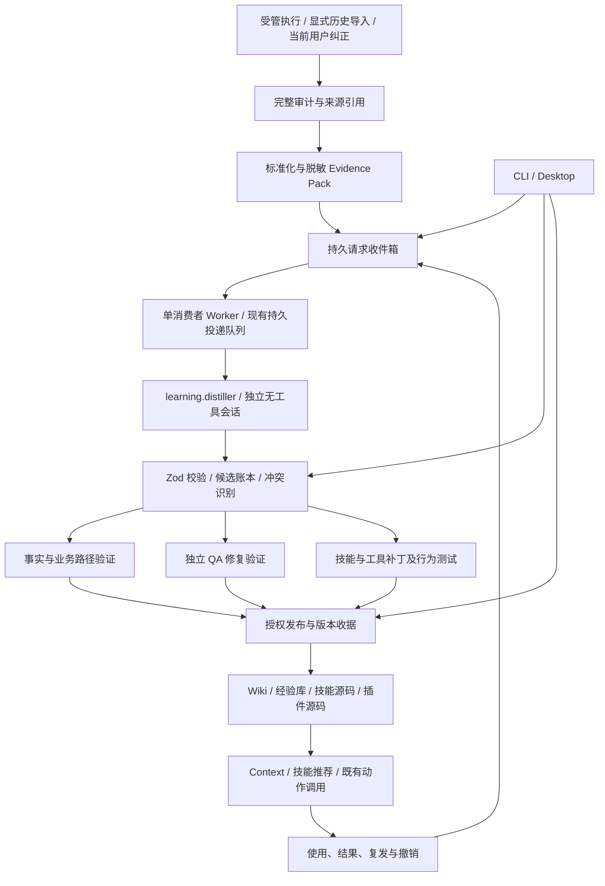
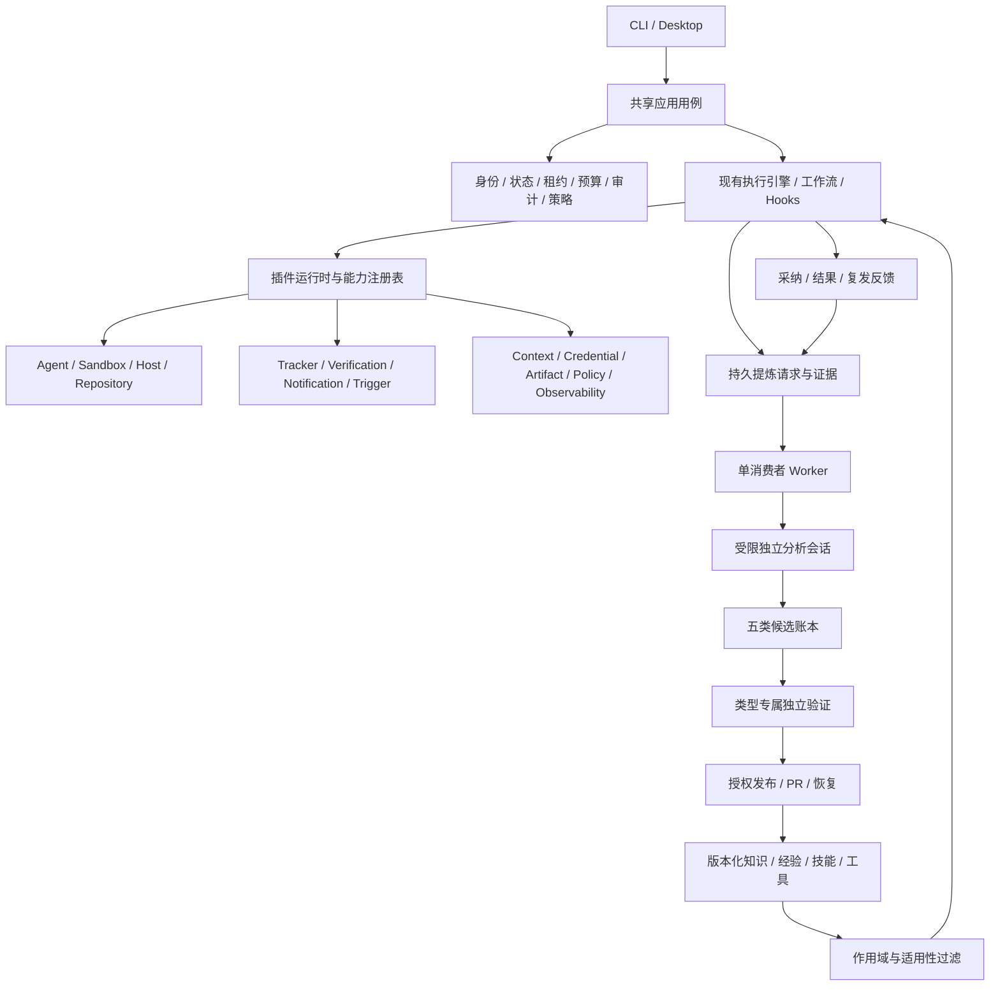
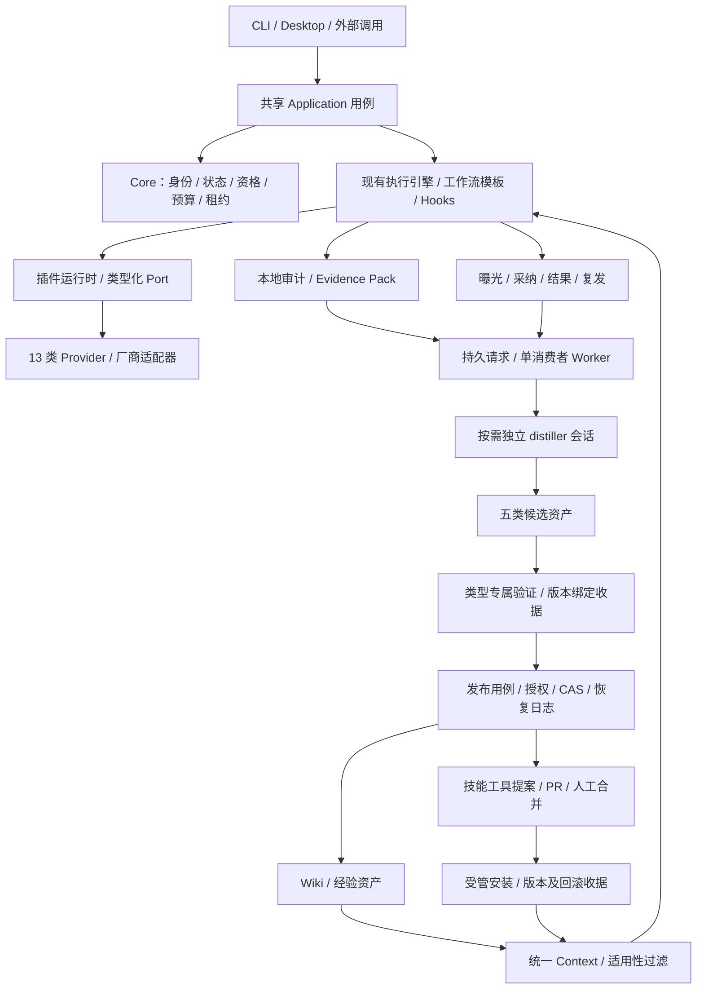
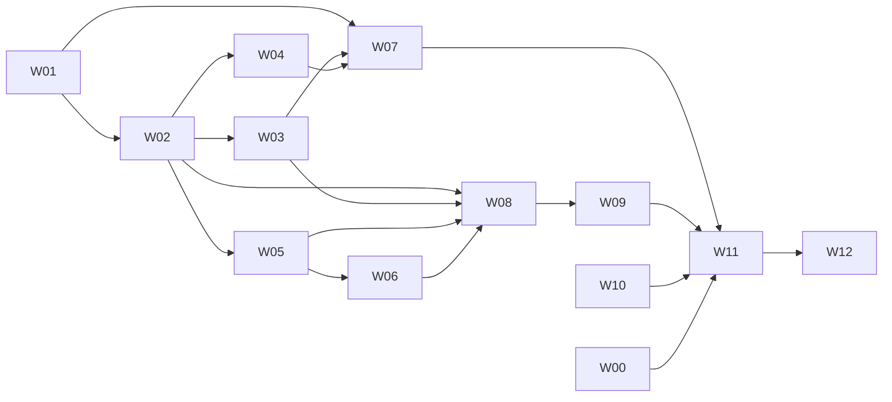
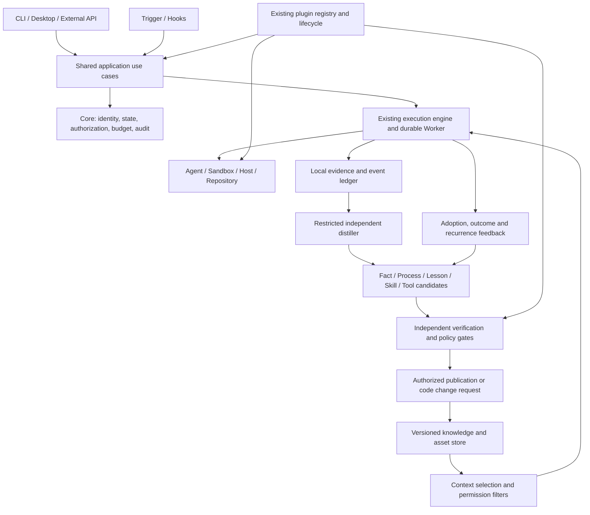
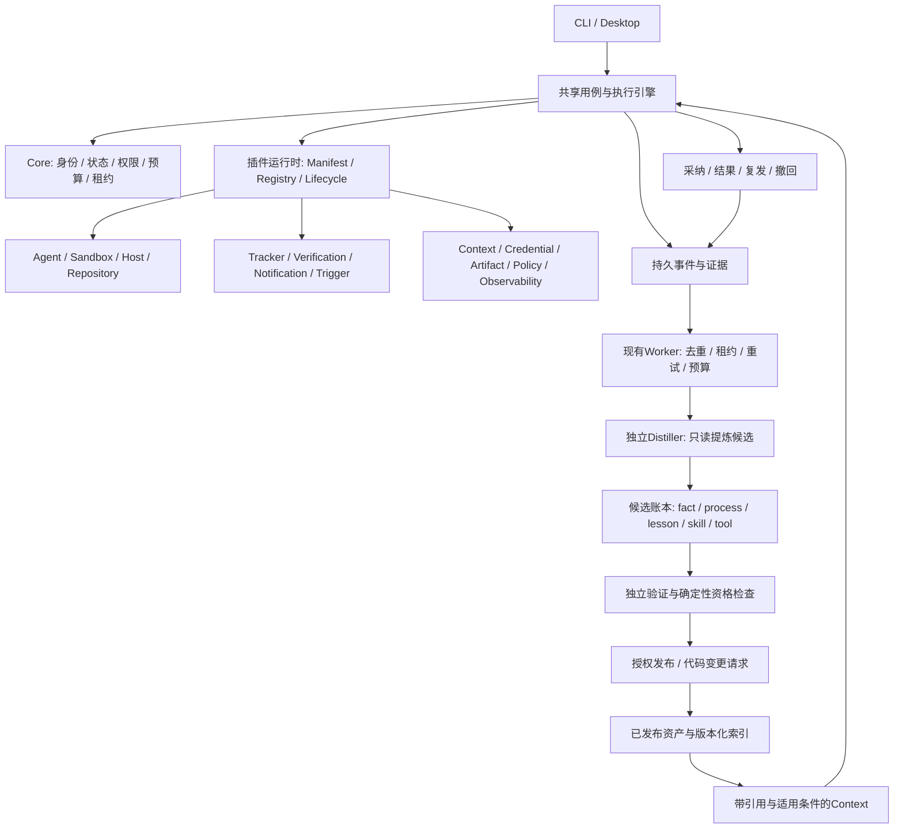
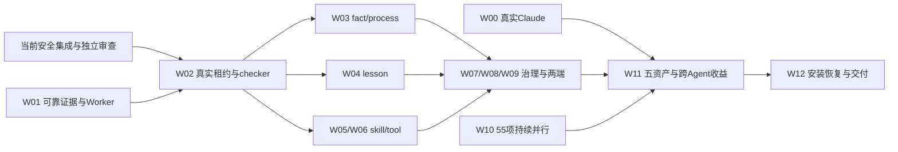

# 会话洞察与知识、技能、工具沉淀开发计划

**2026-11-20 旧版本对照核查。** 环境与修复场景的四份冻结账本均只登记了新版。流程场景中的三个版本对应同一候选，只有一次正式发布。三个场景的六个旧版本席位可重放 0/6，历史实验保留 12/18 次观察。下一轮在首个消费者运行前，分别冻结可独立召回的新旧发布和评分规则。

**2026-11-20 安装版复验。** CLI 0.2.168 在固定本地样本上通过事实、流程、修复经验和工具的 24 项召回检查。OpenCode 2.2.7 通过本地提示词适配器的 6 项技能检查。两个筛选命令分别另有 7 项和 3 项未运行。30 项结果计入本地召回回归。生产提炼和业务收益沿用各自的样本数。macOS arm64 安装包通过 10 项发行检查，并完成 0.2.166 → 0.2.168 离线升级、校验和拒绝、配置保留及回滚。

**2026-11-19 工具复用与新旧经验对照。** 在安装版 0.2.147 中，Claude 根据合成设计契约生成只读清单检查工具。Docker 独立验证通过九项检查，验证、显式安装和新 OpenCode 工作项使用同一源码摘要。消费者自行找到路由，正确指出六行中的三行错误，并保留输入原文。较早草案在验证环节被拒绝。独立前瞻实验完成四组配对、八次预注册 Claude 会话。新旧经验各答对三组。新版总计少用一条命令、少耗时 1.262 秒，多用 883 token。离线复算得到相同报告，原收益实验仍有 12/18 次观察。

本地 Claude 插件市场显式回滚后恢复了原技能内容。仅刷新目录就可能在显示安装版 1.0.0 时加载新版内容。一次更新被拒后，技能直到修复目录才恢复可用。AFK 的合并后安装链路及其是否受该宿主行为影响仍待验证。

**2026-11-19 安装版技能兼容与 macOS 钥匙串验收。** 安装后的 Hook 通过 22 项适用范围和路由检查。Claude Code 2.1.326 配合本地模型替身，对两个技能版本完成手动加载、资源选择、拒绝和恢复等 10 项检查。CLI 0.2.148 通过限定到临时钥匙串文件的命令取得合成凭据，HTTPS 消费者成功认证一次。删除条目后，新 CLI 在发送请求前报错。临时目录清理和个人钥匙串偏好核对均通过。[技能验收](../../../tests/qualification/w05/README.md) · [钥匙串验收](../../../tests/qualification/w10/system-keychain.md)

**2026-11-19 业务流程已走通真实开发、独立 QA 和跨任务复用。** 安装版 0.2.147 的工作项 #750 使用本地 Tracker 和裸 Git 仓库。Claude 实施和 QA 会话分别提交和核验两次 SQLite 状态转换。第三个 Claude 会话从两份原始记录提炼流程，独立校验器通过 13 项断言。显式发布到私有 Wiki 后，新 OpenCode 工作项 #52 给出正确步骤、终态、版本及出处。私有回执的 40 项校验和均通过。

配对收益运行已记录 **12/18**。环境、修复、业务流程各有两组“无经验 / 新经验”对照，六组均完成任务，走弯路从六次降至零次。环境类每次多用约 8,000 token，其中一次慢 9.512 秒。修复类每次少六步，流程类分别少两步和一步。流程测试由运行器交付插件返回的原文。六个旧版本对照仍缺独立验证并获准使用的早期资产。

**2026-11-19 冻结的 30 个跨 Agent 消费案例均已通过。** 安装版 0.2.143 的四个新 OpenCode 会话补齐经验场景。前置条件不符、环境不符、经验已撤回和经验缺失时，提供方均返回零片段，原生会话中的回答均为 `{"fix":null,"source":null}`。两个有效配置的正向对照均找到了预期经验。五类资产各六例，收益对照另行统计。macOS arm64 的 CLI 0.2.147 通过九项安装包仓库测试。打包的 Desktop 0.1.0 通过两项独立配置的发布、撤回和重启测试，使用预置事实、确定性校验器和本地 GitLab 替身。

**2026-11-19 跨 Agent 消费验收 26/30。** CLI 0.2.146 与 OpenCode 2.2.7 复验了技能案例 01 和 03 至 06。原生会话记录显示，正例恰好加载一次目标技能，四个不适用的场景均未暴露或加载该技能。案例 01 已计入此前统计。事实、流程、技能和工具各通过六例，经验通过两例。另有 8/18 个收益对照运行已记录。

**2026-11-19 安装版成功复盘与工具权限验证。** 在 macOS arm64 的 0.2.146 上，`experience review --kind success` 从空任务账本启动。OpenCode 实际办理了两步 SQLite 退件业务，测试程序生成 QA 审计事件。Claude 完成一次提炼，独立校验器从 SQLite 核对两次状态变更，CLI 生成第 2 版发布预览。显式发布后，新工作项中的 OpenCode 从临时 Wiki 取回两步流程并给出正确出处。原始开发任务和 QA 事件生产仍待联调。工具场景 03 至 06 分别覆盖生产环境不适用、读取权撤回、尚未安装和已卸载，四个会话均排除了工具路由。独立导出的四份会话摘要均与回执一致，四个授权对照均找到 2.0.2。真实消费累计 22/30，配对收益观察 8/18。

**2026-11-19 冻结场景真实消费 18/30。** 业务事实和业务流程各 6 项，技能、经验和工具各 2 项。0.2.141 的 `skill-02` 使用原问“有哪些技能能做袋单核对？”，OpenCode 从原生入口加载 `reconcile-bags`。0.2.143 的 `lesson-02` 重放覆盖 27 次安装版查询、两次 Claude 提炼、四个 QA 提交和八个 OpenCode 会话。工作项 #711 按发布的第 2 版经验将偏移从 5 mm 调整到 0 mm，QA 与待发布提交均为 `372c3900`。收益对照仍为 8/18。四个技能排除场景的守卫修复正在集成。0.2.146 静态扫描器实机拒绝含 TS2322 的提交、接受修正提交，插件矩阵为账号 4、服务 6、原生 8、本地 10、部分 2、夹具 25。复算见 `tools-146.QLOuxPbt/combined.IwkOfYKI` 的 `skill-02-replay.log`、`lesson-02-replay.log` 与 `static-scan.VauGpp/`。

**2026-11-19 工具复用与同包 QA。** macOS arm64 安装包 `0.2.146`（SHA-256 `2460cc632272ffe7b8f16ae17340513d4eb6648730997e137945b202aaade8c7`）通过 23 个命令入口和 9 个仓库 QA 用例。工具授权绑定项目、工作区、入口和依赖树，定向源码测试 340/340 通过。两个独立 OpenCode 工作项分别按原名和别名发现 `tool.scan-manifest@2.0.2`，经安装版 CLI 调用验证器。#47 的 3 行输入中第 2 行错误，#48 的 4 行输入中第 1、4 行错误。两次调用均返回预期退出码 1，答案与校验器一致，输入保持原值。安装版工具套件 7/7 通过，其中 2 项启动真实 Agent。冻结场景的真实消费累计 16/30，收益对照 8/18。工具由测试安装，Claude 提炼并交付同一工具的上游链路仍待验。记录见 `tools-146.QLOuxPbt/combined.IwkOfYKI`。

0.2.144 五包全量回归有 8,793 项通过、117 项跳过、2 项失败。隔离快照缺少 `Makefile`，且分支发布测试读取了测试进程所在目录的 Git 状态。0.2.146 测试快照补入构建文件，分支测试改在自建临时仓库验证先提交、后推送。两组定向复验分别通过 5/5 和 23/23。

**2026-11-19 受管仓库安装版 QA。** 0.2.145 首轮安装测试中，QA 把自己为当前任务创建的需求文件判为未提交的工作，9 项中 4 项失败。修复后，QA 在准备上下文前记录干净提交，启动 Agent 时仅允许本轮持有的未跟踪需求文件。执行后先核实文件身份和内容并释放，再检查整棵工作树。最终 macOS arm64 安装包 `e783ad05a3be` 通过 23 个命令启动检查；使用测试 Agent 的本地多仓、挂载远程工作区、批量校验、Hook 和回放共 9/9 通过。源码定向测试 301/301 通过。记录见 `release-145.W5eKUXXc/installed-owned.log` 和 `qa145.Griom10p/joint-owned.log`。

**2026-11-19 经验跨任务采纳及 QA 发布校验。** 冻结场景累计 14/30，收益配对 8/18。新增的 `lesson-01` 取自独立工作区安装版 #707。Claude 提炼的第 2 版经验被新 OpenCode 会话采纳，独立 QA 和本地 Git 远端核实同一提交 `519da0a0`。合成面单测试台的初始偏移为 +4 mm，两次复测均为 0 mm。该次没有收益对照组。当前组合 0.2.145 的 QA、分支和仓库四组回归 300/300 通过，测试和 Runtime 类型检查通过。新增回归用真实 Git 裸库验证：旧 QA 提交在发起推送前被拒绝，推送发生时工作分支移动，远端仍只收到已验证提交。记录见 `qa145.Griom10p/joint.log`。

**2026-11-19 CLI 0.2.142 全量回归。** 五个包共 8,793 项通过、113 项跳过，退出码为 0。Vitest 工作进程的行与语句覆盖率为 90.13%，分支为 88.22%，函数为 86.81%。桌面端和独立启动的子进程在统计范围外。报告见 `coverage-142.8Tn4fDFl/full.log`。

**2026-11-19 技能推荐与工作流验收。** 插件 1.2.5 支持通过 `recall-scope` 声明推荐范围，并保留对历史安装版本的支持。在独立目录安装锁定的 SDK 后，守卫测试 90/90 通过。CLI 0.2.144 安装版通过 10 项工作流测试，使用测试 Agent 和预置候选，覆盖开发与冲突修复进入验证、分析预算耗尽后阻断、成功与修复复盘准备发布，以及内置流程图读取。安装版日志见 `templates-144.4kVaEvRJ/installed.log`。真实跨 Agent 验收仍为 13/30。

**2026-11-19 跨 Agent 验收 13/30，收益观测 8/18。** 0.2.144 安装包中的工作流运行时启动真实 OpenCode。Agent 从原生技能入口加载已授权的 `reconcile-bags` 第 2 版，根据交接单和扫描清单报告漏扫 B-147、多扫 B-659。运行回执记录了安装来源、技能摘要和原生会话。该包的五组仓库与回放测试共 9/9 通过。第二库拒绝后，工作项退出码为 1，回放得到 `failed`，两库保留初始分支，MR 请求为零。回执见 `release-144.kyXvpqXt`。此前 0.2.142 的十套安装回归共 239/239 通过。0.2.143 的自更新修复在两个独立安装目录中验证通过，见 `updater-143.ORBqpLEr`。

**2026-11-19 安装版与真实复用。** macOS arm64 的 0.2.142 安装包通过校验并启动。隔离安装后，多仓库、挂载工作区及 Verification Hook 通过 6 项。双仓库同批前置校验另通过 2 项，第二库校验失败时服务端收到零次推送，成功时两库均在首次推送前完成校验。记录见 `release-142.saPyl47d`。打包的 Electron 在独立工作区通过学习 GUI 两项测试，首次创建的账本权限为 0600。工具分片中，受管 OpenCode 实际调用已安装校验器，检查三行数据并定位第二行错误，主线集成待验。经验分片中，产品为工作项 #704 选择已发布的第 2 版经验，OpenCode 将偏差从 4 mm 修至 0 mm。QA 检查时工作树有变更，受测提交与发布提交不同，显式采纳被拒。该场景的采纳和独立收益仍待验。

**2026-11-19 分版本验收。** 0.2.140 的隔离全量运行通过 8,785 项，跳过 105 项，输入文件摘要在运行前后相同。五包行与语句覆盖率为 90.11%，分支 88.28%，函数 86.76%。0.2.141 安装版在本地 Git HTTP 和共享目录上通过多仓库、挂载工作区及验证 Hook 共 6 项，使用测试 Agent。该次安装将发布包写入了个人 CLI 存储。0.2.142 工作树的候选库测试通过 112 项，安装器隔离回归所在套件通过 19 项。当前组合的完整构建、全量回归及发布 CI 待验。原始记录在 `coverage-140-isolated/full.log`、`remote-workspace-141/installed.log`、`candidate-locks-142-runtime.log` 和 `installer-isolation-142.log`。

**2026-11-19 安装版多仓库 Verification Hook 验收 2/2。** 在独立安装的 0.2.140 上，使用本地 Git HTTP 仓库与测试 Agent 运行 `issue-implementation`。通过时从观察事件解出 `after-agent`、`before-publish` 的实际命令和退出码，检查前后 Git 版本相同，两个仓库发布后停在人工合并门。失败时解出 `before-publish` 的退出码 1，两个远端均只保留初始 main，无推送或创建合并请求。记录见 `verification-hook-140-rerun.log`。

**2026-11-19 跨 Agent 验收 12/30，收益观测 8/18。** 事实和流程各通过 6 项。0.2.139 在两个独立环境中先发布真实提炼的退件流程，并验证原问能召回唯一来源。撤销来源读取授权后，新工作项 #56 的 OpenCode 返回四个空字段，Wiki 页和来源的摘要保持一致，发布账本仍为 committed。另一个环境通过 CLI 撤回流程，恢复原权威记录后，新工作项 #57 仍返回四个空字段。复核两份原生会话的 10 条和 9 条消息，均未出现撤下的来源或步骤状态变化。见 `process-recheck-05-139.J5KgTr` 和 `process-recheck-06-139.oBToaT`。

首次撤权实验中长时间持有的 SQLite 连接读取失败，退出后对原库执行只读 `quick_check` 返回 `ok`。已保留现场，跨进程文件锁仍在调查。首次撤回实验的 Agent 将空步骤写成空数组。补充四字段格式说明后，两项均从新环境重新发布并完成验证。经验、技能、工具各剩 6 项真实跨 Agent 验收。

**2026-11-19 跨 Agent 验收 10/30，收益观测 8/18。** 安装版 0.2.139 在两个独立配置中由真实 OpenCode 办理退件、Claude 提炼流程，再由新工作项的 OpenCode 查询已发布知识。自提工作项 #54 返回四个空字段，切换为非自提后原问能召回。跨项目工作项 `github:w11/parcel-archive#55` 同样返回四个空字段，原生会话中没有流程来源和状态变化。同一问句在原项目命中唯一发布来源。收据分别见 `process-pickup-139.373mZm` 与 `process-project-direct-139.wAqK9y`。

0.2.137 独立全量 8,775 项通过、99 项跳过、1 项失败。五包行与语句覆盖率 90.12%，函数 86.81%，分支 88.27%。失败的 CLI 接线用例在隔离仓库中检测到 GitLab，却预期 GitHub。显式覆盖两个平台后，该文件通过 3/3。0.2.140 多仓库运行已修复任务描述文件阻碍发布的问题。独立安装测试用两个 Git HTTP 仓库验证带描述的任务进入人工合并门，另一个用例验证无关脏文件被保留且阻止推送。两项安装测试及 255 项定向 Runtime 测试通过。两轮面单修复旧版本的预登记均为空，实验库仅能召回已测的新版本，旧版本收益仍待有授权的独立历史收据。

**2026-11-19 跨 Agent 验收 8/30，收益观测 8/18。** 0.2.138 两份真实 Wiki 流程都无法仅凭原问“逆向移交先查袋号还是先签收？”召回。其中一次工作流靠附加说明命中。0.2.139 在常规匹配为空时，允许两个不同流程步骤各贡献一个不同的连续中文双字作为匹配依据。安装版在独立配置中完成真实操作、Claude 提炼和验证发布。新工作项 #53 的 OpenCode 对原问给出两个正确步骤、出处和产品版次。去掉工作流说明后仍命中同一来源，自提及自提状态未知时均返回空。证据在 `process-alias-139.vmTFiE`。三组定向测试 198 项通过。

面单修复第二轮中，无经验组与使用经验组均达到 0 mm。使用经验后从 11 步降至 5 步，少耗时 30.006 秒，少用 38,126 tokens。运行器注入了已选中的经验，产品显式采纳记录为零。主工作树独立复算收据在 `benefit-repair-repeat2-135`。多仓库安装版 0.2.138 通过两个本地 Git HTTP 仓库检出、持有租约、发布及释放，21 个事件通过完整性检查，停在人工合并门。此例采用标题承载需求和测试用 Agent。带非空描述的任务另有 `.afk/backlog-context.md` 阻碍发布的问题待修复。回执在 `repository-managed-local-138`。

**2026-11-19 跨 Agent 验收 7/30，收益观测 6/18。** 安装版 0.2.138 在 `process-01` 上由受管 OpenCode 执行业务操作、Claude 提炼、独立检查器核对条件后发布到 Wiki。新工作项中的另一个 OpenCode 会话对原问返回两个步骤和正确出处、版本。自提或自提状态未知时，检索均返回空。0.2.137 曾将“收到退件”误作额外的机器前提，导致发布后无法召回。0.2.138 在验证和发布时核对来源中的三个完整条件集合。六组定向测试 431/431，三组安装版集成 30 项通过、6 项跳过。回执见 `process-routing-138.B3uYXi`。

首轮面单修复对照中，两组均达到 0 mm，使用经验后无效调节从两次降为零，操作数从 11 降到 5。实验运行器把安装版选出的经验传给 Claude，产品自动采纳仍待验收。离线复算见 `benefit-repair-135`。0.2.135 全量测试受共享构建变动影响，7 项失败。0.2.137 独立覆盖率和最终提交的发布资格另行跟踪。

**2026-11-19 收益观测 4/18，真实跨 Agent 验收 6/30。** 在第二轮环境实验中，两个独立 Claude 会话均返回正确记录。无经验组在 staging 和 production 中检索，使用经验组读取目录后只检索 staging，快 17.688 秒，多执行一步，多用 8,014 tokens，并有一次工具请求被拒。两轮的耗时变化方向相反。两轮均避免了误读，费用均有增加。第二轮原始轨迹离线重放及报告逐字节复算见 `benefit-repeat2-135`。

真实业务流程首次提炼出了与 SQLite 审计一致的两个步骤。候选引用了声明性会话消息，0.2.135 验证器以 `insufficient_evidence` 阻断发布。0.2.136 提示要求完整流程及每个步骤只引用完整、实际观察到的证据。两套定向测试 132 项通过，离线安装及启动通过。0.2.135 覆盖率运行中共享构建目录被重新生成，导致 HTTP 组出现模块加载失败。独立 0.2.136 安装版的 HTTP 组 27/27 通过。最终提交仍需独立全量覆盖率。

Repository 工作流和 QA 路由都要求提供方在整个任务期间持有租约，且 checkout 路径可本地执行。当前三个内置提供方中，只有 `multi-repository` 实现 `withLifecycleLease`。`remote-workspace` 与 `special-git-backend` 可调用快照和各自协议的生命周期操作，还需实现受管租约及可信执行位置。三个真实受管生命周期继续开放。

**2026-11-19 跨 Agent 验收 6/30，收益观测 2/18。** 安装版 0.2.135 在两个独立环境中由 Claude 各提炼一次事实。两份有效权威记录发生冲突（`fact-05`）或唯一权威记录到期（`fact-06`）后，OpenCode 在独立工作项 #47、#48 均返回三个空字段，实际召回零条，原生会话中均无该规则及来源。恢复权威数据后，同一查询命中原发布。事实类累计两次采纳、四次正确排除。

环境收益首次同条件配对中，两个真实 Claude 会话均正确返回 staging 记录。无经验组还读取了 production，有经验组先读目录后只查询 staging。后者多执行一步、多耗时 9.512 秒、多使用 8,391 tokens，估算费用增加 0.01907 美元。经验片段经安装版召回后由实验运行器注入。旧版本组及后续重复实验仍待测量。主工作树已用归档原始轨迹离线重放，并使用当前报告脚本逐字节复算报告。最新结果在 `.codex/validation/request-lifecycle-20261118/fact-01-worker/` 的 `managed-opencode-135/fact-05`、`managed-opencode-135/fact-06` 和 `benefit-pair-135`。

**2026-11-19 跨 Agent 验收 4/30，收益实验观测 1/18。** 安装版 0.2.135 的 `fact-02` 使用同义问句，真实 OpenCode 在工作项 #45 引用正确规则、完整来源和产品版本。`fact-03` 在另一个项目的工作项 #46 返回空答复，原生会话未出现该规则的来源，切换回原项目的查询找到了它。首次跨项目试验中，Agent 在指定文件缺失后搜索其他位置，120 秒到期。第二次试验明确了资料读取的结束条件。四个场景含两次正确采纳和两次正确排除。收益实验首条观测使用真实 Claude 和隔离日志快照。无经验组查询 staging 时也读取了 production 结果，耗时 23.031 秒，执行两次工具动作。配对效果待测。

同版工作区 Runtime 全量 7,341 项通过、52 项跳过，CLI 925 项通过、2 项跳过。Repository 的 Workflow 与 QA 路由已接入，替身提供器回归 53 项通过。安装版另通过 15 项本地 Git、后端命令及回环 HTTP 检查。三个内置 Repository 提供器在实际受管工作项中的完整生命周期仍须验收。运行回执位于 `.codex/validation/request-lifecycle-20261118/fact-01-worker/` 的 `managed-opencode-135/`、`benefit-baseline-135/`、`full-runtime-135-preview-rerun.log` 和 `repository-installed-135.log`。

**2026-11-19 安装版跨 Agent 验收 2/30。** 在 0.2.135 上，同一条冻结问句交给两个独立工作项中的真实 OpenCode 会话。`fact-01` 在产品版本 2.0 下引用了已发布的人工改址规则。`fact-04` 在版本 1.0 下返回三个空字段。知识提供器返回零条来源，导出的 13 条会话消息中也没有该规则或其来源标识。在同一副本中改用 2.0 查询后找到了原始来源。两项分别计为一次正向采纳和一次正确排除。回执在 `.codex/validation/request-lifecycle-20261118/fact-01-worker/managed-opencode-135/`。

**2026-11-18 跨任务采纳 1/30，收益对照 0/18。** 安装版 0.2.134 的真实 OpenCode 在新工作项 `github:w11/parcel#43` 中回答了冻结的封签后改址问题。独立产物中的人工处理规则、完整 Wiki 来源和产品版本 2.0 均与真实 Claude 提炼并发布的第 2 版事实相符。运行记录、发布收据和答复保存在 `.codex/validation/request-lifecycle-20261118/fact-01-worker/managed-opencode-134/`。同版五类本地固定召回通过 30/30。

**0.2.135 流程完整性。** 独立来源要求在发布后归档回执。遗漏归档的旧候选曾因终态相同而通过。校验和发布现在同时要求独立观察到的完整步骤数。相关 Runtime 回归通过 489 项，安装版校验与召回通过 19 项、跳过 4 项。安装版模板检查通过 10 项，实际覆盖本地 Git 提交、冲突解决和成功复盘预览，代理与工单平台使用本地替身。日志位于同一证据目录中的 `process-completeness-green.log`、`process-installed-135.log` 和 `workflow-templates-135.log`。

**2026-11-18 安装版 0.2.134。** 在隔离的包裹改址样例中，SQLite 操作回执记录了实际生效的策略标识、规则原文和改址结果。真实 Claude 一次调用提炼出事实，独立配置的检查器逐值验证，CLI 发布到测试 Wiki，`context.knowledge` 用冻结的中文业务问句召回 `seal-cutoff` 第 2 版。0.2.133 在同类回执上把规则翻译成英文，校验失败。提炼提示现要求保留操作回执中的原始标识和规则，标题、说明可用自然语言。纯观察记录产生的自由表述仍待独立语义验证。见 `.codex/validation/request-lifecycle-20261118/fact-01-worker/policy-receipt-134.log`。

**2026-11-18 安装版验证。** 同一份 0.2.132 安装版 CLI 与 Runtime 通过十套 237 项回归，五类固定召回题通过 30/30，真实 Claude 在合成审批材料上产生一个候选，重放增加零次调用。收据见 `.codex/validation/request-lifecycle-20261118/installed-132-live/` 中的 `matched-ten-suites.log`、`five-assets-rerun.log` 和 `TEST-REPORT.md`。

包裹改址案例在 0.2.132 上因流程候选缺少证据缺口被拒绝。0.2.133 的提示和校验共用同一缺口判定，安装包启动检查通过 23 项。一次真实 Claude 调用产生事实、流程各一个候选。事实记录概括了 QA 执行成功，缺少封签后的人工处理规则和发布目标。独立验证返回 `unauthorized`，Wiki 发布和第二 Agent 采纳仍待验收。见 `.codex/validation/request-lifecycle-20261118/fact-01-worker/live-133.log`。跨任务采纳为 0/30，收益对照为 0/18。

同一 0.2.133 安装包读取带有业务字段名的 SQLite 操作结果后，一次调用提炼出一条事实，准确区分封签前直接改址、封签后保留原址并转人工审核，且给出 `wiki:seal-cutoff` 和一个证据引用。候选用英文描述主题和规则，独立检查器按权威数据中的主题标识和中文规则逐值校验，返回 `assertion_failed`。此次未发布。收据见同目录 `live-133-business-observation.log`。

**2026-11-18 工作区 0.2.132。** 真实 Claude 在虚构的发布审批材料上返回 Markdown 围栏，先前运行以 `MISSING_RESULT` 结束，当时退出码为 0、会话匹配、工具调用数为 0。受限分析现能读取单个完整围栏内的 JSON。重建 Runtime 后，同一 E2E 一次模型调用得到 1 个候选，重放新增调用为 0，来源失效后候选进入冲突状态。定向回归 138 项通过、1 项跳过。运行记录在 `.codex/validation/request-lifecycle-20261118/recall-131/live-fence-fix.json`。跨任务独立采纳仍为 0/30。

**2026-11-18 安装版 0.2.131。** 仓库外安装的 CLI 和 Runtime 通过十个文件的全部 237 项 CLI E2E 测试。五类资产的 30 个冻结本地召回用例全部通过（共 33 项检查通过，跳过两个重复用例）。安装版 Runtime 的回调脱敏检查通过。受限 Worker 使用生成的示例证据调用真实 Claude 一次，结果为 `analysis_failed`，用量未知，候选数为零。真实第二个 Agent 采纳仍为 0/30，收益对照仍为 0/18。见 `.codex/validation/request-lifecycle-20261118/recall-131/`。

**2026-11-18 安装版 0.2.130 remote-container 本机回环。** 服务对未认证的健康检查返回 HTTP 401，对未列入允许名单的 Provider 返回 403。获准的探针在 Alpine 3.20.10 Docker 容器内以退出码 0 完成，写入绑定挂载目录的主机名与容器一致，关闭沙箱后容器已移除。见 `.codex/validation/remote-container-installed-20261118/attempt-zzvkne/events.ndjson`。

**2026-11-18 桌面实机验收。** 本地构建 macOS arm64 的 `AFK Control.app`，在独立用户目录运行。两项 Playwright 用例确认 Electron 以打包模式从 `app.asar` 加载页面。通过设置页验证、发布 Wiki 知识后，共享上下文可召回该条目。来源失效后条目撤回，重启应用后仍无法召回。项目清单来自回环 GitLab 测试服务，候选和校验结果使用固定输入。另有 18 项源码桌面 GUI 测试通过，覆盖并发纠正去重、独立校验缺失或冲突时阻断、经验验证与撤销、工作流图编辑与持久化。构建、归档摘要和两组运行日志见 `.codex/validation/request-lifecycle-20261118/desktop-packaged-130/`。三条工作流的完整任务执行仍待验收。

**2026-11-18 联合验收更新。** 同一次运行观察到全部 30 个固定本地场景，事实、业务流程、修复经验、技能和工具各 6/6。CLI 与 Runtime 使用仓库外的 0.2.130 安装版，工具发现使用独立归档，技能使用本机 OpenCode 新会话和已安装适配器。三个附加断言通过，两个重复的工作树用例跳过。真实会话经独立 QA 发布、再由第二 Agent 采纳的验收仍为 0/30，收益对照为 0/18。记录见 `.codex/validation/request-lifecycle-20261118/recall-130/five-assets-combined-installed.log`。

同一 CLI 安装版的 Docker Provider 在 `alpine:3.20` 中执行任务，验证绑定挂载并回收自有容器。本地 OpenTelemetry Collector 0.165.0 收到指定 span 及值为 1 的计数。记录见同目录的 `installed-docker.log` 和 `installed-otel-collector.log`。

本轮全量覆盖率命令退出 0，8,755 项通过、75 项跳过。统计范围内行覆盖率为 90.12%，分支为 88.25%，Application 分支为 92.47%，策略违规为零。运行前后清单发现变动，最终提交仍需单独复验。报告与输入对比归档在 `.codex/validation/request-lifecycle-20261118/frozen-130-rerun/` 的 `completed-report.md`、`before.sha256` 和 `after.sha256`。

**2026-11-18 五类资产联合复验。** 30 个固定召回场景中，本地观察通过 28 个。事实、流程、经验、工具各通过 6 个，技能通过 4 个。工具由仓库外安装的 CLI 安装和调用，发现插件从工作区安装。技能使用本机 OpenCode 新会话和工作区适配器，项目隔离与版本筛选两项待验。测试总计 30 项通过（含两项判分自检）、2 项重复用例跳过、2 项待办。真实跨 Agent 观察 0/30。见 `.codex/validation/request-lifecycle-20261118/recall-130/five-assets-local.log`。

**2026-11-18 安装版与桌面回归。** 仓库外安装的 0.2.130 CLI 和 Runtime 通过全部 10 个 CLI 端到端测试文件，共 237 项。远端服务使用本地测试端点。桌面学习与经验的契约、IPC、服务及界面组件通过 8 个文件的 264 项测试。上轮全量运行有 8,752 项通过、3 项失败、75 项跳过，application 分支覆盖率为 295/319（92.47%），高于 92.06% 门槛。三项失败涉及权威来源读权限及经验别名收据，当前源码上两个相关套件单独复测 75/75。原始结果分别见 `.codex/validation/request-lifecycle-20261118/recall-130/installed-ten-suites.log`、`recall-130/current-runtime.log` 及同一验证目录下的 `frozen-130-rerun/`。

**2026-11-18 安装版 0.2.130。** 事实、业务流程、修复经验各 6 个固定场景和两项判分自检通过，共 20 项。另有两个仅供工作树运行的重复用例跳过。已发布事实遇到有效来源冲突或到期时停止召回，恢复来源后命中同一发布。经验通过独立检查器观察到的症状别名命中改写问句。23 个命令入口通过安装检查。安装包 SHA-256 为 `849509a62ccc4f050bda7173892559adb7adda211a8660f08adfed8bad0a6540`，日志见 `.codex/validation/request-lifecycle-20261118/recall-130/installed-w11.log`。输入为本地构造的资产，真实第二 Agent 验收仍为 0/30。

**2026-11-18 安装版插件与工作流。** 使用仓库外同一份 0.2.129 CLI 和 Runtime 跑完 CLI E2E 的 10 个测试文件，插件矩阵、学习路由和可观测性 226 项通过，工作流、本地插件和经验生命周期另有 11 项通过。外部端点采用受控夹具。日志在 `.codex/validation/request-lifecycle-20261118/source-access-129/` 的 `integrated-plugins.log` 和 `cli-workflow-lifecycle.log`。macOS PID 身份测试在初次取样时使用系统 ps，在模拟身份变化后核对二次取样的 PID，独立运行连续通过 12 次。守卫与运行器组合为 50 项通过、1 项按环境跳过。收益报告从观测记录读取原生会话 ID，拒绝同一会话重复入组，身份未知时保留原始指标，配对收益留空。报告回归 7/7。

**2026-11-18 同一安装包的三类资产召回。** 仓库外的 0.2.129 安装同时通过 15 个固定场景（4 条事实、6 条流程、5 条修复经验）和 2 项判分自检。经验包含具名产品版次命中、适用条件排除、撤回以及空配置。经验同义改写 `lesson-02` 仍标为待办。记录见 `.codex/validation/request-lifecycle-20261118/source-access-129/combined-w11.log`。这些场景使用本地构造的已发布资产。真实第二 Agent 验收为 0/30。

**2026-11-18 来源读取权限撤销。** 在仓库外安装的 0.2.129 上，`process-05` 先命中已发布流程。只撤销来源读取权限后，两个新的 CLI 进程执行相同查询均返回空。测试核对了来源和 Wiki 页面的原始字节、发布键、候选 ID、证据摘要及已提交状态。事实与流程 10 条固定场景和 2 项判分自检全部通过。安装包 SHA-256 为 `754e2514e414ad2e537d8f9e986a3cff157e37ca7dd818a815567a7279e21ff7`，日志在 `.codex/validation/request-lifecycle-20261118/source-access-129/installed.log`。

**2026-11-18 全量覆盖率报告。** 8 GiB 重跑产出了五个包的报告，行和语句 90.06%、函数 86.77%、分支 88.20%。应用包分支覆盖率为 292/318（91.82%），门槛为 92.06%。测试有 8,743 项通过、1 项失败、64 项跳过、1 项待办。失败项是 macOS 进程身份测试，隔离执行先复现失败，添加守卫退出诊断后通过一次，稳定性仍待确认。已为执行历史补充独立 QA 失败摘要、原因和错误码的回归，应用包单独运行 80/80。全量报告快照见 `.codex/validation/request-lifecycle-20261118/full-coverage-rerun-report.md`。

**2026-11-18 中文业务别名召回。** 安装版 0.2.127 在 `fact-02` 返回空结果，分词器把规则中的“截单点”拆成三个单字。0.2.128 在知识检索时同时匹配完整中文标题和正文声明的括号别名。仓库外安装后，完整问句及单独的“截单点”均命中同一发布版本，“截点”返回空。事实和流程共九条固定场景通过，连同判分自检为 11 项通过、1 项待办。来源读取权限的独立撤销由 `process-05` 跟踪。日志见 `.codex/validation/request-lifecycle-20261118/alias-128/installed.log`。经验资产另外在 0.2.127 验证了全新配置的空结果，同时复现已发布经验在指定产品版本时无法召回。真实第二个 Agent 的观测仍为 0/30。

**2026-11-18 覆盖率与收益验收。** 全量首轮为 8719 项通过、23 项失败、55 项跳过。三个失败文件的夹具分别需要读取新版提示结构、提供能解析 HEAD 的本地 Git 工作树、提供存在的验证目录。修复后三个文件合计 59/59，测试类型检查通过。首轮 V8 在约 4 GiB 堆上限处耗尽内存，未产出覆盖率；已用 8 GiB 堆按原基线重跑。日志位于 `.codex/validation/request-lifecycle-20261118/`。

安装版 CLI 在临时 Wiki 通过 7 条冻结用例。事实覆盖正确版次命中和错误版本排除。流程覆盖原名和别名命中、自提及跨项目排除、撤回后重启并保持排除。连同判分器自检为 9 项通过，单独撤销来源读取授权的 `process-05` 待验证。用 `node scripts/learning-benefit-report.mjs --help` 查看三场景、两轮、三种资产条件的采集协议。业务成功率读取冻结验收项的判定和证据，缺少验收时保留未知。运行终态单独记录。报告测试 6/6，18 次真实对照待采集。

**2026-11-18 安装版插件矩阵与召回评估。** 0.2.127 同一安装包的 CLI 和 Runtime 通过本地插件 101 项、回环 HTTP 27 项、执行组合 71 项，共 199 项。执行组合覆盖 6 个 Agent × 4 个 Sandbox 和 4 个 Host × 4 个 Trigger，使用受控测试端点。日志位于 `.codex/validation/request-lifecycle-20261118/installed-matrix.log`。`tests/e2e/w11/recall-v1.ts` 固定了五类资产各 6 项的输入、适用条件和预期版本，合计 10 条命中、20 条排除。真实第二个 Agent 的观测和 18 次收益对照仍待采集。

**2026-11-18 学习运行时回归。** 15 项身份独立性用例现在按账本顺序建立分析尝试、原子保存输出和结束尝试，再模拟身份延迟登记。沙箱预算用例保留向下取整和输出上限断言，将测试预算调为能容纳实际 SQLite 所有权登记的值。13 个文件共 966 项通过、1 项按环境跳过。跳过的用例另外使用本地 Docker 和固定摘要的 Node 镜像运行通过，核对两次执行、清理和业务验证不足时的候选状态。测试类型检查通过。最终 0.2.127 安装包校验和匹配，安装版 CLI 回归 28/28。源码日志位于 `.codex/validation/request-lifecycle-20261118/`，安装版日志位于 `.codex/validation/installed-learning-0.2.127.pGLFro/ipv4-projection/installed-regression.log`。跨 Agent 真实采纳及收益对照仍待验收。

**W09 打包版知识发布与撤回（2026-11-18，CLI 0.2.127）。** macOS arm64 开发包与源码外安装的 CLI 通过域名、IPv4 两个项目用例。正式设置页完成事实候选验证、预览、写入临时 Wiki 和召回。来源失效后页面带撤回标记，重启并重放旧发布请求后仍然撤回，召回为空。IPv4 项目使用绑定项目摘要的公开标识，生成页面没有原始 IP。输入使用回环 GitLab 夹具、合成候选、测试验证器和隔离的测试钥匙串。打包版日志位于 `.codex/validation/installed-learning-0.2.127.pGLFro/ipv4-projection/desktop.log`。上一级目录的 `final.log` 与 `prepare-diagnosis.log` 记录了同版本早期构建的隐私拦截及诊断。

**W09 安装版发布诊断（2026-11-18，CLI 0.2.126）。** macOS arm64 开发包使用隔离的 Chromium 测试钥匙串和回环 GitLab 夹具，经正式设置页加载两个项目、拒绝错误范围及版本、验证候选并将 v1 升至 v2。点击准备知识预览失败。安装版 CLI 用同一项目独立复现 `knowledge_publication_source_unavailable`，发布账本为空。证据脱敏改写了工作项标识中的 IPv4，来源校验逐字比较时拒绝请求。不含 IP 的项目对照成功。修复验收须同时覆盖合法项目、两个脱敏后同形的不同项目，以及打包版的实际发布与撤回。桌面失败记录见 `.codex/validation/installed-learning-0.2.126.UJkt32/desktop-preview-diagnosis.log`。

**W09 桌面包（2026-11-18）。** macOS arm64 本地开发包 0.1.0 已排除 Electron E2E 测试入口。正式入口、preload、worker 和 renderer 均通过包内容检查。用隔离用户目录启动该包，可打开经验管理及学习治理设置，无项目范围时查询按钮禁用，IPC 拒绝查询不存在的项目。打包版候选发布及撤回、签名分发仍待验收。证据见 `.codex/validation/installed-learning-0.2.126.UJkt32/desktop-content.log` 和同目录 `desktop-settings-isolated.log`。

**W07/W08/W10 安装版回归（2026-11-18）。** 对同一 0.2.126 安装运行另外三个 E2E 文件，学习模板路由 16/16、候选验证 7/7、可观测性 2/2 通过。CLI 在隔离工作目录中运行。候选验证用源码夹具准备 SQLite 数据，以临时 Wiki 和独立审批文件检查流程与经验的发布、召回、撤回。可观测性从安装目录加载 Runtime，在回环 HTTP 服务上检查 Trace、Metrics、503 和重新启用，并检查所选证据存储回读失败后仍可读取本地证据。真实本地 Collector 的单独验收使用 0.2.118。逐项日志见 `.codex/validation/installed-learning-0.2.126.UJkt32/installed-observe-routing-validation.log`。

**W08/W12 安装与经验数据兼容（2026-11-18）。** 正式离线 darwin/arm64 安装包 0.2.126 在仓库外独立安装，CLI 与 Runtime 均从该安装加载，学习 E2E 3/3 通过，模型与独立审计使用夹具。同一隔离 HOME 中，0.2.71 创建第一条合成经验候选，升级到 0.2.126 后完整读取并创建第二条，回退到 0.2.71、再次升级到 0.2.126 后，两条完整 JSON 记录均与回退前一致。每次切换均检查 CLI 版本。证据位于 `.codex/validation/installed-learning-0.2.126.UJkt32/`。其他数据类型、跨 schema 迁移与故障恢复仍待验收。

**W10 清单复核（2026-11-18）**。独立只读核对了 11 月 13 日的 `provider-matrix.json` 和工作树的 `configuredPluginManifests()`。矩阵 SHA-256 为 `19f3401ce59ff0f3739ddca34d35a53b62450cc5865b223575fe93015564de83`。13 类共有 55 个唯一验收行，范围内的 51 个配置 ID 与源码逐名相符，目录另列 `learning.distiller`。Trace 和 Metrics 使用同一配置 ID。11 月 13 日的快照记录 52 行已接线、3 行 Repository 部分接线。当前源码下的实际配置、安装和真实调用仍需逐行绑定运行记录。

**W04 首次采纳绑定已选版本（本地 CLI 0.2.126）**。两个 SQLite 连接复现了同一任务选中旧版本、经验重新验证后首次采纳被误计入新版本。首次采纳现在在写事务内核对该经验、运行和工作项已有的选择记录。仅检索新版或其他工作项选中新版时拒绝计数。该任务选中新版后可确认一次，重放返回原收据。经验存储、结果及召回评测共 145 项通过。编译后学习 E2E 26 项通过，含真实 CLI 进程对合成审计数据的拒绝路径。CLI 与依赖构建、测试类型、架构和文档检查通过。真实模型跨任务采纳及收益仍待验收。

**W05/W06 提案前目录检索（本地 CLI 0.2.125）：** 技能和工具复用已有词项匹配。通过真实提案入口复现且修复两个反例：无空格中文请求能找到已有审批技能；`port` 不再因 `report` 而被误判为已有工具。两例先失败后通过，提案测试文件 88/88 通过，CLI 及依赖构建通过。仅验证提案准备，不涵盖安装、真实模型、跨任务采纳或远端 CI。

**W00/W01 身份变化后不重试（本地 CLI 0.2.124）：** 修复前，Worker 将启动文件变化记为通用失败，重启后请求恢复待处理；CLI 查询还会丢弃该错误码。现在失败尝试与请求阻断在同一 SQLite 事务写入，已失效的来源仍优先保留。重启后同一请求没有第二次分析或预算预留，`experience jobs --json` 可见确切原因。Worker/账本 154 项、CLI 命令 434 项、编译后学习 E2E 26 项通过。未调用真实模型，不构成可信父进程授权或真实经验复用验收。

**W00 启动前文件复核（本地 CLI 0.2.123）：** 受限分析选择可执行文件时记录文件身份和变更时间，在启动 `--help` 和分析前分别复核。不一致或无法复核时返回 `analysis_executable_changed`，不启动下一阶段。两个模拟启动器回归中，修复前分别调用 1、2 次，修复后分别为 0、1 次；未执行改写后的文件。相关 Runtime 定向 17 项及编译后 CLI 学习 E2E 26 项通过。该检查不把签名发行物原子绑定到实际启动，仍需可信父进程消费单次授权并独立记录结束状态。未调用真实模型。

**W03/W04 知识召回（本地 CLI 0.2.122）：** 临时 Wiki 同时发布审批和计费两页；只允许一条结果时，旧提供器对中文计费查询、无关查询等五个断言失败。现在先按任务与候选业务字段的共有词数量排序，不匹配则返回空；读取时仍检查授权、来源、版本和适用条件，再应用 8000 字节及数量限制。工作流和 QA 入口均验证：任务涉及审批时附加审批页，仅处理 SQLite 重试时不附加。经验检索原有 24 个正例全命中、18 个负例无误报；编译后 CLI 学习 E2E 26/26。本次只用临时数据和本地进程；不是语义检索、真实 Claude 提炼、跨 Agent 采纳或收益验证。首次并发 pnpm 自动安装争用失败，改用现有依赖、关闭运行前自动安装的离线构建通过。

**W00 受限守卫的 Node 环境（本地 CLI 0.2.121）：** 首次 `--help` 探针和分析子进程启动共用一个守卫。现在在创建守卫 Node 进程之前，从传入的环境副本移除 `NODE_OPTIONS` 和 `NODE_PATH`，不修改父环境或普通 Agent 的启动方式。macOS 回归以无模型 Node 子进程分别验证隐式继承和显式传入环境，修复前两例失败，修复后通过，并保留无关变量 `LANG`。Runtime 定向 148 通过、1 跳过，编译后 CLI 学习 E2E 26/26；CLI 与依赖构建、测试类型及架构检查通过。这不是整个环境的可信证明，也不把签名清单绑定到实际启动；可信父进程的一次授权和独立关闭记录仍待接入。未启动真实模型、未提交。

**W00 本机 Claude 发行身份（2026-11-18）：** 按 Anthropic 安装文档的发行签名指纹 `31DDDE24DDFAB679F42D7BD2BAA929FF1A7ECACE`，在隔离钥匙环验证 `2.1.326/manifest.json.sig`。`gpgv` 对原清单返回 0，对改动平台大小的清单返回 1（BADSIG）。清单 SHA-256 为 `883e153b05d4a34e4225cdc90d692e4415ed4e46b26434b6430f128b6b8beb1e`。签名清单中 `darwin-arm64` 原生文件的长度 353037664、SHA-256 `e214ad76dcc0e846b03be28ed1c2734aacd4e27acb527cb7f8a9e2bed644e837`，两者均与本机 npm 安装的 `claude` 一致，macOS 严格签名校验也通过。公钥、原清单及签名保存在 `.codex/validation/claude-2.1.326-darwin-arm64-release/`。仅证明核对时二进制字节与签名发行物一致，不证明整个 npm 包或未来启动；未调用模型、未消费许可。下一步由可信父进程将此预期绑定到实际启动及结果关闭记录。

**W00/W01 Worker 单次启动认领（2026-11-18，本地 CLI 0.2.120）：** 在首次探针前，Worker 用一笔 SQLite 写事务核对预留尝试的宿主、PID、非终态、来源阻断及处理收据，并首次绑定会话身份。重复启动认领进入 `analysis_outcome_unknown`，重启不再自动尝试；结果身份回读仍幂等。惰性分析器复现了相同登记两次均放行、来源失效后仍放行，修复后分别只放行一次和零次，已预留预算不退。独立 Node 进程不能认领另一进程的预留；在登记前已由其他调用完成的请求保留原候选和收据。三组 Runtime 测试 188 通过、1 跳过；构建、测试类型、架构及编译后 CLI 学习 E2E 26/26 通过。该认领属于本地账本，不是可信父进程授权，不提供安装身份或独立关闭证明；未调用真实模型，未提交。

**W00 会话身份登记提前（2026-11-18，本地 CLI 0.2.119）：** Worker 的身份登记现位于可执行路径解析之后、第一次 `--help` 子进程启动之前。原实现中，登记抛错和登记中取消都已启动一次探针；两个不调用模型的回归先失败后通过。异步登记超时后，即使确认迟到也不启动子进程。三组 Runtime 测试 184 通过、1 跳过；CLI 及依赖构建、测试类型检查、编译后 CLI 学习 E2E 26/26 通过。身份登记不是启动授权；显式复盘未新增许可要求。尚缺可信父进程对当前安装的独立核验、原子消费一次许可和完整关闭收据。未运行真实模型，未提交。

**W10 真实本地 OTLP Collector（2026-11-18，darwin/arm64）：** 在仓库外隔离安装 CLI 0.2.118（归档 SHA-256 见下），从该安装加载 CLI 与 Runtime。官方 Collector 0.164.0 归档经 SHA-256 `8d8acf4ffce7fe1af35932d573d877d6a5ef395c29a18fda760711b800757e7d` 校验，仅在回环启动，使用 OTLP/HTTP 和详细 debug 导出。通过已安装的 `plugin configure` 选择 `observability.otlp`，复用 `tests/e2e/observability.test.ts` 的受管执行驱动。退出 0；Collector 为同一服务 `installed-afk-collector-14750` 解码了 `github:acme/api#42` 的 span、`afk.run_events_total` Sum 和 `run.event_persistence_ms` Histogram。本地 JSONL 链校验通过（run `collector-smoke-14750`，序号 4，终态 `not_claimed`）；Collector 正常关闭。测试使用合成工作项和 Tracker/claim 夹具，没有启动 Agent；仅证明安装版到真实本地 Collector 的 trace/metrics 正向链路，不覆盖远端后端、远端 Evidence 或真实 Agent。

**W10 Evidence 安装版验收（2026-11-18，本地 CLI 0.2.118）：** 用正式打包脚本生成 darwin/arm64 归档，SHA-256 为 `44c81cf3d170768195d50a1842b7c88d0a7cbac66aa3b473e12c11eff16d1b09`。在仓库外临时 HOME 安装并校验；可观测性 E2E 2/2 通过，CLI 与 Runtime 均来自同一安装。通过 CLI 安装测试 Provider 后，默认未选择、项目不匹配均无 `put/get`；只向选中的 Provider 导出。回读字节不符时，失败回执绑定源事件，独立进程仍可读取正确的本地加密证据，事件链完整，原运行终态不变。测试类型通过。使用本地 Provider 夹具和回环 HTTP，不授远端 Evidence 服务、真实 OTLP collector 或远端 CI 资格。未修改生产代码或提交。

**W01 双端纠正提交（2026-11-18，本地 CLI 0.2.118）：** 编译后 CLI 的 `experience correct` 与真实 Electron Settings 点击并发发起同一纠正；两端返回相同请求 ID，同一 SQLite 账本只新增一条待处理请求，提交和重放不分析、不修改原候选。实际 Worker 在独立 Node 进程中使用确定性分析器，连续两次定向运行只记录一次成功分析、一个预算名额和一条处理收据；Desktop 回读为已处理，仍保留原候选。聚焦用例与双文件 Electron E2E（7/7）通过，相关 E2E 测试类型通过。此证据仅覆盖纠正入口和本地 Worker，不含真实 Claude、正式安装包或远端 CI。

**W01 满队列与强杀恢复（2026-11-18，本地 CLI 0.2.118）：** 队列满时，Worker 将尚未投递的请求标为 `storage_blocked`，继续处理已接受的投递；全局运行可按现有七天保留期清理成功投递，定向运行不清理也不消费其他请求。真实 Node 子进程在测试分析写入身份后被 `SIGKILL`；重启保留原尝试和预算，将未知结果标为 `analysis_outcome_unknown`，既不重试也不退款，并完成另一条已接受请求。Worker、intake、trigger queue 三套 124/124 通过，测试类型通过。本次未调用真实模型、未提交。

**W00 Claude 结果会话绑定（2026-11-18，本地 CLI 0.2.117）：** 六条 macOS 惰性回归复现了接受缺失或不同会话 ID、后续帧掩盖冲突、用另一帧补齐 ID、用旧候选补齐末帧及接受裸完成标记。受限分析现逐个校验原生结果帧的会话 ID 与请求 UUID，冲突不能被后续帧覆盖；末个原生结果帧必须自身携带候选，不能回退到裸标记或逻辑 Sandbox 会话名。继续要求自然 EOF 和守卫成功关闭；普通 Agent 行为不变。六例先红后绿，五文件定向 215 通过、1 跳过，CLI 与依赖构建、测试类型、架构检查和编译后 CLI 学习 E2E 26/26 通过。未调用真实 Claude，未提交。此项只绑定本地结果身份，不授实际安装和冷启动、独立完整收据或可信父进程原子授权资格；W00 仍开放。

**W00 Claude 启动路径绑定（2026-11-18，本地 CLI 0.2.116）：** 两条 macOS 本地夹具回归分别证明，预检后更改 PATH 顺序或重指向 `claude` 符号链接，会让分析启动未通过预检的另一份可执行文件。现仅从绝对 PATH 项选择可执行的普通文件，解析一次真实路径，并在同一受限分析中用该路径启动预检与分析；普通 Agent 执行不变。两条回归先失败后通过；五个定向测试文件 184 通过、1 跳过，CLI 与依赖构建、测试类型、架构检查及编译后 CLI 学习 E2E 26/26 通过。路径一致不证明同一路径上的文件字节、解释器或模块依赖不变，也不构成实际安装身份资格、独立尾部/关闭收据或可信父进程原子授权。未调用真实 Claude，未提交；W00 仍开放。

**W00 受限分析关闭确认（2026-11-18，本地 CLI 0.2.115）：** 本地空载子进程复现了收到结果帧即返回成功、主动终止仍有尾部的进程，以及超时或未读完管道时错误返回成功。受限分析现仅在 stdout/stderr 自然读完且守护进程实际 `close(0, null)` 后接受候选；迟到的原生错误、非零退出、超时和强制截断均不成功。普通批处理保持原语义。新增五个反例修复后通过；流式执行、Local Sandbox、分析 runner 共 135 通过、1 跳过；进程守卫和 Worker 47/47，Runtime/CLI 构建、测试类型和编译后 CLI 学习 E2E 26/26 通过。本次未调用真实 Claude、未提交。此处只确认本地进程终态，不是可信父授权、实际安装身份、独立尾部与关闭收据或原子单次授权；这些仍阻断真实 Claude。

**W01 Worker 单次认领（2026-11-18，本地 CLI 0.2.114）：** 两个独立 Node 进程竞争同一 SQLite 请求，修复前出现两条 `started` 记录。修复后在写事务内拒绝未结算尝试、次数耗尽和已处理请求，再扣预算；相同 `callId` 重放、失败后合法重试保持不变。Worker 争抢失败不把当前所有者的请求误标为存储故障，覆盖首轮及最后一次尝试。账本和 Worker 145/145，Runtime/CLI 构建和测试类型通过，编译后四个 CLI 学习 E2E 文件 26/26 通过。本次未调用模型、未复跑桌面或真实插件、未提交；账本修复不构成 W00 可信父进程的单次授权。

**W02 技能和工具验证许可（2026-11-18，本地 CLI 0.2.113）：** 许可绑定精确的候选 ID、版本、候选摘要和证据摘要，宿主 revision 为 `proposal-validation-runtime-v4`，拒绝旧许可。两个定向文件 167/167；六文件组合 331 通过、1 跳过，两组有重叠。许可绑定不等于生产技能解释器、工具权限拒绝或恢复通过。

**W05 技能输入隔离（2026-11-18，本地 CLI 0.2.112）：** 先核对完整 Git 提交，再仅暂存目标 `SKILL.md`、声明资源及必要父目录。原版与提案版的非技能正文内容一致，新技能不构造原版。回归测试检查实际构建归档，Docker 后端使用模拟实现；工具验证输入不变。生产技能解释器、可信启动器和宿主独立行为判定仍待接入。

**W05 原生技能协议探针（2026-11-18）：** Claude Code 2.1.326 在独立临时 HOME、工作目录及 macOS 宿主沙箱中运行，模型端为仅回环可达的 SSE 夹具。原版与提案版各通过三例：显式调用只加载所选技能正文且原生 `Read` 返回资源字节；普通提示不加载这份手动技能；宿主拒绝读取时返回权限错误且不传资源字节。首个 Claude 文件权限规则的反例已保留，本次通过的是宿主规则。见 `.codex/validation/native-skill-loading-20261118/REPORT.md`。这推进了原生加载证据，不授真实模型行为或恢复资格。生产 `skill-trace-v1` 仍不启用；下一步将实际加载、资源、授权和宿主独立判定绑定至冻结运行，并补正常、拒绝、恢复对照。整个 W00–W12 交付范围不变。

**CLI / Desktop 定向 E2E（2026-11-18，CLI 工作树 0.2.111）：** `pnpm test:e2e:cli` 的 10 个文件 236/236 通过；Electron 的 `learning-settings.spec.ts` 和 `experience-settings.spec.ts` 共 7/7 通过。桌面设置经真实 Electron Main、SQLite 和临时 Wiki 验证发布、召回及来源失效后的撤回。排查中，发布请求缺少与来源审计一致的 `workItemId`，被生产守卫正确拒绝；修复后，召回夹具也补传了验证配置文件和隔离的 HOME，以与生产装配一致。两处均为测试夹具修复，未放宽生产校验。使用确定性验证及测试审批，不含实时模型、生产 Wiki、正式安装包或此组合的 CI 资格；Windows 通知只覆盖命令与模拟进程，不证明原生显示。

**W02/W03 本地组合回归（2026-11-18，CLI 工作树 0.2.111）：** `process` 从候选态经验证取得收据，再向临时 Wiki 预览和发布，未预置验证收据。Runtime 使用真实 SQLite 和 Wiki 子进程、独立 fixture 审批记录，覆盖拒绝或预览后判定依据漂移不写入、版本化召回、来源失效、撤回及恢复旧依据不复活。早期两例因 fixture 缺适用版本被正确拒绝；补齐版本并扩展覆盖后，验证、知识 Runtime 和发布子进程三文件共 231 项通过，取代先前 230 项记录。编译后 CLI 测试文件 7 项通过：新增用例在隔离 HOME 安装本地测试插件，通过独立审批文件完成验证、发布、召回和漂移后撤回，恢复旧依据仍不召回。前两次 CLI 运行在预览失败，调整该用例的 PATH 后通过，但未单独定位失败根因。测试类型检查通过。这不授予原生业务 Provider、生产 Wiki 或正式安装包资格。生产 `fact` 保持关闭。

**当前执行入口（2026-11-18，限定本地 CLI 快照 0.2.111）：** W05 已将显式声明的技能资源纳入目录摘要，在暂存原版、提案版之前与 Git 提交核对资源字节。原有有界扫描拒绝未声明、发生变化或越出归属目录的资源。三个定向测试文件共 194 项通过、9 项真实 Docker 用例未运行，测试类型检查与 Runtime/CLI 构建通过。证据见 `.codex/validation/skill-resource-binding-20261118/REPORT.md`。这只验证输入，不代表原生技能执行。下一步是在两个独立、限制等价的运行环境里证明精确的技能/资源加载，由宿主使用独立保存的期望判定输出。技能解释器和工具权限拒绝仍阻断，W00–W12 整体验收条件不变。下方 0.2.110 入口保留历史证据。

**当前执行入口（2026-11-18，限定本地 CLI 快照 0.2.110）：** 共享观察器响应父运行取消，跳过排队的 Event/Trace/Metrics 导出并停止等待在途导出；Artifact 采集和上传同时受配置及当前运行的 signal 约束。本地审计为权威；取消、超时及上传回执分别记账，晚到结果不改写记录，不承诺回滚远端副作用。完整目标仍开放：W00–W12、十三类插件、51 个配置 ID / 55 行验收、五类资产完整生命周期、三条完整真实工作流及可量化的跨 Agent 复用收益。

取消报告 `.codex/validation/observability-run-cancellation-20261118/REPORT.md` 记录 7 个定向文件 / 258 项断言通过，包含同一观察器上的并发运行隔离。frozen-v3 完成 14/14：lifecycle/learning 源码 350、CLI 源码 437、编译回归 90 项断言通过，无跳过；906 份源码输入、1641 份编译输出无记录漂移。分组重叠，不相加。报告保留中间失败、准确摘要及限定审查范围。前序 0.2.109 的 skill/tool 复盘工作流及精确部分结果见 `.codex/validation/asset-optimization-workflow-20261118/REPORT.md`；其 Desktop 证据仅为 6 项限定检查、9 文件 / 273 项断言，不证明原生 GUI 或安装。前序 Hook 和有界恢复证据范围不变。

**下一实现项：** W05 技能验证需要冻结技能及资源加载、等价且独立的执行作用域、强制工具权限边界，以及根据独立保存的期望检查实际输出的宿主判定。无工具分析与普通开发执行不能替代，未支持用例继续阻断。五类权威验证、真实 Claude/服务、完整真实工作流、真实复用收益、安装/原生 Desktop、准确提交 CI 及完整清理仍开放。`repair-review-preview` 复用彼此独立的既有失败/修复/独立 QA 运行，分析与观察为合成证据，并非真实自动修复。有界恢复只证明返回和状态，必需 tool 权限拒绝仍在仓库选择前阻塞。本次未新增真实模型/服务、原生/helper/容器、安装、生产 Wiki、覆盖率或 CI 证据。生产 fact 继续关闭；已消费许可及禁止探测不变。

以下旧版本入口保留其历史证据范围，不代表当前工作树资格。

**当前执行入口（2026-11-18，CLI工作树0.2.103）：** 完整范围保持W00–W12、十三类51个配置ID/55行验收和五类资产。具体success-review-preview学习工作流及experience review CLI已通过既有复盘动作返回准确request/candidate/version/发布预览。规范工作项身份绑定初次收件、保存请求及Worker复核；错误任务调用不会使有效请求失效。CLI超时越界在创建Runtime前拒绝。frozen-v2的17项检查全部退出0：取消源码479、复盘源码1042、学习工作流源码408、Verification源码232、CLI经验源码257、编译回归89项通过；1233份源码输入与1641份编译输出无漂移。分组重叠，不代表整系统资格。原P2、RED/green、设置失败、准确摘要及限定独立静态复审见`.codex/validation/success-review-workflow-20261118/REPORT.md`；前序路由证据保留于`.codex/validation/learning-cli-route-20261118/REPORT.md`。下一项是失败/修复/独立QA身份分别绑定的lesson实际工作流，再接技能工具优化。五类真实资产生命周期、逐类权威验证、真实Claude提炼/服务、安装、Desktop、跨Agent收益和准确提交CI仍开放。产品集成测试的分析及领域观察为合成实现。本轮为未提交本地改动，不是安装版发布。生产fact关闭，已消费许可和禁止动作不变。

**当前执行入口（2026-11-17，CLI工作树0.2.97）：** 完整目标仍为W00–W12、十三类51个配置ID/55行验收及五资产闭环。学习动作现通过共享注册边界支持直接strict DTO或单次解包并验证的WorkflowRunner上下文；通用插件上下文/options及保存的授权保持原契约。最终frozen-v3的14项检查全部退出0，Runtime源码176项、CLI源码203项、编译回归74项通过，1227份源码输入与1641份编译输出无漂移；保留v1测试身份类型及v2测试架构失败，独立SPEC/QUALITY对wrapper、测试与文档作限定静态PASS，见`.codex/validation/learning-workflow-input-20261117/REPORT.md`。W07条件门禁沿用其既有证据范围。三实际学习工作流及精确请求/候选传递、会话环境治理、五类领域验证、真实模型与服务、安装、Desktop、收益及准确提交CI仍开放。生产fact保持关闭，已消费许可和禁止动作不变。

**本轮W10新增：** 桌面依赖按实际或显式平台声明；邮件PATH绑定与默认/自定义绝对路径严格区分。Windows改为stdin提交无需交互关闭的有界通知脚本并finally释放资源。metadata12、inventory16、notification29项本地检查通过；首次测试缺少trusted字段的3项失败已保留并修正，原5项有效RED保留。新组合报告`.codex/validation/notification-readiness-20261117-v2/REPORT.md`已存在：18项检查全部退出0，Runtime508、CLI源码18、编译入口74项定向通过，源码及产物无漂移；保留v1测试类型失败，不继承0.2.92的组合资格。Windows仅脚本构造及mock进程，Gmail为合成凭证与loopback TLS，均非live或全仓验证。原两条上游402复审失败保留；后续独立复审者Locke对metadata及Windows构造两范围补充限定静态PASS，八份源码/测试hash与v2一致，见`.codex/validation/notification-readiness-20261117-v2/STATIC-FOLLOWUP.md`。这是一名复审者检查两个范围，不是新增测试执行或当前整树资格。没有新增Windows原生显示、真实邮件送达、安装版或准确提交CI资格。

**后续顺序：** W02输入绑定切片本地冻结验证完成，继续权威执行与五类领域验证；宿主revision升级为`proposal-validation-runtime-v2`，旧执行许可必须独立重新授权，不能自动改写，adapter和语义协议仍为v1。W04真实模型/独立QA及跨Agent收益仍开放，再推进W03/W05/W06、W07–W09及W11/W12。生产fact关闭；已消费的W00许可及明确禁止动作不变。W10通知metadata/Windows原402失败已由后续限定静态复审补充，原失败和已有Gmail审查误选安装用例的执行偏差继续保留；原生及真实服务验收仍开放。

以下入口保留历史范围；当前派工与资格以本节及对应冻结报告为准。

**当前计划入口（2026-11-17，CLI 工作树 0.2.92）：** 完整范围、架构、W00–W12、并行职责与最终验收沿用第18节，当前派工以18.18及本入口最新证据为准。十三类对应51个配置插件ID、55行验收项；实现、接线、配置、live和安装资格分列，不能相互替代。本轮CLI查询上下文及lesson本地生命周期已完成限定验证；W10通知依赖已补实现，收据修复仍在进行，尚未完成新组合冻结验证、提交或推送。下文带旧版本的段落保留其历史范围。

**最新证据与立即执行顺序：** 知识库凭证接线及轻依赖schema循环修复保留。CLI recall已支持严格、有界（32KiB）且scope一致的context文件；仅补查询适用性，不授予执行、采纳、QA或发布资格。lesson fixture与生产查询现使用一致的版本及已有executionContexts，删除临时直调诊断，保留partial/inbox发布守卫。v3冻结验证16项检查全部退出0：CLI经验203项、lesson生命周期1项、Runtime学习494项、上下文495项、既有编译回归73项通过；1220项源码及1633项编译输出无漂移，限定独立SPEC/QUALITY通过。生命周期经编译CLI及WorkflowRunner验证发布、跨工作项Context消费、版本绑定结果、立即撤权、撤回及重启不复活，并拒绝缺失/错误版本；Claude transport、语义验证和QA为合成，adoptions=0、benefit=unknown，不能证明真实模型采纳或跨Agent收益。保留v1/v2及收集失败。最新报告见`.codex/validation/knowledge-lesson-lifecycle-20261117-v3/REPORT.md`。下一批以W02权威领域验证、W04真实lesson资格及W10通知依赖/收据为独立任务，再推进W03/W05/W06和W07–W09，最终W11/W12交付。完整Desktop测试类型、真实模型及服务、跨Agent收益、安装升级恢复和准确提交CI仍开放；生产fact关闭，W00已消费许可及禁止动作边界不变。各报告及历史子集不累加。

**W02已确认的实施缺口：** fact仍缺生产冻结工作区执行接线；process缺专属原生业务路径验证；lesson现有语义/QA fixture不授真实模型资格；skill虽接受保留的`skill-trace-v1`配置，但真实解释器与trace适配尚未实现；tool的必需permission-denied/recovery场景尚不能由当前语义适配准备。分别补齐权威执行与行为观察，保留必需覆盖；不能只扩大枚举、信任自报JSON或普通exit=0来关闭缺口。各类独立验收，不等待五类全完才交付已有可用切片。

**W02最小开发卡（输入绑定本地已验，原生领域资格仍开放）：** `node-json-argv-v1`的cancellation/timeout新增`callInput: string`（最长2048字符、无NUL），作为实际argv第三项；必须为受限JSON、通过候选`tool.inputSchema`并拒绝绝对路径参数，缺失保持unsupported。`input`继续精确匹配对应`ProposalCheck`场景身份；normal/refusal禁止用callInput替换既有输入。配置及独立执行授权摘要包含callInput；语义收据`inputDigest`仍绑定场景身份，`deliveredInputDigest`基于实际callInput原始字节，生产执行与二次验证均重建一致argv。此切片不授原生权限/恢复或skill资格，permission-denied/recovery/skill仍unsupported。后续复用现有native scratch观察器，先覆盖受控文件资源；枚举已包含六种场景，缺的是准备、执行接线和宿主事实。helper由受信运行时捕获，配置、授权、context和实际carrier argv须一致校验。权限拒绝要求候选实际操作、准确目标及内核拒绝事件；恢复要求候选产生partial后宿主中断、确认无存活后代，再观察恢复及replay的checkpoint读取和变更轨迹。候选自报、主动非零退出、宿主预填partial、只比最终字节均不授资格。缺轨迹、超限、错身份或清理未确认保持unsupported；仅接通现有三阶段观察仍不能标为恢复合格。新增观察方式须先经过既有执行边界与独立审查，不以放宽隔离换取通过。

**W10通知增量（实施中，未授予新组合资格）：** 五个通知实现均有工厂、注册及生产调用路径。已补`notification.gmail`对`credential.google-oauth`的固定依赖、依赖序激活和注册实例复用；缺失、禁用或不兼容时拒绝激活，停用依赖时拒绝修改配置，不再保留私有凭据fallback。主线程configured完整196项、精确依赖/三态5项通过；原4项RED及修复后4项GREEN保留，重复子集不累加。限定独立SPEC/QUALITY通过；审查者误用宽过滤执行了临时npm安装用例，已记录为执行偏差，不能称本轮全部无安装。逐Provider收据作者已交首版，独立审查发现“完成审计期间取消”与“完成收据持久化失败时无法归属Provider”两项P2，仍须修复并复审。下一步串行冻结新组合，验构建、类型、实际持久事件及相关回归，再补邮件/桌面外部工具声明、就绪诊断与平台生命周期。本轮没有新增live、安装版或CI资格；sendmail接受与收件箱送达分别记账，既有Gmail实发不替代当前源码复验。

**最新实施增量（2026-11-17，CLI工作树0.2.88）：** Verification实际结果已接入既有审计与本地加密Evidence Store；独立QA先持久化合法运行起始事件，初始化失败不执行Agent或发布。限定独立SPEC/QUALITY通过，两项已知P2关闭。冻结组合14项检查全部退出0：Runtime582项通过、1项按名称排除，CLI197项通过，编译后集成73项通过；1218项源码输入无漂移。这是当前切片资格，不是全仓库、安装版、真实模型、服务或CI资格。旧多仓库发布分支已补齐并获限定独立复审。下一顺序为W04 lesson生产生命周期、W02五类领域验证及W10逐Provider资格盘点；W00仅推进允许的非模型诊断，不重置已消费许可。13类55行验收基线、W00–W12和五资产完整交付仍开放，生产fact关闭。最新证据见`.codex/validation/verification-receipts-20261117/REPORT.md`；此前失败和历史范围保留。

**计划复核（2026-11-17，当前优先级）：** 任务分支为`feat/session-distillation`，HEAD为`29a25e0b`，CLI工作树版本为`0.2.87`，包含未提交改动。本轮outcomes增量CLI197项通过；编译后11次实际子进程调用通过，使用合成SQLite、无模型调用；Desktop82项定向测试通过，独立只读SPEC/QUALITY获限定PASS。主线程报告实际Electron outcomes v2为1项通过，源码与编译输入均为`changedInputs[]`；链路为生产Main与真实Renderer、fixture项目清单及合成SQLite，模型调用0，不含安装产物资格。v1旧末尾断言失败报告保留，复发后的资格降级与v2断言调整见18.18。反馈一致性v4冻结1221项输入，含323份Desktop文件；Runtime419项、CLI179项、Desktop218项（含53项视图子集）及v5配置修正是历史限定证据，不移授当前增量资格。旧Runtime/CLI类型、构建、声明、Desktop源码及后端/IPC/E2E测试类型结果保留；本轮Desktop renderer/Electron/backend类型通过，完整Desktop测试类型仍因缺少`react-test-renderer`声明阻断。R02最终作者143项、限定独立QUALITY及冻结组合验证，C02两条收据丢失P2的限定SPEC/QUALITY关闭及实际Electron纠正点击1项，均保留各自历史范围。真实模型与服务、安装产物、精确提交CI和完整系统E2E仍开放。继续真实lesson垂直闭环及W00前置、W02逐类验证与W10盘点；13类55项、W00–W12及五资产完整交付仍开放，生产fact继续关闭。历史证据见`.codex/validation/feedback-consistency-20261117/REPORT.md`；本轮Electron证据见`.codex/validation/experience-feedback-query-20261117/desktop-outcomes-electron-v2.json`及`desktop-outcomes-electron-v2-process.json`。当前派工以18.18为准；其余日期/版本段落是历史快照，不覆盖本段。

**历史排程快照（2026-11-17，CLI0.2.85）：** HEAD仍为`29a25e0b`，工作树CLI版本为`0.2.85`，未提交交付。W04新增已持久审计到历史selected快照的outcome/recurrence绑定；内建Provider按实际存储配置接入观察器，模型学习关闭时仍记录结果。规范身份的独立QA现拥有开始、QA与终态审计；受管QA保留调用方归属。16文件Runtime组合488项、CLI经验132项通过；两项编译后集成通过，另有一份默认工厂→观察器→SQLite的编译后fixture检查通过。126项定向属于488项子集；重跑不累计。Runtime/CLI类型、构建、声明与结构检查通过。首次编译后集成1通过1失败，旧断言要求v1采纳收据，已修正为现行v2后两项通过；原失败保留。新探针未调用模型，合成QA和选中证据不授真实Agent、安装版或系统E2E资格。

本切片独立SPEC/QUALITY、源码外安装及准确提交CI仍开放；历史审查不自动覆盖新增源码。outcome仅记录关联事实，执行成功不证明采用或因果收益，`benefit`保持`unknown`。下一步先做该增量独立审查，再接纠正/负反馈的新版本处理及查询展示，并逐项完成真实跨Agent消费和收益对照。W00–W12、13类55行、五资产及最终交付范围不变，生产fact继续关闭。冻结v1的832项输入与v2新增的根集成测试分别留证；v2未改变原832项摘要。报告见`.codex/validation/experience-outcome-feedback-20261117/report.md`。

**开发排程基准（2026-11-16，本段及18.18的当前顺序优先于历史快照）：** 本地HEAD为29a25e0b，CLI工作树版本为0.2.84，尚未形成已提交交付。W04内建经验retrieved/selected已接Workflow与公开QA入口，绑定完整消费身份、验证/上下文/片段摘要及发布身份。冻结v4的13文件组合实际432项通过，运行前后源码无漂移；源码与持久测试类型通过，独立SPEC/QUALITY关闭本切片已发现的问题。子集和重跑不累计；Runtime/CLI构建及声明生成均通过，前后源码无漂移；安装及准确提交CI仍开放，详见`.codex/validation/experience-context-feedback-20261116/report.md`。selected仅证明执行器接受最终引用，不证明模型读取、采纳或收益。此前version-2采纳及W01原子提交证据保留各自历史范围。下一步关联adopted/outcome/recurrence、纠正及负收益；真实提炼、五类验证、逐资产发布消费、治理与双端产品、13类55行资格及安装交付继续按18.18推进。

**本轮计划校准（2026-11-16，优先于下方同日较早快照）：** 本地HEAD为29a25e0b，0.2.82工作树快照含未提交改动。已发布lesson到ExperienceStore的持续有效性桥绑定实际提交key、候选版本及证据；消费和旧采纳收据重放前重读来源、QA、配置、授权、内容及撤回状态。该快照Runtime六文件196项、CLI130项、Desktop四文件143项通过；34项lesson生命周期包含在Runtime内，重跑不累计。Desktop发布/恢复后的候选重读异常现保留已校验收据并返回candidateRefresh:unavailable，畸形数据、未来版本及最终项目撤权仍拒绝；实际service→hook→view验证显式核对恢复且不重发发布。独立SPEC/QUALITY关闭指定Desktop P2，QUALITY确认直接ExperienceStore恢复召回和close故障回归；故障注入不证明原生close释放前失败无句柄泄漏。报告见`.codex/validation/published-experience-20261116/report.md`。下一卡将消费任务及准确发布版本写入新采纳收据，再补完整反馈链。安装、精确提交CI、真实Claude、五资产完整闭环、跨Agent收益、13类55行验收及系统交付仍开放。

**最新本地复核（2026-11-16）：** 本地HEAD为29a25e0b，工作树CLI版本0.2.80，包含未提交改动；本次未查询远端状态。W04新增经验采纳与验证内容、实际上下文绑定的收据，并明确区分历史未绑定收据。最终绑定切片Runtime四文件203项、CLI一文件129项、编译后集成两项通过，包含最新容量及事务回滚测试；持久测试类型通过，报告位于`.codex/validation/experience-adoption-binding-20261116/`。独立QUALITY关闭两个覆盖缺口；第二位SPEC确认一项P2：活跃运行已有可信目标上下文时，采纳仍可能绑定空对象并漏检漂移。先修复上下文采集与成功QA资格的混用，再做独立复审和组合交付。历史0.2.79适用性切片及W01原子提交证据保留于下文，不叠加计算。这些证据不授真实Claude、安装版、Desktop、原生Docker或全系统E2E资格。生产fact继续关闭，原生资格和独立审查仍开放；五资产、跨Agent收益及13类55项完整验收未完成。历史Docker归属/清理阻断保留，不新增分配或盲目模型重试。完整开发计划以18.18的当前起点、开发卡及验收合同为准，后文版本快照仅代表各自历史范围。

> **For agentic workers:** REQUIRED SUB-SKILL: Use superpowers:subagent-driven-development (recommended) or superpowers:executing-plans to implement this plan task-by-task. Steps use checkbox (`- [ ]`) syntax for tracking.

**Goal:** 将受管会话及明确导入的历史会话转化为有证据、可验证、可发布、可撤销的业务知识、业务路径、修复经验、技能和工具，并在后续任务中验证复用效果。

**Architecture:** 执行事件驱动持久化提炼请求；受限的独立 `distiller` 会话生成候选，确定性代码负责身份、证据校验、验证、发布与反馈。复用现有 Agent / Sandbox、SQLite、持久投递队列、复盘、经验库、Wiki 摄入、技能工坊和插件注册，不新增 Agent 框架或通用工具注册中心。

**Tech Stack:** TypeScript、Zod、Node SQLite、现有插件运行时与 Agent Provider、Vitest、已有 Python Wiki 工具、Electron / React / Playwright。

**Status:** 实施中；当前起点和阻断以18.18“当前执行看板”和“开发执行卡与验收合同”为准。开头摘要及其余增量保留各自快照范围。对应[English plan](2026-11-09-session-distillation.md)。

---

## 1. 目标、基线与非目标

基线是用户已合并的 PR #294 实现。计划最初编写 checkout 为 `8b5a911a`；实施已核实本地 `origin/main` 为 `7194f5eb`，当前任务分支为 `feat/session-distillation`。后续集成仍需实时核对基线。自动化 fixtures 不等于真实模型测试，收费分析和生成工具安装分别受其明确执行条件约束。

| 编号 | 必须实现的结果 |
| --- | --- |
| R1 | 根据运行事件、明确提交的纠正和显式历史导入产生持久请求，重启不丢失，重复事件不重复产出 |
| R2 | 独立分析会话没有执行、修改、MCP 或自动技能权限；未知分析能力明确阻断 |
| R3 | 每个结论绑定具体证据、来源完整性、项目、版本和适用条件 |
| R4 | 提炼业务术语、实体、规则、权限、状态约束和跨系统路径，区分事实、建议及未决冲突 |
| R5 | 修复经验包含经验证的具体动作与不适用条件，保留现有独立 QA、复发、撤销门禁 |
| R6 | 对已有技能优先提出补丁，保留触发限制、泛化参数、分支、恢复和验证条件 |
| R7 | 重复操作优先复用既有 CLI / 脚本 / 插件；工具候选有输入输出、副作用和运行测试 |
| R8 | 发布遵守持久授权、乐观版本校验、恢复和人工合并规则 |
| R9 | 同项目跨任务 / Agent 复用；跨项目交换降为候选，不携带验证与授权 |
| R10 | CLI、Desktop 访问同一用例和状态，不各自启动重复分析 |
| R11 | 分别计量检索、选择、显式采纳、执行结果与复发，评价收益而非只统计资产数 |
| R12 | 有真实 Claude、本地知识写入、技能 / 工具变更和后续复用的可重复端到端验收 |

本轮不建设模型训练、知识图数据库、向量服务、多租户云平台，不自动合并 PR，不把历史消息中的命令当授权，不接管用户全部外部会话。执行支持六种 Agent 不等于已支持六种原生会话解析；未提供解析器的来源使用明确导出，缺失证据必须可见。

## 2. 已有基础与本轮必须修正的具体问题

| 基础 | 复用方式 | 本轮差距 |
| --- | --- | --- |
| 自动失败 / 成功经验 | 继续保存原始来源、QA 和完成证据 | 初始失败摘要不等于根因；成功工作流摘要不等于业务路径 |
| `retro` | 下沉共享证据与分析用例，保持已有命令兼容 | 当前固定 Claude 调用及个人技能绝对路径，产出止于报告 |
| 会话读取 | 复用受管遥测、Claude / Codex / OpenCode 读取与 Wiki 导入规范 | 统一来源、消息定位、完整性和显式导入，不另建一套全量扫描器 |
| 持久投递队列 | 用独立队列文件承载提炼投递 | 现有构造器独占消费者所有权；生产者不能各自实例化该队列 |
| SQLite | 复用私有文件、迁移和事务实现 | 新增薄请求收件箱、候选及发布收据；不再实现通用调度器 |
| Wiki 摄入 | 使用已有 plan / preview / apply / hash / lint / recovery | 当前没有从运行候选到该计划的受控适配 |
| 技能工坊 / 目录 | 复用现有创建、诊断、重构和推荐入口 | 目录丢失调用限制元数据；缺少补丁、行为测试和版本效果 |
| 插件 / System Action | 注册 `learning.distill` 及发布动作 | 需要类型化输入、输出和策略门禁，不引入新的工具注册系统 |

## 3. 责任和驱动架构



- **Core / Application 持有：** 身份、项目作用域、证据引用、候选状态、验证权限、发布策略、预算和审计。模型不能自报 `verified`、扩大作用域或改变策略。
- **`learning.distiller` 插件持有：** 提炼提示词和分析策略；通过现有 `workflow.action` 注册 `learning.distill`，注入所选 Agent Provider。插件名称不加产品前缀。
- **Worker 持有：** 单消费者、预算、中断与重试；按任务创建独立分析会话，不是一个长期积累未受控上下文的 Agent。
- **知识、技能、工具发布适配：** 复用现有 Wiki、Git、Verification、Repository 和 System Action 接口；只有出现真实实现差异才提取新的 seam。
- **CLI / Desktop：** 只调用共享用例。Renderer 不访问文件、密钥或数据库。

### 3.1 请求、投递和模型会话的生命周期

1. 原任务先写审计。终态、修复检查点或显式请求保存到 SQLite 收件箱；队列暂不可用不能使原任务变为失败。
2. 收件箱记录写入失败必须暴露降级状态。Worker 启动和周期性补查完整审计；每运行的已验证序列 / head 与请求在同一账本事务提交。队列满时不越过未接收位置。
3. 只有 Worker 实例化提炼专用 `DurableTriggerQueue`；生产者只写收件箱。Worker 入队后再记录交接收据，中途崩溃通过稳定 key 重放恢复。
4. 消费投递时先查候选 / 处理收据。已经完成的同一来源和策略版本不再次调用模型，即使队列旧投递已被清理。
5. Evidence Pack 内容改变时形成新 key；重试同一 key 必须使用原内容，不能把源文件后来的内容绑定到旧 digest。
6. 分析输出只产生候选；验证和发布分别执行。模型超时、JSON 错误和来源不完整均有明确状态。
7. 关闭先停止接收并发起拥有权范围内取消。现有队列 `close()` 会 drain，需增加可选停止派发模式，默认行为保持兼容；最多等 5 秒后只终止本 Worker 拥有的分析进程，保留未完成投递供恢复。
8. 学习任务标记 `purpose=learning`，其审计不再次触发学习，也不生成普通成功经验，防止自循环。

### 3.2 触发与默认预算

| 项 | 本轮确定行为 |
| --- | --- |
| 自动入口 | 用户启用学习后处理 AFK 受管运行；失败先保存原经验候选，修复后再提炼具体建议 |
| 成功入口 | 独立 QA 通过且运行成功，或到达匹配发布变更的人工合并闸门；未合并不得总结为已上线 |
| 用户纠正 | 明确提交当前纠正及其来源；历史转录中的“用户”文本不自动获得当前授权 |
| 历史导入 | 必须指定运行、可访问会话或导出文件；不扫描全部个人会话，不接入远程平台私有 API |
| 同类操作识别 | 从已保存的工具名称、参数模式及结果生成候选；一次成功不证明通用性，不按次数自动发布 |
| 并发 / 尝试 | 每用户一个 Worker、一个模型任务并发；每投递最多两次模型尝试，第二次含首次错误的脱敏结构说明 |
| 时间 / 文本 | 单次 120 秒；Evidence Pack 128 KiB UTF-8、模型输出 32 KiB、最多 10 个候选；超出则显式分片或阻断，不能静默截成完整来源 |
| 日预算 | 默认最多 20 次模型调用，含重试，启动前原子预留；无用量回报显示 unknown；金额预算仅在 Provider 实际支持时提供 |
| 容量 / 保留 | 普通准入最多 1,000 个待处理请求 / 16 MiB、2,000 条账本记录 / 32 MiB；仅来源暂态阻断和原子失效可使用安全预留，总记录 / 字节不超过普通上限两倍，不允许借此新增工作、模型调用或发布；SQLite 主文件物理上限 128 MiB，包含页开销。短期包默认 7 天，未发布候选 90 天；活跃引用和未决发布恢复禁止淘汰，满额明确阻断 |
| 启停 | `experience worker --once` / `--watch`；Desktop 用现有子进程托管机制启动同一 Worker，退出默认暂停；自动后台模式必须是已保存配置，不能暗装系统服务 |

上述为可配置的初始产品上限，不是性能测量或“从此不再犯错”的承诺。

## 4. 标准数据和用例契约

以下类型表示 Application 契约；边界以 strict Zod schema 实现，拒绝未知字段。已有 `ExperienceRecord` 和 version-1 交换格式不改名、不静默改变语义。

```typescript
type AssetKind = 'fact' | 'process' | 'lesson' | 'skill' | 'tool';
type CandidateState = 'candidate' | 'conflict' | 'validated' | 'published'
  | 'rejected' | 'superseded' | 'revoked';

interface EvidenceRef {
  id: string;
  kind: 'audit' | 'message' | 'tool-result' | 'code' | 'test' | 'human-confirmation';
  digest: string;
  locator: string;
  completeness: 'complete' | 'partial';
  authority: 'observed' | 'declared' | 'inferred';
}

interface DistillationRequest {
  version: 1;
  scope: string;
  sourceId: string;
  sourceRunId?: string;
  workItemId?: string;
  evidenceDigest: string;
  analyzerVersion: string;
  reason: 'completed' | 'repaired' | 'correction' | 'import';
}

interface CandidateProposal {
  kind: AssetKind;
  title: string;
  statement: string;
  evidenceIds: readonly string[];
  applicability: {
    project: string;
    environments: readonly string[];
    versions: readonly string[];
    preconditions: readonly string[];
    exclusions: readonly string[];
    invalidationConditions: readonly string[];
  };
  targetRef?: string;
  payload: unknown; // 按 kind 使用判别 schema，字段见下表。
}

interface DistillationOutput {
  version: 1;
  candidates: readonly CandidateProposal[];
  warnings: readonly string[];
}
```

| kind | payload 必需内容 | 验证凭据 |
| --- | --- | --- |
| fact | 主题、主体、规则、事实 / 提议类别、有效范围 | 对应事实的源码、接口、用户确认或观察；未决提议不能发布为事实 |
| process | 入口、参与系统、前置条件、步骤、状态变化、异常分支、结束条件 | 逐节点证据及缺失标记；局部路径不能宣称全链路通过 |
| lesson | 触发、根因假设 / 已证实根因、尝试、具体修复、预防检查 | 同项目修复与新增独立 QA 证据；沿用现有经验验证 |
| skill | 目标技能或新增理由、触发与禁用条件、输入、分支、恢复、完成条件、补丁、评价用例 | 原技能版本、结构检查、正反例与旧版行为比较 |
| tool | 既有工具搜索结果、输入输出 schema、依赖、权限、超时、副作用、幂等 / 恢复、源码提案及测试 | 隔离执行结果、失败输入、取消与权限拒绝；无适用副作用时显式 none |

模型不能输出系统 id、候选状态、验证权限、发布令牌或任意目标绝对路径。系统分配身份，校验证据 ID 是否属于本请求并解析逻辑 `targetRef` 到授权目标。

```typescript
import { createHash } from 'node:crypto';

// 稳定去重：evidenceDigest 覆盖审计 head、来源哈希、消息范围和完整性。
function distillationKey(input: DistillationRequest): string {
  return createHash('sha256').update(JSON.stringify([
    input.scope, input.sourceId, input.evidenceDigest, input.analyzerVersion,
  ])).digest('hex');
}
```

`sourceRunId` 是原始运行，`jobId` 是提炼请求，分析会话拥有新的 `runId` / `sessionId`。它们均不得替换原始 `workItemId`。

共享用例名确定为：`submitDistillation`、`reconcileDistillationSources`、`processDistillation`、`validateLearningCandidate`、`publishLearningCandidate`、`revokeLearningCandidate`、`queryLearningState`。实现为应用函数，依赖现有具体端口；不为每个函数再建单实现接口。

### 4.1 候选、发布和反馈

- `candidate → validated → published`；证据冲突进入 `conflict`；拒绝、替代与撤销分别保留原因。内容变更形成新版本并重新验证。
- 验证收据绑定候选 digest、验证器版本、证据 digest 和测试结果；模型 confidence 不授予状态。发布时重新核对收据、来源和目标版本。
- 业务事实与易变快照分开；经验保持现有有效期；技能 / 工具按版本失效。不得统一套用 90 天失效语义。
- 发布状态、目标内容与收据不能假装跨 SQLite / 文件 / Git 原子。使用 `prepared → applied → committed` 发布日志、目标 hash 和恢复副本，启动时处理未完成发布。
- 重启后目标已符合预期时补写收据；目标出现第三方修改时标为 conflict，禁止重试覆盖。多页 Wiki 恢复复用现有 recovery receipt。
- 撤销知识标记其权威失效，移出上下文；撤销已部署工具不能只删候选，必须产生具体卸载 / 回滚结果或 `rollback_blocked`，不抹去历史。
- 反馈绑定准确资产版本、目标运行 / 工作项及结果。区别曝光、选择、显式采纳、执行和成功；成功不直接归因为该资产。

## 5. 安全和泛化约束

1. 提炼器接收已脱敏、大小受限的内联证据包；不把源码仓库、密钥目录或原始全量会话挂给模型。必要大来源显式分片并保留消息位置。
2. 现有 Claude 开发命令默认含跳过权限参数，不能原样用于提炼。增加明确的 `analysis` 执行配置，移除该参数；禁用内置工具、自动技能、MCP、项目 / 用户 Hooks 和会话持久化，保留已有合法认证链路。
3. 用已安装 CLI 的 `--help` 和命令构造测试核对支持项。原生工具禁用不是操作系统隔离承诺；验证模型无法请求工具，并验证受信任 CLI 不触发项目 Hooks / 插件。不能证明的 Provider 返回 `analysis_unsupported`，不得退回可写开发模式。
4. 消息、工具输出、知识内容都按不可信数据处理。当前用户授权来自调用上下文，不能从转录角色名或模型文本生成。
5. 去掉账号、IP、个人路径和一次性凭证；项目差异通过参数和适用条件表达。权限规则、业务语义与安全检查不能被“泛化”删除。
6. 先搜索已有知识、技能和工具。候选可建议合并，系统不得用语义相似直接合并相反规则或覆盖验证历史。
7. 检索先改善中文分词、别名和结构化适用性，增加负例；引入额外依赖或向量后端需要实测证明当前方式达不到目标。
8. 自动发布仅在既有持久策略授权内进行。Wiki 目标、允许的动作、项目与资产类型均显式配置；代码变更发布 PR 供人工合并，候选不会直接安装执行。

## 6. 实现文件与职责映射

这是执行人员附录，全部路径相对仓库根。目标是修改最少的既有模块；新文件按以下责任组织，不把生产实现写入计划文档。

| 工作域 | 新增模块 | 修改 / 复用现有模块 |
| --- | --- | --- |
| 契约与候选 | `packages/runtime/src/application/learning/contracts.ts`、`candidate-store.ts` | `learning/experience-store.ts`、`infrastructure/storage/sqlite.ts` |
| 请求与 Worker | `learning/requests.ts`、`worker.ts` | `application/plugins/trigger-queue.ts`、`plugins/observability.ts`、`workflows/execute-work-item.ts`、`application/workflow-engine.ts` |
| 证据与复盘 | `learning/evidence.ts`、`analysis.ts` | `apps/cli/src/commands/retro.ts`、`infrastructure/observability/agent-telemetry.ts`、Wiki 会话 reader |
| 受限 Agent | 复用 Agent / Sandbox，不新增独立进程框架 | `domain/agents/types.ts`、`domain/agents/claude-code.ts` 及所需执行配置传递模块 |
| 插件 | `application/plugins/learning.ts` | `plugin-sdk/index.ts`、`application/plugins/runtime.ts`、`configured.ts`、`builtin-manifests.ts`、`operations.ts` |
| 发布与反馈 | `learning/publication.ts`、`knowledge.ts`、`proposals.ts`、`feedback.ts` | `learning/runtime.ts`、`experience-store.ts`、现有 Context / Verification / Repository 端口 |
| CLI | 扩展 `apps/cli/src/commands/experience.ts` | `command-registry.ts`、`composition-root.ts`、既有 `retro` 命令 |
| Desktop | 扩展 `shared/experience-contract.ts`、`electron/services/experience-service.ts`、`src/features/settings/ExperienceSettings.tsx` | 既有 IPC / preload、进程托管、运行详情和设计系统 |
| 技能 | 修改 `skills/afk-skill-craft/SKILL.md`、其 checklist 和 `skills/jev-agent-guard/scripts/skill-catalog.mjs` | `skills/wiki/scripts/wiki.py`、`session_source.py` 与测试；需要协议变更才修改 Wiki 实现 |
| 契约文档 | 扩展 `docs/architecture/plugins.md/.zh.md`、接入标准、执行文档、测试指南 | 每次命令变化同步执行入口；skills / CLI 变化分别同步其 canonical version |

每个新增 TypeScript 模块有同名 `.test.ts`；跨进程与端到端测试另列，避免把实现镜像测试当收益验证。

## 7. 分任务实施清单

每项按“先红测试 → 确认具体失败 → 最小实现 → 定向绿测试 → 版本 / 文档 / 提交”执行；用户已授权继续实施时不重复询问。以下检查框完成后才推进其依赖项。提交在任务分支或 PRD 切片上完成，不在集成线原地开发。

### T01 — 契约、状态与幂等键（P0）

**依赖：** 无。**写入：** `contracts.ts`、`contracts.test.ts`。

- [x] 定义第 4 节 strict schema、逐类型 payload、状态转换及上述 `distillationKey`，验证规范项目身份。
- [x] 先写反例：伪造 `state=verified`、未知 evidence ID、跨项目适用范围、超长输出、非法 work item 均拒绝。
- [x] 固定输入例 `scope=github:acme/api`、`sourceId=run:r1`、同 evidence / analyzer 产生同 key；改变任一 hash / scope / analyzer 必须不同。
- [x] 运行 `pnpm --filter @afk/runtime exec vitest run src/application/learning/contracts.test.ts`，预期先失败后全部通过。
- [x] 导出共享类型，提交契约切片；不增加命令或修改旧交换格式。

### T02 — 私有请求与候选账本（P0）

**依赖：** T01。**写入：** `candidate-store.ts`、`candidate-store.test.ts`、`requests.ts`、`requests.test.ts`。

- [ ] 使用现有 SQLite 事务 / 迁移，保存请求、证据引用、候选版本、处理收据、发布日志及每运行扫描位置。请求唯一 key，模型输出无状态写权限。
- [ ] 测试两个独立进程提交同 key 只有一条；相同 key 不同内容拒绝；重开库仍可查询；来源缺失保留阻断信息。
- [ ] 测试迁移失败回滚、私有权限、符号链接拒绝、达到容量保护活动引用且不吞请求、状态的乐观版本冲突。
- [ ] 运行 `pnpm --filter @afk/runtime exec vitest run src/application/learning/candidate-store.test.ts src/application/learning/requests.test.ts`，预期无丢失 / 重复记录。
- [ ] 实现收件箱交接收据与持续 cursor，提交；不复制队列的重试状态机。

### T03 — 统一 Evidence Pack 和共享复盘用例（P0）

**依赖：** T01。**写入：** `evidence.ts`、`analysis.ts` 及测试；修改 `retro.ts` 和相应测试。

- [x] 从 `retro` 提取证据组装和报告解析，保留 `retro run/show` 输出兼容；不改变正式 CLI 签名。
- [x] 复用受管遥测与本地 reader，定义消息定位、审计序列、完整性、原始摘要 / 内容 digest；sourceId 不是访问权限。
- [x] 加入损坏审计、缺失转录、部分 JSONL、超大来源分片、secret / 私钥脱敏、文件替换和越界路径测试。没有足够来源时不得生成“完整业务路径”。
- [x] 运行 `pnpm --filter @afk/runtime exec vitest run src/application/learning/evidence.test.ts src/application/learning/analysis.test.ts` 与 `pnpm --filter afk exec vitest run src/commands/retro.test.ts`。
- [x] 移除个人目录依赖，提交；不同原生来源解析能力须独立报告。

### T04 — 受限独立分析配置与插件（P0）

**依赖：** T01、T03。**写入：** `plugins/learning.ts` 及测试；修改 Agent 命令构造、配置传递和插件配置。

- [ ] 新增可明确识别的分析执行配置，Claude 接收内联证据，无原任务仓库与会话上下文；原开发配置保持兼容。
- [ ] 命令测试断言分析不含跳过权限参数、工具列表为空、MCP / 自动技能 / 非受信 Hooks 被禁用，合法认证可用；未知 Provider 在启动前返回 unsupported。
- [ ] 提炼 action 返回 strict JSON；拒绝模型伪造证据、状态、目标路径及超出 10 条 / 32 KiB 的结果。模型不能执行发布动作。
- [ ] 运行 `pnpm --filter @afk/runtime exec vitest run src/domain/agents/claude-code.test.ts src/application/plugins/learning.test.ts src/application/learning/analysis.test.ts`，再运行受影响配置 / transport 测试。
- [ ] 注册 `learning.distiller`、`learning.distill`，同步 CLI version 与插件接入文档，提交。不是所有执行 Agent 都自动获得安全分析资格。

### T05 — Worker、投递和预算（P0）

**依赖：** T02、T04。**写入：** `worker.ts`、`worker.test.ts`；仅为必要的关闭语义修改原队列及其测试。

- [ ] Worker 单独拥有专用投递队列；原任务 / CLI / Desktop 并发生产者只提交收件箱；按稳定 key 交接并处理。
- [ ] 测试“收件箱提交后崩溃”“入队后未写交接收据”“候选落库后未 ack”三个窗口，最终一组候选且不重复收费调用已完成任务。
- [ ] 实现启动前日预算预留、两次尝试、超时 / Abort、插件禁用、单消费者冲突；存量外部 / 不明 owner 不抢占。
- [ ] 测试关闭不启动新任务、只取消拥有的进程、默认队列 drain 兼容、5 秒后可恢复；运行 `pnpm --filter @afk/runtime exec vitest run src/application/learning/worker.test.ts src/application/plugins/trigger-queue.test.ts`。
- [ ] 记录开始、结束、重试、阻断、用量缺失及预算，提交。预算不足停在可观察的 blocked，不无限重试。

### T06 — 事件驱动和持久纠正入口（P0）

**依赖：** T02、T03、T05。**写入：** 现有执行 / 观察调用点和 `requests.ts`；新增 `requests.integration.test.ts`。

- [ ] 成功 / 发布交接、修复检查点产生请求，附既有运行身份；失败先沿用原经验记录，未修复不宣称有有效修复。
- [ ] 原审计 append 与请求之间崩溃，通过完整审计补查恢复；扫描位置和收件箱插入同事务。原执行主结果不受分析不可用影响。
- [ ] 纠正入口记录当前调用者来源，只创建候选 / 冲突或撤销已证伪资产；历史消息不授予授权。
- [ ] 运行 `pnpm --filter @afk/runtime exec vitest run src/application/learning/requests.integration.test.ts`；断言重复终态去重、晚到 QA 失败撤回、learning 运行不递归、队列满不越过 cursor。
- [ ] 用 fake distiller 跑通真实受管执行到候选账本，提交第一个可运行里程碑 M1。

### T07 — 具体修复经验、适用性和召回（P1）

**依赖：** T06。**写入：** `learning/runtime.ts`、`experience-store.ts`、`feedback.ts` 及测试。

- [ ] 将 lesson 候选映射到旧经验门禁；具体动作与假设 / 已证实根因分开，修复内容变化仍保留原失败身份及复发历史。
- [ ] 验证器复核新增独立 QA 和精确目标版本；当前成功不能替另一个修复背书。缺证据保持候选。
- [ ] 在既有词项匹配上加入 `Intl.Segmenter` 中文词项、错误码 / 命令标识、有限显式别名和适用性过滤；语义疑似重复只提示，不覆盖旧记录。
- [ ] 固定评价集含至少 12 对等价查询与 12 个不适用 / 相反条件查询，覆盖中英表达、同码不同项目 / 版本；要求全部项目隔离用例无泄漏，并报告旧版 / 新版 recall@5 与负例。不能为过评价改写答案。
- [ ] 运行现有经验 / 交换 / runtime 测试及 `feedback.test.ts`；验证导入仍降级、撤销退出召回、去重反馈不虚增，完成 M2。

### T08 — 业务知识和业务路径发布（P1）

**依赖：** T06。**写入：** `knowledge.ts`、`publication.ts` 及测试；复用 Wiki reader / ingest。

- [ ] 将 fact / process 转为已有 Wiki version-1 ingest plan；先检索、读完整目标及规则、绑定 expected hash，包含回链和索引。
- [ ] 业务事实和环境表分开；未证实内容落授权收件箱；过程每节点有证据或明确缺失，不凭一次 UI / API 成功推断全链路。
- [ ] 测试重复摄入不重写、相反规则 conflict、人工并发修改不覆盖、敏感 / 规则 / 越界文件拒绝、目标知识已经存在时复用。
- [ ] 用临时 vault 跑 `python3 skills/wiki/scripts/wiki.py ingest --vault <fixture-vault> --plan <fixture-plan> --json`，先 preview；允许策略下再加 `--apply`，核对 hash 和 lint。真实用户 vault 仅在已有明确写入授权下复测，不推远端。
- [ ] 实现 prepared / applied / committed 与部分失败恢复，运行 `knowledge.test.ts`、`publication.test.ts` 及 `python3 -m unittest discover -s skills/wiki/scripts -p 'test_*.py'`，完成 M3。

### T09 — 技能候选、泛化补丁与元数据（P1）

**依赖：** T06；候选与目录工作可并行 T08，发布集成必须等待 T08 的 publication 用例通过测试。**写入：** `proposals.ts`、`proposals.test.ts`、技能工坊 / 目录及其测试。

- [ ] 先检索已有技能、保留 provenance；旧技能优先 patch，新技能必须说明缺少可复用对象的证据。
- [ ] 修正目录保留 / 尊重 `disable-model-invocation`、调用限制和来源；禁用技能不得自动推荐执行。
- [ ] 由证据生成参数、触发 / 不适用条件、分支、恢复与验证；去掉个人路径和环境硬编码，不删业务 / 安全约束。
- [ ] 每个技能变更包含正常、恢复、拒绝三个代表性行为用例及旧版比较；结构合规与行为有效分别报告。
- [ ] 生成可审查补丁，在受管任务 worktree 验证并发布 PR；skills 改动同提交 bump 插件 version，安装缓存不编辑。通过相关单测和模板 / 文档检查后完成 M4 的技能部分。

### T10 — 工具候选和受控验证（P1）

**依赖：** T09。**写入：** 继续 `proposals.ts` / 测试；复用 Verification、Repository 和既有 System Action。

- [ ] 识别重复工具调用模式，先查询已有 CLI / 脚本 / 插件；重复出现仅生成候选，不自动授予执行资格。
- [ ] 单技能辅助放其 scripts；跨工作流调用用已有 action；存在真实多后端 / 按需安装需求才做插件，命名无产品前缀。
- [ ] 源码提案在另一受限验证任务执行，模型提炼进程不运行其输出。测试正常输入、错误输入、超时 / 取消、重试副作用和权限拒绝，验证参数不经 shell 插值。
- [ ] 工具安装 / 发布依据持久授权，插件依赖走已有安装器；无回滚能力显式 blocked，不能只把账本标为 revoked。
- [ ] 在临时仓库演示同一工具处理两组输入并拒绝恶意输入，形成代码 / 测试 / 版本 / PR 收据，完成 M4。

### T11 — CLI 与可运维入口（P1）

**依赖：** T05、T07、T08、T09、T10。**写入：** `experience.ts`、registry / composition 及测试。

- [ ] 保持旧命令兼容，新增 `experience distill`、`jobs`、`candidates`、`inspect`、`validate`、`publish`、`invalidate`、`feedback`、`worker`；候选状态命令不得复用旧经验 id 的语义。
- [ ] 所有查询必需项目 scope；请求入口使用 `--run-id` 或 `--transcript` 二选一，历史来源显式 provider；纠正由 `--correction-file` 和明确来源提交，不把内容放命令行。
- [ ] `worker --once` 处理当前可处理请求后退出，`--watch` 前台运行；输出 pending / blocked / failed / processed 与安全阶段码，不暴露 token 或原文。
- [ ] 黑盒测试 restart、分页、重复请求、禁用 Provider、无预算、错误退出码及旧命令；运行 CLI 定向 Vitest 与 root 新增 `tests/e2e/plugin-distillation.test.ts`。
- [ ] 更新 canonical CLI version、命令注册表和双语执行入口；运行打包脚本验证实际全部命令入口数量，不沿用旧的 23。

### T12 — Desktop 共享治理（P1）

**依赖：** T11。**写入：** 现有 experience 合约、Main 服务、preload / IPC、设置和运行详情及测试。

- [ ] 阅读 Desktop 架构与设计系统；共享用例返回 DTO，Renderer 不能创建 Worker、访问磁盘或直接调用模型。
- [ ] 增加启停 / 预算 / Provider 设置、任务状态、证据与缺失提示、候选差异、验证 / 发布 / 撤销和反馈入口；明确显示未配置、未知及无原生解析器。
- [ ] CLI 与 Desktop 同时打开仍只一个消费者；关闭 / 重启应用不丢请求，不误杀 CLI 启动的进程。
- [ ] IPC 校验 scope、id、来源选择、目标权限及 stale response；测试切换项目不展示前项目结果。
- [ ] 运行 `pnpm --filter afk-control-electron typecheck`、`test`、`build`，再运行相关 Playwright 用例和完整 Electron E2E，完成 M5。

### T13 — 真实闭环、故障演练与交付（P0 发布门禁）

**依赖：** T01–T12。**写入：** `tests/e2e/plugin-distillation.test.ts`、`tests/e2e/plugin-distillation-live.test.ts`、双语指南。

- [ ] 准备不含真实业务凭证的固定会话证据集：修复案例、业务路径、技能变更、工具变更、相反规则、提示注入及缺失证据；期望结论和负例在模型运行前冻结。
- [ ] 真实 Claude 测试必须显式开启 `AFK_REAL_DISTILLATION_E2E=1`，使用已有合法认证；默认显示 skipped，显式开启但缺依赖则失败。记录 CLI / 模型、配置、范围、耗时及用量未知项。
- [ ] 用实际安装版产生请求、重启 Worker、提炼；独立宿主检查候选证据、临时 vault 幂等、技能 / 工具 diff 和测试；第二个相关任务可召回准确版本，不相关 / 跨项目任务不可召回；撤销后立即退出新上下文。
- [ ] 分别演练恶意转录要求执行命令、项目 Hook 写哨兵、未知 MCP、过期权限、发布中断、人工并发改文件、来源被替换、队列 / 磁盘满、预算耗尽、重复事件和孤儿 owner；每项有确定可断言结果。
- [ ] 独立规格审查后再独立质量审查，修复发现并复测；执行第 10 节发布检查，提交 / 推送 / PR，等待人工合并。归档已集成子任务 worktree，保留当前主任务和恢复证据，完成 M6。

## 8. 并行实施与写入归属

| 批次 | 可并行内容 | 协调者保留的工作 |
| --- | --- | --- |
| A | T01 主线程；旁路盘点现有会话和测试 fixtures | 契约、身份、状态、基线与版本策略 |
| B | Worker A: T02；Worker B: T03 | 集成契约、准备 T04 的安全命令检查 |
| C | Worker A: T04 的独立 Provider 文件；完成 T04 后主线程依次 T05 → T06；Worker B: 技能目录限制元数据修复 | Agent 公共类型、配置 / manifest、共享队列改动只由主线程整合；T06 通过完成 M1 |
| D | T06 集成后：Worker A: T07；Worker B: T08；Worker C: T09–T10 | `publication.ts` 先冻结接口；proposals 文件由同一 worker 连续维护 |
| E | 主线程 T11；CLI 契约冻结后 Worker D: T12；其他 worker 准备 T13 fixture | CLI registry、版本、公共导出和执行文档 |
| F | 独立规格审查 → 修复 → 独立质量审查；可并行不同环境验收 | 最终源树、实测证据、发布与清理 |

每个 worker 一个隔离 worktree，禁止共享写集。交付包含补丁、测试命令 / 退出码、实际限制和文件清单。公共类型、根配置与版本由协调者维护，不能由多个 worker 分别 bump 后覆盖。

PRD 有基线时切片合入 `prd/<issue>`，最终由人合入集成线；无 PRD 时使用任务分支并发布可评审 PR。禁止为清理磁盘强删活动、未知或未发布工作区。

## 9. 里程碑和完成定义

| 里程碑 | 交付 | 必须证明 |
| --- | --- | --- |
| M1 / 批次 A–C | 事件到独立 Agent 再到候选的可运行链路 | 崩溃恢复、无工具分析、来源可追溯、预算与去重 |
| M2 / 批次 D | 具体修复经验闭环 | 修复与 QA 对应、后续任务命中、负例拒绝和复发撤销 |
| M3 / 批次 D | 业务知识与路径闭环 | 冲突不覆盖、幂等写入、节点证据、并发保护和恢复 |
| M4 / 批次 D | 技能与工具闭环 | 泛化输入、行为比较、权限与版本、可审查 PR，无自动合并 |
| M5 / 批次 E | CLI / Desktop 一致入口 | 一个消费者、同一状态、项目隔离、安装版命令可用 |
| M6 / 批次 F | 完整交付 | 全部质量门禁、真实 Claude E2E、文档、可回滚、工作区清理 |

排期按以上六批次和依赖推进；每批通过后交付可运行切片。模型、网络和账户等待不算开发完成；真实服务不满足前置条件时准确报告阻断，不能以模拟矩阵替代。

## 10. 测试、迁移和上线检查

### 自动化与真实测试

- 契约 / 状态：未知字段、伪造权威、证据引用、跨项目、旧格式兼容。
- 持久性：真实子进程并发与崩溃，不只模拟 Promise；输入 / 游标 / 投递 / 候选 / 发布收据的关键窗口。
- 分析安全：无工具、无自动技能 / MCP、Hook 哨兵不变、敏感信息不进入包 / 日志、unsupported 无权限回退。
- 资产质量：冻结正反例，业务节点可追溯，技能新旧版比较，工具多输入与安全失败。
- E2E：通过实际 CLI / IPC 调用；模型生成结果由另一执行者或固定宿主断言检验；原始转录不能作为最终展示结果。

### 必须执行的仓库命令

```bash
pnpm typecheck
pnpm build
pnpm architecture:check
pnpm docs:check
pnpm test
pnpm test:coverage
python3 -m unittest discover -s skills/wiki/scripts -p 'test_*.py'
pnpm --filter afk-control-electron typecheck
pnpm --filter afk-control-electron test
pnpm --filter afk-control-electron build
pnpm --filter afk-control-electron e2e
pnpm release:cli --output /tmp/session-distillation-release
```

先运行每任务定向测试，源树稳定后运行上述完整检查；仅当新变更或失败需要时重跑。保留现有逐包覆盖率基线，不为了通过而降低。共享源码覆盖率、Desktop 和模型子进程内部的范围分别报告。

### 迁移与发布

- 不修改旧经验 version-1 交换协议；新候选数据库单独 versioned schema。迁移失败保留原库和源码，禁止自动删除重建。
- SQLite 备份通过一致性方式完成，不能直接复制正在写的 WAL 主文件。旧二进制不得写新 schema；回滚使用兼容 reader 或经验证的迁移 / 快照恢复。
- 学习功能初始禁用，不改变已有执行；显式配置 `learning.distiller` 后才允许模型调用。先一次性处理，再启用持续 Worker，再启用已经授权的发布类型。
- 缺 Claude 认证、Python、vault 规则、目标仓库权限或验证器时保持明确 blocked，不能静默省略目标能力。
- 技能变更同提交 bump `.claude-plugin/plugin.json`；CLI / 共享运行时代码变更同提交 bump `apps/cli/package.json`，以开发开始时的 canonical version 递增，不在本计划预占版本号。
- 安装版测试在仓库外隔离 HOME 完成；真实账号测试单独显式开启。不得发新邮件或通知第三方作为默认验收步骤。
- 推送任务分支、附实测范围和限制、检查 CI，人工决定合并。完成 worker 关闭并归档，原始证据按保留策略保存。

## 11. 效果评价与后续扩展条件

| 指标 | 定义 | 不允许的解释 |
| --- | --- | --- |
| recall@5 / 负例 | 冻结评价集的相关命中与不适用资产排除 | 用召回次数证明建议有效 |
| 选择 / 采纳 / 执行 | 分别记录资产版本、任务和操作者 / 执行证据 | 模型看到上下文就算实际采用 |
| 复发率 | 相同失败族、适用范围和版本内的再次失败，报告分母 | 内容指纹不同就视为没有复发 |
| 重复探索成本 | 同类任务的查证步骤、重试、耗时和 token 对比 | 未采集 token 当作零，或把所有改善归因于学习 |
| 技能迁移效果 | 原场景、参数变化、恢复 / 拒绝场景的新旧版本比较 | 当前账号一次成功就证明通用 |
| 工具收益 | 成功率、副作用失败、人工步骤和维护成本 | 脚本数量越多越好 |

初版验收要求证据和指标可计算、正反例通过，不编造生产收益百分比。只有评价显示需要时增加语义检索、远端共享或新的发布后端；跨组织权限、云端记忆和训练另立有明确前置条件的方案。

## 12. 本轮计划交付与执行顺序

- [ ] T01–T06：先形成可靠且无写权限的提炼链路。
- [ ] T07–T10：在共同契约上并行补齐经验、知识、技能与工具验证 / 发布。
- [ ] T11–T12：接入统一 CLI、Desktop 和可运维 Worker。
- [ ] T13：完成真实使用、故障演练、独立审查、版本与 PR 交付。

已按此顺序实施；未完成项继续沿依赖推进。该顺序不要求用户在已经授权的每个子步骤重复确认，也不授予 Agent 代替人合并或突破目标系统权限的能力。

## 13. 实施进度与剩余开发队列（2026-11-10）

此表描述已检查的代码状态；任务清单只有在实现、验证和提交均满足时才整体关闭。局部测试通过不等于该任务或系统已交付。

内核已在 `4b7295e9` 提交并推送至任务分支。基线验证：Runtime 全包 3,018 项通过、3 项跳过；参数兼容修复的定向 31 项通过；CLI 全包 542 项通过、2 项跳过；技能目录 86 项通过。Runtime / CLI 构建与类型检查、架构与文档检查通过。

2026-11-10 当前切片：最新 Runtime 全包 3,126 项通过、4 项跳过，CLI 全包 542 项通过、2 项跳过，仓库级 326 项通过、1 项跳过。Runtime 与仓库测试同时高并发运行时，一项既有 Git 集成测试超时；待运行结束后，Runtime 以最多 4 个 worker 独立完整重跑通过，未延长超时或修改该测试。原生进程 guard 已集成，独立规格与质量审查通过；当前只支持具有 `/usr/bin/sandbox-exec` 的 Darwin，其他平台分析明确 unsupported。最新真实 Claude 内核测试耗时 38.58 秒：一次调用生成 1 个候选，用量已返回，重放新增调用为 0，转录注入、恶意 Hook 和 MCP 均未写出哨兵文件，晚到 QA 失败使候选失效。测试使用合成审计和真实本地认证，不覆盖安装版、Desktop 或完整资产发布。较早的非法模型输出被正确拒绝，不能据单次成功认定输出稳定。

已修复并独立复审通过：SQLite journal 删除时 `nlink=0` 的有限重查、自动摄入作用域和手工导入边界、暂态解除与诊断、临时权限误判、满账本原子失效及事务中断回滚。六个确定性子进程回归和 60 对真实冷启动通过。上述 T01–T06 修改已随 `2c807ece` 提交推送。旧 CI `42685710461` 已确认失败：覆盖率阶段的真实冷启动在 `PRAGMA journal_mode = WAL` 报 database is locked。WAL 带抖动退避保持 3 秒总上限，经独立复审、集成和 46 项 SQLite / 摄入定向验证后，已随 `23e21fbe` 提交推送。复现机制不能证明是旧 CI 的唯一原因；新 CI `42799416559` 核验时仍在运行，不能将普通测试与既有 Desktop E2E 通过当作发布门禁已关闭。仓库级 326 / 1 的完整运行早于最后两项修复，不能表示每次最终修复后均完整重跑。

| 任务 | 当前状态 | 下一验收点 |
| --- | --- | --- |
| T01 | 已提交 `d0190782`；严格契约、候选载荷、证据绑定与幂等键已实现 | 后续契约改动保持兼容并重跑边界测试 |
| T02 | 请求、候选、游标、发布日志及预算账本已实现；新增 version 2 将证据快照与请求 / cursor 同事务保存，容量计入快照，旧文件兼容；来源阻断在预算预留事务内复核 | 新迁移、容量回滚和跨进程状态比较复审；发布恢复集成 |
| T03 | 证据包、不可变快照及共享提示已实现；脱敏、精确引用绑定和冻结指标已修复 | 已完成独立复审并提交内核；自动触发入口继续由 T06 完成 |
| T04 | 默认关闭插件、动态 Agent 和分析配置已实现并随 `2c807ece` 提交；真实 Claude 的注入 / Hook / MCP 隔离已验证 | 保持 Darwin 支持边界，核验新 CI |
| T05 | Worker / purpose 与进程 guard 已集成提交；独立规格与质量审查通过，包含父进程强杀及无关进程保留 | 核验新 CI；发布补查接线另行验收，不宣称全平台支持 |
| T06 | 自动摄入、补查、作用域、手工导入边界与诊断已修复并随 `2c807ece` 提交，独立复审通过 | 核验新 CI 后关闭 M1 发布门禁 |
| T07 | 已集成未提交：结构化适用条件、共享 Context 消费与 QA 目标审计；156 项定向通过。冻结评价 24/24、负例 0/18、scope 泄露 0；增加了独立可信 fixture 元数据，查询文本及答案未改，不能声称同输入算法收益 | 独立复审，候选 lesson 到实际修复语义及 QA 的绑定；可信目标条件的配置入口 |
| T08 | 已集成未提交：保存配置、授权路由、三个知识动作、Context Provider、Worker 补查与取消；同键并发及取消修复 89 项通过；真实两个 Git worktree 注入、来源失效清旧上下文及实际撤回通过 | 生产验证入口、跨进程发布所有权、独立复审、CLI / Desktop 闭环；当前发布只在同进程按 vault 串行 |
| T09 | 技能目录的调用限制和工具声明保留已实现，YAML 边界复审中 | 候选到补丁、正常 / 恢复 / 拒绝行为比较、原版本绑定、PR 收据 |
| T10 | 聚合版已集成未提交，46 项通过；子工作区报告已修复脏辅助文件造成假改善及命令未留存，59 项通过，尚待独立复审和集成 | 接入可信 Repository staging、取消 / 恢复和发布；执行前后摘要不能替代不可变输入；不能将 Darwin 只读路径称为全平台 M4 |
| T11 | 已集成 jobs / candidates / inspect 只读入口；128 项定向通过，CLI 全量 579 项通过、2 项跳过；构建产物空查询不建账本、缺失候选退出 1 | 提炼、验证、发布、撤销、反馈及 Worker 管理入口；安装包黑盒验证 |
| T12 | 新学习治理 Desktop 尚未接入 | 同一数据与消费者、IPC 校验、项目切换、进程关闭与 Electron E2E |
| T13 | 真实 Claude 内核提炼 E2E 已通过；完整资产发布、安装版及 Desktop 闭环未完成 | 完整闭环、故障演练、覆盖率、安装包、独立审查、PR 与工作区清理 |

### 接下来的并行批次

最近聚合检查：Runtime 全量 3298 项通过、4 项跳过，CLI 579 项通过、2 项跳过，工作区 typecheck / build 通过。Git ancestry 的旧 fixture 假定 master，测试进程单独配置该默认分支，未修改系统配置或无关源码。此前覆盖率执行 4198 项全部通过，但 CLI functions 71.82% 低于既有 71.86% 基线；新增 CLI 集成后正在重跑，基线未降低。后续新增测试及修复仍须结合其定向记录判断覆盖范围。

1. 下一批以已推送 `23e21fbe` 作为共同内核基线；核验 WAL 修复版本 CI，并完成覆盖率门禁。
2. 主线程继续 T08 的生产验证和消费接线；旁路关闭 T07 四项失败并独立复审 T09–T10 隔离修复。库测试不能替代产品闭环。
3. M1 通过后，分别由三个 worktree 完成 T07、T08、T09–T10。先冻结 publication 契约；同一文件只有一个写入者。
4. 主线程接入 T11 并维护版本、命令注册表和公共导出；契约稳定后独立 worktree 完成 T12，另一执行者准备 T13。
5. 执行 T13 的真实模型、真实文件 / 进程与用户入口闭环；默认本地用 Claude Code。远程服务验证单独报告配置与覆盖范围，不以已有 Gmail 成功证明本次学习能力通过。
6. 按里程碑推送可审查变更、检查 CI；人工决定合并。保存变更与测试证据后归档已完成 worktree，释放其依赖和构建产物占用。

### 完整系统的交付约束

插件仍使用既有 Agent、Sandbox、Host、Tracker、Verification、Notification、Trigger、Context / Memory、Credential / Auth、Artifact / Report、Repository / Workspace、Security / Policy 与 Observability 接口。此阶段补齐从这些执行证据到可复用资产的闭环，不重复创建框架。每项外部 Provider 的“已实现”“已配置”“已通过真实验证”分开记录；缺配置不能标记为通过。

### 13.1 2026-11-10 最新证据补充

本段覆盖上文较早的“新 CI 仍在运行”和测试数量；历史记录保留，不作为当前完成声明。

- 已推送 `23e21fbe`：CI `42799416559` 为 completed / success；证据为 `.codex/validation/sqlite-ci-final.json`。
- 未提交聚合代码：Runtime 全包 3,324 项通过、4 项跳过；CLI 全包 581 项通过、2 项跳过。可信上下文集成反例先失败 10 项、通过 2 项，修复后 12 项全部通过；相关八文件 262 项通过。独立复审仍是交付条件。
- 最近完整覆盖率运行 4,320 项通过、1 项失败、7 项跳过；原失败的模拟 Agent CLI E2E 随后定向通过，但完整覆盖率尚未重跑成功。不能把定向通过视为完整门禁通过。
- 已保存可信执行条件和 `learning.context` 接入默认实现 / QA；继承属性边界与手工 QA 的工作项身份修复已纳入集成测试。自然语言否定仍有已复现误召回，必须保留正例并增加反例修复。
- 排队发布取消已修复并通过独立审查；跨进程发布所有权仍缺失。技能 / 工具提案子工作区的 59 项修复已过规格审查，质量审查及聚合集成尚未完成。生产候选验证、冻结 staging、完整写入入口、Desktop 和五类真实闭环仍未交付。

## 14. 完整交付路线与执行交接（2026-11-10）

本节是第 7 节任务的交付视图，不另建一套实现。当前请求是补齐开发计划；未提交代码、历史测试数和子任务分工不作为最终验收证明。

### 14.1 Core、插件与独立 Agent 的边界

| 层 | 必须负责 | 接入方式 |
| --- | --- | --- |
| Core / 共享用例 | 事件与身份、证据快照、状态机、幂等、预算、作用域、授权检查、发布恢复及反馈 | CLI、Desktop、Worker 调用同一用例；不复制状态机 |
| 既有能力插件 | Agent 执行、Sandbox 隔离、知识检索、Verification、仓库、凭据、制品及可观测性后端 | 沿用插件 manifest、能力声明、依赖安装器及 System Action；不新增插件协议 |
| `learning.distiller` | 请求受理、调用受限分析、候选查询及 Worker 协调 | 默认关闭；通过现有 `workflow.action` 接入 |
| 独立分析会话 | 从脱敏证据提炼 fact / process / lesson / skill / tool 候选及适用边界 | 首先支持本地 Claude Code；不获得工具、发布权限或原任务会话 |
| 验证执行 | 运行固定断言、独立 QA、技能行为比较及工具测试 | 复用 Verification / Agent / Sandbox；学习用途不触发再次提炼 |
| 发布执行 | 根据持久授权更新知识目标，或形成技能 / 工具可审查变更 | 每次核对候选、证据和目标版本；PR 由人决定合并 |

### 14.2 六个交付批次

| 批次 | 任务及实施顺序 | 退出条件 |
| --- | --- | --- |
| 1：可靠提炼 M1 | 主线程完成 T06 Observer 接入、启动 / 周期补查、用户纠正及防递归；并行补齐 T05 预算恢复和进程退出；复核 T01–T04 | 完整审计能产生唯一候选请求；重启不丢失；晚到失败撤销资格；原任务不受摄入失败影响；强杀父进程不留分析子进程 |
| 2：经验复用 M2 | 独立工作区完成 T07 适用性、版本、否定条件、采纳反馈与复发处理 | 冻结正反例通过；跨项目零泄漏；后续真实任务获得准确经验；撤销经验不再进入新上下文 |
| 3：知识与路径 M3 | T08 先复用现有 Wiki plan / preview / apply / recovery，再集成发布日志 | 临时 vault 真实写入、重复幂等、逐节点证据、冲突保护和中断恢复通过；未证实结论保留候选身份 |
| 4：技能与工具 M4 | 同一工作区连续完成 T09 → T10；发布集成等待 T08 契约稳定 | 技能正常 / 恢复 / 拒绝行为可比较；工具两组参数及恶意输入验证通过；有版本、测试、变更收据及回滚结果 |
| 5：统一产品入口 M5 | 主线程完成 T11；共享契约冻结后独立工作区完成 T12 | 安装版 CLI、Desktop 共用项目状态和唯一消费者；查询、验证、发布、撤销、反馈和安全退出可操作 |
| 6：完整系统 M6 | T13 真实模型闭环、故障演练、覆盖率、独立规格 / 质量审查及发布清理 | 发布检查全部通过；真实、模拟、未配置和跳过分别报告；推送可评审变更；保存证据后归档已完成工作区 |

批次 2–4 在 M1 通过后并行实施；T08 适配及测试准备可提前进行。共享契约、公共导出、版本与 CLI 注册由主线程维护。每个子任务只写自己的文件，集成后分别进行规格与质量审查，不重复开发既有能力。

### 14.3 上下文、会话和环境治理验收

- 上下文：仅注入当前项目、适用版本、未过期且未撤销资产；限制总量，保留证据引用；跨 Agent 共享资产而非私有认证或完整对话。
- 会话：记录来源运行、用途、模型调用身份、预算及终态；取消、超时、重启、未知结果均可查询。未知结果不伪装成功，也不绕过尝试上限重调。
- 环境：用既有 Host / Sandbox / Repository 准备、检查并清理环境；提炼器只建议修复，执行变更仍走现有策略和验证。磁盘 / 依赖 / 权限故障的修复经验必须带适用条件。
- 工作流与 Hooks：模板选择和 Hook 门禁继续复用现有机制；学习任务的审计不得回流为新学习请求，分析进程不加载项目或用户自定义执行 Hook。
- 反馈：分别记录检索曝光、选择、明确采纳、实际执行、独立验证与复发；结果绑定资产版本，无法测量的耗时 / token 不填零。

### 14.4 原有插件能力的回归与证据矩阵

为 Agent、Sandbox、Host、Tracker、Verification、Notification、Trigger、Context / Memory、Credential / Auth、Artifact / Report、Repository / Workspace、Security / Policy、Observability 每类建立实现 / 配置 / 测试证据矩阵。六种 Agent 的执行支持与原生会话解析支持分开记录。

- 自动化回归覆盖生命周期、依赖缺失、输入边界、取消、权限拒绝及与学习事件的衔接。
- 本地优先使用 Claude Code、Local、临时仓库和临时 vault 完成可重复真实闭环。
- 外部 Provider 使用已有配置及既有授权检查；缺配置准确列出缺项和获取入口，真实验证之前保持未验证。
- Gmail 既往收信证明只覆盖当次通知链路，不作为本次提炼或其他插件通过的证据；计划不额外发送消息。

### 14.5 完成清单与交付记录

- [ ] M1–M6 分别附实现版本、测试命令、退出码、证据位置与已知限制。
- [ ] 冻结召回正反例及真实闭环预期；记录旧版 / 新版结果，不为通过测试修改预期答案。
- [ ] 保持现有逐包覆盖率门禁；共享源码、Desktop、外部模型分别说明统计范围。
- [ ] 演练来源替换、晚到失败、磁盘 / 队列满、预算耗尽、父进程强杀、发布中断和人工并发修改。
- [ ] 验证迁移备份、发布恢复和撤销对真实目标的影响；无法回滚明确记录 `rollback_blocked`。
- [ ] 交付双语指南、接入标准、运行 / 恢复步骤、安装包验证、CI 和可评审 PR。
- [ ] 保留未合入和活动工作区；变更与证据保存且完成集成后，关闭子任务并归档释放磁盘。

按依赖推进并逐个关闭里程碑，不预报未经实测的工期、成本或生产收益。完整系统交付以以上验收结果为准，不以候选数量、插件注册数量或单元测试总数代替。

## 15. 当前基线上的完整开发执行表（2026-11-10）

本节把完整交付拆成可分配、可独立审查的工作包，细化 T01–T13，不另建平行路线。当前状态来自源树、已有测试记录和独立审查；工作区中的实现及测试通过均不等于已集成发布。下列检查框初始保持未关闭，必须附对应提交和验收证据后更新。

### 15.1 先关闭可靠性与隔离缺口，验收 M1

**Q01 · 自动摄入可靠性；主线程；对应 T02 / T03 / T06；发布阻断。**

- [ ] 复现并修复 SQLite rollback journal 消失期间的 `nlink=0` 竞争；限定 sidecar 重查 / 消失处理，保留外部硬链接、符号链接、owner 和数据库身份拒绝测试。确定性回归及真实双生产者冷启动均通过后再关闭。
- [ ] 把来源读取中的暂态变化与已证实损坏分开。并发追加、部分尾行和读取期间变化不得永久撤销已有资产；暂态阻断经完整复核可恢复，已证实替换 / 篡改不得自动恢复。
- [ ] 全量补查合并事件目录中的运行与账本已记录的来源运行；删除审计后不能留下仍可分析、验证或召回的旧来源。定向补查仍保持精确项目 / 运行身份。
- [ ] 为证据快照的落盘、账本容量失败及并发提交建立一致的引用和回收规则。满收件箱反复触发不得累计无界孤儿文件；不得删除另一个生产者已引用或正在提交的同摘要快照。
- [ ] 目录或文件解析的临时权限 / I/O 错误保留错误码，恢复访问后可重试；不能因脱敏包装丢失错误分类而永久撤销。账本满额仍可原子保存来源阻断及候选冲突，使用有绝对上限的安全预留；重复失效不增长，普通准入不能借用预留。
- [ ] 诊断按来源保留未解决阻断，健康运行的定向补查不清空其他运行的错误；来源修复并成功复核后只清除相应错误。
- [ ] 在 `intake.test.ts`、`evidence.test.ts`、`candidate-store.test.ts` 和插件测试中分别复现并修复：追加与读取竞争、捕获后删文件、满容量并发提交、坏来源后处理好来源。断言请求、cursor、候选状态和文件数，而不只检查返回码。

**Q02 · Worker 恢复与进程所有权；恢复工作区；对应 T05 / T06；发布阻断。**

- [ ] 启动 / 周期补查不把本 Worker 的活跃分析标成未知；只对确实失去拥有者的未完成调用做恢复处置。
- [ ] 补查仍未返回时，关闭 / Abort 立即传播到在途分析；取消后的晚到输出不得提交候选。最多两次模型尝试，第二次只携带脱敏的结构错误信息。
- [ ] 已排队但来源失效的请求不预留预算、不调用模型；在途失效不落候选，保留 `source_invalidated`，不得覆盖成一般存储错误。
- [ ] 普通退出、超时及父进程强杀均不能遗留本 Worker 的分析后代；短命中间进程和脱离进程组的后代纳入测试，禁止只凭 PID 杀进程。
- [ ] 在声明支持的平台完成真实子进程测试；缺少可证明隔离 / 清理能力的平台明确返回 unsupported。macOS 特有实现不能被当成 Linux / Windows 支持，也不能靠跳过原测试掩盖回归。
- [ ] 集成 `reconcileSources` 后由同一 Worker 负责启动及周期补查，避免插件入口重复补查。`purpose=learning` 保留审计但不再触发学习及普通经验生成。

**Q03 · 原生分析隔离复核；主线程与独立审查者；对应 T04 / T13；发布阻断。**

- [ ] 使用已有 Claude Code 合法认证，真实验证安全分析配置不执行用户 / 项目 Hook、MCP、自动技能及恶意转录中的写文件要求。
- [ ] 验证隔离措施不会破坏原生认证；在隔离能力缺失时启动前阻断，不回退到普通开发配置。
- [ ] 复测重复投递不增加已完成调用、来源失效阻止候选、预算耗尽可查询；记录实际 CLI / 模型信息，未返回的模型或用量标为 unknown。

M1 退出条件：Q01–Q03 的失败重现全部转绿；T01–T06 独立规格及质量审查通过；真实受管执行能自动生成唯一请求及候选，取消和重启安全；实现、文档及版本进入可评审提交。知识发布缺口另阻断 M3，不把未完成发布能力混入 M1 完成声明。

### 15.2 在共同基线上并行完成经验、知识、技能和工具

| 工作包 / 所有者 | 范围与依赖 | 必须交付和验证 |
| --- | --- | --- |
| Q04 · 经验工作区 | T07；依赖 M1 | lesson 通过独立 QA 和准确修复版本进入旧经验门禁；中文 / 英文召回、明确否定、错误码与版本区分、跨项目隔离；曝光 / 选择 / 采纳 / 执行 / 结果独立记录，复发后撤销适用资格 |
| Q05 · 知识工作区 | T08；依赖 M1 | 关闭下述恢复及适用性缺陷；可信授权、逐节点路径证据、临时 vault 真实发布与撤销、发布枚举和 Context 接入；完成 M3 |
| Q06 · 技能工作区 | T09；依赖 M1，发布等待 Q05 | 目录完整保留调用限制；先查重、优先旧技能补丁，参数 / 分支 / 恢复 / 完成条件明确；正常 / 恢复 / 拒绝三类旧新行为比较；源码变更和人工合并收据 |
| Q07 · 同一技能工作区 | T10；顺序接续 Q06，复用 Q05 发布日志 | 先复用现有 CLI / 脚本 / 插件；工具输入输出、权限、副作用和幂等声明；两组参数、恶意输入、超时 / 取消和失败恢复测试；交付可审查补丁、依赖安装与回滚结果，完成 M4 |

Q04 不以启发式关键词数量代替适用性。冻结测试增加 HTTP 429 / TS2322 与 Node 版本的区分、包含否定措辞的真实故障、无关排除项、被排除的外部项目，以及“故障未发生”的明确反例；保持原答案。跨 Agent 共享已验证资产和引用，不共享会话密钥或私有认证；跨项目导入降为待验证候选。完成 M2 时须有第二个真实任务复用证据及撤销后的反例。

Q05 先关闭两个已复现缺陷：

- [ ] 撤销意图收据在 hard-link 后、删除临时名之前强杀，重启可识别并安全收敛自身临时链接；不因 link count 为 2 永久阻断，也不放宽对外部硬链接 / 符号链接的保护。
- [ ] 环境及版本限制适用于所有带约束的知识，包含 `process`；production 流程在 staging 查询中必须不可见，缺少必要目标信息也不得按适用处理。
- [ ] 由可信配置解析持久授权路径；账本按候选枚举 committed / conflict 等全部相关发布；来源失效与重启补查都实际执行外部撤销或记录 `rollback_blocked`。
- [ ] Context 统一调用发布读取门禁并提供真实目标环境 / 版本；原生 Wiki 搜索、其他读取入口和内存缓存不能绕过撤销或范围限制。准备、写入和恢复阶段均复核授权及目标 hash。

### 15.3 接入上下文、会话、工作流与统一产品入口

**Q08 · 治理集成；主线程；对应 T06 / T07 / T08 / T11。**

- [ ] 上下文由受信执行目标提供项目、环境和版本；在容量上限内注入有效资产和引用。新任务及刷新上下文时重查资格，不能用历史已注入内容证明资产仍有效。
- [ ] 在既有工作流图和 action 机制上交付三条可运行模板：任务完成后提炼；失败 → 修复 → 独立 QA → 经验；候选 → 验证 → 授权发布 → 后续使用 → 反馈。不新增第二执行引擎。
- [ ] Hooks 通过已有门禁传递结构化事件；原运行结果不因派生学习失败被覆盖；来源文本不能注册 Hook 或授予执行权限。
- [ ] 会话查询连通原运行、提炼请求、分析尝试、候选版本和发布收据；展示取消、超时、恢复、预算和未知用量。环境治理复用 Host / Sandbox / Repository 的准备、检查和清理，所有修复及释放动作遵守已有所有权和策略。

**Q09 · CLI；主线程；对应 T11，依赖 Q04–Q08 的共享用例。**

- [ ] 注册第 7 节的 distill / jobs / candidates / inspect / validate / publish / invalidate / feedback / worker 命令；旧经验 id 和新候选 id 不混用。
- [ ] 实现精确项目过滤、分页、安全错误码、来源选择、纠正文件输入和前台 once / watch；用安装版而非源码直调验证输入错误、恢复和禁用场景。
- [ ] 命令注册、共享公共导出、双语接入标准和 canonical CLI version 同步；插件装依赖、初始化、诊断、启停和卸载接入现有生命周期，失败可恢复、不暗装后台服务。

**Q10 · Desktop；独立桌面工作区；对应 T12，依赖 Q09 契约冻结。**

- [ ] 使用与 CLI 相同的共享用例和唯一消费者，提供配置、状态、证据、候选差异、验证、发布、撤销和反馈；Renderer 无数据库、密钥或模型调用能力。
- [ ] 测试项目切换、过期 IPC 响应、CLI 与 Desktop 同时运行、窗口关闭和重启；只关闭自己拥有的进程，保留未完成请求。
- [ ] Electron 实测从用户入口操作至发布 / 撤销，不能用 Main 服务单测替代；通过桌面包自身 typecheck / build / test 及 E2E 后关闭 M5。

### 15.4 Q11：系统验收、插件回归、交付与清理

Q11 对应 T13，由独立验证工作区准备 fixtures，主线程整合结果；依赖 M1–M5。下表每个具体 Provider 各占一行结果，不能只按类别勾选。

| 类别 | 本轮应覆盖的实现 |
| --- | --- |
| Agent | Claude Code、Codex、Cursor、Pi、OpenCode、Copilot；分别记录执行、分析隔离和原生会话解析支持 |
| Sandbox | Local、Docker、Podman、远程容器 |
| Host | SSH、JumpServer、AWS SSM、Kubernetes Exec |
| Tracker | GitHub、GitLab、Linear、Jira |
| Verification | 测试执行器、静态扫描、浏览器检查 |
| Notification | 飞书、Slack、邮件、Gmail OAuth、桌面通知 |
| Trigger | Webhook、定时、Git Push、Issue 事件 |
| Context / Memory | 代码上下文、知识库、检索服务、项目记忆及新资产过滤 |
| Credential / Auth | Keychain、OAuth、OIDC、企业认证 |
| Artifact / Report | 测试报告、证据包、对象存储、报告平台 |
| Repository / Workspace | 多仓库、远程工作区、特殊 Git 后端 |
| Security / Policy | Secret Scan、License 检查、合规策略 |
| Observability | 现有日志、指标、追踪、导出及新的摄入 / 调用 / 发布 / 撤销观测 |

每行记录：实现与接入版本、依赖和配置状态、自动化契约结果、真实验证范围、测试命令 / 时间 / 退出码、证据位置、未覆盖原因。状态明确使用“未实现 / 已实现未接入 / 已接入未实测 / 真实通过 / 阻断”，另标注模拟与 skipped。缺少配置时列出准确缺项和官方获取入口；不将 mock 通过、HTTP 可达或既往 Gmail 收信推广为完整通过。本轮计划不重新发送邮件或第三方消息。

矩阵发现“未实现 / 未接入”时，登记为必须关闭的开发切片：先补该类别的契约反例，再完成 Provider 适配、依赖 / 配置与生命周期、共享运行时接线及产品入口，最后执行契约与真实场景验证。不能把实现缺口改标为“缺配置”后关闭；依赖用户外部账户或人工授权的真实验证单独保留阻断及获取说明。

- [ ] 完成五类资产的固定输入、真实提炼、独立验证、发布、第二任务使用和撤销闭环；技能 / 工具发布完成条件包括人决定合并，合并前只报告验证完成与待合并状态。
- [ ] 完成来源失效、预算 / 磁盘 / 队列满、父进程强杀、迁移失败、发布中断、人工并发变更、权限撤销和跨项目 / 环境负例。
- [ ] 执行逐包 typecheck / build / test、架构检查、文档检查、CLI / Electron E2E；覆盖率输出 lines / statements / functions / branches，执行仓库实际基线和配置门禁，缺报告失败，不编造统一百分比或子进程内部覆盖。
- [ ] 交付安装包、双语操作与恢复指南、插件接入标准、迁移 / 回滚记录、真实及未配置清单、规格 / 质量审查结论；提交推送任务分支、核验 CI，人工决定合并。
- [ ] 归档前保存补丁、提交和验收证据，检查工作区引用与活跃进程；只清理已集成且不再使用的子工作区，记录释放空间，保留未合入实现和恢复现场。

依赖顺序为 `Q01 + Q02 + Q03 → M1 → Q04 / Q05 / Q06 → Q07 → Q08 → Q09 → Q10 → Q11`；Q08 中不依赖资产发布的治理接缝可与 Q04–Q07 并行准备，Q11 可提前准备 fixtures。每个工作包在共同基线上独立工作区实施；共享契约、公共导出、版本、注册表与发布日志集成由主线程统一维护。先规格审查、再质量审查；发现阻断就修复和定向复测，不能用后续功能完成抵消未关闭缺陷。

## 16. 执行前冻结的集成标准（2026-11-10）

本节补齐 T07–T13 的跨模块约束，不新增调度器、插件协议或资产库。本次只更新完整计划及导航，不启动下一阶段开发或额外模型调用。

### 16.1 驱动方式与 Agent 分工

执行事件和已保存策略驱动持久请求；Worker 为每个请求启动一次性独立分析会话，默认使用本地 Claude Code。分析只生成 fact / process / lesson / skill / tool 候选，不获得工具、验证、安装、授权或发布权限。确定性应用用例协调既有 Verification / Sandbox / 独立 QA，控制验证、发布、恢复和撤销。验证与提炼使用独立运行身份；不需要常驻多个角色 Agent。

### 16.2 可信适用性输入：T07、T08、T11、T12

- [ ] 执行准备入口从 Repository / Sandbox / 已保存可信配置生成规范项目、仓库 / 工作区身份、目标 revision、环境及可获得的产品 / 运行时版本，传入 Context 查询与资产读取。区分资产版本、QA 对应 revision 与当前任务 revision；不能假定三个版本必须全等。
- [ ] 模型输出和 prompt 文本不能填充可信字段；资产要求的字段未知时排除该资产并记录原因。经验、Wiki、检索缓存和 Context 聚合入口使用相同规则，来源失效后新任务不能经旧缓存取回。
- [ ] 保留冻结评价集答案；覆盖项目、环境、产品 / 运行时版本、分支、QA revision、有效期、来源撤销与未知字段，报告 recall@5 和负例误召回的分子 / 分母。

### 16.3 技能与工具行为收据：T09、T10

- [ ] 静态检查与行为执行分开记录。每个行为用例保存资产 / 原版本 digest、case 标识、输入摘要、预期断言、实际结果、测试命令和制品引用。一个通用 Provider passed 不能扩展成多个行为用例通过。
- [ ] 新旧版本比较绑定同一规范仓库、worktree、Sandbox 和输入，逐项核对 sandbox.worktreePath 及 Repository 身份；不同仓库结果不能作为版本效果。
- [ ] 显式工具目标必须存在于可信清单、类型正确并绑定当前源码 digest；新增走新增路径。targetRef 不能绕过查重或修改任意技能。
- [ ] 校验模型文件映射的键和值，拒绝绝对路径、目录 / 符号链接逃逸及未知目标；实测两组参数、恶意输入、超时 / 取消和适用的副作用恢复。
- [ ] 产出可审查补丁、测试和目标提交 / PR 收据；人工合并前不能将其作为已部署工具或已生效技能注入。

### 16.4 知识发布与插件接线：T08、T11

- [ ] 保存配置决定授权文件、Wiki 工具及恢复目录，模型只提供逻辑目标。同一 scope 多个授权要求唯一目标路由，歧义保持 blocked。
- [ ] 授权元数据读取与写授权分开：撤销后仍可诊断，写入 / 恢复 / 内容撤回分别核验权限，不能借恢复扩大权限。
- [ ] Worker 启动 / 周期补查及来源失效路径统一补查 prepared / applied / committed / conflict 发布记录；committed 内容来源失效也须实际撤回。逐记录报告阻断，不静默跳过。
- [ ] 复用插件安装、依赖检查、配置、诊断、启用、停止和卸载生命周期。禁用停止新模型调用；卸载保留共享知识、未决恢复收据与活跃引用。
- [ ] 临时 vault 实测保存配置 → preview → 发布 → 第二任务读取 → 来源失效 → 重启恢复 → 撤回；安装版 CLI 与 Desktop 分别复验相同用例。

### 16.5 执行顺序与最终完成条件

1. 主线程关闭共同基线 2c807ece 的已知 CI WAL 锁失败，独立复审修复并重跑 CI；内核 E2E 只作为内核证据。
2. 三个独立工作区分别推进 T07、T08、T09–T10；主线程冻结共享可信条件并维护消费入口、版本和公共导出。提案修复报告须通过独立复审，再集成实际快照与执行路径。
3. 各类资产依次完成规格审查、质量审查、实际发布与撤销；主线程 T11 冻结用例后，桌面工作区实施 T12，验证工作区并行准备 T13 黑盒与故障场景。
4. T13 跑五类资产完整链路、覆盖率和逐 Provider 矩阵。实现缺失必须补开发；外部账号缺失保留具体阻断及官方配置入口，不能标通过。
5. 提交推送、核验 CI，交付安装 / 升级 / 回滚 / 恢复说明；人工决定合并。保存补丁与验收证据，检查引用和活跃进程，再归档已集成工作区，记录实际释放空间。

最终场景：原任务完整证据 → 独立提炼 → 类型专属验证 → 授权发布或可审查 PR → 同项目另一 Agent 的新任务实际复用 → 效果反馈 → 来源撤销 / 新反例 → 阻止复用并恢复目标。五类资产分别验收；产品入口、实际发布或撤销任一缺失，不能关闭 M6。

## 17. 完整开发计划与交付合同

本节是第 7 节 T01–T13 的交付视图。状态以第 13 节为准，工作区报告不替代主分支集成、独立审查和最终运行证据；本次计划更新不改变生产代码。

### 17.1 六个可运行里程碑

| 顺序 | 范围与依赖 | 必须交付 | 关闭条件 |
| --- | --- | --- | --- |
| M1：可靠、安全的提炼内核 | T01–T06；修复已推送，基线 CI 已成功 | 保留 WAL 修复及隔离证据；收件箱 / 快照 / 游标一致性；受限 Claude；预算、取消、重启恢复 | 基线门禁已有证据；后续契约变更重跑双生产者、持锁耗尽 / 恢复、迁移回滚及隔离反例；当前脏代码单独通过完整 CI 与覆盖率门禁 |
| M2：经验与跨 Agent 上下文 | T07，依赖 M1 | 关闭四项版本失败；执行目标提供项目 / revision / 环境 / 版本 / 条件；独立 QA 绑定修复版本；反馈落账 | 冻结正例 24/24 命中前五，负例 0/18 误召回，跨 scope 泄露为零；不改答案迁就实现；另一个任务实际复用且错误版本被拒绝 |
| M3：知识与业务路径 | T08，可与 M2 开发，消费验收依赖 M2 | 生产验证入口、持久授权、preview / publish / reconcile、节点证据、冲突及真实撤回 | fact、process 各自完成临时 vault 写入 → 新任务读取 → 来源失效 → 重启撤回；共享索引新增不能撤销无关资产；缺适用条件拒绝读取 |
| M4：技能与工具 | T09–T10，开发可并行，发布复用 M3 | 已有能力检索；补丁 / 新建提案；可信快照与安全 staging；真实 Sandbox 行为验证；可审查 PR | 相同基线比较新旧产物；正常 / 恢复 / 拒绝独立收据；工具两组输入、越界、取消、副作用回滚通过；未合并不得视为已安装 |
| M5：统一产品入口 | T11–T12，依赖 M2–M4 共享用例 | 注册 CLI；Desktop IPC / 设置 / 详情；单 Worker；诊断、分页、反馈、撤销；三条工作流模板 | 安装版 CLI 与 Electron 分别跑黑盒闭环；同时使用不重复收费；项目切换不串数据；关闭取消自身子进程 |
| M6：完整系统交付 | T13，依赖 M1–M5 | 五类资产真实闭环、逐 Provider 证据矩阵、覆盖率、安装升级恢复、双语文档、可评审 PR | 全部必需门禁通过，无未关闭 P0/P1；缺真实外部条件单独列 blocked；保留证据后清理已集成且无引用的工作区 |

### 17.2 验证资格必须有生产入口

- [ ] 将 Candidate 的验证操作接到共享应用用例；CLI / Desktop 只能提交 scope、候选 ID、预期版本及预配置 checker ID。系统从可信配置解析目标和验证器；拒绝任意命令、客户端目标覆盖及 `passed=true`。
- [ ] 验证器自行取得候选内容摘要、来源状态、可信目标快照、执行标识和实际结果；保存 verifier 身份、证据、候选版本与目标 revision。验证期间内容、授权或来源变化时拒绝晋级并保留原因。
- [ ] 最终授权、来源、目标及 checker 的同步重读在取得 SQLite 写锁后、写候选及验证收据前执行；中间不能异步让出。使用单调时钟检查实际 deadline，包含同步 verifier 阻塞和 SQLite 等锁时间；拒绝必须回滚，不产生晚到晋级。
- [ ] fact 验证业务断言和权威来源；process 逐节点检查证据与明确缺口；lesson 绑定具体修复及独立 QA；skill / tool 运行对应行为 harness。未知或无能力验证的断言保持 candidate / blocked，禁止用模型自评升级。
- [ ] QA 目标写入审计；区分“对哪份代码执行 QA”和“确实覆盖该经验所述修复”。前者不能替代后者。
- [ ] 现有 Wiki、CLI 或其他合法入口能看见原始材料时，仍不能把其内容当成已验证资产注入；所有受管资产消费走同一来源、状态、授权与适用条件门禁。

### 17.3 并行实施的写入边界

| 执行者 | 独立写入范围 | 与主线程的交接 |
| --- | --- | --- |
| 主线程 | 共享契约、可信上下文消费、生产验证入口、版本、公共导出、CLI 注册、聚合集成 | 冻结数据契约；逐份审 diff；只合入有定向测试及独立审查的切片 |
| 可靠性子任务 | SQLite 与专属子进程回归 | 交付复现、有限退避修复和 Linux / Darwin 结果，保留 CI 未覆盖的边界 |
| 经验子任务 | 经验存储、检索评价、工作流 / QA 消费 | 关闭四项失败；保留冻结答案与跨版本拒绝；共享 Context 契约仅由主线程修改 |
| 知识子任务 | Wiki 规划、发布、恢复与相应测试 | 交付授权 / 并发 / 撤回测试；插件注册及产品入口由主线程集成 |
| 提案子任务 | 技能 / 工具提案、行为验证及测试 | 独立复审隔离与共同基线；不得声称未支持的副作用、平台或恢复路径已完成 |
| Desktop 子任务 | Main / preload / IPC / Renderer 与 Electron 测试 | T11 DTO 冻结后开发；不另建存储、Worker 或模型调用路径 |
| 独立验证子任务 | 黑盒 / 故障回归及验收证据 | 用已构建产物验证行为；不得将手写账本状态作为完整用户流程的起点 |

同一文件只分配一个写入者；每个子任务交付变更清单、命令、退出码、证据与未覆盖范围。工作区基于共同已提交版本，集成后重跑受影响包，之后再关闭子任务和归档。

### 17.4 发布、回退和收益验收

- [ ] 每个资产保存来源 → 候选版本 → 验证记录 → 发布目标版本 → 使用任务 → 反馈的完整链路；重启后可查，CLI 与 Desktop 展示相同状态。
- [ ] 记录曝光、选择、显式采纳、实际执行和结果，分别计算 recall@5、误召回、复发及重复探索成本。缺 token / 耗时为 unknown；不承诺未经实测的收益比例。
- [ ] 禁用阻止新分析和发布，保留恢复 / 诊断能力；撤销立即阻止受管复用，外部撤回失败显式 `rollback_blocked`。已人工合并的代码使用后续回退提案，不重写他人提交。
- [ ] 逐包 typecheck / build / test 后执行第 10 节完整门禁；重新推送并检查修复版本 CI。报告分别列自动化、真实 Claude、安装版、Desktop 和每个外部 Provider，不合并成一个“E2E 已完成”。
- [ ] 安装 / 升级先备份一致性快照并演练恢复；产物中包含所需 Wiki / 验证资源，不依赖开发者绝对目录。未知 schema 禁止旧版写入，失败不删除原库。
- [ ] 收尾核对活动进程、会话引用、未提交补丁与 PR 关联；保存证据后归档已完成工作区并报告实际回收量。总工期以门禁关闭为依据，不把并行子任务报告直接累计成完成度。

### 17.5 从当前代码出发的执行批次

沿用第 6 节文件归属和第 7 节 T01–T13，不另建平行任务体系。每行按“反例复现 → 最小实现 → 定向检查 → 独立规格审查 → 独立质量审查 → 集成提交”交付。此表列出的未关闭缺陷均不能由后续功能抵消。

| 批次 / 任务 | 必须实现 | 验收反例与证据 |
| --- | --- | --- |
| A1 · T01–T06 | 核验 `23e21fbe` CI、覆盖率及强杀恢复；原覆盖率基线不降 | 双进程冷启动、持锁耗尽、迁移回滚、重复事件、预算预留及孤儿 Worker；修复提交完整 CI 通过 |
| A2 · T07 | 保存项目可信环境、产品 / Runtime 版本和条件；默认组合传给实现与 QA；Git 提供实际 revision / dirty | 从产品执行入口验证匹配版本可用、错误 / 缺失版本不可用；Provider 和 resolver 拒绝原型继承的顶层 target / applicability |
| A3 · T08 | 排队发布立即响应取消且保持前序屏障；增加跨进程发布所有权及恢复 | A 阻塞、取消 B、C 仍等待 A；双进程同候选不重复发布，不同候选不覆盖共享索引；所有者退出可恢复 |
| B1 · T07–T10 | `validateLearningCandidate` 生产用例接入；只收 scope、候选 ID、预期版本和预配置 verifier ID；系统取得证据与目标 | 伪造 passed、任意命令、验证期间候选 / 来源 / 授权 / 目标变化均拒绝晋级；缺能力为 blocked / unknown |
| B2 · T07 | lesson 绑定具体修复、行为断言、独立 QA 和目标版本，接入使用反馈与复发撤销 | 通用 QA 通过不能证明具体修复；第二任务正确召回、错版本拒绝、复发退出召回 |
| B3 · T08 | fact 校验主体 / 规则 / 权威来源；process 逐节点验证入口、状态变化、异常分支、终态；接通预览、发布与补查 | 临时 vault 真实写入 → 两个新任务读取 → 来源失效 → 重启实际撤回；节点缺证据不标完整；保留第三方编辑与无关索引 |
| B4 · T09–T10 | 独立复审并集成提案输入树 / 命令收据修复；Repository 提供受管快照与冻结 staging；新旧资产比较使用相同非资产输入 | 同 commit 不同 helper、运行中输入漂移、symlink、越界读取均拒绝；保存实际 argv、cwd、输入摘要、策略摘要及执行 ID |
| B5 · T09 | 查找既有技能、优先补丁；保留触发限制、参数、异常恢复；正常 / 恢复 / 拒绝三类新旧行为比较 | 泛化不能删除安全限制；第二任务不同参数可用；源码 diff、测试、版本与可审查 PR；未合并不显示已安装 |
| B6 · T10 | 查找既有 CLI / 脚本 / 插件；工具声明输入输出、依赖、权限、副作用和幂等恢复；复用 Sandbox / Verification | 两组合法输入、恶意输入、超时、取消、部分副作用及回滚失败的实际运行收据；发布 PR 与安装状态分开 |
| C1 · T06–T11 | 现有工作流 / Hooks 接入三模板：完成后提炼、失败修复 QA、候选验证发布反馈 | 学习失败不改变原任务；学习运行不递归；重复事件不重复收费；来源不能注册 Hook |
| C2 · T07–T11 | 统一上下文、会话追踪、跨 Agent 记忆、反馈和环境治理，见 17.7 | 作用域、版本、撤销、缓存、项目切换、预算、取消及子进程清理均有可断言结果 |
| D1 · T11 | 补 distill / validate / publish / invalidate / feedback / worker；沿用 jobs / candidates / inspect | 安装版 CLI 完成提交至撤销；读操作不建账本；禁用、错误版本、分页、JSON、重启与错误退出码通过 |
| D2 · T12 | 同用例 / DTO 完成设置、任务、候选、证据、差异、验证、发布、撤销和反馈 | Electron 用户操作闭环；CLI 同开仅一消费者；项目切换与晚到 IPC 不串数据；关闭只取消自身进程 |
| E1 · T13 | 真实 Claude Code 完成五类资产；第二任务与另一可用 Agent 验证消费 | 每类独立证明来源 → 候选 → 验证 → 发布 / PR → 新任务复用 → 反馈 → 撤销；fixture 不代替真实模型 |
| E2 · T13 | 按第 15.4 节逐 Provider 补实现缺口、接线、依赖、生命周期并回归 | 未实现先开发；缺账号仅阻断真实验证；模拟、跳过、真实通过分开，不把实现缺口改称缺配置 |
| F · T13 | 安装升级恢复、文档、提交推送、CI 与安全清理 | 无未关闭 P0 / P1；安装产物不依赖开发目录；保存证据后清理无引用工作区并报告回收空间；人工决定合并 |

A2、A3、B4 可独立 worktree 并行；B2、B3、B5–B6 等共享验证契约冻结后并行；D2 等 D1 DTO 稳定，E1 fixtures 可提前准备。主线程保留公共契约、配置、版本、注册表和聚合集成；同文件单一写入者。

### 17.6 独立 Agent 的开发职责

驱动方式确定为“执行事件 + 持久 Worker + 按需独立分析会话”。独立指会话、上下文和权限隔离，无须额外安装另一种 Agent；首个真实实现使用本机 Claude Code 的已有合法认证。

1. 事件处理代码记录结果、明确纠正与审计位置，写稳定请求，不直接调用模型。
2. Worker 检查启用、来源、作用域和预算，取得消费者所有权后按需启动分析。
3. `learning.distiller` 只读取脱敏 Evidence Pack 并输出五类候选；不自行读仓库、执行工具、发布或改变状态，会话完成即结束。
4. 代码选择可信验证器；事实 / 流程验证来源断言，经验验证具体修复与独立 QA，技能 / 工具在冻结快照内运行。需要开发补丁时使用既有受管开发 Agent，与只读提炼会话分开。
5. 发布、撤销、版本和恢复由应用用例及既有插件完成；模型输出不构成授权，代码产物通过 PR 由人决定合并。
6. 反馈产生有限的新请求；优化建议再次经过候选与验证，不能直接改已发布资产。

不增加常驻反思 Agent、Agent 投票链、向量数据库或新执行引擎。其他模型接现有 Provider；缺受限分析能力返回 `analysis_unsupported`，执行与资产消费能力单独验证。

### 17.7 上下文、会话与环境治理交付

| 能力 | 实现与验收 |
| --- | --- |
| 上下文 | 同一用例按项目、来源、状态、环境、版本及条件过滤；经验和知识合计最多 5 片段、少于 8,000 字符，携带准确版本和引用；默认执行入口证明实际注入；撤销后新上下文与缓存不得再注入，不声称删除模型已读历史 |
| 跨任务 / Agent 记忆 | 共享版本化资产与引用，隔离会话和凭据；跨项目导入降为候选；两个 worktree 真实运行，一个 Claude Code、另一个本地可用的不同 Agent；缺第二 Agent 时该项保留未真实通过 |
| 会话治理 | 关联 work item、来源 run、提炼 job、attempt、候选版本、验证执行、发布收据与消费 run；查询取消、超时、重试、恢复、预算；未报告模型 / token 为 unknown |
| 环境治理 | 复用 Host / Sandbox / Repository 准备、健康检查、依赖诊断、清理；记录目标指纹；版本不匹配阻止复用；修复建议进入受管任务；取消只回收本次拥有的进程和资源 |
| 工作流 / Hooks | 三模板使用既有图、action 和策略门禁；事件重放幂等；学习禁用阻止新分析 / 发布，保留诊断和恢复；原任务状态不被派生任务覆盖 |
| 效果度量 | 曝光、选择、显式采纳、执行、结果与复发分别落账；固定正负例、相同输入的新旧行为比较；记录重复探索次数及耗时，不以资产数或一般成功率证明收益 |

### 17.8 五类资产的最终验收脚本

每类从产品入口建立原始来源开始，不手写 validated 状态作为 E2E 起点。清单记录输入摘要、产品 / 模型版本、配置摘要、时间、命令、退出码和证据位置。

| 资产 | 必须跑通的实际场景 |
| --- | --- |
| fact | 会话提取业务规则 → 独立断言验证主体 / 条件 / 权威来源 → 临时知识仓发布 → 新任务引用 → 来源改变后停止注入并实际撤回；相反规则保留 conflict |
| process | 会话执行含异常分支的路径 → 每节点状态变化证据 → 发布 → 正确环境新任务复用 → 缺节点或错版本拒绝 → 撤销退出上下文 |
| lesson | 原失败 → 具体修复 → 覆盖该修复的独立 QA → 发布 → 正确版本新任务采纳 → 错版本拒绝 → 复发 / 来源失效撤销 |
| skill | 既有技能参数化补丁 → 同基线正常 / 恢复 / 拒绝比较 → 可审查 PR → 人工合并与明确安装 → 新任务加载准确版本 → 后续回退变更 |
| tool | 同工具两组不同输入 → 恶意输入 / 取消 / 部分失败恢复 → 源码、测试与 PR 收据 → 安装后新任务调用 → 实际回滚或 rollback_blocked |

先在临时仓库 / vault 跑确定性全链路，再开启真实 Claude。等待技能 / 工具人工合并期间分别报告“提案验证通过”和“安装复用未验收”，不能关闭 M6；外部 Provider 结果逐项列示。

### 17.9 集成检查与交付次序

使用第 10 节完整命令，并在变更范围内先定向检查。以下新增接线对应的检查不得遗漏：

```sh
pnpm --filter @afk/runtime typecheck
pnpm --filter @afk/runtime build
pnpm --filter @afk/runtime test
pnpm --filter afk typecheck
pnpm --filter afk build
pnpm --filter afk test
python3 -m unittest discover -s skills/wiki/scripts -p 'test_*.py'
pnpm test:coverage
pnpm test:e2e:cli
pnpm --filter afk-control-electron typecheck
pnpm --filter afk-control-electron build
pnpm --filter afk-control-electron test
pnpm --filter afk-control-electron e2e
pnpm architecture:check
pnpm docs:check
git diff --check
```

自动化要求退出 0 且实际覆盖率门禁通过；mock / fixture / skipped 分开报告。T13 新增 distillation 黑盒与 live 测试必须进入实际测试配置和 E2E 脚本，不能只创建文件。真实模型采用第 7 节显式开启条件；缺依赖时不能以跳过伪装通过。

### 17.10 本轮执行起点与验收顺序

不重写已有运行时，不增加第二套 Agent、调度器或插件注册协议。按以下顺序关闭已知缺口，不能用功能数量抵消失败的门禁。

1. **可靠基线与召回**：保留已成功的内核 CI 证据；修复“未发生 / 不存在该故障”的自然语言误召回，保留 `No space left on device`、配置缺失和权限缺失等真实故障正例。冻结评价和原 CLI E2E 必须同时通过；受影响实现集成后重跑完整覆盖率。
2. **验证入口**：先完成 fact / process 的实际断言检查，再连接保存的 checker 配置、`learning.validate` 及产品入口。客户端不提供目标、命令和结果。lesson / skill / tool 未有类型专属验证时保持 blocked，分别在对应里程碑补齐。
3. **知识发布可靠性**：验证任务与授权、来源、候选、证据及目标版本绑定；跨进程同 vault 发布串行、去重且不覆盖其他索引。模拟父进程强杀而写入子进程仍存活，不能仅凭父进程已死强制接管锁；恢复必须证明无旧写入者。
4. **技能 / 工具提案**：独立质量复审通过后集成现有 59 项提案修复；由受管 Repository / Sandbox 提供冻结输入，关闭修改后还原造成的校验窗口。实际执行收据绑定旧 / 新版本、输入、命令及策略，完成正常、恢复和拒绝分支比较。
5. **治理与统一入口**：冻结共享 DTO 后补 CLI 写入、Worker 控制和 Desktop。三条工作流复用现有引擎 / Hooks；完整关联会话、成本、验证、发布、使用和反馈。权限撤回、禁用、项目切换、取消及重启均通过入口验证。
6. **真实交付**：先临时仓库 / vault 确定性闭环，再真实本地 Claude Code，最后另一 Agent 的消费及逐 Provider 验证。技能 / 工具的提案、人工合并、安装、复用分别记录，不能以 PR 已建立替代已安装。全量门禁、安装升级、CI 和安全清理完成后关闭 M6。

每个执行条目都保留反例失败输出、修复后输出、独立规格 / 质量结论和集成提交。外部账号阻断只影响对应 live 验收；本地实现和其他验收继续推进。开发顺序按依赖和实际证据调整，不承诺未经测量的工期或收益比例。

### 17.11 2026-11-11 实施证据与新发现

- 可信上下文的 runner 继承属性、手工 QA canonical 身份和共同知识读取门禁三项 P1 已通过原样独立 probe（12 项）及有界质量复审。
- 聚合树 CLI / 插件七组 E2E 共 203 项通过；包含模拟 Agent，不是五类真实模型闭环。
- 完整覆盖率运行退出 0：4,352 项通过、7 项跳过；原包基线保持，Runtime functions 86.08%，CLI functions 72.20%。这是错误日志缺失正例最后修复之前的快照，后续修改必须重跑相应验证，不能视为当前 HEAD 的 CI。
- 召回增加了四条 opaque 故障否定、缺失保护机制、错误码否定及 absence 描述子集反例；所有失败均先复现再修复。最新 store / 冻结评价 / SDK 定向共 64 项通过；完整评价仍为 24/24 正例、0/18 负例误召回。独立最终复审尚在进行。
- 候选验证的外部状态漂移和同步 doctor 超时反例已修；独立复审进一步发现 SQLite 写锁等待后仍可能超期晋级，尚未关闭。必须按 17.2 的获锁后提交门禁修复，不得以原 103 项测试通过宣称已完成。
- 提案取消已有 62 项回归；独立最终复审和聚合集成尚未完成。vault 的共享 FD 锁仍在独立工作区实现，生产 Wiki / lint 继承、跨进程发布及恢复未完成。

交付顺序：契约及阻断修复 → 五类资产 → 治理 / CLI / Desktop → 真实 E2E / 逐 Provider → 安装升级恢复 → 文档 / 提交推送 / CI → 人工合并。每个已集成且无引用的子工作区可在保存证据后及时清理，无须等待所有外部账号；未合入变更和恢复现场先保全。

### 17.12 完整开发计划总览与当前执行门禁

本节将已有 T01–T13、五类资产、全部 Provider 和交付条件串成同一执行计划，不另建实现体系。完成以集成版本和对应证据为准；工作区代码、单独库测试和产品接入分别记录。

#### 目标结构与协议



Core 保留不可委托的身份、状态及治理规则；厂商、传输、存储、检索及外部执行差异通过已有插件接入。业务知识和路径属于资产，不为每个业务概念建立新插件类型。新插件 ID 不使用 `afk` 前缀，现有产品及包名保持兼容。

沿用[插件接入标准 v1](../../architecture/plugin-integration-standard.zh.md)：Manifest 的 `id/version/apiVersion/provides/requires/conflicts/configSchema`、类型化 Provider、System Action、Workflow / Hook 注册与 `onDispose`。安装校验依赖及信任配置，激活注册，健康检查后可用，禁用停止新工作，逆序释放自身资源。学习输入输出采用 strict schema；事件按来源与证据摘要幂等；取消、期限、作用域与关联 ID 随执行传递。不将现有进程内插件描述为不可信代码沙箱，也不新增通用 RPC 协议。

#### 可独立交付的工作包

| 工作包 | 开发内容与明确产物 | 依赖 | 关闭标准 |
| --- | --- | --- | --- |
| P0 基线恢复 | 修复共享召回对单词查询的兼容性；保留否定故障、真实缺失故障、版本及作用域门禁 | 已推送 `dd38ece6` | 原 Desktop `network` 断言不修改且通过；冻结评价、原 CLI E2E、受影响包和新提交 CI 通过 |
| M1 内核可靠性 | 对 T01–T06 事件、收件箱、证据、Worker、预算、迁移和恢复补充集成核验 | P0 | 事件重放不重复收费；并发及强杀恢复；禁用、取消与资源归属有真实断言 |
| M2 验证生产接入 | 完成 `validateLearningCandidate`、保存 checker 配置和 `learning.validate`；从受管来源解析证据，禁止要求用户维护第二套来源映射 | M1；契约可先冻结 | fact / process 实际断言通过；取得 SQLite 写锁后复核来源、授权、目标、checker 和 deadline；其他资产未有专属验证时阻断 |
| M3 知识与经验 | fact / process 走 Wiki 预览、发布、索引、读取、撤销；lesson 走具体修复和独立 QA；同 vault 跨进程互斥及子进程 FD 继承 | M2 | 父进程被杀而子写入者存活时不能接管；重启恢复、第三方修改保护、来源失效实际撤回；新任务按真实版本消费 |
| M4 技能与工具 | 优先复用或修改既有资产；冻结 Repository / Sandbox 输入；绑定命令、环境、输入和旧 / 新版本收据；生成代码及测试变更提案 | M2，发布复用 M3 | 正常、恢复、拒绝比较；工具恶意输入、部分副作用与取消验证；PR、人工合并、安装和复用状态分开 |
| M5 治理与产品入口 | CLI 写操作及 Worker 控制；Desktop 设置、证据、差异和治理；三模板、Hooks、统一上下文、会话追踪、反馈与环境治理 | M2–M4 的共享 DTO 冻结 | 安装版 CLI 与 Electron 实际闭环；同时运行只有一个消费者；晚到响应不串项目；撤销和禁用立即阻止新消费 |
| M6 全插件和交付 | 逐项处理 15.4 的 13 类 Provider；真实 Claude 五资产闭环、不同 Agent 消费；安装升级恢复、覆盖率、CI、文档和清理 | M1–M5；Provider 检查可提前并行 | 每个 Provider 有独立证据状态；无未关闭 P0/P1；必需真实验收通过后才声明完整系统交付 |

M2 / M3 / M4 开发可按 17.3 的文件边界并行；产品写入口不能越过验证及发布门禁。分析只运行按需独立会话，开发补丁复用现有受管 Agent；不增加常驻 Agent 群或另一套调度系统。

#### 当前待整合切片

- [ ] 验证工作区：检查获锁后提交门禁的最终代码，独立复审实际 SQLite 等锁超时；生产 wrapper 接受可信配置并通过真实插件 / 产品入口调用。
- [ ] 提案工作区：集成更新后的取消与收据实现；此前报告 66 项定向测试通过，需独立规格结论及聚合树重跑，不能将报告直接标为交付。
- [ ] 发布锁工作区：独立审查共享 FD 锁，再连接发布、恢复和 Wiki；检查 staging lint 使用真实所属 vault 验证锁身份。
- [ ] Wiki FD 继承：现有 42 项 Python 测试通过记录只证明该切片；须与发布锁集成后测试孤儿 lint / writer 和取消，不使用用户真实 vault 做故障注入。
- [ ] 主线程：保持公共契约、版本、导出、注册与文档唯一写入者；集成后逐包检查，再提交推送并跟踪该提交的 CI。

#### 五类资产交付契约

| 资产 | 结构化结果 | 验证与复用 |
| --- | --- | --- |
| fact | 业务实体、术语、规则、条件、权威来源 | 独立断言；冲突保留；来源变化失效 |
| process | 入口、节点、状态变化、异常与终态 | 节点级证据；缺环节显式不完整；版本匹配 |
| lesson | 故障、根因、具体动作、独立 QA、不适用条件 | 修复专属行为验证；否定查询拒绝；复发撤销 |
| skill | 触发、参数、步骤、恢复、拒绝、已有技能差异 | 同基线新旧行为比较；保留触发与权限限制 |
| tool | 输入输出、依赖、权限、副作用、幂等与恢复 | 冻结环境执行；两组输入、恶意输入、部分失败与取消 |

所有资产均连接来源、候选版本、验证执行、发布目标、消费任务及反馈。跨 Agent 共享资产与引用，不共享原始凭据；跨项目输入降为新候选。召回、曝光、选择、显式采纳和结果分别计量，缺用量为 unknown。收益以固定评价及相同任务对照衡量，不用资产数量代替。

#### 验收和完成定义

- [ ] 复用第 10、17.8、17.9 节命令及脚本；每个受影响包独立 typecheck / build / test，覆盖率不低于已保存的包基线，关键权限和状态反例必须覆盖。
- [ ] 故障注入覆盖证据变化、凭据失效、来源失效、目标漂移、SQLite 锁等待、崩溃、孤儿子进程、发布中断、撤回失败及安装恢复；不把测试跳过记为通过。
- [ ] 真实模型首先用本地 Claude Code；独立记录另一个 Agent 的消费结果。五类资产均从产品入口开始，不以手工写验证状态替代流程。
- [ ] 每个外部 Provider 记录实现、接线、自动化、配置与真实验证结果；缺配置仅阻断该项真实验收，继续其余本地开发。不因已有 Gmail 收信证据推定其他通知能力通过。
- [ ] 真实验证需要账号或凭据时列出具体缺项及官方获取入口；使用本地已有认证，不在日志输出密钥。发送外部消息另须当前明确发送授权。
- [ ] 交付物包括双语计划和接入标准、逐 Provider 矩阵、自动化及真实验收报告、升级恢复记录、可审查 PR 和对应提交 CI；人工决定合并。
- [ ] 清理只针对已集成且无进程 / 会话引用的工作区；先保留补丁及证据，再报告实际回收空间。外部阻断、待人工合并和未覆盖平台必须保留为开放状态。

## 18. 统一开发计划与实施顺序（2026-11-12 复核）

本节汇总 T01–T13 和第 17 节，不重新定义既有里程碑。W00–W12 是工作包编号；历史测试计数只证明对应快照。关闭工作包必须附集成提交、独立审查和该提交的验收结果。生产协议仍以[插件接入标准](../../architecture/plugin-integration-standard.zh.md)为准；实现职责沿用第 6 节文件映射。

### 18.1 最终目标与当前证据

交付链路：任务执行 → 完整证据 → 独立提炼 → fact / process / lesson / skill / tool 候选 → 类型专属验证 → 授权发布或变更提案 → 后续任务及另一 Agent 复用 → 反馈 → 来源变化或复发后失效与撤回。CLI、Desktop、插件调用同一应用用例。

| 范围 | 已核对证据 | 尚需关闭 |
| --- | --- | --- |
| 已提交召回修复 | `d18e7d5f`；保存的 CI `42958399025` success，含 Shared Packages And CLI、Desktop E2E | 该 CI 不覆盖未提交实现；当前变更重新验收 |
| 验证生产接线 | 一次聚合快照 307 项通过；独立规格复审 39 项；随后质量复审正式 / 规格 / 新质量探针合计 54 项通过，无开放 P0/P1/P2 | 安装版入口、五类语义验证器；复审不覆盖整个系统 |
| 知识发布 | 规格复审及质量复审通过；质量复审七文件 276 项、Wiki 33 项、独立五组探针与三个真实强杀时序通过；null 取消原因 P3 已由原六探针独立关闭 | 当前本地 Darwin 切片有界通过；等待集成提交及安装产品入口验收，不推定 Windows / NFS / 断电恢复 |
| Wiki 锁继承 | 最终有界独立复审通过；Wiki 33 项、全部 Python 45 项通过，另有继承锁 / 异常 FD 探针 | 不推定所有平台或网络文件系统通过；仍需集成提交验收 |
| lesson 发布 | `282ab63c` 已推送，CLI 0.2.55；精确 CI `43082368306` success；授权 read-set、限额与写锁守卫双审查关闭；19 roots 类型检查 0 diagnostics，store / 实际发布 107 项通过 | 该提交资格不覆盖未提交 CLI、提案或 EvidenceStore；真实模型起步的安装产品闭环仍须验收 |
| 技能 / 工具提案 | Repository 生命周期、固定版本、不可变输入及可信 oracle 已实现；来源读取修复改用有界同 FD 和身份校验，163 项正式测试含实际固定镜像 Docker、原 33 项质量探针通过 | 最终独立复核、集成提交；专属验证器 / CAS / 发布生产接线及安装复用尚缺 |
| CLI | 新知识 prepare / publish / reconcile 和 Context applicability / target 转发已实现；较早 CLI 608 pass / 2 skip；fixture 私有目录修复后构建产物 E2E 六项通过；继承字段正式 43 项通过 | 独立质量发现 union 在 Context guard 前读取继承 getter 的 P2；先修根因再统一构建、复审和黑盒，不把旧产物当新源码证据 |
| stdout 协议 | 尾帧及截断 JSON 假完成修复双审查通过，尚未提交；真实诊断所用产物已核对源码摘要 | 集成提交及对应包回归；本地协议修复不等于真实 Claude 故障已修复 |
| 真实 Claude | 一次有界真实复验：原生 is_error、nativeExit 1、tools 0、无结构化结果、无 exit 后 data；用户设置未变且未保留原文 | 实际分析仍失败；先做非模型安全诊断和分类，只有新证据支持时再安排有界复验，禁止盲目重试 |
| Provider 审计 | 12 类已有具体适配器与注册 / 显式调用；第 13 类 Observability 有本地审计和 OTLP；新增 EvidenceStore 显式消费六文件已冻结，作者相关测试 264 项通过 | EvidenceStore 独立双审查及聚合集成；受管 Repository 选择及 Verification 自动选择仍待接线；所有具体实现逐项取得资格 |
| Desktop | Settings 已接学习视图、Main、IPC / preload；最新完整单测 1,066 项、完整 Electron 101 项均通过；生产 Main 学习 E2E 覆盖 v1 候选、实际安装 checker、验证、预览、Wiki 发布、可信 Context 读取、来源失效后停止召回、真实撤回及幂等回放，另拒绝错误观察值；配置竞态与 UI 收据丢失 / 展示页过滤均已有独立复核 | 本地结果不覆盖真实模型或未配置外部服务，仍需集成提交 CI；五类资产、分页和完整治理产品化仍未关闭 |
| 可信执行上下文 | 独立发现并修复 canonical backlog 被 observation 覆盖、执行 repository 误作业务 scope 两项 P1；规格复核原 10 探针及新增 12 项身份矩阵通过；独立质量复核原 10、12 矩阵及 117 正式项共 139 项通过，无新增 P0/P1/P2 | 集成提交验收仍需完成；确定性 runner 检查不代表真实跨 Agent 全链路 |
| 产品与完整交付 | 既有产品和提交 CI 提供基础 | 五资产闭环、跨 Agent 复用、逐 Provider 验收、升级恢复 |

历史完整覆盖率快照退出 0：325 文件通过、4 文件跳过，4,763 项通过、7 项跳过，Runtime / CLI 函数覆盖率为 86.42% / 72.27%，总行覆盖率 88.49%，当次基线阈值违规为空。该快照不覆盖当前新增切片、Desktop 或独立子进程。Runtime 的 4,078 pass / 11 skip 同样早于当前全部改动，不视为当前聚合回归通过。三处旧学习工作区此前已可恢复归档；目录逻辑大小约 3.24 GiB，同时间窗可用空间约增加 1.86 GiB，两者分别记账。

### 18.2 架构及驱动责任



- Core 持有不可委托的身份、状态转换、资格及治理规则；Application 编排用例；Runtime 托管进程、持久化和插件。厂商、传输、存储差异放入插件。
- 事件代码只落持久请求；Worker 取得所有权并检查预算后，使用已有 Claude Code Provider 按需启动独立分析会话。
- 分析 Agent 只读取有界、脱敏 Evidence Pack，输出候选；不执行命令、发布或自授验证状态。开发补丁另走受管执行会话；验证器独立取证；代码负责发布和回收。
- 业务知识、路径、经验是资产类型；技能与工具优先优化已有实现。不增加常驻 Agent 群、第二套调度框架或向量数据库。新插件 ID 不以 `afk` 为前缀，已有命令和包保持兼容。

### 18.3 工作包与验收条件

每包执行：反例复现 → 最小实现 → 定向回归 → 规格审查 → 质量审查 → 聚合集成 → 版本与文档 → 提交验收。

| 包 / 优先级 | 依赖 | 实现与交付物 | 关闭条件 |
| --- | --- | --- | --- |
| W00 基线阻断 / P0 | 无 | 集成已双审查的 `streaming.ts` 修复；定位 `analysis-runner.ts` 真实原生错误；沿用安全诊断与有界调用 | 实际 Claude 返回合法提炼结构；无工具 / Hook / MCP 权限放宽；失败证据与尝试预算保留 |
| W01 内核可靠性 / P0 | 已有契约；与 W00 并行 | 核对 `requests.ts`、`worker.ts`、`evidence.ts`、`candidate-store.ts`：收件箱、游标、幂等、唯一消费者、预算、迁移和恢复；接通执行审计 | CLI / Desktop 双生产者不重复收费；取消与重启不丢请求；队列满、SQLite 等锁、预算耗尽、来源不完整均有明确结果 |
| W02 独立验证 / P0 | W01；契约可先冻结 | 完成 `validation.ts`、`validation-runtime.ts`、`plugins/learning.ts` 的保存配置、类型专属验证与共享用例 | strict 输入拒绝客户端 passed / command / target；获写锁后复核来源、配置、授权、目标与 deadline；五类有对应验证器，否则 blocked |
| W03 知识发布 / P0 | W02 fact / process | 完成 `knowledge.ts`、`knowledge-runtime.ts`、`publication.ts`、`publication-lock.ts` 及 Wiki preview / apply / lint / withdrawal | 两候选并发更新索引均保留；仅导航漂移可重新预览成新计划；内容 / 模板 / 授权漂移拒绝；强杀、孤儿进程、恢复和真实撤回通过 |
| W04 经验与共享记忆 / P1 | W02 lesson | 复用经验库、独立 QA、统一可信 Context、feedback、exchange；补具体修复、不适用条件和复发处理 | 同项目跨任务 / Agent 可用；错误版本、否定条件、失效来源及撤销资产不可召回；跨项目降为候选；不修改冻结答案 |
| W05 技能优化 / P1 | W02；发布依赖 W03 | `proposals.ts` 接技能目录和工坊；先查已有技能，生成参数、正常 / 恢复 / 拒绝分支补丁；受管 worktree 对比和 PR | 同基线新旧行为逐用例收据；保留触发限制；不改安装缓存；提案、合并、安装、复用分开记录 |
| W06 工具沉淀 / P1 | W02；共用 W05 输入机制 | 复用 CLI / 脚本 / 插件目录；Repository / Sandbox 冻结源码、输入、命令；声明依赖、副作用、幂等、恢复 | 两组输入、恶意输入、超时、取消、部分副作用及回滚通过；不以执行前后 hash 代替不可变 staging；无法回滚明确 blocked |
| W07 执行与治理 / P1 | W01 / W02；资产随 W03–W06 接入 | 复用执行图、模板、lifecycle Hooks、Policy、审计；三模板、上下文预算、会话关联及环境诊断 | 三模板实际执行；学习事件不递归学习；required Hook 失败阻断；取消只回收自有进程；环境修复受管验证 |
| W08 CLI 产品化 / P1 | W02；发布等 W03–W06 | 扩展 `experience.ts` 及既有注册表：提交 / 导入、查询、检查、验证、发布、撤销、反馈、worker once / watch；分页、JSON、安全错误 | 安装包不依赖源码目录；正确释放自有 runtime；缺配置、禁用、重启、取消及恢复黑盒通过；同步命令文档及 CLI version |
| W09 Desktop 产品化 / P1 | W08 DTO 稳定 | 扩展现有 experience contract / service / IPC / 设置 / 详情：证据、版本、验证、发布差异、撤回、预算、诊断 | Electron 点击完成验证与发布 / 撤回；切项目晚到响应不串数据；与 CLI 共用账本及唯一消费者；Renderer 不持密钥或数据库 |
| W10 插件完整接入 / P1 | 已有注册契约；并行 | 按 18.5 逐 Provider 补实现、依赖安装、配置、doctor、启停、卸载和运行接线；优先 EvidenceStore、受管 Repository 与 Verification 选择 | 逐实现记录开发、接线、自动化、配置、live；实现缺口先开发；缺账号不记通过；安装失败不残留部分启用 |
| W11 五资产与收益 / 交付 P0 | W00、W03–W10；fixtures 提前准备 | 扩展既有 E2E、固定召回集及新旧行为对照；本地 Claude 产生真实候选，另一 Agent 消费；注入来源失效和撤销 | 五类分别完成来源到复用 / 反馈 / 撤回；不手写 validated 起步；未合并技能 / 工具不记已安装 |
| W12 发布与清理 / 交付 P0 | W11；完成切片可先清理 | 逐包检查、覆盖率、架构、安装升级、迁移恢复、双语指南、提交推送、PR / CI；保全证据后归档 | 必需检查通过、无开放 P0/P1；CI 对应确切提交；人工决定合并；归档已集成无引用工作区，报告实际释放空间 |

W00 不得用跳过真实验证或增加重试掩盖失败；W02 不得用普通测试执行器 passed 替代领域断言；W03 不得以覆盖并发索引或放宽 digest 校验换取通过。

### 18.4 五类资产交付协议

| 类型 | 候选必须表达 | 独立验证 | 发布及消费 |
| --- | --- | --- | --- |
| fact | 实体 / 术语、规则、条件、权威来源及证据定位 | 从可信来源重新观察断言；保留冲突与未知 | 版本化 Wiki；来源变化禁止新消费并安排撤回 |
| process | 入口、系统、前提、节点动作 / 状态、异常与终态 | 逐节点证据；缺节点不能冒充完整路径 | Wiki 业务路径；环境 / 产品版本匹配后注入 |
| lesson | 症状、根因、具体修复、独立 QA、不适用条件 | 对应修复行为与版本的 QA，不只看通用测试 | 已验证经验；复发去重、重验或撤销；反馈绑定精确版本 |
| skill | 触发、参数、步骤、正常 / 恢复 / 拒绝分支、既有差异 | 同快照比较新旧行为；不扩大权限或去掉触发限制 | 补丁 / PR；人工合并、受管安装后验收实际调用 |
| tool | 输入输出、依赖、权限、副作用、幂等、超时与恢复 | 冻结执行两组输入及恶意输入，检查取消和部分失败 | 代码 / 测试 / 版本 / 安装收据；不直接执行候选脚本 |

共同绑定 scope、来源 run、证据摘要、候选 ID / version / digest、验证执行 / checker 版本、目标 revision、授权摘要、发布收据、消费 run 和反馈。沿用现有候选状态契约；UI 操作不能把失败改为成功。

### 18.5 全插件矩阵与接入步骤

这是必须逐项完善的目标清单，不宣称已全部真实通过。每个 Provider 独立登记 `implemented / wired / contract_test / integration_test / configured / live_test / blocker / evidence`；状态使用 pass、fail、blocked、not_run、not_applicable 并附理由。

| 类别 | 目标实现 | 验收重点 |
| --- | --- | --- |
| Agent | Claude Code、Codex、Cursor、Pi、OpenCode、Copilot | 执行、streaming、usage、恢复、取消；受限分析与原生会话解析分别声明 |
| Sandbox | Local、Docker、Podman、远程容器 | 归属、路径映射、隔离、清理；缺引擎 / 协议有 doctor 结果 |
| Host | SSH、JumpServer、AWS SSM、Kubernetes Exec | 发现 / 解析 / argv 执行、认证、原始退出码、超时；逐 transport 证据 |
| Tracker | GitHub、GitLab、Linear、Jira | 查询 / 写入 / 关系 / 回写；外部 issue key 不替代规范 backlog 身份 |
| Verification | 测试执行器、静态扫描、浏览器检查 | 真实退出码、结构化证据、目标版本和取消；领域资产走专属协议 |
| Notification | 飞书、Slack、邮件、Gmail OAuth、桌面通知 | 送达收据、认证刷新 / 撤销 / 过期、浏览器回调；发送有明确授权 |
| Trigger | Webhook、定时任务、Git Push、Issue 事件 | HMAC、重放去重、持久队列、重试、停机边界及唯一消费者 |
| Context / Memory | 代码上下文、知识库、检索服务、项目记忆 | 项目 / 版本 / 来源 / 授权过滤、预算、引用、撤销后的缓存失效 |
| Credential / Auth | Keychain、OAuth、OIDC、企业认证 | 私密解析、过期、刷新、撤销；不推定覆盖所有企业产品 |
| Artifact / Report | 测试报告、证据包、对象存储、报告平台 | 本地审计权威、脱敏、hash、超时、上传失败；通用上传不等于厂商签名 SDK |
| Repository / Workspace | 多仓库、远程工作区、特殊 Git 后端 | snapshot / prepare / checkout / publish / cleanup 声明、租约、人工修改保护 |
| Security / Policy | Secret Scan、License、合规策略 | required 门禁、异常阻断、证据与发布前复核 |
| Observability | 日志 / 事件、Trace、Metrics、Evidence 导出 | 本地先持久化、run / job / asset 关联、脱敏、丢弃及重试可见 |

统一接入顺序：

1. 选已有 Port；仅实际表达不足时扩展共享契约并记录兼容性，不为单一实现另造框架。
2. 提供 Manifest、strict 配置、稳定 ID、apiVersion、provides / requires / conflicts、可选能力；实现既有工厂、activate、health / diagnostics、dispose。
3. 安装检查平台、包 / 二进制版本、能力依赖，复用安装器处理声明依赖，失败回滚激活。系统依赖遵守既有权限，不静默装常驻服务。
4. 复用 Credential Provider 和本地已有认证；配置仅存引用。缺项给准确字段及经核验的官方入口，不输出 secret，不推定现有凭据有效。
5. 共享 composition 注册，Application 经类型化 Port / action 调用；CLI / Desktop 不复制连接实现。失败撤销部分注册；禁用阻止新操作；dispose 按归属幂等清理。
6. 依次完成契约、真实本地 transport / 进程、安装产物、真实服务验证。卸载保留用户数据、活动引用及恢复收据，被使用的依赖拒绝移除。

2026-11-12 审计确认的接线任务归入 W10，不能以缺配置关闭：

- [ ] **EvidenceStore 消费：** 保存选择至 observer 的生产接线已实现，包含本地证据先持久化、指定 Provider 的 put/get、项目/身份/digest/大小校验及失败收据；本地加密证据仍为权威，ArtifactSink 语义保留。剩余：默认生产运行的取消信号接线及真实远端验收；底层可注入 signal 的测试不关闭生产取消待办。
- [ ] **受管 Repository 选择：** 已配置 Provider 已接入工作项、工作流及独立 QA 的共享工作区用例，沿用 prepare / checkout / publish / cleanup 与租约；规范业务身份保持，缺少 lifecycle 能力明确阻断。剩余：各真实后端的发布、恢复及安装验收，遵守现有禁止动作，不将接线复核记作真实后端通过。
- [ ] **Verification 选择：** 保存选择已接入 lifecycle/QA，通用 system action 也有生产调用链。通用 dispatcher 已将显式 target 绑定到显式授权工作区内的规范目录，无工作区授权的普通调用保留 Provider 语义。原11项生命周期fixture失败已修复，三个文件194项及frozen-v2的Verification组230项通过。限定独立静态复核见 `.codex/validation/plugin-production-wiring-20261117/verification-static-review.md`，组合快照证据见 `.codex/validation/learning-workflow-lifecycle-20261117/REPORT.md`。各 Provider 的真实验收仍开放；普通执行器通过不授予五类资产领域资格。

通用 HTTP 对象上传、OTLP 与特定厂商原生 SDK 分别标记；原生 S3 / OSS / COS / Prometheus / Langfuse 不是已完成实现，也不因本次盘点自动变为新增交付承诺。用户明确要求的十三类及表内实现仍全部在交付范围内。

### 18.6 标准协议及生命周期

- 插件沿用 `apiVersion: 1`、Manifest、类型化 `register…Provider`；安装检查 → 配置校验 → 激活 → 运行 / 诊断 → 停止接收 → 排空或取消自有工作 → 逆序 dispose → 卸载。展示状态不能替代实际资源状态。
- 验证沿用 `learning-validation-v1`；客户端只传 `scope/candidateId/expectedVersion/checkerId`，保存配置决定验证器、目标、授权；结果绑定执行身份及断言证据。
- 复用 `learning.distill/capture/reconcile/jobs/candidates/validate`、`learning.knowledge.prepare/publish/reconcile`、`learning.worker.once`。新写操作先定义共享用例和 strict DTO，再同步 CLI / IPC。
- 发布沿用 `prepared → applied → committed` 与 conflict；导航重规划保存新不可变计划，旧计划标 superseded，不改旧 digest，不跨候选或 scope 跳转。
- 要求幂等身份、预期版本、取消 signal、超时、有界输出、结构化错误和审计引用；外部非零退出与认证 / 协议 / 超时分别记录。协议变更同步标准及契约测试。
- Hooks 复用 required init / before-agent / after-agent / before-publish / cleanup。通用逐工具拦截不宣称已支持；确有需要时依据 Agent 实际能力实现受限适配并单独验收。

### 18.7 会话、上下文、环境与收益治理

- [ ] 关联 work item → source run → job → attempt → candidate version → verification → publication → consumer run；按项目查询取消、超时、预算、重试、恢复，缺失用量为 unknown。
- [ ] 经验与知识统一按授权、项目、来源、状态、环境、版本、有效期、条件过滤，携带准确引用；默认限额沿用 17.7。撤销后新任务和缓存拒绝消费，不宣称删除模型历史。
- [ ] 跨 Agent 共享版本化资产与引用，隔离认证和原始会话；跨项目导入不继承 QA、授权、采纳计数。
- [ ] Host / Sandbox / Repository 负责环境准备、依赖诊断、目标指纹、健康检查、磁盘治理、清理；建议先进入受管任务，不直接修改系统。
- [ ] 三模板完成“成功任务复盘与知识候选”“失败修复、独立 QA 与经验”“既有技能 / 工具优化、行为比较与 PR”；共用 Hooks / Policy 门禁。
- [ ] 曝光、选择、显式采纳、执行、结果、复发分开计量；固定任务对比重复探索、成功率、耗时和已知成本，保留无资产 / 旧资产 / 新资产对照，不预先承诺收益比例。

W11 在执行前冻结评价集：至少 30 条召回断言，覆盖五类资产、错误项目 / 版本、否定条件、撤销和来源失效；在该集合内禁止越权或失效召回。另选择至少三类已有明确失败证据的重复探索场景，以新任务和不同参数比较无资产 / 旧资产 / 新资产，每组至少两次独立运行，按既有预算分批执行。报告样本数、失败、未知成本和环境差异；只有实际避免已知弯路、且相关正确性检查不退化，才记为该场景复用有效，不外推为普遍收益。

### 18.8 并行实施及依赖



主线程维护契约、导出、版本、注册、CLI、聚合集成；子任务分别负责候选验证、知识发布、技能 / 工具、Desktop、独立验收。共享契约先冻结，同文件单写入者；审查者不审自身实现。

第一批收口当前已实现的发布、提案基础及 CLI 补丁，并行诊断 W00、复核 W01 和推进 W10；第二批在 W02 契约冻结后推进 W03 / W04 / W05，工具复用同一冻结输入机制；第三批 W07–W09 产品化并完成 W10；最后 W11–W12。W00 真实失败只阻断依赖真实模型的验收，不阻断独立实现和确定性测试。先复用既有补丁和工作区，不因计划更新重新开发。

### 18.9 验证命令与交付门禁

依赖齐备后执行仓库已有命令，按包依赖顺序构建；诊断可直接使用已安装的 Node 入口，避免包管理器隐式安装。不以无输出推定退出码成功。

```sh
pnpm build
pnpm typecheck
pnpm architecture:check
pnpm docs:check
pnpm test
pnpm test:coverage
python3 -m unittest discover -s skills/wiki/scripts -p 'test_*.py'
pnpm test:e2e:cli
AFK_REAL_DISTILLATION_E2E=1 AFK_REAL_DISTILLATION_HOME="$HOME" node node_modules/vitest/vitest.mjs run tests/e2e/plugin-distillation-live.test.ts
pnpm --filter afk-control-electron typecheck
pnpm --filter afk-control-electron build
pnpm --filter afk-control-electron test
pnpm --filter afk-control-electron e2e
```

该 live 命令仅覆盖现有真实提炼测试；W11 必须扩展 E2E，从安装版 CLI 和 Electron 分别完成 17.8 的五条资产验收。故障注入只用临时仓库 / vault，不破坏用户真实知识库。

- [ ] 受影响包独立 typecheck / build / test，逐包覆盖率不低于保存基线；不通过降阈值、删反例、跳过必需检查完成交付。
- [ ] 覆盖来源变化、授权过期、目标漂移、SQLite 等锁、强杀 / 孤儿进程、磁盘 / 队列满、取消、部分发布及撤回失败。
- [ ] 每个 Provider 报告开发、接线、自动化、真实验证；缺账号列准确缺项与官方入口，保持 blocked，继续独立工作。
- [ ] 报告包含提交、配置摘要、模型 / 产品版本、命令、退出码、证据、未覆盖范围；旧 CI、模拟 E2E、生成提案、提交 PR 不代替实际运行。
- [ ] 交付标准、双语指南、五资产验收及收益对照、Provider 矩阵、安装升级 / 迁移 / 恢复记录、可审查 PR；人决定合并。
- [ ] 清理前核对引用、进程、未提交内容、恢复需要，保全补丁和证据后归档已集成无引用工作区，记录实际释放空间。

已授权开发和验证无需逐阶段重复确认。账号可用性、外部消息授权、技能 / 工具待人工合并属于真实条件，不能以等待替代；其余独立工作继续推进。

### 18.10 批次交付与并行分工

本节是第 18.3 节工作包的执行视图，不增加另一套任务编号。完成状态仍归属 W00–W12。真实 Claude 是最终交付的硬门槛，但不阻止独立的验证器、产品入口、Provider 或恢复工作继续推进。

| 批次 | 工作包与责任 | 按顺序执行的动作 | 可审查交付与进入下一批条件 |
| --- | --- | --- | --- |
| A：收敛当前切片 | 主线程：W00/W08；独立审查：W02/W03/W09 | 核对原始失败与最终证据；关闭尚未复核的 UI / 资源 / 上下文问题；补真实撤回 E2E；同步版本、协议和双语文档；提交、推送并核对该提交 CI | 验证、知识发布和 Desktop 切片可单独交付；未解决 Claude 失败保留为 W00，不宣称系统完成 |
| B：打通五类资产 | 知识线程：W03/W04；技能工具线程：W05/W06；主线程：W02 | lesson 绑定修复及独立 QA；冻结 staging 后运行技能新旧比较和工具边界检查；验证收据绑定实际执行输入；接发布、失效与撤回；审查后集成 | 五类各自具备验证实现和明确失败语义；生成 skill/tool 提案不等于合并、安装或复用 |
| C：产品与治理闭环 | 主线程：W07/W08；Desktop 线程：W09 | 共用用例补齐提交/导入、验证、发布、撤销、反馈及恢复；增加分页和预算诊断；接三模板及 required Hooks；跑 CLI 与 Desktop 共用账本的并发检查 | 安装版产品无需源码目录即可完成操作；无重复消费者、越项目数据或晚到响应串写；明确展示 blocked 与部分成功 |
| D：全插件接入 | Provider 线程：W10；独立审查线程：契约与调用路径 | 按第 18.5 节逐实现核对 manifest、配置、凭据、依赖安装、接线、doctor、启停、取消、卸载与升级；执行负向契约后再做真实服务验证 | 每项具有独立状态和证据；未配置与开发缺口分别记录；不能用某个 SSH 或某个 Agent 通过代表整个类别通过 |
| E：运行验收与发布 | 主线程：W11/W12；独立验收线程 | 本地 Claude 完成五资产流程；另一 Agent 在新任务复用；运行无资产/旧资产/新资产对照；验证失效撤回、升级迁移和恢复；逐包检查后提交推送、跟进准确提交 CI；归档无引用工作区 | 五资产、产品、Provider、恢复和收益报告齐备；无开放 P0/P1；人工决定合并；保留外部条件未满足的准确清单 |

- 主线程持有共享契约、注册、导出、版本、集成及发布；每次冻结后再分配实现，不并行修改同一文件。
- 独立诊断线程聚焦 W00，只记录脱敏协议形状及分类。不能通过取消隔离、开放工具或无限重试换取模型返回。
- 知识线程负责 fact/process/lesson 与可信 Context；技能工具线程复用同一不可变输入机制；Desktop 线程消费冻结 DTO；Provider 线程按互不重叠的适配器写入范围分配。
- 审查线程不修改作者文件、不自审；发现问题回原作者修复，再复跑原始反例。共享契约变化时，列出实际受影响消费者后恢复并行。
- 现有已审查补丁先集成，不重写已通过模块。每批可按完整切片提交；分批交付不能替代 E 批最终验收。

### 18.11 最终场景、失败处理与完成定义

| 场景 | 必须真实发生的动作 | 必须观察的结果 |
| --- | --- | --- |
| 业务知识与路径 | 完成一次受管任务；分析证据并产生 fact/process；独立观察规则及路径节点；CLI 或 Desktop 预览发布；新任务读取 | 原始来源、候选版本、验证和消费 run 可关联；冲突规则和缺失节点阻断；来源失效后停止新消费并撤回 |
| 修复经验 | 失败、修复、独立 QA；形成 lesson；另一任务和 Agent 读取；制造同类复发 | 记录具体修复及不适用条件；反馈绑定精确版本；复发进入重验或撤销，不能继续算有效经验 |
| 技能优化 | 发现已有技能；提受管补丁；冻结基线并比较正常/恢复/拒绝用例；提交 PR；合并后受管安装和新任务调用 | 保留触发及权限边界；行为比较有执行收据；人工合并前状态停在提案；安装失败可恢复旧版本 |
| 工具沉淀 | 查找已有 CLI/脚本/插件；在隔离环境执行两组合法及恶意输入；测试取消、超时和部分副作用；合并、安装后调用 | 固定源码、输入和命令可追溯；依赖及副作用可诊断；恢复失败明确 blocked；候选文本不直接获得执行权限 |
| 跨任务及跨 Agent | 在相同授权项目中由另一任务、另一 Agent 检索并显式采纳已发布版本；跨项目导入同一资产 | 共享资产与引用，不共享凭据或自动暴露原始会话；跨项目只得到候选，不继承验证、授权或历史采纳计数 |
| 生命周期与恢复 | 安装/启用插件；在执行中禁用、取消、退出或强杀；重启恢复；升级及卸载 | 不接收禁用后的新工作；清理仅作用于自有资源；请求不丢、外部动作不重复；数据保留及迁移结果可检查 |
| 可用性与收益 | 同一任务集分别使用无资产、旧资产、新资产；保存任务难度、版本、环境与模型条件 | 分开报告检索、选择、采纳、结果、复发、耗时及已知成本；未观测或不能比较的指标标 unknown，不把资产增量当收益 |

- 外部认证或目标缺失时，只将对应 live 验收标 blocked；给出缺项、配置入口和下一条可执行检查，其他工作继续。不得索取或打印密钥。
- 真实运行失败时先保留失败证据和分类，再做有界诊断；fixture、缓存答案或人工写入 validated 都不能替代真实通过。
- 发布发生部分成功时按收据和恢复日志核对，不以 CLI 退出码推定已回滚；撤回失败必须在查询和 UI 可见，并阻止继续消费。
- 来源、目标、checker、策略或授权变化会使旧验证不再适用于新发布；重新验证后产生新收据，不能原地改写历史结论。
- 整体完成要求 A–E 批全部关闭；当前本地单测、fixture E2E、历史 CI 和已打开 PR 只证明其各自边界。外部条件尚未满足时交付明确受限版本，不标整体完成。

### 18.12 剩余交付清单与执行门槛（2026-11-12 复核）

本清单承接 W00–W12，不重开已审查实现。先集成现有补丁，再补缺口；真实模型、外部服务、安装产物与自动化 fixture 分开记账。每个工作包保留负责人、依赖、提交、反例、审查结论及最终收据。

当前远端已核实基线为 `9cfc3797`：CI `43064887874` success，六项 job 通过、两项路径过滤 skipped。`d8540007` 的 CI `43059314459` attempt1 因 Wiki 依赖安装失败，保留原记录；更早的 CI 不作为当前变更验收。

`282ab63c` 已在本地提交 lesson 发布、授权 / 写锁守卫及轻量证据依赖修复；尚未推送。当前待整合为已双审查的 stdout 尾帧修复、待关闭质量审查的提案基础，以及待双审查和构建产物 E2E 通过的 CLI / Context 切片。EvidenceStore 消费单独开发，不混入尚未审查的提交。

#### 第一阶段：核实基线并完成可信执行（W00 / W01 / W02）

最新真实 Claude 诊断只有一次模型调用：原生错误帧、退出码 1、tools 0、无结构化结果，未观察到尾帧丢失。错误类别尚未确定；不能将失败归因于认证、配额、网络或解析，也不能重复同一调用赌成功。CLI 当前 608 项通过不抵消构建产物 prepare 的真实失败。

- [ ] 修复隔离 HOME 中构建产物的 prepare 失败，完成发布、正确 / 错误版本召回、QA 失效及撤回，不以手工晋级候选消除失败。
- [ ] 将 stdout、提案和 CLI 的独立审查重绑最终摘要；重新跑受影响包及持久测试类型检查，提交并推送已审查切片，跟进精确提交 CI。
- [ ] 先用受支持的非模型命令及本地协议反例诊断原生错误；只有新证据支持才重建并安排下一次有界真实提炼，保留调用次数、时间和输出上限。
- [ ] 将提案基础接到技能 / 工具专属验证器、保存 checker、验证收据、CAS 和生产 action；拒绝候选自行提供可执行命令、成功标志或替换验证目标。
- [ ] 补收件箱、唯一消费者、取消、队列积压、预算、数据库锁等待和重启恢复检查；未知成本保留 unknown，失败不无限重试。

关闭门槛：安全分析真实成功；同一请求不重复付费执行；验证收据可追溯实际输入、命令、目标和环境；资源清理失败有可恢复记录。

#### 第二阶段：逐资产闭环（W03 / W04 / W05 / W06）

| 资产 | 剩余实现 | 必测反例 | 交付凭证 |
| --- | --- | --- | --- |
| fact | 连接权威业务来源的观察器、冲突及变更检测 | 模型自述、来源不完整、相反规则、跨项目证据 | 独立观察收据、Wiki 版本、实际消费引用、失效撤回 |
| process | 绑定节点、角色、前置条件、分支和结果的路径检查 | 只验证末端成功、缺中间节点、权限或顺序不符 | 节点级证据、发布路径、新任务适用性判断 |
| lesson | 接真实审计、修复提交与独立 QA；补根因、动作和不适用条件的领域检查 | QA 成功却未验证该根因、外项目 QA、晚到失败、修复版本漂移 | 精确修复与 QA 绑定、领域断言、复用反馈及复发撤销 |
| skill | 既有目录去重、受管补丁、固定输入下新旧行为对照、PR 和安装版本跟踪 | 触发范围扩大、权限升级、拒绝或恢复路径退化 | 对照收据、人工合并状态、安装版本及新任务调用 |
| tool | 既有工具优先复用；执行契约、依赖、副作用、幂等及恢复验证 | 恶意参数、两组输入、超时、取消、部分写入和重复调用 | 隔离执行收据、受管变更、安装及运行结果 |

关闭门槛：每类从来源到验证、发布或提案、消费、反馈、失效走通。代码提案、PR、已合并、已安装、已复用分别记录；人工合并前停在提案状态。QA 或容器退出 0 均不能单独证明语义正确。

#### 第三阶段：产品入口与治理（W07 / W08 / W09）

- [ ] 安装版 CLI 和 Electron 共用同一应用用例，补齐导入、查询分页、验证、预览、发布、撤销、反馈、一次执行和持续消费；新增写操作先冻结 strict DTO。
- [ ] 三个工作流模板真实执行：成功复盘与知识；失败、修复与独立 QA；技能或工具优化与行为比较。required Hook 失败阻断执行或发布，学习事件不得递归触发自身。
- [ ] 统一会话关联、上下文预算、来源引用、超时、取消、恢复和诊断；跨任务、跨 Agent 仅共享授权资产，跨项目导入重新作为候选。
- [ ] 环境优化形成可审查的诊断与修复任务，经过验证再沉淀；工作区清理检查活动进程、会话、租约和未集成修改，只回收自有无引用资源。
- [ ] 验证切项目晚到响应、CLI/Desktop 并发、成功操作后刷新失败、撤回后不再召回及历史收据保留。

关闭门槛：脱离源码目录也能操作；没有第二份执行实现或重复消费者；UI 明确展示未配置、阻断、部分成功和已撤回。

#### 第四阶段：逐 Provider 交付（W10，与前三阶段并行）

覆盖第 18.5 节全部 13 类，按具体 Provider 而非类别打勾。2026-11-11 的只读盘点列出 63 个能力面，其中 58 个已有实现面与 5 个原生厂商适配缺口示例；它们不是 63 个唯一插件，也不是新增厂商承诺。

- [x] 修正本地报告 health 创建目录、配置审计存储时 inventory 初始化密钥的路径。list/doctor 对不存在目录及只读 HOME 无写入；真实受管操作按需初始化。`d94b2607` 已推送且精确提交 CI 通过。
- [ ] 拆分二进制存在、配置完整、认证状态、目标可达和业务验证，保留 unknown；不得把退出 0、静态 healthy 或找到可执行文件当作业务就绪。
- [ ] 为已有 Context、Repository、Verification、Policy 建立显式本地项目配置并保存真实工具/Git 收据，避免重复开发已存在适配器。
- [ ] 全量核对安装、配置、依赖、注册、调用、取消、停用、卸载与升级；每项列实现、接线、自动化、配置、live 五个状态。
- [ ] 通用 HTTP 上传、远端工作区及知识库保留其协议边界；若目标服务需要专有签名、认证或对象模型，在对应适配器补实现后再声称支持。原生 Prometheus、Langfuse 或某云厂商 SDK 不由 OTLP/HTTP 兼容性推定。
- [ ] 缺外部配置只阻断该 Provider 的 live 验收，提供缺项、官方配置入口和下一步命令；使用本地已有凭据引用，禁止把 secret 放入参数、计划或日志。通知发送遵守明确授权。

关闭门槛：用户明确要求的实现均具备生产接线与契约检查；每项真实验收独立有证据。缺账号或未实施的厂商能力仍公开为开放项。

#### 第五阶段：收益评估与正式交付（W11 / W12）

- [ ] 固定同一任务集、输入、环境和版本，比较无资产、旧资产、新资产；另一个 Agent 在新任务显式采纳资产，关联任务结果和反馈。
- [ ] 分别输出检索相关性、显式采纳、任务成功率、复发率、耗时、已知 token/成本、验证失败率及误用案例；不预先许诺改善百分比，不用资产数量代替效果。
- [ ] 在临时仓库与知识库做来源漂移、认证过期、发布中断、强杀恢复、撤回失败、插件升级失败与迁移恢复；不得破坏真实知识库来制造故障。
- [ ] 执行第 18.9 节逐包 typecheck/build/test、覆盖率、架构和文档检查，另跑 Desktop 单测及 Electron E2E；最终收据绑定准确提交与配置，skip、fixture 和 live 分开报告。
- [ ] 更新 CLI/技能版本与双语协议，提交推送并跟进相应 CI；PR 保留人工合并决策；保全证据后归档已集成且无引用工作区并报告空间变化。

最终交付包：双语计划与接入标准、13 类逐实现矩阵、五资产收据、真实 Claude 与跨 Agent 复用报告、安装升级恢复记录、收益报告、已知限制、可审查 PR 与对应提交 CI。只有全部必需项关闭才标完整系统交付；具备本地运行条件但缺外部服务资格时，明确标为受限交付。

### 18.13 可派发开发任务与里程碑

本节是上述工作包的任务卡，不新增编号体系或替代历史收据。以第 18.2 节架构、第 18.5 节全部实现和[插件接入标准](../../architecture/plugin-integration-standard.zh.md)为统一契约。这里定义开发任务与验收，不将接口草图当成已经存在的新 API。

#### 当前切片及集成顺序

| 切片 | 本地事实 | 下一动作 | 可声明完成的门槛 |
| --- | --- | --- | --- |
| 只读诊断 | `d94b2607` 已推送；双审查及精确提交 CI 通过 | 保留证据，共享接线变化时回归 | 本切片已关闭；不代替其他 Provider 的业务资格 |
| lesson 验证 | `d8540007` 已推送；双审查通过，身份竞态独立关闭；CI 核心/CLI 通过，整次受 Wiki 安装失败影响 | 保留该失败，核对后续集成提交 CI；接发布、失效及复发 | 不相干 QA 与错误根因拒绝；可信新任务复用并可撤回 |
| lesson 发布 | 双审查及测试类型重绑关闭；19 roots 无诊断、107 项通过；`282ab63c` 已推送，精确 CI `43082368306` success | 保留提交证据；补真实模型起步的安装入口全链路 | 发布、读取、失效、撤回及重启幂等恢复闭环；同请求其他资产不被误伤 |
| 冻结容器 | 双审查及 57 项独立复核通过；真实 Docker 62 项通过；`9cfc3797` / CLI 0.2.54 的精确 CI `43064887874` success | 连接 Repository 提案；原语资格不代替上层用例资格 | 实际输入不可变；资源所有权可追溯；不确定清理保留恢复状态 |
| Desktop QA 错误边界 | `d8540007` 已推送；双审查、本地四场景及 CI Electron 103 场景通过；该次总 CI 仍 failure | 后续集成提交 CI；随发布用例补真实发布与撤回场景 | QA 错误状态准确展示；Electron 覆盖边界明确 |
| stdout 尾帧 | 退出后排空和截断 JSON 拒绝均双审查通过，原反例已复跑 | 按最终摘要集成及包检查，不重写已通过修复 | 截断及错误帧拒绝；完整 native 尾帧、合法 raw signal、取消及有界排空兼容 |
| 测试类型门禁 | lesson 和提案正式测试类型已修；新增关键测试已纳入持久检查 | 后续切片变化时复跑同范围检查，保留原红证据 | 不用 any、排除测试或降低接口约束消除诊断 |
| CLI / Context | 知识三命令、适用性转发已实现；私有目录 fixture 修复后 built E2E 六项通过；继承字段正式 43 项通过 | 修复 union 提前读取 inherited getter 的 P2；重新冻结、独立复审、统一构建后跑包和黑盒 | 构建后真实命令完成预览、发布、召回、失效和撤回；非法输入不执行 getter 或 Provider |
| 提案基础 | 固定输入及来源读取竞态修复已冻结；163 项正式测试含实际 Docker、原 33 项质量探针通过 | 最终独立复核后集成，再接专属验证与 CAS | 基础机制和技能 / 工具领域资格分别验收 |
| EvidenceStore 消费 | 显式选择、本地优先、脱敏镜像及回读检查六文件已冻结；作者相关测试 264 项通过 | 独立规格和质量审查后统一构建，随后补受管 Repository / Verification 选择 | 未选 Provider 零私密字节；远端失败或错误回读不能替换本地权威证据 |
| 真实 Claude | 有界复验失败：原生错误帧、退出码 1，未发生尾帧丢失 | 非模型安全诊断取得新证据，再定义下一次有界复验 | 生产路径获得有效结构化结果；工具、MCP、Hooks 隔离保持 |

实施顺序为已审查切片集成 → 剩余语义与执行接线 → 产品与治理 → 真实验收。W00 为最终交付阻断，不使独立工作等待。每次源代码提交同时更新 CLI 版本；技能变化同时更新插件版本；不同快照测试不可拼接成同一次验收。

#### M0：冻结契约和关闭可靠性阻断（W00–W02）

- [ ] 主线程冻结文件摘要、基线提交、Provider 清单和已有反例；将实现、集成、自动化、配置、live 五维分别记账。
- [ ] 诊断线程只检查实际 Claude 请求、受支持 flag、原生结果、事件消费及 schema；每次复现声明时间、输出及调用次数上限，失败保留分类并停止，不以重复付费试运气。
- [ ] 内核线程核对 `requests.ts` / `worker.ts` / `evidence.ts` / `candidate-store.ts`：双生产者、单消费者、租约过期、崩溃恢复、队列上限、重复事件、取消、预算和数据库等锁。
- [ ] 验证线程冻结 `validation.ts` / `validation-runtime.ts` 的输入与收据：调用者只选候选及已保存 checker；拒绝注入命令、结果、目标和自授状态；获得写锁后重验时效及授权。
- [ ] 独立审查分别跑规格与质量检查；作者修复后原样重跑反例，随后按包执行 typecheck / build / test。

交付：可信请求与验证骨架、真实 Claude 诊断结论、逐提交证据。W00 未成功时 M0 只能报告部分交付。

#### M1：五类资产分别可验证和撤回（W03–W06）

- [ ] 知识线程在 `knowledge.ts` / `knowledge-runtime.ts` 复用权威观察器；fact 绑定事实来源，process 绑定角色、节点、顺序和分支；缺少中间路径证据时 blocked。
- [ ] 发布线程在 `publication.ts` / `publication-lock.ts` 验证并发索引合并、目标漂移、旧计划重放、权限变更、进程强杀、恢复及真实撤回；只允许导航变化产生新预览。
- [ ] 经验线程在 `lesson-validation.ts` / `validation-runtime.ts` 将具体根因、修复、预防和适用条件绑定独立 QA；补验证后来源变更、QA 失效、复发降级与撤回传播。
- [ ] 技能线程在 `proposals.ts` / `proposal-runtime.ts` 先检索原有技能，保留触发限制，再生成补丁；新旧版本用同一冻结输入验证正常、拒绝和恢复行为，输出受管 PR。
- [ ] 工具线程复用上述提案与容器机制；检查依赖、参数、副作用、幂等、取消、超时及恢复；验证通过后输出版本化变更，不自动把候选代码装入宿主。
- [ ] 独立验收逐类检查“来源 → 候选 → 独立验证 → 发布或提案 → 消费 → 反馈 → 失效”；技能和工具合并、安装、实际调用各有独立收据。

交付：五种资产类型的真实执行证据。模型分析、测试退出 0、生成 PR 均不可单独晋级为已发布或已复用。

#### M2：会话治理、统一 Context 与可操作产品（W07–W09）

- [ ] 治理线程关联业务 work item、源 run、分析 job、attempt、候选版本、验证、发布与消费 run；查询、取消、超时、预算、恢复及保留策略使用现有审计与存储。
- [ ] Context 线程统一权限、项目、版本、环境、条件、来源完整性和有效期过滤；按预算去重裁剪，附引用；撤回使后续读取与缓存失效，跨项目导入重新验证。
- [ ] 工作流线程接三模板：成功复盘、失败修复与独立 QA、技能工具优化；连接现有 required Hooks；验证失败阻断和学习事件不递归触发。
- [ ] 环境线程用现有 Host / Sandbox / Repository 诊断目标、工具版本、依赖、工作区状态与磁盘；修复作为受管任务；仅清理自有且无进程、租约、引用和未保全修改的资源。
- [ ] CLI 线程用 `experience.ts` 和命令注册表补提交 / 导入、分页查询、验证、预览、发布、撤销、反馈和 worker；运行安装产物黑盒并同步执行文档。
- [ ] Desktop 线程复用共享 DTO / 用例，补资产证据、版本差异、验证与发布、撤回、预算和诊断；用真实 Electron 验证切项目竞态、操作后刷新失败及 CLI 并发。

交付：CLI 与 Desktop 可独立从安装产物完成同一操作；没有第二套数据库、执行实现或消费者。

#### M3：十三类插件逐实现资格（W10，可并行）

完整实现名单见第 18.5 节。每个具体 Provider 使用同一交付卡：Manifest / Port → strict 配置与凭据引用 → 依赖安装与失败恢复 → composition 接线 → 调用与取消 → doctor → 禁用 / 卸载 / 升级 → 契约与真实资格。

- [ ] 执行组：六个 Agent、Local / Docker / Podman / 远程容器、四个 Host、三类 Repository；分别验证会话语义、执行目标、挂载、租约与回收。
- [ ] 协作组：四个 Tracker、三类 Verification、飞书 / Slack / 邮件 / Gmail / 桌面通知、四类 Trigger；分别验证实际身份、业务结果、授权发送、去重及重试。
- [ ] 数据与治理组：四类 Context / Memory、Keychain / OAuth / OIDC / 企业认证、四类 Artifact / Report、三类 Security / Policy、Observability；分别验证读取权限、凭据生命周期、证据完整性、required 闸门及导出失败。
- [ ] 为每项保留安装、装配、契约、配置及 live 状态，doctor 另分二进制存在、配置完整、认证、目标可达和业务验证；未知保持 unknown。
- [ ] 先读取已有配置及凭据引用；缺配置只阻断对应真实资格，生成缺失字段、官方获取入口和下一步命令。不得把通用 HTTP / OTLP 测试写成特定厂商原生实现。

交付：全部明确要求实现的逐项矩阵；需要账号或远端基础设施的项目保留独立资格状态。本计划不将列举 SDK 缺口扩展为未要求的全厂商开发承诺。

#### M4：端到端与收益证明（W11）

- [ ] 在真实本地 Claude 中从受管会话产生五类候选，走生产验证、发布或提案、召回及反馈；不得从手工 validated 数据起步。
- [ ] 换新任务、换另一个已配置 Agent，验证共享版本化资产；原始会话、私密凭据和项目权限不随共享传播。
- [ ] 固定任务、输入和环境，运行无资产、旧资产、新资产三组；分别记录检索相关性、显式采纳、任务成功、重复探索、复发、耗时及已知 token / 成本。
- [ ] 注入来源失效、错误适用条件、授权撤销及资产撤回，证明后续任务停止采用；对比中失败或 unknown 原样保留。

交付：五资产逐链路收据、跨 Agent 报告、收益与误用报告。框架存在不等于系统已经越用越智能，必须以消费结果证明。

#### M5：发布、恢复与存储回收（W12）

- [ ] 执行第 18.9 节既有逐包命令及 Desktop / Electron 检查；保持现有覆盖率门槛，新增关键分支有正反例；覆盖率数字明确包、提交和统计边界。
- [ ] 在临时项目验证首次安装、升级、配置和数据库迁移、认证过期、离线、发布中断、升级失败及恢复；保留幂等恢复收据。
- [ ] 版本、协议、命令注册及双语文档同步后，按切片提交推送；核对精确提交 CI，发布审查 PR，等待人工合并。
- [ ] 保全未集成代码与验收证据，再归档已完成且无引用工作区；报告归档目录大小与实际空间变化，两者分别统计。

交付：可安装运行版本、配置资格矩阵、故障恢复记录、五资产与收益报告、已知限制、精确 CI 和安全清理记录。M0–M5 全部必需门槛关闭后才宣告完整交付。

#### 并行与估算规则

主线程持有契约、共享入口、版本和集成；子线程分别负责知识、经验、技能工具、Provider、Desktop，审查与作者分离。复用已有 subagent 和隔离工作区；一个文件同时只有一个作者，依赖冻结契约后开发。不同任务争用同一文件时先串行集成，再派发下一项。

每个任务卡按“反例 → 最小修复 → 定向验证 → 双审查 → 包检查 → 版本文档 → 提交 CI”推进。先审查现有实现，再估剩余工作；真实 Claude、远端账号、环境与人工合并单列等待时间，不给没有执行证据的固定完成日期。进度报告必须列已关闭门槛、当前阻断、下一张任务卡与证据，不以代码量或总测试数代替完成率。

### 18.14 首批执行卡、驱动职责与需求追踪

#### 驱动职责

执行事件与既有 Worker 驱动持久任务。独立 distiller 只输出候选及证据引用；确定性应用代码拥有去重、预算、租约、权限、版本、状态晋级和发布。验证器独立观察实际目标，按任务选现有 Verification Provider，不要求每个检查都启动模型。技能、工具补丁由受管开发 Agent 在 Repository / Sandbox 中生成，与分析会话、验证执行和发布收据分别关联。现有工作流编排这几种职责，不增加常驻 Agent 群或第二套调度器。

#### 首批执行卡

以下卡片承接已有 W00–W12；顺序是依赖顺序，独立卡可并行。作者、规格审查和质量审查分离，共享文件先冻结再交接。

| 任务卡 | 执行范围与动作 | 依赖 | 必须保留的验收证据 |
| --- | --- | --- | --- |
| W02 / W03 已提交切片 | `282ab63c` 已推送，精确 CI `43082368306` success；保留发布、guard 和轻量证据提取，不重做 | 已推送提交及原双审查记录 | 当前提交已取得 CI；新增切片独立验收，不借用该 CI |
| W08 / W04 构建产物与输入边界 | prepare 原失败已定位并以 0700 fixture 修复，built E2E 六项通过；继续修复 Context union 提前读取继承 getter 的 P2，保留 Provider 异常传播 | 原失败证据、独立 getter 反例及正式 43 项；不需要真实模型 | 新源码统一构建后，生产 QA lesson 经 prepare → publish → Context → QA 失效 → 停止召回 → reconcile 撤回；兄弟资产保留；非法 getter 不运行 |
| W00 尾帧集成 | 原协议及截断 JSON 修复双审查已通过；保留现有补丁，集成包回归后提交 | 冻结源码及独立规格 / 质量报告 | 原反例、合法尾帧、is_error、非零退出、继承 FD、取消、超时均通过；不推断真实模型已修复 |
| W00 原生错误诊断 | 先核对受支持的非模型状态命令、配置摘要和本地协议；取得新证据后再定义一次新的有界 live 复验 | 已保存原生 is_error / nativeExit 1，且无尾帧丢失 | 不泄露原文和凭据、不改用户设置、不盲目重复调用；实际合法提炼成功才关闭 W00 |
| W05 / W06 提案基础收口 | 来源读取边界修复已冻结；163 项正式测试含实际 Docker、原 33 项质量探针通过，等待最终独立复核后集成 | 固定镜像、Repository 生命周期及有界同 FD 来源读取摘要 | 原审查反例保留；0 类型诊断；来源在登记等待时撤销不得继续分配或执行；作者测试不替代质量审查 |
| W05 / W06 专属验证及生产接线 | 分别定义技能行为和工具副作用断言，接保存 checker、验证收据及 CAS 晋级；连接既有工坊、受管变更提案和安装版本追踪 | 提案基础及 W02 契约冻结 | 正常 / 拒绝 / 恢复比较，两组工具输入与恶意输入，实际撤回；提案、人工合并、安装、复用四种状态分离 |
| W10 三项接线 | EvidenceStore 消费实现已冻结，先完成独立双审查及集成；受管 Repository / Verification 选择按 18.5 在共享用例接入，随后更新逐实现资格矩阵 | 审计已确认缺口；配置与共享入口先冻结 | 未选 Provider 私有字节为 0；远端不能替换本地权威；受管执行实际使用选中工作区和验证器，身份、取消、租约及清理正确 |
| W08 / W09 产品及 W07 治理 | 在共享用例稳定后接 CLI、Desktop、Context、三模板和 Hooks；先复用现有入口，补缺失写操作和失效刷新 | 对应资产用例已冻结，不能跳过专属验证 | 安装产物黑盒、真实 Electron 发布 / 撤回、CLI 并发唯一消费者、切项目竞态、required 失败阻断、来源失效停止召回 |

首批收口后继续 M1 五资产 → M2 产品治理及 M3 全插件 → M4 收益 → M5 发布恢复。W00 与 W10 均有独立验证状态，不阻止无依赖的本地开发；任一必需 live 项未通过时不能宣告完整交付。

#### 需求覆盖与交付追踪

| 用户要求 | 对应工作包 | 最终交付物 |
| --- | --- | --- |
| 可安装依赖及能力模块，十三类插件无缝接入 | W10 / W12 | 逐实现资格矩阵、统一标准、安装 / 停用 / 卸载 / 升级及失败恢复 |
| 业务知识、业务路径和可复用经验 | W02 / W03 / W04 | fact / process / lesson 的来源、独立验证、授权发布、版本召回及撤回收据 |
| 优化技能、沉淀工具并可泛化 | W05 / W06 | 受管补丁、冻结输入、新旧行为对照、版本化提案和实际安装复用证据 |
| 跨任务、跨 Agent 共享记忆 | W04 / W07 / W11 | 两种实际 Agent 消费同一版本资产；作用域隔离；跨项目重新验证 |
| 会话治理、上下文及环境优化 | W01 / W04 / W07 | 完整关联链、预算及恢复、有限上下文、环境指纹与自有资源清理 |
| 工作流模板与 Hooks | W07 | 三模板实际运行，required 门禁、事件幂等、取消和防递归 |
| CLI 与 Desktop 一套实现 | W08 / W09 | 同用例同账本、安装产物和 Electron 操作证据 |
| 可观测性、覆盖率与越用越智能 | W10 / W11 / W12 | 本地权威审计及导出、逐包覆盖率报告、固定任务无 / 旧 / 新资产对照与负收益披露 |
| 完整可运行、可恢复并释放存储 | W12 | 安装包、迁移 / 故障恢复、精确提交 CI、人工审查 PR、无引用工作区归档及实际空间报告 |

### 18.15 聚合集成验收增量（2026-11-12）

- [x] Context getter P2 已修复：own-data 检查前移至整个 invocation union 之前。正式 52、原独立 14、新独立质量 55 项通过，构建 SDK / CLI 黑盒通过；Provider 原异常传播与合法 null-prototype 保持。
- [x] 提案来源读取 P2 最终独立质量复核通过：原 33 项、原两反例、补充 8 项及正式 163 项，含真实 Docker；原规格 19 项在真实 Repository / Docker 条件下全部通过。四文件冻结匹配，范围外三文档变化单列，不声称全仓静止。
- [x] Runtime / CLI 统一构建及声明、各包类型、持久测试类型、架构 / workspace imports / 文档链接通过。CLI 全包 608 pass / 2 skip；built learning E2E 6/6。
- [x] Runtime 首次完整运行 4179 pass / 12 skip / 1 fail，失败为已有 host descendant cancellation；原文件单独 31/31 通过，随后完整复跑 4180 pass / 12 skip。保留首次失败，未改生产或放宽断言，不声称已解释偶发根因。
- [x] EvidenceStore 独立规格：正式 93 + 独立 14 项及两项类型通过。补公开 SDK `setPluginAuditEvidence` 导出，重建后五场景黑盒覆盖默认关闭、选中消费且本地先持久、脱敏加密、项目隔离及错误回读保留本地权威。
- [x] Context 最终独立规格 delta 两组各 21 项通过。EvidenceStore 运行期选择失效阻断本地审计的 P2 已修复；原两反例和原 125 项保留，含新增正式用例 128/128 通过，独立 builtSDK 注销 / 歧义 / 能力失效三场景及两 root 类型通过。显式非法选择仍拒绝，原 RED 保留。
- [x] 精确冻结的 CLI 0.2.56 批次已提交并推送为 `e9a4e59c93370dfa7ebbe09a85570c811b87e122`；PR #295 保持草稿、未合并。
- [x] 精确提交 CI `43158891111` 已完成 success，head SHA 与 `e9a4e59c93370dfa7ebbe09a85570c811b87e122` 一致；六个 job 通过，PRD 与 advisory PTY 两项按路径规则 skipped。本地增量与历史完整运行的边界继续保留，最终 CI 独立记录。
- [ ] 下一批 W05 / W06 专属验证共享用例复用提案执行与真实 CandidateStore CAS；保存配置、`learning.validate` 分派、代码发布 / 安装和消费仍需接线及独立审查。
- [ ] 下一批 W10 Verification 保存配置与共享生命周期接线：独立规格发现禁用 `workflow.integrations` 可跳过保存门禁的 P1，已补原 RED 并修复实际加载身份检查，保存策略同样受保护；独立最终复核进行中。default-runtime / integrations / QARunner 定向 172/172 通过，Runtime 完整 4284 pass / 13 skip；CLI 608 pass / 2 skip，built E2E 三文件 105/105。构建产物在真实 Git worktree、LocalSandbox 和 Node 子进程完成四项 QA 场景，Agent 协议输出及远端发布仍为 fixture。持久类型检查曾与清空 dist 的构建并发而失败，构建结束后原配置复跑通过；临时扩大到整个已有 QA 测试暴露其旧类型错误，已恢复原检查范围且保留失败日志，不以放宽断言通过。发行归档、完整会话取消及 CLI 0.2.57 提交尚未完成。
- [ ] W05 / W06 新共享用例作者 66 项、独立 QUALITY 初始 91 项通过后，补充身份反例发现 P1：省略可选来源 run 身份可与验证 run 相同且晋级。原反例与真实 SQLite 收据保留，已交作者修复；未进入集成提交，不宣称该版本通过最终审查。
- [x] W10 保存 Verification 选择及门禁防绕过切片通过最终独立双审：规格保留原主 probe 在 init 提前拒绝的旧断言失败，以新增直接拒绝反例 10/10 闭环；质量正式 91 + 原独立 29 + 新反例 12，共 132/132。六文件冻结一致；本次提交范围 Runtime 4219 pass / 12 skip，不含另行开发且尚未合格的 proposal-validation 测试。CLI / built E2E、类型与构建结果沿上项记录；尚未证明发行归档、全局取消或完整 W10。
- [ ] W00 实际 Claude 合法提炼、W10 受管 Repository / 自动 Verification、W07–W09 产品治理、W11 收益和 W12 发布恢复保持未完成。

每张任务卡记录唯一工作包、作者 / 审查者、依赖摘要、提交、配置资格、执行证据、开放缺陷与完成门槛；同一变更不以不同报表重复计完成率。缺配置生成明确字段和已核验官方获取入口，继续其他任务；不要求用户重复提供本地已有配置。

### 18.16 完整开发计划的当前起点与剩余顺序

本节是 2026-11-12 的后续计划，沿用 W00–W12、18.2 架构、18.5 全 Provider 清单和插件接入标准，不增加调度框架。计划更新不等于实施完成，不自动启动模型调用或重新消费已经使用的诊断尝试。

#### 已确认的起点

- [x] `ddcecd50927740ffbbe5ea82996287476c794f10` 已提交推送，CLI 0.2.57；保存的 Verification 选择、策略先行和禁用门禁模块防绕过切片取得精确 CI `43168885190` success，六个 job 成功、两项路径规则跳过。该结果不覆盖当前未提交的 0.2.58 批次，也不表示全部 Provider 已验收。
- [x] 技能 / 工具验证的来源身份 P1 已修复并取得独立规格及质量复核；非 observed oracle 结果拒绝的原 skill/tool 两反例独立通过。它们仅关闭对应缺陷，不代表提案完整规格通过。
- [ ] 仍有两个提案阻断：七种实验只重复相同命令和常量输出不能证明语义覆盖；Repository 分配后 snapshot 失败可能遗留自有工作区。必须取得实际行为证据和安全清理的独立复验，再接生产入口。
- [ ] 最新一次真实 Claude 调用退出 1，没有合法提炼结果；仅一次模型启动，未保留原文且用户设置未变。诊断报告不可用，离线实测发现系统临时路径别名不满足 canonical 写入契约；这解释报告不可用机制，不能解释 Claude 本身失败。修正诊断路径、补离线回归并保留原失败，不能据此重置尝试或盲目重试。

#### 六个交付阶段

| 阶段 | 工作包 / 依赖 | 必须完成的开发 | 完成证据 |
| --- | --- | --- | --- |
| A 可靠性与独立验证 | W00–W02；与 Provider 盘点并行 | 安全诊断路径；来源与独立执行身份；严格 oracle 结果；受管分配失败恢复；队列、租约、预算及 CAS 复核 | 原失败反例变绿、独立双审、无授权或来源漂移晋级；真实 Claude 成功前 W00 保持开放 |
| B 五类资产闭环 | W03–W06；依赖对应验证契约 | fact/process 发布；lesson 独立 QA；skill 新旧行为对照；tool 输入、副作用、恢复和受管变更；统一失效与撤回 | 每类来源→候选→独立验证→授权发布或提案→消费→反馈→失效；代码类另记录人工合并和安装 |
| C 产品入口与治理 | W07–W09；随 B 的稳定用例接入 | 安装版 CLI、Electron、分页及安全错误；三模板、required Hooks、统一取消、上下文预算、会话关联和环境诊断 | 脱离源码目录操作；CLI/Desktop 共用账本与消费者；晚到响应不串项目；取消不杀无关进程 |
| D 全插件接入 | W10；与 A–C 并行 | 18.5 的 13 类具体实现逐项补齐安装、依赖、配置、注册、运行、诊断、停用、卸载及升级；优先受管 Repository 选择 | 每个 Provider 分列实现/接线/自动化/配置/live 五栏；实际使用选中工作区；缺账号保持未验收 |
| E 真实复用与收益 | W11；依赖 W00 及 B–D | 本地 Claude 起步、另一 Agent 新任务复用；五资产故障演练；固定评价集及无资产/旧资产/新资产对照 | 至少 30 条召回断言；三类弯路场景，各组至少两次独立运行；报告成功、复发、耗时和已知成本 |
| F 安装、交付与回收 | W12；依赖 E，完成切片可先归档 | 逐包检查、覆盖率、归档安装、迁移与升级失败回退、双语指南、提交及精确 CI、PR、安全清理 | 安装可运行、恢复可执行、必需检查通过、无开放 P0/P1 及核心验收阻断；人工决定合并；报告实际释放空间 |

#### 下一批可直接执行的任务卡

1. **关闭提案行为验证缺口。** 先以忽略输入、输出常量的工具保留失败用例；在既有 Case / Observation 契约上绑定实际输入投递、独立断言和控制结果。正常/拒绝/恢复观察分支及状态；超时/取消观察实际终止与资源释放；权限检查观察明确权限维度的拒绝，不能只检查 stdout。只读、无网络沙箱不能满足副作用实验时返回 unsupported。skill 必须由真实支持的解释器执行；没有解释器保持 blocked。
2. **关闭受管分配泄漏。** 复现 prepare 成功分配而 snapshot 失败；复用现有所有权记录与锁回收自有干净分配。脏目录、他人工作区和人工修改保留；清理失败留下可恢复身份和安全错误。独立复跑原泄漏反例及正常 cleanup。
3. **冻结专属验证生产契约。** 客户端仍只提供 `scope/candidateId/expectedVersion/checkerId`；保存配置决定 checker、授权、目标与实验。独立身份、真实输入、目标版本、原始来源、控制结果和配置摘要进入收据；清理后、获数据库写锁后同步复核再 CAS。验证许可不授予发布许可。
4. **接入生产用例。** 共享 `learning.validate` 按资产类型分派；CLI/IPC 复用同一 DTO 与应用逻辑。随后连接代码变更提案、人工合并状态、受管安装、版本回滚和后续任务消费；fact/process 的 Wiki 许可不能授权 skill/tool 写代码。
5. **完成同批资格后提交。** 各相关包分别 typecheck/build/test，补持久测试类型入口和行为 E2E，同步双语标准，确认当前 0.2.58 批次范围。未合格文件不能混入已合格提交；精确提交 CI 通过后更新审查记录。

#### 独立 Agent 与并行责任

事件与 Worker 驱动，模型按需启动。distiller 提炼候选，开发 Agent 生成受管补丁，独立验证观察实际行为，Core 负责晋级、授权和恢复；不使用常驻模型控制状态机。主线程持有契约、版本、共享入口及集成；子任务按语义验证、Repository 生命周期、知识/经验、Provider、Desktop、验收分配不重叠文件。作者、规格审查和质量审查分离；契约冻结后并行消费，共享构建不与依赖其产物的类型检查并发。

#### 最终交付清单

- [ ] 可安装运行的 CLI 与 Desktop；五类资产、三个模板、Hooks、会话/上下文/环境治理及跨任务跨 Agent 共享有产品入口。
- [ ] 13 类插件逐实现资格矩阵、接入标准、依赖安装/升级/卸载记录；新增插件 ID 不加 `afk` 前缀。
- [ ] 五资产真实链路报告、逐包测试及覆盖率、固定评价集收益报告；实际服务、fixture 和 skip 分别记录。
- [ ] 版本迁移、发布中断、来源失效、撤销及升级失败的恢复记录；未配置服务和未知成本明确列出。
- [ ] 精确提交、CI、未合并 PR、安装包及操作指南；工作区引用审计、证据保全和磁盘回收报告。

不以日期或测试总数宣布完成。每阶段按证据关闭；账号、真实 Claude 失败和人工合并等待独立列示，继续推进不受其影响的开发。

#### 18.16 实施增量：输入、断言与宿主控制

- [x] 新语义基础已接既有提案运行器：固定资产 argv 传递原始输入，宿主重算 JSON 成员、原始输出、退出码及控制事实断言；独立审查发现数组 length 被误作 JSON 成员，已修根因并增加正式反例，最终语义审查进行中。
- [x] 作者真实本地 Git / 受管 Repository / 固定 Docker 镜像执行：正常两输入新旧比较 1 项、实际拒绝 1 项、宿主取消与超时 2 项通过。未实现的剩余实验继续 blocked，不把四项定向证据当完整候选晋级。控制 E2E 首轮因新候选 recovery 摘要未同步而失败，修正 fixture 后在新目录两项通过，原失败保留。
- [x] 受管分配失败清理通过生产 Store 路径独立复验；持续 executor 故障无法确认安全删除时保留资源。另发现调用者取消覆盖恢复错误，新增不可变 RepositoryPreparationCleanupError 并优先保留；独立原 21 项、新 2 项、定向正式 5 项及 strict types 通过。未取消的验证用例分类 storage_failed，不输出私有路径。
- [x] 诊断临时路径 canonical 修复完成独立离线 8 项、既有 launcher 5 项及 classifier 87 项重跑。真实 Claude 失败、旧 ready 与已消费 attempt 未改，没有新模型调用。
- [x] 底层宿主控制独立 30 项通过，其中 5 项真实 Docker；正式 73 pass / 7 skip，五 roots strict types 通过。范围为实际运行、强制终止及自有资源清理，不推导业务恢复或权限语义。
- [ ] 当前 0.2.58 批次尚未提交；新语义双审、聚合检查、构建与精确提交 CI 待完成。旧 callback foundation 尚未移除，生产 skill/tool 分派、真实 skill interpreter、恢复及权限实验仍开放；baseline 在控制触发前退出的比较与全局取消后的持久恢复也未交付。
- [x] 新语义 v2 独立规格及质量限定范围通过，原数组成员反例关闭；Runtime 全包 4382 pass / 19 skip、CLI 608 pass / 2 skip、built E2E 105/105。Runtime 构建/声明与类型、CLI 构建/类型、持久测试类型、架构及文档通过。另一次独立实际 normal 首跑 deadline 失败，同限额隔离复跑通过，首次失败保留；不称所有运行均绿。两位质量审查者误用同一报告文件名导致旧报告摘要失配，原测试日志和 JSON 保留，另目录重建可追溯报告；不回填原 hash。此项覆盖上一条对应检查状态，提交及精确 CI 仍待完成，完整领域资格保持开放。

### 18.17 完整开发执行清单（2026-11-13 复核）

本节沿用 W00–W12 工作包，不增加第二套任务体系。第 18.3 节定义职责，第 18.5 节定义逐实现范围；下列顺序、退出条件与当前状态用于后续派工。代码修改前，执行者把对应任务展开为具体反例、最小补丁与测试命令；未冻结的接口不能作为并行实现前提。

#### 基线与交付边界

- 当前已推送提交为 `4280f69de7a6e79749240c15f8b49e4ba15f36f5`，CLI `0.2.58`。该批次包含提案输入及断言绑定、宿主取消/超时观察、受管分配失败清理和验证基础；本地 Runtime 4382 pass / 19 skip、CLI 608 pass / 2 skip、built E2E 105/105，仅证明该快照的对应范围。
- 精确提交 CI `43231304792` 经 `workflow_dispatch` 完成且结论 success，已核对完整 SHA；Shared Packages And CLI、Verify + Desktop E2E、CLI PTY E2E advisory 及其余五个 job 全部 success。该结果不覆盖后续工作区变更。PR #295 已通过 AFK CLI 更新并保持未合并。
- 独立 56 项质量审查报告已在新目录重建，恢复清单明确旧报告文件被覆盖、其摘要失配；原始日志保留。独立 11 项审查另有独立冻结，不合并计数或回填旧摘要。
- 实际 Claude 尚无有效分析结果，原因未定。旧结果的 exit 1 属于 launcher/Vitest 外层退出，不能据此认定 Claude 原生退出码或上游错误。离线诊断路径修复没有产生新模型调用，也没有重置旧尝试标记；新一代诊断须区分原生进程、外层进程、等待状态、截止来源及收据写入状态。
- lower-control 提前退出及语义消费者已实现并冻结，通过独立规格和联合质量审查；联合质量范围为 30 个独立 probe、204 个正式测试及四个实际 Docker 案例。该结论不覆盖完整候选资格、生产配置或持久恢复。CLI 工作区版本为 `0.2.59`，尚待最终集成、提交和精确提交 CI。
- Repository 持久恢复 v2 的两个 P2 已经原规格审查者实际复验关闭：原三反例、新增 19 边界和原 33 集合共 55 个独立用例通过，正式五套件 163/163。首次 SQLite 并发 reopen/list/close 有一子进程 exit 1 且 stderr 缺失；增加诊断后十次单项和原集合均通过，仍不能证明原失败只是探针问题。独立质量继续核查，整体验收保持开放；未知所有权、缺失路径和外来工作区保护不放宽。
- 公开恢复操作已增加严格输入、私密字段剥离及失败退出码；method/capability getter 的错误泄露已修复，源码规格复验 53/53。独立源码质量 56 个 probe、57 个正式测试通过，另 48 项过滤跳过；实际 built CLI 质量 12/12，getter 的 built 专项规格交付仍待完成。各报告分别绑定范围，不累加为唯一总覆盖。
- 0.2.59 冻结源码统一重建及声明生成通过，CLI typecheck、持久测试类型、architecture/import 守卫通过。Runtime 全量 4434 pass / 24 skip、CLI 609 pass / 2 skip、built E2E 107/107、实际 Repository→Docker 编排 9 pass，临时 HOME 已清理、无模型调用。首次 Runtime 全量遗漏进程级 Git 默认分支约定，两个旧 ancestry fixture 因 master 不存在失败；按约定设置后全量通过，未改用户配置或源码，旧失败保留。该批集成证据位于独占目录 recovery-integration-0259-20261112，不覆盖未来源码和待完成的独立质量/提交 CI。
- 后续独立质量为 REQUEST CHANGES，三项 P2：真实 SQLite close/unlink 的 SHM nlink=0 与创建后 chmod 前窗口被私密 guard 误拒绝；prepare 失败补偿重取 lease 后未绑定当前 generation；产品实际删除 empty reservation 后 close 暂时失败，补偿和显式恢复两条路径均无法结清。定向 4 pass / 4 fail，19 个 SQLite 子进程有两个实际 exit 1，完整 stderr/时点和 109 份证据冻结。原 SPEC 首次缺 stderr 的事件仍无法追溯归因。作者正在原四文件做 v3，须重放这批反例并独立复验；不能靠旧包检查或重跑成功取消缺陷。
- 公开恢复 getter 的实际 built 专项规格已交付通过：原两条 RED 2/2，额外 capability getter 2/2 及正向 2/2；1672 项产物和实际依赖绑定稳定。真实 Docker 九场景的 23 个操作另经只读清单核实无残留容器/镜像。两项均不授予底层 v3 资格。
- Claude 新一代诊断仅离线运行，最终 24/24（23 项有宿主禁网；一项既有 guard 固定本地 Node 用例因嵌套 sandbox 限制无外层禁网），旧失败保留。实现与 38 项启动绑定已冻结，独立 SPEC 进行中，之后仍需独立质量及当前构建核验，才能由主线程创建本代一次诊断授权。尚无 ready/attempt，不重置旧尝试；本地非模型版本核验为 Claude Code 2.1.322。
- 完成目标是安装后的 CLI/Desktop 五资产闭环、13 类插件逐实现接线与验证、跨任务跨 Agent 复用及可恢复治理。只有接口、注册、fixture 或单个成功案例均不能关闭完整目标。

#### 驱动与权威

1. 任务结束、QA、失败、人工纠正及显式历史导入生成持久请求；既有 Worker 负责去重、租约、预算、投递与恢复。
2. 独立 distiller 按需使用已有 Agent Provider，读取有界脱敏证据，提炼业务知识、路径、修复经验、技能和工具候选；不持有发布权限。
3. 需要修改技能/工具时，由另一受管开发会话生成补丁。独立验证读取固定版本，在受管 Repository/Sandbox 观察实际行为；验证结果由代码重新计算。
4. Core 保留身份、状态机、授权、审计顺序、晋级条件、取消、预算与恢复权威。Application 编排；Runtime 管理进程和持久化；插件提供类型化能力；CLI/Desktop 调用共享用例。
5. 只有达到相应类型资格、来源仍有效且获授权的资产才能发布。技能/工具发布代码变更请求，人工决定合并，再单独完成安装及版本回滚验收。实际使用反馈驱动保留、泛化、降级与撤回。

#### M0：确认基线与可信执行（W00 / W01 / W02）

- [x] 确认 `4280f69d` 精确提交 CI success，并区分必需检查、advisory 与 skipped。后续代码变更仍须生成新的提交资格，不继承该结果。
- [x] 完成 baseline 提前退出协议及语义消费的独立规格/质量审查：分别表示已触发控制与控制前自然退出；实际 attach/inspect 和清理一致才形成可信观察。提前退出记录实验失败并允许新旧比较；外部取消、基础设施异常和清理失败继续阻断。不得伪造 running、kill 或 137。最终集成提交验收仍按 M6 单独执行。
- [ ] 覆盖旧版失败、新版成功；两版均失败；旧版控制前退出；新版忽略输入；恒定输出伪成功；错误目标及摘要；并发取消等反例，并用现有固定本地镜像验证。
- [ ] 完成恢复、权限及部分副作用实验。每项先声明可观察状态、所需权限和恢复终态；只读/无网络环境无法证明的实验保持 unsupported。权限拒绝必须有操作及权限边界证据，恢复必须有故障前后状态、重试和幂等证据。
- [ ] 接入真实技能解释器，覆盖触发限制、参数、正常、拒绝与恢复分支。解释器不可用时保持 blocked；不能以工具命令输出替代技能执行。
- [ ] 补齐全局取消后的持久资源恢复：分配前登记意图，绑定实际所有权，取消/崩溃后可重新核对并回收。清理失败留持久恢复记录；脏目录、外来工作区、活动引用和未知所有权保留。
- [ ] 对真实 Claude 故障先做不调用模型的配置、协议、错误分类诊断；新证据支持后创建独立有界尝试，明确预算与诊断可用性。保留旧失败，不盲目重试、不放宽权限。

退出条件：控制结果可信、实验完整性足以支撑下一阶段；取消和重启后有可操作恢复记录。真实 Claude 分支可并行诊断，但完成系统发布前必须取得真实有效提炼结果。

#### M1：专属验证进入生产（W02 / W08 / W09 契约）

配置接线采用兼容 v1 的严格 v2：v1 保留原知识验证；v2 按 knowledge / repository-asset 显式分派，scope/checkerId 全局唯一。asset 使用独立执行 grant，绑定仓库、目标 commit、catalog、沙箱、内建 adapter、权限及预算，不借用 Wiki 发布授权。先实现共享配置/授权 schema，再同步配置入口和 lesson 发布读者，最后接可信 catalog、ownership 及专属验证；只有解析器不算生产接线完成。复用已有语义 schema，不复制实验协议或新增晋级器。

- [ ] 为 skill/tool 保存 checker、固定实验、目标版本、受管 Repository、Sandbox 和专属验证授权；与 Wiki 写入授权、代码发布授权分别校验。
- [ ] 共享 `learning.validate` 按五类资产分派；客户端仍只传 `scope / candidateId / expectedVersion / checkerId`。客户端不得传任意命令、目标路径、断言或 passed 状态。
- [ ] 生产资格路径要求完整领域语义，关闭旧 callback foundation 绕过入口；未具备专属验证器的类型返回 blocked。
- [ ] 收据绑定来源、候选版本、目标 revision、输入、实际执行、独立观察、配置、授权及清理结果。获写锁后重新读取权威快照并 CAS；漂移、超时、撤权及证据缺失拒绝晋级。
- [ ] CLI 和 IPC 用同一 DTO 与应用用例，黑盒测试从保存配置到实际执行与状态落账。并发验证只能有一个有效晋级，重复调用不能重复副作用。

退出条件：安装入口可分别调用五类验证；伪造、漂移及未授权反例均不能生成有效发布资格。

#### M2：五类资产分别完成全生命周期（W03–W06）

| 资产 | 必须交付 | 验收场景 |
| --- | --- | --- |
| fact | 来源及引用、项目/版本约束、冲突检查、Wiki 预览/发布/撤回 | 来源变化后停止召回；并发更新索引不丢内容 |
| process | 前置条件、角色、步骤、决策分支、失败及回退路径 | 正常与异常业务路径可追溯；版本不匹配不推荐 |
| lesson | 症状、根因、具体修复、适用/否定条件、独立 QA、复发关联 | 同项目另一任务复用；跨项目降为待验证候选；错误经验可撤回 |
| skill | 优先优化现有技能、参数及触发限制、新旧行为比较、受管提案 | 实际解释器执行；人工合并后安装、另一 Agent 使用、回退旧版本 |
| tool | 优先复用已有 CLI/脚本、输入输出、依赖、副作用、幂等及恢复声明 | 两组输入、恶意输入、取消/超时、部分副作用、升级及回滚 |

- [ ] 每种资产独立跑通提炼→候选→验证→授权发布/提案→新任务消费→反馈→失效→撤回→重启恢复。
- [ ] 技能/工具独立记录 proposed、验证、变更请求、人工合并、安装和已复用证据，不能用“已生成 PR”替代“已生效”。
- [ ] 发布期间故障、锁丢失、目标变化及撤权保持可恢复；撤回同时处理索引、缓存和安装引用。资产访问遵守项目、来源及授权边界。

退出条件：五种资产各有真实产品入口和独立生命周期证据；不因某一类通过而连带关闭其他类型。

#### M3：共享记忆、会话与环境治理（W04 / W07）

- [ ] 统一 Context 接口输出片段、引用、来源 revision、适用性与有效期；按项目、版本、授权及预算过滤，再注入执行上下文。
- [ ] 同项目跨任务、跨 Agent 使用共享账本和知识库，保留会话摘要与原始证据权限。跨项目泛化需重新验证；撤销及来源失效使索引和缓存同步失效。
- [ ] 关联 work item、run、attempt、native session、资产版本与反馈；控制 token/时间/费用、并发、恢复和取消。不可用的费用或 usage 标明 unknown。
- [ ] 固化三个模板：开发→验证→复盘；失败→诊断→修复→防复发；历史导入→提炼→审查→发布。每个模板实际执行，required Hook 失败阻断，optional Hook 失败有收据，学习事件不递归生成学习任务。
- [ ] 环境 doctor 检查依赖版本、认证状态、磁盘、工作区归属和服务可达性；区分可自动恢复与需外部配置。修复遵守授权、验证及回退，不修改用户无关配置。

退出条件：另一 Agent 在新任务中获得正确记忆并留下采纳反馈；错误项目、过期、否定条件和撤销资产均不注入上下文。

#### M4：13 类插件逐实现完成（W10，可与 M0–M3 并行）

| 类别 | 本次全部实现范围 | 关闭证据 |
| --- | --- | --- |
| Agent | Claude Code、Codex、Cursor、Pi、OpenCode、Copilot | 实际启动、流式协议、能力声明、取消及支持的恢复 |
| Sandbox | Local、Docker、Podman、远程容器 | 实际执行、边界、所有权、取消、清理 |
| Host | SSH、JumpServer、AWS SSM、Kubernetes Exec | 实际目标发现/解析、执行、认证、退出码 |
| Tracker | GitHub、GitLab、Linear、Jira | 查询、受管写入、关系/回写及身份映射 |
| Verification | 测试执行器、静态扫描、浏览器检查 | 选定目标版本实际执行、结构化结果和取消 |
| Notification | 飞书、Slack、邮件、Gmail OAuth、桌面通知 | 授权测试投递及真实收据；OAuth 刷新/失效 |
| Trigger | Webhook、定时任务、Git Push、Issue 事件 | 认证、幂等、持久投递及重启边界 |
| Context / Memory | 代码上下文、知识库、检索服务、项目记忆 | 实际检索、引用、授权过滤及失效 |
| Credential / Auth | Keychain、OAuth、OIDC、企业认证适配器 | 私密消费、过期、刷新/撤销及失败分类 |
| Artifact / Report | 测试报告、证据包、对象存储上传、报告平台 | 实际读写/投递、脱敏、完整性及失败恢复 |
| Repository / Workspace | 多仓库、远程工作区、特殊 Git backend | 实际 prepare/checkout/publish/cleanup、租约和修改保护 |
| Security / Policy | Secret Scan、License、合规策略 | 真实违规与通过反例、required 门禁 |
| Observability | 本地日志/事件、Trace、Metrics、Evidence 导出 | 本地先持久化、关联、脱敏、导出失败与超时 |

- [ ] 优先核验已提交 EvidenceStore 的生产消费，再完成受管 Repository 选择、保存配置的 Verification 选择；执行和独立 QA 使用选定能力，不静默退回默认实现。
- [ ] 每个具体实现登记 implemented、wired、contract、integration、configured、live、installed、blocker、evidence 和版本；一个分类下的成功不能代表同类其他实现。
- [ ] 按 Manifest / `apiVersion: 1` / 既有类型化 Port 接入：安装暂存→依赖及 strict 配置校验→依赖序激活→运行/doctor→停止接收→排空或取消自有任务→逆序 dispose→卸载。激活失败回滚部分注册，升级失败恢复上一可用版本，卸载保护活动引用和用户数据。
- [ ] 新 ID 无 `afk` 前缀。厂商能力、支持平台、外部依赖、认证引用及可选能力明确声明；宿主内插件与进程/Sandbox 隔离能力分别说明。
- [ ] 优先读取已有本地配置和认证状态。缺项生成字段级诊断、经核验的官方获取入口和不含 secret 的操作步骤；缺账号只阻断对应 live 验收，不停止独立实现，也不标成通过。

范围沿用 18.5：通用对象上传、企业凭据、OTLP 的真实边界如实披露；不将它们称为所有厂商原生 SDK。

#### M5：安装产品、真实 E2E 与收益（W08 / W09 / W11）

- [ ] CLI 安装产物覆盖查询、候选、验证、预览/发布、撤回、反馈、worker、分页及 JSON；在源码目录之外运行，验证缺配置、禁用、取消及重启。
- [ ] Desktop 使用共享用例，显示资产/版本、验证依据、发布差异、撤回、预算、诊断及恢复；切项目晚到响应不串数据；Renderer 不读取密钥或数据库。CLI/Desktop 并发不重复提炼和收费。
- [ ] 真实本地 Claude 任务产生证据，经独立提炼/验证后，另一个新任务及至少另一种 Agent 实际复用。每个目标 Agent 的插件资格仍由 M4 单独验收。
- [ ] 固定至少 30 条召回断言；选择环境、业务路径、修复经验三类弯路，按无资产/旧资产/新资产三组各至少两次独立运行。冻结输入和评分规则，报告成功率、复发率、耗时、已知 token/费用、样本量及失败。
- [ ] 输出按包和关键路径的覆盖率、未覆盖分支及 skip/blocked 原因；覆盖率不能替代真实行为、故障或服务验收。

退出条件：五资产、三个模板、统一产品入口及跨 Agent 的安装后真实闭环通过；效果没有改善时保留结果并修正策略，不通过改评分消除失败。

#### M6：升级恢复、正式交付与安全回收（W12）

- [ ] 对各变更包分别 typecheck、build、test；执行架构/import 守卫、持久测试类型、文档链接、built CLI E2E 和独立 Desktop 检查。使用本地已安装工具，不让环境问题触发无关依赖升级。
- [ ] 验证空目录安装、已有数据迁移、升级中断、损坏配置、认证过期、进程强杀、发布中断、断网和磁盘不足后的恢复；故障后能判定资产/工作区的真实状态。
- [ ] 发布安装包、双语接入/运维文档、逐实现资格矩阵、E2E/覆盖率/收益/恢复报告和残余阻断。每项证据绑定实际源码提交及工具版本，必需 CI 通过后更新未合并 PR。
- [ ] 枚举工作区与 Agent、任务、PR、进程、lease 的引用，先保全未提交修改及证据。仅回收已完成且无活动引用的受管资源；外部用户资源保留，记录清理前后字节和实际释放空间。

最终完成条件：无开放 P0/P1 及核心验收阻断；所有要求的具体实现均有明确资格，缺配置/live 失败不能计为整体验收成功。代码交付保持未合并，由用户决定合并。

#### 派工、依赖及每批交付合同

| 并行角色 | 独占写入职责 | 依赖与交接 |
| --- | --- | --- |
| 主线程 / 集成 | 共享契约、生产分派、版本、双语计划、最终提交 | 接口先冻结；统一构建、集成及证据索引 |
| 执行作者 | frozen control、语义实验、技能解释器对应文件 | 先关闭提前退出；API 冻结后交验证消费者 |
| 生命周期作者 | Repository 所有权、持久恢复和安全清理 | 与实验实现并行；不改共享验证入口 |
| 资产作者 | 知识/经验发布与共享；技能/工具提案分别分片 | 依赖 M1；文件拆分后并行 |
| 插件作者 | 具体 Provider、工厂接线和各自测试 | 每次分配不重叠文件；冲突的工厂由主线程整合 |
| 产品作者 | CLI 或 Desktop 各自入口及测试 | 共享 DTO 冻结后推进；不另造业务状态机 |
| 独立审查 / 验收 | 独立规格反例、质量与真实验收证据 | 作者不自审；每人独立证据目录，绑定冻结摘要 |

关键依赖：M0 可信实验→M1 生产验证→M2 五资产发布/安装→M3 复用消费→M5 真实闭环→M6 交付。M4、Claude 诊断、恢复机制、产品壳和模板可在明确契约后并行；同一源码文件只有一个作者，共享 build 不与依赖其 dist 的检查并发。

每批固定交付：反例与预期→最小实现→定向测试→独立规格审查→独立质量审查→集成及逐包检查→版本/文档→提交/推送→精确提交 CI。状态只使用实际通过、失败、阻断、未运行或有理由不适用；历史失败保留，新证据单独归档。下一批首先关闭提前退出和持久恢复，再推进完整语义及专属生产验证。

#### 本次复核增量与下一步

- Repository v3 四源码已冻结；作者报告迁移探针8/8、SQLite子进程19/19、正式测试196/196。主线程既有本地复跑8/8，并实际逐项核对19个child的code0/signal null；新报告冻结在原v3的main-recheck-20261113，不能替代独立验收。独立复验被自动审核以可能涉及网络安全风险拒绝，保留记录及开放门槛，不绕过审核重试。空reservation结清后保留closed行、空witness目录和父目录项，无GC；这部分不能计入释放空间。
- Claude诊断的stderr/EPIPE和child清理已独立关闭。本次核对当前构建、792项输入和39项启动绑定后实际执行一次native CLI模型启动；在约120100ms以analysis_timed_out结束，native close已观察，outer deadline未触发，writer succeeded、settingsUnchanged=true。313039字节/1594条stdout JSON行没有产生合法终态；无parse failure或已识别JSON错误，不能据此判定认证/网络正常或根因。原ready/attempt/result及安全摘要保留，不再运行本代许可。W00仍开放，usage/cost未知。
- 严格配置原快照通过独立SPEC：正式102/102、知识回归402/402、独立51/51。后续消费者及生产组装另由A2 v3增量SPEC和独立QUALITY覆盖；完整语义未交付，W02保持开放。
- 所有权共享guard的原SPEC通过正式128/128、原探针51/51及五guard矩阵35/35。独立QUALITY在新增contract-clarification中确认限定宿主同步调用合同通过；普通async错误仍必须同步拒绝、回滚并消费返回Promise拒绝。篡改native Promise属性的旧RED完整保留，不扩大为任意同进程JavaScript隔离承诺，不增加全局rejection处理器。
- A2 v3的R1修复已通过原SPEC及独立QUALITY：原未改两项反例转GREEN；晚到resolve/reject四项均不调用validator/账本；共享兼容525通过/1跳过，独立边界19项和QUALITY新增13项通过。QUALITY真实publication相关215/215、strict38 roots/172 sources零诊断；结论限已支持合同。v1/v2及原RED保留，不授完整生产ready资格。
- 修复后完整Runtime4727通过/24跳过、CLI609通过/2跳过及相关类型检查通过；0.2.59构建、built学习黑盒6/6、其他七组CLI/插件矩阵207/207通过。本地验收包约5.3MiB，离线安装及23个命令入口通过；源码外安装后同一学习黑盒6/6，临时HOME已删除、792项输入无漂移。矩阵含模拟Agent/传输程序，不代表厂商live；完整tool/skill仍`insufficient_coverage`。
- 顺序：定位真实Claude非终态输出而不盲重试；独立worktree并行实施Cursor/Pi真实恢复与tool状态事实，之后推进对应生产语义及五资产闭环。Repository独立门槛保留原拒绝，不重复等价尝试或以作者证据代替。当前增量见ignored的integration-0.2.59-20261113/post-r1报告；所有证据绑定快照，构建/打包串行。

#### 紧接本次计划的实施检查点

- [x] W02切片：所有权v2原SPEC及合同范围更正后的独立QUALITY通过；保存双方freeze及原RED，不据此关闭整个W02。
- [x] W02切片：第二次import与同一cancellation进行Promise.race，保留checkBudget；持久回归2项RED→GREEN，替身ready仅验证编排。
- [x] W02切片：新v3冻结、原SPEC复验及另一位QUALITY通过；原RED和v1/v2未改写，不据此关闭完整W02。
- [x] W00尝试：合格构建及39项绑定后执行一次真实Claude，记录120秒analysis_timed_out、原生退出及设置未变；本代许可已消费。
- [ ] W00结果：根据此次安全观测定位非终态输出，形成可验证修复；没有合法候选前保持开放，不盲重试、放宽权限或重置许可。
- [ ] W01：补齐 tool/skill 的宿主观察、权限拒绝、重试幂等、部分副作用恢复和解释器；完整候选须经真实保存配置、选定 Provider 和验证账本获得资格，同时拒绝伪造成功。
- [ ] W08/W12：当前CLI构建、打包及源码外安装黑盒已通过；继续Desktop及完整交付检查。合格切片提交/推送并核对精确提交CI，五资产、治理和全部Provider按各自证据关闭；不使用旧CI覆盖当前未提交源码。

#### 目标架构与核心边界



| 层 | 保留的权威与职责 | 可替换部分 |
| --- | --- | --- |
| Core | 工作身份、状态迁移、授权边界、预算约束、版本和审计规则 | 不允许插件自行改写资格或发布状态 |
| Application | 执行、学习、验证、发布、检索、反馈和恢复用例 | 通过已选择的类型化 Port 调用插件 |
| Runtime | 进程、持久队列、租约、资源所有权、取消和恢复的实际执行 | 各平台及服务适配器 |
| Plugin | 厂商协议、能力声明、认证消费、依赖检查和结果转换 | 13 类具体实现及其可选能力 |
| CLI / Desktop | 交互、配置引导、展示和用户操作 | 共享同一用例和 DTO，不拥有第二套业务状态 |

独立 Agent 是学习链路中的角色：distiller 负责理解证据和生成候选；技能/工具开发会话负责补丁；独立验证负责提出反例和观察执行。三者均复用现有 Agent Provider。事件、Worker 和确定性代码驱动生命周期，不让长期常驻的全权 Agent 调度、验证并批准自己的结果。

#### 插件标准的实施合同

以[插件接入标准](../../architecture/plugin-integration-standard.zh.md)和现有 SDK 为协议源；本节只规定交付门槛，不再定义第二份接口。

1. Manifest 使用既有 `apiVersion: 1`，声明唯一 ID、版本、提供/依赖/冲突能力；新插件 ID 无 `afk` 前缀。配置由专用 Schema 校验，secret 使用 CredentialRef。
2. 安装先在暂存区解析受支持平台和依赖，校验后激活；复用现有依赖处理器，明确每个包的安装、失败回滚、离线与卸载边界。只安装所选能力所需依赖；不执行未声明安装脚本。
3. `activate` 通过既有 SetupContext 注册类型化 Provider；`health/diagnostics` 报告真实状态；`onDispose` 撤销注册并释放自有资源。声明能力与实际方法不一致时拒绝启用。
4. 激活失败回滚部分注册；停止接收后排空或取消自有任务，逆序 dispose；升级失败恢复上一可用版本。活动会话、受引用资产和用户数据阻止不安全卸载。
5. 公共 dispatcher 使用 capability/provider/operation/input Envelope 和白名单操作，逐操作验证输入输出；Agent/Sandbox 和凭据读取保留各自专用入口。取消、超时、认证、远端非零退出及不可用能力分别表达。
6. 每个实现交付配置获取说明、脱敏 doctor、契约测试、生产选择接线、实际服务验证和安装版验证；一个具体 Provider 通过不使同类全部通过。

#### 可派发开发任务卡

下表沿用 W00–W12，不设新任务编号。每张卡按“冻结输入和预期→运行反例→最小实现→定向检查→独立规格/质量→集成”执行；命令和样例沿用 18.9、18.13 及对应冻结契约，不能把尚未确认的 API 写成既成实现。

| 工作包 / 阶段 | 输入和实施责任 | 必须运行的验收及退出条件 |
| --- | --- | --- |
| W00 / M0 | 原 Claude 失败、诊断修复冻结和当前构建；主线程协调原 SPEC 与另一 QUALITY，诊断作者只修自身文件 | 同步/OS pipe 不干扰原结果；单次预算、超时和原生/外层退出可区分；门槛通过后完成一次有界真实提炼，有效结构化结果才关闭 live 项 |
| W01 / M0 | 固定候选输入、旧/新 revision 和实验 schema；执行作者补宿主观察、恢复、权限及技能解释器 | 恒定输出、忽略输入、错误目标、早退和假恢复均被拒绝；权限拒绝有实际边界证据；幂等重试及部分副作用终态可核验 |
| W02 / M0–M1 | v3 所有权记录、严格配置、专属 grant、可信 catalog；资源作者与验证作者分片 | 崩溃/过期租约/并发 SQLite/空预留结清三反例；配置漂移、撤权、错误摘要、用户路径注入拒绝；清理失败阻断资格且可恢复 |
| W03 / M2 | fact/process 候选及来源引用；知识作者复用现有 Wiki 发布和锁 | 正常及异常业务路径、冲突不覆盖、并发不丢失；来源改变后停止召回；预览、授权发布、撤回、重启一致 |
| W04 / M2–M3 | lesson 适用性、独立 QA、经验账本和 Context；经验作者接生产反馈 | 同项目新任务及另一 Agent 可复用；错误项目、否定条件、旧版本和撤销内容不注入；跨项目重新验证，不直接提升权限 |
| W05 / M2 | 现有技能及新旧补丁、解释器能力；技能作者优先优化已有技能 | 参数和触发约束、至少两类任务的正常/拒绝/恢复分支；独立行为比较、可审查 PR、人工合并后安装/回退证据 |
| W06 / M2 | 已有 CLI/脚本、候选工具和副作用声明；工具作者优先泛化已有工具 | 两组有效输入、恶意输入、超时/取消、重试与幂等、部分副作用、依赖升级/回滚；仅 stdout 成功不授予资格 |
| W07 / M3 | 运行身份、Context、预算和既有模板/Hooks；治理作者接统一执行用例 | work item/run/attempt/native session 全链路；三个模板各真实执行；required Hook 阻断、optional 有收据、防递归、取消后资源可恢复 |
| W08 / M1、M5 | 冻结的验证/发布/恢复 DTO；CLI 作者只做交互适配与版本/命令文档 | 源码目录外安装运行；JSON/分页/退出码；五资产查询到反馈和撤回；缺配置、撤权、重启、并发不会越权或重复执行 |
| W09 / M1、M5 | 同一 DTO 和共享用例；Desktop 作者独占桌面文件 | 项目切换及晚到响应隔离；Renderer 不读凭据/数据库；配置、证据、差异、取消、恢复可操作；与 CLI 并发不重复收费 |
| W10 / M4 | 13 类逐实现清单、配置引用及选择规则；按独立 Provider 派发 | implemented/wired/contract/integration/configured/live/installed 分别有证据；无配置明确阻断 live；已选 Provider 失败不得静默换默认实现 |
| W11 / M5 | 已发布资产、固定任务与评分规则；独立评估者执行对照 | 至少 30 条召回断言；三类弯路 × 三组资产状态 × 每组至少两次独立运行；报告复发率、成功率、耗时及已知成本，保留无改善结果 |
| W12 / M6 | 最终源码、安装包、迁移和受管资源引用；主线程集成，独立验收 | 逐包检查、安装/升级/中断/断网/磁盘不足恢复、精确提交 CI；保护未提交修改和活动引用；实际释放空间与保留元数据分列 |

#### 代码责任与并行窗口

复用已有位置，新增文件必须先确认没有可复用实现。资产主线在 `packages/runtime/src/application/learning/`，生产插件操作在 `packages/runtime/src/application/plugins/`，厂商实现和持久恢复在 `packages/runtime/src/infrastructure/providers/`，对外类型在 `packages/runtime/src/plugin-sdk/`；客户端分别由 `apps/cli/` 和 `apps/desktop/` 消费，完整场景在 `tests/e2e/` 验证。Core 规则沿用 `packages/core/`，跨入口应用用例沿用现有分层；不以本计划为由搬迁现有模块。Desktop 修改前另读其架构和设计系统。

| 批次 | 可并行的工作 | 集成门槛 |
| --- | --- | --- |
| A：当前修复收口 | 修复A2 R1并完成v3双审查；核验已关闭的所有权/诊断绑定；保留Repository独立验收阻断 | 新反例回归、原SPEC和独立QUALITY通过；不以完整Runtime绿色覆盖开放finding |
| B：可信执行与生产路由 | 恢复/权限实验和解释器；catalog/grant/ownership；独立 Provider 缺口盘点 | W01/W02 资格满足；五类分派没有 callback 绕过，受管资源可恢复 |
| C：资产与治理 | fact/process、lesson/Context、skill、tool 分片；会话治理和模板 | W03–W07 生命周期、共享记忆和 Hook 反例通过 |
| D：产品与逐 Provider | CLI、Desktop、W10 独立插件分片；优先本地 Claude/Local/Repository/Verification/Memory，再外部服务 | 从保存配置到真实选定能力的安装版闭环；每个具体实现单独定级 |
| E：真实复用及收益 | 独立 E2E、跨 Agent 复用、覆盖率、W11 对照评估 | 五资产及三个模板有效，外部 live 项有各自证据；无改善不得改评分冒充提升 |
| F：正式交付 | 单一构建/打包窗口，安装升级和故障恢复，引用审计及回收 | W12 和精确提交 CI 通过，PR 保持未合并，交付资格矩阵及已知限制 |

每个 subagent 使用独立 worktree 和独占写集；当前冻结在聚合工作区的切片原位只读审查，避免为了形式迁移破坏证据对应。共享 SDK、注册工厂、版本和双语文档由主线程串行整合。共享 dist 的构建与依赖该产物的检查不能并发。没有配置的服务项继续完成代码、契约和离线验证，并保留 live 阻断，不拖住无依赖切片。

#### 工作包依赖与最小交付切片

以下依赖按具体资产/Provider生效，fact验证通过后可推进fact发布，不必等待tool解释器；但未通过的类型保持阻断，不从另一类型继承资格。

| 工作包 | 开始条件 | 本包必须产生的可运行结果 | 后续消费方 |
| --- | --- | --- | --- |
| W00 | 当前诊断绑定、合格构建和既有分析授权/预算 | 真实Claude输入证据包，受限会话返回合法候选；超时和退出有收据 | W03–W06真实候选、W11 |
| W01 | 已有冻结执行及状态观察设计 | 收件箱/幂等/预算/恢复接线，tool状态观察、权限与恢复反例，skill解释器及新旧行为对照 | W02对应类型 |
| W02 | W01对应语义；可信配置、grant、catalog和资源所有权 | 五类分派、来源/目标/授权复核、验证账本CAS、明确失败及清理恢复；首先关闭R1 | W03–W06、W08/W09 |
| W03 | W02 fact/process验证及Wiki发布协议 | 术语/实体/规则/路径预览、冲突处理、发布、失效与撤回 | Context、W08/W09、W11 |
| W04 | W02 lesson验证、精确QA与版本证据 | 修复动作/不适用条件、跨任务跨Agent召回、采纳/复发反馈及撤销 | W07、W11 |
| W05 | W02 skill解释器验证 | 优化既有skill的补丁、参数/触发限制、行为比较、PR、合并后的安装与回退 | W07、W11 |
| W06 | W02 tool受限执行验证 | 既有CLI/脚本复用或工具补丁、输入输出/副作用/恢复、PR、安装和版本回退 | W07、W11 |
| W07 | 既有执行引擎和至少一种合格资产；其他资产逐类接入 | 共享Context、会话身份/预算、环境doctor、三个工作流及required/optional Hooks | 所有执行入口、W11 |
| W08 | 冻结共享用例及DTO，可先接入已合格类型 | 安装版CLI配置/提炼/验证/发布/撤回/反馈/恢复，JSON和退出码稳定 | W11/W12 |
| W09 | 与W08同一用例和DTO，桌面架构规则 | Desktop操作、证据和差异视图、取消/恢复；项目切换隔离及与CLI并发去重 | W11/W12 |
| W10 | 既有插件契约，各Provider独立开始 | 13类每个具体实现的依赖安装、生产选择接线、doctor、逐级验收和配置引导 | W07–W09、W11/W12 |
| W11 | 已发布/安装资产、真实Agent和冻结评分任务 | 五资产闭环及跨Agent复用、30条召回断言、弯路对照、覆盖率/收益报告 | W12 |
| W12 | 所有必需切片、独立审查与W11结果 | 迁移/安装/升级/中断恢复、精确提交CI、交付包、引用审计及安全回收 | 最终交付 |

独立Agent按角色创建短会话：distiller只读证据产候选；开发会话在有所有权的工作区产生补丁；验证会话提出反例，确定性检查与真实执行决定资格。三者通过现有Agent Provider驱动，作者不能批准自己的产物；Worker负责生命周期，模型不持有调度或发布权。

共享记忆以项目作用域、资产版本、来源引用和适用条件为检索单位，不直接共享原生会话历史。代码上下文、业务知识、修复经验、skill/tool目录分别复用已有存储和Context接口；跨Agent使用同一发布资产，跨项目导入先降为候选再验证。撤销、来源失效和权限变更必须退出检索及缓存；失败反馈回到候选/重验，不因使用次数自动升级可信度。

#### 验收执行顺序与覆盖率边界

命令在本计划对应聚合工作区执行；清单本身不代表已通过，当前结果以本节最新基线和对应执行收据为准。

| 顺序 | 执行命令或检查 | 必须保留的结果 |
| --- | --- | --- |
| 1：R1定向回归 | `pnpm --filter @afk/runtime exec vitest run src/application/learning/validation-runtime.test.ts src/application/learning/proposal-validation-runtime.test.ts` | 模块加载期间取消/超时反例转GREEN；完整语义未支持仍明确阻断 |
| 2：源码门槛 | `pnpm --filter @afk/runtime typecheck`；`pnpm exec tsc -p tsconfig.tests.json --noEmit`；`pnpm architecture:check` | 每条退出码、源码摘要；不将不在类型根中的旧测试误称已检查 |
| 3：独立审查 | 作者新freeze→原SPEC复验→另一位QUALITY；每次新证据目录 | 原R1的修复证据及合同范围；不能靠替身ready宣称生产语义成功 |
| 4：串行构建与黑盒 | `pnpm build`；完成后运行`pnpm exec vitest run tests/e2e/plugin-learning-validation.test.ts` | 当前0.2.59产物版本/hash，旧产物授权路由RED对应的新GREEN |
| 5：包及产品回归 | 各变更包独立typecheck/build/test；`pnpm test:e2e:cli`；`pnpm --filter afk-control-electron test`；`pnpm --filter afk-control-electron e2e` | 各包及Desktop分别报告；脚本内含构建，禁止并发使用共享dist |
| 6：真实与安装验收 | 一次有界Claude提炼；源码目录外安装CLI/Desktop，按五资产、三个模板及逐Provider场景执行 | 原生进程/远端服务回执、实际资产版本、安装摘要；fixture不代替真实服务 |
| 7：覆盖率及交付 | `pnpm test:coverage`；`pnpm docs:check`；`git diff --check`；精确提交CI | 四项覆盖指标逐包报告，缺报告失败；证据/阻断/skip及实际释放空间完整列出 |

复用已有coverage脚本，分别报告lines/statements/functions/branches和未覆盖文件；先冻结实测包基线，再把本次修改文件的阈值配置为门槛，不能倒推一个虚构的当前百分比。关键拒绝、授权、取消、恢复与撤回分支必须各有可运行行为用例。现有V8报告不覆盖独立CLI/模型/容器子进程，也不覆盖Desktop工具链；这些必须用独立报告或行为证据列明，不汇成未经测量的“全系统覆盖率”。

缺外部配置时，W10先读取本地现有配置和安全认证状态，再产生逐字段引导：能力/Provider、缺失字段、经核验的官方获取入口、最小权限、secret安全保存方式、doctor及live测试结果。没有配置只能完成代码与离线验收；不把blocked变成pass，也不反复请求已经提供的配置。收益评估固定任务、输入、版本及评分：无资产/旧资产/新资产三组，对环境、业务路径、修复经验三类弯路各至少两次独立运行，分别报告复发、成功、时间和已知成本；未知用量保留unknown。

#### 可运行系统的最终交付包

- [ ] 安装后的 CLI 和 Desktop、兼容配置和升级/回退说明，依赖可按需安装；旧数据及授权边界有迁移验证。
- [ ] 13 类全部具体实现的资格表、逐实现配置获取入口和 doctor；状态携带来源版本、证据及阻断，不用单一百分比替代。
- [ ] 五类资产各自的提炼、验证、发布/安装、复用、反馈、失效、撤回和恢复证据；代码资产保留人工合并门槛。
- [ ] 跨任务/跨 Agent 共享记忆、三个工作流模板、Hook、会话预算/取消及环境 doctor 的实际产品验证。
- [ ] 逐包及关键路径覆盖率、真实服务 E2E、收益对照、迁移/故障恢复和已知限制报告；历史失败、skip 和未配置服务如实列出。
- [ ] 精确提交 CI、未合并 PR、可回滚安装产物及安全清理记录；证据/恢复 witness 等保留空间单列，不把未释放存储计为回收。

#### 当前派工与分阶段交付看板（2026-11-13）

本看板细化本节已有 M0–M6 和 W00–W12，不新增状态机或第二套里程碑。任务的开始时间由前置验收决定；外部服务授权和人工合并不计为可保证的开发工期。每个切片必须先交付可运行结果，再进入下一切片；不得只增补计划而长期不收口实现。

| 当前任务 | 作者 / 写入边界 | 下一次交付及验收 | 依赖与状态 |
| --- | --- | --- | --- |
| W00 Claude 非终态诊断 | 主线程协调诊断作者；仅分析 runner/stream 协议及其回归 | 先离线区分协议解析、终态检测、预算耗尽和原生错误；保留失败代次；只有可验证假设及原门禁满足后才创建新的有界真实尝试，输出合法候选 | 原尝试已耗用；不得重置许可或扩大权限；仍开放 |
| W10 Cursor/Pi 生产恢复 | Agent适配器及远端桥接作者；engine/handoff保持独立写集 | 原远端组合RED已修复，正式129/129；独立SPEC新增九项RED：SIGINT后未实际停止却允许恢复P1、错误后继generation六例及续接prompt丢失两例P2；先修共享边界，再原探针复验及另一位QUALITY | SPEC暂不通过，未集成；完整batch交接、交互tmux原生身份和厂商live仍开放 |
| W01 tool S1 状态事实 | frozen-execution及最小helper/输入/容器接口；Sartre仅修共享preflight及测试 | 独立SPEC发现Node将前导横线artifact解释为选项P1；作者在共享入口拒绝所有前导横线路径，报告持久回归16 RED→24 GREEN、原独立3 RED→14 GREEN、纯层168通过/24跳过及真实宿主探针10通过 | 作者修复完成待独立复验；本次实际Docker0项，旧容器证据不自动覆盖新快照；S2/S3/skill及完整tool资格仍开放 |
| W07 批处理会话治理 | 主线程；streaming执行器及持久回归 | 原上下文及持续活动4项、completion优先级1项RED转GREEN；Runtime4738通过/24跳过，类型/架构通过；原SPEC及独立QUALITY限定两源码资格通过 | 当前CLI/Desktop build通过、built三文件74/74，Desktop104文件1076/1076及五文件Electron E2E8/8；安装版及完整batch交接仍开放，覆盖率5805通过/27跳过，Runtime行91.91%、CLI行70.85%；不覆盖后续恢复增量 |
| W02 资源生命周期 | 独立资源作者；Repository分配、租约与持久恢复 | 先列出已有作者/主线程证据和仍缺的独立门禁；独立验收未完成前不关闭；清理失败可查询并恢复，未知所有权/活动资源/未发布工作均保留 | 保留原自动审核拒绝；不重复等价尝试，不以作者检查代替独立验收 |
| W09 当前Desktop版本 | 后续独立产品作者；先读Desktop架构，冻结共享DTO后仅写IPC/UI及测试 | 当前聚合源码的typecheck/build/test/E2E，然后源码目录外安装测试；项目切换、CLI并发去重、取消及授权状态不得漂移 | 可与下层事实开发并行；构建及使用共享dist的检查串行 |

tool 后续切片顺序固定，不能用 S1 的成功替代完整工具行为：

| 切片 | 实际开发内容 | 最小退出证据 |
| --- | --- | --- |
| S1：状态事实 | 固定权限下的真实scratch读写、受保护helper/FD通道、输入与版本绑定、进程家族静止 | 实际候选产生部分文件，独立读取验证；伪造与错绑定反例拒绝；缺离线构建前提则报告具体缺口 |
| S2：恢复和幂等 | 同一受管session中实际故障留下部分副作用，恢复调用与再次重放；独立effect审计 | 故障前/后状态及实际终态，恢复无丢失；终态幂等与exactly-once分别声明，不能从终态推断执行历史 |
| S3：权限拒绝 | 真实候选操作对应的syscall拒绝witness，或该工具使用的真实Provider拒绝审计 | 操作、参数/路径、errno或Provider拒绝身份可核验；preflight拒绝与真实执行拒绝分开，平台缺能力保持开放 |
| S4：生产接线 | 消费S1–S3事实，接保存配置、独立grant、catalog、选定Repository/Sandbox、收据及CAS | 安装版入口完成两组正常输入、恶意输入、取消/超时、恢复、拒绝、来源漂移和清理反例；完整候选才能晋级 |

skill 单列真实解释器任务，复用 S1–S3 工具事实及已有 Agent 执行接口；必须实际加载原/新技能源，验证触发限制、参数、步骤、拒绝与恢复轨迹。Markdown解析或宿主按预设步骤自行演示不授解释器资格；受限 analysis 会话不承担执行技能。

| 交付批次 | 对应工作包 | 必须运行的产品场景 | 出口 |
| --- | --- | --- | --- |
| 1：可信基础 | M0/M1；W00–W02及上述事实切片 | 有效提炼、可信工具/技能行为、独立验证、取消及持久恢复；已合格的资产类型可先进入批次2 | 原反例修复、独立规格及质量审查、实际保存路由收据；未合格类型继续阻断 |
| 2：五资产闭环 | M2；W03–W06 | fact/process/lesson/skill/tool逐项从来源到提炼、验证、发布或提案、消费、反馈、失效、撤回和重启恢复 | 五份独立生命周期证据；skill/tool的PR、人工合并、安装与复用分别记录 |
| 3：产品及治理 | M3及M5产品部分；W07–W09 | 同项目新任务及另一Agent共享版本化记忆，跨项目重新验证；预算、上下文筛选、环境doctor、开发/修复/知识整理三个模板及required/optional Hooks | 安装版CLI/Desktop共享用例，撤销内容不再召回，Hook失败及递归/重复事件受控 |
| 4：全部插件 | M4；W10，与前3批并行 | 本节13类每个具体实现独立验收：安装依赖、配置、激活、实际选择、运行、诊断、升级回退、停用与卸载 | implemented/wired/contract/integration/configured/live/installed逐列证据；同类成功不传递资格 |
| 5：效果与真实E2E | M5；W11 | 本地Claude起步及另一Agent复用；至少30条召回断言；三类弯路无资产/旧资产/新资产对照，各组至少两次独立运行 | 覆盖率逐包四指标；成功率/复发/时间/已知成本和负收益原样报告；未知成本保留unknown |
| 6：发布与恢复 | M6；W12 | 迁移、安装、升级失败回退、强杀恢复、精确提交CI和清理引用审计 | 可运行CLI/Desktop及未合并PR；只有已完成且无引用资源可回收，实际释放量单列 |

每批共用检查单：

- [ ] 冻结需求、输入、预期拒绝场景、唯一文件作者和独立审查者；先运行可重现反例，再做最小实现。
- [ ] 定向测试与该变更包自己的类型/构建/测试通过；共享构建完成后才运行依赖dist的黑盒与安装检查。
- [ ] 作者冻结后由独立规格和质量审查；新发现保留原RED，修复后原反例复跑，不覆写旧证据。
- [ ] 生产入口采用已保存的Provider/授权；UI、模拟Agent、本地HTTP fixture、真实服务与安装版证据分别标记。
- [ ] 同一提交包含应有版本和双语文档；推送任务分支后核对精确SHA的CI，发布PR并保留人工合并门槛。
- [ ] 更新对应W工作包的结果、剩余缺口及证据；任何必需live/安全恢复/独立验证缺口仍开放时不宣告完整系统交付。

#### 面向下一轮开发的完整执行顺序

本清单落实上述工作包，不新增框架或第二份插件协议。文件职责沿用第6节，逐任务命令沿用第7节和本节验收执行表；未冻结的改动不能混入已完成审查的范围。

**首批：修复可复现阻断，交付可信执行基础（W00–W02、W07、W10）。**

- [ ] 恢复作者先重放独立SPEC九项RED。在共享执行边界校验后继generation及传递续接prompt；本地和远端都必须保留中断后仍存活进程的活动身份、硬期限及kill能力，确认旧执行停止后才允许新执行启动。以实际PID、续接stdin和捕获快照验收，逻辑aborted不等于进程已退出。
- [ ] batch交接作者完成“capture→确认stop→native resume或handoff文档启动→继续执行”；无原生resume时走batch路径。预算耗尽、取消、租约丢失及清理失败均不能留下新旧双活；交互路径另验。
- [ ] tool作者的artifact选项绑定修复完成原SPEC复验和独立QUALITY；容器服务可用后运行新冻结的真实容器检查。随后按S2、S3、S4顺序实现实际恢复/重放、权限拒绝及保存配置下的生产接线，skill另补真实解释器。
- [ ] Claude诊断先用离线流协议反例确认非终态原因；仅在可验证假设和既有执行条件满足后进行新的有界真实提炼。Repository保持独立门槛开放，不绕过既有审核拒绝。
- [ ] 汇总已运行覆盖率的终态收据与逐包四指标；本批源码变化另建freeze并完成对应定向检查，不能沿用旧覆盖率取得新资格。

**第二批：完成五类可复用资产（W03–W06）。**

| 产物 | 必须实现的内容 | 最小产品验收 |
| --- | --- | --- |
| fact | 业务术语、实体关系、规则、权限与状态约束；绑定项目、版本、证据及有效范围 | 源码/接口/确认与结论对应；冲突保留；来源改变即退出召回 |
| process | 入口、参与系统、正常/异常分支、前置条件、状态迁移与完成条件 | 至少一条正常路径与一条异常路径逐节点有证据；未观察节点明确缺失 |
| lesson | 失败症状、已证实根因、无效尝试、具体修复、不适用条件与预防检查 | 独立QA验证修复；同项目新任务可采纳；负例拒绝；复发触发降级或重验 |
| skill | 优先优化既有技能；显式触发/禁用条件、参数、分支、恢复与完成断言 | 原/新技能源真实执行，至少两组正常输入及不适用反例；产出可审查PR，人工合并后另验安装 |
| tool | 优先复用既有CLI/脚本/插件；固定输入输出、依赖、权限、副作用、期限、恢复及版本 | 实际执行两组输入、恶意输入、取消、超时、拒绝和恢复；代码、测试、PR、安装与回退分别留收据 |

每类独立跑完来源→候选→验证→授权发布或提案→消费→反馈→失效/撤回→重启恢复。fact/process/lesson达到资格后可先交付；skill/tool缺口保持开放，不能拖延已合格类型，也不能降低完整目标。

**第三批：共享记忆、会话治理和产品入口（W04、W07–W09）。**

- [ ] 共享记忆以项目、资产版本、来源及适用条件为单位；同项目跨任务/Agent复用，跨项目导入回到候选。检索前按权限/有效性过滤，选取后按预算组装；撤销、来源变更与权限变更清除相关缓存。
- [ ] 上下文分别保留目标、当前进度、关键决策、失败尝试、恢复点与资产引用；压缩/交接不能把未确认总结升级为权威。原生session ID与逻辑run/session身份分开审计。
- [ ] 环境doctor识别依赖、认证、工作区、磁盘、网络与执行前提；建议绑定环境指纹和已验证修复。用户数据、活动工作区和未知所有权资源保留，优化后复测而非反复猜测环境。
- [ ] 开发、修复、知识整理三个模板统一接入事件、学习与验证；required Hook失败阻止后续副作用，optional Hook记录降级；重复事件、递归学习和重复Worker被阻断。
- [ ] CLI/Desktop共用提交、验证、发布、撤回、查询及恢复用例；展示候选、来源、冲突、验证、预算及失败。覆盖项目切换、并发操作、晚到响应、授权过期与取消；从源码目录外的当前安装产物验收。

**第四批：全部插件逐实现完成（W10，与前三批按稳定协议并行）。**

- [ ] 以本节13类全量清单为唯一交付范围；Agent、Sandbox、Host、Tracker、Verification、Notification、Trigger、Context/Memory、Credential/Auth、Artifact/Report、Repository/Workspace、Security/Policy及Observability均不删减。
- [ ] 每个具体Provider分别完成依赖按需安装、配置Schema、凭据引用、注册与选择、实际操作、doctor、升级失败回退、停用/卸载和活动引用保护；只做registry或adapter不算接入。
- [ ] 配置先读取本地已有状态；缺失项由引导给出经核验的官方获取入口、最小权限和安全保存方式。未配置记为未验收；不得要求用户重复提供已有密钥，也不能用同类Provider结果代替。
- [ ] 各Provider按implemented、wired、contract、integration、configured、live、installed分别登记证据，包含版本、时间、失败与阻断；Observability覆盖完整关联链且不泄露原始凭据/未授权上下文。

**第五批：证明复用收益并发布（W11–W12）。**

- [ ] 先完成本地Claude真实提炼/发布，再由同项目新任务及另一Agent复用同一资产；五类资产分别验收，不以一封邮件或一次知识写入代替全链路。
- [ ] 固定至少30条召回断言，包含中文别名、相似症状不同根因、跨项目负例、过期来源、撤销和冲突。对环境、业务路径、修复经验分别比较无资产/旧资产/新资产，每组至少两次独立运行，报告成功、复发、时间和已知成本；负收益及unknown原样保留。
- [ ] 当前源码逐包typecheck/build/test、Desktop与安装版E2E、覆盖率和故障恢复通过后，生成可回滚产物；同提交更新CLI/技能所需版本及双语文档，推送并核对精确SHA CI，发布PR供人工合并。
- [ ] 清理前核对工作区、线程、PR、运行、租约、资产与恢复记录引用；只回收已完成且无引用资源，保留失败证据和未决工作；报告清理前后实际磁盘量。

**并行执行责任。** 主线程拥有公共契约、聚合集成、版本、文档及最终验收；恢复、工具事实、五资产、产品和Provider各作者使用不相交写集。作者冻结后由独立SPEC及另一位QUALITY审查，发现问题回作者修复再冻结；构建和消费共享dist的检查串行。当前真实双活P1未关闭前，不发布完整会话治理资格；全部必需项通过前，不宣告完整系统交付。

#### 本轮完整开发计划确认（2026-11-13）

本段更新执行起点，沿用M0–M6、W00–W12和前述逐Provider范围。目标是安装后可运行、可恢复、可验证复用的系统。作者通过、独立通过、已集成、已安装及真实服务通过分别记录，不填写无证据的完成百分比。

**驱动与角色。** 事件和持久Worker调度；独立distiller提炼，受管开发Agent生成技能/工具补丁，独立验证执行证明行为。这些是已有Agent/Sandbox上的按需角色，不新增常驻服务。确定性代码独占去重、租约、预算、身份、授权、CAS晋级和审计。distiller不能执行候选、安装、发布或提高权限；开发Agent仅获得当前任务已授予的权限。

**最新起点。** Agent原generation、续接prompt和直接子进程停止已独立复验修复；最新SPEC仍有detached后代存活P1、deadline停止失败后公开kill不可重试P2，正式209通过不抵消三项独立RED。batch最新SPEC正式67通过，但规范工作身份导致交接文档路径失败、首次pending start取消失效两项P1产生六项独立RED。tool前导横线路径修复已通过独立SPEC及QUALITY，仅授入口修复资格，完整S1/S2/S3/S4及skill解释器开放。Gmail被动诊断作者48通过、21项原实现RED，待独立SPEC/QUALITY；生产类型零新诊断，六项旧测试类型诊断保留；不证明live可用。Claude真实提炼和Repository独立门槛仍开放。

| 阶段 / 工作包 | 开发顺序与交付 | 必须通过的行为验收 |
| --- | --- | --- |
| M0执行可靠性 / W01、W07、W10 | 进程族停止/重试；并行修batch规范ID、文档读写兼容、首轮启动取消；再集成恢复和预算 | root先退出而自有后代仍活跃时不得报告停止成功或启动下一代；失败可重试；首轮/后续晚返回均清理；native/fresh/terminal文档可读；真实Node和远端反例通过 |
| M0工具/技能 / W01 | S1完整状态事实/进程静止→S2同session故障/恢复/重放→S3真实权限拒绝；单列原/新技能源真实解释器 | 输入/版本/阶段绑定，stdout不能伪造；终态幂等与效果历史分别声明；缺观察能力保持unsupported；旧Docker结果不覆盖新源码 |
| M0真实提炼 / W00 | 离线分析实际Claude非终态输出→验证协议/终态假设→满足既有授权预算条件后有界真实尝试 | 有来源且类型合法的真实候选；原生/外层退出及进度/终态分开；不重置已耗用许可或盲重试 |
| M1生产验证 / W02 | 保存checker配置/独立grant/catalog→选定Repository/Sandbox→五类分派→锁内重读并CAS | 错来源/目标、配置漂移、撤权、并发和取消不晋级；清理失败可恢复；安装入口实际使用所选能力 |
| M2知识与经验 / W03、W04 | fact/process来源、冲突、发布撤回→lesson独立QA、具体修复/反例→跨任务消费及复发反馈 | 各类提炼→验证→发布→新任务消费→反馈→失效/撤回→重启恢复；事实/推断分开；冲突不覆盖；跨项目为待验证候选 |
| M2技能与工具 / W05、W06 | 优先复用现有能力→原/新实验→受管补丁/PR→人工合并后安装、复用、回退 | 验证、合并、安装分别落账；两组输入及恶意/拒绝/恢复反例；解释器/副作用实际观察；Agent不合并PR |
| M3共享记忆/治理 / W04、W07 | 项目/权限过滤→适用性/版本/证据选上下文→会话预算/交接/取消/环境doctor→三模板/Hooks | 两种真实Agent消费同一有效版本；失效停止召回；开发/修复/知识整理模板运行；required阻断、optional留痕、幂等/防递归；只清理自有资源 |
| M4全部插件 / W10 | 13类每个指定实现补依赖安装、注册、生产选择、配置、doctor和生命周期；先读现有配置 | 每实现记录implemented/wired/contract/integration/configured/live/installed/evidence；缺配置给字段、核验官方入口和最小权限；被动诊断不替代live |
| M5产品及收益 / W08、W09、W11 | 用例进CLI/IPC/Desktop→源码外安装→本地Claude真实闭环→另一Agent复用→固定任务评分 | 同一账本/唯一消费者，切项目隔离；五资产真实E2E；30条召回断言；三类弯路×无/旧/新资产×每组两次独立运行，报告成功/复发/耗时/已知成本及失败 |
| M6交付/回收 / W12 | 冻结集成源码→串行构建/逐包检查→安装/升级/中断恢复→精确提交CI→引用审计和清理 | 可回滚CLI/Desktop、双语标准、逐实现资格及覆盖率/E2E/收益/恢复报告、未合并PR；保全修改和ignored证据，实测释放空间 |

**插件共同合同。** 沿用现有Manifest、`apiVersion: 1`、类型化Port和操作Schema，新增ID无`afk`前缀。系统依赖、厂商CLI和能力模块分别校验平台/版本/完整性，暂存成功才激活；失败撤销部分注册和本次安装记录，不删除其他应用共享依赖。凭据用受管引用，不经通用dispatcher暴露。生命周期：暂存→依赖/配置校验→依赖序激活→运行/诊断→停止接收→排空或取消自有任务→逆序dispose→升级/卸载。宿主保护活动引用和用户数据；进程内加载不等于隔离，执行限制使用既有进程/Sandbox。细节只维护现有接入标准。

**学习资产共同合同。** 五类均记录作用域、来源摘要、目标版本/环境、适用/否定条件、独立验证、授权、资产版本、失效关系及消费反馈。process另有角色/状态/决策/异常/回退；skill/tool另有依赖/权限/I/O/断言/恢复。召回、选择、采纳、执行及复发分别计量；来源变化、撤回或负反馈先降级/停止召回，再独立验证是否重新发布，禁止自我强化未经验证结论。

**首批并行责任。** Agent作者独占process-provider、streaming及remote client/server；batch作者独占workflow-engine/handoff，resource-scope或store扩展先登记；tool作者在独立worktree推进S2；Gmail四文件冻结后交独立审查；Claude诊断只写独占ignored证据。准确路径沿用各卡的冻结写集，公共契约/生产组装/版本/文档/提交由主线程负责。共享文件单作者，构建及共享dist消费者串行。停止证明不能以root退出或加快轮询替代，不新建取消框架。

**每卡步骤与收据。** 原反例→最小共享修复→定向回归→冻结→独立SPEC→另一位QUALITY→集成→对应安装/真实验证。记录前置依赖、源码/工具版本、写集/freeze、RED/GREEN、审查、fixture/live边界、配置阻断、清理及回退。共享源码变化后重跑受影响验收；无依赖卡并行。计划修改只运行`pnpm docs:check`及`git diff --check`，不重复构建或调用模型。

**最终停止条件。** 全部必需工作包、13类每个指定实现、五资产、安装产品、跨Agent真实复用和恢复均有当前提交证据，无开放P0/P1及核心阻断。缺账号、live失败、人工合并未发生分别报告，整体不宣告完成；继续无依赖开发。Repository原自动审核拒绝保留，不重复等价操作绕过。

**派工返回增量。** batch两项P1已有作者修复冻结：规范ID写入/读取/prompt统一编码，首个await前登记scope清理。作者重放原22项全绿、新增18项实际RED转GREEN、组合126/126及严格类型零诊断；这不等于独立通过，已交原SPEC审查者复验，之后仍需另一位QUALITY。Claude离线诊断16项通过，未调用模型/网络；固定事件分类证明旧摘要无法区分文本和思考进度。另复现原生错误`errors: string[]`被解析器丢失详情，列为独立修复及持久回归任务；它不解释已消费尝试的超时。原尝试仍无法区分终态丢失与生成未完成，旧许可、原始收据不变；下一步先独立离线审查，不盲重试。

**当前实施收据。** batch原SPEC独立复验135/135通过、101个受控Node清理，F1/F2在该冻结范围关闭，另位QUALITY已派发。Agent进程后代/重试作者正式213/213、修正oracle后24/24及严格类型通过，原SPEC复审中；仅普通继承执行标记的后代管理，不冒称恶意代码隔离。作者误直接重放旧SPEC覆盖七份自写观察JSON，原字节未知，已记录事故；原log/reporter/report/freeze保留，后续复制探针到新目录，旧证据不再声称完全未变。Gmail原QUALITY发现health getter越过脱敏边界P2，已最小修复并新增持久RED→49/49 GREEN，原QUALITY复验中；生产类型零诊断、六项旧测试诊断保留。built doctor原unknown反例在重建后关闭，HTTP/TLS完整矩阵27/27，合成刷新/发信与被动doctor明确分开，不授Google live。Claude离线SPEC16+18通过后，原生errors数组详情丢失修复已落两文件，作者34/34及严格类型通过，独立SPEC已派发；仍不解释真实超时。当前构建仅绑定Gmail范围，不能覆盖并行Claude增量；统一集成构建、安装、提交及精确CI仍开放。

#### 已完成的覆盖率测量（2026-11-13）

聚合源码快照的全部配置包与仓库测试5805通过、27跳过，执行退出0，792项输入无漂移，临时HOME已删除。原始报告与指定基线`4280f69d`的修改文件整文件报告分别保留；后者为已有测量的报告生成，没有重新运行测试，也没有配置新的修改文件阈值。

| 包 | Lines | Statements | Functions | Branches |
| --- | --- | --- | --- | --- |
| Core | 97.40% | 97.40% | 100.00% | 82.79% |
| Application | 97.46% | 97.46% | 93.02% | 92.06% |
| Workflow Graph | 99.00% | 99.00% | 100.00% | 84.39% |
| Runtime | 91.91% | 91.91% | 87.00% | 87.20% |
| CLI | 70.85% | 70.85% | 72.33% | 77.05% |

已有逐包实测基线门槛通过。Desktop、独立CLI/模型/容器子进程不在此次V8范围；零覆盖文件仍列在报告。独立工作区后续恢复改动不在此快照，不继承这份覆盖率资格。首次报告生成命令传错运行器cwd参数的ENOENT记录保留，修正参数后报告退出0，不算产品失败或新增测试通过。

### 18.18 完整开发计划交付版（2026-11-17复核）

**当前派工增量（0.2.91，优先于下方旧快照）：** W04-L1的编译CLI/生产WorkflowRunner合成本地生命周期已通过v3冻结16检查及限定独立复审；CLI203、lesson1、学习494、上下文495、既有编译73分别记录，不累计历史。缺失/错误适用版本不得召回；partial发布保护未放宽。真实提炼、采纳收益、跨Agent、安装及准确提交CI仍开放。W10-C1已接线，先补Gmail固定Credential依赖和逐Provider通知收据；W02-V1按入口最新的权威观察开发卡推进。主线程集成/共享构建串行，现有两名只读审查Agent已完成并释放，不为规划重复创建工作区。

**本次计划补充（2026-11-17，源码只读盘点）：** 十三类均有实现依据，但55行是验收项，不是55个插件ID。前十二类对应50个配置插件ID；可观测性配置插件`observability.otlp`同时提供Trace和Metrics，本地日志、事件及Evidence接口/导出分别由现有设施和契约承载。因此本范围为51个配置插件ID、55个验收项；`learning.distiller`另列，不能用于补数。本次盘点没有运行测试、构建、安装或访问真实服务，不产生新的运行资格。

**新增的具体缺口。** 知识库配置工厂目前只接受endpoint，没有凭证引用接线；需要复用现有Credential与operation-secret合同，在操作期解析凭证并处理拒绝、过期、取消和脱敏。默认retrieval文档、multi-repository集合及compliance规则为空，且多类Provider需要显式integration selection；已注册不得标为有效消费。Host完整权限闭环仍开放，既有策略拒绝保持阻断，不能通过等价操作绕过。现有模拟Agent/transport矩阵只授协议和编排资格。

**下一批并行任务及集成出口。**

| 卡 | 工作与写入归属 | 完成条件 |
| --- | --- | --- |
| W04-L1 | lesson作者补生产发布→Context→版本反馈→撤回完整生命周期，复用既有存储与入口 | 本地生产入口和编译后进程分别留证；合成语义/Agent与真实模型资格分开；保留重启、漂移和重复反馈反例 |
| W02-V1 | 验证作者逐类核对fact/process/lesson/skill/tool checker与宿主执行观察 | 每类独立语义证据和拒绝路径；执行exit=0不能替代领域通过；生产fact在门槛满足前关闭 |
| W10-C1 | Context作者补现有知识库Provider的操作期凭证transport | 不新增认证框架；错误、取消和输出不泄漏secret；仅Provider层先行，不并改共享工厂 |
| W10-I1 | 主线程将51个ID与55行分列，待C1合同固定后串行接严格配置、依赖和生产消费者 | 保存配置→选择Provider→实际调用→可观察结果；按source/contract/integration/configured/live/installed逐项留证 |

**整体阶段出口。** 第一阶段冻结基线与真实资格矩阵；第二阶段交付lesson闭环、Worker可靠性、逐类验证与知识库鉴权；第三阶段交付fact/process知识发布及skill/tool提案、人工合并后安装和回退；第四阶段完成三模板、Hooks、跨任务/跨Agent记忆、会话环境治理及CLI/Desktop；第五阶段逐实现真实验收、收益对照、源码外安装/升级/恢复、当前提交CI及安全清理。W10贯穿各阶段；真实模型、服务及被策略禁止的动作保持各自门槛，不阻断可独立推进的本地任务。完整W00–W12职责、估算及交付标准沿用本节后文，不重复开发已具资格的切片。

**本轮派工更新（0.2.88，优先于本节历史快照）：** 验证收据生产接线及独立QA可重放初始化已获限定SPEC/QUALITY通过。冻结14检查全部退出0，Runtime582通过/1项有意过滤、CLI197通过、编译组合73通过，1218输入无漂移；不累计历史或重跑计数。收据绑定宿主执行ID、权威运行上下文、阶段、真实工作区及前后HEAD/branch，保存实际结果和失败；执行、取消、持久化或审计失败阻断必需门禁。前后版本检查不等于冻结dirty/untracked输入，解析后持久化也不赋予native provenance或领域验证资格。旧多仓库发布同步分支的限定复审已关闭。下一执行卡是W04 lesson发布→实际Context消费→版本绑定反馈→撤回的生产生命周期；W02专属验证与W10逐实现盘点按独占写集并行。W00许可已消费，继续非模型诊断，不盲重试。安装、live、准确提交CI、十三类插件及五资产完整交付保持开放。

本节回答整体架构、实施范围、驱动职责、开发顺序、并行边界与最终验收。沿用已有实现和工作包，不新建调度框架、存储系统或平行插件协议。文件职责见第6节，逐步实现见T01–T13，逐Provider范围见18.17；本节不重定义其接口。

**当前首批执行顺序：** CLI0.2.87 outcomes增量CLI197项、编译后11次实际子进程调用及Desktop82项定向测试通过；合成SQLite链路无模型，Desktop独立只读SPEC/QUALITY获限定PASS。主线程实际Electron outcomes v2为1项限定通过，源码及编译输入均无漂移；保留v1失败报告，具体边界见O01。R02修复、C02纠正点击及v4的Runtime419/CLI179/Desktop218（v5只修验证配置）保留为历史限定证据，不移授当前资格。继续真实lesson生命周期，保留查询回归及未覆盖边界；完整Desktop测试类型缺少`react-test-renderer`声明，安装产物、真实模型/服务与精确提交CI仍开放。历史收据不授当前资格；selected不等于adopted，成功不证明收益，recurrence为false不证明无复发。W00可信Claude、W02逐类验证及W10逐Provider盘点在独立写集并行；全部W00–W12、13类55行及五资产完整交付仍开放，生产fact继续关闭。

#### 当前起点与计划使用规则

截至2026-11-17，当前任务分支为`feat/session-distillation`，工作树CLI版本为0.2.88，包含未提交的验证、提案、恢复、Worker原子提交、经验采纳适用性、version 2绑定收据、内建上下文、结果反馈、独立QA审计、版本绑定纠正及outcomes只读查询入口改动。版本号和已有历史CI不能证明当前组合已交付。完整范围仍为13类55行能力验收、五类学习资产、跨任务/跨Agent共享、执行与会话治理、CLI/Desktop、安装恢复及安全回收。

**本轮新增复核事实与最高执行优先级。** 下表覆盖本节后文历史快照中的下一步；不把静态反例记成已动态复现，也不以作者报告代替独立验收。

| 卡 | 已知事实 | 下一开发动作与验收 |
| --- | --- | --- |
| R01 / W04工作流反馈事务 | 配置Provider/存储、单一反馈归属、事务与幂等修复获得限定SPEC/QUALITY通过 | 保留容量失败回滚、审计持久与重放回归；当前证据未覆盖专用多进程selection/outcome竞争测试，不扩大资格 |
| R02 / W04发布经验复发 | 最终作者143项通过；原始审计身份、旧别名、歧义拒绝、撤权及事务回滚获限定独立QUALITY；新Runtime组合419项通过 | 保留精确版本复发、来源持续核验与回滚回归；多个真实observer同时修复同一旧publication仍是未覆盖边界；摘要相同不证明根因，旧已提交收据不自动改写 |
| R03 / W04审计目录归属 | 组合层统一绝对审计目录；有效RED为19通过/2失败，GREEN为21通过，限定独立审查通过 | 保留默认、显式、相对目录与自定义homeDir回归；同进程重建证据不扩大为环境变化后的跨进程发现资格 |
| C01 / W04及W08纠正 | 版本绑定和原始UTF8上限修复后SPEC通过；CLI v3为179项通过，编译后实际CLI子进程入队及拒绝路径集成通过，未调用真实模型 | 保留旧候选不变、版本/项目精确绑定、幂等及敏感错误回归；独立QUALITY、安装和新组合交付资格继续核对；入队不等于新候选已分析或验证 |
| C02 / W08及W09产品反馈 | 历史组合218项通过，53项视图属于子集；服务81通过/10失败、视图49通过/4失败的RED保留，修复后两文件144项通过；限定SPEC/QUALITY关闭两条P2；实际Electron纠正点击1项通过 | 保留严格收据、候选刷新异常及awaited cleanup恢复/撤权回归；新增查询证据独立记入O01。真实cleanup故障无残留、实时Provider撤权、完整测试类型及安装产物仍未验；查看不得启动模型 |
| O01 / W08及W09 outcomes只读查询 | CLI0.2.87：197项通过，编译后11次实际子进程调用通过（合成SQLite、0模型）；Desktop82项定向测试及renderer/Electron/backend类型通过，独立只读SPEC/QUALITY限定PASS。主线程实际Electron v2为1项通过，源码及编译输入`changedInputs[]`；生产Main+真实Renderer、fixture项目清单/合成SQLite、0模型、非安装产物 | 保留scope+run+workItem精确绑定、缺work item拒绝、limit 0..100、close失败不输出成功、脱敏、固定IPC白名单与UI晚到结果隔离；查询无插件激活/模型调用。E2E覆盖成功/复发/未知收益顺序、错误work item为空、恢复查询2条、撤回历史2条、adoptions为0。真实close故障资源清理、实时撤权、A→B→A及卸载后晚到结果、Desktop limit截断边界仍未覆盖；安装、真实服务与精确提交CI继续开放 |

O01实际Electron证据由主线程维护：`.codex/validation/experience-feedback-query-20261117/desktop-outcomes-electron-v2.json`及`desktop-outcomes-electron-v2-process.json`。v1失败保留：旧末尾断言要求新注入复发后仍有verifiedEvidence，但Runtime有意降级并清除资格。v2只调整E2E断言，验证复发前verified、复发后candidate且无verified、撤回后revoked且无verified；并非产品源码变更，不扩大为历史收据授予当前资格。

Runtime纠正报告为`.codex/validation/learning-correction-20261117/runtime-focused-v1.json`至`runtime-focused-v3.json`；原失败报告保留，重复执行不累加测试数。旧反馈证据为`.codex/validation/experience-outcome-feedback-20261117/report.md`。新源码修改后重新冻结输入并验证，旧报告不移授当前组合资格。纠正提交只保存新证据，不自动撤回已发布旧资产；明确撤回与独立来源失效仍走各自既有用例。

**可交接的执行顺序。**

1. 主线程保全当前差异、源码摘要和资源引用；先完成R01–R03及C01，再独立审查，新增反例不被历史绿色覆盖。
2. 在独立写集中推进W00真实Claude前置、W02五类checker和W10的55行现状盘点；先交lesson垂直链路，再依各自验证资格交fact/process与skill/tool。
3. W04/W07补跨任务共享、失效及复发反馈；W08/W09在用例合同冻结后并行接入，三模板、Hooks和会话/环境治理与资产闭环一起运行。
4. W10每行分别验实现、生产接线、契约、集成、配置、live和安装；缺凭据保留该行阻断，继续不依赖它的任务，不创建第二套插件协议。
5. W11在安装产品上完成五资产、两种真实Agent、至少30条冻结召回断言及18次固定对照；W12完成当前提交的包级检查、覆盖率、CI、升级恢复、回退及引用安全回收。

工作包完整范围、M0–M6出口、55行能力清单、五资产合同、63–103人日暂估及并行交接规则继续以下文为准。该估算不含账号、外部服务和人工合并等待；首批缺口关闭后重估，不给固定完成日期。当前新增纠正代码和独立审查事实尚不代表系统E2E完成。

- 已有代码先按当前调用链盘点，仅补缺口；每项分别记录实现、生产接线、契约、集成、配置、真实服务及安装资格。未核实的实现保持待核实，不能直接算作未开发或已完成。
- 0.2.76冻结候选的源码与编译后验证各为488通过/7跳过，是同一组495用例，不能相加。当前所有权桥的8文件定向回归为540通过、0失败、0跳过，报告为`.codex/validation/fact-ownership-20261116/integration-curated-v4.json`，仅覆盖该切片；默认生产fact仍未接线启用，原生资格与独立SPEC/QUALITY仍开放。
- 扩大回归的integration-v2报告为737通过/1跳过，但误选了包含恢复用例的Repository整文件；发现时进程已退出。保留报告与范围偏差，该结果不授受限原生恢复资格，后续仅使用审查过的允许用例清单，不重复该整文件运行。
- readonly signal测试赋值错误已修复；Runtime及依赖构建、Runtime类型检查、持久测试类型检查与架构检查通过。执行收据新增与持久归属记录的operation/execution/request/checker/target/image/input/context绑定；普通对象仍不能取得原生执行身份。该增量尚无独立双审或源码外安装资格，不以这些检查替代完整包测试。
- 原生Repository恢复v3及等价探针、原D08动态探针继续排除；历史Docker分配归属与清理未闭合前不新建、拉取或重启Docker资源。相关live验收保持开放，不将受阻改成免验。模型/审查端不可用时继续确定性工作，不盲目重试。

**W01实施收据（0.2.78工作树）。** SQLite故障触发器证明旧实现会先提交候选/处理收据，再在写分析成功状态时失败；已复用现有事务修复。`learning-atomic-completion-20261116/worker-chain-v1.json`为85通过/1平台跳过，包含完整Worker29项；`store-focused-v2.json`为13通过/92名称过滤排除，`store-compatibility-v1.json`为10通过/95名称过滤排除，三份报告合计108项不同通过用例，不能再加此前Worker单文件29项。报告均在`.codex/validation/`下。覆盖失败回滚、剩余尝试恢复、持久重放、预算不退还、终态冲突及非法输入；历史未知结果不猜测修复，无真实模型调用。Runtime构建与类型、持久测试类型、架构和差异空白检查通过；独立双审、源码外安装和准确提交CI仍开放。

初始RED及两次测试修正失败保留；首个存储运行因并发pnpm自动安装冲突在测试前退出，无用例结果。该自动安装运行了依赖生命周期并报告Puppeteer浏览器缓存下载；后续直接调用已安装Node工具完成检查，不声称环境完全未变。

**每张开发卡的固定合同。** 领取前确认当前基线、既有实现、独占写集、输入输出和依赖；交付必须包含最小补丁、接口变化、正向/拒绝/取消/恢复检查及证据。作者完成、独立SPEC、独立QUALITY、主线程集成、源码外安装及精确提交CI分别记账。共享schema/SDK、默认工厂、注册表、版本及构建窗口由主线程串行处理；不以创建更多Agent替代可独立交付的写集。

**里程碑出口。** 与下方阶段表统一为M0–M6：M0可信执行与可靠Worker；M1五类生产验证；M2五资产生命周期；M3共享记忆与会话治理；M4十三类55行插件资格；M5安装产品与真实复用收益；M6发布、恢复与清理。各资产按自身验证依赖交错推进，W10全程并行。缺少必需live、独立审查或恢复证据的阶段不得关闭。

计划交付后已推进上述W01最小实现，未新建作者工作区、提交推送、新增模型调用或Docker分配。以下架构、W00–W12、逐实现矩阵和当前执行看板共同构成完整实施依据。

**本次复核后的首批开发卡。** 以下顺序覆盖旧快照中的“下一步”，不重新实现已交付切片。

| 卡 / 写入流 | 下一动作 | 出口及依赖 |
| --- | --- | --- |
| M0 / 主线程 | 保存当前组合及证据范围；只集成最小已审查改动，保护已有未提交文件 | 当前切片类型/构建已通过；完整组合、安装及准确提交CI仍单独验收 |
| W01 / Worker | 原子提交缺陷已复现并最小修复，本地108项不同用例通过；下一步独立SPEC/QUALITY及安装/恢复资格 | 本地通过不关闭W01或M1；保留初始RED与基础设施失败，未知历史结果仍为未知；真实Claude另验 |
| W02 / 资产验证 | 对540项所覆盖的所有权桥增量做独立SPEC/QUALITY；核实原生前置、执行授权及领域消费者 | 未满足原生前置前只推进允许的确定性检查，保持生产fact关闭；不绕过Docker清理阻断 |
| W00 / Claude | 复用既有授权、观察器及单次预算门禁，先完成离线资格和失败诊断 | 仅在既有执行前置满足后进行有界真实调用；没有新调用不登记真实提炼成功 |
| W10 / Provider | 按13类55项逐行复核代码、生产选择、配置、live与安装证据 | 每行给出缺口、依赖、配置入口及下一检查；未配置不关闭该行 |
| W03–W09 / 后续作者 | 先消费冻结接口，按各资产验证资格推进发布、记忆、技能工具和两端产品 | 不要求五类全部完成才交付单条闭环；共享工厂/SDK及构建由主线程串行整合 |

**W04实施收据（0.2.79工作树）。** 经验采纳在新写入和重放前复用召回的适用性规则；CLI从完整审计提取匹配项目、干净目标及成功QA提交的上下文。缺失或不匹配上下文拒绝受限经验采纳，不改变计数；兼容采纳和重放只计一次。Runtime报告`runtime-suite-v2.json`为91通过，CLI报告`cli-suite-v1.json`为129通过，编译后本地集成`compiled-e2e-v1.json`为2通过，均位于`.codex/validation/experience-adoption-context-20261116/`；不叠加此前红绿及重跑用例。编译后集成经公共验证入口生成合成QA证据，不能代表真实Claude、厂商live或源码外安装。采纳仍是显式确认，收据尚未绑定候选版本及实际执行结果；lesson发布桥、复发关联和真实跨Agent复用继续开放，W04未关闭。

**W04绑定收据增量（0.2.80工作树，本地验证完成，交付仍开放）。** 复用现有经验收据表，绑定验证内容摘要、实际上下文摘要、来源run及确认时间；等价重放返回原收据且只计一次，重新验证或上下文漂移拒绝沿用旧绑定。历史占位收据明确返回legacy-unbound，不虚构验证版本。采纳计量不再混入失败来源及独立验证来源判定，容量按实际文本字节核算。最终`runtime-v3.json`为203通过（CandidateStore106、ExperienceStore59、Exchange13、Runtime25），`cli-v1.json`为129通过，`compiled-e2e-v1.json`为2通过；持久测试类型、Runtime/CLI构建与类型、架构及workspace imports通过。容量/事务回滚单条已包含在203项中，COMMIT回滚已包含在106项中，均不另加。独立QUALITY复核关闭两个覆盖缺口；第二位SPEC确认活跃运行可信上下文被丢弃的P2，修复和复审仍开放；源码外安装及准确提交CI未验。详情见`.codex/validation/experience-adoption-binding-20261116/report.md`。这些结果不关闭W01或W04，也不证明候选/发布版本关联、真实模型或跨Agent收益。

**接下来的五张卡（按依赖执行）。**

1. 当前W04收据及W01原子完成切片的限定本地检查与独立双审已完成；保留各自源码摘要和证据边界，组合安装与准确提交CI仍待交付。
2. retrieved/selected切片已完成冻结v4的432项限定回归、类型、Runtime/CLI构建与声明生成及独立双审；安装和准确提交CI保持开放。保持Provider返回、预算选择、执行器接受引用与实际Agent读取的证据边界，不从origin字符串推断可信资格。
3. 将retrieved、selected、adopted、outcome、recurrence分别持久关联目标run和资产版本，补齐重复事件、纠正、复发和负收益路径；不得由任务成功推断资产有效。
4. 并行推进W00可信Claude诊断、W02独立验证和W10逐Provider盘点；各自满足原有授权及环境前置后，先完成一条真实lesson闭环，再扩展fact/process和skill/tool。
5. 消费冻结用例补齐W07–W09治理及CLI/Desktop，再通过W11真实跨Agent、固定收益对照与W12安装恢复/准确提交CI交付；未完成卡逐项保持开放。

#### 目标与架构边界

目标是可安装、可配置、可运行、可恢复且能证明复用收益的CLI/Desktop系统。新增插件ID不带afk前缀；保留既有产品名称与命令兼容性。Core拥有身份、状态、预算、授权、租约、事件和资产资格；插件提供可替换能力；客户端只调用共享用例。



Distiller、开发Agent、验证者是现有Agent Provider下不同职责的受管短会话。Worker与确定性代码负责调度和发布资格；不让模型批准自身候选，不要求每个验证都调用模型。skill/tool代码提案经人工合并后才能记为已合并，再分别记录安装和复用。

#### 起点与首批阻断

以下表格及后续增量保留先前快照；当前执行起点以本节“本次复核后的完整执行计划”为准。1882978d的CI已成功；新提交须独立验收，不能继承历史绿色。

| 项目 | 当前可确认范围 | 下一张执行卡 |
| --- | --- | --- |
| 聚合基线 | 已推送4254befb、CLI0.2.61；CI43569013282已失败；父提交8da53aa1八job全绿不移授 | 先定位真实npm依赖安装测试中Provider缺失及Desktop学习设置断言失败；保留本地二十文件16门禁、六套回归和安装五组证据的原适用范围 |
| Batch交接 | 历史glob缺陷已修复；作者97/97、原QUALITY新目录92/92及严格类型通过；八roots已精确集成 | 待Agent依赖集成后做聚合及安装验证；旧失败保留 |
| Agent恢复 | Agent/remote、Streaming及容器原生路径五文件已集成；容器路径原SPEC194项、QUALITY212项通过；权威撤销事实独立于取消状态，最新SPEC56项、QUALITY72项通过 | 聚合构建、逐包typecheck、持久测试及Desktop两套typecheck通过；完整覆盖率和远端容器双路径组合仍分别验收，macOS普通后代范围不扩大 |
| Tool实验 | onOwnership时间合同已获独立SPEC70+39、QUALITY70+39+29及fresh严格类型通过；作者237通过/38跳过 | 源码/纯层门槛关闭；真实Linux helper及容器、完整S1/S2、replay语义witness与effect-history资格继续开放 |
| Gmail | 被动诊断与命令指引增量独立通过；指引49/49及5/5；历史HTTP/TLS fixture27/27 | 统一重建与安装复验；实际Google认证/发信另立live收据 |
| Claude提炼 | parser最小合同通过QUALITY；Streaming跨UTF-8分片修复已获独立SPEC及原QUALITY，原生/legacy反例通过，源码已精确集成 | 真实提炼仍超时无候选，不重用已耗许可，不据此解释真实超时 |
| Repository | 作者实现及部分验证存在，独立复验仍开放 | 保留原自动审核拒绝及阻断，不重复等价操作绕过；其余独立工作继续 |

以上是开发起点，不是完成率。已覆盖七份旧观察JSON的证据事故继续保留；原字节未知，不重建为所谓原始证据。后续自写探针复制到新目录运行。

聚合集成复验增量：Streaming两文件与Tool七文件已集成，原聚合Tool修改保留；冻结1163项构建/源码/测试输入。14文件Agent/batch/Gmail源码回归395/395，19文件学习/Tool回归1243通过、48跳过；整包构建、逐包typecheck及持久测试typecheck均退出0。built执行矩阵64通过、7失败：Codex远端runtime被拒，Cursor/Pi在Docker/Podman缺usage共四例，OpenCode远端子进程未退出，以及组合覆盖汇总失败。失败原样保留，先修执行链路并重验，不放宽矩阵断言；fixture不是厂商live。证据位于`.codex/validation/session-runtime-integrated-20261113/`。

后续收口：容器终态完整消费usage/error/session/tools，host checkpoint与实际cwd分别绑定，Codex命令使用实际cwd；远端exec配置不丢失、逻辑session不再冒充原生thread，本机转录不用于远端遥测。原生身份撤销同时清服务器快照、阻断客户端晚到响应及旧快照恢复，wire `sessionInvalidated`保留经interrupt/deadline改写状态前的撤销事实，矛盾completed响应拒绝。相关作者、独立审查及集成收据分别保留，最新聚合1165项输入冻结，来源摘要`58424014da8c513597d40d777b7f2dae2acccf05d3195f3c31059649bd85a39a`。

安装验证：此前聚合快照生成5.4MB的0.2.59 CLI包，23个安装命令入口、本地/HTTP 28项、学习验证6项通过；精确archive SHA为`037c2501cbf6acf05c0dcc8ab541f1f13d8bb70b5aef9a358d9a6d7dfff4f01e`，不代表后续容器改动已安装验收。CLI包609通过/2跳过，共享三包117通过，均按各自快照记录。完整V8任务第一次被验证脚本600秒上限中断，部分结果2329通过/14失败/21跳过及临时文件缺失日志保留，不授完整覆盖资格；短私有TMPDIR下原生分析26通过/1跳过及两个built反例通过，仅为定向证据。改用30分钟验证上限后，完整采集退出0，1165项冻结输入前后无漂移；353个测试文件逐断言为6232通过、55跳过、0失败，执行矩阵71/71。Vitest顶层JSON把跳过计入passed，不能将6287称为实际通过数。范围内Lines/Statements为89.24%、Functions为85.62%、Branches为86.80%；保留包级基线通过。Desktop及独立CLI/Agent/容器子进程不在此覆盖率内。原始与封存报告见`.codex/validation/session-native-integrated-final-20261113/qualified-coverage/`。Desktop另有1076项单测及完整typecheck/build退出0；103项Electron E2E全部通过，0跳过/0失败/0 flaky，冻结输入无漂移，证据见`.codex/validation/session-desktop-final-20261113/`。真实Electron主进程、preload、IPC和界面使用隔离Provider fixtures，不授厂商live或桌面安装包资格。

远端服务使用ContainerSandbox时的host/native双路径切片已完成：原独立SPEC记录75通过/2失败/66跳过并发现1个尾斜杠P2，旧失败保留。作者修复共享client的原值/去尾斜杠等价绑定后，原SPEC89通过/66过滤、strict0；完整四文件QUALITY最终179 case executions（174 unique fullNames）、strict0。四文件已逐字按审查freeze集成，其余1161输入无漂移。新1165项freeze为`1073f8e72b7d320e589a542de2d1cdb23391bb70122f7d4bcb7813cabed68590`；受影响源码285/285、逐包typecheck、持久测试typecheck、架构/import通过。新0.2.59包SHA为`898602ead5ea12887024d5ad0088e3282838d6d628ba29db1ac9204673b6e424`，源码外23入口及执行矩阵71/71通过。新freeze完整覆盖率已退出0：353文件逐断言6254通过/55跳过/0失败，Lines/Statements89.24%、Functions85.65%、Branches86.82%，保留包基线通过；输入无漂移，Desktop和独立spawn覆盖仍不在此统计内。新路径快照的Desktop完整build/typecheck、1076单测及103 Electron E2E全部通过，1165输入与新freeze逐字匹配，无漂移；证据见`.codex/validation/session-desktop-remote-path-20261113/`。本轮不授live/daemon、桌面安装包或完整五资产资格。集成报告见`.codex/validation/session-remote-path-integrated-20261113/report.zh.md`，整体目标继续按本节推进。

#### 里程碑与可运行交付

本轮安装增量：四份E2E补齐既有CLI/Runtime安装入口选择并保留原断言，源码freeze为`0e3cf4687a1d6b48a1474569d959997a639ce9e05d86d59ad041dcca57fb3eaf`。新0.2.59包SHA为`0b89fafee5907d4e3fac606205acd021639f5cee03fa79c8182268a83822c26d`，源码外安装及23入口检查通过。八套安装回归205通过，另10个普通Repository snapshot/argv用例通过；去重后215个不同用例通过，2个受管恢复用例因既有审核拒绝保持未验。fixture/live与旧快照边界保留；未包含待审远端路径补丁。报告见`.codex/validation/session-runtime-delivery-20261113/report.zh.md`。

| 阶段 | 工作包与依赖 | 必须完成的开发 | 阶段出口 |
| --- | --- | --- | --- |
| M0 可信执行 | W00/W01及W07执行部分；立即开始 | 修复交接身份；停止/取消/恢复；进程和工作区所有权；预算；工具S1状态、S2恢复、S3权限实验；技能真实解释器；Claude诊断 | 无相关开放P0/P1；反例与独立双审查通过；不支持的观察明确unsupported；真实提炼门槛独立保留 |
| M1 生产验证 | W02；依赖对应资产的M0语义 | 保存checker配置；可信catalog；独立grant；受管Repository/Sandbox；五类分派；锁内重读及CAS；清理恢复 | 产品入口实际选择所配能力；伪造、漂移、撤权、并发、取消均不能错误晋级 |
| M2 五类资产 | W03–W06；各自依赖M1 | 五类资产分别提炼、验证、发布/提案、消费、反馈、失效、撤回和重启恢复 | 每类有独立生命周期收据；某一类通过不代表其余通过 |
| M3 共享记忆与治理 | W04/W07；可按已合格资产推进 | 权限/版本/适用性检索；跨任务跨Agent共享；会话预算与交接；环境doctor；开发、修复、知识整理三模板；Hooks | 两种真实Agent消费同一有效资产；失效停止召回；required阻断、optional留痕、幂等及递归受控 |
| M4 全部插件 | W10；稳定协议后按实现并行 | 13类所有指定实现的依赖安装、注册、生产接线、配置引导、诊断、升级回退、停用卸载 | 每实现分别具有implemented/wired/contract/integration/configured/live/installed证据 |
| M5 产品与收益 | W08/W09/W11；依赖对应生命周期 | 共享CLI/IPC/Desktop入口；源码外安装；五资产真实E2E；跨Agent复用；固定任务对照；覆盖率 | 三模板和五资产在安装产品可用；固定召回及收益实验完成，失败和负收益如实报告 |
| M6 发布与恢复 | W12；必需门槛关闭 | 迁移、升级中断、离线、强杀、磁盘不足恢复；精确提交CI；双语文档；引用审计与回收 | 可回滚安装产物、未合并PR、完整验收矩阵与实际空间变化 |

M4的独立Provider不必等待M2全完；W08/W09可先接入已冻结用例；M5的真实复用必须等待对应资产发布与安装。M0中的真实Claude故障可并行诊断，但不能在最终交付中省略。估算按任务卡补充作者、审查及外部等待，不给未经核验的固定完成日期。

#### 五资产共同合同与类型差异

| 资产 | 必需内容与发布对象 | 最小行为验收 |
| --- | --- | --- |
| fact | 业务术语、实体、规则；事实/推断区分；来源和版本；Wiki发布 | 来源失效停止召回；矛盾不覆盖；预览、发布、撤回可恢复 |
| process | 前置条件、参与角色、步骤、决策、异常与回退；业务路径 | 正常和异常路径有证据；不适用版本拒绝推荐 |
| lesson | 症状、根因、具体修复、适用/否定条件、独立QA | 新任务命中并实际采纳；错误经验、复发和撤销反馈可追踪 |
| skill | 优先优化现有skill；参数、触发范围、依赖和新旧行为 | 真实解释器；正常/拒绝/恢复；提案、人工合并、安装、复用、回滚分别记账 |
| tool | 优先复用现有CLI/脚本；I/O、依赖、权限、副作用和恢复 | 两组输入、恶意输入、取消/超时；外部观察实际状态；终态幂等不冒称效果恰好一次 |

五类共同绑定来源摘要、作用域、候选/资产版本、目标revision、适用条件、授权、验证收据和反馈。跨项目导入先作为候选重新验证；原生会话历史不直接作为所有Agent的共享记忆。召回、选择、采纳、成功与复发分别计量，使用次数不自动提高可信度。

#### 全部插件与统一接入

范围为18.17列出的13类及每个指定实现：六Agent；Local/Docker/Podman/远程容器；SSH/JumpServer/SSM/Kubernetes Exec；GitHub/GitLab/Linear/Jira；测试/静态/浏览器验证；飞书/Slack/邮件/Gmail/桌面通知；Webhook/定时/Git Push/Issue；代码/知识库/检索/项目记忆；Keychain/OAuth/OIDC/企业认证；报告/证据包/对象存储/报告平台；多仓库/远程工作区/特殊Git；Secret/License/合规；日志事件/Trace/Metrics/Evidence导出。

55行是逐能力验收口径，不等于55个独立安装包。已核对现有矩阵：Agent6、Sandbox4、Host4、Tracker4、Verification3、Notification5、Trigger4、Context5（含experience）、Credential5（含google-oauth）、Artifact4、Repository3、Policy3、Observability5（日志、事件、Trace、Metrics、Evidence）；OTLP的Trace和Metrics共用插件但分别验收。共享实现不得合并两行的资格。

- [ ] 按现有Manifest和apiVersion1接入；AgentProvider、SandboxProvider、HostConnectionPort、IssueTrackerPort、VerificationProvider等沿用接入标准，不增加第二套通用call接口。
- [ ] 每实现执行安装暂存→依赖与配置校验→按依赖激活→注册→运行/doctor→停止接收→排空或取消自有任务→逆序dispose→卸载；激活和升级失败恢复上一可用状态。
- [ ] 验证所选Provider真正被执行引擎、独立验证器和产品入口消费，禁止注册成功后静默回默认；optional能力在调用前检查，不支持返回明确诊断。
- [ ] 先读取已有配置。缺项产生字段、最小权限、核验后的官方入口和安全填写引导；不要求用户把secret贴到会话。无账号仅阻断该实现live，继续无依赖工作。
- [ ] Gmail继续使用浏览器选账号与自动回调，不额外要求填写邮箱；凭据私有解析。被动doctor不刷新、不弹浏览器、不发信，缓存状态不代表live权限。
- [ ] 通用对象上传、企业凭据适配、OTLP按实际支持范围声明，不标为所有厂商专用SDK。定时规则、断线恢复及平台差异分别验收。

#### 并行实施与交接

逐Provider复核已覆盖13类55行实现；现有适配器不等于全生命周期完成。W10内继续使用以下具体切片，不新增另一份主计划。证据和逐行资格见`.codex/validation/provider-delivery-audit-20261113/provider-matrix.json`；其中快照资格保留原范围，后续完整覆盖率和Desktop收据由上文更新。

| 切片 | 确认的开发缺口 | 当前推进 |
| --- | --- | --- |
| D01 / D02 | 外部CLI依赖声明、host/backend诊断及按需安装；复用既有npm安装 | SDK已交付。D01九文件含knowledge能力声明修复已通过SPEC/QUALITY，并精确合入工作树；尚未提交或安装验收，选中backend仍开放。D02首recipe的部署资产丢失及受管工作区绑定缺口正在独立作者修复，未授安装目录完整资格 |
| D03 | 升级激活失败恢复上一可用版本 | 已随4254befb交付。原SPEC与QUALITY通过，manager测试一行签名修正另获QUALITY；安装版CLI实际完成v1调用→v2注册后激活失败→清理→恢复v1→新进程继续调用→卸载。原始失败与未确认清理边界保留 |
| D04 | 工作项/工作流/独立QA消费所选Repository | learning提案和显式invoke已消费，受管引擎仍需接线；旧恢复审核拒绝保持开放 |
| D05 | 公共能力、Hooks、SystemAction和工作流/QA可信取消 | 早期claim修复、资源所有权及QA已随8e48d3ad交付。新两套件五项旧契约失败经逐项根因核验、强化断言、独立SPEC/QUALITY关闭；QA类型修正JS字节不变。完整Runtime4988通过/21跳过、安装版取消与恢复通过；准确提交CI另验 |
| D06 | Verification收据绑定实际argv/cwd/退出码、目标revision和证据 | 依赖D05，普通passed不能替代资产领域资格 |
| D07 | Context读取可信执行worktree，项目记忆保持来源/版本/撤回过滤 | 复用现有ExperienceStore；不新建平行记忆库 |
| D08 | 通用Credential引用保留有效期并在操作时解析 | report-platform作者修复保留；静态/普通数据限定复核13/13通过，不授原动态安全审查或完整D08资格。原审核阻断仍有效，禁止重跑被拦截的getter/Proxy探针。其余OTLP、Tracker、远程认证、通知及凭据内部引用逐项接线；不重复Google刷新实现 |
| D09 | 定时事件进入既有持久队列 | 九文件与最小配置/CLI接线、恢复定时action warning的修复均随8e48d3ad交付。原SPEC139/QUALITY140及warning独立SPEC/QUALITY关闭；全量root344、源码外安装矩阵214通过。身份/action/input、重试及停机所有权边界保持；厂商live另验 |
| D10 | 日志/导出及capture失败可查询记账 | 十一文件B随8e48d3ad交付，原SPEC436/QUALITY425及新完整回归通过。capture失败与实际SDK投递分开计量，晚到元数据不改写终态业务状态；新提交CI/覆盖率及真实导出端服务资格分别验收 |

W00完整离线结构观察通道已获SPEC_PASS与QUALITY_PASS；QUALITY使用22个观察场景及22个对照、30组断言和122个Schema变异。资格仅限离线通道，尚须接入实际production bootstrap/runner并离线复验。该通道不创建live许可，不重用旧已耗尝试，也不解释最近真实Claude超时原因；真实提炼门槛仍开放。新取消与依赖切片在作者worktree隔离开发，不继承上文聚合6254项与覆盖率资格。

| 工作流 | 独占责任 | 交接对象 |
| --- | --- | --- |
| 主线程 | 共享契约、配置/注册工厂、版本、聚合集成和构建窗口 | 全部作者；共享文件只能串行写入 |
| 执行作者 | Agent/remote/streaming；batch/handoff另卡独占 | W07与产品入口 |
| 实验作者 | Tool S1–S3、技能解释器；独立worktree | W02及W05/W06 |
| 资产作者 | fact/process、lesson、skill、tool按不相交写集拆卡 | Context与产品入口 |
| Provider作者 | W10按具体实现分片；公共注册修改回交主线程 | 配置资格矩阵 |
| 产品作者 | CLI与Desktop分写集，消费同一冻结用例 | W11与安装验收 |
| 独立审查者 | SPEC和QUALITY由不同于作者的人分别承担 | 失败退回原作者，原反例新目录重放 |

复用现有subagent/worktree；每卡先登记依赖、写集、验收和资源所有权，再开发。共享dist构建及消费者串行；冻结期间不改审查源。每卡动作固定为反例→最小共享修复→定向验证→冻结→SPEC→QUALITY→集成→受影响包/安装检查→提交/推送及精确CI。不在本次计划交付中启动新的产品修改或真实模型调用。

#### 当前基线上的可派发执行卡

下表细化已有工作包，不新增框架、资产状态或并行主计划。路径均相对仓库根；开发前核对对应模块的全部调用者，优先在共享入口修复。每卡按“冻结输入→失败反例→最小补丁→定向检查→SPEC→QUALITY→集成与安装检查”执行，只有最后一步完成才记为已集成。文件归属沿用第6节；新增的probe与收据写入新的验证目录。

| 顺序 / 工作包 | 修改和复用入口 | 必须先锁定的反例与验收 |
| --- | --- | --- |
| 首批 / D05共享取消 | `application/plugins/{operations,integrations,runtime,default-runtime,cancellation}.ts`、`application/workflows/{lifecycle,system-actions}.ts`、`infrastructure/verification/command.ts`，均位于`packages/runtime/src/` | 按已双审九文件freeze逐字集成；late Repository句柄与原异常不丢失、typed late PASS拒绝、默认闭包传递signal、直接child关闭后才返回。重跑受影响用例并生成新聚合freeze，不重复开发已合格补丁 |
| 首批 / D05引擎及QA | `packages/runtime/src/application/workflow-engine.ts`、`application/runners/qa-runner.ts`及对应测试 | 复制原SPEC探针到新目录：正常kill对照继续通过；kill失败必须成为可查询终态失败，不能success/completed；剩余独立cleanup仍执行，未确认关闭的资源保留所有权和恢复记录。已发生的publication单独留痕，不伪称已撤回 |
| 首批 / W00真实提炼 | `packages/runtime/src/application/learning/analysis-runner.ts`及既有Agent/Streaming启动链 | 将双审观察通道接入实际runner/bootstrap；离线断言原生输出、解析、传输、终态和候选五种事实分别记录，且不改变结果、权限和设置。形成可验证假设后才准备新的有界真实尝试；实际Claude产出合法候选才能关闭W00，不能重放旧已耗许可 |
| 首批 / D01产品接线 | `packages/runtime/src/plugin-sdk/profile.ts`、`application/plugins/{builtin-manifests,configured,manager}.ts`与`apps/cli/src/commands/plugin.ts` | 先修复D01-QUALITY-001：host/backend × cancel/timeout四组合中晚到PROBE_CLEANUP_UNCONFIRMED必须保留cleanup:unconfirmed及原取消/超时原因，不能把settled当已清理。重新独立审查通过后精确集成；list/静态manifests不得构造插件、解析secret或执行工具；自定义binary与host/backend位置正确投影；显式doctor只探测获准的精确command/argv，不回退宿主。超时等待close、未知清理明确unconfirmed |
| 首批并行 / D03升级恢复 | `packages/runtime/src/application/plugins/{manager,loader}.ts`及对应测试 | v1可调用→静态安装v2→import/factory/注册后activate失败→v1仍可用；成功才回收旧版本。覆盖中断重启、配置CAS、ESM及相对依赖缓存，失败注册和disposer清理不污染旧版本；只用本地fixture完成开发验证 |
| 第二批 / D02按需安装 | 沿用`application/plugins/manager.ts`现有暂存、锁、原子配置及npm安装；接入`apps/cli/src/commands/plugin.ts` | 显式安装所需依赖与能力模块；声明来源不等于可执行安装器。按平台/架构和执行位置选择锁定版本及受信安装方式，先校验再切换；测试损坏包、hash不匹配、离线、磁盘不足、并发、取消和卸载引用。被动发现不安装；不能用通用shell执行任意下载说明 |
| 第二批 / D04与D06生产验证 | `application/workflows/execute-work-item.ts`、`application/workflow-engine.ts`、`application/runners/qa-runner.ts`、`application/learning/validation-runtime.ts`与`infrastructure/verification/command.ts`，位于`packages/runtime/src/` | 所选Repository/Verification由真实生产入口消费，禁止静默默认；workspace绑定实际checkout/revision，argv/cwd/exit/evidence来自执行观察；目标漂移、假passed、未独立验证及取消不晋级。受管恢复原审核阻断单列，不重试等价被拒动作 |
| 第二批并行 / D07与D08 | `packages/runtime/src/infrastructure/providers/{context,credentials,artifacts}.ts`、`application/plugins/configured.ts`及现有ExperienceStore | Context从受管worktree读取，拒绝跨项目/路径/版本越界，来源撤回立即停止新召回；不将原生聊天记录当共享记忆。凭据保留expiresAt并在实际操作时解析，覆盖过期、撤权、刷新失败和并发，不泄露secret或破坏Gmail独有刷新 |
| 第二批并行 / D09与D10 | `packages/runtime/src/application/plugins/{trigger-queue,observability}.ts`及既有Trigger、diagnostics/audit消费者 | interval进入已有持久队列；同tick稳定去重、重启恢复、队列满显式拒绝、停机有界。注入连续导出失败和丢弃，计数可查且有界，本地审计保留；不能把外部sink不可达当审计成功。Q04另在源码外安装验证显式选择的EvidenceStore实际put/get，覆盖未知Provider、无权限和内容不匹配，不允许回退默认Store |
| 第三批 / W01–W06资产闭环 | `packages/runtime/src/application/learning/{requests,worker,evidence,candidate-store,validation,knowledge,publication,proposals}.ts`及既有经验/反馈用例 | 对fact/process/lesson/skill/tool逐个执行来源→候选→独立验证→发布或提案→实际消费→反馈→撤回→重启恢复。来源摘要变化、冲突、重复事件、双生产者、预算耗尽、发布中断分别留收据；技能与工具以真实行为验收，PR、合并、安装和复用分开记账 |
| 第四批 / W07–W09共享治理及产品 | 既有Session/Handoff/Context、`apps/cli/src/commands/experience.ts`、第6节Desktop共享service/IPC/界面 | 实现开发、修复、知识整理三模板；会话预算/超时/重试/交接/恢复；环境doctor与Hooks；CLI/Desktop同一用例同一结论。required失败阻断，optional失败留痕，取消不吞掉，学习任务不递归学习。工具观察按平台边界声明，不扩大隔离保证 |
| 跨批并行 / W10全Provider | 沿用18.17逐Provider清单和现有配置/工厂/注册入口 | 13类55行逐行登记实现、生产接线、协议、集成、配置、live和安装资格；逐实现验证选择、调用、凭据失败、取消/超时、升级、停用和卸载。通用适配器不冒称厂商专用能力；缺配置仅阻断对应live，保留完整交付范围 |
| 收口 / W11与W12 | 既有`tests/e2e/`、Desktop E2E、打包及覆盖率脚本、双语文档与CI | 冻结最终源码，在源码外安装后跑真实Claude→五资产→另一Agent复用；恢复/撤回和收益对照；精确提交CI通过、提供未合并PR及可回退产物；引用审计后清理完成的自有工作区并记录释放字节 |

D05引擎/QA原P1、夹具类型及兄弟测试修正已审查并随8e48d3ad提交；D03恢复已随4254befb提交。D01七文件SDK已交付，九文件产品接线双审后已合入当前manager工作树；剩余文档、安装与backend资格分别验收。D02依赖D01声明及D03安装恢复，D06依赖D05与D04的实际执行身份，D07资产召回依赖对应发布资格。共享配置、工厂、版本及dist窗口由主线程串行集成；历史任务卡按本节当前状态领取，不重复开发已完成补丁。

#### 独立Agent、共享记忆与优化闭环

- **提炼会话：** Worker按受管运行终态、已验证修复、当前用户纠正或显式导入触发；创建短生命周期只读分析会话。输出五类候选和证据引用，不直接写Wiki、技能、工具或validated状态。
- **开发会话：** 仅对skill/tool获准提案进入隔离工作区；先检索既有能力，选择补丁或新实现；生成正常、拒绝、异常恢复的行为证据。接口泛化只引入被至少两组实际输入证明需要的参数，保留调用限制和副作用声明。
- **验证会话及确定性checker：** 使用独立身份与受限执行目标；事实/路径核验来源，lesson重放修复，skill/tool运行真实解释器或程序并观察外部效果。验证者不得接受候选自报成功，也不以模型互相赞同替代行为证据。
- **发布及回收：** 由既有确定性用例执行授权、版本CAS、索引发布与撤回；代码提案待人工合并。发布资产保留source、scope、revision、applicability、version和验证收据；每次召回重新过滤权限/失效，撤回后的缓存不得继续注入新会话。
- **上下文与收益：** Context按项目和任务检索已发布资产，按token预算注入有引用的片段；记录retrieved、selected、adopted、outcome、recurrence，保持概念分离。跨Agent共享资产和工具协议，不共享未经治理的全部聊天历史；原生会话resume与知识复用分别验收。

**驱动实现合同。** 复用现有Worker、DurableTriggerQueue、CandidateStore与AgentProvider。独立指独立身份、上下文、授权和预算的短会话，不要求再启动一套常驻Agent服务。首个分析实现使用Claude Code；当前executeAnalysis只接受声明analysis且名称为claude-code的Provider，其他Agent先完成执行/消费兼容，不能默认视为已支持提炼。

| 环节 | 确定性代码职责 | Agent职责 | 本环节验收 |
| --- | --- | --- | --- |
| 触发 | 接收受管终态、独立QA确认修复、用户纠正和显式导入；学习任务打purpose隔绝递归 | 无 | 重复来源同版本不新增模型调用；来源变化生成新请求 |
| 证据 | 冻结命令、diff、失败/成功、QA与纠正引用；脱敏；绑定scope/sourceRunId/workItemId/evidenceDigest | 无 | 无证据为blocked；来源不一致不执行；不能把runId替代workItemId |
| 调度 | 原子预留预算、持久投递、唯一消费者、租约/恢复、超时取消 | 无 | 双消费者不重复处理；强杀后可恢复；关闭后不接新任务 |
| 提炼 | 构造受限只读prompt，校验输出Schema、引用、容量 | Distiller返回fact/process/lesson/skill/tool候选及适用/否定条件 | 非法/无引用输出不发布；无候选是明确结果，不伪造候选 |
| 泛化 | 检索已有知识、技能和工具，计算候选版本与冲突 | 分析差异、参数和跨场景适用性；开发Agent只处理获准代码提案 | 优先更新已有能力；至少两组输入证明泛化，保留不适用范围 |
| 验证 | 独立grant、目标绑定、checker分派、真实执行与收据校验 | 需要语义核验时使用独立验证会话 | 自评passed、普通测试绿、模型赞同均不直接授发布资格 |
| 发布 | 权限、版本CAS、发布日志、索引、撤回与恢复 | 无发布授权；skill/tool提交可审查变更 | 人工合并前只算提案；发布失败不得出现半有效资产 |
| 消费 | 项目/权限/版本/环境/有效期过滤，token预算与引用注入 | 执行Agent选择使用并给出可追溯反馈 | 跨Agent共享相同有效资产；撤回后新会话不再召回 |
| 优化 | 汇总结果、复发、成本、失败模式，生成新版本候选 | Distiller解释失效原因并建议新候选 | 不原地改写已验证版本；负收益导致降级/撤回而非加权推广 |

默认限制沿用当前契约：单次120秒、每请求最多2次、每日20次模型调用、证据128KiB、输出32KiB、最多10个候选、待处理1000条/16MiB。配置不足、认证失效、非法输出、预算耗尽分别留原因；仅可恢复投递错误按既有上限重试，不能反复调模型掩盖失败。新增配置须严格校验；实际usage/费用不可得时写unknown。

**可复用性验收。** fact/process以项目知识和业务路径为主，lesson保留具体修复和否定条件，skill沉淀可执行步骤与触发限制，tool沉淀稳定I/O与副作用合同。相似会话先合并为同资产的新候选版本；跨项目泛化去除实例参数后仍须重新验证。检索先复用现有关键词、引用和版本过滤，不把向量数据库或知识图谱作为本轮前置依赖。

**独立开发与泛化的补充验收合同。** 以下工作并入既有工作包，不增加调度系统或常驻Agent；“两组输入”之外，须证明派单可靠、来源独立以及对未见场景有效。

| 合同 | 实现归属与绑定 | 必须通过的反例与出口 |
| --- | --- | --- |
| 独立开发派单 | W05/W06复用W01投递与W07会话；绑定获准候选版本、开发任务、独立session、patch/proposal收据 | 重复投递只产生同一提案；启动中断可恢复；授权撤回后不再开发或接纳结果；迟到补丁不得覆盖新版本 |
| 多会话归纳证据 | W01及W03–W06冻结来源身份、版本、digest集合，权限取有效来源的交集；重复观察与独立支持分别记录 | 相似摘要不算共同事实或根因；矛盾生成conflict候选；任一所依赖来源失效，重新验证或取消相应资格，不能沿用旧支持数 |
| 独立泛化场景 | W02/W11组织，W03/W05/W06提供资产；验证前冻结至少一个未参与提炼的适用场景和一个不适用反例 | 核对知识适用边界、skill参数化及tool在变化输入下的实际输出/副作用；失败收窄适用范围，不通过修改冻结断言来迁就结果 |

派单只允许确定性状态机推进；模型提出开发或泛化建议不等于获得执行授权。上述收据与同版本验证、发布、安装、反馈收据共同进入W11/W12交付记录。

W00生产接线增量：实际executeAnalysis/OS guard与真实CandidateStore已接入私有sidecar；Store限定RED→GREEN为8/8、语法16/16。实际guard在固定fake claude help前以71退出、operation_not_permitted，fake未到达，五类guarded E2E未验证；没有取消guard、减弱sandbox、真实vendor或新增live许可。作者交付待独立审查，不能继承旧离线通道资格；证据见`.codex/validation/claude-production-observer-author-20261114/REVIEW.zh.md`。

#### 本次复核后的完整执行计划（当前派工依据）

本段按2026-11-16已核实状态覆盖本节此前的进行中快照；W00–W12、D01–D10及第6节文件归属继续有效。先完成已有卡，不为重写计划新建作者工作区。执行增量按各冻结快照独立记账。

**当前执行看板。** 以下顺序优先于本节后面的旧版本进行中描述。每个出口都要求当前组合证据，已完成的源码不重复开发；候选审查通过不直接记为生产接线完成。

| 批次 | 具体交付与已有起点 | 依赖 / 退出标准 |
| --- | --- | --- |
| P0 / 收口0.2.70 | 原取消与覆盖率已封存、PR已更新；定向重跑实际8通过8失败，根因为缺少CLI/shared构建 | 不再重跑不变SHA；构建前置已在V5修复，准确新提交须验证真实PTY断言，不能以advisory绿色代替通过 |
| P1 / 主线安全集成 | V3复审关闭原GC/QA边界但发现三个遗漏；V5补当前完成请求身份、loop alive关联、completed必须known，并补PTY构建前置 | V5已有16门禁、145定向及安装资格；完整六包通过，独立QUALITY仍阻断；通过后最小差异合入，保留脏改动，准确新SHA CI另验 |
| P2 / 可信验证桥 | 0.2.72–0.2.75证据保留；0.2.76冻结候选1792输入无漂移、16门禁及源码/编译后各488通过/7跳过。0.2.77所有权桥最终8文件540项通过、类型错误已修复；0.2.78 Worker增量证据见本节实施收据 | 未提交，独立双审开放；默认生产fact关闭。真实grant、领域资格、默认工厂、原生/重启/远程分别验收。Docker历史清理未确认，不分配新资源；integration-v2范围偏差不授受限恢复资格 |
| P3 / 知识与经验 | 可信上下文与QA资格分离缺陷已获源码复审关闭；lesson发布→ExperienceStore桥在工作树接线，先收口组合、Desktop、双审及安装证据，再完成版本化反馈/复发；fact和process各按自身资格交付 | 每类独立完成候选、验证、预览、发布、消费、反馈、失效、撤回、恢复；本地投影不关闭真实跨任务/跨Agent复用或其他资产资格 |
| P4 / 技能与工具 | 复用既有skill/tool候选，先搜索已有能力；真实解释器/程序验证、泛化、代码提案及安装回退 | 至少两组输入；正常/拒绝/恢复；工具部分副作用有外部观察；提案、人工合并、安装和复用分账 |
| P5 / 治理与两端产品 | 共享Context、会话交接和预算、环境doctor、三模板、required/optional Hooks；CLI/Desktop共享用例 | 跨任务/跨Agent有效版本消费，撤回后不新召回；三模板实际运行；列表不取secret/调模型；两端同状态、同阻断 |
| P6 / 13类55项 | 沿用既有逐实现矩阵；并行补生产选择、依赖安装、配置引导、诊断、升级回退、停用卸载 | 每行分别登记implemented/wired/contract/integration/configured/live/installed；外部配置缺失是该行阻断，不算通过或免验 |
| P7 / 系统验收与交付 | 源码外CLI与Desktop安装包；真实Claude五资产、另一真实Agent复用；30条召回断言及18次固定对照；迁移、强杀、离线、磁盘不足 | 当前提交逐包/覆盖率/CI通过；收益、失败、未知成本分别报告；可回退产物与未合并PR；无引用工作区保全后归档并记录释放字节 |

W00真实Claude与W01可靠Worker可在P1/P2的非交叉写集并行；P6贯穿全程；P5界面可先消费冻结契约，真实复用等待对应资产发布。共享SDK、工厂、版本、构建输出由主线程串行集成；作者、SPEC、QUALITY分离。V3完整六包通过但独立复审失败，不覆盖V5；V5的完整出口以上方最新状态为准。当前默认估算仍为63–103人日、有效并行约5–8工作周，属于待逐卡重估的区间，不含外部账号、政策阻断与人工合并等待。

审查服务复核：小分片仍收到SenseNova429并在首个可见重试事件后请求中止，随后确认idle；原subagent402保留。沿用现有权限/Hooks的Claude Code静态开发审查，当前模型为GLM5.3；完整分片与低effort小分片均在各自120秒期限内没有assistant结论，CLI关闭且无工具调用，不授QUALITY资格。它们不是产品Distiller/W00调用，也不能据此解释其真实超时根因。独立审查继续开放，未以协调者的旧用例复跑代替。

#### 开发执行卡与验收合同（2026-11-15，完整实施入口）

**交付目标。** 完成13类55个具体实现，以及会话→五类资产→后续任务/另一Agent复用→效果反馈→失效撤回的完整系统。下列卡沿用W00–W12；P0–P7仅表示交付顺序。详细修改位置沿用第6节和T01–T13，现有标准接口以[插件接入标准](../../architecture/plugin-integration-standard.zh.md)为准。先复核已有实现再领缺口，不把历史未勾选项直接重写一遍。

**职责与技术选择。** 复用TypeScript/Zod、现有SQLite、持久事件、Worker、AgentProvider及插件运行时。Core决定身份、状态、权限、预算和资格；Application编排；Runtime执行IO和托管生命周期；插件承载厂商/协议差异。CLI和Desktop仅调用同一应用用例。先使用已有检索、Wiki和经验库，未有检索评估证据前不引入向量数据库、常驻Agent群或第二套消息/调度框架。

| 执行角色 | 输入与职责 | 明确边界 |
| --- | --- | --- |
| Worker，确定性代码 | 事件、持久请求、幂等键、预算预留、租约、取消、补查恢复 | 唯一消费者；模型失败不反向破坏原任务结果 |
| Distiller，按需独立Claude Code短会话 | 脱敏Evidence Pack，提炼fact/process/lesson/skill/tool候选 | 不执行历史指令、不分配验证/发布状态、不持有发布许可；只用已支持的analysis能力，不改变现有安全设置 |
| 开发Agent，受管工作区 | 已选择的skill/tool候选、既有能力搜索结果、变更范围 | 产出补丁和变更请求；不自行合并或覆盖安装缓存 |
| Checker/独立验证者 | 冻结目标、输入、领域断言、对照和独立授权 | 宿主记录实际结果；自报passed或另一段模型赞同均不授资格 |
| 发布/召回/反馈用例，确定性代码 | 验证收据、持久发布授权、资产版本和目标版本 | 锁内复核、CAS、恢复、撤回；热度不能提升事实可信等级 |

**共同数据合同。** 沿用现有strict DTO，绑定项目scope、原workItemId/runId、提炼jobId、证据digest及消息范围、候选id/version、资产版本、checker版本/配置摘要、目标revision、授权、适用/否定条件和收据。提炼会话拥有新的run/session身份，不替换原任务身份。内容或来源变化必须产生新版本并重验。`candidate→validated→published`沿用账本规则；blocked/conflict/revoked均保留原因；skill/tool的proposed、merged、installed、adopted分别记账。

**标准接入步骤。** 使用现有类型化Port→Manifest/API v1及strict配置→声明依赖/冲突/外部工具→静态发现→显式安装并校验包内入口和完整性→按依赖激活注册→生产配置选择→有界调用→健康诊断→停止接收/排空或取消自有操作→逆序dispose→无引用后卸载。升级失败清理新实例并恢复旧版本；清理未知保留占用和恢复状态。新插件ID不加`afk`前缀。进程内可信插件不宣称具备不可信代码隔离；跨进程数据不继承私有对象身份。

**W00 · 真实Claude提炼；P0；与W01/W10并行。**

- [ ] 核对既有失败、安装产物、调用身份与授权；保留原始错误分类，定位启动、stream、尾帧、close与超时责任，不把开发审查超时当产品故障根因。
- [ ] 沿用既有runner/observer及父授权，完成实际安装身份、调用闭包、生命周期与原子尝试预算绑定；先运行已存在的离线反例和严格类型检查。
- [ ] 独立规格/质量审查后，只有既有许可仍有效且未耗尽时才执行受限真实验证；耗尽或受阻保持blocked，不重置、不盲重试、不修改认证或弱化guard。既有专属上限优先：executeAnalysis最多一次、guarded启动最多两次，help≤10秒且总分析≤120秒。
- [ ] 出口：实际Claude Code返回合法、有原证据引用的候选；工具请求、恶意转录、未知字段、非法引用、取消和超时均有确定结果。其他五种Agent执行/消费资格与analysis能力分别验收。

**W01 · 证据、Worker与账本；P0。**

- [ ] 从真实执行审计与显式导入形成有界Evidence Pack；标记来源缺失、脱敏和完整性，禁止静默截断后宣称完整。
- [ ] 检查CLI/Desktop双生产者、稳定幂等键、唯一消费者、预算原子预留、交接收据和cursor事务；purpose=learning不再次触发学习。
- [ ] 用两个进程重复提交、交接中断、SQLite锁竞争、队列满、磁盘不足、取消与重启验证：已接收请求不丢失，同一来源版本不重复收费，未知用量保持unknown。
- [ ] 出口：请求→执行→候选全程可追踪，支持查询和安全恢复；保留既有容量/保留期与活跃引用保护，不另写队列。

**W02 · 五类独立验证；P0；先完成fact纵向切片。**

- [ ] 封存0.2.72组合回归、编译资产/归档绑定、安装检查及独立双审；不将旧合成59项正向用例继承为新来源证明。
- [ ] 从已有execution manifest与Repository/Sandbox身份解析实际目标，复用现有租约和所有权机制取得排他权；验证前及最终提交前核对canonical cwd、Provider、工作区ID、revision与租约仍有效。Provider缺少必要能力时明确unsupported，不能用随机新工作区冒充所选目标。
- [ ] 将实际checker可执行文件、脚本和传递依赖绑定到受管不可变输入及准确运行环境；独立执行授权与发布授权分离。执行前后hash相同不能替代执行中不可变保证。
- [ ] 完成真实`fact`适配后才启用`fact-command`；默认runner来源必须在解析克隆前检查。复制、JSON重建、冻结伪造、注入runner自报、错误revision、来源漂移、撤权、迟到成功和租约丢失均不得晋级。
- [ ] 为process、lesson、skill、tool分别接已有保存配置与领域checker；普通测试passed不等于业务断言成立。获账本写锁后重读来源/授权/目标/期限，CAS提交；清理失败保留恢复身份。
- [ ] 出口：五种checker均有实际输入与领域反例；缺能力显示blocked，验证收据可审计且不能被客户端注入。

**W03 · 业务知识与业务路径；P0；依赖各自W02。**

- [ ] fact保存术语、实体、规则、权限、约束及出处，区分事实/建议/冲突；process保存入口、角色、前置条件、决策、状态、异常与终态，逐节点标注证据和缺口。
- [ ] 接现有Wiki prepare/preview/apply/lint和版本化索引；发布时锁内复核验证、授权及目标，内容漂移拒绝；仅导航变化重新预览形成新计划。
- [ ] 验证并发两候选不互相覆盖、发布中断/重启补收据、第三方修改形成conflict、来源失效停止召回及真实撤回。
- [ ] 出口：fact、process分别从候选走到后续任务消费及撤回；Wiki写入成功不替代领域正确性。

**W04 · 经验与跨任务/跨Agent共享；P1；依赖lesson验证。**

- [ ] 沿用ExperienceStore保存症状、已证实根因、失败尝试、具体修复、预防、适用与否定条件，并接独立QA及发布收据。
- [ ] Context先做项目/权限/版本/环境过滤，再按结构化字段、中文词与别名检索；返回准确资产版本和出处。跨项目导入重新成为候选，原始会话、权限与验证资格不直接共享。
- [ ] 分开记录曝光、选择、显式采纳、执行结果及复发；验证错误版本、撤权、来源变化、撤回、缓存过期均不能新召回。已运行会话通过下个检查点标记失效或重新获取，不能声称已清除模型内部旧上下文。
- [ ] 出口：同项目另一任务及另一种真实Agent可消费同一已发布版本；复发生成重验/新候选，保留失败与负收益。

**W05 · 技能提炼与优化；P1；依赖专属验证。**

- [ ] 先检索已有技能，选择补丁或给出新增理由；参数化项目差异，保留触发/禁用条件、正常/拒绝/恢复分支和完成检查。
- [ ] 在冻结基线用实际支持的解释器对照新旧版本，至少两组不同输入，另测拒绝、恢复和不适用场景；结构lint不授行为通过。
- [ ] 受管worktree生成最小补丁、测试及PR；技能源版本同步升级；人工合并后再由安装流程记录实际版本、调用和回滚，禁止写安装缓存。
- [ ] 出口：至少一项既有技能真实优化并复用；提案、人工合并、安装和采用收据各自存在。

**W06 · 工具沉淀；P1；复用W05冻结输入与提案机制。**

- [ ] 先搜索已有CLI/脚本/插件；工具合同定义输入输出schema、依赖、权限、副作用、幂等、期限、取消、恢复及适用环境。
- [ ] 实际投递两组不同输入并观察外部结果；常量输出、忽略输入、恶意输入、错误权限、超时/取消、部分副作用及恢复均有反例。
- [ ] 状态正确、恢复正确、权限拒绝分别举证；终态幂等不宣称副作用恰好一次。无法观察或安全回滚的实验保持blocked，不拉镜像/重启环境绕过阻断。
- [ ] 出口：受管变更请求、人工合并、依赖安装、实际调用及版本回退均可追踪；复用现有注册表，不增加工具平台。

**W07 · 执行、上下文、会话与环境治理；P1。**

- [ ] 在现有执行图落实开发、缺陷修复、知识整理三模板，声明每步Agent/Sandbox/Host/Repository、输入输出、验证、超时、重试及补偿；仅幂等或有恢复协议的步骤自动重试。
- [ ] 接现有lifecycle Hooks和Policy：required失败阻断、optional失败留痕、同事件去重；规定超时和递归深度，学习事件不递归学习，持有凭据的插件不向日志输出secret。
- [ ] 统一work item/run/session/原生thread关联，保留交接摘要、决策和未完成事项；续接仅按各Agent真实能力声明。上下文按权限/适用性/新鲜度/预算分配，压缩保留证据引用，取消仅终止自有资源。
- [ ] doctor先检查既有配置、工具、磁盘、端口及工作区；被动检查不认证、不发消息、不修环境。受管修复提供计划、效果核验和回滚；原生逐工具拦截只在Agent支持时声明。
- [ ] 出口：三模板实际完成；required Hook、预算耗尽、会话取消/交接、上下文失效及环境降级均通过运行验收。

**W08/W09 · CLI与Desktop；P1；共享用例稳定后并行。**

- [ ] CLI复用现有注册表与experience入口提供显式导入/提炼、候选/证据查询、验证、发布/撤回、反馈、worker once/watch、doctor及恢复；支持分页、JSON、安全错误与一致退出码。
- [ ] Desktop通过既有learning contract/service/IPC展示相同状态、证据、版本、差异、预算、阻断、安装及恢复；Main调用共享用例，Renderer不持密钥、数据库或通用任意命令桥。
- [ ] 两端共享账本和唯一消费者；切项目晚到响应不可串数据，发布成功后列表刷新失败仍保留收据，列表操作不唤起模型/刷新凭据。
- [ ] 出口：源码外CLI安装与打包Desktop分别完成真实用户操作；更新canonical版本及双语执行入口文档，源码Electron通过不冒充Desktop安装包通过。

**W10 · 13类55实现完整接入；P1；贯穿并行。**

- [ ] 按本节既定55行清单盘点源码、注册、默认/显式生产选择与已有证据，分别标记implemented/wired/contract/integration/configured/live/installed/blocker；报告遗漏的实际功能，禁止按注册数量报完成率。
- [ ] 每行补依赖的来源/版本/平台/完整性、安装失败恢复、配置schema、凭据引用、health/doctor、期限/取消、升级回退、禁用/卸载及反向引用检查。
- [ ] 先读本地已有非秘密配置；缺项给官方获取URL、最少字段和安全本地录入方式。Gmail继续浏览器选账号、自动回调、自动识别邮箱；发送等外部副作用按已有明确授权范围执行，不在聊天收集secret。
- [ ] Agent逐项声明streaming/usage/resume/analysis能力；Repository与Verification实际进入执行/验证选择；远程失败不静默回退Local。Observability分别验证本地审计、事件、Trace、Metrics、Evidence导出，远端失效不伪造本地证据。
- [ ] 出口：55行逐项具有安装与适用真实边界证据，平台和服务分别记账。无配置或受策略阻断只阻断该行相应资格，继续其他卡；不得改成免验凑齐。

**W11 · 五资产与收益验收；交付P0。**

- [ ] 从真实Claude新提炼开始，五类分别走来源→候选→实际验证→授权发布/提案→消费→反馈→失效/撤回→重启恢复；禁止手写validated或用同一类的成功替代其他四类。
- [ ] 第二种真实Agent在新任务消费准确资产版本；另验不存在资产、错误环境/版本、冲突、撤权和过期来源，证明弯路避免来自有效经验而非污染的既有会话。
- [ ] 冻结至少30条召回断言；环境、业务路径、修复三类场景，分别无资产/旧资产/新资产，每组至少两次，共至少18次对照。记录成功、复发、步骤、人工纠正、耗时及真实可得usage/费用；unknown、负收益、小样本限制分别披露。
- [ ] 出口：完整链路及效果报告可重跑；只在实际对照支持时声明改善，不预设“提升百分比”。

**W12 · 发布、恢复和回收；交付P0。**

- [ ] 先完成当前main安全集成候选的独立QUALITY及新来源组合双审，保留全部失败；最小hunk提交，不夹带未验proposal/recovery/Host脏改动，不在集成线原地修改。
- [ ] 按冻结构建窗口执行逐包build/typecheck/test、持久测试类型、架构/import/docs、覆盖率；再验证CLI/PTY、Desktop及源码外安装。修复PTY缺构建前置，精确新SHA必须实际断言通过；advisory job绿色不授资格。
- [ ] 运行升级/迁移、离线、进程中断、磁盘不足、来源撤销、部分安装与发布日志恢复；只在允许的普通自有资源中演练，不重跑已禁止的原生恢复或等价安全探针。
- [ ] 推送任务分支并更新未合并PR；CI head必须对应提交，产物绑定源码/依赖/配置摘要。人工决定合并；技能/工具等待人工合并的生命周期保持开放。
- [ ] 关闭作者和审查会话后核查任务、PR、进程、租约及反向引用；备份脏文件和ignored证据，归档已完成无引用的自有worktree，再清重复产物。记录逻辑大小和实际可用空间变化，不以二者互相替代。
- [ ] 出口：CLI/Desktop可运行产物、协议/配置指引、55行矩阵、五资产/收益/覆盖率/恢复报告、精确CI、未合并PR及回收收据齐备；无开放P0/P1或核心验收阻断。

**并行派工与关键路径。** 主线程持有SDK/schema、共享工厂、版本、集成树及构建窗口；其余作者只改约定写集。最多四至五条有效作者流：①Claude/Worker；②验证/Repository；③知识经验→技能工具按依赖轮转；④CLI/Desktop分写集；⑤独立Provider。规格与质量审查由非作者承担，依次进行；审查服务402/429或无结论不得冒充通过，不盲重试，不用主线程自审替代独立结论。复用适合的现有worktree，结束即释放；用户已授权的实现不重复询问。



**验收命令与门槛。** 使用现有脚本，不新增平行测试入口。构建完成后运行定向验证；完整交付执行：

```bash
pnpm architecture:check
pnpm build
pnpm typecheck
pnpm test
pnpm docs:check
pnpm test:coverage
pnpm test:e2e:cli
pnpm test:e2e:pty
pnpm --filter afk-control-electron typecheck
pnpm --filter afk-control-electron test
pnpm --filter afk-control-electron build
pnpm --filter afk-control-electron e2e
```

真实模型/外部服务测试仅在对应授权、配置、预算和来源绑定满足后单独运行，不因本命令列表而自动开启。现有总覆盖率基线最低Lines/Statements87.06%、Functions82.92%、Branches84.27%，并同时保留各包基线；不能用总数遮蔽CLI等单包下降。当前HEAD同SHA报告为89.10/89.10/86.09/87.92，不授未提交0.2.72组合覆盖率。Desktop、PTY、独立子进程/容器分别报告覆盖边界与实际用例。

**工作量与重估。** 沿用已有63–103人日、四至五条有效作者流约5–8工作周的暂估区间，不是承诺日期，也不把新增卡与旧估算叠加。第一批先封存当前候选及55行缺口，按每卡剩余实现、两次独立审查、集成和外部等待重新估算。账号/政策、模型服务不可用和人工合并等待单列；不能以等待为由缩小最终范围。

**本轮计划验证边界。** 本节更新方案，不启用fact生产模式，不新调模型或外部服务，不提交/推送产品代码。0.2.72组合已读取到Core36、Application78、Graph9、Runtime5694通过/21跳过、CLI620通过/2跳过、root345通过/1跳过；父验证进程退出0，六组回归通过，独立审查与最终资产绑定仍开放。scope文案中旧0.2.71标签不得覆盖实际manifest/归档版本身份；归档SHA256为`29f2fae85fb1f52221132f0aad86621ca0610f582464622852311f7a00f1a6ec`，仅证明相应CLI包和局部安装检查，未授五资产、厂商live或Desktop安装资格。

**W02实施增量：同步租约检查，尚未交付。** 0.2.72组合已补齐最终封存：1785输入无漂移、437包内运行资产逐项绑定，六包Core36/Application78/Graph9/Runtime5694通过21跳过/CLI620通过2跳过/root345通过1跳过；独立审查与生产接线仍开放。在其上隔离0.2.73候选为6路径、1786输入、tree `a1d6dd35114cf36104a643fce0bf20e421f4854e`：FilesystemClaimLock新增同步实际代次/期限/关闭检查，RepositoryLeases透传并在执行claim身份读取时复核；保留合法子引用跨父返回的行为，关闭句柄不能借其他引用继续检查或heartbeat。16门禁、19项定向通过；61项过滤未执行，另11项编译后普通租约检查通过。原三项RED、两项子引用回归失败、两处旧mock缺字段类型失败及未配置legacy fixture的27项原有类型诊断均保留；后者基线与候选相同，新增0，正式持久测试类型已通过。未新增模型或过期所有者/原生Repository恢复探针，未提交推送，独立SPEC/QUALITY开放。

**W02当前增量（2026-11-16）。** 0.2.74原生工作区租约基线为tree `fc6f9c0dc21b99b9f672266904614c9bb94c5515`，保留其16门禁、330源码、198编译后及19所有权通过/61过滤的限定证据。其上0.2.75候选tree `5d5762b8b4ecdfe4a8c31ca9990b0b93301212de`复用既有冻结输入、精确本地镜像、只读无网络容器及清理机制，将checker/目录内依赖、请求和目标快照冻结交接；绑定摘要与参数，支持期限、取消和清理失败。6路径/1792输入无漂移，16门禁及源码、编译后分别316通过/7跳过；同一组用例不累计为632项独立场景。初始11项缺实现RED、信号接口TS2322及早期真实Docker失败均保留；信号已桥接原生AbortController。真实失败没有保存嵌套原因/操作ID，后续daemon不可连接，无活跃相关进程，清理未确认；不重试分配、不拉镜像、不重启、不全局清理。适配器尚不证明原生来源或领域资格，独立实际授权、领域消费者、默认工厂及双审开放；默认生产fact关闭，未提交推送。记录为`frozen-checker-runtime-20261116`；原生租约细节仍见`fact-workspace-scope-20261116`。下一步先核实实机遗留资源，再完善授权/消费者；全包、覆盖率、安装、Desktop和厂商资格不从旧候选转授。

**历史交付快照（非当前起点）。** 以下E2及旧版本证据保留其原适用范围。

**本次复核起点。** 已推送HEAD为4d94c04edec664fb538e76c31ea25d91271b89a4 / CLI0.2.66，准确CI43686768244八job全部成功，含普通测试、覆盖率、Desktop与PTY E2E；原0.2.65失败记录保留。已交付E2的1764输入、13变更文件对应tree `a3231a42dbacc2534a189447055496749a9b1b85`；1780份工作文件内容不变且暂存区为空。本地完整回归为Core36、Application78、Workflow Graph9、Runtime5377/21skip、CLI616/2skip、root344/1skip，另17门禁和467定向通过。完整六包执行位于E，E2仅两份文档不同、其余1762输入逐字相同，按此对应使用其结果。交付证据见`.codex/validation/credential-otlp-final-delivery-20261115/DELIVERY.md`。

E2官方包SHA256为`32832ee9e382b1805ddca33ca3a1c6865ebbc6678f5cc010b6df4801384bc85e`，430个运行文件/资产绑定，源码外214安装矩阵和236凭据/OTLP回归通过。独立SPEC435例/1581断言、QUALITY368例/1329断言通过；QUALITY已终态完成、审查者已释放。证据入口为`.codex/validation/credential-otlp-ci-docs-v2-20261115/DELIVERY-PENDING.md`及相邻独立审查目录。该SHA的CI八job已成功，源码覆盖率与源码Desktop资格按独立CI收据记账；Desktop安装包仍未验。普通离线/fixture不授真实Claude、浏览器或Repository恢复资格。

**架构选择。** 本轮采用既有运行时上的事件驱动Worker和短生命周期Distiller。主Agent同步提炼会增加原任务延迟并混淆执行与自评；常驻多Agent平台会增加状态和恢复成本。独立Agent仅承担需要语义推理的提炼、获准代码开发或语义复核；去重、预算、授权、版本、发布与撤回均由现有确定性代码处理。

**本次计划交付核验增量。** 当前0.2.69基于已交付0.2.68组合OIDC按操作解析：assertion/subjectToken每次resolve保留元数据与精确所属方，发现/输入/交换/响应体共用绝对预算，兼容原字符串及回调，签发token有效期按响应计算。新组合1768输入/10文件，manifest `a8054ab56d930473bfe76459ba6a3d40712f2d5f1a61e39367d5ab7d484c7b29`，tree823ed559，已推送01fea19a。17门禁、持久测试类型、742定向及六包Core36/Application78/Graph9/Runtime5478通过21跳过/CLI616通过2跳过/root344通过1跳过；新组合SPEC158与QUALITY174均为不同用例/执行次数相同、零失败，类型及seal通过。归档SHA256为`b4d802a1ef9dbe8317e1be932417e6f06291639ef0f2cbe51dc7a99ac60cf78b`，431运行资产绑定，源码外214矩阵及628普通回归全部通过，无源码/安装/投影漂移，自有临时目录已清理。准确CI43704315325进行中，不移授前一提交覆盖率或Desktop资格。0.2.68/ed5a63a6的CI43700474523八job成功，源码Lines/Statements89.06%、Functions86.07%、Branches87.88%，violations为空、498报告哈希封存；Desktop/PTY单独通过且不计入这些百分比。原F1两项旧激活假设失败、installed-v2/v3命名空间spy失败及所有作者/审查harness错误均保留在原身份下。远端作者工作区原生归档后仅删除逐字匹配备份的ignored残留；受保护中文目录保留。下一卡由五资产生产验证审计给出具体写集，不重复开发已合格凭据切片。

**首批可领取卡。** 每卡继承第6节文件归属和T01–T13的具体测试步骤。交接必须提供依赖、独占写集、失败反例、补丁、冻结身份、审查结果及资源归属；不得把通过的候选重新实现一遍。

| 顺序 / 卡 | 输入、开发动作与责任 | 本卡结束条件 |
| --- | --- | --- |
| 0 / E2交付（已完成） | 主线程核对候选及双审seal、13个产品blob与工作文件保护；提交准确准备tree，推送任务分支，用AFK CLI更新PR并回读 | 4d94c04e已推送；CI43686768244八job成功、496报告封存；PR文本回读一致、未合并；1780份工作文件不变、暂存区空 |
| 1A / W00可信提炼 | 执行作者沿既有0.2.63专用基线补可信父授权、实际安装身份、runner/observer闭包、调用尾部/关闭和原子单次预算；离线审查后才能使用有界真实尝试 | 实际Claude返回有来源的合法候选；最多一次executeAnalysis、两次guarded启动，help≤10秒且分析含help≤120秒；不复用耗尽许可、不弱化guard、不盲重试 |
| 1B / W01可靠Worker | 账本作者核验事件→证据→收件箱→单消费者→候选收据；两个客户端只提交请求；同scope/source/digest/analyzerVersion去重 | 双生产者、锁竞争、预算耗尽、队列满、关闭和重启有反例；已接收请求不丢，purpose=learning不递归触发学习 |
| 1C / D08凭据与D07组合 | 0.2.68组合已交付，不重新实现；0.2.69的OIDC候选已双审、完整六包、安装、提交推送，主线程跟随同一准确CI至终态并封存自身覆盖率/交付收据 | 0.2.68准确CI已成功；0.2.69当前七job成功、Shared Packages And CLI仍运行，不能提前关闭或移授旧百分比；保留Gmail刷新和静态发现不取secret合同 |
| 1D / W10矩阵 | Provider作者核对55行，逐项登记implemented/wired/contract/integration/configured/live/installed和blocker，只领取缺口 | 每行绑定源码/归档、平台、配置摘要与证据；缺账号只阻断该行live，给出安全配置入口；一行不能借另一行资格 |
| 2 / W02-F1真实fact验证 | 复用既有learning-candidate-validation作者工作区和共享验证器；将语义请求与cwd分离，绑定保存的checker、执行授权、实际选定Repository/Sandbox和宿主执行观察；先完成合同及失败反例，真实目标依赖满足后验证正向 | 真实pending fact经生产action获得独立领域证据；argv/cwd/exit/revision可核验，锁内重读拒绝伪造/重放/漂移/撤权/取消/晚到成功；普通Verification目录target语义保留，清理失败不晋级 |
| 3 / 五资产纵向切片 | knowledge、lesson、skill、tool作者持有不相交写集，分别等待本类checker；先fact/process/lesson，再skill/tool行为、提案和安装 | 每类单独完成提炼→验证→发布或提案→消费→反馈→撤回→恢复；CLI/Desktop可随已冻结用例并行接入 |

以上卡的后续执行沿既有自主实施授权。本次计划交付只改文档，不执行新的产品修改、提交或模型调用。Host保留16文件部分候选；剩余SSH/Desktop补丁被自动PreToolUse拒绝，原因为`Local policy blocks destructive or credential-related access.`，不得重构等价动作绕过。该阻断不影响其他卡，也不能将未通过的Host部分混入组合。

**统一验收记录。** 复用已有矩阵与收据，逐条保存workPackage、sourceCommit或diffDigest、artifactDigest、provider、platform、configurationDigest、testKind、命令/退出码、证据引用、blocker和清理结果。testKind区分契约fixture、真实本地边界、厂商live、源码外安装；同一测试不得跨类型冒领。现有源码覆盖率门槛保持不变，新增关键失败分支必须有反例；百分比不替代五资产和55行生命周期验收。里程碑、人员估算、后续卡及完成标准见下表。

**本次审计后的开发总表。** 本表是剩余范围的领取顺序，复用W00–W12，不新增任务体系；“待验”不是“未实现”，先核对已有候选再补缺口。W02合同和反例不依赖真实模型，可以先行；真实闭环仍须W00通过。

| 工作包 | 必须完成的具体工作 | 依赖与可验收出口 |
| --- | --- | --- |
| W00 / Claude真实提炼 | 沿既有专用基线补可信父授权、安装身份、调用与最终close绑定、原子单次预算；完成离线审查再运行受限分析 | 真实Claude输出合法且有来源的候选；旧离线拒绝不算模型成功；失败不绕过guard、不盲重试 |
| W01 / 可靠收集与Worker | 核对终态、独立QA、用户纠正和显式导入四类入口；证据脱敏/冻结；请求去重、租约、预算预留、恢复与递归隔绝 | 双客户端不重复消费/收费；强杀、满队列和SQLite竞争有结果；已接收请求可恢复 |
| W02 / 五类独立验证 | 先交W02-F1；随后process路径断言、lesson独立QA、skill解释器及tool状态/恢复/权限验证；每类保存精确checker和执行授权 | 每类分别经产品入口验证；语义证据与宿主执行观察都存在；锁内CAS拒绝漂移，未支持类型blocked |
| W03 / fact与process发布 | 来源/规则冲突检查；Wiki预览、授权发布、索引并发、撤回和恢复；补fact/process在发布时重查checker配置及目标证明 | 来源/配置/授权/目标变化不得发布；并发索引不丢内容；强杀后能查询并恢复原计划 |
| W04 / lesson与共享记忆 | 症状、根因、具体修复及否定条件；按实际发布key、候选版本和证据绑定既有ExperienceStore，消费前持续核验；继续补反馈和复发关联 | 工作树已有绑定投影及本地定向检查，组合/安装/CI另验；由第二真实任务及另一真实Agent证明确切版本采纳、撤回和失效 |
| W05 / skill泛化 | 检索已有技能→生成最小补丁或新技能→保留触发限制/参数→真实解释器新旧对比→提案→人工合并后的安装/回退 | 正常、拒绝、恢复和两组输入通过；提案、合并、安装、使用分别有收据；不改安装缓存 |
| W06 / tool沉淀 | 优先复用CLI/脚本/插件；冻结源码/输入/依赖；声明I/O、副作用、权限、幂等、超时及恢复；受管行为实验与提案 | 两组输入、恶意输入、取消、部分副作用及恢复有外部观察；尚不支持的权限/恢复语义不得用普通exit=0替代 |
| W07 / 执行与治理 | 开发、修复、知识整理三模板；required/optional Hooks；会话身份/预算/恢复；上下文过滤与环境doctor | 三模板实际运行；required失败阻断、optional留痕；学习不递归；逐工具治理仅按Agent真实能力声明 |
| W08 / CLI | 同一用例提供收集/导入、查询、证据、验证、预览/发布、撤回、反馈与worker once/watch；JSON、分页及错误码 | 源码外安装黑盒可完成生命周期；静态查看不调模型；版本/注册表/双语文档同步 |
| W09 / Desktop | 共享DTO/service/IPC接候选、证据、验证、差异、撤回、预算和诊断；依赖安装与登录引导 | Electron点击链路与CLI同结论；切项目不串数据；Renderer不持secret/DB；源码E2E与安装包分开验 |
| W10 / 十三类55项 | 按下方既定清单逐行补实现、生产选择、依赖安装、配置、doctor、升级回退、停用与卸载 | 每实现独立登记implemented/wired/contract/integration/configured/live/installed；缺配置只阻断该行live，不抹去实现缺口 |
| W11 / 真闭环与收益 | 真实Claude产生五类候选→逐类验证/发布或代码提案→另一个真实Agent新任务消费→反馈/失效/撤回；冻结评价集 | 至少30条召回断言和18次固定对照；报告成功/复发/耗时/已知usage费用，负收益保留，不许手种validated起步 |
| W12 / 发布与清理 | 精确组合六包及Desktop检查、覆盖率、安装/升级/迁移/恢复；准确CI、可回退包、双语指引与PR；资源引用审计 | 无开放P0/P1或核心阻断；PR由人工合并；已完成且无引用工作区先保全再归档，不删除受活动任务保护的目录 |

**W02-F1最小可执行卡。** 审计输入为`.codex/validation/learning-validation-next-card-audit-20261115/next-card.json`。当前缺陷是知识验证将语义JSON放进`VerificationRequest.target`，命令Provider却把target作为cwd；只有自定义语义fixture可通过，尚无内置的工作区绑定执行证明。不得仅给普通测试执行器增加doctor声明来授予领域资格。

- [ ] 冻结已有作者候选及主工作树相关输入；检查`validation-configuration.ts`、`validation-runtime.ts`、`validation.ts`和全部调用方，确认无关脏修改保留。
- [ ] 在现有验证测试中保留RED：语义目标被当cwd、只有外层passed、缺执行观察、伪造/重放观察、target/config/grant漂移、取消后晚到成功。
- [ ] 保存checker、目标及独立执行授权；真实目标依赖未满足时，仅完成合同/反例并保持正向blocked，不自签授权或替换成fixture成功。
- [ ] 在既有共享契约与命令Provider中分开领域请求和执行cwd；从获准Repository/Sandbox读取实际workspace/revision，记录真实argv/cwd/exit和语义证据。fact/process来源revision的文件SHA256不等于Git commit，两者分别绑定。
- [ ] 复用既有取消/绝对期限和资源所有权；清理未知或失败留恢复状态，不能给验证资格。
- [ ] 获写锁后同步重读来源、候选版本、配置、授权、checker和目标，CAS仅允许当前有效收据晋级；并发只能产生一次有效状态迁移。
- [ ] 主线程串行集成`plugins/learning.ts`、SDK、`infrastructure/verification/command.ts`及生产E2E的最小hunk；不改proposal/recovery/credential/Host或引擎。
- [ ] 执行`pnpm --filter @afk/runtime exec vitest run src/application/learning/validation-configuration.test.ts src/application/learning/validation-runtime.test.ts src/application/learning/validation.test.ts`，再运行`pnpm exec vitest run tests/e2e/plugin-learning-validation.test.ts`。真实目标合格后从pending fact经生产入口取正向证据，保留普通目录target回归。
- [ ] 非作者SPEC/QUALITY复核，受影响包typecheck/build/test、持久测试类型和源码外安装入口通过后，才做版本/文档/提交/准确CI交付；该卡不关闭其他四类资产或真实Claude。

**并行领取与关键路径。** 主线程负责共享schema/SDK/工厂/版本、组合、构建窗口和交付。四条作者流按无交叉写集推进：执行/Claude与Worker、资产验证、知识经验/技能工具按依赖轮转、CLI/Desktop与独立Provider；SPEC和QUALITY由非作者承担。W02-F1是下一产品开发卡，W00和55行盘点可并行。后续关键路径为W02-F1→fact发布复用→process/lesson→skill/tool真实行为→共享治理和两端产品→五资产/跨Agent/55行验收→W12；已冻结DTO和独立Provider无需等待整条链。

**本轮计划范围。** 仅更新双语计划，不修改产品源码、不新开作者工作区、不提交推送、不消耗模型许可。后续按已有自主授权执行；存在受策略阻断的动作继续保持阻断，其余独立任务照常推进。已有63–103人日/5–8工作周为未逐行重估的规划区间，不作为交付承诺；每批根据55行实际缺口及外部依赖重估。

**前一交付快照：0.2.65已提交推送。** 当前提交为3804eacf970fd2a2f622023a3bf59c7778e77c3e；以下冻结tree及归档证据继续有效。CI43679307758已确认相同SHA并终态failure：七job成功、共享覆盖率9测试失败；后续本地完整Runtime复现其中8项。旧watch的HTTP超时仅为观察失败，未重启run。 e584c9d6精确CI43630401968成功，其覆盖率不授后续源码资格。D02安装+D04路由+缺失授权拒绝组合已获新独立SPEC19/19、QUALITY29/29、严格类型和交付绑定67项通过。对实际HEAD为43文件，准备产品tree为`17ffa16447bd2bd47bbf23340007fefcfc6cb629`，1762项产品输入；旧44文件补丁重复包含HEAD已有Desktop说明，历史证据保留。最小hunk已集成，1756项无关文件内容保持，index为空，不得整文件暂存未验收的学习/恢复代码。正式归档SHA256为`6ae6adf8d4b99eb668250fc98f2924354221818c3c7ae0b960efe501591223c3`，23入口、430项包内运行文件/资产绑定、源码外实际npm/Playwright CLI及Repository转发/拒绝等12步通过；Repository为惰性fixture，无真实Git/浏览器/模型。新Core36、Application78、Workflow Graph9、CLI616/2skip、root344/1skip通过；81项组合、2项实际Node兼容及17门禁通过，不称新完整Runtime套件通过。新Desktop构建/类型、1078单测及104实际ElectronE2E通过，0skip/flaky/retry；不授Desktop安装包/工具安装界面资格。提交/推送已完成，1778份工作文件字节不变；该SHA的CI失败已封存，当前优先修复fixture合同/环境依赖及Special deadline分类后验新源码，不重启旧run。证据见plugin-system-working-integration-20261115/prepared-commit.json、plugin-system-delivery-v1-20261115和plugin-system-delivery-binding-audit-20261115/receipt.json；Desktop收据在schedule-durable-delivery工作区的plugin-system-desktop-v1-20261115。

**更早交付快照。** e584c9d6dc1623e6d8fa781c5e99c6df4e892ae1，CLI0.2.64，精确tree ce8e99e99725056eec7d7291353a61451bbff9bd。23文件凭据候选及Desktop认证说明已提交推送；交付绑定限定审查通过，1764份工作文件在提交前后字节不变，7个部分修改文件的无关改动保留。正式archive SHA256为d238f7ef476eb21d41745fb5441fc8de935df9811dfd882cb3fb5d241a8f2465，23入口、214个不同安装矩阵用例和125项安装凭据回归通过；214为首轮7套件205项与最终CLI9项两个成功子集，不称首轮整体成功或完整214项重跑。Desktop完整build/typecheck、1078单测、104ElectronE2E通过，0skip/0flaky。环境Python和安装测试副本缺文件的原失败均保留；所有422个包内workspace JS与候选编译字节一致。PR295仍为草稿未合并，已通过AFK CLI更新并回读核对。CI43630401968准确绑定该提交，八个job全部成功；覆盖率范围见前段。证据位于credential-operation-delivery-v2-20261115/DELIVERY.md及相邻独立审查目录。

**已交付基线与边界。** 已提交并推送1882978ddeabc3e0f818c55b3c184086d1324c3f，CLI0.2.63，PR295仍为未合并草稿。21文件切片包含D01静态发现、loaded兼容、Streaming帧身份和停止次序修复。CI43614507487准确指向该提交；当前八个job全部成功，源码Lines/Statements89.23%、Functions86.25%、Branches87.75%，策略违规0，包级基线通过。492份下载报告文件已封存哈希；Desktop、PTY和独立子进程不在该源码覆盖率内。旧43583716052失败保留。最终archive SHA256为6877c0b2a41004ec4ad8182c05007ff6abbb8040b662aed9160d03967489487a；214项安装断言属于前一归档，最终归档另有7297成员等价核验及五组生命周期/取消检查，不声称214项重跑于最终包。详见现有agent-stream-ci-fix-main-20261114/product-final交付收据。

**驱动方式。** 复用现有事件、SQLite、Worker、投递队列和AgentProvider。Worker负责触发、去重、预算、租约和恢复；Claude Code的独立短会话负责提炼候选；代码提案由独立开发会话处理；独立checker或验证会话负责验证；确定性用例负责资格、发布、撤回及反馈。独立会话不等于新建常驻Agent服务。首个distiller仅为已声明analysis的Claude Code；其他五种Agent先验收执行和消费能力，不自动宣称支持提炼。

**当前切片队列。** 已完成的D08五消费者及其Desktop、安装、提交和CI不重新派工。后续按以下资格推进：

| 切片 | 已有资格 | 下一步与开放边界 |
| --- | --- | --- |
| D02 / CLI0.2.65 | 双审、绑定67项、安装12步及源码Desktop通过，3804eacf已提交推送 | 精确CI失败，修复包含于待提交0.2.66；完整卸载、真实浏览器、其他平台及Desktop安装工具UI开放 |
| D04普通路由 | SPEC41/41、QUALITY27/27；新组合双审、安装转发/拒绝及工作树集成完成 | 真实Git、remote/special物化/租约与恢复另验；惰性fixture不授真实资格 |
| Host交互R1 | 精确修复已限定SPEC/QUALITY通过 | 最小集成，处理更广类型检查仍有34项诊断的边界；原生外部终端生命周期、Desktop SSM/Kubernetes选择及整包验收仍开放 |
| D08 OTLP与远端 | CLI0.2.66已推送4d94c04e，独立SPEC435例/1581断言、QUALITY368例/1329断言及准确CI43686768244八job成功；远端0.2.67原独立审查中断记录保留 | 继续现有0.2.68远端/Context组合的完整回归、安装、最终双审及准确提交CI；组合未提交，不能继承0.2.66或独立Context资格 |
| D07 / 中文Context | 在隔离feat/context-lexical-recall基于4d94c04e实现：三个Provider共用已有经验分词，过滤新增中文词项的疑问词；两轮各3个RED保留，最终71定向、17门禁、持久测试类型与三个实际编译Provider正反例通过 | 独立候选六包回归已全部通过，SPEC14/14通过；使用上方0.2.68组合继续安装/组合回归/双审/提交/新CI；不授真实跨Agent或资产生命周期资格 |
| W00 Claude | 观察器修复限定双审；启动门禁限定离线SPEC | 补可信父授权、调用绑定尾部/生命周期及原子单次预算链，再资格审查；真实Claude尚未新增调用 |

- [ ] 审查资源恢复后继续原有未完成审查，不反复重试HTTP402；期间推进不依赖审查结果的确定性实现。
- [ ] D02、D04、Host及OTLP各自冻结，主线程串行合成共享写集；合成变化重新验收，不改冻结输入。
- [ ] 每个CLI源码提交递增canonical版本，更新双语文档与命令合同，推送后验精确提交CI；人工决定合并。

Claude观察器故障透明、final flush及尾部收据修复已限定双审通过；仍须在延迟产品import之前完成真实部署身份、模块闭包、Node选项及新的有界主线程授权校验，并验证可信父进程完成记录。尚无新真实Claude调用。工作区清理工具拒绝plugin-registry归档，原因是另一活动任务仍引用；已保全12文件，实际释放0字节，不能手工绕过引用保护。

**Core与插件合同。** Core持有工作身份、执行状态、权限、预算、租约、证据与资产资格；Application编排工作流、会话、上下文和发布。插件提供可替换实现，CLI/Desktop共用用例与连接链路。沿用apiVersion1、Manifest、strict配置、类型化注册及onDispose；保留插件ID、capability ID和provider name三种身份，不增加通用字符串call协议。新增插件ID无afk前缀。取消signal、绝对期限、输出上限、结构化失败和审计沿既有Port传递；可选能力使用前检查。

**开发执行单位。** 下表每行是一张可分派工作卡；作者补丁、SPEC、QUALITY、集成、安装和准确提交CI分别记账。默认依赖与已有实现优先，只有真实调用合同不足时扩展共享Port。

| 批次 / 卡 | 依赖及实际开发动作 | 本卡必须通过的验收 |
| --- | --- | --- |
| A / 基线资格 | 已完成：封存e584c9d6/CLI0.2.64的CI43630401968、覆盖率、包级与安装收据；不重跑已成功工作流。后续资格绑定新提交 | 当前八个job成功；新候选不能借用该CI、覆盖率或安装包结果 |
| A / D01 backend | 已交付静态清单基础上，将显式probe绑定所选backend/实际执行位置 | backend不可用给明确诊断；不得回退宿主探测；被动list/doctor不认证、不解析secret、不联网、不安装 |
| B / D02依赖安装 | 依赖D01/D03；0.2.65已实现可信工作区通道及首个锁定Playwright配方，先审查并交付现有候选。之后扩展必要平台/配方、Desktop安装工具入口与完整卸载 | 当前资格仅darwin/arm64、Node≥22.16、安装后无浏览器CLI；浏览器获取/运行另验。覆盖损坏、离线、取消、并发、磁盘不足及激活失败；已知引用可卸载、活动/未知引用拒绝，不删除共享依赖 |
| B / Host统一 | 复用既有作者补丁；修复取消/超时先于child close返回及信任指纹端点与所选Provider实际连接端点不一致 | CLI/Desktop使用同一解析与连接实现；JumpServer遵循实际jms sftp合同；signal/剩余期限贯穿发现与调用；端点一致；等待关闭或保留未确认归属 |
| B / Host交互资源 | 在统一Host链上完成provider持有的交互会话和租约；不能以argv计划冒充已连接资源 | 打开、交互、断线、取消、关闭、晚到资源、应用退出及重启后的归属明确；不杀其他任务资源；实际选中一个有效SSH目标验证连接，不恢复已删除的无效别名 |
| B / D08凭据解析 | 已交付e584c9d6/CLI0.2.64：ReportPlatform、飞书、Slack、OAuth clientSecret、Enterprise values；保留既有回归与原始元数据校验 | 当前提交Desktop、正式包、源码外检查及精确CI通过；该资格不扩大为其他消费者或完整安全资格 |
| B / D08剩余消费者 | OTLP E2已随0.2.66交付；远程容器/远程工作区bearer使用现有0.2.68组合继续最终资格；其后四Tracker、Webhook、OIDC内部引用逐项迁移；env解析时机单列 | 每消费者独立验轮换、过期、撤权、取消、期限及dispose；保留Gmail刷新；禁止原动态探针及等价动作；每次CLI源码提交递增canonical版本 |
| C / D04 Repository | 已限定双审通过普通路由及已释放父句柄拒绝续租修复；集成后让受管工作项、工作流、独立QA调用所选prepare/checkout/publish/cleanup并持有正确租约 | SPEC/QUALITY各11项、8个独立控制仅授普通契约；修复真实multi-repository的afk/<runId>分支与引擎工作分支不一致；remote/special提供所需租约及可执行工作区；unsupported不等于完成 |
| C / D06 Verification | 依赖D04与已交付D05；保存checker选择，按资产类型分派；执行身份绑定观察到的argv/cwd/revision/exit/evidence | 客户端不能指定passed或任意command/target冒充授权；锁内重读来源/配置/grant/版本；假PASS、漂移、取消、超时不晋级；普通测试通过不授资产领域资格 |
| C / D07 Context | 复用Context与ExperienceStore；可信工作区读取、已发布资产过滤、引用及token预算 | 错项目、错误版本、路径越界、失效来源、否定条件、撤回缓存不进入新会话；两种Agent读取同一有效资产；跨项目交换重新成为候选 |
| C / Evidence与D10 | 在既有可观测性接线上补显式EvidenceStore put/get及真正导出端验证 | 本地审计保持权威；digest/大小/项目/身份匹配；失败和丢弃可查；unknown Provider不回退；Trace/Metrics/Event/Evidence逐能力验收 |
| D / W00真实Claude | 沿用已封存0.2.63安装基线完成门禁开发；正式尝试前重新绑定实际采用归档、observer/runner及闭包，完成可信父授权、调用尾部/生命周期和原子预算检查 | 旧合成成功不能代替实际模型；真实Claude须返回合法有来源候选。旧120秒超时原因仍未知，丢失raw不重构；新授权最多一次executeAnalysis、最多两次guarded启动（help≤10秒，分析含help总计≤120秒）；不复用已耗尝试、不盲重试、不改认证或弱化guard |
| D / W01请求与Worker | 复核并补齐事件→证据→收件箱→唯一消费者→账本；重启补查、幂等、预算、事务与迁移 | CLI/Desktop双生产者不重复收费；重复来源版本不重复分析；来源变化新身份；强杀、锁竞争、队列满、预算耗尽、关闭不丢失已接收请求；purpose=learning不递归 |
| D / W02专属验证 | 在C批可信目标和授权上，冻结五类checker配置、收据及共享用例 | 五类分别有验证合同，缺checker明确blocked；不能由模型自评、普通runner的passed或UI切换授予资格 |
| E / W03 fact与process | 依赖相应W02；Wiki preview/apply/lint、版本化索引、冲突、撤回与发布恢复 | fact独立核对规则/实体/来源；process逐节点核对角色/前提/决策/异常/终态；并发索引不覆盖；漂移拒绝；发布中断恢复无半有效资产 |
| E / W04 lesson与共享记忆 | 依赖lesson验证；保存症状、根因、具体修复、适用和否定条件；跨任务召回、反馈及复发处理 | 后续真实任务采纳对应版本；错误/撤回经验不召回；复发触发重验或新候选；跨Agent共享治理后的资产，原生resume另验 |
| E / W05 skill | 先检索技能目录，优先更新已有skill；保留触发限制，生成参数/正常/拒绝/恢复分支与新旧行为对照 | 真实解释器运行；至少两组不同输入证明泛化；提交PR，人工合并、安装、调用和回滚分别记账；不修改安装缓存 |
| E / W06 tool | 先复用CLI/脚本/插件；冻结输入、源码、依赖、执行镜像或实际环境；定义I/O、权限、副作用、幂等、超时与恢复 | 两组输入、恶意输入、取消、超时及部分副作用有外部效果证据；S1状态/S2恢复/S3权限分开；不能以终态幂等宣称副作用恰好一次；不能回滚时明确限制 |
| F / W07治理 | 复用执行图、lifecycle、Policy和审计，完成开发/修复/知识整理三模板；上下文预算、会话身份/交接/恢复及环境doctor | 三模板实际执行；required Hook失败阻断、optional留痕、取消不吞；环境修复受控；逐工具拦截仅按Agent真实支持声明；不扩大平台进程隔离保证 |
| F / W08 CLI | 共享提交/导入、查询、检查、验证、发布/撤回、反馈、worker once/watch；分页、JSON、诊断和注册表同步 | 源码外安装使用，禁用/缺配置/取消/重启黑盒通过；自己拥有的runtime被关闭；版本来自canonical package值 |
| F / W09 Desktop | DTO稳定后接相同service/IPC；候选、证据、差异、发布、撤回、预算、诊断及Worker控制 | 真实Electron点击链路；切项目晚到响应隔离；Renderer无secret/DB；与CLI同账本、同结论、唯一消费者 |
| 跨批 / W10全插件 | 按下表13类55行逐实现完成安装、配置、生产选择、健康检查、升级、禁用、卸载与真实服务验证 | 一行不能借另一行的资格；fixture、真实本地边界、厂商live和安装包分别记录；缺配置引导到官方入口并只阻断对应live |
| G / W11真实复用与收益 | 依赖对应资产已发布/安装；真实Claude提炼→五类逐一发布/提案→另一真实Agent新任务消费→反馈/撤回 | 每类完整生命周期；30条固定召回断言；三类弯路×无/旧/新资产×至少2次，共至少18次固定对照；报告成功、复发、耗时及已知usage/费用，保留负收益 |
| G / W12正式交付 | 冻结最终源码与依赖，逐包构建/typecheck/test、架构、文档、覆盖率、CLI/Desktop及安装回归；升级/迁移/离线/强杀/磁盘不足恢复 | 精确提交CI通过；交付可回滚产物、协议、配置指引、矩阵及未合并PR；清理前核查任务/Agent/PR/进程/租约/反向引用，保全脏文件和ignored证据，记录实际释放字节 |

**十三类55行交付范围。** 下列名称对应现有矩阵，不额外增加厂商专用SDK承诺。每行分别登记implemented、wired、contract、integration、configured、live、installed及blocker；每个结果注明源码/归档身份、平台、配置摘要与证据。

| 类别 | 必须逐项交付的实现 |
| --- | --- |
| Agent（6） | Claude Code、Codex、Cursor、Pi、OpenCode、Copilot |
| Sandbox（4） | Local、Docker、Podman、远程容器 |
| Host（4） | SSH、JumpServer、AWS SSM、Kubernetes Exec |
| Tracker（4） | GitHub、GitLab、Linear、Jira |
| Verification（3） | 测试执行器、静态扫描、浏览器检查 |
| Notification（5） | 飞书、Slack、邮件、Gmail、桌面通知 |
| Trigger（4） | Webhook、定时任务、Git Push、Issue事件 |
| Context / Memory（5） | 代码上下文、知识库、检索、项目记忆、经验上下文 |
| Credential / Auth（5） | 系统Keychain、OAuth、OIDC、企业认证、Google OAuth |
| Artifact / Report（4） | 本地测试报告、证据包、对象存储、报告平台 |
| Repository / Workspace（3） | 多仓库、远程工作区、特殊Git后端 |
| Security / Policy（3） | Secret Scan、License、合规策略 |
| Observability（5） | 本地日志、本地事件、OTLP Trace、OTLP Metrics、Evidence接口/导出 |

**接入与安装生命周期。** 按现有Port实现→Manifest和strict配置→声明依赖→静态发现→显式安装暂存→来源/完整性/闭包校验→按依赖激活与注册→生产选择及调用→health/诊断→停止接收→排空或取消自有操作→逆序dispose→引用检查后卸载。激活/升级失败恢复上一可用版本；未知清理保留归属和恢复记录。静态发现与显式probe分开。先读现有配置，不在聊天中收集secret；Gmail沿用浏览器选账号、自动回调和账号识别，不额外要求填写邮箱，被动doctor不刷新token或发信。

**并行窗口与职责。** 主线程持有共享配置/工厂/版本、schema、组合及构建窗口。D08五消费者已交付；D02+D04新组合双审、交付绑定、安装及源码Desktop已通过，不重复派工；OTLP E2已随0.2.66交付；远端两bearer及中文Context使用既有0.2.68组合继续验收。Host交互R1仅限定双审，完整Host仍受本机策略阻断。W00观察器修复双审通过，身份/授权门禁仍需最小任务。已结束作者及审查者释放后再复用名额，不因旧派工记录重复创建任务；模型代理402视为开发环境失败，不算产品测试结果，也不盲重试。资产作者分别持有knowledge、lesson、skill、tool写集；CLI/Desktop分写集。共享default-runtime、configured、builtin-manifests、SDK、引擎、QA及dist由主线程串行合成，作者只交最小hunk。

**依赖顺序。** A恢复准确基线；B与C不同写集并行；D的离线Worker/分析观察可与B/C并行，真实模型须满足其绑定和预算门槛。各E资产等待自身W02，不要求等其他四类完成；F可先消费已冻结DTO；W10贯穿全程。G只验收已经完成真实发布/安装的资产，不用手写validated数据起步。

**当前切片及后续Repository实施卡。** branch/ref接线及新组合双审、安装、源码Desktop和工作树集成已完成。旧SPEC28/29、9/10失败及旧补丁保持封存。

- [x] 类型化checkout、配置基线/实现/独立QA分支、固定commit、冲突拒绝及publish/cleanup绑定；缺失授权观察验证0次/发布0次/清理1次。
- [x] 当前43文件tree、归档、源码Desktop、工作树与独立绑定67项通过；验证专用helper未进入产品。
- [x] 确认原HEAD/任务分支/无新暂存，提交准备tree并CAS更新分支；1778份工作文件字节不变，3804eacf已推送，PR通过AFK CLI更新并回读一致、未合并。
- [x] 当前SHA的CI43679307758终态failure、496覆盖率文件及log封存；七job成功，共享覆盖率9项失败，不授发布资格。
- [x] E2修复CI失败并完成独立SPEC/QUALITY，保留RED与原run；完整六包回归通过，仅授冻结候选本地资格。
- [x] E2精确tree以4d94c04e提交推送，CI43686768244八job全部成功，覆盖率/源码Desktop及496报告绑定本提交；原失败和Desktop安装包边界保留。
- [ ] 在允许的普通操作内验证真实Git prepare→实现checkout→独立QA checkout→自有目标publish→cleanup，观察branch/revision/退出码。禁止原生恢复v3及等价探针；受阻项继续未验收，不绕过。
- [ ] remote/special补执行路径/位置、租约、取消和期限；能力缺失不回退宿主，真实服务与字段转发分开验收。
- [ ] 完整卸载/反向引用、真实浏览器、Desktop安装包/工具安装UI与其他平台分别成卡，不继承当前fixture或darwin/arm64资格。

**人员与预计工作量。** 以主线程兼集成、执行/Repository、资产验证、知识经验、技能工具或CLI/Desktop产品五条独立写入流为并行上限，技能工具与产品按依赖错峰；SPEC和QUALITY由非作者承担，不再为每种角色创建常驻服务。以下是剩余工程规划区间，按人日计，不是完成承诺；账号等待、模型代理不可用、人工合并和新发现阻断不计其中。

| 可运行交付阶段 | 主要剩余工作 | 估算人日 | 出口 |
| --- | --- | --- | --- |
| A–C执行底座 | D02收口、D04分支、Host集成、剩余凭据及Verification/Context/Evidence生产接线 | 12–20 | 安装后可按实际选择安全执行、验证、审计；各卡可独立交付 |
| D–E学习闭环 | W00门禁/真实诊断、Worker可靠性、五类checker和五资产发布/撤回/恢复 | 18–30 | 先交付fact/process/lesson可运行闭环，再交skill/tool提案与安装合同 |
| F治理与产品 | 共享记忆、三模板/Hooks、会话环境治理、CLI/Desktop同用例、安装工具界面 | 10–16 | 两端可操作同一资产生命周期与Worker，项目/权限隔离可验 |
| W10逐实现补齐 | 55行盘点后补缺实现、配置向导、生命周期、平台与真实服务证据 | 15–25 | 逐行矩阵完整；明确未配置项和live阻断，不转为免验 |
| G系统交付 | 五资产真实E2E、跨Agent复用、固定收益对照、最终覆盖率/CI/升级恢复与清理 | 8–12 | 完整交付清单、未合并PR、可回退包及无引用资源回收 |

总工程量暂估63–103人日，允许阶段重叠；四至五条有效并行写入流下先按5–8个工作周规划，每批结束按真实缺口重估。无法用当前测试总数推算55行的剩余实现量；外部认证和真实模型阻断可能延长日历时间。

**五资产共同状态。** 沿用candidate/conflict/validated/published/rejected/superseded/revoked，严格绑定来源digest、scope、资产版本、目标revision、适用条件、授权、验证收据与反馈。fact/process发布到知识库；lesson进入经验库；skill/tool先形成代码提案，PR存在、人工合并、安装和复用是四个不同事实。相似内容只能生成合并或更新候选，不能直接覆盖冲突规则；跨项目导入丢弃原发布资格并重新验证。

**会话洞察与优化闭环。** 统一Context按项目/权限/版本/环境/有效期过滤，再按预算注入有引用片段；分别记录retrieved、selected、adopted、outcome、recurrence。保存导致弯路的条件、错误尝试、有效修复及否定条件；复发、业务变化和负收益生成新候选或撤回，不能靠次数自动提高可信度。沿用单次120秒、每请求最多2次、每日20次、证据128KiB、输出32KiB、最多10候选及待处理1000条/16MiB；这是上限而非自动重试承诺，费用未知必须标unknown。优先现有关键词/别名/结构化过滤，本轮不增加向量库、图数据库或模型训练。

**会话洞察的具体开发步骤。**

| 卡 | 实现路径 | 可运行验收 |
| --- | --- | --- |
| W03知识 | 冻结证据→提取术语/实体/规则/状态/权限→区分观察/声明/推断→检索已有页面→新增/修订/冲突→Wiki | 来源漂移拒绝；相反规则conflict；preview/apply/lint、索引、撤回和恢复有收据 |
| W03路径 | 入口、角色/系统、前提、步骤、分支、异常、终态逐节点引用，缺失标partial | 正常/异常独立核验；局部观察不宣称全链路；版本/权限不匹配不注入 |
| W04经验 | 触发、无效尝试、根因/确定程度、修复、验证及否定条件；独立QA授资格 | 第二真实任务采用确切版本；复发重验/撤回；失败经验不替代必要诊断 |
| W05技能 | 先检索并优先补丁；参数化有证据的变化，保留触发/禁用/依赖/恢复/完成条件；新旧对照 | 两组输入及正常/拒绝/恢复；源码版本同步；提案/人工合并/安装/调用/回滚分开 |
| W06工具 | 先查CLI/脚本/插件；冻结I/O、源码、依赖、权限、副作用、超时、幂等与恢复 | 隔离真实运行两组输入/非法输入；取消/超时/部分副作用外部观察；一次成功不证明通用 |
| W07优化 | 权限/项目/版本/环境过滤→检索选择/预算→版本和运行绑定反馈→失效/负收益新候选 | 两种真实Agent共享有效资产；撤回后不召回；曝光/选择/采纳/结果/复发独立计量 |

**洞察管线的可派发实施顺序。** 下列步骤细化既有W01–W07，接口沿用第4节与接入标准；它们是待核对/补齐的验收清单，不表示现有实现全部缺失。每步先查既有调用链和测试，再只开发缺口。

1. **来源与触发，W01。** 归一化任务、会话、消息、工具结果、代码revision和独立QA的引用；保存来源完整性与读取权限。完成事件对应`completed`，已验证修复对应`repaired`，当前纠正对应`correction`，显式历史导入对应`import`；失败先存原始经验，不能将失败摘要直接发布为根因。六Agent的执行/消费与各自转录解析分别登记；无解析器时使用显式导出，不能伪造完整会话。验收：相同来源重复到达只产生一个请求；未知/损坏来源阻断并可诊断。
2. **证据与请求，W01。** 复用EvidencePack，脱敏后冻结消息范围、工具输入输出、修复前后差异及验证结果；保留observed/declared/inferred和complete/partial。以scope/sourceId/evidenceDigest/analyzerVersion生成幂等身份，事务保存请求及补查游标。验收：来源变更产生新请求；旧请求保持原digest；128KiB超限明确分片或阻断，不能静默截断后当完整证据。
3. **提炼执行，W00/W01。** Worker原子预留预算并取得唯一消费权，再启动已有analysis配置下的Claude Code短会话。输入仅为受限证据，输出沿用`goal_complete`包裹的version1五类候选；不得执行历史指令、调用工具或修改存储。依次检查字节上限、strict schema、scope和证据ID，系统分配候选身份。验收：一次真实Claude产生合法候选；恶意历史指令、未知字段、伪造引用、超时、无工具能力及取消均有确定结果，不由模型分配发布状态。
4. **比对与泛化，W03–W06。** 先检索现有知识、经验、技能及工具，形成新增、修订、冲突或无新增价值的判断。知识保留项目与版本；路径逐节点绑定证据；经验保留无效尝试与否定条件；技能优先补已有技能；工具优先复用现有CLI/脚本。只参数化证据覆盖的变量，具体地址/ID/凭据不得成为泛化模板常量。验收：重复无价值结果不制造第二个已发布资产；相反规则进入conflict；一份项目经验不能直接授予跨项目资格。
5. **逐类验证，W02。** 使用保存的checker配置和可信目标；fact核对事实权威，process核对节点及缺失，lesson需要独立QA，skill需要正常/拒绝/恢复及旧版对照，tool需要独立观察输入输出与副作用。验收：目标revision、候选digest、配置版本、授权和收据一致才可晋级；缺checker为blocked，`verify.passed`本身不授领域资格。
6. **发布与恢复，W03–W06。** 验证后仍需发布策略/授权与锁内重读。fact/process经Wiki preview/apply/lint，lesson经经验库；skill/tool产生受管补丁和变更请求，人工合并后才能安装。使用既有prepared/applied/committed收据完成恢复；第三方目标变更转冲突，不重试覆盖。验收：发布中断、撤权、并发修改、重复发布和撤回后重启均保持一致；提案、合并、安装、运行四种事实不混记。
7. **跨任务与跨Agent消费，W04/W07。** 在共享应用层先按权限、项目、revision/版本、环境、有效期与否定条件过滤，再按相关性、去重和上下文预算选择带引用片段，接入各Agent已有输入机制。资产ID/版本绑定目标run，原生resume身份仍归各Provider管理。验收：Claude与另一真实Agent在不同任务读取同一有效版本；撤回后新查询不再返回；正在运行的会话在下一受管检查点记录失效，不能声称已抹除模型已读内容。
8. **反馈与再学习，W04/W07/W11。** 依次记录retrieved、selected、adopted、outcome及recurrence；检索未采用不计采纳，任务成功不直接归因为资产。当前纠正、复发、业务规则变化和负收益生成带新证据的新请求/版本，重复失败不累加可信度。验收：同一根因在后续任务复发时能追溯所用版本、失效条件与修正；30条冻结召回断言和至少18次新旧行为对照分别报告。

**治理与产品的实现细项，W07–W09。**

- [ ] 上下文：每次选择保留来源、原因、大小和预算；测试中文、标识符、无关问题、错误项目/版本、撤回及缓存失效。结果过大只减少可注入片段，不改变原始证据完整性。
- [ ] 会话：保存逻辑run与原生session/thread的对应、Provider能力、工具/模型耗时与usage；实现有界重试、超时、取消、交接及恢复。交接只传目标、已验证结果、剩余步骤和资产引用；不把另一Agent的原生会话ID当本Agent可恢复身份。
- [ ] 环境：doctor先报告所选backend的工具版本、依赖、凭据引用状态和磁盘；修复走已支持安装路径及Policy，不静默改变环境。无法确认释放的进程或工作区保留归属，避免重复启动与错误回收。
- [ ] 模板：开发、故障修复、知识整理三模板均绑定实际Agent/Sandbox/Repository/Verification选择，明确输入、产物、失败出口及终态证据；学习作为后置请求，不因提炼失败回写原任务失败。
- [ ] Hooks：复用已有生命周期注册；required失败阻断后续阶段，optional失败入审计；检查超时、取消、重复事件及学习递归。逐工具拦截只在Provider实际支持时声明，不能靠任务前后Hook冒称全工具治理。
- [ ] CLI/Desktop：消费同一查询/提交/验证/发布/撤回/反馈/Worker用例，命令及IPC DTO变化先冻结；候选ID与旧经验ID不混用。静态查看不创建账本、不取secret、不启分析；切项目不接收旧请求的晚到结果。

**分阶段启用与回退。** 安装和升级后保留原配置，不能静默启用模型、后台Worker或自动发布。启用顺序为静态检查→显式一次提炼→候选查看/验证→经授权发布指定类型→持续Worker→纳入反馈；各阶段都有可查询阻断。停用学习先停止接收/取消自有分析、保留收件箱和收据，原执行引擎继续服务；恢复启用从同一幂等身份补查。知识撤回移除有效索引；技能/工具回退绑定实际安装版本及资源引用，失败保留rollback_blocked，不以删除候选冒充卸载。达到55行逐项验收前按实现展示资格，不显示笼统“全部插件已完成”。

**阶段执行顺序。** 0.2.68已经交付；0.2.69待准确CI终态及交付封存；下一产品卡为W02-F1，与可信Claude诊断和55行盘点并行→fact/process/lesson垂直闭环→skill/tool行为验证和提案安装→三模板/Hooks/会话环境治理与CLI/Desktop→55行、跨Agent收益及安装恢复。W10和不依赖模型的卡贯穿并行；只关闭有证据的卡。W00专属单次预算优先于通用尝试上限，不反复调用模型掩盖失败。

**每卡固定实施步骤。**

- [ ] 核对基线、全调用链、依赖、写集及资源归属，选最小共享修复点。
- [ ] 保存真实失败反例；测试先失败，再以最小补丁转绿；保留原失败与未改对照。
- [ ] 检查受影响包build/typecheck/test及测试文件严格类型，冻结源码/依赖/产物身份。
- [ ] 不同于作者的SPEC和QUALITY独立审查，问题退回原作者；组合改写需重新审查。
- [ ] 主线程集成最小hunk，在源码外安装验证生产入口；不继承未覆盖的新快照资格。
- [ ] 同提交同步CLI版本、命令注册表及双语文档，推送任务分支/PRD切片，准确提交CI成功后登记交付；不代人工合并。

**最终完成标准。** 不是以插件数量或测试总数作为完成。必须五类资产真实闭环、跨任务/跨Agent复用、三模板/Hook/会话治理可操作、十三类55行逐实现资格完整、必需真实服务检查有收据、当前提交覆盖率及CI通过、恢复/回滚及安全回收有证据；无开放P0/P1或核心验收阻断。缺配置或未验live仍开放，不能改成not_applicable凑齐。禁止的原生Repository恢复和原D08动态探针不纳入可执行任务，既有阻断保留，其余工作照常推进。

#### 已提交切片与当前交付证据

2026-11-20，提交 `987eac6c` 的[四平台构建](https://github.com/easyhaloo/afk/actions/runs/44595292353)通过 Linux 与 macOS 各自的 x64、arm64 安装、工作流和产物审计。四个下载包均与随附 SHA-256 匹配。使用该次 macOS arm64 产物 `19ba337c1977027d422d8946508a18f2ee386f2f6873a138314740ce7fe59eb2` 从源码外运行，Pi 经本地 Ollama 回答 `16 + 23 = 39`，原生会话与 AFK 同为 514 个输入、80 个输出 token。双仓工单通过实施与独立 QA，两种场景结束时均有零剩余租约、零剩余工作树。工单使用脚本 Agent 与回环 Tracker。跨主机挂载仍待验证。

2026-11-21，Release CLI 运行 `44782222425` 验证了提交 `f751e430` 的 CLI `0.2.181`。macOS 和 Linux 的 x64、arm64 均通过离线安装、基于运行 `44773404254` 的升级回滚、安装版仓库工作流及产物审计。四份下载归档的 SHA-256 与随附校验文件一致，元数据中的平台、架构和版本均正确。仅验证模式跳过发布。

同一 macOS arm64 归档通过 [15 项安装版工作流模板测试](../../../tests/qualification/w07/README.md)。测试使用脚本 Agent、回环 Tracker 和临时 Git 仓库，覆盖必需 Hook 失败阻断、可选 Hook 留痕及审计回放。桌面端真实模型学习流程待验。

2026-11-20，GitHub Actions 运行 `44559190766` 在提交 `7012631d` 上成功。共享包与 CLI 的覆盖率套件通过 8,913 项，跳过 241 项。核心、应用、工作流图、运行时和 CLI 的行及语句覆盖率为 89.98%，函数为 86.78%，分支为 88.75%。桌面端单独通过 106 项 E2E。

2026-11-21，GitHub Actions 运行 `44779309112` 在提交 `f751e430` 上成功。`source-coverage` 产物记录行及语句覆盖率 90.17%、函数 86.95%、分支 88.81%。总覆盖率和五个包的门槛均通过，违规项为零。桌面端 E2E 在独立作业中通过。上述结果对应此提交的 CLI `0.2.181`。本地 `0.2.182` 工作区回收补丁已通过定向回归，待全量 CI。

更新后的 `0.2.182` 回收补丁通过 80 项运行时测试和 7 项 CLI 单测。macOS arm64 安装包的 SHA-256 为 `77fd35551b828f8da174c439d245f69637cf430501a0672ef8539f620c12a824`，在仓库外安装后通过两个 `doctor` 端到端用例。两种入口均保留过期但未关闭的执行占用。释放后，`--fix` 回收测试工作区并注销 Git worktree，将陈旧的活动记录以 `failed` 归档。回收后的盘点与回收报告均无诊断，命令返回退出码 0。旧 QA 工作区仍待恢复。

提交 `bb78d3a1` 的 macOS arm64 CI 归档经 SHA-256 校验，在仓库外安装后通过 17 项端到端测试，包括 15 项工作流模板用例和 2 项工作区回收用例。同一提交的 CI `44790676100` 成功，Desktop 在独立作业中通过 107 项 Playwright E2E。安装归档及复跑范围见 [W07 验收记录](../../../tests/qualification/w07/README.md)。

`44790676100` 的 `source-coverage` 产物记录行及语句覆盖率 90.17%、函数 86.95%、分支 88.82%。总覆盖率及 Core、Application、Workflow Graph、Runtime、CLI 五个包的门槛均通过，违规项为零。Desktop 覆盖率在该产物范围外。`report.json` 的 SHA-256 为 `bd1aca41b2d558d8db4fd3ebd33e53cee27b859ee174015c30893cdb7ab2b557`。

Release CLI `44790689971` 在同一提交通过 macOS 和 Linux 的 x64、arm64 四平台验证。各平台均通过离线安装、从 `0.2.181` 升级到 `0.2.182`、拒绝错误校验和、保全配置、回滚和安装版仓库工作流、工作区回收及产物审计。回滚基线为 `44782222425`，发布步骤在仅验证模式中跳过。

从同一 macOS arm64 归档在仓库外复跑 Release CLI 安装验证步骤，7 个测试文件共 20 项通过。`test-report-local` 和 `evidence-bundle` 的落盘摘要均与各自回执一致。

同次 Linux x64 归档在独立的 `linux/amd64` 容器内通过安装版触发恢复。原交付收到两次并生效一次。两个进程经 SIGKILL 停止并重启后，48 条新交付各生效一次，首末相隔 188.138 秒。独立主机间的投递待验收。见 [Linux x64 回执](../../../tests/qualification/w10/schedule-linux-x64-182.receipt.json)。

2026-11-19 对照 `w11-recall-v1` 冻结题集复核了历史安装包的第二消费者。五类资产各有六条，10 条应命中均命中，20 条应排除均排除。

| 资产 | 消费者 CLI | 可追溯边界 |
| --- | --- | --- |
| 事实、流程、修复经验 | 0.2.135、0.2.138、0.2.139、0.2.143 | 18 条均可追溯至实际提炼、验证及授权发布。另有 0.2.147 的流程消费记录。 |
| 技能 | 0.2.141、0.2.146 | 六条验证了历史第 2 版的加载或排除。新提炼的修订稿仍待匹配同一摘要的人工合并、安装、消费回执。 |
| 工具 | 0.2.142、0.2.146 | `tool-01` 的 2.0.3 提炼、Docker 验证、安装和调用可按源码摘要关联，待正式晋级及人工合并回执。其余五条验证了 2.0.2 的消费或排除。 |

收益对照已有 12/18 次独立运行。环境、流程、修复各有两对 `none` 和 `new`，双方均通过任务检查。六次 `none` 都出现预先定义的重复操作，六次 `new` 都避开了该操作。流程组两对分别缩短 7.334 秒和 7.451 秒。三个场景各缺两次可独立召回旧发布的 `old` 对照。任务级 `#765` 的收益仍为 `unknown`，实际账单未知。

2026-11-20，使用提交 `f3f9f8ed` 的 CLI `0.2.180` 安装版，为合成退件交接流程生成前后两个发布版本。两个版本均由真实 Claude Code 完成实施和独立 QA。QA Hook 读取已提交的 SQLite 数据库，并把状态转换写入运行审计。独立检查器在旧版通过 15 项断言，在新版通过 13 项。两个版本分别在隔离 Wiki 中进入 `committed`。新版引用审计中已验证的旧版发布键，并移除重复核对清单步骤。[前瞻对照协议](../../../scripts/w11-prospective/README.md) 已完成流程组冻结及在线召回复验。`none` 返回空，`old` 和 `new` 各自只返回指定发布，正文与发布字节一致。冻结 SHA-256 为 `11acc42166e8e8d34c82462c19c9c7ae5e72d1ac328e855f913c2127be6f3258`。流程组 6 个席位待运行，环境与修复组 12 个席位待发布配对。前瞻检查调用模型 0 次，预留费用 0 分。历史收益仍为 12/18。

2026-11-20，使用 0.2.162 安装包和真实 Claude 对合成清单会话重新提炼。新候选 `e1316adc38460632b234887bb4e15cc0c5d770ff33c1b4ba47bdddfc5818a584` 提供三组正常输入和一组拒绝输入，纯计算所需权限为空。正式验证通过提案准备，随后因权限拒绝实验缺少受支持的观察协议返回 `blocked/insufficient_coverage`。该候选停留在 `candidate`。这次运行单列在冻结的 30 个样本之外。

D01 SDK已完成首批独立交付：commit `9ed99fb681eb2842f0886a8c5d7ba155a8d9026d`，tree `bbd22ef6eb3b17a96c1331db4267e0760bb35184`，CLI0.2.59；真实index清空，捕获的1749份工作文件字节不变。Runtime4447通过/21跳过、CLI608通过/2跳过、root338通过/1跳过；Core30、Application78、workflow-graph9通过；16项构建/类型/架构/import/docs检查退出0。Python3.9.6原失败与3.13.7对照保留，不修改断言或超时。当前精确tree未重授Desktop或覆盖率资格。

5,268,903字节CLI安装包SHA256为`3c228176fd83999366310888803579bd6b4012b12c99e7ff14d187ae5f0af810`；官方源码外23入口及独立SDK8项通过，自有临时安装已移除。初次打包驱动错误与两次离线元数据缺失原样保留；使用既有pnpm、关闭自动依赖验证、ignore-scripts及prefer-offline完成正式打包，registry元数据获取不宣称全离线或共享cache未变。收据见`.codex/validation/plugin-external-tools-integration-20261114/commit-snapshot-v2/DELIVERY.md`。PR295已更新，CI43554331331的headSHA匹配9ed99fb6，八job全部成功，含Desktop E2E及PTY；首次watch API超时仅重连同一run，未重启workflow。V8 Linux Node22.23.4全配置源码覆盖率为Lines/Statements88.78%、Functions85.49%、Branches87.10%，policy violations为空，包基线保留；Desktop、PTY及独立spawn进程不在百分比范围内。完整run及490项下载产物hash保留，无合并。

#### 验收、度量与交付清单

- [ ] 逐包执行typecheck/build/test；已有可运行命令为`pnpm architecture:check`、`pnpm typecheck`、`pnpm build`、`pnpm test`、`pnpm docs:check`。按冻结构建窗口运行，全部退出0；根绿色不替代单包结果。
- [ ] 使用`pnpm test:e2e:cli`及Desktop独立typecheck/test/build/e2e；再在源码外安装目录验证，不把fixture标为真实厂商服务。
- [ ] 使用`pnpm test:coverage`测量Lines/Statements/Functions/Branches及未覆盖关键分支；保留已有门槛，所有新增关键失败分支有可运行反例。Desktop、子进程和容器统计边界明确。
- [ ] 至少30条冻结召回断言；环境、业务路径、修复经验三类弯路，每类无资产/旧资产/新资产三组，每组至少两次独立运行。报告样本量、成功率、复发、耗时、已知usage/费用；未知保持unknown。
- [ ] 每实现和每生命周期保存源码提交/未提交diff摘要、工具版本、配置摘要、运行命令、退出码、原始结果、SPEC/QUALITY、fixture/live及清理证据；历史证据不覆盖新源码。
- [ ] 交付安装包、插件接入标准、配置引导、架构图、逐实现资格矩阵、五资产E2E、覆盖率、收益及恢复报告、升级回滚说明、精确CI与未合并PR。
- [ ] 回收前检查任务、Agent、PR、进程与lease引用，保全未提交修改和ignored证据；只清理已完成且无引用的自有资源，记录实际释放字节。

完成判据：上述必需范围全部有当前证据，无开放P0/P1和核心验收阻断；缺配置、真实服务未验、人工合并未发生均保持开放。交付变更请求由用户决定合并，Agent不代为合并。
