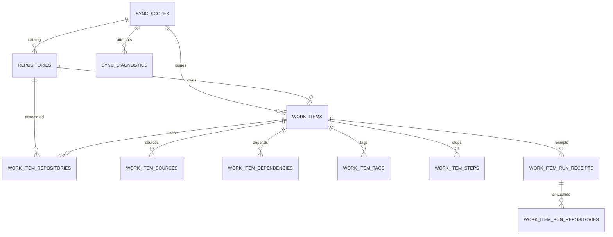
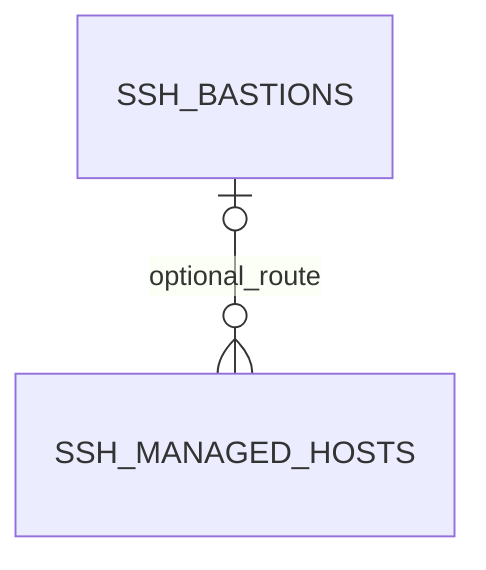

# CLI / Desktop 共享 SQLite 分表设计

日期：2026-10-22。状态：Application、Runtime、CLI 和 Desktop 的 SQLite 接入及旧 JSON/YAML 的显式迁移已在独立 worktree 实现。

已确认：仓库与任务采用关系分表；AFK 管理的 SSH 主机、JumpServer 堡垒机也持久化到 SQLite。两类数据分库，保留现有身份与服务边界。存储实现由 CLI 和 Desktop 复用，默认在同机同用户下共用数据文件。本次交付为设计、DDL 和可运行的结构校验。

## 1. 存储边界

| 数据 | 存储与职责 | 能否通过重新同步恢复 |
| --- | --- | --- |
| Provider 仓库、任务及其关系 | `<storageRoot>/inventory/<namespaceKey>.sqlite`，本地查询投影 | 可以，Provider 是业务事实源 |
| AFK 管理的 SSH 主机、堡垒机配置 | `<storageRoot>/local-config.sqlite`，本机权威配置 | 不可以，必须保留或从备份恢复 |
| 系统 OpenSSH 配置、密钥、信任记录 | 保留现有系统文件与 OpenSSH 解析流程 | 不归数据库同步管理 |
| SSH、JumpServer 认证资料 | 保留现有安全存储服务，SQLite 不存储其内容 | 按现有服务能力恢复或重新输入 |
| 终端会话、连通性、最近测试、实时同步日志 | 保留现有进程内状态 | 重启后重新计算 |
| 执行历史、执行回执的原始记录 | 保留现有事件和工作区记录；库中只存查询投影 | 从原始记录重新投影 |

清空 inventory、退出 Provider 账号、切换 Provider 账号都只影响 inventory。它们不调用 SSH 配置删除流程。两个库之间不建立外键，不要求跨库原子事务。

`namespaceKey` 是已验证的 Provider 身份上下文的 SHA-256：对启用的 Provider 集合按平台、规范化主机、稳定用户 ID 排序并序列化。不能使用 token、显示名称或本地目录作为身份。账号尚未验证时，不打开其他账号的活动库；账号切换后，旧网络请求不能向新上下文发布结果。

`storageRoot` 默认由 Runtime 根据当前系统用户的 home 解析为 `~/.afk/storage/`，允许构造存储模块时显式注入其他根目录，便于测试和隔离配置。CLI 与 Desktop 都调用同一个路径解析函数，不各自推导路径。Electron userData 只作为旧配置的迁移来源。该目录用于用户级 inventory 与 SSH 配置，切换 `AFK_WORKSPACE` 不切换它；工作区执行记录继续使用现有工作区路径。相同根目录、相同 Provider 身份上下文才共享同一 inventory 文件。

## 2. 分层、复用与当前代码落点

### 2.1 包职责

遵循现有 [workspace 架构](../../architecture/overview.md#workspace-organization)，SQLite 实现属于 Runtime 的基础设施层；Application 定义查询与同步所需的存储接口，并通过注入使用；Core 继续只包含纯业务模型和规则。

| 层 | 承担的内容 | 拟议落点 |
| --- | --- | --- |
| `@afk/core` | 已有 WorkItem 身份、状态、关系及领域规则 | 复用现有模型，按真实领域需求补充，不放数据库类型 |
| `@afk/application` | 共享分页输入/结果、持久化查询接口、freshness 与同步发布编排 | 扩展 `src/ports.ts`、`src/provider-inventory.ts`；配置用例按需补充 |
| `@afk/runtime` | SQLite 连接、DDL/迁移、SQL/FTS、事务、路径、旧文件导入、查询结果装配 | `src/infrastructure/storage/`，以 `src/storage.ts` 和 `@afk/runtime/storage` 公开所需能力 |
| CLI | 注入身份和路径，调用共享用例，处理命令参数和输出 | `apps/cli` 的现有命令组合位置 |
| Desktop | 注入身份和平台服务，后台执行、IPC 校验、DTO 转换和界面通知 | `apps/desktop/electron`；renderer 继续通过固定 IPC 方法访问 |

依赖方向：`CLI / Desktop → Application`，两端在组合位置通过 `Runtime` 构造具体存储并注入；`Runtime → Application / Core`；`Application → Core`。Application 不能反向导入 Runtime。SQLite 实现不导入 Electron、Commander 或 Desktop 的 shared DTO。

共享接口围绕仓库分页、任务分页/详情/标题映射、范围发布、主机/堡垒机配置读写定义；SQL、表名、连接和事务对象保持在 Runtime 内部。不增加通用 CRUD/ORM 或独立 storage workspace；复用现有包即可。进程生命周期由宿主负责打开和关闭，业务调用方使用同一套存储接口。

分页与持久配置的规范类型由 Application/Core 按职责拥有，Desktop shared 层只承担线协议校验及平台专属字段。后续需要将现有 Desktop 中可共享的主机配置字段移入共享契约，再让两端引用，避免为 CLI 复制一份类型。

### 2.2 已有实现与接入位置

| 现有位置 | 当前职责 | 后续接入方式 |
| --- | --- | --- |
| `apps/desktop/electron/services/work-item-inventory-store.ts` | 按筛选条件保存整份 JSON | 替换为按实体和关系写入、SQL 查询的存储 |
| `apps/desktop/electron/services/work-item-inventory-service.ts` | 内存缓存、读取持久缓存、远程刷新 | 将可复用查询/同步编排放到 Application；Desktop 保留后台调度和 IPC 通知 |
| `apps/desktop/electron/adapters/work-item-application-adapter.ts` | 调用 Application 获取 Provider inventory | 扩展明确的同步覆盖范围，保留 Application 边界 |
| `apps/desktop/shared/backlog-contract.ts` | 工作项、来源、关联仓库、执行回执 DTO | 保留原 ID、可选字段和数组顺序 |
| `apps/desktop/electron/adapters/ssh-managed-host-store.ts` | 管理主机 YAML、按别名 upsert、稳定 ID | 用配置库替换持久化，保留服务契约 |
| `apps/desktop/electron/adapters/jumpserver-store.ts` | 堡垒机 YAML 与同步元信息 | 用配置库替换持久化 |
| `apps/desktop/electron/adapters/ssh-config-adapter.ts` | 合并系统、AFK 管理、兼容主机来源 | 继续合并，只替换 AFK 管理来源 |
| `apps/desktop/electron/services/ssh-service.ts` | 连接、信任、会话、上传、部署 | 保留现有行为 |
| `apps/desktop/electron/services/jumpserver-service.ts` | 外部 CLI、资产同步、组管理 | 继续编排外部操作，数据库只承担配置事务 |
| 两个现有 `*-credential-service.ts` | 安全存储及连接目标绑定检查 | 保持独立，以原对象 ID 查找 |
| `packages/runtime/src/infrastructure/runtime/resource-registry.ts` | 已有共享 SQLite 资源登记，使用 node:sqlite、WAL、外键和超时 | 沿用加载与连接配置惯例；资源登记保持现有职责和数据库 |
| `packages/runtime/src/infrastructure/tracker/store.ts` | 工作区内项目/issue 与本地路径关联索引 | 保留现有合同；与账号级远端 inventory 分开，后续有需要再明确关联迁移 |

Desktop 的现有 store 可以先用薄适配接入 Runtime，避免把业务 SQL 留在应用层。CLI 直接使用共享包的公开 export；两端都不通过相对路径导入另一个 workspace 的 src，也不由 Desktop 启动 CLI 来读数据库。

SSH 配置元数据的持久化实现共享。Electron safeStorage、系统信任、交互输入、PTY 和终端选择等能力继续由宿主注入或现有平台服务负责。CLI 是否具备相应认证能力必须明确检查；不能为了复用配置而在 Runtime 依赖 Electron，或给 CLI 增加明文认证降级。

## 3. 连接、事务与版本

采用 Runtime 已使用的 `node:sqlite`，复用已有资源登记的加载惯例。存储接口提供异步调用方式：Desktop 在专用线程内构造存储、分别维护两个连接，避免同步 SQL 阻塞主进程；CLI 的短命令可在当前 Node 进程构造相同存储实现，长驻 TUI 按响应性需要使用线程。线程通信属于宿主适配，不复制存储逻辑；网络请求仍由 Application 通过 Provider 接口完成。

CLI 目前声明 Node >=18，不能据此假定原生 SQLite 可用。本方案以已校验的 Node 22.16 和 Desktop Electron 运行时作为接入基线；实现时须同步对齐 engines、开发/CI/发布环境，并在打开模块时提供明确的运行时能力错误。此次设计不修改版本声明，也不引入第二套 SQLite 驱动或 JSON 降级实现。

| 设置 | Inventory | Local config |
| --- | --- | --- |
| `foreign_keys` | 每个连接开启 | 每个连接开启 |
| `journal_mode` | WAL | WAL |
| `synchronous` | NORMAL，可重新构建 | FULL，配置持久性优先 |
| `busy_timeout` | 3000 ms | 3000 ms |
| 表模式 | STRICT | STRICT |
| 版本 | `PRAGMA user_version` | 独立的 `PRAGMA user_version` |

初始化 DDL 是一次性建库脚本，不作为每次启动重复执行的迁移。后续每次升级使用顺序版本迁移，在事务内完成，版本过高时明确报错。元信息单例行由初始化模块写入；发布一批数据时，同一事务内递增该库的 `revision`。两端同时启动时，先获取 SQLite 写锁，再在事务内重读版本并执行所需迁移；不能在锁外检查后假定版本未变。

CLI 与 Desktop 使用各自进程的连接，SQLite 负责同一数据库的写入串行。所有写入使用短事务，网络请求不持有写锁；锁等待超过 busy_timeout 时返回明确的可重试 busy 错误。配置编辑携带读取时的 revision，事务内比较后更新，过期编辑返回冲突，避免两端静默覆盖。

进程内缓存不是跨进程一致性的依据。Desktop 在读取、重新聚焦和现有后台刷新时检查数据库 revision，CLI 查询以已提交数据为准；本进程提交可立即通知自身界面，其他进程提交通过 revision 检查失效缓存。schema 版本迁移要求兼容部署；旧客户端遇到高版本数据库时拒绝打开，不尝试回写。

在支持 POSIX 权限的平台，数据目录使用 0700、数据库和备份使用 0600，连同 WAL/SHM 文件一起纳入权限检查。备份应使用 SQLite 一致性备份能力或关闭连接后的完整备份；不能在活跃 WAL 写入时只复制主文件。

## 4. Inventory 表结构

可执行字段定义、类型、约束、索引见 [inventory DDL](2026-10-22-desktop-sqlite-schema.sql)。共 **13 张业务/元信息表和 2 张 FTS5 虚表**，不计 SQLite 自动生成的内部表。以下 `?` 表示允许 NULL，`position` 从 0 开始。

### 4.1 元信息与同步范围

| 表 | 字段 | 约束与用途 |
| --- | --- | --- |
| `inventory_meta` | `singleton`、`namespace_key`、`namespace_kind`、`revision`、`created_at_ms` | 单例主键为 1；namespace 为 64 字符摘要；kind 为 authenticated / legacy_unverified |
| `sync_scopes` | `id`、`platform`、`host_key`、`scope_kind`、`project_key` | id 为内部整数主键；平台、主机、范围类型、项目构成唯一键 |
| 同上 | `attempt_seq`、`published_seq`、`last_attempt_at_ms?`、`last_success_at_ms?`、`last_status` | 尝试与发布分别计数；published 不超过 attempt；状态为 never/running/success/partial/failed/interrupted |
| `sync_diagnostics` | `id`、`sync_scope_id`、`attempt_seq`、`platform`、`project_key?`、`code`、`message`、`retryable`、`observed_at_ms` | 属于某次同步尝试；随 scope 级联清理；只保存必要诊断，不记录认证资料 |
| `legacy_imports` | `source_key`、`source_sha256`、`imported_at_ms`、`status`、`imported_items`、`rejected_entries` | source_key 主键；记录已完成/拒绝的旧 inventory 导入，防止重复导入 |

`scope_kind=catalog` 的 project_key 为空；`scope_kind=issues` 必须指定原始 project_key。`host_key` 使用 Provider 适配器规范化的主机标识，不能从任务 ID 做未经验证的字符串猜测。

### 4.2 仓库主表 `repositories`

| 字段 | 类型 | 说明 |
| --- | --- | --- |
| `id` | INTEGER PK | 本地关联键，不代替 Provider 项目身份 |
| `platform`、`project_key` | TEXT | 联合唯一，保持当前 ProviderProjectRef 原值 |
| `host_key` | TEXT | 所属规范化 Provider 主机 |
| `provider_host?`、`provider_project_id?` | TEXT | 原始 DTO 的可选 Provider 定位信息 |
| `name`、`default_branch?`、`web_url?` | TEXT | 展示和默认分支信息 |
| `catalog_scope_id` | INTEGER FK | 指向 catalog scope；删除受 RESTRICT 约束 |
| `catalog_listed` | INTEGER 0/1 | 最近完整目录是否仍列出此仓库 |
| `last_listed_seq` | INTEGER | 最近列出该仓库的同步序号 |
| `observed_at_ms` | INTEGER | 本地观测时间 |

任务关联但未在目录中列出的仓库仍允许存在，catalog_listed=0。目录不再返回某仓库时只改变可见标记，不连带删除工作项。现有 GitLab project_key 已包含实例范围，保持原值；以后增加多实例能力时必须首先明确 Provider 身份合同，不能用数据库自增键掩盖项目身份冲突。

### 4.3 任务主表 `work_items`

| 字段 | 类型 | 说明 |
| --- | --- | --- |
| `row_id` | INTEGER PK | FTS rowid 和本地内部键 |
| `id` | TEXT UNIQUE | 原始 WorkItemId，1–160 字符，贯穿查询与执行 |
| `owner_repository_id` | INTEGER FK | 任务所属项目，RESTRICT |
| `issue_number` | INTEGER | 原始 issue 编号，正安全整数 |
| `origin_scope_id` | INTEGER FK | 该项目的 issues scope，RESTRICT |
| `title`、`description?` | TEXT | 标题非空，正文可选 |
| `managed`、`execution_eligible` | INTEGER 0/1 | 保留 DTO 语义，eligible 不能高于 managed |
| `state`、`execution_mode` | TEXT enum | 与 shared DTO 状态/模式枚举一致 |
| `parent_id?` | TEXT | 原始父任务 ID，允许尚未同步的父任务 |
| `branch_name`、`provider_ref`、`web_url?` | TEXT | 保留 DTO 原值 |
| `owner?`、`priority?` | TEXT | 负责人及 P0/P1/P2/P3 |
| `provider_updated_at?` | TEXT | Provider 原始更新时间 |
| `sort_updated_at` | TEXT generated | coalesce(provider_updated_at, '')，分页排序键 |
| `sources_present`、`repositories_present`、`execution_plan_present`、`runs_present` | INTEGER 0/1 | 区分可选数组缺失与显式空数组 |
| `is_present`、`last_seen_seq`、`observed_at_ms` | INTEGER | 范围同步可见性、序号、本地观测时间 |

Provider 更新时间进入排序前须为同一 UTC ISO 格式；不可信时间应报诊断，不能直接把不同时区字符串混排。数据库中的状态是投影，修改业务状态必须仍通过现有 Application/Provider 路径。

### 4.4 任务关系与执行投影

| 表 | 字段 | 键与语义 |
| --- | --- | --- |
| `work_item_sources` | `work_item_id`、`position`、`source_id`、`source_type`、`title`、`reference`、`role?`、`platform?`、`project_key?`、`issue_number?`、`web_url?` | PK=(work_item_id, position)；type 为 github_issue/gitlab_issue/external/local |
| `work_item_repositories` | `work_item_id`、`position`、`repository_id`、`association_id?`、`role?`、`checkout_path?`、`base_branch` | 任务与仓库多对多；关联 ID 与 repository_id 分开；仓库删除 RESTRICT |
| `work_item_dependencies` | `work_item_id`、`position`、`depends_on_id` | 来源任务 FK；依赖目标是可缺失的原始 ID |
| `work_item_tags` | `work_item_id`、`position`、`tag` | 保留标签顺序与重复，不强行建立全局标签实体 |
| `work_item_steps` | `work_item_id`、`position`、`step_id`、`title`、`detail?`、`status?` | 执行计划步骤；可选状态与 DTO 一致 |
| `work_item_run_receipts` | `row_id`、`work_item_id`、`run_id`、`status`、`started_at`、`completed_at?`、`workflow?`、`working_branch?`、`workspace_path?`、`pid?`、`error?`、`repositories_present`、`projection_source`、`observed_at_ms` | row_id 主键；(work_item_id, run_id) 唯一；来源为 inventory/workspace |
| `work_item_run_repositories` | `run_receipt_row_id`、`position`、`platform`、`project_key`、`provider_host?`、`provider_project_id?`、`name`、`checkout_path`、`base_branch`、`role?` | PK=(run_receipt_row_id, position)；执行时的仓库快照，不强制关联当前目录 |

除执行仓库快照外，各子表以 `(work_item_id, position)` 为主键；任务真正移除时其子表 CASCADE。各 position 由写入层连续生成，读取按 position 排序。

presence 标记为 0 时不应存在对应子行；标记为 1 且没有子行表示 `[]`。这一跨表不变量由同一写事务和 DTO 往返测试保证。缺失 sources 的旧条目按 owner project 做平台匹配；显式空 sources 不触发该回退，保持当前筛选语义。

`parent_id` 和 `depends_on_id` 不设置目标外键，因为只同步一部分项目时目标可能不在本地。保留并展示原 ID，不能为了满足外键删除关系。自引用、格式与输入语义仍由现有 DTO 校验处理。

`work_items.id`、`run_id`、`parent_id`、`depends_on_id` 不互相替换；`baseBacklogId` 仍由执行领域决定。当前 GlobalWorkItem 不包含它，不能根据父子/依赖关系推导或伪造这一字段。回执不替代事件历史；workspace 投影不能因一次不含 runs 的远端刷新被抹掉。

回执按 `(work_item_id, run_id)` 合并；相同键以 workspace 来源为准。远端显式提供 runs 时，仅替换该任务的 inventory 来源回执；未提供时保留已有投影。工作区完成一次可信重读后才能替换它自己的回执集合。`runs_present` 表示最终合并 DTO 的字段存在性：有工作区回执时为 1，不能机械复制远端的缺失标记。

### 4.5 关联图



## 5. 查询、索引与搜索

筛选、排序、分页都在数据库执行。列表不加载 description、执行步骤和完整执行回执；详情按任务 ID 查询，只批量装配当前页所需关系，避免每行一个数据库往返。

| 场景 | DDL 索引/策略 |
| --- | --- |
| 默认任务列表 | `idx_items_recent`：(is_present, sort_updated_at DESC, id ASC) |
| 状态、模式、所属项目筛选 | `idx_items_state_recent`、`idx_items_mode_recent`、`idx_items_project_recent` |
| 标签、来源平台、关联仓库筛选 | `idx_tags_lookup`、`idx_sources_project`、`idx_associated_repository`，使用 EXISTS 避免重复任务 |
| 父任务/依赖反查 | `idx_items_parent`、`idx_dependencies_target` |
| 同步标记范围 | `idx_items_scope_seen`、`idx_repositories_catalog` |
| 仓库目录与 Provider 定位 | `idx_repositories_list`、`idx_repositories_provider_id` |
| 执行回执、同步诊断 | `idx_run_receipts_recent`、`idx_diagnostics_scope_attempt` |

默认每页 50，最多 200；使用 `(sort_updated_at DESC, id ASC)` 游标，不用深 OFFSET。继续页的谓词为：

```sql
WHERE is_present = 1
  AND (sort_updated_at < :last_time
       OR (sort_updated_at = :last_time AND id > :last_id))
ORDER BY sort_updated_at DESC, id ASC
LIMIT :page_size_plus_one;
```

以上是无其他筛选条件的示意。游标包含 namespace、revision、排序、筛选摘要和最后一行的两个排序键；服务端验证字段、长度、筛选一致性。同一读事务读取 revision 和页面；revision 改变后返回 `CURSOR_EXPIRED`，客户端重新读取首页。空更新时间按空串排在后面。

`work_item_search` 和 `repository_search` 各有一个 `search_text` 列，使用 FTS5 trigram；rowid 分别对应 work_items.row_id、repositories.id。工作项搜索文本由 ID、标题、正文、所属项目和标签组成；仓库由项目键和名称组成。各字段分别做 NFC、固定规则大小写规范化，不做语义分词。

长度至少 3 个 Unicode 码点的查询，用 FTS 的双引号短语（内部引号加倍）匹配候选，再对原字段规范化副本做 `instr` 精确子串过滤，避免字段拼接、大小写折叠等造成误匹配。长度为 1–2 的查询直接在已按权限/平台/项目等约束的候选集执行 instr；这类查询仍可能扫描大量候选，首次实现接受该上限，需根据真实数据延迟再优化。空串不进入搜索路径。

MATCH 参数也必须绑定，输入不能作为 FTS 操作符执行；引号、冒号、百分号、下划线按普通字符处理。FTS 与主表/标签在同一写事务更新；现有 DDL 只提供删除触发器，插入和更新搜索文本是适配器的明确职责，不能以为已有自动同步。FTS 损坏可从主表重建。

拟议固定 IPC 方法：

| 方法 | 参数 | 返回 |
| --- | --- | --- |
| `repositories.query` | platform、搜索、limit、cursor | 当前页、nextCursor、revision、freshness |
| `workItems.query` | 当前筛选、搜索、limit、cursor | 精简列表、nextCursor、revision、freshness、诊断摘要 |
| `workItems.get` | workItemId | 详情、关系、同步状态 |
| `workItems.titles` | 有界 ID 数组 | ID 到标题映射，未同步 ID 明确标记 |
| `inventory.sync` | 平台或项目范围 | 同步尝试与覆盖结果，不返回全量库存 |

这些是待实现的查询契约；已有接口不能在未迁移调用方前直接移除。分页和筛选变更要更新 shared/preload/IPC/renderer 的固定白名单，不提供任意 SQL 通道。

## 6. 同步与一致性

读取优先返回本地投影及 freshness。Desktop 沿用目前 5 分钟后台刷新，CLI 的一次性查询遵循当前命令的刷新语义，并共用同一同步用例；持久化改造不能悄悄改变现有命令的远端读取合同。相同进程、相同范围复用正在执行的请求，不为每组 UI 筛选重复请求 Provider。

跨进程的 attempt_seq 必须在数据库写事务内递增并返回，本次请求持有该序号，发布时再次比较。新尝试开始后，旧尝试的成功、失败和清理回调都不能覆盖新状态。两端偶尔重复拉取可以接受；首版不增加数据库租约或守护进程。某进程退出不能直接把所有 running scope 标为 interrupted，因为另一个进程可能仍在同步；只允许持有当前 attempt 的操作发布其取消结果。

远端请求和 DTO 校验在事务之外完成。发布时在短写事务内检查 namespace 与 attempt，更新实体、替换该次确实提供的子集合、更新搜索、保存诊断与 scope，再递增 revision。提交后才通知 renderer。

| 覆盖结果 | 发布规则 |
| --- | --- |
| 完整 catalog | upsert 返回仓库，按 scope 更新 last_listed_seq；同 scope 未出现仓库设 catalog_listed=0 |
| 完整某项目 issues | upsert 返回任务和关系，按 scope 更新 last_seen_seq；同 scope 未出现任务设 is_present=0 |
| 部分成功 | 只 upsert 已验证返回的数据，不把缺失对象标成消失，保留最近成功时间，状态 partial |
| 失败或被中断 | 保留上次可见数据，记录 failed/interrupted，不伪造空库存或更新成功时间 |

当前 Application 结果只有全局 complete 和 diagnostics。后续必须补充每个 catalog / issues scope 的覆盖结果；在扩展完成之前，只允许全局 complete=true 时执行缺失标记，其他情况保守 upsert。用户筛选得到的 ready/tag/project 子集不能被当成全项目同步结果。

任务同步必须校验 owner repository、origin scope 的平台/项目/主机一致；SQL FK 只保证存在，不能代替该语义验证。关系替换、回执来源合并都必须遵循已有 DTO 字段是否实际提供，不能把可选缺失当作删除指令。

## 7. Inventory 旧缓存与恢复

旧 JSON 按 options 存放重复快照，且没有可信账号归属。原文件保留；有需要时导入 namespace_kind=legacy_unverified 的隔离库，仅供恢复诊断，不能作为当前登录身份的活动缓存。新身份需要完整同步后发布其可信投影。

导入先验证版本、DTO、摘要和冲突；不同 options 的同一 ID 不做无依据的最后写入覆盖，存在冲突时隔离并报告。完成记录与导入行同事务提交，重复启动不重复导入。损坏、权限错误和版本不兼容应区分报错，不沿用旧实现捕获所有异常后返回空对象的行为。

Inventory 数据损坏时可以保留问题副本并重新同步，但重建期间必须展示“本地数据不可用/正在同步”。无法联网不等于没有仓库或任务。重建不接触配置库。

## 8. SSH 配置分表

可执行定义见 [local config DDL](2026-10-22-desktop-local-config-schema.sql)。共 **4 张表**，此库不按 Provider 账号分片。

### 8.1 `local_config_meta`

| 字段 | 类型/约束 | 用途 |
| --- | --- | --- |
| `singleton` | INTEGER PK，必须为 1 | 单例 |
| `revision` | INTEGER，默认 0，非负 | 每次配置事务提交时递增，失效列表缓存 |
| `created_at_ms` | INTEGER，非负 | 数据库初始化时间 |

### 8.2 `ssh_bastions`

| 字段 | 类型/约束 | 用途 |
| --- | --- | --- |
| `id` | TEXT PK，managed: 前缀 | 保留现有堡垒机 ID |
| `alias` | TEXT NOT NULL UNIQUE | 原配置别名，按现有大小写规则比较 |
| `hostname`、`username` | 非空 TEXT | 实际连接地址、用户 |
| `port` | INTEGER，1–65535 | 实际连接端口 |
| `jms_server_alias` | 非空 TEXT | 外部 jms CLI 的服务条目标识，区别于本地 alias |
| `linux_only` | INTEGER 0/1 | syncFilter.linuxOnly |
| `last_synced_at?` | TEXT | 原 lastSyncedAt |
| `last_sync_asset_count?`、`last_sync_skipped_count?` | 非负 INTEGER | 最近同步计数 |
| `created_at_ms`、`updated_at_ms` | 非负 INTEGER，updated >= created | 本地配置时间，不代替资产同步时间 |

### 8.3 `ssh_managed_hosts`

| 字段 | 类型/约束 | 用途 |
| --- | --- | --- |
| `id` | TEXT PK，managed: 前缀 | 保留现有主机 ID，不因改名重建 |
| `alias` | TEXT NOT NULL UNIQUE | 对应现有按别名 upsert 语义 |
| `hostname` | 非空 TEXT | 实际目标 |
| `port` | INTEGER，默认 22，1–65535 | 实际端口 |
| `username?` | TEXT | 保留未指定用户的语义 |
| `identity_file?` | TEXT | 文件路径引用，不存储文件内容 |
| `remote_workspace?` | TEXT | 远端默认工作目录 |
| `legacy_proxy_jump?` | TEXT | 无损保留现有 proxyJump 字段 |
| `jump_host_type?` | NULL / openssh / jumpserver | 数据库 NULL 对应 DTO none/未设置 |
| `jump_host_reference?` | TEXT | 原 jumpHost 别名，不替换成数据库 ID |
| `bastion_id?` | TEXT FK，ON DELETE RESTRICT | 可解析的本地 JumpServer 关联 |
| `created_at_ms`、`updated_at_ms` | INTEGER，updated >= created | 本地创建/修改时间 |

不对 `(hostname, port, username)` 建唯一约束：不同别名可以访问同一目标。目标索引用于查找和诊断，不自动合并对象。alias、hostname、路径等仍先通过现有输入边界校验；SQL 非空和端口检查只是最后一道约束。

### 8.4 `local_config_imports`

| 字段 | 类型/约束 | 用途 |
| --- | --- | --- |
| `source_key` | TEXT PK | 来源类型与规范化路径组成的稳定键 |
| `source_sha256` | TEXT，64 字符 | 导入时的内容摘要，不保存原文副本 |
| `imported_at_ms` | INTEGER，非负 | 成功导入时间 |
| `imported_hosts`、`imported_bastions`、`diagnostic_count` | INTEGER，非负 | 数量与诊断计数 |

此表只记录已提交的导入；失败诊断通过现有日志/结果返回，不能先写“导入完成”。首次导入创建时间统一采用导入时刻，保留旧同步时间，不能推测不存在的历史创建时间。

### 8.5 连接路线与关联关系



| 场景 | jump_host_type | jump_host_reference | bastion_id |
| --- | --- | --- | --- |
| 普通直连/未设置结构化跳板 | NULL | NULL | NULL |
| OpenSSH 跳板 | openssh | 原 OpenSSH alias，必填 | NULL |
| 已解析 JumpServer | jumpserver | 原堡垒机 alias，必填 | 已有 ssh_bastions.id |
| 无法解析的旧 JumpServer 引用 | jumpserver | 原引用，必填 | NULL，返回诊断 |

OpenSSH alias 可以来自系统配置，属于外部软引用；不能强制要求它存在于 ssh_managed_hosts。JumpServer FK 为空不代表直连，不得悄悄选另一个堡垒机；连接前按现有服务验证并明确提示引用不可用。

解析时还要验证 bastion_id 对应的 alias 与原引用一致。堡垒机改名需要同一事务更新已绑定主机的引用；对仅有字符串引用的旧配置，先明确匹配再关联，不猜测。legacy_proxy_jump 保留原值，结构化路线仍按现有 ssh-service 分支解释，不能在迁移中改变优先级。

索引为 `(hostname, port, username)`、`bastion_id`、`(jump_host_type, jump_host_reference)`，alias 使用唯一索引。不增加连接状态、hasPassword、会话、指纹或通用配置键值表。

普通删除堡垒机受 RESTRICT 保护。现有“删除堡垒机及其资产”的明确组操作，可以在一个配置事务中先处理同一 JumpServer 引用下的主机，再处理堡垒机；不能波及同名 OpenSSH 引用或其他主机。外部 jms 操作与安全存储操作不在 SQLite 事务内，失败时应返回已完成/未完成步骤并允许重试，不能报告整体成功。

## 9. SSH 导入、兼容与恢复

迁移输入仅为现有 AFK 管理主机文件和 AFK 堡垒机文件。系统 OpenSSH 配置和兼容来源继续按现有适配器合并，不作为 AFK 管理行导入；保留现有来源优先级与去重规则。

1. 使用现有解析、验证规则读入配置；预检重复 ID、同表重复 alias、无效目标以及跳板引用，生成明确诊断。身份冲突导致本次导入失败，不静默覆盖或重新分配 ID。
2. 保留全部原 managed ID、别名、端口、用户、路径、proxyJump、结构化跳板、同步筛选与计数。外部引用无法解析时保留字符串，附诊断；不能捏造关联。
3. 认证资料保持现有安全服务负责。旧配置若含认证字段，只能通过现有安全服务确认保留，不能复制进 SQLite；服务不可用时不标记迁移完成。仅会话内存可用不满足持久迁移成功条件。
4. 在单个 local-config 事务内写入堡垒机、主机、各来源导入记录并递增 revision。全部提交后切换读取来源；任一步失败都保持旧配置可用。外部服务与数据库无法做分布式事务，重试必须幂等。
5. 保留旧文件作为恢复来源；应用完成切换后只写配置库。已有成功导入记录时，不因为旧文件的摘要变化自动再次导入，否则会复活已移除的配置。显式恢复作为单独操作处理。

原对象 ID 本身就是现有安全存储的查找引用，因此不增加 credential_id 表。稳定 ID 不代表认证可跨目标复用：hostname、port 或 user 改变后，继续执行现有服务的目标绑定检查，不允许只凭 ID 绕过检查。

数据库来源的 SshHost 仍使用 managed 来源标记；configPath 的展示变化必须与现有 ssh-service 分类逻辑一起测试，避免误判为兼容文件来源。OpenSSH 实际参数、信任校验、PTY、上传和部署继续由现有服务处理。

配置库读取失败、损坏或版本不支持时，返回明确错误并保留现场；不能自动初始化空库覆盖配置。恢复采用已验证的一致性备份。配置备份不包含安全服务管理的认证内容，恢复后可能需要重新输入认证资料。

## 10. 实施顺序与验收

实施顺序已完成 Application 契约、Runtime 存储、Provider 身份解析、CLI inventory 发布、Desktop inventory 缓存、Desktop SSH 配置接入以及旧 JSON/YAML 的一次性迁移。旧 JSON/YAML 仍保留为恢复来源；迁移标记与配置事务在导入入口内完成，防止同时启动时重复导入。每阶段都要求原始身份不变、可回退且故障可见。

DDL 的最小可运行检查见 [schema check](2026-10-22-desktop-sqlite-schema.check.mjs)：

```sh
node docs/superpowers/specs/2026-10-22-desktop-sqlite-schema.check.mjs
ELECTRON_RUN_AS_NODE=1 "$(node -p 'require("./apps/desktop/node_modules/electron")')" docs/superpowers/specs/2026-10-22-desktop-sqlite-schema.check.mjs
pnpm docs:check
git diff --check
```

该检查只创建内存库、使用虚构数据，不读取真实用户配置。它验证字段/关系约束、FTS、事务回滚和两库隔离；Runtime、CLI 和 Desktop 的适配器测试另外覆盖发布、往返读写和旧文件迁移。

后续实现必须增加的行为验收：

- 当前 GlobalWorkItem 全字段往返，包含缺失/空数组、顺序、外部来源、依赖目标缺失、多仓库和执行回执来源合并。
- catalog/项目级完整、部分、失败和中断同步；过期 attempt、账号切换、事务失败不能误隐藏数据或跨账号发布。
- 中文、短搜索、特殊字符、无更新时间、相同更新时间和跨 revision 游标；EXPLAIN QUERY PLAN 检查核心列表索引，真实规模数据测量 P95 延迟及主进程响应。
- inventory 导入身份不明、内容冲突、损坏和断电回滚；配置库不受 inventory 重建影响。
- SSH 全字段导入、稳定 ID、别名冲突、三种连接路线、未解析引用、组删除范围、认证目标绑定、外部步骤部分失败与恢复。
- CLI 与 Desktop 使用相同根目录的往返读写；不同身份隔离；并发迁移、导入、写锁超时、过期配置 revision、跨进程缓存失效和过期同步发布；测试必须使用两个独立进程和临时文件库。
- CLI 支持的最低 Node 版本与打包后的 Electron 分别执行 SQLite/FTS 校验，不能仅验证本机高版本 Node。
- 每个实际修改的 workspace 独立运行 typecheck/build/test，并验证打包后的 Electron 连接与权限行为。
