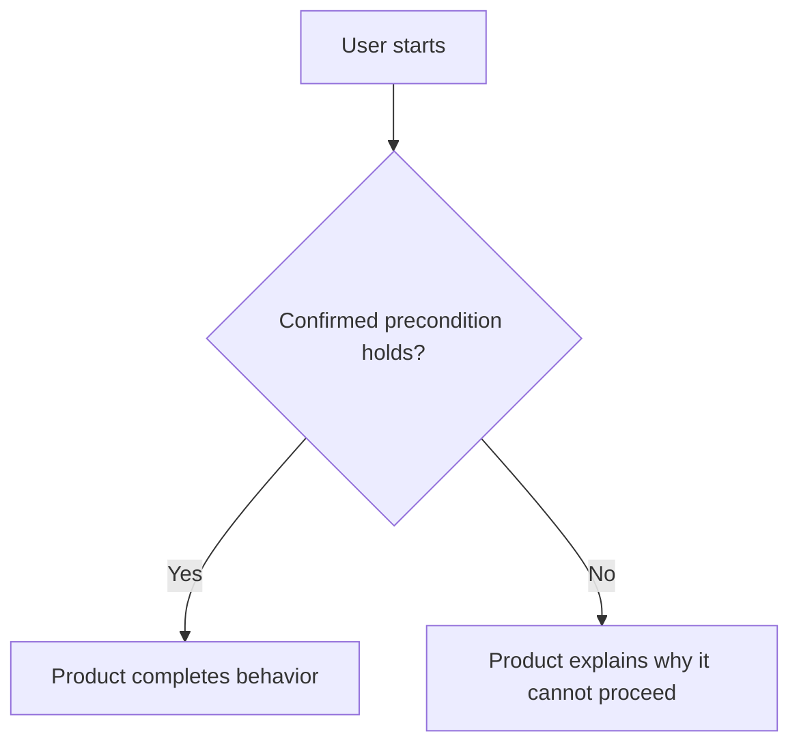
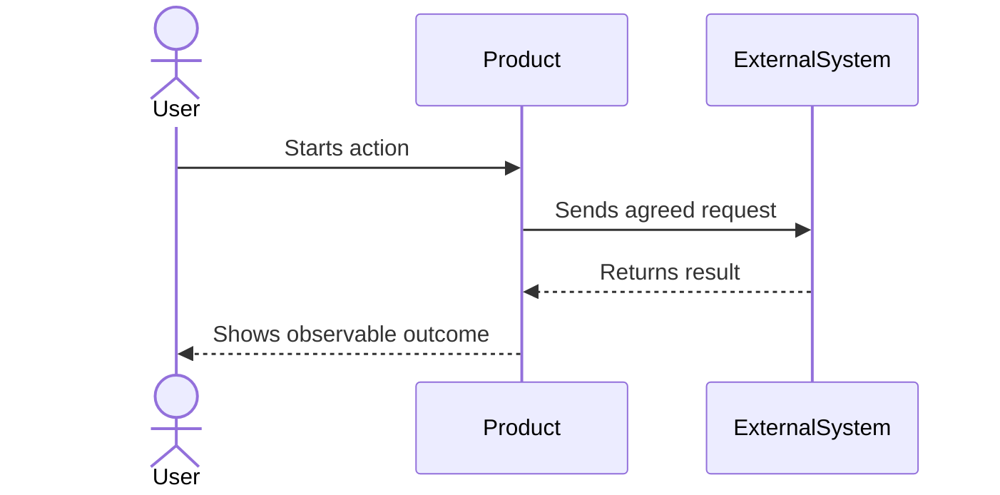
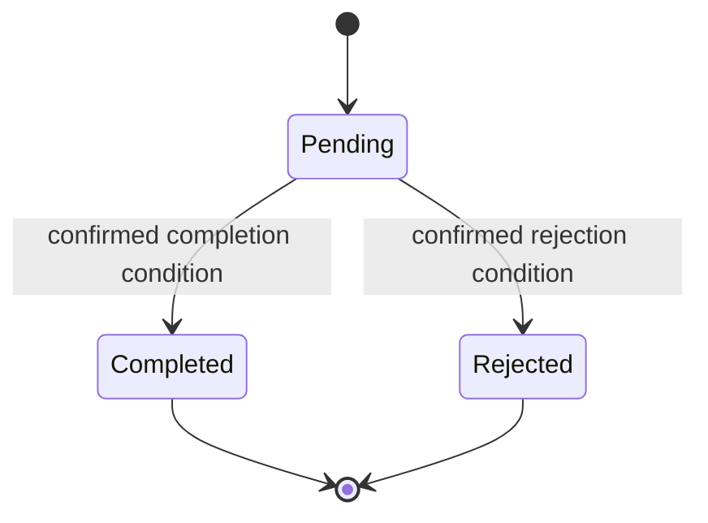

# Diagram Guidelines for AI-Ready PRDs

Use Mermaid source as the canonical diagram representation when a diagram
materially reduces ambiguity. Diagrams are optional; do not add them merely to
fill a section.

## Diagram Selection

| Need | Diagram | ID prefix |
|---|---|---|
| User or business path | `flowchart` | `FLOW-###` |
| Cross-boundary product interaction | `sequenceDiagram` | `SEQ-###` |
| Product-visible lifecycle | `stateDiagram-v2` | `STATE-###` |
| Complex branching business rule | `flowchart` decision tree | `RULE-###` |

## Rules

- Give every diagram a stable ID, a concise purpose, and links to related
  requirement or acceptance-criteria IDs.
- Use the same actor, domain term, and state names as the PRD tables.
- Label branches with explicit product or business conditions.
- Include material permission, cancellation, failure, and retry outcomes only
  when they affect confirmed product behavior.
- Keep diagrams at the user/product/external-contract boundary. Do not diagram
  internal function calls, modules, services, databases, or broker topology.
- Do not introduce a technical component, API, event, or data store unless it
  is part of a confirmed external product contract or explicit organizational
  constraint. Otherwise defer it to technical design.
- If a diagram conflicts with the PRD text, return to clarification and resolve
  the product behavior before approval. Do not leave an open risk in a
  published PRD.

## Flowcharts

Use flowcharts for user-visible and business-process steps. Every path should
have a meaningful end state or explicitly lead to a user-visible waiting state.

## Sequence Diagrams

Use sequence diagrams only for interactions across product or external-system
boundaries. Show request/response meaning and asynchronous behavior, not
internal method calls.

## State Diagrams

Use state diagrams when an entity has a meaningful product lifecycle. Define
initial and terminal states, allowed transitions, and prohibited transitions
in a nearby table or concise text. Do not model internal execution states that
are irrelevant to users or external consumers.

